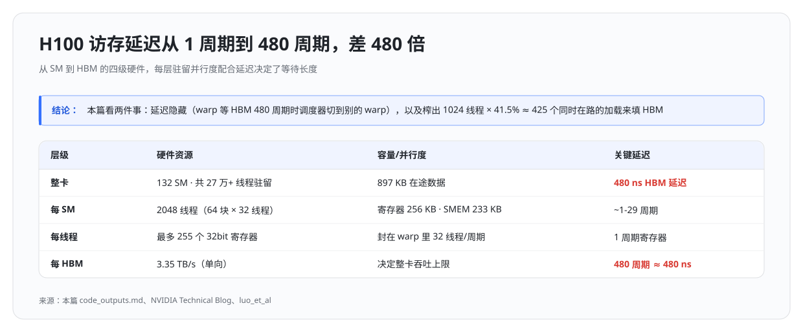
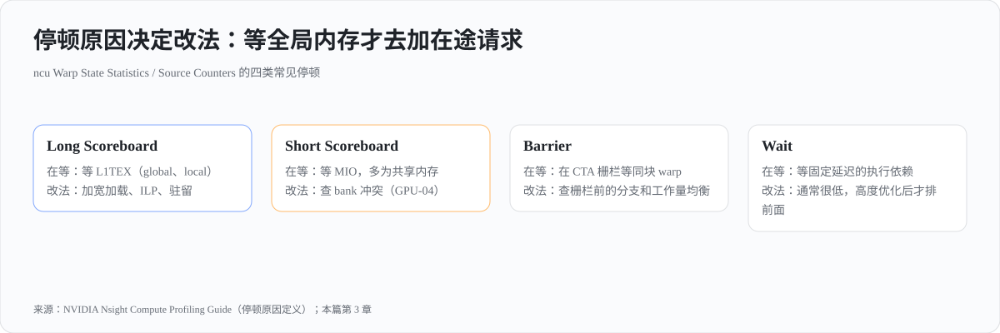
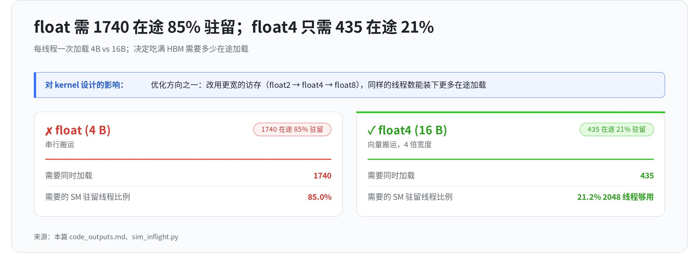
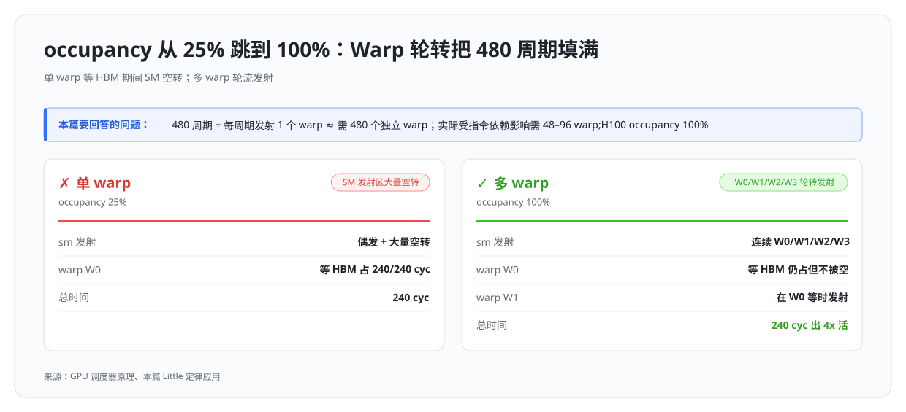
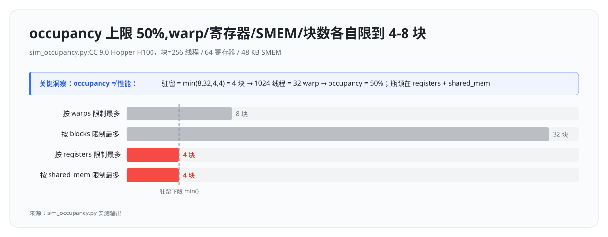
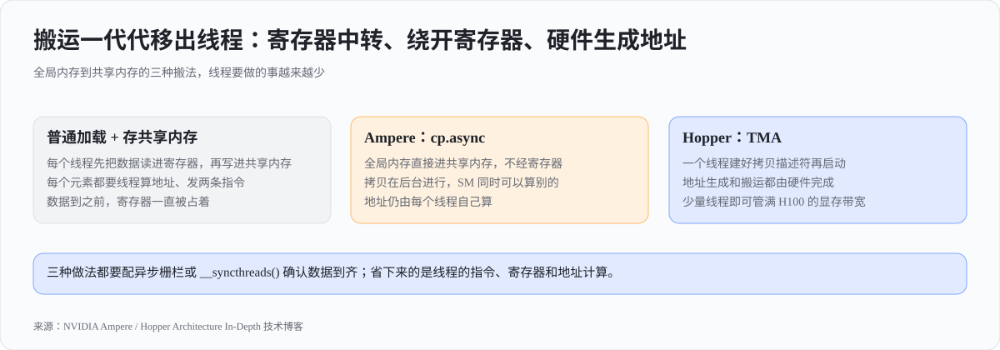
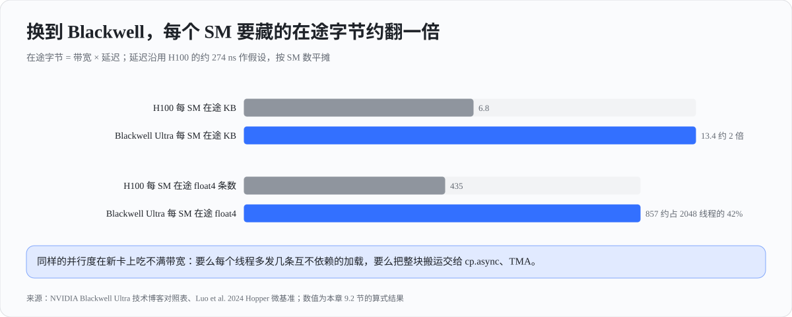

# GPU-01｜硬件｜GPU 架构：SM、存储层级与延迟隐藏

> 🎯 **这篇文档解决什么问题**：写 kernel、调训练、查推理吞吐，最后都要回答同一个问题：这张卡的时间花在哪了。答案取决于三件事：芯片上有多少个 SM 在干活，数据从哪一级存储来、要等多久，等数据的那几百个周期有没有被别的工作填上。本篇从 GPC、TPC、SM 的层级讲到 warp 调度、寄存器、共享内存、L2 和 HBM，再讲延迟隐藏和 occupancy 的算法，最后讲 Hopper 和 Blackwell 新加的 TMA 和 Tensor Memory。读完应当能拿到一张没见过的卡，写出它的资源上限和每 SM 要藏的在途字节，算出一个 kernel 的 occupancy，并判断它该往哪个方向改。
>
> **使用方式**：第 1 到 3 章是骨架（等待有多长、SM 能驻留多少、调度器怎样挑 warp），第 4 到 8 章是全篇重点，建议对着 sim_occupancy.py 和 sim_inflight.py 边算边读；第 9 章讲换到 Blackwell 后哪些数字要重算，第 10 章是核对清单。五步闭环在本篇的用法：定天花板（资源上限、Little 定律），测实际（ncu 的 DRAM 吞吐和停顿原因），定位等待（等全局内存、共享内存还是栅栏），消除或隐藏（加驻留、加宽加载、加 ILP、异步拷贝），复测（波次和换卡重算）。
>
> **代码**：zero-to-gpu/01-arch/ 下有 sim_occupancy.py（occupancy 计算器）、sim_inflight.py（在途字节估算）、sim_wave.py（波次利用率）、gpu_props.py（硬件参数查询）、test_occupancy.py，以及三个需要真实 GPU 的 CUDA 微基准（带宽、occupancy、P-chase 延迟）。以 sim_ 开头的只需 Python 标准库。

<b>🧭 主线位置</b>：GPU-00（[GPU-00｜索引｜从 0 开始 GPU 优化：路线、章节与练习](./README.md)）给出全系列的时间账和五层等待；本篇处理第一层：**线程等访存延迟**（时间账的 W_mem 项）。具体场景是 SM 上驻留的 warp 或线程内的独立指令不够，访存延迟藏不住，SM 的发射槽空过。读完本篇，下一步是 GPU-02（[GPU-02｜硬件｜性能账本：Roofline、算术强度与三类瓶颈](./02-ledger.md)）：用 Roofline 和算术强度判断一个 kernel 的等待落在算力、带宽还是固定开销上。

## 导读 · 先给结论

- <b>一次全局内存加载约 480 个周期。</b>H800 上的微基准测得全局内存约 478.8 个周期、L2 约 263.0、共享内存约 29.0[[1]](https://arxiv.org/abs/2402.13499)。线程拿到数据前什么也做不了，这段等待要靠别的线程或别的指令填上。
- <b>在途字节 = 带宽 × 延迟。</b>按 Little 定律，H100 SXM 吃满 3.35 TB/s[[2]](https://www.nvidia.com/en-us/data-center/h100/)，整卡约 897 KB、每 SM 约 6.8 KB 要同时在路上。每线程读 float 时要 85% 的线程同时挂着加载，读 float4 只要 21.2%（sim_inflight.py）。
- <b>SM 是资源账的单位。</b>H100 SXM5 有 132 个 SM[[3]](https://developer.nvidia.com/blog/nvidia-hopper-architecture-in-depth/)，每个 SM 最多 64 个 warp、32 个块、64K 个寄存器、228 KB 共享内存[[4]](https://docs.nvidia.com/cuda/cuda-programming-guide/05-appendices/compute-capabilities.html)，驻留数取四者的最小值。
- <b>Occupancy 只是手段。</b>Volkov 展示过 CUBLAS 2.0 把占用率从 67% 降到 33%，性能从 128 Gflop/s 升到 204 Gflop/s，靠的是每个线程多做几件互不依赖的事[[5]](https://www.nvidia.com/content/gtc-2010/pdfs/2238_gtc2010.pdf)。要看的是在途请求够不够。
- <b>先定位再动手。</b>ncu 的停顿原因区分等全局内存（Long Scoreboard）、等共享内存（Short Scoreboard）和等栅栏（Barrier），每一类的改法不同[[6]](https://docs.nvidia.com/nsight-compute/ProfilingGuide/index.html)。
- <b>块数要凑整波。</b>线程块数凑不满 SM 的整数倍，最后一波就有 SM 空转；A100 上矩阵 N 从 1536 改到 1544，耗时接近翻倍[[7]](https://docs.nvidia.com/deeplearning/performance/dl-performance-matrix-multiplication/index.html)。
- <b>换卡要重算。</b>Blackwell 的带宽到 8 TB/s，每 SM 要藏的在途字节约翻一倍；硬件也在把搬运从线程手里拿走（cp.async、TMA、Tensor Memory），第 7、9 章展开。



<b>📎 与系列其他文档的分工</b>：GPU-00（[GPU-00｜索引｜从 0 开始 GPU 优化：路线、章节与练习](./README.md)）给出全系列的时间账，本篇从硬件层切入，定义 SM、驻留和在途字节这几个最基础的量。GPU-02（[GPU-02｜硬件｜性能账本：Roofline、算术强度与三类瓶颈](./02-ledger.md)）用 Roofline 把时间账转成峰值对标。GPU-03（[GPU-03｜硬件｜CUDA 编程模型：线程层级、stream 与编译链](./03-cuda.md)）讲 stream、event 和异步拷贝怎样让主机和设备并行。GPU-04（[GPU-04｜硬件｜访存与归约：合并访存、共享内存与 warp 归约](./04-memory.md)）到 GPU-08 逐步优化内核，本篇的 occupancy 计算器和在途字节估算是这些篇的工具。

## 第 1 章 · 线程在等什么：延迟、带宽与在途字节

GPU 上一条全局内存加载要等几百个周期才拿到数据。本章先把这段等待量化出来，再用 Little 定律算出要吃满显存带宽、整张卡需要同时挂着多少请求，最后说明 GPU 靠什么把这段等待藏起来。后面各章讲的架构、调度和 occupancy 算法，都在回答本章提出的问题。

### 一次加载要等多久

Luo 等人用 P-chase 微基准在 H800 上测了各级存储的访问延迟：共享内存约 29.0 个周期，L1 约 40.7，L2 约 263.0，全局内存约 478.8[[1]](https://arxiv.org/abs/2402.13499)。H800 和 H100 同属 Hopper 架构，本系列在没有 H100 SXM 公开测量时沿用这组数，全局内存记作约 480 个周期。

| 存储层级 | H800 实测延迟（周期） | 对 kernel 的含义 |
|---|---|---|
| 共享内存 | 29.0 | 块内复用数据的落脚点（第 4 章） |
| L1 | 40.7 | 与共享内存同在一块片上存储里 |
| L2 | 263.0 | 全卡共享，命中也要等两百多个周期 |
| 全局内存（HBM） | 478.8 | 本篇要藏的主要等待 |

这张表说明两件事。其一，就算数据在 L2 命中，也要等两百多个周期，片上和片外的分界其实在 L1 之后。其二，一个线程发出加载后如果紧接着就要用这个值，它要原地等近 480 个周期，这段时间里这个线程什么也做不了。

### Little 定律：要有多少数据同时在路上

排队论里的 Little 定律说，稳态下系统里的平均在途量等于到达率乘以停留时间。套到显存上：要让 HBM 持续跑满，同时在路上的字节数至少要等于带宽乘以延迟。H100 SXM 的 HBM 带宽是 3.35 TB/s[[2]](https://www.nvidia.com/en-us/data-center/h100/)。本篇配套的 sim_inflight.py 把 480 个周期折算成约 274 ns，算出整卡要有约 897 KB 同时在路上，摊到 132 个 SM，每个 SM 约 6.8 KB。

这 6.8 KB 要靠线程发出的加载请求凑出来。每个线程一次读多宽，决定了要多少条请求（sim_inflight.py 输出）：

- 一次读 4 字节（float）：每个 SM 要约 1740 条加载同时在路上，占 2048 个线程上限的 85.0%。
- 一次读 8 字节（float2）：约 870 条，占 42.5%。
- 一次读 16 字节（float4）：约 435 条，占 21.2%。折成 warp，435 ÷ 32 ≈ 13.6 个，占每 SM 64 个 warp 槽的 21.2%。

这组数假设每个线程同一时刻只有一条加载在路上。读 float 时，几乎要让 SM 上每个线程都挂着一条加载，才勉强填满带宽；换成 float4，同样的在途字节只要四分之一数量的线程。另一条路是让每个线程连发几条互不依赖的加载，在途请求数按条数翻倍。


### GPU 怎样把等待藏起来

CPU 靠大缓存、乱序执行和分支预测缩短单个线程的等待。GPU 不缩短等待，而是在等待期间换别的线程干活。H100 SXM 有 132 个 SM[[3]](https://developer.nvidia.com/blog/nvidia-hopper-architecture-in-depth/)，每个 SM 最多驻留 64 个 warp、2048 个线程[[4]](https://docs.nvidia.com/cuda/cuda-programming-guide/05-appendices/compute-capabilities.html)，整卡最多 132 × 2048 = 270336 个线程同时驻留。只要每个周期都有 warp 手里有不依赖未到数据的指令，SM 的发射槽就不会空着，单个线程的 480 个周期就被别的线程填上了。

能藏住等待的并行度有两个来源。线程级并行（TLP）是驻留更多 warp，代价是每个线程分到的寄存器和共享内存变少，第 5 章算这笔账。指令级并行（ILP）是让一个线程手里同时有几条互不依赖的指令，例如连发几条加载再统一使用。Volkov 在 GTC 2010 的报告里指出，每个线程能同时推进 3 个独立操作时，8% 的占用率就够填满流水线；CUBLAS 从 1.1 到 2.0，占用率从 67% 降到 33%，在 G80 上的性能反而从 128 Gflop/s 升到 204 Gflop/s[[5]](https://www.nvidia.com/content/gtc-2010/pdfs/2238_gtc2010.pdf)。occupancy 只是手段之一，真正要看的是在途请求够不够。

### 本篇怎样用五步闭环处理这段等待

按系列的时间账 T = T_compute + W_mem + W_host + W_comm + W_idle，本篇处理 W_mem 里“线程等访存延迟”这一项。五步闭环在本篇的落点如下：

1. 定天花板：读出卡的 SM 数、驻留上限和带宽，用 Little 定律算每 SM 要多少在途字节（第 2、5 章）。
2. 测实际：用 ncu 看 DRAM 吞吐和 warp 停顿原因（第 3、5 章）。
3. 定位等待：停顿主要落在等全局内存、等共享内存还是等栅栏（第 3、4 章）。
4. 消除或隐藏：提高驻留 warp、加宽单次加载、增加 ILP，或把搬运交给异步拷贝（第 6、7 章）。
5. 复测：看在途字节够不够、波次有没有浪费（第 8 章），换卡时重算（第 9 章）。

> 💡 **常见误区**：把 occupancy 当作要最大化的目标。现象是为了提高 occupancy 拆小线程块、压寄存器，结果反而变慢。原因是延迟靠在途请求来藏，TLP 和 ILP 都能提供；压寄存器可能让每个线程能同时发出的独立加载变少。改法是先用 Little 定律算出每 SM 需要的在途请求数，再比较加 warp 和加 ILP 哪个更便宜。

> 🔑 **本章要点**：Hopper 上一次全局内存加载约 480 个周期。按 Little 定律，H100 SXM 要吃满 3.35 TB/s，整卡约 897 KB、每 SM 约 6.8 KB 要同时在路上；读 float 时 85% 的线程都得挂着加载，读 float4 只要 21.2%。GPU 靠驻留 warp（TLP）和线程内独立指令（ILP）把这段等待填上，occupancy 只是其中一种手段。

## 第 2 章 · 吞吐机器的架构：GPC、TPC、SM

第 1 章算出每个 SM 要有约 6.8 KB 数据同时在路上。这些请求由驻留在 SM 上的线程发出，而一个 SM 能驻留多少线程，由它的硬件资源决定。本章从芯片层级讲到 SM 内部，列出决定驻留数的四个上限，并用一个例子演示怎样取最小值。

### 从芯片到 SM

完整的 GH100 芯片有 8 个 GPC、72 个 TPC（每个 GPC 9 个）、每个 TPC 2 个 SM，共 144 个 SM，配 60 MB L2[[3]](https://developer.nvidia.com/blog/nvidia-hopper-architecture-in-depth/)。出货的 H100 SXM5 屏蔽了一部分：8 个 GPC、66 个 TPC、132 个 SM，50 MB L2，80 GB HBM3（5 个堆栈、10 个 512 位内存控制器）[[3]](https://developer.nvidia.com/blog/nvidia-hopper-architecture-in-depth/)。A100 有 108 个 SM，H100 SXM5 多出 22%[[3]](https://developer.nvidia.com/blog/nvidia-hopper-architecture-in-depth/)。

对写 kernel 的人来说，GPC 和 TPC 主要是物理分组；编程模型里能直接控制的单位是线程块，而一个线程块必须整块落在一个 SM 上运行。所以资源账按 SM 算：块能不能放下、放几个，看的是单个 SM 的寄存器、共享内存和 warp 槽位。L2 和 HBM 是全卡共享的，所有 SM 的请求最后都汇到这里。

### SM 里有什么

H100 的每个 SM 有 128 个 FP32 CUDA core、4 个第四代 Tensor Core，以及 256 KB 的片上存储，由 L1 数据缓存和共享内存合用[[3]](https://developer.nvidia.com/blog/nvidia-hopper-architecture-in-depth/)。寄存器文件是另一块独立存储：每个 SM 有 64K 个 32 位寄存器，即 256 KB[[4]](https://docs.nvidia.com/cuda/cuda-programming-guide/05-appendices/compute-capabilities.html)。第 3 章会讲，SM 内部再分成四个分区，每个分区有自己的 warp 调度器。

同一个 SM 上的所有驻留 warp 共用这些资源。寄存器和共享内存在线程块启动时一次分配，块运行结束才释放；运行期间不会按需伸缩。这就是为什么 kernel 的寄存器用量和共享内存用量会直接决定驻留数。

### 决定驻留数的四个上限

compute capability 9.0（Hopper）的每 SM 上限如下[[4]](https://docs.nvidia.com/cuda/cuda-programming-guide/05-appendices/compute-capabilities.html)：

| 资源 | CC 9.0 上限 | 由 kernel 的哪个参数消耗 |
|---|---|---|
| 驻留 warp 数 / SM | 64（2048 线程） | 每块线程数 |
| 驻留块数 / SM | 32 | 每块一个 |
| 32 位寄存器 / SM | 64K（每线程最多 255 个） | 每线程寄存器数 × 每块线程数 |
| 共享内存 / SM | 228 KB（每块最多 227 KB） | 每块静态加动态共享内存 |

驻留块数取四个上限算出的最小值，再乘以每块 warp 数，就是理论驻留 warp 数；它占 64 的比例叫理论 occupancy。ncu 的 Occupancy 部分直接给出这个值（指标 sm__maximum_warps_per_active_cycle_pct），并和实测的 achieved occupancy 并列；两者差得多，通常说明负载不均衡[[6]](https://docs.nvidia.com/nsight-compute/ProfilingGuide/index.html)。

### 例子：取四个上限的最小值

设每块 128 个线程（4 个 warp）、每线程 64 个寄存器、每块 48 KB 共享内存：

- warp 上限：64 ÷ 4 = 16 块。
- 块数上限：32 块。
- 寄存器：每块 128 × 64 = 8192 个，65536 ÷ 8192 = 8 块。
- 共享内存：每块 48 KB，加上 CUDA 为每个线程块保留的 1 KB[[8]](https://docs.nvidia.com/cuda/hopper-tuning-guide/)，共 49 KB；228 ÷ 49 ≈ 4.65，取 4 块。

最小值是 4 块，共 16 个 warp，理论 occupancy 16 ÷ 64 = 25%，瓶颈在共享内存。把每块共享内存降到 32 KB，连同保留的 1 KB 是 33 KB，228 ÷ 33 ≈ 6.9，取 6 块；共享内存仍是最紧的一项，驻留数升到 6 块、24 个 warp，occupancy 为 24 ÷ 64 = 37.5%。只按 228 ÷ 32 算会得到 7 块，多算了一块。本篇的 sim_occupancy.py 按同样的规则计算；对 256 线程、64 寄存器、48 KB 的配置，它给出寄存器和共享内存同时限制在 4 块、32 个 warp、occupancy 50.0%。


块数上限在小块 kernel 上会先起作用：每块只有 32 个线程（1 个 warp）时，32 个块只凑出 32 个 warp，occupancy 最多 50%，寄存器和共享内存再充裕也没用。改法是把块加大到至少 64 个线程。

> 💡 **常见误区**：拿 L1 和共享内存合用的 256 KB 当共享内存上限。现象是按 256 KB 设计的分块在 H100 上启动失败或驻留块数比预期少。原因是 CC 9.0 每 SM 共享内存最多 228 KB、每块最多 227 KB[[4]](https://docs.nvidia.com/cuda/cuda-programming-guide/05-appendices/compute-capabilities.html)，剩下的留给 L1。改法是一律按 compute capability 表里的值算，超过 48 KB 的每块共享内存还要用动态共享内存并显式申请（见 GPU-05）。

> 🔑 **本章要点**：H100 SXM5 有 132 个 SM，线程块整块落在一个 SM 上，资源账按 SM 算。驻留数由四个上限共同决定：64 个 warp、32 个块、64K 个寄存器、228 KB 共享内存，取最小值。这一步就是五步闭环的“定天花板”：先算出理论 occupancy，再对照第 1 章的在途请求数，看驻留的线程够不够。

## 第 3 章 · 执行模型与 Warp 调度

第 2 章算的是一个 SM 最多能驻留多少 warp。驻留只是前提，这些 warp 能不能把等待填上，要看调度器每个周期能不能找到可发射的指令。本章讲 SIMT 执行模型、SM 内的调度器怎样挑 warp、ncu 怎样告诉你 warp 在等什么，以及分支发散的代价。

### SIMT：32 个线程一条指令

GPU 把 32 个线程编成一个 warp。Pascal 及以前的架构里，一个 warp 只有一个程序计数器，配一个活动掩码标出哪些线程在执行；分支发散时，走不同路径的线程只能分段串行执行[[9]](https://images.nvidia.com/content/volta-architecture/pdf/volta-architecture-whitepaper.pdf)。Volta 起改成每个线程有自己的程序计数器和调用栈，同一 warp 里不同分支的语句可以交错推进；但执行仍是 SIMT，任一周期里，warp 内所有活动线程执行的是同一条指令[[9]](https://images.nvidia.com/content/volta-architecture/pdf/volta-architecture-whitepaper.pdf)。

对性能来说，这意味着发散的代价没有变：一个 warp 里一半线程走 if、一半走 else，两段代码都要发射一遍，每段只有一半的线程在干活。独立线程调度改善的是正确性和可编程性（例如 warp 内细粒度加锁不再死锁），不是发散的吞吐。

### 调度器怎样挑 warp

Volta 的 SM 分成四个处理块，每块有自己的 warp 调度器[[9]](https://images.nvidia.com/content/volta-architecture/pdf/volta-architecture-whitepaper.pdf)；Hopper 沿用了这种结构，ncu 文档在解释 wgmma 时就说它像一道横跨 SM 四个 warp 调度器的栅栏[[6]](https://docs.nvidia.com/nsight-compute/ProfilingGuide/index.html)。按这个划分，H100 每个 SM 的 128 个 FP32 core 平均每个分区 32 个，一个 SM 上驻留的 warp 也分摊到四个调度器名下。

ncu 文档对调度过程的描述是：每个调度器维护一池分到它名下的 warp；每个周期检查这些 warp 的状态，没有停顿、下一条指令已就绪的叫 eligible warp，调度器从中选一个发射；一个 eligible warp 都没有时，这个发射槽就空过，空过的槽多说明延迟没藏住[[6]](https://docs.nvidia.com/nsight-compute/ProfilingGuide/index.html)。

所以延迟隐藏的条件可以说得很具体：在一条加载等待的约 480 个周期里，同一个调度器名下的其他 warp 加起来，要能在大多数周期拿出一条 eligible 指令。驻留 warp 多（TLP）或者每个 warp 手里独立指令多（ILP），都能让这个条件成立。ncu 的 Scheduler Statistics 部分给出每个调度器平均有多少 active、eligible warp，以及多少周期一条也没发出去。

### warp 在等什么：ncu 的停顿原因

ncu 在 Warp State Statistics 和 Source Counters 部分按原因统计 warp 的停顿[[6]](https://docs.nvidia.com/nsight-compute/ProfilingGuide/index.html)。和本篇关系最大的四种：

| 停顿原因 | ncu 文档的定义 | 通常对应 |
|---|---|---|
| Long Scoreboard | 等 L1TEX 操作（local、global、surface、texture）的结果 | 等全局内存，本篇要藏的 W_mem |
| Short Scoreboard | 等 MIO 操作的结果，最常见的是共享内存访问 | 共享内存 bank 冲突或访问过密（第 4 章、GPU-04） |
| Barrier | 在 CTA 栅栏处等同块的其他 warp | __syncthreads() 前各 warp 进度不齐 |
| Wait | 等固定延迟的执行依赖 | 通常很低，只在已高度优化的 kernel 里排前面 |

读法是先看哪一类占大头，再对号入座。Long Scoreboard 占主导，说明在途请求不够或请求太窄，回到第 1 章的 Little 定律算账，考虑加宽加载、加 ILP 或提高驻留数。Short Scoreboard 占主导，问题在共享内存一侧，加 warp 不一定有用。Barrier 占主导，先看栅栏前的分支和每段工作量是否均匀。



### 分支发散的代价

同一 warp 内的线程走不同分支时，各条路径依次发射，每段只有部分线程活动。条件只取决于 warp 编号（例如 threadIdx.x / 32）时，同一 warp 的线程总走同一条路，不发散；条件取决于每个线程的数据时，就可能发散。ncu 的 Source Counters 部分给出分支效率，用来量化发散的程度[[6]](https://docs.nvidia.com/nsight-compute/ProfilingGuide/index.html)。

减少发散的常见做法有两种：把数据重排，让判断条件相同的元素落在同一个 warp 里；或者把只有少数线程需要的工作挪出主循环，单独处理。发散和延迟隐藏的关系在于，发散的 warp 每条指令只用到部分线程，同样多的驻留 warp 能提供的有效并行度变少，填等待的能力也跟着下降。

> 💡 **常见误区**：认为 Volta 之后有了独立线程调度，分支发散就没有代价了。现象是在热循环里按线程数据分支，ncu 的分支效率很低。原因是执行仍是 SIMT，同一周期 warp 只发一条指令，不同路径照样要分别发射[[9]](https://images.nvidia.com/content/volta-architecture/pdf/volta-architecture-whitepaper.pdf)。改法是让分支条件按 warp 对齐，或重排数据让同一 warp 走同一条路。

> 🔑 **本章要点**：warp 是 32 个线程一条指令的执行单位；SM 分四个分区，每个调度器每周期从 eligible warp 里挑一个发射，挑不出来就空过一个槽。这一章对应五步闭环的“定位等待”：用 ncu 的停顿原因区分是在等全局内存（Long Scoreboard）、等共享内存（Short Scoreboard）还是等栅栏（Barrier），再决定怎么藏。

## 第 4 章 · 存储层级：容量、延迟与带宽

第 1 章用一张延迟表说明了“要等多久”。本章把每一级存储的容量和带宽也补上，讲清楚数据放在哪一级、各级之间差多少，以及共享内存这一级特有的 bank 规则。目的是让你在写 kernel 前就能判断：一份数据该放寄存器、共享内存，还是只能靠 L2 和 HBM。

### 五级存储一览

下表的容量是 H100 SXM 的规格，延迟沿用第 1 章 Luo 等人在 H800 上的实测[[1]](https://arxiv.org/abs/2402.13499)：

| 层级 | 容量（H100 SXM） | 延迟（H800，周期） | 谁能看见 |
|---|---|---|---|
| 寄存器 | 每 SM 64K 个 32 位，即 256 KB；每线程最多 255 个 | — | 单个线程 |
| 共享内存 | 每 SM 最多 228 KB | 29.0 | 同一线程块 |
| L1 | 与共享内存合用每 SM 256 KB | 40.7 | 同一 SM，硬件管理 |
| L2 | 整卡 50 MB | 263.0 | 全卡 |
| HBM | 整卡 80 GB，3.35 TB/s | 478.8 | 全卡及主机 |

容量出处：寄存器和共享内存上限见 compute capability 表[[4]](https://docs.nvidia.com/cuda/cuda-programming-guide/05-appendices/compute-capabilities.html)；L1 与共享内存合用 256 KB、L2 50 MB、HBM 80 GB 见 Hopper 架构博客[[3]](https://developer.nvidia.com/blog/nvidia-hopper-architecture-in-depth/)；3.35 TB/s 见 H100 规格页[[2]](https://www.nvidia.com/en-us/data-center/h100/)。

有两点容易忽略。先看寄存器：寄存器文件和共享内存一样大，都是每 SM 256 KB 左右，寄存器才是 SM 上最大的一块可编程存储。再看 L1：它和共享内存是同一块物理存储，共享内存配得越多，留给 L1 缓存的就越少。

### 各级之间差多少带宽

Luo 等人也测了各级吞吐。H800 上共享内存每 SM 每周期约 127.9 字节，全局内存实测约 1861.5 GB/s，L2 的吞吐是全局内存的 4.23 倍[[1]](https://arxiv.org/abs/2402.13499)。共享内存这个数可以从 bank 结构推出来：32 个 bank、每个 bank 每周期 32 位[[10]](https://docs.nvidia.com/cuda/cuda-c-best-practices-guide/)，合起来正好 32 × 4 = 128 字节每周期。

对 kernel 的含义是：同一份数据，从共享内存读比从 HBM 读快得多，前提是要先把它搬上来，并且被读不止一次。数据只用一次的逐元素 kernel，搬上共享内存没有好处；数据会被反复读的 kernel（如矩阵乘），复用次数越多，片上存储的价值越大。GPU-02（[GPU-02｜硬件｜性能账本：Roofline、算术强度与三类瓶颈](./02-ledger.md)）用算术强度把这件事量化，GPU-05（[GPU-05｜硬件｜GEMM 逐步优化：从朴素循环到 warp 分块](./05-gemm.md)）在 GEMM 上一级一级做分块。

### 共享内存的 bank 规则

CC 5.x 起，共享内存分成 32 个 bank，相邻的 32 位字依次落在相邻的 bank 上；一个 warp 有 32 个线程，bank 也是 32 个，所以同一 warp 里任意两个线程都可能撞 bank[[10]](https://docs.nvidia.com/cuda/cuda-c-best-practices-guide/)。撞在同一 bank 不同地址上的访问要分几次完成；例外是多个线程读同一个地址，这时硬件广播，不算冲突[[10]](https://docs.nvidia.com/cuda/cuda-c-best-practices-guide/)。

按这条映射规则，可以直接判断常见的访问模式：

- 32 个线程按下标连续读 float（步长 1 个字）：落在 32 个不同 bank，无冲突。
- 32 个线程按步长 32 个 float 读（例如按列读一个 32 列宽的方阵）：地址相差 128 字节，全部落在同一个 bank，32 路冲突。
- 把方阵每行补一个元素（声明成 [32][33]）：步长变成 33 个字，32 个线程又落回 32 个不同 bank。

bank 冲突和合并访存的系统讲法在 GPU-04（[GPU-04｜硬件｜访存与归约：合并访存、共享内存与 warp 归约](./04-memory.md)），本篇只需要记住：共享内存快的前提是访问模式对，冲突会把一次访问拆成多次，ncu 里表现为 Short Scoreboard 停顿偏高（第 3 章）。

### 加载宽度与在途请求

第 1 章算过，每 SM 约 6.8 KB 的在途字节要靠线程的加载请求凑出来。下图把 sim_inflight.py 的结果画成对比：每个线程一次读 4 字节时，要 1740 条加载同时在路上；一次读 16 字节时只要 435 条。加宽单次加载，是在不增加线程数的前提下提高在途字节最直接的办法；代价是地址要按 16 字节对齐，数据维度不是 4 的倍数时要处理尾部。



> 💡 **常见误区**：认为 L2 有 50 MB，数据放得下就不用管 HBM。现象是 kernel 的 DRAM 吞吐很高，L2 命中率却不高。原因是 L2 是全卡 132 个 SM 共享的，不同 kernel、不同线程块的数据都在争这 50 MB，而且命中 L2 也要等两百多个周期。改法是用 ncu 的 Memory Workload Analysis 看 L2 命中率和 DRAM 字节数，靠分块复用减少 HBM 读量；需要把某块数据钉在 L2 时，用 GPU-04 讲的 L2 驻留控制。

> 🔑 **本章要点**：寄存器和共享内存每 SM 都在 256 KB 左右，L2 整卡 50 MB，HBM 80 GB；延迟从共享内存的约 29 个周期到 HBM 的约 480 个周期。共享内存 32 个 bank、每周期 128 字节，访问模式不对会撞 bank。这一章给五步闭环的“消除或隐藏”准备了选项：数据复用就上共享内存，访问要对齐 bank，单次加载要尽量宽。

## 第 5 章 · Occupancy 的阶梯：取整规则、TLP 与 ILP、实测对照

第 2 章用四个上限取最小值算出理论 occupancy。真到调 kernel 时，还会遇到三个问题：为什么少用几个寄存器 occupancy 纹丝不动，occupancy 要多高才够藏住第 1 章那 6.8 KB 的在途字节，以及 ncu 实测的 occupancy 为什么比理论值低。本章依次回答。

### 寄存器按 warp 取整：occupancy 是一级级台阶

寄存器不是按线程逐个分配的。Best Practices Guide 写明，寄存器按每个 warp 向上取整到 256 个的整数倍[[10]](https://docs.nvidia.com/cuda/cuda-c-best-practices-guide/)。一个 warp 32 个线程，所以每线程寄存器数每 8 个算一档（8 × 32 = 256）。同一档里增减寄存器，SM 能放下的块数不变。

以每块 128 个线程（4 个 warp）、不用共享内存为例，sim_occupancy.py 的结果是：每线程 32 个寄存器时驻留 16 块、64 个 warp，occupancy 100%；33 个时掉到 12 块、48 个 warp，75%；40 个仍是 75%；41 个掉到 10 块，62.5%。算法和第 2 章一样，只是先取整：33 个寄存器 × 32 个线程 = 1056 个，取整成 1280 个；每块 4 个 warp 共 5120 个，65536 ÷ 5120 = 12.8，取 12 块。用 --sweep-regs 扫一遍，得到下面这串台阶（扫描按 8 个寄存器一步，图中写的是每一档的范围）：



这张图给调寄存器划了两条线。一条是只有跨过台阶才有收益：一个用 40 个寄存器的 kernel，压到 33 个毫无变化，压到 32 个才回到 100%。另一条是压寄存器有代价：编译器放不下的变量会溢出到 local memory，而 local memory 在片外，访问它和访问全局内存一样贵[[10]](https://docs.nvidia.com/cuda/cuda-c-best-practices-guide/)。控制寄存器上限有两个办法，按文件用编译选项 -maxrregcount，按 kernel 用 __launch_bounds__ 限定符[[10]](https://docs.nvidia.com/cuda/cuda-c-best-practices-guide/)；改完要看编译输出里有没有新增溢出。

共享内存也有取整：第 2 章算过，CUDA 为每个线程块额外保留 1 KB 共享内存[[8]](https://docs.nvidia.com/cuda/hopper-tuning-guide/)，所以每块 32 KB 实际占 33 KB，只放得下 6 块。算 occupancy 时直接用 sim_occupancy.py 或 ncu 的 Occupancy 部分，比手算可靠。

### occupancy 要多高：TLP 和 ILP 的换算

occupancy 本身不是目标，目标是第 1 章那笔账：每个 SM 约 6.8 KB 同时在路上。驻留的 warp 越多（TLP，线程级并行），能同时挂着的加载越多；每个线程手里互不依赖的加载越多（ILP，指令级并行），同样多的线程也能挂更多加载。两条路可以互相换算。

以第 2 章 256 线程、64 寄存器、48 KB 共享内存的配置为例，sim_occupancy.py 给出 occupancy 50%，即每 SM 驻留 32 个 warp、1024 个线程：

- 每线程一次读 float4：sim_inflight.py 算出每 SM 要约 435 条加载在路上，占 1024 个驻留线程的约 42.5%。每个线程一次只挂一条，也够了。
- 每线程一次读 float：要约 1740 条，比驻留线程数还多。平均每个线程要同时挂约 1.7 条加载，也就是至少把两条互不依赖的加载连着发出去，再统一使用结果。

所以 50% occupancy 够不够，取决于加载宽度和 ILP，不取决于 50% 这个数本身。Best Practices Guide 也说，低 occupancy 的 kernel 每个线程能分到更多寄存器、溢出更少，ILP 足够高时，有时低 occupancy 就能完全藏住延迟[[10]](https://docs.nvidia.com/cuda/cuda-c-best-practices-guide/)。Volkov 在 GTC 2010 的报告里给过两组实例：CUFFT 从 2.2 到 2.3，每块线程从 256 降到 64，occupancy 从 33% 降到 17%，在 G80 上的性能从 45 Gflop/s 升到 93 Gflop/s；CUBLAS 从 1.1 到 2.0，occupancy 从 67% 降到 33%，性能从 128 Gflop/s 升到 204 Gflop/s[[5]](https://www.nvidia.com/content/gtc-2010/pdfs/2238_gtc2010.pdf)。新版本让每个线程做更多互不依赖的工作，用 ILP 换掉了一部分 TLP。

反过来，ILP 也不是免费的。每多挂一条加载，就要多一组寄存器接结果，寄存器用量可能跨过上一节的台阶，把 occupancy 往下拉。实际调优是在两者之间找平衡：先算出每 SM 需要多少条在途加载，再比较“多驻留几个 warp”和“每个线程多发几条加载”哪个更便宜。

### 测实际：理论 occupancy 和 achieved occupancy

理论 occupancy 是资源允许的上限，运行时达到多少要靠 ncu 测。ncu 的 Occupancy 部分把理论值（指标 sm__maximum_warps_per_active_cycle_pct）和实测的 achieved occupancy 并列给出；两者差得多，通常说明负载不均衡[[6]](https://docs.nvidia.com/nsight-compute/ProfilingGuide/index.html)。常见原因有三类：

- 线程块之间工作量差得多，先结束的块留下空位，后面没有新块可补。
- 块数不够填满整卡，或者最后一波只有部分 SM 有活干（第 8 章）。
- 块内 warp 进度不齐，一部分 warp 早早结束，块的资源要等最慢的 warp 跑完才释放。

看 achieved occupancy 的同时，要对照第 3 章的停顿原因和 DRAM 吞吐。achieved 接近理论值、Long Scoreboard 仍占大头、DRAM 吞吐离峰值很远，说明驻留的线程挂的加载还不够，按上一节的换算加宽加载或加 ILP。DRAM 吞吐已经接近峰值，再提高 occupancy 也没有用，要回到第 6 章减少搬运的字节数。

> 💡 **常见误区**：认为每少用一个寄存器，occupancy 都会涨一点。现象是用 -maxrregcount 把寄存器从 40 压到 36，occupancy 没变，kernel 反而因为溢出变慢。原因是寄存器按每 warp 256 个取整，33 到 40 个寄存器同属一档[[10]](https://docs.nvidia.com/cuda/cuda-c-best-practices-guide/)。改法是先用 sim_occupancy.py 的 --sweep-regs 找到最近的台阶，确认压到台阶下面不会溢出，再动编译选项。

> 🔑 **本章要点**：寄存器按每 warp 256 个取整，occupancy 每 8 个寄存器一档，只有跨过台阶才变化；共享内存每块另占 1 KB。occupancy 要多高，看每 SM 要多少条在途加载：读 float4 时 50% occupancy 就够，读 float 时还要每线程连发两条加载。理论值和 achieved occupancy 差得多时先查负载均衡。这一章同时覆盖五步闭环的“定天花板”和“测实际”。

## 第 6 章 · 消除或隐藏（一）：加宽加载、加 ILP、靠复用少搬字节

第 5 章算清了每 SM 要多少条在途加载、当前的驻留线程够不够。不够时，除了提高 occupancy，线程内部还有三根杠杆：一次读得更宽，一个线程同时挂几条加载，以及通过复用让要搬的字节本身变少。前两根是“隐藏”，让同样多的线程撑起更多在途字节；第三根是“消除”，直接减少 W_mem 的分子。本章按改动成本从低到高讲。



### 加宽单次加载

第 1 章的 sim_inflight.py 输出已经给出差距：每 SM 约 6.8 KB 的在途字节，每线程读 4 字节要约 1740 条加载同时在路上，读 16 字节只要约 435 条。换成 float4 一类的向量类型，编译器会生成一条 16 字节的向量加载，同样的线程数，在途字节变成 4 倍。

代价在对齐和边界。PTX 规定所有访存指令的地址都要按访问大小对齐，16 字节的 ld.v4.b32 就要求地址是 16 的倍数[[11]](https://docs.nvidia.com/cuda/parallel-thread-execution/index.html)。所以数组起始地址和每个线程的偏移都要满足对齐，元素个数不是 4 的倍数时，尾部要退回标量加载单独处理。合并访存（同一 warp 的地址落在连续的段里）仍然要保证，宽加载和合并访存的配合在 GPU-04（[GPU-04｜硬件｜访存与归约：合并访存、共享内存与 warp 归约](./04-memory.md)）细讲。

### 加 ILP：一个线程同时挂几条加载

如果一个线程发出加载后立刻使用结果，它同一时刻只有一条加载在路上。把循环改成“先连发几条互不依赖的加载，再统一计算”，在途加载数就按条数翻倍。例如每个线程处理 4 个元素：先把 4 个元素都读进寄存器，再依次计算和写回。编译器有时会自动做这种重排，但循环里有依赖或指针别名时不会，需要手动展开或用 #pragma unroll 配合局部数组。

Volkov 在 GTC 2010 的报告里给过一个量级：每个线程能同时推进 3 个独立操作时，8% 的 occupancy 就够填满流水线[[5]](https://www.nvidia.com/content/gtc-2010/pdfs/2238_gtc2010.pdf)。第 5 章的换算也说明了这一点：50% occupancy、读 float 时，每个线程平均要挂约 1.7 条加载，把展开系数设成 2 就跨过了这条线。

ILP 的成本是寄存器：每条在途加载的结果都要有寄存器接住，展开系数翻倍，接结果的寄存器也翻倍。展开后要回到第 5 章的寄存器台阶，看 occupancy 掉了几档，算一算总的在途加载数到底是涨了还是跌了。

### 靠复用少搬字节

前两根杠杆都不改变要搬的总字节数，只让搬运更快地填满带宽。DRAM 吞吐已经接近峰值时，它们就没用了，只能减少字节。能减多少，取决于一份数据被用几次。

<b>逐元素 kernel 没有复用可挖。</b>向量加法 C[i] = A[i] + B[i]，每个元素读 8 字节、写 4 字节，只做一次加法，每份数据只用一次。把它先搬进共享内存再算，只会多一次读写。这类 kernel 能做的是把相邻的几个逐元素操作融合进同一个 kernel，中间结果留在寄存器里，不再写回显存；GPU-07（[GPU-07｜硬件｜Triton、CUTLASS 与 CuTe DSL](./07-dsl.md)）讲的 Triton 常用来写这类融合 kernel。

<b>矩阵乘的复用随分块变大。</b>朴素实现里，每个线程算一个 C 元素，要从全局内存读 A 的一行和 B 的一列，共 2K 个元素；相邻线程读的大部分是同一批数据，却各读一遍。改成线程块协作：把 A、B 各一块 T × T 的子矩阵搬进共享内存，块内 T × T 个线程共同使用。每个元素从全局内存读出后被用 T 次，全局读取约减为原来的 1/T。T 取 32，同样的结果只需约 1/32 的全局读取。

块越大，复用越多，但并行的块越少。NVIDIA 的矩阵乘性能指南把这条权衡说得很直接：大 tile 复用更多、更省带宽、效率更高；但问题规模一定时，大 tile 意味着能并行跑的 tile 变少，可能填不满 GPU[[7]](https://docs.nvidia.com/deeplearning/performance/dl-performance-matrix-multiplication/index.html)。大块还要更多共享内存和寄存器，又会压低 occupancy。所以分块大小没有通用最优值，GPU-05（[GPU-05｜硬件｜GEMM 逐步优化：从朴素循环到 warp 分块](./05-gemm.md)）在 GEMM 上一级一级加分块，并讲怎样用自动调优在候选配置里搜索。

> 💡 **常见误区**：认为数据先搬进共享内存总会更快。现象是给逐元素 kernel 加了一层共享内存缓冲，耗时反而上升。原因是共享内存的价值来自复用，每份数据只用一次时，多出来的写共享内存、栅栏同步和读共享内存都是净开销。改法是先数一数每份数据会被读几次，只用一次的就直接从全局内存读进寄存器，把精力放在加宽加载和融合上。

> 🔑 **本章要点**：线程内有三根杠杆。加宽加载和加 ILP 让同样多的线程撑起更多在途字节，代价分别是对齐和寄存器；靠复用少搬字节，矩阵乘分块让全局读取约减为 1/T，逐元素 kernel 只能靠融合。这一章对应五步闭环的“消除或隐藏”：DRAM 吞吐没跑满时先隐藏，跑满了只能消除。

## 第 7 章 · 消除或隐藏（二）：把搬运交给硬件

第 6 章的三根杠杆都还靠线程自己搬数据：每个线程算地址、发加载、用寄存器接住结果，再写进共享内存。线程越忙着搬运，能用来计算和挂更多在途请求的余量就越少。从 Ampere 到 Hopper，NVIDIA 一步步把搬运从线程手里拿走：先是绕开寄存器的 cp.async，再是由硬件生成地址的 TMA，配合直接从共享内存取操作数的 wgmma。本章讲这三样东西各省掉了什么、没省掉什么。Blackwell 的 Tensor Memory 放在第 9 章。

### 普通加载：数据要在寄存器里转一圈

在 Ampere 之前，把一块数据从全局内存搬进共享内存，每个线程要做两件事：先发一条全局加载把数据读进寄存器，等数据到了，再发一条共享内存存储写出去。等待期间寄存器一直被占着；地址由每个线程自己算；搬完还要 __syncthreads() 确认整块到齐。分块 GEMM 的主循环里，这些指令和计算指令挤在同一批 warp 的发射槽里。

### Ampere：cp.async 绕开寄存器

A100 引入了异步拷贝指令，把数据从全局内存直接装进 SM 的共享内存，中间不经过寄存器[[12]](https://developer.nvidia.com/blog/nvidia-ampere-architecture-in-depth/)。拷贝在后台完成，SM 同时可以做别的计算[[12]](https://developer.nvidia.com/blog/nvidia-ampere-architecture-in-depth/)。同一代还在共享内存里加了硬件加速的异步栅栏，把“到达”和“等待”拆成两步，用来让异步拷贝和计算重叠[[12]](https://developer.nvidia.com/blog/nvidia-ampere-architecture-in-depth/)。

有了这两样，分块 GEMM 可以写成多级流水：共享内存里开两块或更多缓冲，算第 k 块的同时，已经在拷第 k + 1 块。Best Practices Guide 的测试结论是，每个元素 8 或 16 字节时异步拷贝的性能最好；线程逐个拷 16 字节元素时还可以绕过 L1[[10]](https://docs.nvidia.com/cuda/cuda-c-best-practices-guide/)。这和第 6 章“加宽单次加载”是同一个道理。

cp.async 没省掉的是地址计算和指令数：每个线程仍要为自己负责的那几个元素算地址、各发一条拷贝指令。

### Hopper：TMA 让硬件生成地址

H100 新增的 Tensor Memory Accelerator（TMA）能在全局内存和共享内存之间高效搬运大块数据[[3]](https://developer.nvidia.com/blog/nvidia-hopper-architecture-in-depth/)。用法是一个线程先建好拷贝描述符，再启动 TMA；之后的地址生成和数据搬运都由硬件完成，步长、偏移和边界的计算也由 TMA 接管[[3]](https://developer.nvidia.com/blog/nvidia-hopper-architecture-in-depth/)。TMA 是异步的，完成信号沿用 A100 引入的共享内存异步栅栏，一个 warp 里选一个线程发起即可[[3]](https://developer.nvidia.com/blog/nvidia-hopper-architecture-in-depth/)。



对第 1 章的 Little 定律来说，这是一个质变。之前每 SM 约 6.8 KB 的在途字节要靠几百个线程各挂一条加载凑出来；用 TMA 时，一次请求就是一整块子矩阵，在途字节不再受“线程数 × 单次宽度”的限制。Hopper 架构博客的说法是，用 TMA 后只需要少量 CUDA 线程就能管满 H100 的全部显存带宽，其余线程可以专心做计算[[3]](https://developer.nvidia.com/blog/nvidia-hopper-architecture-in-depth/)。Colfax 的 TMA 教程也指出，TMA 的异步性便于写 warp 专用化的 kernel：一部分 warp 只负责发 TMA，另一部分只负责计算[[13]](https://research.colfax-intl.com/tutorial-hopper-tma/)。

### wgmma：操作数直接从共享内存取

数据进了共享内存，还要喂给 Tensor Core。Hopper 的 wgmma 指令以 warpgroup 为单位执行，一个 warpgroup 是 4 个连续的 warp[[11]](https://docs.nvidia.com/cuda/parallel-thread-execution/index.html)。它的乘数矩阵 A 可以在寄存器里，也可以和 B 一样用描述符指向共享内存[[11]](https://docs.nvidia.com/cuda/parallel-thread-execution/index.html)，省掉了先把操作数读进寄存器的步骤。累加器仍然在寄存器里，分布在参与的线程上[[11]](https://docs.nvidia.com/cuda/parallel-thread-execution/index.html)。所以大 tile 的累加器会吃掉大量寄存器，第 5 章的寄存器台阶照样起作用；Blackwell 把累加器搬进 Tensor Memory，正是冲着这一点（第 9 章）。

TMA 加 wgmma，构成 Hopper 上高性能 GEMM 的基本形态：生产者 warp 用 TMA 把下一块搬进共享内存，消费者 warpgroup 用 wgmma 直接从共享内存取操作数计算，两者靠异步栅栏交接，这正是异步栅栏设计时就面向的生产者-消费者模式[[12]](https://developer.nvidia.com/blog/nvidia-ampere-architecture-in-depth/)。指令细节和数据类型在 GPU-06（[GPU-06｜硬件｜Tensor Core 与低精度：从 mma 到 FP8 和 FP4](./06-tensor-core.md)），用 CUTLASS、CuTe 和 Triton 把它写出来在 GPU-07（[GPU-07｜硬件｜Triton、CUTLASS 与 CuTe DSL](./07-dsl.md)）。

> 💡 **常见误区**：认为换成 cp.async 或 TMA，加载本身就变快了。现象是只把同步加载换成异步拷贝、仍然拷完立刻等待，耗时几乎没变。原因是异步拷贝不缩短访存延迟，每次照样要等几百个周期；它省掉的是寄存器中转、地址计算和线程的指令，收益要靠“算这一块的同时拷下一块”的流水才能兑现。改法是至少开两级缓冲，让拷贝和计算交替，再用 ncu 看 Long Scoreboard 和 Barrier 停顿有没有下降。

> 🔑 **本章要点**：Ampere 的 cp.async 让数据绕开寄存器直接进共享内存，配合异步栅栏实现拷贝与计算重叠；Hopper 的 TMA 由一个线程发起、硬件生成地址，一次请求搬一整块，在途字节不再受线程数限制；wgmma 直接从共享内存取操作数，但累加器仍占寄存器。这一章仍是五步闭环的“消除或隐藏”：隐藏的手段从“多派线程”变成了“让硬件替线程搬”。

## 第 8 章 · 复测：波次利用率与下一个瓶颈

第 5 到 7 章的账都按单个 SM 算。改完 kernel 复测时，还要从整卡看两件事：线程块够不够把所有 SM 都填满，以及等待消掉之后，时间又落到了哪一项上。本章先讲波次，再给出复测时该看的指标和瓶颈转移的去向。

### 波次：块数要凑满整卡

整卡同时能跑的线程块数，等于 SM 数乘以每 SM 能驻留的块数，这一批叫一个波次（wave）。块数不是波次大小的整数倍时，最后一波只有部分 SM 有活干，其余 SM 空等这一波跑完。NVIDIA 的矩阵乘性能指南用 A100 举例：A100 有 108 个 SM，用 256×128 的分块时每个 SM 只放得下一块，一个波次就是 108 块[[7]](https://docs.nvidia.com/deeplearning/performance/dl-performance-matrix-multiplication/index.html)。本篇的 sim_wave.py 复现了这个例子：

*sim_wave.py 输出（A100 108 SM，256×128 分块，M = 2304）*

```text
108 SM x 1 块/SM，分块 256x128，M=2304  N= 1408:   99 块, 1 波, SM 利用率上限  91.7%  N= 1536:  108 块, 1 波, SM 利用率上限 100.0%  N= 1664:  117 块, 2 波, SM 利用率上限  54.2%  N= 3072:  216 块, 2 波, SM 利用率上限 100.0%  N= 3200:  225 块, 3 波, SM 利用率上限  69.4%
```

利用率上限按块数 ÷（波数 × 108）计算。N = 1536 时 108 块正好一波；N 再多一列分块，块数变成 117，多出来的 9 块要单独跑第二波。指南里的实测是：N 从 1536 加到 1544，第二波只用到 9/108 = 8.33% 的 SM，GFLOPS 约减半，耗时接近翻倍[[7]](https://docs.nvidia.com/deeplearning/performance/dl-performance-matrix-multiplication/index.html)。计算量只多了一点，耗时却按波数走。


换到 H100 上，用第 2 章 256 线程、64 寄存器、48 KB 共享内存的配置，每 SM 驻留 4 块，一波是 132 × 4 = 528 块。一个只有 100 块的 kernel 只跑一波，但最多只有 100 个 SM 有活，至少 32 个 SM 闲着。这时有两种口径：按 SM 算利用率上限约 75.8%（100 ÷ 132），按驻留槽位算约 18.9%（100 ÷ 528）。写报告时要说明用的是哪一种。

改法有三类：调整分块大小，让块数接近波次大小的整数倍；块数太少时，让每块做得少一点、块数多一点；M、N 都小而 K 很大时，库会沿 K 方向切块，代价是最后要多做一次归约[[7]](https://docs.nvidia.com/deeplearning/performance/dl-performance-matrix-multiplication/index.html)。用 cuBLAS 时这些选择由库根据形状完成，自己写 kernel 时要自己算。

### 复测看什么

复测用改动前的同一组 ncu 指标对比，至少看四项：

- DRAM 吞吐：离峰值还有多远。已接近峰值，说明隐藏已经到头，只能靠第 6 章的复用减少字节。
- 停顿原因：Long Scoreboard 的占比有没有下降，Barrier 和 Short Scoreboard 有没有上升（第 3 章）。
- 理论与 achieved occupancy：改寄存器、改共享内存后，两者各变了多少，差距有没有拉大（第 5 章）。
- 块数与波次：块数相对波次大小的余数，最后一波有多空。

四项都要和改动前对比，只看一项容易误判。例如加 ILP 之后 occupancy 掉了一档，单看 occupancy 像是退步，但 DRAM 吞吐上去了、Long Scoreboard 下来了，就是有效的改动。

### 瓶颈转移到哪里

线程等访存这一项藏住之后，时间会落到下一项上。按复测结果分流：

- DRAM 吞吐接近峰值，kernel 被带宽卡住：用 GPU-02（[GPU-02｜硬件｜性能账本：Roofline、算术强度与三类瓶颈](./02-ledger.md)）的 Roofline 和算术强度确认，再到 GPU-04（[GPU-04｜硬件｜访存与归约：合并访存、共享内存与 warp 归约](./04-memory.md)）和 GPU-05（[GPU-05｜硬件｜GEMM 逐步优化：从朴素循环到 warp 分块](./05-gemm.md)）提高复用。
- 算力单元接近满载：考虑 Tensor Core 和低精度，见 GPU-06（[GPU-06｜硬件｜Tensor Core 与低精度：从 mma 到 FP8 和 FP4](./06-tensor-core.md)）。
- kernel 本身已经很快，但时间线上 kernel 之间有空隙：等待落到了主机侧，见 GPU-03（[GPU-03｜硬件｜CUDA 编程模型：线程层级、stream 与编译链](./03-cuda.md)）的 stream 和异步拷贝，以及 GPU-14（[GPU-14｜单机｜性能分析与 Profiling](./14-profiling.md)）的 Profiling 方法。
- 多卡训练或推理里卡在通信：见 GPU-13（[GPU-13｜单机｜NVLink 与 NVSwitch](./13-nvlink.md)）的 NVLink 和 NVSwitch。

> 💡 **常见误区**：拿单个 SM 的 occupancy 推整卡吞吐。现象是 occupancy 算得很漂亮，换一个矩阵尺寸耗时却突然翻倍。原因是块数跨过了整波边界，多出一个几乎空着的波次[[7]](https://docs.nvidia.com/deeplearning/performance/dl-performance-matrix-multiplication/index.html)。改法是每次改分块或改问题规模时，用 sim_wave.py 或手算一遍块数 ÷ 波次大小，余数很小时调整分块。

> 🔑 **本章要点**：一个波次 = SM 数 × 每 SM 驻留块数，块数刚跨过整波时，最后一波几乎空跑，A100 上 N 从 1536 到 1544 耗时接近翻倍。复测时用同一组 ncu 指标对比 DRAM 吞吐、停顿原因、occupancy 和波次，再按结果把下一个瓶颈交给对应的篇目。这一章对应五步闭环的“复测”。

## 第 9 章 · Blackwell 上的延迟隐藏：每个 SM 要藏的字节翻倍

前 8 章的数字都以 H100 SXM 为准。换到 Blackwell，延迟隐藏的原理一条没变：线程发出访存后要等几百个周期，SM 靠别的 warp 和别的独立指令把这段时间填上。变的是要填多少。显存带宽从 3.35 TB/s 涨到 8 TB/s，而访存延迟没有跟着成比例下降，按 Little 定律，在路上的字节数要跟着带宽一起涨。本章先列出 Blackwell 改了哪些硬件数字，再用第 5 章的算法重算一遍在途字节，最后说明 TMEM 这类新部件为什么是“把搬运从线程手里拿走”这条路线的延续。

### 9.1 · 三代芯片的关键数字

NVIDIA 在 Blackwell Ultra 的技术博客里给了一张 Hopper、Blackwell、Blackwell Ultra 三代芯片的对照表[[14]](https://developer.nvidia.com/blog/inside-nvidia-blackwell-ultra-the-chip-powering-the-ai-factory-era/)。和本篇有关的几行摘在下面；H100 的 SM 数来自 Hopper 架构博客[[3]](https://developer.nvidia.com/blog/nvidia-hopper-architecture-in-depth/)。

| 项目 | Hopper（H100 / H200） | Blackwell | Blackwell Ultra |
|---|---|---|---|
| 每卡 die 数 | 1 | 2 | 2 |
| SM 数 | H100 SXM 132 | 随 SKU 不同 | 最多 160，随 SKU 不同 |
| 显存容量 | 80 GB / 141 GB | 192 GB | 288 GB |
| 显存带宽 | 3.35 TB/s / 4.8 TB/s | 8 TB/s | 8 TB/s |
| 每卡 NVLink | 900 GB/s | 1,800 GB/s | 1,800 GB/s |

两颗 die 之间用 NV-HBI 连接，带宽 10 TB/s，对 CUDA 程序表现为一张卡，L2 由两颗 die 共享并保持一致[[14]](https://developer.nvidia.com/blog/inside-nvidia-blackwell-ultra-the-chip-powering-the-ai-factory-era/)。对写 kernel 的人来说，编程模型不变：一个 grid 照样铺满全部 SM，不需要按 die 拆分。和本章最相关的变化只有两项：带宽变成约 2.4 倍（8 ÷ 3.35），SM 数没有同比例增加。Blackwell Ultra 的显存仍是 HBM3E[[14]](https://developer.nvidia.com/blog/inside-nvidia-blackwell-ultra-the-chip-powering-the-ai-factory-era/)，HBM4 要到 Vera Rubin，见 [GPU-32｜LLM｜Rubin 时代与 Dynamo 推理：Blackwell 之后的时间账（2026）](./32-rubin-dynamo.md)。

### 9.2 · 用 Little 定律重算在途字节

第 1 章的算法是：在途字节 = 带宽 × 延迟。H100 用的延迟是约 480 个周期，sim_inflight.py 按 1.75 GHz 的粗估时钟折合约 274 ns，乘上 3.35 TB/s 得到整卡约 897 KB，每 SM 约 6.8 KB[[1]](https://arxiv.org/abs/2402.13499)。Blackwell 数据中心卡的 HBM 访存延迟，目前没有找到可以引用的公开测量，所以下面沿用 274 ns 作假设，只看带宽变化的影响。

按五步闭环走一遍。**定天花板**：带宽 8 TB/s，整卡在途字节约 8 TB/s × 274 ns ≈ 2.19 MB，约 2,142 KB，是 H100 的约 2.4 倍。按 Blackwell Ultra 最多 160 个 SM 平摊，每 SM 约 13.4 KB，是 H100 每 SM 6.8 KB 的约 2 倍；SKU 的 SM 数更少时，每 SM 要承担的还更多。**测实际**：用 sim_inflight.py 代入实测带宽和这张卡的 SM 数，或者用 ncu 的 Memory Workload Analysis 一节看 DRAM 吞吐是否接近实测上限。**定位等待**：仍按第 3 章的办法，看停顿原因里 Long Scoreboard 的占比。**消除或隐藏**：见下一段。**复测**：改完回到 ncu 对比同一组指标。

把每 SM 13.4 KB 换算成加载条数，差距更直观。每个线程一次读 16 字节（float4）时，H100 每 SM 要约 435 个加载同时在路上，Blackwell 要约 857 个。按 H100 每 SM 2048 个线程的上限来衡量，435 个约占 21%，857 个约占 42%[[4]](https://docs.nvidia.com/cuda/cuda-programming-guide/05-appendices/compute-capabilities.html)。也就是说，在 H100 上“每个线程一次只发一个 float4、occupancy 中等”还能吃满带宽的 kernel，搬到 Blackwell 上会明显吃不满。可选的办法和第 6 章一样，只是更迫切：每个线程发出多个互不依赖的加载，提高指令级并行；或者把整块搬运交给 cp.async、TMA 这类异步拷贝，让一次请求搬一大块，不再靠线程数去堆在途字节。



> 💡 **常见误区**：认为“带宽更高，延迟更容易藏”。现象是 kernel 搬到新卡后带宽利用率反而下降。原因是 Little 定律里带宽在乘号一侧：带宽越高，要填满的在途字节越多，同样的并行度能达到的带宽占比越低。改法是按新卡的带宽和 SM 数重算每 SM 在途字节，再决定提高 ILP 还是改用 TMA 整块搬运。

### 9.3 · Tensor Memory：累加器搬出寄存器

Blackwell Ultra 的每个 SM 配了 256 KB 的 Tensor Memory（TMEM），官方描述是用来存放 warp 同步的中间结果，提高复用、减少片外访存[[14]](https://developer.nvidia.com/blog/inside-nvidia-blackwell-ultra-the-chip-powering-the-ai-factory-era/)。对矩阵乘来说，中间结果就是累加器。在 Hopper 上，wgmma 的累加器放在寄存器里，一个大 tile 的累加器会吃掉大量寄存器；第 5 章讲过，寄存器用量是 occupancy 阶梯的主要台阶之一。累加器移到 TMEM 之后，同样大小的 tile 占的寄存器变少，能驻留的 warp 就可能更多，或者在同样的驻留数下用更大的 tile。Blackwell 对应的矩阵乘指令是 tcgen05 系列，不是 Hopper 的 wgmma，细节和编程方式见 [GPU-06｜硬件｜Tensor Core 与低精度：从 mma 到 FP8 和 FP4](./06-tensor-core.md)。

同一篇博客还提到，Blackwell Ultra 支持两个 SM 合作完成一次矩阵乘、共享操作数，以减少重复的显存流量[[14]](https://developer.nvidia.com/blog/inside-nvidia-blackwell-ultra-the-chip-powering-the-ai-factory-era/)。这和第 6 章“小数据复用”是同一个思路：数据只搬一次，被更多计算单元用到。它们在实际 kernel 里能否生效，取决于 CUTLASS、cuBLAS 这些库有没有用上，普通 CUDA C++ 代码不会自动获得这些收益。

### 9.4 · 换卡时要重算的五个数

- SM 数：从 gpu_props.py 或 cudaGetDeviceProperties 读，不要按营销材料里的最大值写死。
- 显存带宽：先查规格，再按 [GPU-16｜单机｜单机验收与调优](./16-node-burnin.md) 的方法实测，后面的计算都用实测值。
- 访存延迟：有公开微基准就用公开值并注明出处，没有就沿用旧卡数值并标注为假设。
- 每 SM 在途字节：带宽 × 延迟 ÷ SM 数，再换算成你的加载宽度下需要多少条在途请求。
- 寄存器与共享内存上限：从 compute capability 表读，重跑 sim_occupancy.py 看阶梯位置有没有变化[[4]](https://docs.nvidia.com/cuda/cuda-programming-guide/05-appendices/compute-capabilities.html)。

> 🔑 **本章要点**：Blackwell 把显存带宽提到 8 TB/s，约为 H100 的 2.4 倍，而 SM 数没有同比例增加，按 Little 定律每个 SM 要保持的在途字节约翻一倍。延迟隐藏的方法不变，只是更依赖指令级并行和 TMA 这类整块异步搬运；TMEM 把累加器移出寄存器，给 occupancy 腾出空间。本章处理的仍是“线程等访存延迟”这一项，只是把定天花板用的数字换成了新卡的。

## 第 10 章 · 核对清单与自测

### 📌 动手调 kernel 前的核对清单

下面每一项都对应前面某一章。任何一项答不上来，回到对应章节。

- <b>读出卡的资源上限（第 2 章）。</b>用 gpu_props.py 或 cudaGetDeviceProperties 读 SM 数，再按 compute capability 表查每 SM 的 warp、块、寄存器和共享内存上限。H100 SXM5 是 132 个 SM，每 SM 64 个 warp、32 个块、64K 个寄存器、228 KB 共享内存[[4]](https://docs.nvidia.com/cuda/cuda-programming-guide/05-appendices/compute-capabilities.html)。
- <b>算出每 SM 要藏的在途字节（第 1 章）。</b>在途字节 = 带宽 × 延迟，再除以 SM 数；H100 SXM 约每 SM 6.8 KB。再按加载宽度换算成在途加载条数。
- <b>算出理论 occupancy 和瓶颈资源（第 2、5 章）。</b>记得两条取整：寄存器按每 warp 256 个，共享内存每块另占 1 KB。
- <b>用 ncu 定位等待（第 3 章）。</b>停顿主要是 Long Scoreboard、Short Scoreboard 还是 Barrier，各自的改法不同。
- <b>检查共享内存访问模式（第 4 章）。</b>同一 warp 的访问有没有撞 bank，需要时补一列。
- <b>选对杠杆（第 6、7 章）。</b>DRAM 吞吐没跑满时，先加宽加载、加 ILP 或改用异步拷贝；跑满了，只能靠复用减少字节。
- <b>算块数和波次（第 8 章）。</b>块数 ÷（SM 数 × 每 SM 块数）的余数是否很小。
- <b>换卡重算（第 9 章）。</b>带宽、SM 数、延迟、资源上限，换卡后逐项重算。

### 自测题

<b>1. H100 上某 kernel 每块 256 个线程、每线程 80 个寄存器、每块 96 KB 共享内存。理论 occupancy 是多少？瓶颈是哪项资源？</b>

<b>答：</b>25%，瓶颈是共享内存。寄存器：每块 256 × 80 = 20480 个，65536 ÷ 20480 = 3.2，最多 3 块（80 × 32 = 2560 正好是 256 的整数倍，取整不改变结果）。共享内存：每块 96 KB 加保留的 1 KB 共 97 KB，228 ÷ 97 ≈ 2.35，最多 2 块[[8]](https://docs.nvidia.com/cuda/hopper-tuning-guide/)。取最小值 2 块、16 个 warp，16 ÷ 64 = 25%。sim_occupancy.py 的输出与此一致。

<b>2. 一个纯搬运、几乎不计算的 kernel，要吃满 H100 SXM 的 3.35 TB/s，每 SM 要有多少字节同时在路上？每线程读 float 时，2048 个线程里有多少要同时挂着加载？</b>

<b>答：</b>按 Little 定律，带宽乘以约 480 个周期（约 274 ns），整卡约 897 KB，每 SM 约 6.8 KB。每线程读 4 字节时每 SM 要约 1740 条加载，占 2048 个线程的 85%（sim_inflight.py）。

<b>3. 某 kernel 每块 128 个线程、每线程 40 个寄存器，理论 occupancy 75%。用 -maxrregcount=36 重新编译，occupancy 会变吗？</b>

<b>答：</b>不会。寄存器按每 warp 256 个取整，33 到 40 个寄存器同属一档，都是 12 块、48 个 warp、75%[[10]](https://docs.nvidia.com/cuda/cuda-c-best-practices-guide/)。要回到 100% 得压到 32 个，而且要先确认不会溢出到 local memory。

<b>4. 某 kernel 在 H100 上每 SM 能驻留 4 块，实际只启动 100 个块。会跑几波？利用率上限是多少？</b>

<b>答：</b>一波是 132 × 4 = 528 块，100 块只跑一波。最多只有 100 个 SM 有活，按 SM 算利用率上限约 75.8%，按驻留槽位算约 18.9%，写结论时要注明口径。

<b>5. 某 kernel 在 H100 上 achieved occupancy 接近理论值 75%，ncu 显示 Long Scoreboard 停顿占大头，DRAM 吞吐只有峰值的一小半。下一步怎么改？</b>

<b>答：</b>驻留 warp 不少，但在途请求不够：每个线程挂的加载太少或太窄。先把加载加宽到 16 字节，再让每个线程连发几条互不依赖的加载；分块 kernel 可以改用 cp.async 或 TMA 做多级流水（第 6、7 章）。改完复测 DRAM 吞吐和 Long Scoreboard 占比[[6]](https://docs.nvidia.com/nsight-compute/ProfilingGuide/index.html)。如果 DRAM 吞吐已接近峰值，就不是藏不住的问题，要靠复用减少字节。

### 下一篇

本篇处理的是时间账里“线程等访存延迟”这一项：用 Little 定律定出要藏多少，用 occupancy、宽加载、ILP 和异步拷贝把它藏住，用波次和 ncu 指标复测。藏住之后，kernel 要么被带宽卡住，要么被算力卡住。GPU-02（[GPU-02｜硬件｜性能账本：Roofline、算术强度与三类瓶颈](./02-ledger.md)）用 Roofline 和算术强度判断落在哪一边，第 8 章的分流表列出了其余去向。

## 参考文献

按正文首次引用顺序编号，资料截至 2026 年 11 月中。

[1] Luo et al. Benchmarking and Dissecting the Nvidia Hopper GPU Architecture. arXiv (2024) [arxiv.org/abs/2402.13499](https://arxiv.org/abs/2402.13499)

[2] NVIDIA. H100 Tensor Core GPU 产品规格 (2023) [www.nvidia.com/en-us/data-center/h100/](https://www.nvidia.com/en-us/data-center/h100/)

[3] NVIDIA Technical Blog. NVIDIA Hopper Architecture In-Depth (2022) [developer.nvidia.com/blog/nvidia-hopper-architecture-in-depth/](https://developer.nvidia.com/blog/nvidia-hopper-architecture-in-depth/)

[4] NVIDIA. CUDA Programming Guide, Compute Capabilities (2026) [docs.nvidia.com/cuda/cuda-programming-guide/05-appendices/compute-capabilities.html](https://docs.nvidia.com/cuda/cuda-programming-guide/05-appendices/compute-capabilities.html)

[5] Volkov. Better Performance at Lower Occupancy. GTC (2010) [www.nvidia.com/content/gtc-2010/pdfs/2238_gtc2010.pdf](https://www.nvidia.com/content/gtc-2010/pdfs/2238_gtc2010.pdf)

[6] NVIDIA. Nsight Compute Profiling Guide (2026) [docs.nvidia.com/nsight-compute/ProfilingGuide/index.html](https://docs.nvidia.com/nsight-compute/ProfilingGuide/index.html)

[7] NVIDIA. Matrix Multiplication Background User’s Guide (2023) [docs.nvidia.com/deeplearning/performance/dl-performance-matrix-multiplication/index.html](https://docs.nvidia.com/deeplearning/performance/dl-performance-matrix-multiplication/index.html)

[8] NVIDIA. Hopper Tuning Guide (2026) [docs.nvidia.com/cuda/hopper-tuning-guide/](https://docs.nvidia.com/cuda/hopper-tuning-guide/)

[9] NVIDIA. Tesla V100 GPU Architecture Whitepaper (2017) [images.nvidia.com/content/volta-architecture/pdf/volta-architecture-whitepaper.pdf](https://images.nvidia.com/content/volta-architecture/pdf/volta-architecture-whitepaper.pdf)

[10] NVIDIA. CUDA C++ Best Practices Guide (2026) [docs.nvidia.com/cuda/cuda-c-best-practices-guide/](https://docs.nvidia.com/cuda/cuda-c-best-practices-guide/)

[11] NVIDIA. Parallel Thread Execution ISA (2026) [docs.nvidia.com/cuda/parallel-thread-execution/index.html](https://docs.nvidia.com/cuda/parallel-thread-execution/index.html)

[12] NVIDIA Technical Blog. NVIDIA Ampere Architecture In-Depth (2020) [developer.nvidia.com/blog/nvidia-ampere-architecture-in-depth/](https://developer.nvidia.com/blog/nvidia-ampere-architecture-in-depth/)

[13] Colfax Research. CUTLASS Tutorial: Mastering the NVIDIA Tensor Memory Accelerator (TMA) (2024) [research.colfax-intl.com/tutorial-hopper-tma/](https://research.colfax-intl.com/tutorial-hopper-tma/)

[14] NVIDIA Technical Blog. Inside NVIDIA Blackwell Ultra: The Chip Powering the AI Factory Era (2025) [developer.nvidia.com/blog/inside-nvidia-blackwell-ultra-the-chip-powering-the-ai-factory-era/](https://developer.nvidia.com/blog/inside-nvidia-blackwell-ultra-the-chip-powering-the-ai-factory-era/)

---

[在 Colab 里跑本章 CPU 练习](https://colab.research.google.com/github/zyaochen/zero-to-gpu/blob/main/colab/01-arch.ipynb) · 上一章：[GPU-00｜索引｜从 0 开始 GPU 优化：路线、章节与练习](./README.md) · [目录](./README.md) · 下一章：[GPU-02｜硬件｜性能账本：Roofline、算术强度与三类瓶颈](./02-ledger.md)
