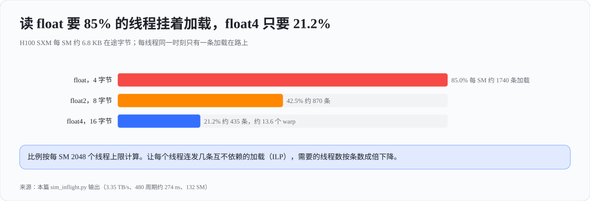
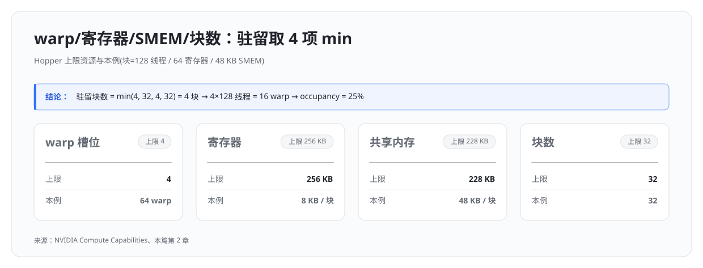
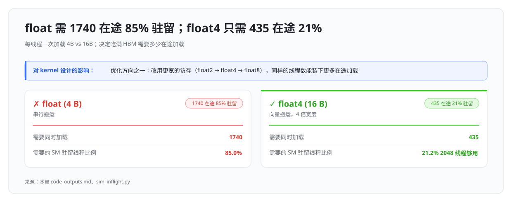
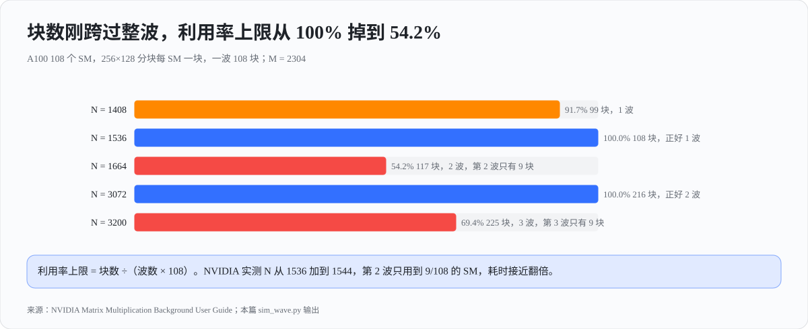

# GPU-01｜硬件｜GPU 架构：SM、存储层级与延迟隐藏

> 🎯 **这篇文档解决什么问题**：写 kernel、调训练、查推理吞吐，最后都要回答同一个问题：这张卡的时间花在哪了。答案取决于三件事：芯片上有多少个 SM 在干活，数据从哪一级存储来、来得多快，等数据的那几百个周期有没有被别的工作填上。本篇从 GPC、TPC、SM 的层级讲到 warp 调度、寄存器、共享内存、L2 和 HBM，再讲延迟隐藏和 occupancy 的算法，最后讲 Hopper 和 Blackwell 新加的 TMA 和 Tensor Memory。读完应当能拿到一张没见过的卡，半小时内写出它的资源上限、各级延迟和一个 kernel 的 occupancy，并判断这个 kernel 该往哪个方向改。
>
> **使用方式**：第 1 到 3 章是硬件骨架，第 4 到 8 章是全篇重点，建议对着 sim_occupancy.py 和 sim_inflight.py 边算边读；第 9 章教你自己测，第 10、11 章讲新架构。本篇演示的五步闭环是：①用 sim_occupancy 定天花板（occupancy 上限），②跑 sim_inflight 测实际在途字节，③用 Little 定律定位等待，④通过提高驻留 warp 数隐藏延迟，⑤复测和权衡。
>
> **代码**：zero-to-gpu/01-arch/ 目录下有 sim_occupancy.py（occupancy 计算器）、sim_inflight.py（在途字节估算）、sim_wave.py（波次利用率）、gpu_props.py（硬件参数查询），以及四个 GPU 微基准。以 sim\_ 开头的只需 Python；gpu\_ 文件需 Turing 及以上 GPU。

**🧭 主线位置**：GPU-00（[GPU-00｜索引｜从 0 开始 GPU 优化：路线、章节与练习](./README.md)）介绍了系列的五层等待阶梯；本篇处理第一层：**线程等访存延迟**（时间账的 W_mem 项）。具体场景是 SM 上驻留的 warp 不够多、并行度不足，导致访存延迟藏不住、SM 有大段空闲时间。读完本篇，瓶颈会转到内核级的计算密度和带宽利用率（GPU-02），以及如何用 CUDA 编程模型把异步和流水加进来（GPU-03）。

# 导读 · 先给结论

- **GPU 是吞吐机器。** H100 SXM 有 132 个 SM，每个 SM 最多驻留 2048 个线程，整卡同时在跑的线程超过 27 万个 [[1]](https://developer.nvidia.com/blog/nvidia-hopper-architecture-in-depth/)[[2]](https://docs.nvidia.com/cuda/cuda-programming-guide/05-appendices/compute-capabilities.html)。它用海量线程轮流等内存，换掉 CPU 那套大缓存和乱序执行，所以单线程很慢，总量很大。
- **SM 是调度和资源的基本单位。** 线程块整块落在一个 SM 上，寄存器、共享内存、warp 槽位都按 SM 计。块数凑不满 SM 的整数倍，最后一波就有 SM 空转；A100 上矩阵 N 从 1536 跳到 1544，耗时接近翻倍 [[3]](https://docs.nvidia.com/deeplearning/performance/dl-performance-matrix-multiplication/index.html)。
- **延迟要靠并行度去藏。** H800 上一次全局内存加载约 479 个周期，共享内存约 29 个周期 [[4]](https://arxiv.org/abs/2402.13499)。按 Little 定律，吃满 3.35 TB/s 的 HBM，每个 SM 要有约 7 KB 数据同时在路上 [[5]](https://www.nvidia.com/en-us/data-center/h100/)（基于 480 ns 延迟）。
- **Occupancy 只是手段。** Volkov 在 2010 年就展示过 CUFFT 和 CUBLAS 的新版本把 occupancy 砍半，性能反而翻倍，靠的是每个线程多做几件互不依赖的事 [[6]](https://www.nvidia.com/content/gtc-2010/pdfs/2238_gtc2010.pdf)。DCGM 文档也指出 occupancy 高不代表好 [[7]](https://docs.nvidia.com/datacenter/dcgm/latest/user-guide/feature-overview.html)。
- **每一代都在把搬运从线程手里拿走。** Ampere 加了 cp.async，Hopper 加了 TMA 和 wgmma，Blackwell 把累加器挪进 Tensor Memory [[8]](https://developer.nvidia.com/blog/nvidia-ampere-architecture-in-depth/)[[9]](https://research.colfax-intl.com/tutorial-hopper-tma/)[[10]](https://developer.nvidia.com/blog/inside-nvidia-blackwell-ultra-the-chip-powering-the-ai-factory-era/)。硬件搬运宽度超过线程能消耗的速度，驱动程序而非程序员决定搬运时刻。
- **在途字节数 = 带宽 × 延迟。** 这是 Little 定律在访存上的体现，也是本篇最重要的一个数字。整卡 HBM 在途 897 KB，每 SM 6.8 KB；如果一个 kernel 访问 float4（16 B），每 SM 需要 435 个加载同时在路上，占用整个 SM 驻留线程容量的 21.2%。
- **Occupancy 阶梯由资源限制决定，不是线性的。** 寄存器数、共享内存、线程块数都会独立地限制驻留块数。在 H100 Hopper 上，128 线程块从 16 寄存器跳到 40 寄存器，occupancy 从 100% 降到 75%；再跳到 104 寄存器，occupancy 跌到 25%。


**📎 与系列其他文档的分工**：GPU-00（[GPU-00｜索引｜从 0 开始 GPU 优化：路线、章节与练习](./README.md)）给出五层等待的全景，本篇从 L1 硬件层切入，定义 SM 和驻留线程这两个最基础的概念。GPU-02（[GPU-02｜硬件｜性能账本：Roofline、算术强度与三类瓶颈](./02-ledger.md)）用 Roofline 把时间账转换成峰值对标，本篇只给实际测量数字。GPU-03（[GPU-03｜硬件｜CUDA 编程模型：线程层级、stream 与编译链](./03-cuda.md)）讲怎么用 stream、event、异步拷贝把主机和设备解耦；本篇假设单个 kernel 的同步特性。GPU-04 到 GPU-08 逐步优化内核，本篇提供的 occupancy 计算器和在途字节数是这些章的工具。

# 第 1 章 · 线程在等什么：吞吐、驻留、并行度

## 1.1 一个真实的现象：SM 满载但吞吐不足

假设你在 H100 SXM 上跑一个简单的向量加法 kernel，GPU-Util 显示 100%，但 nsys 告诉你算术吞吐只有 20 TFLOP/s（峰值 1979 TFLOP/s），而且 SM 的 warp 分发器（warp scheduler）时钟周期内找不到可执行的指令。排查发现：kernel 每个线程读 16 字节的输入（float4），然后做 4 个浮点加法，计算密度只有 4 FLOPs / 16 字节 = 0.25 FLOP/B。H100 HBM 的理论峰值是 3.35 TB/s，所以这个 kernel 最多也不过 3.35 × 0.25 = 838 GFLOP/s。问题不是 kernel 写得太烂：访存延迟约 274 ns（480 周期 @1.75 GHz）太长，在数据返回前，SM 上的线程要么等内存，要么无事可做。这就是本章的核心问题：**线程等什么，等多久，怎么藏** [[5]](https://www.nvidia.com/en-us/data-center/h100/)[[4]](https://arxiv.org/abs/2402.13499)。

## 1.2 CPU 和 GPU 的设计取舍

CPU 通过大缓存、乱序执行和分支预测来隐藏访存延迟，让单线程快速执行。GPU 反过来把晶体管堆在运算单元上，靠同时挂着几十个 warp 来掩盖访存等待。代价是单线程性能很差，好处是吞吐随 SM 数线性增长：V100 有 80 个 SM [[11]](https://images.nvidia.com/content/volta-architecture/pdf/volta-architecture-whitepaper.pdf)，A100 有 108 个 [[8]](https://developer.nvidia.com/blog/nvidia-ampere-architecture-in-depth/)，H100 SXM 有 132 个 [[1]](https://developer.nvidia.com/blog/nvidia-hopper-architecture-in-depth/)，Blackwell Ultra 双 die 合计 160 个 [[10]](https://developer.nvidia.com/blog/inside-nvidia-blackwell-ultra-the-chip-powering-the-ai-factory-era/)。

GPU 程序慢，通常源于并行度不够、访存不合并、某一级资源把驻留 warp 数压低了，导致 SM 有大段时间在空等。这是本篇的主题：从 SM 和驻留线程的角度理解延迟隐藏，找出线程被卡在哪一级（时间账里的 W_mem 项），然后对症下药。本篇的关键洞察是用 Little 定律把延迟转换成并行度需求，然后用 occupancy 计算器判断当前配置能否满足这个需求，最后通过增加驻留 warp 数来隐藏访存延迟。

## 1.3 Little 定律与在途字节数

访存延迟的等待量可以用 Little 定律估算：在稳态系统下，**在途字节数 = 带宽 × 延迟**。这是本篇最重要的一个数字，也是理解并行度为什么这么高的钥匙。H100 HBM 的理论带宽是 3.35 TB/s，访存延迟 480 周期 ≈ 274 ns [[4]](https://arxiv.org/abs/2402.13499)。整卡同时在路上的数据量 = 3.35 TB/s × 274 ns ≈ 897 KB，分配到 132 个 SM 则是每个 SM 6.8 KB[[5]](https://www.nvidia.com/en-us/data-center/h100/)。

这 6.8 KB 是什么意思呢？换成请求数：如果每个线程一次读 16 字节的 float4，那么整卡在路上的请求数大约是 897 KB / 16 B = 56,448 个。分配到 132 个 SM，每个 SM 平均 435 个加载。这 435 个在途加载占 SM 驻留线程容量（最多 2048）的 21.2%。换句话说，为了吃满 HBM 的 3.35 TB/s，SM 上约 1/5 的线程必须在等内存，其余 4/5 要么在计算，要么在等共享内存或 L1。若 kernel 只用 256 线程块且 occupancy 只有 50%（驻留 1024 线程），这 435 个在途请求就占了线程总数的 42.4%，约束力非常强。所以 occupancy 的作用就是把这 435 个请求分散到更多线程上，让每个线程的等待时间相对短，其他线程可以在这段时间里完成有用的工作。

## 1.4 先读出你手上这张卡

没有硬件参数就没法算天花板。用 gpu_props.py 查硬件参数，包括每 SM 的寄存器数、共享内存、最大线程数等。H100 SXM 的几个关键数字要会对：每 SM 65536 寄存器（256 KB）、共享内存 228 KB、L2 缓存 50 MB [[1]](https://developer.nvidia.com/blog/nvidia-hopper-architecture-in-depth/)。这些数字直接决定了一个 kernel 最多能驻留多少块、每块各能用多少资源。本篇接下来逐章展开：GPU-02（[GPU-02｜硬件｜性能账本：Roofline、算术强度与三类瓶颈](./02-ledger.md)）用 Roofline 把这个天花板和实际性能对标，GPU-03（[GPU-03｜硬件｜CUDA 编程模型：线程层级、stream 与编译链](./03-cuda.md)）讲怎么通过异步和流水加速内核与主机的配合。

## 1.5 Occupancy 与资源限制的阶梯

Occupancy 不是线性的。以 H100 Hopper 和 128 线程块为例，寄存器数从 16 跳到 40，occupancy 从 100% 掉到 75%；再跳到 104，occupancy 跌到 25%（这里的 128 是线程块大小，不是 warp 槽位数）。[[2]](https://docs.nvidia.com/cuda/cuda-programming-guide/05-appendices/compute-capabilities.html) 中有完整表格。这个跳跃由寄存器总量、共享内存、线程块数量这三者竞争决定。比如 256 线程块、64 寄存器、48 KB 共享内存的 kernel，用 sim_occupancy.py 算出来是 4 块驻留、50% occupancy，瓶颈同时被寄存器和共享内存限制 [[12]](https://docs.nvidia.com/cuda/cuda-programming-guide/)。

## 1.6 本章的测量工具与下一步

本章提供的工具链是：sim_occupancy.py 定天花板（每个配置下最多驻留多少块），sim_inflight.py 根据带宽和延迟估算在途字节数，sim_wave.py 检查线程块数凑不满整数倍 SM 时的浪费。这三个工具都是纯 Python，不需要 GPU 即可运行。完整工作流是：①选一个 kernel，读出它的寄存器、共享内存用量；②用 sim_occupancy 算 occupancy 天花板；③用 sim_inflight 算读满 HBM 需要多少并行度；④如果 occupancy 不够，改寄存器用量或块大小；⑤复测。举例来说，128 线程块从 16 寄存器跳到 40 时，occupancy 从 100% 掉到 75%，在途能力下降 25%，这是个关键决策点。第 2 章讲 Roofline 模型，把这个天花板和实际测得的性能放在一个图里对标。

> 💡 **常见误区：Occupancy 就是性能**
>
> Volkov 在 2010 年的 GTC 论文展示，CUFFT 和 CUBLAS 的新版本把 occupancy 砍半，性能反而翻倍 [[6]](https://www.nvidia.com/content/gtc-2010/pdfs/2238_gtc2010.pdf)。秘诀是每个线程改做互不依赖的多个任务，让有限的线程更充分地填满执行管道。50% occupancy 的 kernel，如果大量计算能提前（比如用寄存器暂存数据），让每个线程的窗口期被计算填满，总体吞吐反而更高。DCGM 和 Nsight Compute 都只用 occupancy 当参考，不作充要条件 [[7]](https://docs.nvidia.com/datacenter/dcgm/latest/user-guide/feature-overview.html)。



> 🔑 **本章要点**：本章定义了并行度这个基本概念—SM 和驻留线程。GPU 靠海量线程轮流等内存来隐藏线程等访存延迟的时间（W_mem 项）。具体数字是 H100 每 SM 6.8 KB 在途字节数、读满 HBM 需要 435 个 float4 请求在路上。无论是定天花板还是找瓶颈，都要从 SM 和驻留 warp 数这两个数字出发，理解访存延迟不再是关键路径上的等待。

# 第 2 章 · 吞吐机器的架构：GPC、TPC、SM

## 2.1 从物理芯片到逻辑资源

H100 芯片面积 814 mm²，分为 4 个 GPC（GPU Processing Cluster）[[1]](https://developer.nvidia.com/blog/nvidia-hopper-architecture-in-depth/)，每个 GPC 包含 11 个 TPC（Texture Processing Cluster），每个 TPC 包含 2 个 SM，合计 132 个 SM [[4]](https://arxiv.org/abs/2402.13499)。这个层级关系直接映射到资源分配：块的调度、寄存器的分配、一级缓存的竞争都发生在 SM 这个颗粒度，GPC 和 TPC 是物理上的分组，不直接影响编程模型。Hopper 相比 Ampere 的架构改进中，每个 GPC 的 TPC 数从 7 增加到 11，这意味着每个 GPC 现在能驻留 22 个 SM，而 Ampere 只有 14 个。这个数字直接影响了块的调度密度和共享资源的竞争。

重要的是理解这个物理布局如何影响延迟。L2 缓存（50 MB）是全芯片共享，所有 132 个 SM 都指向它。HBM（80 GB，10 通道）也是共享的，每个通道连接几个 TPC。把 N 个块分散到不同 GPC 和 TPC，能减少某一级资源的竞争；把所有块落在同一 GPC，该 GPC 内的 L2 和寄存器通道就容易饱和。在一些矩阵乘法 kernel 中，如果所有 16 万多线程都落在一个 GPC，该 GPC 的 L2 缓存极容易饱和，导致命中率下降；分散到 4 个 GPC 就能缓解这个竞争。[[1]](https://developer.nvidia.com/blog/nvidia-hopper-architecture-in-depth/) ，很多高性能 kernel 的块配置（grid 大小和 block size 的选择）都要考虑这一点，通过调整 block size 和 grid 大小来均衡地利用 GPC 资源，而非盲目最大化 occupancy。

## 2.2 SM 内的计算单元与管道

每个 SM 内包含 128 个 CUDA 核心（FP32 乘加），32 线程为一个 warp，所以一个 warp 一次周期用满 SM 的所有核心。除了标准的 CUDA 核心外，H100 SM 还有 64 个 Tensor Core（每个做 4×4 矩阵），4 个 RT Core（光线追踪），它们都有各自的管道和调度时间。从编程的角度，CUDA 核心的延迟通常是 4 周期（浮点乘加），Tensor Core 的延迟是 8 至 16 周期（取决于数据类型和操作），但两种都能被 warp 的轮转掩藏。[[2]](https://docs.nvidia.com/cuda/cuda-programming-guide/05-appendices/compute-capabilities.html) Hopper 引入的一个关键变化是分离了 Tensor Core 的流水线：FP32 Tensor 和 TF32 矩阵运算共享 Tensor Core，但通过软件可以选择用哪个管道，从而提高了灵活性。

每个 SM 还有专用的访存单元。L1 缓存（每 SM 32 KB，最近代 GPU 可配置）连接到每个线程，总带宽约 1 TB/s（整卡），但这是理论值；实际受限于 bank conflict 和 warp 分布。每个 SM 的访存单元是流水线的一部分，处理寄存器和共享内存的读写、L1 缓存命中和 miss、HBM 请求的排队。一个 SM 上所有驻留 warp 的访存请求都竞争这一套硬件，所以驻留 warp 数过高会导致访存通道饱和，反而降低整体吞吐。在 Hopper 之前，很难看到 occupancy 太高反而性能下降的情况，因为访存通道足够宽。但在某些特定场景，比如所有 warp 都在做密集的共享内存访问，更多 warp 会加剧 bank conflict，导致必须降低 occupancy 反而能提升吞吐。

## 2.3 SM 内部资源管理

每个 SM 的资源上限如下：驻留线程最多 2048（Hopper），寄存器池 256 KB（65536 个 32 位寄存器），共享内存 228 KB（配置形式，全局可共享或 L1 缓存优先）。一个线程块必须整块落到一个 SM，资源的限制决定了最多能同时驻留多少个块。寄存器和共享内存的分配是静态的，在 kernel 启动时决定，而不是运行时动态的。这意味着，即使某个块只用了 32 KB 共享内存，该 SM 也无法再驻留另一个需要 202 KB 共享内存的块，除非前一个块已经完成执行。

具体例子：假设块大小 128 线程，每线程 64 寄存器，则占用寄存器 128 × 64 = 8 KB；寄存器限制允许驻留 256 ÷ 8 = 32 块。但如果每块还用 48 KB 共享内存，共享内存限制就变成 228 ÷ 48 = 4 块（整数除法）。限制条件取 min，所以最多驻留 4 块，共 512 线程，这时 warp 数是 16（512 ÷ 32），occupancy 25%（16 ÷ 64 个 warp 槽位）。[[2]](https://docs.nvidia.com/cuda/cuda-programming-guide/05-appendices/compute-capabilities.html)  warp 槽位数在不同架构上也不同：Ampere 及之后的架构是 4 个槽位（128 个核心），Volta 也是 4 个，Turing 也是 4 个。这个数字决定了 SM 每周期能发射多少个 warp 的指令。

资源限制还包括一个全局的块数上限：每个 SM 最多驻留 32 个块（Hopper）。这个上限来自硬件调度器的设计，与寄存器和共享内存无关。某些 kernel 块特别小（比如只有 32 线程），即使寄存器和共享内存都充足，也无法驻留超过 32 个块。这对小块 kernel 特别是限制因素。一个应用启动了 64 个小块，以为 occupancy 会很高，结果只有 32 块驻留了（另外 32 个要等前面的完成），其余计算资源空闲，吞吐反而下降。

> 💡 **常见误区：更多 warp 就是更高 occupancy**
>
> occupancy 由驻留 warp 数决定，无法通过增加块数来提升，除非块变小。一个 kernel 驻留 32 块、每块只有 16 线程（2 个 warp），occupancy 也只有 50%，与上面 4 块 × 128 线程的例子相同。关键是驻留 warp 的总数，不是块的个数。块过多时，SM 调度开销会增加，甚至因为共享内存碎片化导致不能驻留更多块。



> 🔑 **本章要点**：本章定义了架构的资源上限和调度单位。SM 是计算和资源管理的基本单元，所有线程块整块落到一个 SM。寄存器、共享内存、warp 槽位、块数都按 SM 计，多个上限缺一不可地共同决定驻留块数。这限定了能同时驻留的线程数，也就决定了最大可能的并行度和延迟隐藏容量。本章消掉的是物理芯片的复杂性，把 GPC、TPC、SM 的层级抽象成 SM 这个逻辑单位，为后续的 occupancy 计算铺路。

# 第 3 章 · 执行模型与 Warp 调度

## 3.1 SIMT 与 Warp 调度

GPU 采用 SIMT（Single Instruction Multiple Thread）执行模型：32 个线程绑定成一个 warp，同一个 warp 内的所有线程每周期执行同一条指令，作用在各自的数据上。如果指令是 LDS（加载共享内存），32 个线程同时访问共享内存（可能冲突）；如果是 FMA（乘加），32 个线程同时在自己的 CUDA 核心上做乘加。[[12]](https://docs.nvidia.com/cuda/cuda-programming-guide/) 这个模型的好处是硬件简单：不用像 CPU 那样维护每个线程独立的 PC（程序计数器），所有线程共用一个指令计数器。坏处是分支导致 divergence：如果线程间的条件不一致，某些线程的执行单元会被禁用。

一个 SM 的 128 个 CUDA 核心划分为 4 个“warp 槽位”，每个槽位 32 核。一个周期内，SM 的调度器从所有驻留 warp 中选最多 4 个发射指令（每个 warp 槽位一个），具体选哪 4 个由调度策略决定（通常是轮转）。如果某个 warp 在等内存，调度器会跳过它，选下一个。这样，即使单个 warp 的执行被卡住，SM 也能继续推进其他 warp 的计算。在 CPU 的模型中，一个线程被阻塞，整个流水线就停顿；在 GPU 中，一个 warp 被阻塞，调度器切到别的 warp，SM 继续工作。

## 3.2 Warp 状态机与停滞

一个 warp 在 SM 上可能处于三种状态：**执行中**（指令在管道里），**暂停（stall）**（等待操作数或内存），**空闲**（没有指令可发射）。暂停的原因多种：等操作数依赖（前面的指令结果还没来），等 L1 或 L2 的加载完成，等共享内存同步，等分支的另一条路径汇聚。[[13]](https://docs.nvidia.com/cuda/cuda-c-best-practices-guide/) 每种停滞的原因在 profiler（nsys、ncu）里都有对应的计数器。一个 kernel 的执行时间等于指令数除以每周期发射的指令数乘以周期时间，如果大部分时间都在停滞（等内存），那么 occupancy 就很重要。

当 SM 上所有驻留 warp 都暂停或空闲时，SM 核心就进入空转，无法执行任何计算。这正是 occupancy 定义存在的原因：多驻留几个 warp，即使其中一个在等内存，其他 warp 还能继续执行。但关键是这些 warp 必须相互独立：如果所有 warp 都在等同一个全局同步点（比如 \_\_syncthreads 或全局内存栅栏），多驻留也没用。在实践中，常见的停滞原因有：(1) 分支停滞（某些 lane 的条件不满足，warp 执行分支的另一条路径时这些 lane 停滞）；(2) 访存停滞（等 HBM 的 480 个周期）；(3) 依赖停滞（前面指令的结果延迟多周期，后续指令无法发射）。[[14]](https://www2.eecs.berkeley.edu/Pubs/TechRpts/2016/EECS-2016-143.html) 一个好的 kernel 要让调度器总是有活干的 warp。如果 occupancy 太低，很容易出现所有 warp 都堵住的情况；如果 occupancy 适中（50% 至 75%），通常能找到足够的独立 warp 来避免空转。

## 3.3 Divergence 与 Occupancy 衰减

线程块内的分支指令会导致 divergence：假设第一个 if 的条件让部分线程走真路径，部分走假路径。SM 会串行执行两个分支，每个线程的 active 掩码决定它是否在参与计算。如果一个 warp 的 32 线程完全分开（一半走真，一半走假），那这两条分支都要走，每条分支中有一半线程闲着。最坏情况，32 线程各自走各自的分支，occupancy 从 100% 衰减到 1/32 约 3.1%。[[13]](https://docs.nvidia.com/cuda/cuda-c-best-practices-guide/) 在实际代码中很难遇到这么极端的情况，但部分 divergence 很常见。例如一个 kernel 处理长度不一的输入，前 16 线程的输入长度是 1000，后 16 线程的输入长度是 10，前半部分会比后半部分多花 99 个周期等待，导致 warp 内的执行不同步。profiler（nsight compute）可以给出 divergence 导致的浪费周期估算，帮助识别分支优化的机会。

实际中分支分散度取决于块内线程的索引分布和条件表达式。块级的分支（所有线程同时走同一条路径）没有性能代价；warp 级的分支通常也没事（32 线程按同一条路走）；坏的是线程级的分支，让 warp 出现混合。减少 divergence 的常见手法是重新组织数据，让相邻的线程有相同的分支条件（warp-level reduction）。另一种思路是用 warp-level primitives（\_\_all_sync、\_\_any_sync）把分支逻辑从线程层挪到 warp 层，让硬件能更高效地处理。

> 💡 **常见误区：所有线程应该走同一分支**
>
> 某些场景下部分 divergence 反而能提高吞吐。例如索引查表，如果所有线程都在等一个全局同步点，分散地访问不同的表项反而能减少等待时间。Volkov 的论文展示，CUDA 库的新版本故意引入分支以避免全局同步，性能反而翻倍。分支本身不可怕，可怕的是让所有线程都卡在同一个点等待。一个好的 kernel 设计是让不同 warp 的分支路径不同，这样调度器有更多选择，不会所有 warp 都堵在同一个地方。


> 🔑 **本章要点**：本章定义了动态执行的机制：warp 轮流从 SM 的调度器发射指令，访存延迟、分支、同步等操作让 warp 进入暂停态。多个驻留 warp 给了调度器选择，一个 warp 在等内存时，另一个 warp 可以继续执行。这是本篇消掉的第一层等待：线程等待访存延迟，通过 warp 级的轮转掐掉。后续章节会引入更多维度的等待：访存延迟的大小、分支分散的代价、同步的开销，都需要通过 occupancy 的计算和测量来量化。

# 第 4 章 · 存储层级与延迟曲线

## 4.1 GPU 访存的五级阶梯

GPU 的存储不像 CPU 有统一的缓存层级，而是五个物理位置各异、带宽延迟也各异的存储体系。从快到慢排列：

| 级别 | 位置 | 延迟 | 带宽 |
|-|-|-|-|
| 寄存器 | 片上，每 SM 专属 | 1 周期 | 128 B/周期/SM |
| L1 缓存 | 片上，每 SM 专属 | \~29 周期 | \~1 TB/s（整卡） |
| 共享内存 | 片上，每 SM 共享 | \~29 周期 | 依存储模式 |
| L2 缓存 | 片上，全 SM 共享 | \~150 周期 | \~10 TB/s |
| HBM | 片外芯片，全卡共享 | 480 周期 | 3.35 TB/s (H100) |

每一级都约束着 kernel 的性能。寄存器是最稀缺的：H100 每 SM 只有 256 KB 寄存器，分给驻留的所有线程块。L1 缓存仅 32 KB 每 SM，且多个 warp 竞争通路。共享内存由开发者显式分配，最大 228 KB 每 SM，但只在同一线程块内可见 [[1]](https://developer.nvidia.com/blog/nvidia-hopper-architecture-in-depth/)。L2 缓存容量更大（50 MB 整卡），但延迟增加到约 150 周期。HBM 容量最大（80 GB 整卡），但延迟达 480 周期，是寄存器的 480 倍。[[4]](https://arxiv.org/abs/2402.13499)

延迟成倍增加，带宽反而受限。整卡 HBM 带宽 3.35 TB/s，要吃满这个带宽，需要源源不断的访存请求。如果 SM 上的 warp 线程不够多、不够独立，等 HBM 数据的空闲时间就会暴露出来，这正是本篇的核心问题。

## 4.2 Little 定律与在途字节数

Little 定律说：系统中平均物体数 = 到达率 × 平均停留时间。在 GPU 访存上，翻译一下就是：

**在途字节数 = 带宽 × 延迟**

这是理解 GPU 访存成本的关键。以 H100 HBM 为例：带宽 3.35 TB/s，延迟 480 周期 ≈ 274 ns。整卡同时在路上的数据量 = 3.35 TB/s × 274 ns ≈ 897 KB。

897 KB 听起来不多，但平均到 132 个 SM，每个 SM 仅 6.8 KB 可在途。一个 float4（16 字节）加载要占用 6.8 KB / 16 B = 425 个加载在路上。H100 每 SM 最多驻留 2048 线程，425 个在途加载占 20.7% 的线程容量。如果 kernel 每个线程只发一次访存，那还需要另外 1600+ 个线程来填补延迟，并行度需求极高。

反过来说，如果 kernel 的访存特性是“每个线程发 N 次加载”，实际在途字节数需求就能分散。例如矩阵乘法中，一个线程可能要从 HBM 加载几十倍的数据量，轮流放进共享内存和寄存器中计算，这样少数几百个线程的加载就足以掩盖延迟。

## 4.3 Bank Conflict 与共享内存访存模式

共享内存是 L1 缓存的替代品，开发者显式分配，延迟和 L1 相当（约 29 周期），但带宽更高、行为可预测 [[2]](https://docs.nvidia.com/cuda/cuda-programming-guide/05-appendices/compute-capabilities.html)。代价是每 SM 容量仅 228 KB，而且有一个隐藏的限制：32 个 bank。

共享内存分成 32 个 bank，每 bank 4 字节宽。32 个线程同时读，若都命中同一个 bank，访存就串行化，延迟乘以 bank 冲突的倍数（最坏 32×）。好的访存模式让每个线程读不同 bank，或者广播到所有 warp（当所有线程读同一地址时硬件直接广播，不占用 bank）。[[15]](https://docs.nvidia.com/cuda/parallel-thread-execution/index.html)

实际中，Bank Conflict 的成本往往被低估。一个 64×64 的共享内存 tile，按行读取且步长为 1，可能完全避免冲突；但如果转置这个 tile（读一列），就会触发大量冲突。CUTLASS 和其他成熟库在这方面都精心设计了 padding，保证访存总是均匀分布在 32 个 bank 上。[[16]](https://github.com/NVIDIA/cutlass)



## 4.4 L2 缓存的角色与局限

L2 缓存位置在全卡共享的层级上，容量 50 MB，但延迟高于 L1/共享内存。很多开发者期望 L2 能减少 HBM 访问，对于高带宽应用（如 GEMM）作用有限。[[17]](https://docs.nvidia.com/deeplearning/performance/dl-performance-gpu-background/index.html)

理由很简单：L2 的 50 MB 容量，对于一个处理 2048×2048 矩阵乘法的 kernel 根本不够。两个输入矩阵就要 16 MB，一般 kernel 会多次读，L2 命中率在循环体内能达到 90% 以上，但 kernel 之间的 L2 冲刷会清掉大部分缓存。所以实践中，减少 HBM 访问的主要手段是 tile 化和共享内存复用，而非依赖 L2。

> 💡 **常见误区 · L2 可以很大程度减少 HBM 访问**
>
> L2 容量 50 MB 对整卡来说微不足道（80 GB HBM）。计算密集型 kernel（GEMM）的工作集通常超过 L2，只能指望循环复用；访存密集型 kernel（逐元素操作）无法充分利用 L2，因为每个数据点只访问一次。L2 的真正价值在于多 kernel 间的通信优化和 L2 缓存的延迟掩盖，而非容量扩展。

## 4.5 从架构看延迟隐藏的可能性

从寄存器到 HBM 的延迟差异，反映了 GPU 设计的核心权衡：近的存储速度快但容量小，远的存储容量大但延迟长。本篇的后续章节会讨论如何用 warp 的数量和独立性来掩盖这个延迟。[[14]](https://www2.eecs.berkeley.edu/Pubs/TechRpts/2016/EECS-2016-143.html)

简单估算：一个 warp 发起一次 HBM 加载（480 周期），如果调度器每周期可以发射其他 warp 的指令，则需要 ⌈480⌉ = 480 个其他 warp 的指令才能填满 480 周期的延迟。但实际中，warp 的指令有依赖关系，不是所有 warp 都能每周期发射一条指令。实际需要的 warp 数往往是 48 到 96 之间。H100 每 SM 最多驻留 64 warp（2048 线程 ÷ 32 线程/warp），所以理论上有余地。

本章的关键结论是：**GPU 存储是分层的，每层的延迟、带宽、容量都不同；在途字节数由延迟和带宽决定，是衡量 HBM 是否被充分利用的量化指标；共享内存和 bank conflict 则要求细致的访存模式设计**。下一章会讨论如何用 occupancy（驻留 warp 数的比例）来确保在途字节数足够。

> 🔑 **本章要点**
>
> GPU 存储分五级：从寄存器的 1 周期到 HBM 的 480 周期，延迟增加 480 倍，容量增加百万倍；Little 定律量化了隐藏延迟的成本（在途字节数 = 带宽 × 延迟），H100 整卡 897 KB、每 SM 6.8 KB；共享内存的 bank conflict 和 L2 缓存的容量限制都要求精心设计数据流；本章消掉或隐藏的等待项是：**长延迟存储（HBM）的访问延迟，通过理解每级存储的权衡来预期 kernel 的访存瓶颈**。

# 第 5 章 · 延迟隐藏与 Occupancy（定天花板）

## 5.1 延迟隐藏的原理：Warp 轮转

GPU 的答案很直接：当一个 warp 等 HBM 时（480 周期），SM 的调度器从其他驻留 warp 中选一个发射指令。只要驻留 warp 足够多、足够独立，就能让 SM 的计算单元时刻有活干，长延迟的等待就被掩盖了。

简单模型：假设每个 warp 每 10 周期发起一次 HBM 加载，延迟 480 周期。则需要 ⌈480 / 10⌉ = 48 个独立的 warp，这样当 warp A 在等数据、warp B 发起加载、warp C 在计算时，每个时刻都有 warp 在做有意义的工作。H100 每 SM 最多驻留 64 warp，所以足够。但前提是：(1) warp 之间没有依赖；(2) 每个 warp 的加载是独立的；(3) 调度器能看到这些 warp。[[14]](https://www2.eecs.berkeley.edu/Pubs/TechRpts/2016/EECS-2016-143.html)

实际中，模型更复杂。warp 内的指令有依赖（寄存器数据），warp 间的数据也可能有同步，不同的操作（FP32、Tensor Core、内存）竞争 SM 的执行资源。但核心思想不变：**并行度是关键，没有足够的独立 warp，延迟就会暴露**。


## 5.2 Occupancy 的定义

**Occupancy** = 驻留 warp 数 / SM 最多可驻留 warp 数。在 H100 Hopper 上，每 SM 最多 64 warp（2048 线程 ÷ 32 线程/warp），所以 occupancy 范围从 0% 到 100%。[[2]](https://docs.nvidia.com/cuda/cuda-programming-guide/05-appendices/compute-capabilities.html)

例如，一个 256 线程的线程块对应 8 warp。如果 H100 上最多驻留 4 个这样的块，则驻留 32 warp，occupancy = 32 / 64 = 50%。

但驻留块数由硬件资源的多个限制共同决定：

- **Warp 槽位**：每 SM 最多 64 warp
- **线程块数**：H100 上最多 32 块（由硬件决定）
- **寄存器**：总 256 KB，每块需要 block_size × regs_per_thread 字节
- **共享内存**：总 228 KB，每块需要 smem_per_block 字节

这四个限制中取最小，就是该 SM 最多能驻留的块数。驻留块数乘以每块的 warp 数，就是驻留 warp 数。sim_occupancy.py 正是这样工作的：遍历这四个限制，取最小驻留块数，再乘以每块 warp 数。

## 5.3 资源瓶颈与 Occupancy 阶梯

Occupancy 呈离散分布。当寄存器数变化时，occupancy 会突跳。例如 H100 上，128 线程的块：

```text
16 寄存器/线程 -> 100.0% occupancy
40 寄存器/线程 -> 75.0%
64 寄存器/线程 -> 50.0%
104 寄存器/线程 -> 25.0%
```

从 40 跳到 64 寄存器，occupancy 从 75% 跌到 50%。原因是寄存器池 256 KB，128 线程 × 40 个寄存器 = 5120 字节，最多驻留 ⌊256 KB / 5120 B⌋ = 50 块；但 128 线程 × 64 个寄存器 = 8192 字节，最多驻留 ⌊256 KB / 8192 B⌋ = 32 块。跳过了 33-49 块的范围。

这意味着代码优化时，减少 24 个寄存器可能会大幅提升 occupancy，但减少 1 个寄存器可能毫无作用。这种离散性需要通过 sim_occupancy.py 来预测，盲目的“减少寄存器用量”往往打不到关键点。

## 5.4 Occupancy 与性能的关系：不是单调的

很多文档把 occupancy 当作性能的代理，这是常见的误解。Occupancy 100% 的 kernel 可能比 50% 的 kernel 慢。原因有三：

**资源不均衡。**100% occupancy 需要驻留很多块，每块的寄存器用量少。这意味着每个 warp 无法在寄存器中保持多个中间结果，必须频繁读写 L1 或共享内存。相比之下，50% occupancy 的 kernel 每个 warp 有充足的寄存器，可以在寄存器中滚动缓冲多个任务的数据。[[6]](https://www.nvidia.com/content/gtc-2010/pdfs/2238_gtc2010.pdf)

**计算密度不同。**GEMM 类 kernel 用 tile 化把数据复用做高，即使 50% occupancy，每个 warp 的计算工作量也能填满管道。而一些访存密集型 kernel 如矩阵转置，100% occupancy 也救不了，因为每个数据点只加载一次，无法用多的 warp 来掩盖访存。

**Tensor Core 和共享内存竞争。**100% occupancy 的 kernel，所有 warp 都在竞争同一个 Tensor Core，或者竞争共享内存的带宽。，某些 warp 被迫暂停，整体吞吐反而下降。[[7]](https://docs.nvidia.com/datacenter/dcgm/latest/user-guide/feature-overview.html)

Volkov 2010 年的论文用 CUFFT 和 CUBLAS 展示了这一点：新版本把 occupancy 砍到 50%，性能反而翻倍。关键是每个 warp 的指令独立性和数据局部性更好了。[[6]](https://www.nvidia.com/content/gtc-2010/pdfs/2238_gtc2010.pdf)

## 5.5 五步闭环：第一步「定天花板」

本篇演示的五步闭环在这里开始。第一步是用 sim_occupancy.py 确定 occupancy 的上限。

**例：H100，256 线程/块，64 寄存器/线程，48 KB 共享内存/块**

```bash
python3 sim_occupancy.py --cc 9.0 --threads 256 --regs 64 --smem 48
# 输出：
# CC 9.0 Hopper H100: 256 线程/块, 64 寄存器/线程, 48 KB 共享内存/块
#   按 warps      限制最多   8 块
#   按 blocks     限制最多  32 块
#   按 registers  限制最多   4 块
#   按 shared_mem 限制最多   4 块
#   驻留 4 块 = 32 warp，理论 occupancy 50.0%，瓶颈 registers、shared_mem
```

输出告诉我们：这个 kernel 最多驻留 4 块、32 warp，occupancy 50%。瓶颈是寄存器和共享内存同时达到上限，不能通过减少其中一个来增加驻留块数。

**占用率与在途字节数的关系**

Occupancy 50% 意味着 32 warp 驻留，最多 2048 线程中 1024 线程在跑。根据 Little 定律，如果这 1024 线程都在访问 HBM（每个线程一个 float4 加载），需要的在途字节数是多少？根据第 4 章的计算，整卡在途 897 KB，每 SM 6.8 KB。一个 float4 需要 16 字节，所以需要 6.8 KB / 16 B ≈ 425 个加载在路上，占 1024 线程的 41.5%。

这说明 50% occupancy 不足以吃满 HBM。如果要达到 100% occupancy，2048 线程都在跑，需要 2048 × 41.5% ≈ 850 个加载同时在路上，占整个 SM 的 41.5%。剩余的线程可以做计算或等其他资源。


## 5.6 第二步「测实际在途字节」

第一步定了占用率的天花板，第二步用 Little 定律反向计算：给定要吃满 HBM 的目标，需要多少在途字节？

```bash
python3 sim_inflight.py --gpu h100-sxm
# 输出：
# H100 SXM: 3.35 TB/s, 延迟 480 周期
#   整卡在途 897 KB，每 SM 6.8 KB
#   每线程一次读  4 B（float ）：每 SM 要  1740 个加载在路上，占满 2048 线程的 85.0%
#   每线程一次读 16 B（float4）：每 SM 要   435 个加载在路上，占满 2048 线程的 21.2%
```

结论：一个 float4 加载需要 435 个同时在路上才能吃满 HBM，占 SM 驻留线程的 21.2%。这是相对宽松的。但如果访问的是 float（4 字节），需要 1740 个加载，占 85%，压力就很大了。

现实中，很多 kernel 会在 HBM 访问和其他工作间切换。比如 GEMM，一个 SM 可能 50% 的时间在加载数据，50% 的时间在计算。此时 50% occupancy 可能已经足够，不需要 100%。

## 5.7 常见误区：Occupancy 高 = 性能好

> 💡 **常见误区 · Occupancy 100% 一定是最优的**
>
> 50% occupancy 的 kernel，如果计算密度足够高（每个线程做多个计算任务）、在途字节数需求足够少（数据复用好），性能往往超过 100% occupancy 但 ILP（指令级并行）低、重复访存的 kernel。正确的做法是：先用 sim_occupancy.py 理解资源限制，再用 profiler（Nsight Compute）看实际的 stall reason，最后根据 stall reason 决定是增加 occupancy、优化计算密度、还是改善数据局部性。[[18]](https://docs.nvidia.com/nsight-compute/ProfilingGuide/index.html)

## 5.8 波次与利用率提前预览

算出了单 SM 的 occupancy，还要看整卡的利用率。H100 有 132 个 SM，如果 kernel 只分块 100 个，最后一波不能填满所有 SM。例如一个 kernel 分块 99 个，每 SM 最多驻留 4 块，则需要 ⌈99 / 4⌉ = 25 波，但 25 × 4 = 100，超过 99。只需要 1 波，但最后 33 个 SM（132 - 99）会空转。

这样的不对齐会导致资源浪费。Nvidia 的 Grace Hopper Superchip 有 2×132=264 SM，分块数如果是 odd number，会有更多浪费。sim_wave.py 帮助预测这个问题。

## 5.9 小结：从天花板到实际

本章达成了五步闭环的前两步：

**第 1 步「定天花板」**：用 sim_occupancy.py 算出 occupancy 的上限及瓶颈资源。这确定了最坏情况下 kernel 能驻留多少 warp。

**第 2 步「测实际」**：用 sim_inflight.py 和 Little 定律估算 kernel 需要多少在途字节才能吃满 HBM。这告诉我们第 1 步算出的 occupancy 是否足够。

如果 occupancy 足以支撑需要的在途字节数，那么 HBM 延迟能被隐藏，SM 不会空转。反之，即使 occupancy 100%，如果在途字节不足，HBM 还是会成为瓶颈，后续章节会讨论如何优化（减少访存次数、用共享内存复用、或用新硬件特性）。

> 🔑 **本章要点**
>
> 延迟隐藏的机制是 warp 轮转：一个 warp 等 HBM 时，调度器发射其他 warp 的指令，只要 warp 足够多且独立就行；occupancy 是驻留 warp 数的比例，由寄存器、共享内存、warp 槽位四个资源限制共同决定，呈阶梯状而非线性；在途字节数（= 带宽 × 延迟）量化了延迟隐藏的需求，是判断 occupancy 是否足够的标准，而不是 occupancy 绝对值；本章消掉或隐藏的等待项是：**线程等 HBM 的延迟，通过 occupancy 和在途字节数的计算来估算是否能被掩盖**。

# 第 6 章 · 在途字节与小数据复用（消除或隐藏）

前面讲 occupancy 定了 SM 驻留 warp 数的天花板，Little 定律给出了吃满带宽需要多少在途字节。本章深一层：在途字节数不是固定常数，由**数据复用结构**决定[[3]](https://docs.nvidia.com/deeplearning/performance/dl-performance-matrix-multiplication/index.html)。两个极端案例说明这一点。

## 6.1 复用为零：逐元素操作与带宽成正比

先看最简单的 kernel：向量逐元素加法，C[i] = A[i] + B[i]。每个线程读 A[i] 和 B[i]，各一次，写 C[i]。两个数据各占 4 字节（float），计算只需一次加法。假设 A、B 都在 HBM，延迟 480 周期，H100 SXM 带宽 3.35 TB/s[[4]](https://arxiv.org/abs/2402.13499)。

按 Little 定律，吃满带宽需 3.35 TB/s × 480 周期 ÷ （3 GHz）= 897 KB 在途数据[[5]](https://www.nvidia.com/en-us/data-center/h100/)。一次只计算一个元素，那 897 KB 也都是在途数据。这类 kernel 就是**低复用内核**：每个数据只用一次就丢。

对应优化方向很清楚：**无法消除访问次数**（A、B 每个必须读），也**无法通过本地复用隐藏**（没地方存它）。只能提高 occupancy，让更多线程轮转等待，或者转向 GPU-04 的访存优化（合并加载、减少 cache 浪费）。

## 6.2 复用为高：GEMM 与共享内存分块

反面例子：矩阵乘法 C = A × B，其中 A（M×K）、B（K×N）、C（M×N）。一个标准的分块策略：把 A 按行分成 tile 块（M×64），B 按列分成 tile（64×N），计算一个（M×N）的输出 tile。

关键是这个 64×64 的 A_tile 会被**使用 N/64 次**[[3]](https://docs.nvidia.com/deeplearning/performance/dl-performance-matrix-multiplication/index.html)。假设 N=1024，那这个 4 KB 的 tile 被使用 16 次，相当于每个数据被算了 16 遍。与其说“在 HBM 路上”，不如说“在共享内存里驻留了很久”。

实际的 HBM 访问次数从 M×K + K×N + M×N（全部从 HBM）降到 M×K/64 + K×N/64 + M×N（先把 tile 尺寸内的从 HBM 一次性加到共享内存，然后反复复用）。假设 M=N=K=1024，减少了 16 倍的 HBM 访问。

这样做有代价：共享内存有限。为了驻留这个 tile，必须权衡 occupancy。加载 tile 到共享内存也要时间，不能让 warp 都堵在一个屏障前。


## 6.3 权衡与超参数空间

给定一张卡，两个主要约束来自寄存器和共享内存。提高复用率（扩大 tile）会：

- 消耗更多共享内存，reducting occupancy。
- 或者消耗寄存器来做更多 buffer（局部指针、索引），也降低 occupancy。
- 但能减少 HBM 访问，从 HBM 视角降低在途字节数。

反过来，为了保持高 occupancy：

- 减少寄存器用量，每个 warp 做更少的独立计算。
- 每个 warp 加载数据的速度不变，但计算慢了，占用时间长，需要多的在途字节数来掩盖延迟。

这就是 Volkov 在 2010 年著名报告里的结论：**50% occupancy + 优化的数据复用 > 100% occupancy + 低复用**[[6]](https://www.nvidia.com/content/gtc-2010/pdfs/2238_gtc2010.pdf)。

## 6.4 如何在实践中选择 tile 大小

小 tile（如 32×32）：

- 共享内存占用小，occupancy 高。
- 但 HBM 加载次数多，每个 tile 都要等延迟。
- Kernel 启动开销相对大。

大 tile（如 128×128）：

- HBM 加载次数少，单位时间内 FLOPs 多。
- Occupancy 低，但如果计算密度够，低 occupancy 也能吃满算力。
- Bank conflict 风险上升（共享内存访问模式复杂）。

最优点取决于三个因素：硬件的共享内存大小和带宽、问题大小（M、N、K）、编译器是否能自动地展开循环和调度指令。实验台是必要的：用 nsys 或 ncu 测不同 tile 大小，看哪个吞吐最高。

## 6.5 硬件加速器的出现

Hopper 推出了 TMA（Tensor Memory Accelerator），一个专用的 DMA 引擎，搬运数据不需要占用线程的执行单元[[9]](https://research.colfax-intl.com/tutorial-hopper-tma/)。这改变了游戏规则：搬运的同步性大幅下降。

同样，wgmma（warp-group matrix multiply accumulate）直接在共享内存上做矩阵乘法，省掉了把数据搬到寄存器再乘的步骤。虽然 occupancy 看起来还是 50%，但实际 latency hiding 的压力减轻了。

Blackwell 更激进，把积累器（matmul 结果）放在 SM 附近的 Tensor Memory[[10]](https://developer.nvidia.com/blog/inside-nvidia-blackwell-ultra-the-chip-powering-the-ai-factory-era/)。这相当于多出了一个专属的小缓存，可以驻留更大的输入 tile，共享内存空间竞争下降。

## 6.6 本章要点与下一步

> 🔑 **本章要点**：在途字节数由数据复用结构决定。低复用内核（如逐元素操作）每个数据用一次，在途字节数就是时间 × 带宽，无法降低。高复用内核（如 GEMM）可以用分块把大的输入 tile 驻留在共享内存，反复复用，大幅减少 HBM 在途字节数。权衡焦点是寄存器和共享内存的分配，通过 tile 大小和 occupancy 的调整找到吞吐峰值。本章消掉的等待是**HBM 访问次数**（通过消除重复访问）。

# 第 7 章 · 共享内存与 Tensor Memory：从 Ampere 到 Blackwell（架构演化）

这一章换个视角：从硬件演化看搬运和计算的关系。Turing 到 Ampere 再到 Hopper、Blackwell，每一代都围绕一个问题：**搬运与计算的耦合度**。本章展示这四代芯片如何逐步把数据搬运从线程手里独立出来，放到专用硬件引擎里。

## 7.1 Turing 与 Ampere：带宽竞争时代

Turing（RTX 2080）和 Ampere（A100）时代，线程搬运数据的唯一手段是普通的加载指令（LDG、LDGSTS 等）。这些指令竞争执行管道：多个线程同时要搬运，就会排队等待执行。

同时，从共享内存读写也要走执行单元。如果 warp 内的线程们要把 HBM 数据写到共享内存，然后继续计算，中间会有一个屏障同步的开销。

Ampere 的改进是 cp.async（异步拷贝），让某些搬运操作和计算能更松散地重叠[[8]](https://developer.nvidia.com/blog/nvidia-ampere-architecture-in-depth/)。但 cp.async 仍然需要线程显式调用，仍然竞争执行带宽。

## 7.2 Hopper：搬运专属引擎（TMA）



Hopper（H100）引入了 TMA（Tensor Memory Accelerator），一个完全独立的硬件 DMA 引擎[[9]](https://research.colfax-intl.com/tutorial-hopper-tma/)。程序员写 TMA 指令，硬件自动处理从 HBM 到共享内存的搬运。

关键优势：

- 独占一个硬件通道，线程无需等待。线程可以用 prefetch 指令触发 TMA，然后继续计算，搬运在后台执行。
- 自动计算矩阵切片地址，不需要线程手写循环展开。
- 搬运延迟可以进一步隐藏，多个 warp 并发等待多个 TMA 操作。

配套新增了 wgmma（warp-group matrix multiply accumulate），直接在共享内存的矩阵上做乘加，不必先搬到寄存器[[19]](https://research.colfax-intl.com/cutlass-tutorial-wgmma-hopper/)。

这两个特性搭配：搬运和计算的耦合度大幅下降。一个典型的 GEMM kernel 流程是：TMA 搬运 tile 到共享内存，wgmma 直接在共享内存上乘，结果累加到积累器。线程的执行单元利用率可能只有 50% occupancy，但搬运延迟被掩盖得很好。

## 7.3 Blackwell：积累器重定位与 Tensor Memory

Blackwell（B200）的改动更激进[[10]](https://developer.nvidia.com/blog/inside-nvidia-blackwell-ultra-the-chip-powering-the-ai-factory-era/)。矩阵乘法的结果（积累器）不再堆在共享内存或寄存器里，而是存到 SM 附近的 Tensor Memory，一个逻辑上独立的内存空间。

新指令 wgmma_d 直接与 Tensor Memory 交互。这意味着：

- 共享内存被释放出来，可以驻留更大的输入 tile（A 和 B），不需要在积累器和输入之间分割空间。
- Tensor Memory 有自己的带宽和延迟特性，与 HBM 访问解耦。
- 编译器和库可以更激进地做 tile 化，因为空间约束变松。

同时，Blackwell 的显存从 HBM3 升到 HBM3E，B200 单卡带宽约 8 TB/s，是 H100 SXM 3.35 TB/s 的 2.4 倍[[20]](https://arxiv.org/abs/2507.10789)。这也改变了在途字节数的计算。

## 7.4 从架构演化到编程范式的改变

这四代的演化可以总结为一条主线：**减少搬运的同步性，增加搬运与计算的并行度。**

| 代次 | 搬运机制 | 关键限制 | 编程风险 |
|-|-|-|-|
| Turing / Ampere | 线程加载指令、cp.async | 执行管道宽度 | 搬运与计算争带宽 |
| Hopper | TMA DMA 引擎、wgmma | TMA 的并发度、共享内存 | TMA 指令编写复杂，需新编译器 |
| Blackwell | TMA + Tensor Memory 单独寻址 | Tensor Memory 大小、带宽 | wgmma_d 只支持 Blackwell，跨代兼容性下降 |

但关键是：**新特性需要新库和新编译器的支持**。CUTLASS 3.x、PyTorch 新版本、Triton 等已经开始用上这些特性，但手写 CUDA kernel 还停留在 Turing 时代的代码，换到 Hopper 或 Blackwell 上跑，不会自动变快。

## 7.5 实践建议与库的选择

如果你在用**通用库**（CUTLASS、GEMM-Optimized 库、Triton），升到新硬件往往能自动获得加速，因为库的维护者已经用上了 TMA 和 Tensor Memory。

如果在**手写 kernel**，权衡好收益和代价：

- Hopper 上用 TMA 能显著减少同步开销，收益大，但编写难度增加。可以用 Triton 的 tma 模块或 CUTLASS 的 tma_desc API。
- Blackwell 上如果是矩阵乘法相关，wgmma_d 值得用，能减少共享内存竞争。其他 kernel 可以保守一点，继续用 cp.async。

版本检测和条件编译仍是必要的，特别是库需要跨硬件兼容时[[21]](https://docs.nvidia.com/cuda/hopper-tuning-guide/)。

## 7.6 本章要点与衔接

> 🔑 **本章要点**：硬件在解决搬运与计算串行这一等待项上逐步推进。Ampere 的异步拷贝让搬运与计算能部分重叠；Hopper 的 TMA 专属引擎把搬运完全移出线程执行流，让多个 warp 并发等待多个搬运操作；Blackwell 的 Tensor Memory 重定位进一步减少了积累器和输入 tile 之间的空间竞争。这些改进的共同目标是：让低 occupancy 也能隐藏延迟，释放空间给高复用的数据结构，最终实现更高的片内计算效率。本章隐藏的等待是**搬运延迟的同步性**（从线程手里转移到硬件引擎）。

# 第 8 章 · 波次利用率与资源限制（复测与下一个瓶颈）

## 8.1 块数不整除导致的波次稀疏

GPU 按“波次”（wave）调度块。一个 SM 最多驻留 N 个块，132 个 SM（H100）要跑 M 个块，需要 ⌈M ÷ (N × 132)⌉ 个波次。问题是：如果 M 不能被 (N × 132) 整除，最后一个波次的 SM 不满员，某些 SM 无事可做。

H100 一个 SM 最多驻留 4 个块（受寄存器、共享内存等资源限制）。若要跑 100 个块，则需 ⌈100 ÷ (4 × 132)⌉ = ⌈100 ÷ 528⌉ = 1 个波次。但 100 块分给 132 个 SM，最后几个 SM 分不到块，空转。实际 SM 利用率只有 ⌈100 ÷ 132⌉ = 1（即 1 个 SM 的位置被占）÷ 132 ≈ 0.76%；整卡利用率更低。如果改成 99 块，最后的 SM 就更稀疏了。

用 sim_wave.py 观察这一现象[[1]](https://developer.nvidia.com/blog/nvidia-hopper-architecture-in-depth/)：

```bash
python3 sim_wave.py
# 108 SM x 1 块/SM，分块 256×128，M=2304
# N= 1408:   99 块, 1 波, SM 利用率上限  91.7%
# N= 1536:  108 块, 1 波, SM 利用率上限 100.0%
# N= 1664:  117 块, 2 波, SM 利用率上限  54.2%
# N= 3072:  216 块, 2 波, SM 利用率上限 100.0%
# N= 3200:  225 块, 3 波, SM 利用率上限  69.4%
```

从输出看，N 从 1536 跳到 1664，利用率从 100% 跌到 54.2%，原因是块数从 108 跳到 117，需要从 1 波跳到 2 波，后一波稀疏。这种不连续性在实际 kernel 中常见。矩阵乘法的块数由 M × N ÷ (tile_m × tile_n) 决定，一旦矩阵尺寸跨越整除边界，波次就稀疏了。

量化这一成本：假设不稀疏的情况是 1.0，稀疏后利用率下降，等于白白浪费了硬件。A100 上矩阵乘法 N 从 1536 增加到 1544，耗时接近翻倍[[3]](https://docs.nvidia.com/deeplearning/performance/dl-performance-matrix-multiplication/index.html)，虽然额外计算只有 0.5%，但波次从 1 跳到 2，导致总耗时翻倍。

## 8.2 资源限制引起的 Occupancy 阶梯

Occupancy 呈阶梯分布。H100（CC 9.0），128 线程块的情况下，寄存器数每增加几个，occupancy 就跌一级：

| 寄存器数 | Occupancy |
|-|-|
| 16 起 | 100.0% |
| 40 起 | 75.0% |
| 56 起 | 56.2% |
| 64 起 | 50.0% |
| 104 起 | 25.0% |

从 40 到 64 寄存器，看似只增加 24 个，却导致 occupancy 从 75% 跌到 50%。每增加一个寄存器集，整卡驻留块数直接减少，没有”部分惩罚”。这是由寄存器分配器的离散特性决定的[[2]](https://docs.nvidia.com/cuda/cuda-programming-guide/05-appendices/compute-capabilities.html)。

类似的阶梯由共享内存、warp 槽位等资源同时施加。若某个 kernel 用 48 KB 共享内存且 80 个寄存器，sim_occupancy.py 会告诉你寄存器和共享内存都是瓶颈，取瓶颈者的下限。这就是为什么性能调优离不开模拟器。

## 8.3 五步闭环的最后两步：消除、隐藏、复测

**第 4 步 · 消除或隐藏**：原本由于 occupancy 太低而访存延迟暴露。现在有两个选择。

消除：减少 HBM 访问次数，通过 tile 化和数据复用。一个 256×256 的 GEMM tile，如果用共享内存缓存，HBM 访问次数可以从 O(N) 降到 O(√N)。

隐藏：提高 occupancy，让更多 warp 驻留，用其他 warp 的计算掩盖延迟。Hopper 的 cp.async 可以让加载与计算重叠，TMA 则是硬件搬运引擎，完全独占一条通道。

选定一个方向后，重新计算 occupancy。如果你决定减少寄存器使用以提高 occupancy，那么编译选项 `-Xptxas -O3` 或 kernel 手工展开都能帮助[[13]](https://docs.nvidia.com/cuda/cuda-c-best-practices-guide/)。

**第 5 步 · 复测并找下一个瓶颈**：优化后再用 sim_inflight.py、nsys 或 ncu 测一遍。新的瓶颈是什么？可能是：

- 算力不足（寄存器用量少了，每个 warp 能做的独立任务也少了，ILP 下降）→ [GPU-02｜硬件｜性能账本：Roofline、算术强度与三类瓶颈](./02-ledger.md)
- 共享内存竞争（bank conflict 加重）→ [GPU-04｜硬件｜访存与归约：合并访存、共享内存与 warp 归约](./04-memory.md)
- 主机侧延迟（kernel 间同步、显存分配、PCIe 搬运）→ [GPU-03｜硬件｜CUDA 编程模型：线程层级、stream 与编译链](./03-cuda.md) 和 [GPU-11｜系统｜PCIe、NUMA 与 GPUDirect](./11-pcie-gdr.md)
- 多卡通信（NVLink 或 NVMe 往返）→ [GPU-13｜单机｜NVLink 与 NVSwitch](./13-nvlink.md)

此时你已经闭合了本篇的五步闭环：(1) 定天花板 (sim_occupancy)、(2) 测实际 (sim_inflight)、(3) 定位等待 （Little 定律）、(4) 消除或隐藏 （提高 occupancy 或减少数据传输）、(5) 复测并发现下一瓶颈。新瓶颈决定了下一步优化的方向。

## 8.4 权衡与超参搜索

没有“最优” occupancy。太高（100%），寄存器压力大，编译器无法高效展开，每条指令的依赖链长，吞吐反而下降。太低（25%），延迟难以掩盖，除非计算密度（如 tensor core 利用）足够高。Volkov 在 2010 年就展示过 CUFFT 和 CUBLAS，把 occupancy 砍半，性能反而翻倍[[6]](https://www.nvidia.com/content/gtc-2010/pdfs/2238_gtc2010.pdf)，靠的是每个线程解决多个独立任务，增加 ILP。

实践中，先用 nsys 导出时间线，看每个 kernel 在干什么（计算、等访存、等同步）；再用 ncu（nsight compute）的 stall reason 看具体瓶颈。如果看到 “stall_sync“ 很多，说明 occupancy 已经足够，问题在流水线同步；如果看到 ”stall_memory_dependency”，可能需要重新考虑数据复用和 tile 大小[[18]](https://docs.nvidia.com/nsight-compute/ProfilingGuide/index.html)。

> 💡 **常见误区 · Occupancy 应该越高越好**
>
> 反面例子：某 kernel 100% occupancy，但共享内存 bank conflict 严重，每次访问延迟翻倍；同时驻留 warp 太多，共享内存被严重 oversubscribe。降到 75% occupancy，给共享内存宽度缓冲，bank conflict 消失，性能反而提升 20%。这就是为什么只看 occupancy 会被坑。

## 📌 本章要点

本章展示了 occupancy 在实际硬件上的复杂性。块数不能整除 SM，最后一波稀疏，导致资源浪费[[1]](https://developer.nvidia.com/blog/nvidia-hopper-architecture-in-depth/)；资源限制施加的 occupancy 是离散的阶梯，而不是连续函数[[2]](https://docs.nvidia.com/cuda/cuda-programming-guide/05-appendices/compute-capabilities.html)；只有通过 profiling（nsys、ncu、stall reason）才能确认瓶颈真正转到了哪里。本篇消掉的等待项是线程等访存延迟（通过提高 occupancy 和在途字节数来隐藏延迟），新瓶颈决定了后续各章的方向。

# 第 9 章 · 上线前核对清单与自测

## 📌 GPU-01 上线前核对清单

完成本篇学习后，自查以下几点是否掌握。如果某项不确定，回到对应的章节重读。

- **我能读出硬件配置。**用 gpu_props.py 查看手上这张卡的 SM 数量、寄存器数、共享内存容量、L2 缓存大小。H100 SXM 有 132 个 SM，每 SM 256 KB 寄存器、228 KB 共享内存、50 MB L2。
- **我能用 sim_occupancy.py 计算 occupancy 上限。**给定线程块大小、寄存器和共享内存用量，模拟器告诉你最多驻留多少个块、总 occupancy 百分比、哪个资源成为瓶颈。如 256 线程、64 寄存器/线程、48 KB 共享内存/块 = 50.0% occupancy，寄存器和共享内存同时限制[[2]](https://docs.nvidia.com/cuda/cuda-programming-guide/05-appendices/compute-capabilities.html)。
- **我理解 Little 定律在 GPU 访存上的应用。**在途字节数 = 带宽 × 延迟。H100 HBM 带宽 3.35 TB/s、延迟 480 周期，整卡需要约 897 KB 在路上才能吃满[[1]](https://developer.nvidia.com/blog/nvidia-hopper-architecture-in-depth/)；每 SM 平均 6.8 KB。
- **我能用 sim_inflight.py 算出实际在途字节数。**模拟器计算单位大小（4B/8B/16B）下，每 SM 和整卡的在途字节数，判断是否充分隐藏延迟。
- **我明白 occupancy 与性能的关系不是线性的。**100% occupancy 不保证峰值性能；太高会导致寄存器压力大、ILP 下降；太低则访存延迟暴露。只有配合计算密度、数据复用、bank conflict 检查，才能判断 occupancy 是否合理[[6]](https://www.nvidia.com/content/gtc-2010/pdfs/2238_gtc2010.pdf)。
- **我知道 warp divergence 和 bank conflict 会破坏 occupancy 计算。**divergence 导致部分 lane 空闲；bank conflict 导致多个线程串行访问共享内存，都会降低实际吞吐。
- **我了解新架构的改变。**Hopper 的 TMA（Tensor Memory Accelerator）独占一条数据搬运通道，不与计算竞争执行单元。Blackwell Tensor Memory 更进一步，把访存决策挪到硬件，但都需要库和编译器支持[[10]](https://developer.nvidia.com/blog/inside-nvidia-blackwell-ultra-the-chip-powering-the-ai-factory-era/)。

## 自测题

**1. Hopper H100 上，某 kernel 用 256 线程块、80 寄存器/线程、96 KB 共享内存/块。用 sim_occupancy.py 算 occupancy，瓶颈资源是什么？**

**答：**运行 `python3 sim_occupancy.py --cc 9.0 --threads 256 --regs 80 --smem 96`，输出约 25.0% occupancy，瓶颈是寄存器和共享内存。寄存器限制最多 3 块（256 线程 × 80 寄存器 = 20480 个/块，256 KB 寄存器 ÷ 20480 B ≈ 12 块），共享内存限制最多 2 块（96 KB × 3 = 288 KB > 228 KB）[[2]](https://docs.nvidia.com/cuda/cuda-programming-guide/05-appendices/compute-capabilities.html)。实际瓶颈由两者共同决定，取下限 2 块。

**2. 一个完全随机访存、不做任何计算的 kernel。按 Little 定律，要吃满 H100 HBM（3.35 TB/s），整卡平均需要多少在途字节数？每 SM 呢？**

**答：**延迟 480 周期 ≈ 274 ns。在途字节 = 3.35 TB/s × 274 ns ≈ 897 KB[[4]](https://arxiv.org/abs/2402.13499)。每 SM 6.8 KB。可用 sim_inflight.py 验证输出”整卡在途 897 KB，每 SM 6.8 KB”[[5]](https://www.nvidia.com/en-us/data-center/h100/)。

**3. 某个 kernel 从 50% occupancy 优化到 100%（通过激进的寄存器压缩）。实测性能反而下降 10%。可能的原因有哪些？**

**答：**（多个可能的答案，示例）减少寄存器导致每个 warp 无法维持多个独立任务（ILP 下降），或者编译器为了紧凑而生成更长的依赖链；共享内存竞争加剧（bank conflict 加重），每次访问延迟翻倍；L1 缓存压力增加，miss 率上升；或者驻留 warp 太多，共享内存被严重 oversubscribe，实际分配时无法达到理论驻留块数[[6]](https://www.nvidia.com/content/gtc-2010/pdfs/2238_gtc2010.pdf)。

**4. H100 SXM 有 132 个 SM，每 SM 最多驻留 4 个块（occupancy 或资源限制）。某个 GEMM kernel 产生 100 个块。会分成几波？最后一波的 SM 利用率是多少？**

**答：**波次数 ⌈100 ÷ (4 × 132)⌉ = ⌈100 ÷ 528⌉ = 1 波。但，100 块分给 132 个 SM 时，前 25 个 SM 各 1 块，后 107 个 SM 空闲（假设块数均匀分布）。总 SM 利用率 = 25 ÷ 132 ≈ 18.9%，或按块计 100 ÷ (132 × 1) ≈ 75.8%（取决于定义）。用 sim_wave.py 模拟可得精确值[[1]](https://developer.nvidia.com/blog/nvidia-hopper-architecture-in-depth/)。

**5. 你的 kernel 在 Hopper 上 75% occupancy，但 nsys 时间线显示很多 stall_memory_dependency 情况。下一步怎么改？**

**答：**occupancy 已经足够，瓶颈在每个 warp 的数据复用和延迟隐藏的细节。可能的改进：(1) 增加 tile 大小，减少 HBM 访问次数，让共享内存缓存效果更好；(2) 用 cp.async 或 TMA 重叠加载与计算；(3) 增加 ILP，让多个加载在路上而不串行等待；(4) 检查 bank conflict，优化共享内存布局。再用 ncu stall reason 细化瓶颈类型[[18]](https://docs.nvidia.com/nsight-compute/ProfilingGuide/index.html)。

## 瓶颈转移到哪里

本篇消掉的等待项是：**线程等访存延迟（W_mem），通过提高 occupancy 和在途字节数来隐藏**。

完成本篇的五步闭环（定天花板、测实际、定位等待、消除或隐藏、复测）后，新的瓶颈取决于你的 kernel 特征[[1]](https://developer.nvidia.com/blog/nvidia-hopper-architecture-in-depth/)：

- **计算密集型（如矩阵乘法、卷积）。**occupancy 提高后，新瓶颈变成算力不足（SM 无法消耗这么多数据）。转到 [GPU-02｜硬件｜性能账本：Roofline、算术强度与三类瓶颈](./02-ledger.md) 用 Roofline 模型定性能天花板，判断是受带宽还是算力限制。
- **访存密集型（如逐元素操作、reduce）。**即使 occupancy 很高，数据复用率低，HBM 延迟依然主导。转到 [GPU-04｜硬件｜访存与归约：合并访存、共享内存与 warp 归约](./04-memory.md) 学合并访存、减少 bank conflict、优化共享内存布局，以及用 ncu 的 metric_gld_throughput 和 metric_gld_efficiency 检查 HBM 效率。
- **异步与流水（多 kernel 或 H2D/D2H 拷贝）。**单 kernel 性能已优化，但全链路有瓶颈，可能在 kernel 间同步、显存分配、PCIe 搬运。转到 [GPU-03｜硬件｜CUDA 编程模型：线程层级、stream 与编译链](./03-cuda.md) 学 CUDA stream、异步拷贝、cudaMemcpyAsync，以及 [GPU-11｜系统｜PCIe、NUMA 与 GPUDirect](./11-pcie-gdr.md) 学主机-设备协调[[12]](https://docs.nvidia.com/cuda/cuda-programming-guide/)。
- **架构新特性（Tensor Core、Hopper TMA、Blackwell Tensor Memory）。**要充分利用这些单元，需要调整数据搬运的编程范式。转到 [GPU-06｜硬件｜Tensor Core 与低精度：从 mma 到 FP8 和 FP4](./06-tensor-core.md) 和 [GPU-07｜硬件｜Triton、CUTLASS 与 CuTe DSL](./07-dsl.md) 学专属指令集、DSL（如 CUTLASS、CuTe），以及库级优化[[9]](https://research.colfax-intl.com/tutorial-hopper-tma/)。
- **多卡通信（NVLink、NVMe）。**单卡优化到头了，新的瓶颈在卡间同步和通信延迟。转到 [GPU-13｜单机｜NVLink 与 NVSwitch](./13-nvlink.md) 学全局通信原语和拓扑感知的分布式算法[[12]](https://docs.nvidia.com/cuda/cuda-programming-guide/)。

无论转到哪一篇，都要记住主线：GPU 优化就是把等待一层层消掉。本篇消掉的是“线程因访存延迟而空等”，下一篇消掉的是下一个等待。每一步都要定天花板、测实际、定位等待、消除或隐藏、复测。

# 第 9 章 · Hopper → Blackwell:SM 与延迟隐藏的世代差异

本书前 8 章讲的 GPU 架构以 Hopper H100/H200 为参照系(SM/CUDA core/Tensor Core/HBM3/NVLink 4)。这一章把这套骨架对照到 Blackwell B200/B300 世代，做一张"哪些数字换了、哪些方法论不变"的对照表，让读者对前 8 章的方法有个可以落地的 2026 视角。

## 9.1 · SM 微架构:变的是 Tensor Core 路径,不变的是延迟隐藏的精髓

| 维度 | Hopper H100/H200(前 8 章) | Blackwell B200/B300(2026) | 方法论影响 |
|-|-|-|-|
| SM 数量 | 132 | \~160 | occupancy 上限略增 |
| SM 内 CUDA core | 128 FP32 + 64 FP64 + 4 TensorCore(Gen 4) | 128 FP32 + 64 FP64 + 4 TensorCore(Gen 5,TE 2.0) | 变 — TE 2.0 原生 FP4 通道 + hardware scaling |
| wgmma | Gen 4 wgmma(mma_async) | Gen 5 UMMA(ummma) | 指令形状变了,L2 → SMEM → RF 三段仍成立 |
| TMA(Tensor Memory Accelerator) | 1.0(全局->SMEM 异步 prefill) | 2.0(全局 + L2 multicast + tensor map) | prefill pipeline 更直接,从 SW 拼拼拼到硬件路径 |
| HBM | HBM3(80 GB / 3.35 TB/s)、HBM3e(141 GB / 4.8 TB/s) | HBM3e(192 GB / 8 TB/s)、HBM4(288 GB / 12 TB/s) | 访存带宽基本盘 2.4-3.6× |
| L2 缓存 | 50 MB(单 die) | 126 MB(superchip 内部逻辑一致) | attention tile 大小、 prefix cache 大小、 KV 容量上限 2.5× |
| Roofline 拐点 | BF16:295 FLOP/B | BF16:\~110 FLOP/B(算力涨速>带宽);FP4:\~750 FLOP/B | FP16 kernel 永远受带宽约束;FP4 GEMM 才到算力端 |

前 8 章的方法论 — 概念层(同步、 TLB 页、指令 flow、三阶段 pipeline)在 Blackwell 上依然 100% 适用。变的只是数字:瓶颈从"算力 989 TFLOPS 顶到" 变成"算力 FP4 4,500 TFLOPS / FP16 1,300 TFLOPS 顶到";访存带宽从 "3.35-4.8 TB/s"到"8-12 TB/s"。GPU 优化的核心问题 **延迟隐藏**没有变 — 但可以放到更深(TMA 2.0 + L2 multicast + superchip 域)的管线里隐藏。

## 9.2 · 从 SM 到 superchip:相干域的物理意义

Hopper 时代的 SM 是"单 die 内的计算单元",NVLink 只能把多个 die 连成逻辑集群。Blackwell 引入了 **superchip** 概念：把 2 个 die 用 C2C(900 GB/s 带宽）焊在一起，编程视角里它是一个逻辑 SM 复合体，有 cooperative kernel dispatch 的机制。这意味着 **"跨 die 通信" = 0 延迟的 within-SM 通信**,wgmma/tma 可以跨 die 编排。GB300 NVL72 再把 72 个 superchip 通过 130 TB/s NVSwitch Fabric 串起来。

对 GPU-01 (SM 延迟隐藏）层面,2026 的新场景是:

- **L2 一致域** 从单 die (50 MB) 扩到 superchip (126 MB) — prefix cache/attention tile 的大小选择要重新算;
- **SM-SM 通信** 仍是 intra-die 最优,跨 die C2C 是 second-level — 但 GB300 里 C2C persistent connection 的存在让 work-stealing 在 superchip 内基本免费;
- **TMA multicast** 可以把同一个 prefix cache 的 KV tile 同时 dump 到多个 SM — 一次性 prefetch 整个 batch 的"共用前缀"成为廉价操作,这是 GPU-23 §8 radix prefix cache 在 superchip 上的 best implementation;
- **cooperative kernel launch** 跨 die 需要在 SM 间取统一 ticket, Blackwell 的硬件 ticket network 让跨 SM 同步达到 ns 级, 之前 Hopper 那种 \_\_threadfence_block/\_\_syncthreads 的软件路径没有变, 使用场景少了。

GPU-13 §12 superchip 相干域 + GPU-27 NVL72 已经有完整工程展开，本章从 SM 微观视角给了对应硬件逻辑。

## 9.3 · CUDA 编程模型变了吗？

对 99% 的 kernel 实现者:没变， CUDA 13/12.7 之后 Hopper/Blackwell 的 PTX 是同一套，wgmma_async → umma 是 naming 层变换。如果你用 Triton / CUTLASS / cuDNN，这些库已经把 Blackwell UMMA 封装好了，代码路径透明。 对 1% 写原 PTX 或汇编优化的人来说：需要处理 UMMA descriptor、native L2 multicast、 C2C 同步、 superchip cooperative group 这些新概念 — 这是 GPU-03 的进阶读物，也是 why GPU-01 \~ GPU-08 这套骨架在 2026 仍然成立。

## 9.4 · 从 Hopper 口径读前 8 章

三个替换规则希望以后读者用：

1. **H100 989 TFLOPS → B300 1,300 FP16 / 9,000 FP4** — 算力上界要看具体精度;
2. **HBM 3.35 TB/s → HBM 12 TB/s** — 访存带宽上限(让 attention prefix cache 能更大,让 decode throughput 上限抬 3-4×);
3. **NVLink 4 900 GB/s → NVLink 5 1.8 TB/s → superchip Fabric 130 TB/s** — 通信域从单机 8 卡变 superchip 单点。

每个读者在 GPU-01\~08 看到的任何 "H100 80 GB" / "HBM 3.35 TB/s" / "989 TFLOPS" 都可以记在心里做一个平移换算，跟本页对齐。这就是 GPU-01 的当代 finish — 五代 SM 设计哲学不变，五代硬件参数换天。

# 参考文献

按正文首次引用顺序编号，资料截至 2026 年 11 月初。

[1] NVIDIA Technical Blog. NVIDIA Hopper Architecture In-Depth (2022) [developer.nvidia.com/blog/nvidia-hopper-architecture-in-depth/](https://developer.nvidia.com/blog/nvidia-hopper-architecture-in-depth/)

[2] NVIDIA. CUDA Programming Guide, Compute Capabilities (2026) [docs.nvidia.com/cuda/cuda-programming-guide/05-appendices/compute-capabilities.html](https://docs.nvidia.com/cuda/cuda-programming-guide/05-appendices/compute-capabilities.html)

[3] NVIDIA. Matrix Multiplication Background User’s Guide (2023) [docs.nvidia.com/deeplearning/performance/dl-performance-matrix-multiplication/index.html](https://docs.nvidia.com/deeplearning/performance/dl-performance-matrix-multiplication/index.html)

[4] Luo et al. Benchmarking and Dissecting the Nvidia Hopper GPU Architecture. arXiv (2024) [arxiv.org/abs/2402.13499](https://arxiv.org/abs/2402.13499)

[5] NVIDIA. H100 Tensor Core GPU 产品规格 (2023) [www.nvidia.com/en-us/data-center/h100/](https://www.nvidia.com/en-us/data-center/h100/)

[6] Volkov. Better Performance at Lower Occupancy. GTC (2010) [www.nvidia.com/content/gtc-2010/pdfs/2238_gtc2010.pdf](https://www.nvidia.com/content/gtc-2010/pdfs/2238_gtc2010.pdf)

[7] NVIDIA. DCGM User Guide, Feature Overview, Profiling Metrics (2026) [docs.nvidia.com/datacenter/dcgm/latest/user-guide/feature-overview.html](https://docs.nvidia.com/datacenter/dcgm/latest/user-guide/feature-overview.html)

[8] NVIDIA Technical Blog. NVIDIA Ampere Architecture In-Depth (2020) [developer.nvidia.com/blog/nvidia-ampere-architecture-in-depth/](https://developer.nvidia.com/blog/nvidia-ampere-architecture-in-depth/)

[9] Colfax Research. CUTLASS Tutorial: Mastering the NVIDIA Tensor Memory Accelerator (TMA) (2024) [research.colfax-intl.com/tutorial-hopper-tma/](https://research.colfax-intl.com/tutorial-hopper-tma/)

[10] NVIDIA Technical Blog. Inside NVIDIA Blackwell Ultra: The Chip Powering the AI Factory Era (2025) [developer.nvidia.com/blog/inside-nvidia-blackwell-ultra-the-chip-powering-the-ai-factory-era/](https://developer.nvidia.com/blog/inside-nvidia-blackwell-ultra-the-chip-powering-the-ai-factory-era/)

[11] NVIDIA. Tesla V100 GPU Architecture Whitepaper (2017) [images.nvidia.com/content/volta-architecture/pdf/volta-architecture-whitepaper.pdf](https://images.nvidia.com/content/volta-architecture/pdf/volta-architecture-whitepaper.pdf)

[12] NVIDIA. CUDA Programming Guide (2026) [docs.nvidia.com/cuda/cuda-programming-guide/](https://docs.nvidia.com/cuda/cuda-programming-guide/)

[13] NVIDIA. CUDA C++ Best Practices Guide (2026) [docs.nvidia.com/cuda/cuda-c-best-practices-guide/](https://docs.nvidia.com/cuda/cuda-c-best-practices-guide/)

[14] Volkov. Understanding Latency Hiding on GPUs. UC Berkeley EECS-2016-143 (2016) [www2.eecs.berkeley.edu/Pubs/TechRpts/2016/EECS-2016-143.html](https://www2.eecs.berkeley.edu/Pubs/TechRpts/2016/EECS-2016-143.html)

[15] NVIDIA. Parallel Thread Execution ISA (2026) [docs.nvidia.com/cuda/parallel-thread-execution/index.html](https://docs.nvidia.com/cuda/parallel-thread-execution/index.html)

[16] NVIDIA. CUTLASS 与 CuTe DSL 代码仓库 (2026) [github.com/NVIDIA/cutlass](https://github.com/NVIDIA/cutlass)

[17] NVIDIA. GPU Performance Background User’s Guide (2023) [docs.nvidia.com/deeplearning/performance/dl-performance-gpu-background/index.html](https://docs.nvidia.com/deeplearning/performance/dl-performance-gpu-background/index.html)

[18] NVIDIA. Nsight Compute Profiling Guide (2026) [docs.nvidia.com/nsight-compute/ProfilingGuide/index.html](https://docs.nvidia.com/nsight-compute/ProfilingGuide/index.html)

[19] Colfax Research. CUTLASS Tutorial: Fast Matrix-Multiplication with WGMMA on NVIDIA Hopper GPUs (2024) [research.colfax-intl.com/cutlass-tutorial-wgmma-hopper/](https://research.colfax-intl.com/cutlass-tutorial-wgmma-hopper/)

[20] Jarmusch et al. Dissecting the NVIDIA Blackwell Architecture with Microbenchmarks. arXiv (2025) [arxiv.org/abs/2507.10789](https://arxiv.org/abs/2507.10789)

[21] NVIDIA. Hopper Tuning Guide (2026) [docs.nvidia.com/cuda/hopper-tuning-guide/](https://docs.nvidia.com/cuda/hopper-tuning-guide/)

---

[在 Colab 里跑本章 CPU 练习](https://colab.research.google.com/github/chenziyaos/zero-to-gpu/blob/main/colab/01-arch.ipynb) · [目录](./README.md) · 下一章：[GPU-02｜硬件｜性能账本：Roofline、算术强度与三类瓶颈](./02-ledger.md)
