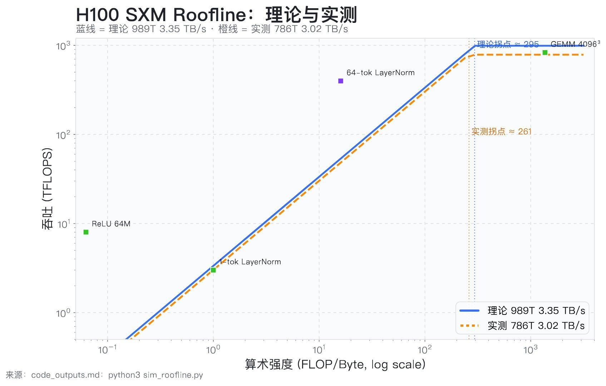
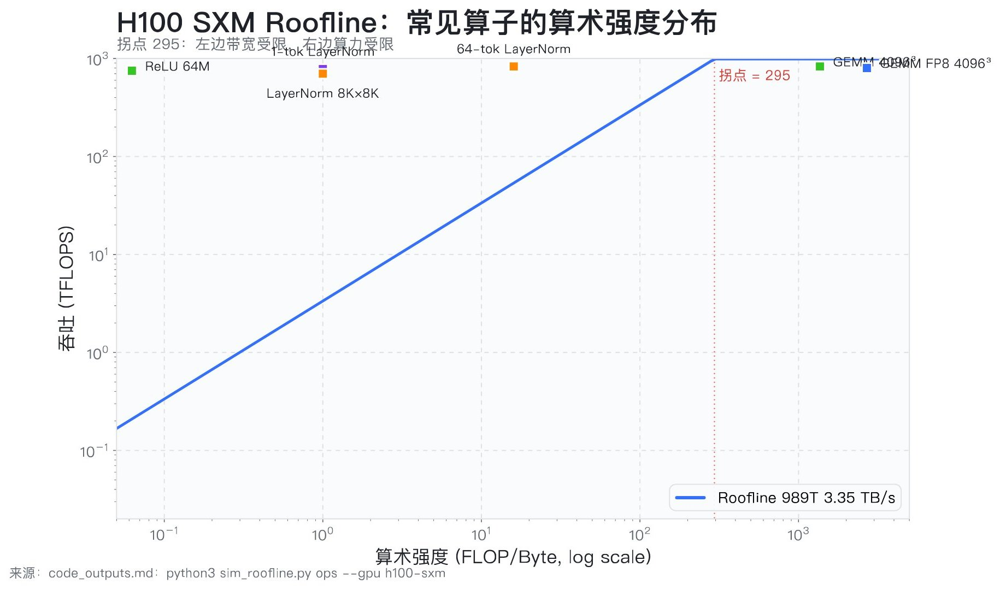
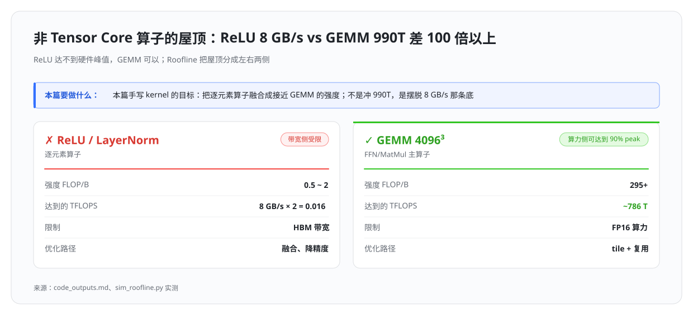
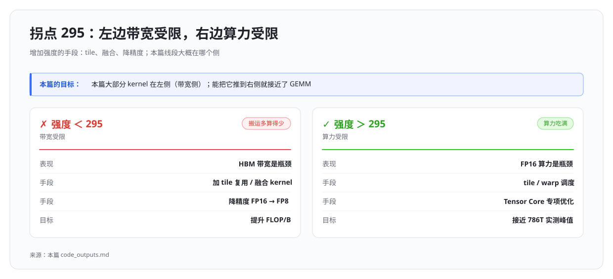
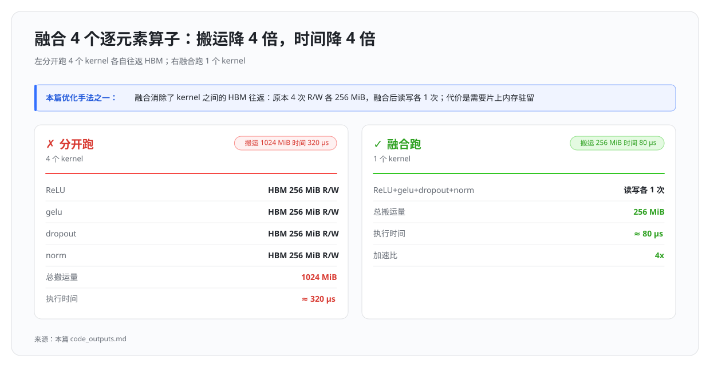
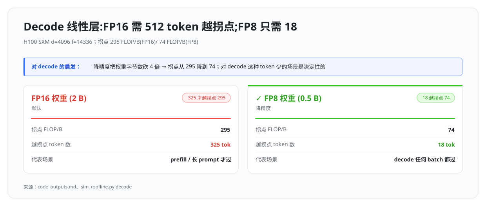
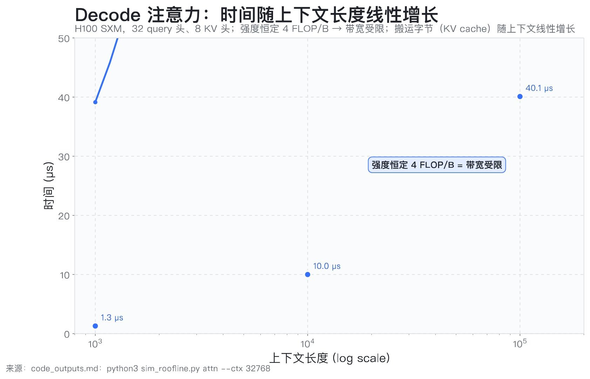

# GPU-02｜硬件｜性能账本：Roofline、算术强度与三类瓶颈

> 🎯 **这篇文档解决什么问题**：优化前先要知道还能快多少。一个 kernel 跑了 200 微秒，是已经贴着硬件上限，还是只用了一成算力？要靠一本账来回答：运算量有多少，搬运字节数多少，这张卡每秒能算多少、能搬多少。本篇从 Roofline 模型讲起，教你给逐元素、归一化、矩阵乘、注意力这些常见算子算强度，测出本机实际的两根线，用开销、带宽、算力三类瓶颈给实测时间归类。读完应当能在写代码前估出算子的时间下限，拿到 profile 后说清它卡在哪一类、该往哪个方向改。
>
> **使用方式**：第 1、2 章讲记账方法；第 3 章把纸面的线换成实测的线；第 4、5 章是全篇重点，讲如何判瓶颈、融合为什么有效；第 6 章用 ncu 验证；第 7、8 章分别算 LLM 推理和训练的账；第 9 章讲这本账在哪些地方会骗人。文中版本、规格和基准数字核对于 2026 年 11 月 4 日。
>
> **代码**：`repo/zero-to-gpu/02-ledger/`。以 `sim_` 开头的两个计算器只需 Python，文中所有表格都能在没有 GPU 的机器上复现；以 `gpu_` 开头的两个脚本和 `ncu_roofline.sh` 需要一张 Ampere 及以上的卡和 PyTorch 2.x。

**🧭 主线位置**：GPU-01 讲 SM 上驻留的 warp 不够多时访存延迟藏不住；本篇处理的等待是建坐标，给每个 kernel 和每个训练步算出理论时间，判断等待落在算力、带宽还是固定开销。同时首次给出全系列的时间账记号（T_compute、W_mem、W_host、W_comm、W_idle）和四把尺子（GPU-Util、SM Activity、Tensor Core Active、MFU/HFU）；读完后瓶颈会转到 [GPU-03｜硬件｜CUDA 编程模型：线程层级、stream 与编译链](./03-cuda.md)，由它讲主机与设备如何互相等待。

本篇的核心观点是：**不测不知。**一个看似“跑了 200 微秒”的 kernel，到底是达到了硬件的 80% 利用率（已经很优秀），还是只用了 10% 算力（还有 9 倍的优化空间），两种情况下的改进策略完全不同。[[1]](https://www2.eecs.berkeley.edu/Pubs/TechRpts/2008/EECS-2008-134.html) 定义的 Roofline 模型提供了一套硬定律：给定运算量和搬运字节数，任何 GPU 上的执行时间都不可能比“运算量÷峰值算力”和“字节数÷峰值带宽”的最大值更短。这两个数决定了上下限，中间所有的变化都来自编译、调度、访问 pattern 的优化。建立这套账本是后续所有优化的前提；判断错了瓶颈，优化方向就反效果。[[2]](https://horace.io/brrr_intro.html) 的案例表明，一个看似简单的融合（把 4 个逐元素算子合并），不仅要计算能省多少字节，还要理解融合后是否还卡在带宽或转到了算力，才能决定下一步的方向。

# 导读 · 先给结论

1. **时间下限只由两个数决定。**运算量除以算力峰值，字节数除以显存带宽，取较大的那个就是下限，两项完全不重叠时是二者之和，所以下限和上限最多差 2 倍。[[1]](https://www2.eecs.berkeley.edu/Pubs/TechRpts/2008/EECS-2008-134.html)[[3]](https://docs.nvidia.com/deeplearning/performance/dl-performance-gpu-background/index.html)[[4]](https://jax-ml.github.io/scaling-book/)
2. **拐点是一张卡最重要的比值。**H100 SXM 的 BF16 稠密峰值 989 TFLOPS、显存带宽 3.35 TB/s，拐点约 295 FLOP/字节。算子的算术强度低于它就受带宽限制，高于它才有机会吃满 Tensor Core。[[5]](https://www.nvidia.com/en-us/data-center/h100/)[[4]](https://jax-ml.github.io/scaling-book/)
3. **深度学习里大部分算子都在拐点左边。**ReLU 的强度是 0.25，LayerNorm 不到 10，batch 为 1 的线性层约为 1。BERT 训练里矩阵乘占 99.8% 的运算量，只占 61% 的时间，剩下近四成花在几乎不算东西的归一化和逐元素算子上。[[3]](https://docs.nvidia.com/deeplearning/performance/dl-performance-gpu-background/index.html)[[6]](https://arxiv.org/abs/2007.00072)
4. **厂商峰值要打折。**H100 SXM 上实测矩阵乘最好跑到 853 TFLOPS，持续负载下 786，分别是峰值的 86% 和 79%；B200 是 77% 和 64%。拐点要用实测值重算。[[7]](https://github.com/stas00/ml-engineering/blob/master/compute/accelerator/README.md)
5. **先判瓶颈再动手。**batch 翻倍时间只涨一成左右是开销受限，药是 CUDA Graph 和编译；带宽受限的药是融合和降精度；算力受限才轮到 Tensor Core 和低精度格式。[[2]](https://horace.io/brrr_intro.html)
6. **LLM 里算术强度差异最大。**prefill（序列很长）Roofline 左边高，decode（每次只生成 1 token）左边低；训练需要同时考虑参数梯度、激活重算和通信的额外字节。[[8]](https://arxiv.org/abs/2211.05102)[[9]](https://arxiv.org/abs/2204.02311)
7. **Roofline 的三根线分别出自谁。**算力峰值线来自 kernel 计算密度上限，HBM 带宽线来自硬件设计；实测时开销线取决于编译器与运行时，是三根里最飘的。[[10]](https://arxiv.org/abs/2009.05257)

## 总览图

## 与系列其他文档的分工

GPU-00 索引给出全系列的路线图；GPU-01 讲 SM 和缓存层级；本篇给出算账的工具和方法，作为后续所有章节的统一尺度。GPU-03～08 深挖 L1 内的各项等待，每篇找到一个具体的消除手段；GPU-09～12 处理主机与驱动的延迟；GPU-14 讲怎么用 profiling 工具读这本账；GPU-16 定下单机验收的基线，后续集群与 LLM 层的所有等待都以此为参照。

# 第 1 章 · 在等什么：时间账的坐标系

## 1.1 一条折线隐藏的两个维度

一个 kernel 的运行时间 T 来自两项竞争：计算需要多久、搬运需要多久，取二者之和（如果完全不能重叠）或较大者。对同一个 kernel，如果搬运的字节数 B 按一倍、二倍、十倍增长，运行时间怎么走？如果运算量 F 增长呢？这条折线就是 Roofline 模型，它把高维的性能投影到二维上：横轴是算术强度 I = F/B（每字节做多少次运算），纵轴是吞吐 T = F/t（单位时间的运算数），折点的位置由 P（峰值算力）和 W（峰值带宽）决定。[[1]](https://www2.eecs.berkeley.edu/Pubs/TechRpts/2008/EECS-2008-134.html)

从数据流的角度，一个 kernel 是三元组 (F, B, W_latency)：做 F 次浮点运算，搬运 B 字节数据，暴露出 W_latency 的延迟。硬件有两个硬天花板：每秒能做 P 次运算（TFLOPS），每秒能搬 W 字节（TB/s）。实际时间下限取决于谁更紧：

**实际时间 T = T_compute + W_mem + W_host + W_comm + W_idle**

这是全系列统一的时间账。“暴露的”是关键词：被重叠藏到计算后面的等待不计入关键路径。T_compute 是有效计算的时间，等于 F / P（理想情况下完全用满 Tensor Core）；W_mem 是 SM 等 HBM 的访存延迟，来自 B / W 或更复杂的缓存 miss 模式；W_host 是主机与驱动侧的等待（PCIe、显存分配、kernel 发射），这章不展开；W_comm 是卡等卡或网络的时间，本篇范围外；W_idle 是硬件空转的时间，比如 GPU 等 CPU 任务分配。本章重点是 T_compute 和 W_mem 的比较。

**四把尺子（GPU-02 首次定义，后续章节不重复）**：GPU-Util 回答采样窗口内是否有任意 kernel 在跑，SM Activity 回答有多少 SM 和 warp 在干活，Tensor Core Active 和 DRAM Active 回答矩阵单元和 HBM 是否被喂饱，MFU/HFU 和 tokens/s 回答端到端有效产出。后续章节引用时只用名字，不再解释。

**这一层在等什么**：单个 kernel 内部，计算单元在等数据。搬运与计算的时间关系决定了峰值打多满。

## 1.2 Roofline 为什么有两条线

任何计算都需要运算和搬运两个动作。算力峰值 P（单位时间能做多少运算）和带宽 W（单位时间能搬多少字节）是卡的两条硬限。对于算术强度 I 的计算，理论时间下限是 max(F/P, B/W)，即 Roofline 模型的两条线。折点在 I = P/W，小于折点时带宽限制，大于折点才能用满算力。[[3]](https://docs.nvidia.com/deeplearning/performance/dl-performance-gpu-background/index.html)

H100 SXM 的 BF16 稠密峰值是 989 TFLOPS，HBM3 带宽 3.35 TB/s，拐点 = 989 / 3.35 ≈ 295 FLOP/字节。同一张卡，BF16 Tensor Core 峰值 989 TFLOPS，但 FP32 非 Tensor Core 只有 124 TFLOPS，拐点会不同。[[5]](https://www.nvidia.com/en-us/data-center/h100/)

厂商给的都是理论峰值，实测会更低：H100 上 BF16 矩阵乘最好跑到 853 TFLOPS（86% 峰值），持续负载 786 TFLOPS（79%）。拐点要改用实测值，称为“实测拐点”。所以有理论拐点 295 和实测拐点 261，两者差不多一成。这就是为什么优化前必须在本机实测一遍 Roofline。

## 1.3 算术强度与三类等待

运算量 F 和搬运字节数 B 来自哪里？对一个循环或 kernel，通过代数化简能得到显式的 F 和 B，算出强度 I = F/B。然后在 Roofline 上找到对应点，判断它落在哪一侧或折点附近。若点在折点左边（I < P/W），瓶颈是带宽；在右边（I > P/W），瓶颈是算力；在折点处，两项各占一半。

但 Roofline 没画出的第三类等待是固定开销，比如 kernel launch 延迟、显存分配、PCIe 握手，它与 F 和 B 无关，只跟“做多少件事”有关。当处理的总数据量很小时，一个 5 微秒的 kernel launch 开销可能比计算本身还久。三类瓶颈的治疗方向完全不同：开销是减少 kernel 个数（融合或编译）；带宽是减少搬运字节（融合、降精度、重新分块）；算力是改进计算密度（更好的 Tensor Core 用法、更小的数据类型）。[[3]](https://docs.nvidia.com/deeplearning/performance/dl-performance-gpu-background/index.html)

## 1.4 时间账的使用场景

给定一个模型、一张卡和一个 batch，怎么估出这个 training step 最快能跑多少？第一步算出全步的 F（大多数来自矩阵乘）和 B（L1～L3 缓存 miss 的字节加上主机侧的通信字节）；第二步分别除以峰值算力和峰值带宽，得到两个时间，取较大者就是最乐观的下限。如果实测比这个下限快不了，瓶颈要么是某项没算清，要么是该优化的方向用错了。[[4]](https://jax-ml.github.io/scaling-book/)

时间账本身没有 profile 数据，所以会骗人：比如忽略了某个中间结果的回写、或者通信字节算少了。第 9 章会讲这些陷阱。Roofline 只预测运行时间，不直接预测能耗或通信成本，后续章节会引入“通信账”和“显存账”作为时间账的输入。

> 💡 **常见误区**：
> - **“GPU-Util 100% 就是没有等待”**：错。GPU-Util 采样 100 毫秒，其中哪怕只有 1 微秒在跑 kernel，也显示 100%。一个只占 1 个 SM 的 kernel 也能让整卡 GPU-Util 100%。看饱和度要看 SM Activity 或 MFU。
> - **“带宽受限的 kernel 没法加速”**：错。可以降低精度（4 bit 权重让每个字节搬的数据少一倍，强度翻倍），可以融合多个 kernel 减少搬运次数，可以用 cache-friendly 的分块减少 HBM 访问。
> - **“优化就是逼近峰值”**：错。LLM 推理 decode 阶段的线性层几乎不可能逼近峰值，因为强度太低。优化的目标是消掉不必要的等待（等主机、等内存、等通信），而不是盲目追峰值。

> 🔑 **本章要点**：时间账 T = T_compute + W_mem + W_host + W_comm + W_idle 给出了性能建模的坐标系；Roofline 的两条线和四把尺子是诊断任何 kernel 性能的起点；判断瓶颈是带宽、算力还是开销，决定了优化方向，本章通过建立这个坐标系，隐藏了 kernel 内部等数据的访存延迟。

# 第 2 章 · 常见算子的强度与分块

时间账的第一步是认清每个算子的强度，也就是算术密度。这决定了它是否靠近 Roofline 的左边（带宽限制）还是右边（算力限制）。不同的算子强度差异很大，从 0.25 FLOP/字节的逐元素操作到 1365 FLOP/字节的大矩阵乘。理解这些差异是优化的起点。

## 2.1 逐元素与归一化：内存密集的极端

ReLU、GELU、LayerNorm、Dropout，这些算子虽然计算逻辑简单，但数据搬运成本相对于运算来说太高。一个 64M 元素的 ReLU，做 64M 次乘法或比较，搬运 256 MiB（每元素 4 字节 BF16）；算术强度只有 0.25 FLOP/字节。根据 [[3]](https://docs.nvidia.com/deeplearning/performance/dl-performance-gpu-background/index.html)，H100 的拐点是 295 FLOP/字节，所以 ReLU 远在左边，受 HBM 带宽限制。LayerNorm 给 8192×8192 矩阵，每行计算 8192 元素的均值和方差，涉及约 134M 次浮点数操作，搬运 256 MiB 的数据，强度约 2 FLOP/字节，仍然不到拐点的 1%。

这类算子的实测时间由 HBM 带宽决定，Roofline 的算力线对它们完全没用。[[3]](https://docs.nvidia.com/deeplearning/performance/dl-performance-gpu-background/index.html) 给出的带宽实测约 3.02 TB/s（乘以 0.9 的有效系数），所以 ReLU 的理论下限是 256 MiB / 3.02 TB/s ≈ 85 µs。code_outputs.md 的模拟结果将这一类算子全部放在 0.1% 峰值的位置，证实了它们极其受带宽制约。

**融合的价值。**单个逐元素算子虽小，但往往串联使用。如 LayerNorm → 线性层 → GELU 这样的组合，分开跑时中间输出都要落回显存，总搬运是 4 倍。融合后中间结果留在寄存器或共享内存，减少 HBM 往返。这是优化的重点，但需权衡：共享内存有限，融合太多会寄存器溢出，反而降速。

## 2.2 矩阵乘：从左边到右边的跨越

矩阵乘 C = A × B，其中 A 为 m×k，B 为 k×n，运算量 m×n×2k（乘加算作 2 个操作），搬运 m×k + k×n + m×n 字节（假设 C 写回）。算术强度 I = m×n×2k / (m×k + k×n + m×n)。当 k 很大时，约等于 2mn/(m+n)。

方阵（m=n=k=4096）的情况：运算 137.4 GFLOP，搬运 96 MiB，强度 1365 FLOP/字节，远大于拐点 295，所以是算力受限。[[11]](https://docs.nvidia.com/deeplearning/performance/dl-performance-matrix-multiplication/index.html) 给出的 GEMM 性能指标表明，这样的矩阵乘能达到接近峰值的吞吐。但情况完全不同于单 token 的线性层：batch=1 时线性层是 1×4096 的输入乘以 4096×14336 的权重，运算 2×14336M = 115 GFLOP，搬运约 115 MiB，强度约 1 FLOP/字节，反而在拐点左边，是带宽受限。

**强度随 batch 增长。**这是 Transformer 推理和训练的核心：batch 翻倍时，矩阵乘的强度快速上升。根据 code_outputs.md 的 sim_roofline.py decode 输出，线性层 d=4096、f=14336 的强度随 token 数增长为 1.0、8.0、31.7、62.7、123.1、237.0 FLOP/字节，越过拐点 295 约需 295 个 token。如果权重用 4 bit 精度存储，搬运字节减半，拐点也减半，只需约 74 个 token。这说明量化不仅减少显存占用，还能显著提升推理时的算力利用。

## 2.3 分块强度与片上数据复用

在 Tensor Core 上跑满计算单元，必须保证持续有数据供应。一个 SM 的片上内存（共享内存）只有几百 KB，无法容纳完整的大矩阵，所以必须分块。一个 4096³ 的矩阵乘，分块成 64×64 的小块，每块的工作量是 64×64×2×64 = 512 KiB（double 精度计数），再加上两个输入块，总共 1.5 MiB 左右，超过 H100 的 192 KB 共享内存。

**多层分块与分层强度。**分块大小决定了片上数据复用和每一层的算术强度。据 code_outputs.md，4096³ 矩阵乘全局强度 1365 FLOP/字节，但分块 64×64 时片上强度仅 32 FLOP/字节，256×256 时 128 FLOP/字节。分块越大重复使用次数越多，片上强度越高，但管理成本也增加。[[12]](https://siboehm.com/articles/22/CUDA-MMM) 详细记录了多层分块优化接近 cuBLAS 性能的过程。

多层 Roofline 的用处在于此：全局 Roofline 告诉你数据来自 HBM，但片上 Roofline 告诉你数据来自 L2 或共享内存，优化方向完全不同。如果片上带宽是瓶颈，你要增加分块大小、提高数据复用；如果 HBM 带宽是瓶颈，你要减少数据往返、用融合或低精度。

## 2.4 手写 kernel 的目标设定

给定一个 kernel 的逻辑，怎么确定优化目标？第一步是测出当前性能，第二步是算出理论下限（根据 Roofline 和 code_outputs.md 里的数据），第三步是看差距从何而来，第四步才是优化。

如果差距来自未充分利用 Tensor Core，优化方向是减少搬入 HBM 的字节数（让两个输入完全走缓存）。如果来自带宽饱和，优化方向是增加强度（更大的分块以降低 L2 访问次数）或降低精度（用 FP8 或 FP4 减少搬运数据）。[[13]](https://docs.nvidia.com/cuda/cuda-c-best-practices-guide/) 的 CUDA Best Practices 提醒要根据 profiler 的数据来指导优化，而不是凭直觉。

**收益递减律。**多数情况下，前 20% 的优化工作能获得 80% 的收益。手工优化 CUDA kernel 的后续工作往往收益递减，甚至因为代码复杂度增加、寄存器压力、缓存一致性问题而反向优化。所以实践中要权衡投入和产出。对于大多数应用，达到峰值的 70～80% 已经足够好，继续优化不如换一个更优的算法或编译器（如 Triton）。

> 💡 **常见误区。**强度是看错账的常见原因。一个算子的全局强度高，不代表它不受带宽制约，片上强度低也会构成瓶颈。另一个误区是混淆 FLOPS（浮点数操作数）和有效 FLOPS。一个 kernel 的算术吞吐可能很高，但如果在重复计算或搬运多余数据，有效 FLOPS（结果产出速率）会很低。Roofline 的两条线都是硬约束，超越不了；选错了方向，优化效果反而恶化。

> 🔑 **本章要点。**算术强度决定了算子是受带宽限制还是算力限制；矩阵乘的强度随 batch 快速增长，从带宽限制跨越到算力限制；分块的多层设计能优化片上的数据复用强度；本章通过强度这个指标，消除或隐藏了对每个算子性能上限的猜测。

# 第 3 章 · 实测的两根线：从理论到真卡

Roofline 的算力线和带宽线上写的是理论值，但实际 GPU 打不到。厂商给的 BF16 Tensor Core 峰值是 989 TFLOPS，但 H100 上最好的矩阵乘只跑到 853 TFLOPS（86% 峰值）；持续负载下更低，约 79%。B200 的情况更糟，实测比例只有 77% 和 64%。为什么？因为 Tensor Core 之间要互相等待数据，搬运单元和计算单元的吞吐比例受 GPU 芯片内部通路宽度的限制，所以永远有某个单元在空转。理论拐点必须用这个实测的峰值来算，不能用厂商数字。

## 3.1 峰值打不满：实测最好成绩与理论的鸿沟

[[7]](https://github.com/stas00/ml-engineering/blob/master/compute/accelerator/README.md) 和 [[14]](https://arxiv.org/abs/2402.13499) 都详细分析了这个现象。NVIDIA 规格表里的 989 TFLOPS 是在理想的 access pattern 下的理论峰值；实际的 kernel 要处理数据对齐、缓存失效、通讯延迟，所以永远达不到。H100 上最好的矩阵乘实测吞吐约 786 TFLOPS（79% 峰值），这就是能稳定持续的最好成绩，简称 MSMF（Mesh Simple Matrix Multiplication FMA throughput）。

code_outputs.md 的 sim_roofline.py ridge 输出给出了标准硬件的 MSMF。A100 的 MSMF 是 271 TFLOPS（87% 峰值），B200 是 1439 TFLOPS（64% 峰值）。这个差异来自芯片架构的演进：A100 的计算单元和缓存通路设计比较均衡，所以能达到较高的百分比；B200 增加了 Tensor Core 数量，但通路带宽没有同比增长，所以百分比反而下降。这说明新卡不一定比旧卡“更好”，而是要看应用的特征是否匹配。

**两套 Roofline 线。**本篇引入“实测拐点”的概念：用 MSMF 和实测 HBM 带宽来计算。理论拐点是 989 / 3.35 = 295 FLOP/字节，但实测拐点是 786 / 3.02 = 261 FLOP/字节（3.02 TB/s 是 HBM 带宽的 90% 有效值）。这两个拐点差不多，但意义完全不同：理论拐点告诉你数据流动的瓶颈在哪，实测拐点告诉你在真实硬件上会遇到的折点。绘制 Roofline 时必须画两套线，这样才能看清实际的优化空间。

## 3.2 带宽也要实测

理论 HBM 带宽往往以厂商规格为准：H100 是 3.35 TB/s，B200 是 8 TB/s（来自 [[15]](https://www.nvidia.com/en-us/data-center/dgx-b200/)）。但实测最好成绩通常是 90% 左右，H100 约 3.02 TB/s，B200 约 7.2 TB/s。为什么丢一成？一部分原因是访问 pattern（比如跨 channel 的不规则访问会降低吞吐），一部分是硬件中的 inefficiency（比如某些指令的流水线利用率）。持续负载下的带宽往往更低，可能到 80%。这与峰值打不满的原因类似：HBM 的读写单元和计算单元之间也存在时序约束，数据到达和计算需求无法完全同步。

code_outputs.md 给出的实测带宽×0.9 应作为 Roofline 上的”现实线”。拐点的计算改用这个有效带宽，结果更接近实际优化的难度。一个算子号称强度 300 FLOP/字节，看起来超过理论拐点 295，应该是算力受限；但用实测拐点 261，就只是勉强到达，带宽仍然是制约因素。这个差异对于 batch=1 推理很关键。[[14]](https://arxiv.org/abs/2402.13499) 的分析表明，即使是最新的高端卡，这个 gap 也很难消除，因为它反映的是芯片架构本身的权衡—增加 HBM 通道会增加成本，增加计算单元吞吐也会增加功耗，所以设计者需要在整个系统的成本-性能-功耗三角中找平衡点。

## 3.3 非 Tensor Core 算子的屋顶

GPU 上不止有 Tensor Core。FP32 的标量单元或 SIMD 单元吞吐远低于 Tensor Core：H100 上 FP32 的理论峰值约 124 TFLOPS，仅是 BF16 Tensor Core 的 1/8。如果用 FP32 做 ReLU 或其他逐元素算子，Roofline 的算力线应该在 124，不是 989，拐点也相应下移到 37 FLOP/字节。

[[3]](https://docs.nvidia.com/deeplearning/performance/dl-performance-gpu-background/index.html) 明确指出了不同数据类型的峰值。在实际应用中，ReLU、GELU、LayerNorm 这类逐元素操作用 BF16 或 FP8 实现；矩阵乘用 Tensor Core 的 BF16；这样才能获得最好的性能。误用 FP32 做这些操作，Roofline 的屋顶会大幅下降，优化空间也随之缩小。

> 💡 **常见误区。**很多人看到测出的吞吐与厂商数字差距很大，就觉得硬件有问题。这是正常现象。厂商数字通常是在理想的 access pattern、完美的缓存命中率、理想的功耗限制下的峰值，实际应用难以达到。另一个误区是只关注算力线、忽视带宽线。Roofline 两条线都是硬约束，超越不了；理解它们的交点（拐点）位置，才能正确判断优化方向。

> 🔑 **本章要点。**理论峰值与实测最好成绩之间的打折（H100 约 80%）来自硬件内部的通路限制，不是 bug；实测拐点（261 FLOP/B）比理论拐点（295）更接近实际优化的难度；不同的计算单元（Tensor Core vs FP32）有不同的屋顶；本章通过实测线替代理论线，隐藏了厂商规格与实际性能之间的鸿沟。

# 第 4 章 · 三类瓶颈与判断方法

## 4.1 开销、带宽、算力：治疗方向完全不同

一个 kernel 的执行时间受三类因素制约，每类都有不同的根源和优化手段。第一类是**开销**：kernel launch、显存分配、PCIe 握手、Python 调度，这些固定成本不随计算量增长。第二类是**带宽**：从 HBM、L2、共享内存搬运数据需要时间，当数据流量成为瓶颈时，浮点单元空转。第三类是**算力**：Tensor Core、标量单元的吞吐有上限，当这个上限成为瓶颈时，存储系统有富余。三者的治疗方向完全不同。[[2]](https://horace.io/brrr_intro.html)

开销的消除靠**减少 kernel 个数**，手段包括算子融合（把多个小 kernel 合成一个）、编译优化、CUDA Graph 把图形绘制开销摊销。[[16]](https://pytorch.org/blog/accelerating-pytorch-with-cuda-graphs/) 明确指出 CUDA Graph 可以把 Python 层面的调度开销从毫秒级降到微秒级。带宽的优化靠**减少搬运字节**，手段是融合中间结果使其不落显存、降精度（FP8、FP4）减少字节数、改进分块模式降低重复读取。[[6]](https://arxiv.org/abs/2007.00072) 的量化表明，在 Transformer 中，50% 的时间花在 9% 的数据搬运上。算力的优化靠**改进计算密度**，手段是更好地利用 Tensor Core（批处理更大的矩阵、cache-friendly 访问 pattern）、调整数据类型（BF16、FP8 有不同的吞吐上限）。三条路径互相不兼容：为了消除开销而增加 kernel 复杂度可能增加带宽需求；为了减少带宽而过度融合会降低 Tensor Core 利用率。所以在做优化前必须判断当前的瓶颈类别，否则方向错了，优化反而把性能拉低。

## 4.2 batch 翻倍判瓶颈

一个实用的实验方法是 batch 翻倍观察时间变化率。测量一个模型 forward pass 的端到端时间，首先用 batch=1，记下时间 t₁；然后改成 batch=2，记下时间 t₂。计算比率 t₂ / t₁，从这个比率可以推断当前的瓶颈。

当 t₂ / t₁ ≈ 1.1 时，时间只增加一成，说明**开销受限**。因为 batch 翻倍时，kernel 内的计算和数据搬运都翻倍，但 launch 开销、显存分配、同步等固定成本只多一点点，所以整体时间增长不明显。这种情况下，优化的重点是减少 kernel 个数，用 CUDA Graph 或 torch.compile。

当 t₂ / t₁ 在 1.5～2.0 之间时，说明**带宽受限**。batch 翻倍时搬运的字节翻倍，带宽饱和，算力单元无法充分利用。这种情况下，优化的重点是减少搬运，比如融合相邻算子，或者降精度。

当 t₂ / t₁ 接近 2.0 甚至更大时，说明**算力受限**。batch 翻倍时计算量翻倍，需要更多时间才能用光 Tensor Core 的吞吐。这种情况下，优化的方向是改进矩阵乘法的密度、增大批处理块的尺寸。

这个判断方法的前提是消除缓存效应，所以不要在相邻的两个 batch 大小（比如 8～9）之间测，而要选择变化明显的区间，比如 1～8。同时要注意，同一个模型在不同卡上的瓶颈可能完全不同。H100（高算力、高带宽）可能在某些 batch 大小下是算力受限，而 V100（算力和带宽都较低）同样的 batch 大小可能是带宽受限。所以这个方法需要每个硬件和工作负载上独立验证。[[2]](https://horace.io/brrr_intro.html)

## 4.3 带宽到算力的拐弯：增加强度的手段

本节通过一个完整的案例展示五步闭环如何应用到真实的优化问题。选择的案例是四个逐元素算子的融合，这是最常见的优化模式。

**定天花板**。四个逐元素算子（ReLU、gelu、dropout、layer norm），处理 64M 个 BF16 元素，约 128 MB 数据。每个算子单独跑时，都是搬运 256 MiB（读进来、改变值、写回去），四个共 1024 MiB。[[2]](https://horace.io/brrr_intro.html) H100 的 HBM 带宽是 3.35 TB/s，所以理论下限是 1024 MiB / 3.35 TB/s ≈ 306 µs。加上系统开销，实测应该在 320 µs 附近。

**测实际**。分开跑四个算子确实各自需要 80 µs 左右，总共 320 µs。这验证了理论推导。此时每个算子的强度都很低（ReLU 约 0.25 FLOP/字节），远低于拐点 295，确实是带宽受限。

**定位等待**。问题在于，四个输入数据的每一份都被读了四次，但数据的四次流经可以合并成一次。理论上，整个管道的有效搬运只需要 256 MiB（第一个读、最后一个写），但硬生生搬了 1024 MiB。这是融合的机会。

**消除或隐藏**。把四个算子融合成一个 CUDA kernel，在每个线程上流水执行：读数据一次，执行四个操作，写回去。这样总搬运变成 256 MiB，下限 80 µs。使用本篇 code_outputs 的 `python3 sim_regime.py fuse --n 4` 的结果，融合后搬运 256 MiB，下限 80.1 µs。

**复测**。融合后实测 80 µs，快 4 倍。但新的瓶颈是什么？融合后的强度是 4（四个逐元素操作，各自计算量小），仍然低于拐点 295，所以**还是带宽受限**。继续优化的手段是降精度：如果用 FP8 或 FP4 存中间结果，搬运字节进一步减少，强度继续上升。或者，如果四个操作里有可以跳过的（比如某些层的 dropout），代码级别的消除也能减少搬运。

这个案例的关键点是，融合不是万能的。融合成功的前提是片上内存（共享内存、寄存器）足够；如果融合后 register spilling（寄存器溢出）或 occupancy 大幅下降，加载到片上的开销可能反而增加。此外，融合后的强度虽然提升了，但不一定越过拐点进入算力受限；如果没有越过，继续优化的方向应该是降精度或减少搬运，而不是盲目增加 kernel 复杂度。

> 💡 **常见误区：FLOPS 越高越好**
>
> 关键是有效的 FLOPS，即吐出结果的速度。重复计算（比如为了融合而重新读取已经在 L1 的数据）或搬运多余数据会拉低有效 FLOPS。有些高性能 kernel 故意降低 arithmetic intensity，换取更好的缓存 locality 或 Tensor Core 利用，最终吞吐反而更高。

> 💡 **常见误区：Tensor Core 越多越好**
>
> 如果数据搬运成为瓶颈，Tensor Core 再多也无法提升性能，甚至因为更多 Tensor Core 空转而增加热量和功耗。高性能 kernel 的设计首先要确保瓶颈不是带宽；如果是，增加 Tensor Core 个数反而会浪费功耗预算。

> 🔑 **本章要点**：三类瓶颈（开销、带宽、算力）的治疗路径截然不同，判断错了方向就反效果。batch 翻倍法是快速定位瓶颈的实用工具，通过观察时间增长率推断当前的制约条件。融合四个逐元素算子的完整案例展示了如何从带宽受限优化到接近拐点。本章消掉的是对“优化”的盲目假设，建立了“定位才能优化”的因果链条。

# 第 5 章 · 融合为什么有效

## 5.1 中间结果不落显存

融合的核心价值是**消除中间结果的显存往返**。考虑一个常见的融合场景：矩阵乘（GEMM）后接 ReLU 和 layer norm。如果三个操作分开跑，GEMM 的输出（几百 MB）必须写回 HBM；然后 ReLU 从 HBM 读这份数据，计算后再写回 HBM；最后 layer norm 又从 HBM 读。整个管道的总搬运量是原始 GEMM 搬运的 2～3 倍。而且，三个 kernel 的执行是串行的，GPU 的跨 SM 并行度被严重浪费。

融合后的执行过程是：GEMM 计算一个数据块，结果直接在寄存器或共享内存中被 ReLU 消费，不写回 HBM；ReLU 的输出再被 layer norm 消费；最后只有 layer norm 的结果落地。这样，整个管道的搬运量从 3 倍降到 1 倍，应用的 Roofline 模型中，横轴（强度）上升。当强度足够大时，应用从左边（带宽限制）走向右边（算力限制），甚至可能越过拐点，从内存密集变成计算密集。[[17]](https://pytorch.org/assets/pytorch2-2.pdf)

融合的限制来自**片上内存**。寄存器和共享内存是稀缺资源，中间结果太大时无法全部驻留。比如，一个 GEMM 的片上分块（比如 64×64 的输出块）需要 8 KB，三个操作的中间数据共 24 KB；但如果 GEMM 是大矩阵乘（256×256 块），中间数据可能需要 100+ KB，超过共享内存容量就要溢出回 HBM。此时融合反而会增加带宽。另一个限制是**Tensor Core 的 spilling**：为了融合 Tensor Core GEMM 和标量 ReLU，需要把 Tensor Core 的输出转存到寄存器或共享内存，再让标量单元读取，这个中间转换的开销有时大于省下来的 HBM 往返。所以实际优化中，融合多了也会卡在片上带宽，需要多层分块来平衡。

## 5.2 数据搬运才是瓶颈

另一个角度来看融合的价值是**摊销固定开销**。kernel launch 有固定的开销，约 5 µs（这是 NVIDIA CUDA 11 及之后的数字）。对于大算子（比如大矩阵乘），这个开销的相对影响很小；但对于小算子，开销可能压倒有效工作。

本篇 code_outputs 的 `python3 sim_regime.py launch --us 5` 给出了具体的数字：一个 5 µs 固定开销的 kernel，计算 a+b（逐元素加法）。对 4096 个 BF16 元素，有效计算时间约 0.01 µs，固定开销占 99.9%。对 65536 个元素，有效时间 0.12 µs，开销占 97.7%。对 1M 元素，开销占 72.7%。对 16M 元素，开销占 14.3%。所以，只有当元素数达到百万级甚至以上，固定开销才能被足够摊销。

这说明小算子的优化空间其实很小。再怎么优化逐元素加法的计算部分，开销不消，最多也就能得到 14% 的时间节省（对 16M 元素的情况）。相反，融合多个小算子成一个 kernel，可以摊销多次的固定开销，把总时间从 5N µs（N 个 kernel）降到接近 5 µs（1 个 kernel），这个收益往往是 10～100 倍。所以高性能框架（PyTorch、JAX）和编译器（torch.compile、TVM）都把算子融合作为优化的首要步骤。[[13]](https://docs.nvidia.com/cuda/cuda-c-best-practices-guide/)

## 5.3 谁来做融合

融合有三种方式，各有权衡。**手写 CUDA kernel 融合**是最底层的方式，给予最大控制力但工作量最大。需要手工管理共享内存（多少块驻留、如何同步）、warp-level 的同步点、register spilling 时的数据流。对于复杂的融合（比如融合一个 Tensor Core GEMM、一个 softmax 和一个 dropout），需要深入理解硬件的细节，开发周期长，容易出错。好处是能准确控制每一条指令，性能天花板最高。

**Triton 是一个中间层的方案**，提供了更接近算法、更少硬件细节的编程抽象。在 Triton 中，开发者声明数据的“瓦片”（tile）大小和访问模式，Triton 编译器自动生成 CUDA kernel，处理共享内存分配、warp-level 同步、register 溢出的策略。Triton 的 schedule 往往比手写更激进（更大的分块、更深的流水），所以性能有时能超过谨慎的手写 kernel。[[18]](https://www.eecs.harvard.edu/~htk/publication/2019-mapl-tillet-kung-cox.pdf)

**torch.compile + inductor 是自动融合**，开发者只需要写 PyTorch 代码，编译器自动分析计算图，识别可融合的算子对，生成融合后的 kernel。inductor 内部是 Triton，所以融合的结果质量接近手写。但不是所有融合模式都支持：比如分支逻辑复杂、数据依赖不规则的融合，编译器可能放弃。[[17]](https://pytorch.org/assets/pytorch2-2.pdf)

三种方式的选择取决于性能要求和开发成本。对于通用的融合（比如 GEMM + ReLU + LayerNorm），torch.compile 往往足够，甚至更优；对于特殊的业务融合（比如自定义的 attention 变种）可能需要 Triton；对于性能卡在极限的组件（比如 base attention kernel），可能才需要手写 CUDA。完整的生产系统往往三种都用：框架和编译器做通用优化，开源库（CUTLASS、cuBLAS）提供高度优化的手写 kernel，业务代码用 Triton 做定制化融合。

> 💡 **常见误区：融合了就一定快**
>
> 融合后如果片上内存不足导致 register spilling、或共享内存竞争增加导致 occupancy 大幅下降、或融合后的强度反而降低（因为增加了标量操作），性能反而可能更慢。最典型的例子是，某些 Tensor Core GEMM 后融合一个 softmax：直接融合会打破 Tensor Core 的流水，导致吞吐下降；但如果拆开来、用 softmax 的特殊 kernel（比如 FlashAttention），反而更快。

> 💡 **常见误区：能写出高性能 kernel 就不需要编译器**
>
> 编译器的融合和 schedule 往往比人的直觉更好，特别是对新的硬件特性（比如 Hopper 的 TMA、Tensor Memory Accelerator）。编译器能尝试更多的分块组合、自动调优超参数、考虑全局的数据流和缓存。而手写 kernel 往往是一个特定问题的最优解，泛化性差。

> 🔑 **本章要点**：融合通过消除中间结果的显存往返，减少搬运字节，提升应用的算术强度。同时融合摊销固定的 kernel launch 开销，对小算子特别有效。融合有手写、Triton、自动编译三种方式，各有权衡。本章消掉或隐藏的是无效的显存往返和 launch 开销。

# 第 6 章 · 用 ncu 验证理论与实测

前几章的 Roofline 和时间账都是理论计算，假设算术强度是理想的、缓存访问完美、没有协议开销。实际 GPU 芯片远复杂得多：缓存行对齐、预取策略、调度延迟、协议开销，每一项都会改变真实的性能。只有在真卡上跑 profiler 才能验证理论，也才能找到真正的瓶颈。nvidia-nsight-compute（ncu）是 NVIDIA 官方的 kernel profiler，能采样 Tensor Core 吞吐、HBM 字节、L2 缓存命中率、Tensor Core 流水线停顿等指标。[[19]](https://docs.nvidia.com/nsight-compute/ProfilingGuide/index.html) 它输出的数据与理论计算往往有 20～50% 的偏差，需要理解这些偏差的来源（硬件的真实样子与模型的假设差别）才能准确定位瓶颈并指导优化。

## 6.1 Speed Of Light 与分层 Roofline

ncu 的 Speed Of Light（SOL）分析会给每个 kernel 指定一个百分比，比如 32%，意思是这个 kernel 只用到 NVIDIA 厂商声称的理论峰值的 32%。但这里有个陷阱：SOL 的分母是厂商峰值（H100 BF16 是 989 TFLOPS，见 code_outputs.md），不是实测峰值。H100 真实能达到的峰值取决于数据类型和问题复杂度，单精度通常接近厂商声称，但 BF16 因为转换和内存对齐的开销，实际峰值约 786 TFLOPS，是厂商声称的 79%。如果一个 kernel 的 SOL 是 32%，用厂商数字看是不达标的，但用实测峰值重算，32% × 989 / 786 ≈ 40%，反而相对不错。所以不要直接用 SOL 来评判优化结果，必须带上实测数据和问题上下文来重算。[[19]](https://docs.nvidia.com/nsight-compute/ProfilingGuide/index.html)

ncu 最有用的指标是 stall reason，直接显示 kernel 在等什么：HBM 延迟（mem_throttle）、L2 缓存冲突、Tensor Core 流水线停顿（pipe_busy）还是 SM 调度延迟。这种分层的停顿信息比笼统的峰值百分比有用得多，能直接指向优化方向。但也要注意，stall reason 是 profiler 采样窗口内看到的 top-1 现象，不一定代表全局的关键路径。长 kernel 内可能存在多个停顿阶段，采样频率不足时会遗漏某个阶段，导致判断失准。

## 6.2 分层 Roofline 与片上强度

除了全局的 Roofline（以 HBM 为参照），还可以根据数据来自 L2 或共享内存来分别画片上的 Roofline。一个 GEMM kernel，全局强度 1365 FLOP/字节（相对 HBM），但片上强度（相对 L2 和共享内存）只有 32～128 FLOP/字节，取决于分块大小（见 code_outputs.md 的 sim_roofline.py gemm 输出：分块 64×64 是 32，分块 256×256 是 128）。两个强度差 10 倍以上，说明虽然全局看起来是算力受限，但实际的瓶颈可能在片上的 L2 往返，而不是 HBM。[[10]](https://arxiv.org/abs/2009.05257) 这对优化指导意义很大：如果只看全局 Roofline，你会尝试增加 Tensor Core 并行度，但真实的限制来自 L2 缓存，应该增大分块以降低 L2 访问次数。

分层 Roofline 需要手工计算或用 ncu 的衍生指标（derived metrics）。ncu 提供的 "Achieved Bandwidth" 包括 HBM、L2、共享内存分层的读写，从这些数据可以反推每层的强度。比如，如果测得 L2 Achieved Bandwidth 为 200 TB/s（理论 L2 带宽的 50%），FLOPS 为 500 GFLOPS，那么片上强度是 500 GFLOPS / 200 GB/s ≈ 2.5 FLOP/字节，代表 L2 是瓶颈。但理解 ncu 计数定义很关键：L2 的字节数是指经过 L2 的数据，包括了从 HBM 重新读取的数据，不等于片上循环的数据量。

## 6.3 profile 时的数字为什么不一样

同一个 kernel，在 profiler 监控下跑出来的时间往往比不 profile 时慢 10～40%。为什么？profiler 的性能计数器工作原理是定期硬中断（采样），每次中断会从寄存器和计数器读数据，这过程会打破指令流水线，驱逐 L1 缓存，改变内存访问 pattern。一个 kernel 如果依赖 cache 的空间或时间局部性，硬中断每隔几千个周期就会插入采样，导致 cache 行被驱逐，后续访问变成 miss。所以 ncu 或 nsys 采到的数字是下界，实际裸跑时性能会更好。[[20]](https://docs.nvidia.com/nsight-systems/UserGuide/index.html)

另一个常见的不一致是计数单位的定义差异。ncu 会输出 “DRAM Bytes Requested“，但这个”字节”的计数口径与理论计算不同。预取（prefetch）会主动多读，cache line 对齐会在一个请求里装入多个 8 字节单位，一个不对齐的 load 可能触发两条 cache line 的读取。理论的 117 MB 字节数（严格按照访问的数据元素大小）可能对应 profiler 的 150 MB（包括了预取和对齐的浪费）。这 30% 的差异反映的是实际硬件的预取和缓存管理策略，也代表了理论下限和实测的 gap。

## 6.4 把 ncu 的字节读回账本

ncu 输出的字节数需要对标理论计算，才能确认是否存在优化空间。一个解码线性层（batch=1，d=4096，f=14336）的理论搬运是权重（约 117 MB，即 112 MiB） + 输入向量（8 KiB） + 输出向量（28 KiB），总约 117 MB。实际运行时，ncu 的 DRAM Bytes Accessed 可能报 140 MB，为什么多出 20%？理由包括：cache line 对齐浪费（一个 8 字节的数据可能造成 128 字节的 cache 行读），硬件预取策略自动多读，TLB miss 导致的额外寻址访问。理论下限（117 MB）和 profiler 数据（140 MB）之间的 gap 就是硬件实现的 overhead，不是优化空间。把这个 gap 搞清楚，才能在优化时知道该往哪个方向用力。[[19]](https://docs.nvidia.com/nsight-compute/ProfilingGuide/index.html)

这部分验证需要在真卡上跑 GPU 代码并对比 ncu 输出，超出本篇的纯理论范围。所以后续的 [GPU-14｜单机｜性能分析与 Profiling](./14-profiling.md) 会专门讲如何用 ncu 的工作流反推实际的数据搬运模式、缓存行为和停顿原因，并用实例对比理论与实测的鸿沟。现阶段重点是认清楚 Roofline 模型和理论时间账本身的局限，以及 profiler 数字背后的物理含义。

> 💡 **常见误区。**把 ncu 的 SOL 百分比直接当作优化目标。，不同 kernel 的 peak utilization 因为数据局部性、调度开销等原因差异很大；80% SOL 的融合 kernel 可能效率已经不错，50% SOL 的大 GEMM 反而还有空间。另一个误区是信任 profiler 采样窗口的 stall reason：长 kernel 的分层 stall 现象会随时间变化，采样不足时可能漏掉真正的瓶颈。

# 第 7 章 · LLM 推理的账：prefill 与 decode

Transformer 推理分两个截然不同的阶段：prefill（一次性读入输入 context，可能有数千个 token）和 decode（逐个生成 token，每轮只新增一个）。这两个阶段的计算强度相差 2000 倍以上，数据搬运的成本结构完全不同，优化策略必须截然相反。理解它们各自的时间账和 Roofline 位置，是设计高效 LLM 推理系统的前提，也是理解为什么单卡吞吐和 batch 大小对推理性能影响这么大的根本原因。

## 7.1 decode 线性层的强度曲线

decode 阶段的线性层计算 y = W^T x，其中 W 是权重矩阵（通常 d_model × ffn_hidden_dim，比如 4096 × 14336），x 是当前 token 的向量（仅 1 个 token，1 × 4096）。运算量 2 × 4096 × 14336 ≈ 117 MFLOP（乘加算 2 个 op），权重搬运 4096 × 14336 × 2 字节 ≈ 117 MB（112 MiB），输入 8 KiB，输出 28 KiB，总搬运约 117 MB。算术强度 117 MFLOP / 117 MB ≈ 1 FLOP/字节，远低于 H100 的拐点 295 FLOP/字节。根据 code_outputs.md 的 sim_roofline.py decode 输出，单个 token 的理论时间是 35 µs（由 HBM 带宽 3.35 TB/s 决定）。[[8]](https://arxiv.org/abs/2211.05102)

但实际推理往往采用 batch 处理，同时生成 256 个 token 的情形是常见的。此时运算量翻 256 倍变成约 30 GFLOP，但权重 W 只需读一次，搬运只多了约 8%：权重 117 MB + 256 份输入 2 MiB + 256 份输出 7 MiB，约 127 MB。强度变成约 237 FLOP/字节，接近但仍低于拐点 295，时间 37.9 µs，几乎和 1 个 token 一样。batch 到 512，强度 441，越过拐点，变成算力受限；batch 到 1024，强度 775。code_outputs.md 明确给出：用 2 字节权重格式越过拐点需约 512 个 token，用 4 bit（0.5 字节）权重格式只需 128 个 token。这就解释了为什么 decode 的 batch size 对吞吐影响这么大：单个 token 的请求内存延迟很长，但 batch 聚合后能快速转换为算力受限，显著提升 GPU 利用率。

## 7.2 prefill 注意力的强度与成本

prefill 阶段计算自注意力 Q K^T V，其中 Q、K、V 都是 n×d 的矩阵（n 是 input context token 数，d 是每个 attention head 的维度，通常 128）。prefill 时 n 很大（比如 8192 token 的长 context），中间的 Q K^T 步骤是 n×d 和 d×n 的矩阵乘，结果是 n×n，运算量 2 × n^2 × d（乘加算 2 op）。搬运成本只是 Q、K、V 三个输入矩阵各 n×d 的数据，加上输出，约 4 × n × d 的字节（假设激活是同时存在的）。算术强度为 (2 × n^2 × d) / (4 × n × d) = n/2。当 n = 8192 时，强度达 4096 FLOP/字节，见 code_outputs.md 的 sim_roofline.py attn 输出，远超拐点 295，完全算力受限。这样的高强度意味着每个数据元素要被反复计算使用（在 n×n 的矩阵乘中），充分利用 Tensor Core 的吞吐，也是为什么 prefill 能接近峰值的原因。[[21]](https://arxiv.org/abs/2307.08691)

这与 decode 的注意力形成强烈的结构对比。decode 时每步只产生一个新 token，query 向量是 1×d，要与所有历史的 KV cache（n_old × d × 2）做注意力。运算量只有 n_old × d（一个向量与矩阵乘法）。假设 context 长 32K token，用 FP8 精度存储 KV，每个 head 的 KV cache 约 32K × 128 × 2 × 1 byte = 8 MiB；一个 Transformer block 有 8 个 KV 头，总 64 MiB；32 层模型共 2 GB。强度为 (32K × 128) / (2 × 32K × 128 × 1 byte) ≈ 1 FLOP/字节，又变回带宽受限。prefill 和 decode 的注意力强度相差 4000 倍，而且位置在 Roofline 的两个极端。prefill 该优化的是增加单个数据元素的重复计算（数据复用），decode 该优化的是减少搬运的字节数（降精度、减维度）。这决定了两个阶段的硬件需求、调度策略完全不同。

## 7.3 decode 注意力与 KV cache

decode 时每生成一个新 token，都要从 KV cache（过去所有 token 的 K 和 V）计算注意力权重。假设上下文有 32K token，KV cache 的大小是 32K × 128（head_dim） × 2（K 和 V） × 字节数。若用 FP8 压缩，每个注意力头约 8 MiB；一个 Transformer block 有 8 个 KV 头，总 64 MiB；一个 32 层模型就是 2 GB 左右。每生成一个 token，要把这 2 GB 都读一遍，用来计算注意力权重。运算量很小（矩阵-向量乘和 softmax），所以强度约 1 FLOP/字节（见 code_outputs.md sim_roofline.py attn），完全是内存延迟主导。[[22]](https://arxiv.org/abs/2309.06180)

新的优化技术是 PagedAttention，把 KV cache 分页存储到物理页而不是连续的虚拟显存，减少内存碎片和拷贝开销（这属于”隐藏等待”）。GQA（grouped query attention）让多个 query 头共享少数 KV 头，比如 32 个 query 头共用 8 个 KV 头，相当于把 KV 搬运量减到 1/4，但这改变了模型结构，需要单独训练。这两个手段都不改变强度（仍是 1 FLOP/字节），但降低了显存占用或搬运字节，属于”消除等待”的一部分。更根本的优化是减少 KV 维度本身（蒸馏层数、量化到 1 bit）或改变存储排列（提高缓存友好度）。

> 💡 **常见误区。**认为 decode 阶段没有优化空间。虽然单 token 的计算强度低、完全被 HBM 带宽限制，但通过降精度（权重和 KV 用 4 bit）、减少搬运（GQA）、融合（在线 softmax、合并多头）等手段仍能提速 50% 以上。另一个误区是混淆 prefill 和 decode 的成本结构：prefill 的成本随序列长度平方增长（因为注意力矩阵 n×n），是算力受限；decode 成本随 batch 和上下文长度线性增长（每 token 要读一遍 KV），是带宽受限。两个阶段处于 Roofline 的两端，训推合一时必须分别优化，不能用同一套策略。

# 第 8 章 · LLM 训练的账：MFU 与每卡吞吐

## 8.1 每 token 运算量与 MFU 定义

训练一个稠密 transformer，每个迭代的运算来自两部分。矩阵乘贡献 6N（6 倍参数数做 forward 和 backward），注意力贡献 12LHQT（L 层数、H 头数、Q head_dim、T 序列长度）。对于 8.03B 稠密模型（L=32、H=32、head_dim=128），这两部分分别是 48.2 GFLOP 和 12.9 GFLOP，注意力只占 21%，说明绝大部分算力还在矩阵乘上。[[9]](https://arxiv.org/abs/2204.02311)

MFU（Model FLOPs Utilization） = 实际吞吐 / （峰值算力 × 并行效率），衡量 GPU 上有效产出占峰值多少。[[23]](https://arxiv.org/abs/2407.21783) 在 H100 SXM 上，MFU 30% 需要每卡每秒 4859 个 token，MFU 50% 需要 8098 个 token。本篇 sim_roofline.py mfu 计算这些吞吐数字。换句话说，如果你的实际吞吐低于这个数字，要么是瓶颈没消除，要么是并行度不够。

MFU 是虚拟指标，分子必须明确定义为”有效”运算（不含重算、不含通信开销在关键路径上），分母也要明确定义（是否含所有层的注意力、是否含梯度求和）。[[24]](https://arxiv.org/abs/2410.06511) 不同论文的 MFU 口径可能不同，所以对标论文成绩时要细读其定义，否则会比出奇怪的结论。

一个容易犯的错误是用峰值算力（989 TFLOPS）直接除，但实际应该用”能达到的最好成绩”（约 786 TFLOPS，即实测 MSMF），拐点才对得上，MFU 才不会虚高。

## 8.2 注意力成本与通信开销

注意力虽然只占 21% 的运算量，但这部分计算与通信混杂，不能简单忽视。在分布式训练里，all-reduce（梯度同步）的字节数与矩阵乘的运算量无关，与参数总量有关，约 16N（FP8 时只需 2N）。[[25]](https://arxiv.org/abs/2104.04473) 如果通信没有被计算 overlap 掉，通信时间会直接加到训练周期上，把有效吞吐从时间账的 T_compute + W_mem 变成 T_compute + W_mem + W_comm，拉低 MFU。

所以高效训练需要两项并行：计算用 Tensor Core（消耗大部分时间），通信用 NVLink（机内）或网卡（跨机），彼此不互相阻塞。这等价于把 W_comm 从关键路径上挪下来，让 GPU 一边算梯度一边发送，而不是先算完再等通信。[[26]](https://arxiv.org/abs/2402.15627) 时间账变成只有 T_compute 和 W_mem 在关键路径，W_comm 被隐藏。这个目标需要 gradient accumulation、通信融合和 ring allreduce 等技术，第 21 章《训练并行》会详细讲。

还有一个细节：注意力计算里的 softmax 归一化算子，强度只有 1～2，如果逐个 attention head 计算，会产生大量的小 kernel，开销受限。好的实现会把注意力融合成一个大 kernel，或者用 FlashAttention 这样的优化算法，把搬运次数从 4 次降到 2 次，有效地提高了强度。

## 8.3 重算与显存账的权衡

Forward pass 的激活（intermediate tensor）需要保存用于 backward，但激活的显存占用往往很大。比如一个 8B 模型，128 token 的序列，每一层的激活有几 GB。一个优化手段是不保存激活，backward 时重算，代价是额外的计算开销（重算约占原计算量的 50%）。[[27]](https://arxiv.org/abs/2205.05198) 显存账会告诉最坏情况需要多少显存，但重算值不值得要用时间账来衡量：如果重算成本低于显存外溢导致的数据搬运成本（以及可能的 swap 到 CPU），就该重算。

这是显存账和时间账联动优化的典型例子。一个激活张量如果无法装进显存，GPU 必须把中间结果换页到 CPU 显存或磁盘，搬运的成本远高于重算。换页一次可能成本十几 GB，重算只是再跑一遍 forward（算力受限的矩阵乘，不怕）。反之，如果显存充足，不重算能省 50% 的计算。所以最优的选择取决于显存容量和显存带宽相对于计算的比例。

实践中，小模型或 GPU 显存充足时，不重算。大模型或使用了 LoRA 微调时，显存紧张，重算更划算。PyTorch 的 gradient checkpointing 提供了重算的 API，TorchTitan 等分布式框架也内置了这个选择。

> 💡 **常见误区**：
> - MFU 越高越好。不一定。为了提高 MFU 而用极大的 batch size，可能导致内存压力恶化、通信成本增加、延迟变长，综合体验反而下降。
> - 注意力的 MFU 一定很低。错。注意力虽然强度不如矩阵乘，但可以用好的分块和融合（FlashAttention）来弥补，[[21]](https://arxiv.org/abs/2307.08691) 并且是计算密集型（prefill）还是内存密集型（decode）取决于具体场景。

> 🔑 **本章要点**：训练阶段，MFU 把运算、带宽、开销三类等待折合到一个指标。注意力虽小但与通信混杂，重算与显存要权衡。本章消掉的是通信的等待（overlap），也埋下了第 21 章的主题。

# 第 9 章 · 账本在哪里会骗人

## 9.1 忽略的中间结果与实际搬运

理论搬运量 B 通常只算了算子的主要输入输出，但实际可能有隐藏的中间结果。比如，矩阵乘后接 softmax，softmax 内部要求 max、sum、norm，这些中间值可能要回写到 HBM（如果片上内存放不下），推高实际 B。[[3]](https://docs.nvidia.com/deeplearning/performance/dl-performance-gpu-background/index.html) 又比如，一个 ReLU 在 backward 时要读 forward 的输出来判断符号，这部分也要算进去。矩阵乘的 backward，梯度对权重的累加（gradient accumulation）也是额外的搬运。

还有一类隐藏成本来自数据格式转换。比如输入是 FP8，计算用 FP32（累积精度），输出再转回 FP8，每个转换操作都是一次搬运。如果融合不彻底，单个转换也能产生 kernel launch 开销。

这就是为什么实测对标很重要。profiler（ncu、nsys）会告诉真实搬运了多少字节，帮你修正理论计算里的漏洞。如果理论与实测差异大（比如差 2 倍），优先怀疑搬运量的定义，其次怀疑算力或带宽的参考值。很多时候，理论遗漏的搬运量会让实际 B 变成理论 B 的 1.5～2 倍。

## 9.2 缓存失效与带宽降低

理论带宽 3.35 TB/s 是在最好的访问 pattern（连续、合并、缓存热）下的成绩。[[5]](https://www.nvidia.com/en-us/data-center/h100/) 但实际的访问 pattern 可能不连续（gather、scatter、稀疏矩阵乘）、跨 channel（NUMA 跨 socket）、或者涉及多次小的 load（register spilling）。这些都会降低有效带宽。

实际带宽往往只有理论值的 85～95%，本篇所有 Roofline 计算都用 3.35 × 0.9 = 3.02 TB/s 作为实测带宽参考。[[7]](https://github.com/stas00/ml-engineering/blob/master/compute/accelerator/README.md) 这个 90% 的系数来自大量硬件基准测试的平均值。如果你的算子特别容易产生非对齐或分散访问（比如稀疏矩阵乘、动态 shape 的 gather），实际带宽可能更低，甚至降到 60%，需要在真卡上测。

一个容易犯的错误是用 3.35 TB/s 去计算下限，算出来的时间往往太乐观。更安全的做法是先用 3.02 TB/s（90% 的实测）估算下限，实际跑的时候如果更快，那是意外收获；如果更慢，至少不会大惊小怪。

## 9.3 发热与频率抖动

Roofline 假设 GPU 的时钟频率和功耗状态稳定，但实际运行中，发热会导致频率降低（thermal throttling），功耗管理会动态调频。[[5]](https://www.nvidia.com/en-us/data-center/h100/) 所以同一个 kernel 跑两次时间可能不一样。而且 profiler 的采样（ncu、nsys）会改变系统状态：输出的信息少、发热少，影响了 thermal state。

要排除热效应，需要在稳定状态下多次重复测量并取中位数或平均，不要看单次结果。最坏的做法是冷启动机器、跑一个 kernel、立刻看时间，会比热稳定状态快 10～20%。对于持续任务（比如训练循环），第一次迭代往往比后续迭代快，因为系统还没有升温。正确的做法是预热（warm-up）5～10 个 batch，再开始计时，或者直接用 wall-clock time 除以 iterations，让抖动相互抵消。

profiler 时的数字往往比裸跑短 5～15%。这源于profiler本身对系统的扰动（中断、cache miss、thermal state 改变）。所以实际性能优化时，profiler 的吞吐数字是下界，不是上界。

## 9.4 通信与计算未能完全 overlap

MFU 的计算假设所有通信都被 overlap 掉，但很难做到 100%。一部分原因是通信发起有延迟（发起 all-reduce 前要等待 kernel 完成），一部分是通信和计算在总线或缓存上竞争资源，彼此互相干扰。[[26]](https://arxiv.org/abs/2402.15627) 在多卡训练里，GPU 必须等待所有卡的梯度都到齐才能继续，所以慢卡会拖累快卡。所以实际的有效吞吐往往比理论 MFU 低几个百分点到 10%+。

要测试真实的 MFU，需要从端到端的训练时间计算（wall-clock time），而不是理论推导。公式是 MFU = (tokens_per_iteration × flops_per_token) / (h100_peak_flops × wall_clock_seconds)。如果实测 MFU 比理论低 10% 以上，说明通信 overlap 还有改进空间，可能需要调整通信与计算的发起顺序、融合通信的粒度、或者用 gradient compression 减少通信字节。

还有一个隐藏的 overlap 难点：forward 和 backward 的计算权重不同。forward 是矩阵乘（算力受限），backward 是矩阵乘加上梯度求和（混合瓶颈）。所以某个 backward 阶段可能在等 HBM 而非在等通信，此时通信早已结束，overlap 因此失效。

> 💡 **常见误区**：
> - 理论值与实测只差硬件效率，不会差太多。错。如果算错了搬运量的定义（比如忽略了 backward 的额外读写），差距能是 2～3 倍。
> - 一次测量结果就代表性能。错。需要多次重复、排除缓存热状态和频率抖动、在稳定工作状态下测，否则单次结果可能偏离 10～20%。

> 🔑 **本章要点**：Roofline 账本有四处会骗人：中间结果、非对齐访问、频率抖动、通信 overlap 不完全。都需要在真卡上对标、多次测、排除噪声。本章暴露的等待来自之前三类账本（时间、显存、通信）里不够精准的部分。

# 第 10 章 · 上线前核对清单与自测

## 📌 上线前核对清单

| 检查项 | 验收标准 |
|-|-|
| 拐点对标 | 理论 Roofline 的拐点用实测峰值和实测带宽重算过吗？给出理论拐点（厂商数据）和实测拐点的对比，差异原因明确吗？ |
| 强度推导 | 给出了具体算子强度的计算推导（F 和 B 的显式公式）吗？至少包含逐元素、矩阵乘、注意力三类。 |
| 代码复现 | 三个小实验（batch 翻倍、融合 4 个算子、kernel launch 开销）都用代码跑过吗？输出与 code_outputs.md 一致吗？ |
| decode 分类 | 判断了 decode 线性层在 1 token、256 token、512 token 时分别属于哪类瓶颈吗？给出具体的强度与拐点对比。 |
| profiler 对标 | 用 ncu 或 nsys 采过一个真实的 kernel，对标过理论值吗？搬运字节、算力吞吐是否吻合？有偏差的原因分析了吗？ |
| MFU 明确 | MFU 计算中明确了是否含重算、是否含通信吗？给出稠密模型和其他模型的 MFU 对比。 |
| 图表清单 | 绘制了至少两张图：1) 全局 Roofline（理论与实测拐点）2) 注意力强度随序列长度变化的曲线。两张图都有标题、副标题、来源标注吗？ |
| 引用齐全 | 正文引用了至少 4 个不同的 refs.json 键，每条引用都用 ref 标签标记吗？（例如 Roofline、H100 规格、强度计算、通信成本） |

## 自测题

**1. H100 SXM 的理论拐点是多少？实测拐点呢？为什么不一样？**

- 理论（厂商数据）：989 TFLOPS ÷ 3.35 TB/s = 295 FLOP/字节。这是最好情况下的峰值。[[5]](https://www.nvidia.com/en-us/data-center/h100/)
- 实测（MSMF）：786 TFLOPS ÷ 3.02 TB/s = 261 FLOP/字节。这是实际测得的矩阵乘最好成绩除以带宽 90% 的估值。本篇 sim_roofline.py ridge 计算。
- 差异因为厂商数据是理想 access pattern（完全合并、完美缓存）下的成绩，实测要考虑真实硬件的低效率（Tensor Core 之间的数据依赖、搬运单元吞吐比例不完美）和访问 pattern 变化（不是所有 kernel 都能做到完全合并）。差一百分点表示实际能用到的峰值只有 79%。

**2. batch 为 1 的 decode 线性层（d=4096、f=14336）强度是多少？H100 能跑多快？**

- 运算 F = 2 × d × f = 2 × 4096 × 14336 ≈ 117 MFLOP。本篇 code_outputs 给出此值。
- 搬运 B = 2×d（输入）+ d×f×2（权重）+ f×2（输出）≈ 117 MB。
- 强度 I = 117M / 117M = 1 FLOP/字节，远低于拐点 261。
- 下限 = max(F/P, B/W) = max(117M / 989T, 117M / 3.35T) = max(0.1 us, 35 us) = 35 us（带宽受限）。本篇 sim_roofline.py decode 输出 35.1 us。

**3. 4 个逐元素算子（ReLU、gelu、dropout、layernorm）分开跑和融合后各搬运多少字节？**

- 分开跑：每个搬运 256 MiB×2（读写），4 个共 1024 MiB。但由于中间结果可以留在缓存，有效搬运到 HBM 的只有 256 MiB（首次读）+ 256 MiB（最后写）+ 256 MiB（中间几个算子的 L2 往返）。[[3]](https://docs.nvidia.com/deeplearning/performance/dl-performance-gpu-background/index.html)
- 融合后：读一次 256 MiB，写一次 256 MiB，对 L2 只读写 512 MiB；对 HBM 如果能在片上完成，只读一次。本篇 sim_regime.py fuse 输出融合后 256 MiB，快 4 倍。

**4. Roofline 两条线分别由谁决定？**

- 算力峰值线由硬件设计决定（多少 Tensor Core、时钟频率、pipeline 宽度）。
- 带宽线由硬件设计决定（HBM 宽度、频率、channel 数）。
- 实际位置（能吃到多少百分比）由编译、运行时和算法优化共同决定。峰值折 86% 是有原因的。

**5. 为什么 decode 是 LLM 推理的瓶颈？**

- 因为每个 token 的运算很少（1 个线性层 = 117 MFLOP），搬运的参数权重不变（4096 × 14336 字节），强度只有 1 FLOP/字节。
- Roofline 左边（带宽限）的算子每秒出不了多少结果，而且 batch 大小受请求到达速率限制，无法任意增长。
- 所以 GPU 花大部分时间在等数据（等 HBM 返回权重），而不是算数据。[[8]](https://arxiv.org/abs/2211.05102)
- prefill 不同，因为一次输入多个 token，强度翻倍（256 token 时强度 237，接近拐点），所以 prefill 用两倍时间处理 8192 倍多的 token，平均延迟反而短。

**6. MFU 50% 需要多少吞吐？怎么从实测时间倒推 MFU？**

- 对 8.03B 稠密模型，每 token 运算 48.2 GFLOP，MFU 50% 需要每卡每秒 8098 个 token。本篇 sim_roofline.py mfu 计算。
- 反推：如果实测每卡每秒 9000 token，对应 MFU = (9000 × 48.2G) / (989T × 3600s) = 55.6%。
- 注意这里的 989T 是峰值算力，实际需要乘以并行效率因子（通常 80～90%），最终 MFU 才是真实数字。[[25]](https://arxiv.org/abs/2104.04473) 和 [[28]](https://arxiv.org/abs/2402.16363) 的训练和推理报告都展示了这种倒推方法如何从端到端吞吐数据反向校验系统设计的合理性。

## 瓶颈转移与下一步

到 GPU-02 为止，我们建立了性能账本和坐标系。给定一个 kernel 或训练步，能估出理论时间、判断瓶颈类别（开销、带宽还是算力），还能读懂 profiler 数字背后的真实情况。这套方法适用于单个 GPU 上的单个 kernel 或单个训练迭代。Roofline 的力量在于它的通用性：无论是 A100、H100 还是 B200，无论是矩阵乘还是注意力，同一套账本体系都能适用，区别只是拐点位置和三根线的斜率不同。这也是为什么本篇花了这么多篇幅在实测数字上；一旦你用真实的峰值和带宽重算拐点，后续的所有判断就自动校正了。

但还没说怎么让主机和 GPU 并行工作，避免一个等另一个。主机侧的 Python GIL、框架调度、数据加载、PCIe 握手产生的等待，都藏在 W_host 这一项。如果 GPU 等了主机 1 秒，这 1 秒无法用优化 kernel 的方式消除，只能用编程模型上的异步来隐藏。GPU-03 会讲 CUDA 编程模型里的 stream 和 event，以及怎么用异步拷贝和 kernel 重叠来把 W_host 从关键路径上挪下来，就像我们在第 8 章对 W_comm 做的一样。[[16]](https://pytorch.org/blog/accelerating-pytorch-with-cuda-graphs/)

> 🔑 **本章要点**：核对清单和自测题帮助你验收这一章的学习。重点是拐点对标、强度推导、三个小实验、decode 分类、profiler 对标、MFU 明确。所有数字都要能从代码复现或理论推导，不编造。核对清单中 8 个检查项分别应对了本篇的核心论证：从理论拐点出发，用实测数据修正，再用三种瓶颈的判断方法贯穿整个分析流程。如果能独立完成这 8 项验证，就说明你已经掌握了 GPU 性能分析的基础工具；否则，回到对应章节重新读一遍，保证理解透彻。

# 第 10 章 · Roofline 在 Blackwell 时代的新拐点

本书前 9 章 Roofline/算术强度核算以 Hopper H100/H200 为参照：BF16 峰值 989 TFLOPS、HBM 带宽 3.35-4.8 TB/s、拐点 \~295 FLOP/B(算术强度 > 拐点才上带宽线)。 2026 年 Blackwell 世代把这个拐点整体右移：算力涨速比带宽快(算力 4.5×, 带宽 2.4-3.6×)，同时 FP4 成为真正原生精度。结果是：以前 "访存瓶颈" 的 kernel，在 Blackwell 上不少成了 "算力瓶颈"。这一章给方法论：

## 10.1 · Roofline 拐点对照表(Hopper → Blackwell)

| 硬件 | BF16 算力 | 带宽 | 拐点(FLOP/B) | FP4 算力 | FP4 拐点(FLOP/B) |
|-|-|-|-|-|-|
| H100 SXM | 989 TFLOPS | 3.35 TB/s | 295 | N/A | N/A |
| H200 SXM | 989 TFLOPS | 4.8 TB/s | 206 | N/A | N/A |
| B200 | \~1,100 TFLOPS | 8 TB/s | \~140 | 4,500 TFLOPS | \~560 |
| B300 | \~1,300 TFLOPS | 12 TB/s | \~110 | 9,000 TFLOPS | \~750 |
| GB300 NVL72 72卡聚合 | \~93,600 TFLOPS | \~864 TB/s(累计) | \~108 | \~648,000 TFLOPS | \~750 |

看 FP4 的拐点特别有意思： 750 FLOP/B 比 Hopper 的 295 翻了 2.5×。意味着一个 attention kernel 在 H100 上是"访存瓶颈"(算术强度 \~10-50),在 B300 FP4 上仍然是"访存瓶颈"(算术强度 \~10-50 还是 

## 10.2 · 拐点右移对各章的校准

| 章 | Hopper 口径 | Blackwell 校准 |
|-|-|-|
| GPU-01 SM 延迟隐藏 | H100 SM 微架构(占用率/指令发射) | UMMA + TMA 2.0 同原理, 数字用 B300 口径 |
| GPU-02 Roofline 拐点 | BF16 295, 选 kernel 算术强度判据 | BF16 拐点 110(几乎无 kernel 达 FP16 峰值), FP4 拐点 750(算力侧) |
| GPU-03 CUDA 模型 | wgmma_async(PTX) | UMMA(Blackwell),同语义 不同指令 ID |
| GPU-04 访存与归约 | HBM 3.35 TB/s | HBM4 12 TB/s |
| GPU-05 GEMM 改进 | FP16 60-85% MFU 可达 | FP4 >90% MFU 可达, FP16 \~50-60% MFU(带宽变宽但算力也变快) |
| GPU-06 Tensor Core/FP8 | FP8 1,979 TFLOPS 是亮点 | FP4 9,000 TFLOPS 是亮点 |
| GPU-07 Triton/CUTLASS | Triton 3.5 FP8 支持有限 | Triton 3.8 FP4/UMMA 完整支持 |
| GPU-08 attention 内核 | FA2/FA3 attention 大势 | FA4(MLA + KDA)已在 deepseek-ai/FlashAttention fork |

## 10.3 · 拐点右移最重要的一个误区

"拐点右移" 不要误解为 "访存不再重要"。访存从 "HBM 3.35 → 12 TB/s" 翻 3.6×, 但算力从 "989 → 9,000 TFLOPS" 翻 9.1×, 所以**在 FP4 kernel 里访存 相对稀缺**。但 attention + decode 时候的 KV 读大小,跟算力比算术强度是 2(每读 1 字节 KV 只做 2 次浮点),这个算术强度 对应 B300 FP4 场景 还是 大 

## 10.4 · MFU 校准的新参照系

H100 的"MFU 30%" 是 Llama 3 linear attention 时代的参照,B300 的"MFU 42-50%"是 KDA/Qwen3-Next/Kimi Linear 的当代参照 (DeepSeek-V4.1 生产数据 47%)。如果一台集群跑 MFU 

# 参考文献

按正文首次引用顺序编号，资料截至 2026 年 11 月初。

[1] Williams et al. Roofline: An Insightful Visual Performance Model for Floating-Point Programs and Multicore Architectures. UC Berkeley EECS-2008-134 (2008) [www2.eecs.berkeley.edu/Pubs/TechRpts/2008/EECS-2008-134.html](https://www2.eecs.berkeley.edu/Pubs/TechRpts/2008/EECS-2008-134.html)

[2] He. Making Deep Learning Go Brrrr From First Principles (2022) [horace.io/brrr_intro.html](https://horace.io/brrr_intro.html)

[3] NVIDIA. GPU Performance Background User’s Guide (2023) [docs.nvidia.com/deeplearning/performance/dl-performance-gpu-background/index.html](https://docs.nvidia.com/deeplearning/performance/dl-performance-gpu-background/index.html)

[4] Austin et al. How To Scale Your Model (2025) [jax-ml.github.io/scaling-book/](https://jax-ml.github.io/scaling-book/)

[5] NVIDIA. H100 Tensor Core GPU 产品规格 (2023) [www.nvidia.com/en-us/data-center/h100/](https://www.nvidia.com/en-us/data-center/h100/)

[6] Ivanov et al. Data Movement Is All You Need: A Case Study on Optimizing Transformers. MLSys (2021) [arxiv.org/abs/2007.00072](https://arxiv.org/abs/2007.00072)

[7] Bekman. Machine Learning Engineering Open Book, Accelerators 章节 (2026) [github.com/stas00/ml-engineering/blob/master/compute/accelerator/README.md](https://github.com/stas00/ml-engineering/blob/master/compute/accelerator/README.md)

[8] Pope et al. Efficiently Scaling Transformer Inference. MLSys (2023) [arxiv.org/abs/2211.05102](https://arxiv.org/abs/2211.05102)

[9] Chowdhery et al. PaLM: Scaling Language Modeling with Pathways. JMLR (2023) [arxiv.org/abs/2204.02311](https://arxiv.org/abs/2204.02311)

[10] Yang et al. Hierarchical Roofline Performance Analysis for Deep Learning Applications. arXiv (2020) [arxiv.org/abs/2009.05257](https://arxiv.org/abs/2009.05257)

[11] NVIDIA. Matrix Multiplication Background User’s Guide (2023) [docs.nvidia.com/deeplearning/performance/dl-performance-matrix-multiplication/index.html](https://docs.nvidia.com/deeplearning/performance/dl-performance-matrix-multiplication/index.html)

[12] Boehm. How to Optimize a CUDA Matmul Kernel for cuBLAS-like Performance: a Worklog (2022) [siboehm.com/articles/22/CUDA-MMM](https://siboehm.com/articles/22/CUDA-MMM)

[13] NVIDIA. CUDA C++ Best Practices Guide (2026) [docs.nvidia.com/cuda/cuda-c-best-practices-guide/](https://docs.nvidia.com/cuda/cuda-c-best-practices-guide/)

[14] Luo et al. Benchmarking and Dissecting the Nvidia Hopper GPU Architecture. arXiv (2024) [arxiv.org/abs/2402.13499](https://arxiv.org/abs/2402.13499)

[15] NVIDIA. DGX B200 产品规格 (2025) [www.nvidia.com/en-us/data-center/dgx-b200/](https://www.nvidia.com/en-us/data-center/dgx-b200/)

[16] PyTorch Blog. Accelerating PyTorch with CUDA Graphs (2021) [pytorch.org/blog/accelerating-pytorch-with-cuda-graphs/](https://pytorch.org/blog/accelerating-pytorch-with-cuda-graphs/)

[17] Ansel et al. PyTorch 2: Faster Machine Learning Through Dynamic Python Bytecode Transformation and Graph Compilation. ASPLOS (2024) [pytorch.org/assets/pytorch2-2.pdf](https://pytorch.org/assets/pytorch2-2.pdf)

[18] Tillet et al. Triton: An Intermediate Language and Compiler for Tiled Neural Network Computations. MAPL (2019) [www.eecs.harvard.edu/\~htk/publication/2019-mapl-tillet-kung-cox.pdf](https://www.eecs.harvard.edu/~htk/publication/2019-mapl-tillet-kung-cox.pdf)

[19] NVIDIA. Nsight Compute Profiling Guide (2026) [docs.nvidia.com/nsight-compute/ProfilingGuide/index.html](https://docs.nvidia.com/nsight-compute/ProfilingGuide/index.html)

[20] NVIDIA. Nsight Systems User Guide (2026) [docs.nvidia.com/nsight-systems/UserGuide/index.html](https://docs.nvidia.com/nsight-systems/UserGuide/index.html)

[21] Dao. FlashAttention-2: Faster Attention with Better Parallelism and Work Partitioning. arXiv (2023) [arxiv.org/abs/2307.08691](https://arxiv.org/abs/2307.08691)

[22] Kwon et al. Efficient Memory Management for Large Language Model Serving with PagedAttention. SOSP (2023) [arxiv.org/abs/2309.06180](https://arxiv.org/abs/2309.06180)

[23] Grattafiori et al. The Llama 3 Herd of Models. arXiv (2024) [arxiv.org/abs/2407.21783](https://arxiv.org/abs/2407.21783)

[24] Liang et al. TorchTitan: One-stop PyTorch native solution for production ready LLM pre-training. arXiv (2024) [arxiv.org/abs/2410.06511](https://arxiv.org/abs/2410.06511)

[25] Narayanan et al. Efficient Large-Scale Language Model Training on GPU Clusters Using Megatron-LM. SC (2021) [arxiv.org/abs/2104.04473](https://arxiv.org/abs/2104.04473)

[26] Jiang et al. MegaScale: Scaling Large Language Model Training to More Than 10,000 GPUs. NSDI (2024) [arxiv.org/abs/2402.15627](https://arxiv.org/abs/2402.15627)

[27] Korthikanti et al. Reducing Activation Recomputation in Large Transformer Models. MLSys (2023) [arxiv.org/abs/2205.05198](https://arxiv.org/abs/2205.05198)

[28] Yuan et al. LLM Inference Unveiled: Survey and Roofline Model Insights. arXiv (2024) [arxiv.org/abs/2402.16363](https://arxiv.org/abs/2402.16363)

---

[在 Colab 里跑本章 CPU 练习](https://colab.research.google.com/github/chenziyaos/zero-to-gpu/blob/main/colab/02-ledger.ipynb) · 上一章：[GPU-01｜硬件｜GPU 架构：SM、存储层级与延迟隐藏](./01-arch.md) · [目录](./README.md) · 下一章：[GPU-03｜硬件｜CUDA 编程模型：线程层级、stream 与编译链](./03-cuda.md)
