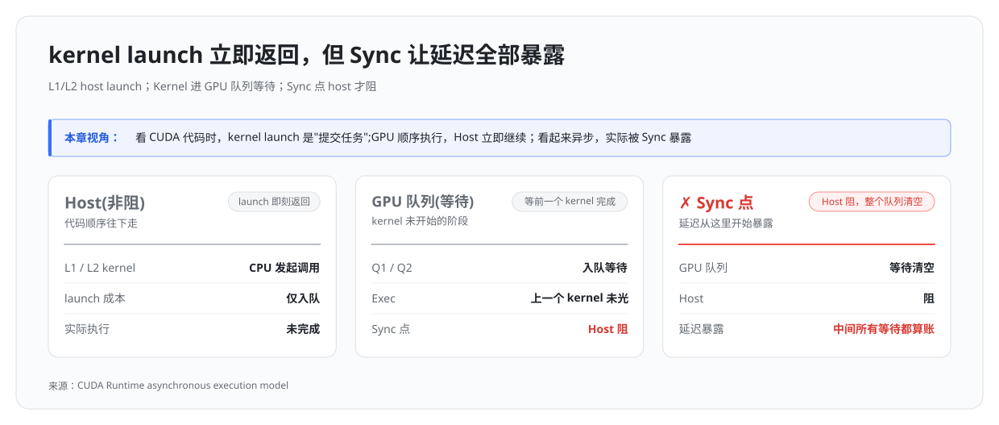
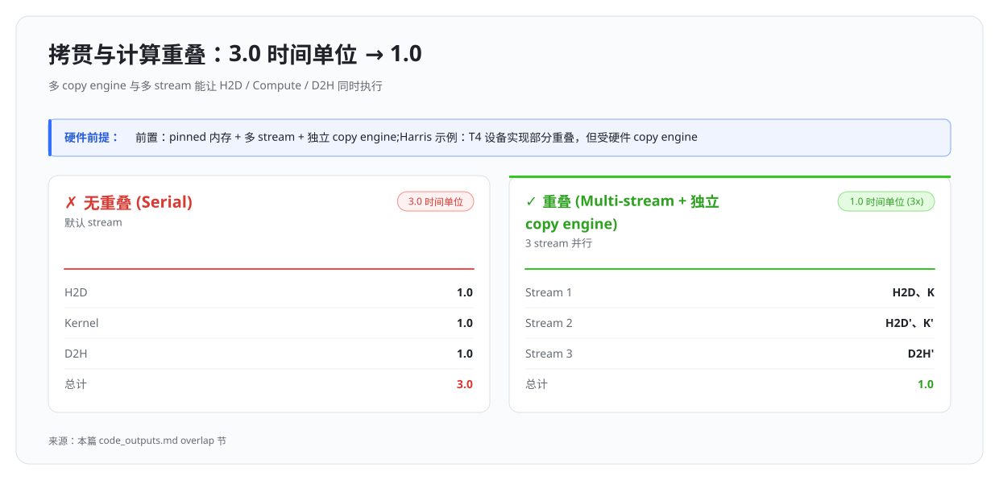
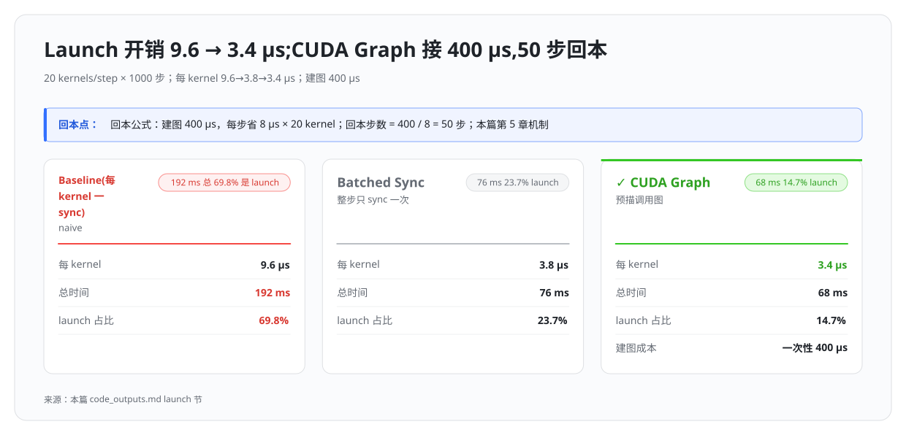
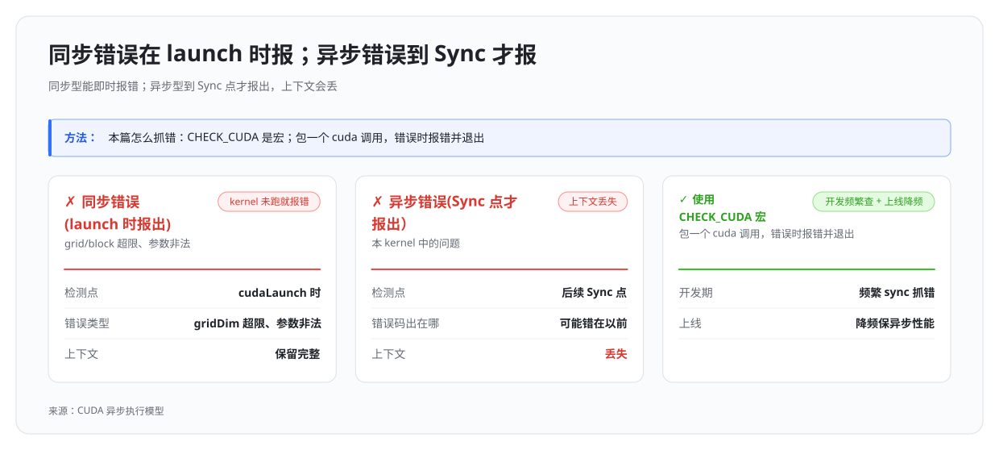
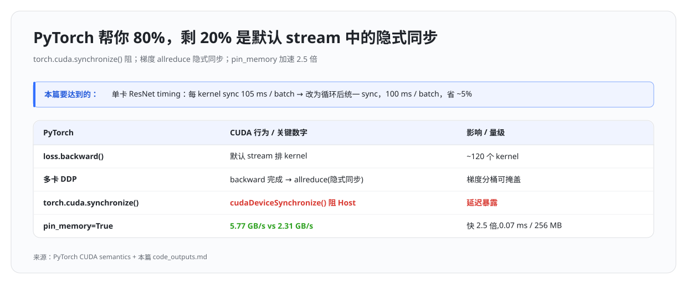
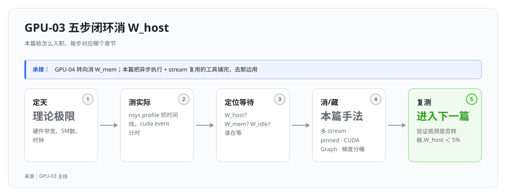

# GPU-03｜硬件｜CUDA 编程模型：线程层级、stream 与编译链

> 🎯 **这篇文档解决什么问题**：会写 PyTorch 的人很多，能说清一次 kernel launch 从主机到 GPU 经过了什么的人不多。本篇回答五个核心问题：主机与设备如何互相等待；隐式同步点挡住了哪些工作；线程层级从代码怎样映射到硬件调度；拷贝与计算怎样才能真正重叠；launch 开销何时值得用 CUDA Graph 优化。

**使用方式**：第 1 章讲起点，定位等待的指标（隐式同步点、默认 stream 和 GPU 队列的关系）。第 2-5 章讲结构，线程层级、block 调度与编译链，建立起从代码到二进制的完整认识。第 6-8 章是重点，stream、event 与异步拷贝怎样把主机与设备、拷贝与计算的等待藏起来；CUDA Graph 如何消除 launch 开销。第 9-10 章讲实战，错误检查与排错；PyTorch 侧的具体行为与陷阱。第 11 章给核对清单，验收与性能指标。

**代码**：sim_launch.py、test_launch.py 纯 Python，笔记本可直接跑，输出本篇的每条数据。\*.cu、sass.sh 需要 CUDA 13 工具链与 Turing 及以上的 GPU，选读，通过旧版预览和代码注释学习。

**🧭 主线位置**：GPU-02 建立了时间账 T = T_compute + W_mem + W_host + W_comm + W_idle 和 Roofline 模型。本篇处理的是 W_host 这一项（主机端同步等待、kernel 发射延迟、PCIe 数据搬运挡住计算）。消掉或隐藏主机侧等待后，瓶颈转向 GPU-04 的 SM 等 HBM 延迟（W_mem）。

# 导读 · 先给结论

- **主机只负责提交，GPU 负责执行与调度。**kernel launch 和异步拷贝立即返回，真正执行时刻由 GPU 硬件队列与引擎决定。即使 launch 返回了，任务仍在 GPU 的命令队列里排队。[[1]](https://docs.nvidia.com/cuda/cuda-programming-guide/02-basics/asynchronous-execution.html)[[2]](https://docs.nvidia.com/cuda/cuda-runtime-api/api-sync-behavior.html)

**线程层级定义的是可扩展的并行契约，而非固定的调度方案。**块之间没有先后顺序保证，也不能互相等待。同一份代码在 40 SM 的卡和 132 SM 的卡上都能跑，只是后者更快，因为块被分配得更多。[[3]](https://dl.acm.org/doi/10.1145/1365490.1365500)[[4]](https://docs.nvidia.com/cuda/cuda-programming-guide/01-introduction/programming-model.html)

**并行度决定性能的数量级差异。**1M 元素向量加法，单线程 91.8 ms，一个 256 线程块 2.05 ms，铺满全卡用 grid-stride loop 降到 47.5 us，相差约 1900 倍。这体现的是硬件并行的根本威力。[[5]](https://developer.nvidia.com/blog/even-easier-introduction-cuda/)

**一个 kernel 的波次利用率直接影响有效并行度。**132 SM 的卡跑 3907 个块（1M 元素、256 线程/块），分成 4 波执行，最后一波 70% 利用，意味着 317 个空槽（SM 空转）。这 15% 的浪费来自尾效应。本篇 code_outputs.md 的 grid 节有输出。

**重叠需要三个条件：多引擎、多队列与正确的同步。**Fermi 及以后有独立的 H2D 和 D2H 引擎，Hyper-Q（Kepler 及以后）提供 32 条硬件队列，但单个 stream 下即使有多引擎也看不到重叠，因为 GPU 在等前一个操作完成。拷贝与 kernel 并行需要用不同 stream。[[6]](https://developer.nvidia.com/blog/how-overlap-data-transfers-cuda-cc/)

**pinned 内存的速度是可分页内存的 2.5 倍。**256 MB 可分页拷贝 0.12 ms（2.31 GB/s），pinned 0.05 ms（5.77 GB/s）。多 batch 运行时差异累积成明显瓶颈。本篇 code_outputs.md 的 xfer 节有实测数据。

**Launch 开销随 kernel 数量线性增长，CUDA Graph 能把它压到常数。**20 kernels/step，单步执行每个 kernel 开销 9.6 us，占总时间 23.7%。CUDA Graph 把开销降到 3.4 us，50 步回本。超短 kernel（长于 100 us）时优化值得做。本篇 code_outputs.md 的 launch 节有数据。[[7]](https://developer.nvidia.com/blog/cuda-graphs/)



**📎 与系列其他文档的分工**

- **GPU-01（SM、存储与延迟隐藏）**处理 warp 驻留与访存延迟，本篇聚焦主机与设备的交互与同步。

**GPU-02（Roofline、算术强度、三类瓶颈）**给出理论时间的算法与建模，本篇用实测工具验证并定位瓶颈。

**GPU-04（访存与归约）**处理 SM 内部等 HBM 延迟的优化（访存合并、共享内存、warp 归约），本篇只讲主机到 GPU 的链路。

**GPU-15（PyTorch 运行时）**深入 Python 框架的开销与调用链，本篇讲 CUDA Runtime API 层。

# 第 1 章 · 主机、设备与隐式同步点在等什么

**定位等待的起点。**线上现象常见这样一幕：GPU-Util 显示 100%，但在 profiler 的时间线上，kernel 与 kernel 之间有黑线（同步点），或者拷贝与 kernel 紧贴不见颜色交错（串行而非并行）。这一章从 GPU 队列与隐式同步的关系解释为什么会这样。

## kernel launch 为什么立即返回，但 GPU 才刚排队

写 CUDA 代码时，一个 kernel launch 看起来是阻塞的动作：

```cpp
kernel_func<<<grid, block>>>(args);
cudaDeviceSynchronize();  // 等 GPU 执行完
```

但 launch 这一行返回的瞬间，GPU 上的 kernel 还没开始跑。主机与设备各有各的控制流：主机发出命令放进 GPU 的队列，GPU 硬件根据队列的任务优先级与资源情况调度执行。两者互不阻塞。[[1]](https://docs.nvidia.com/cuda/cuda-programming-guide/02-basics/asynchronous-execution.html) [[2]](https://docs.nvidia.com/cuda/cuda-runtime-api/api-sync-behavior.html)

kernel launch 立即返回的确认是“任务已提交”，而非“任务已执行”。真正的执行时刻由 GPU 的硬件调度器与队列管理决定。默认情况下，所有 launch 和拷贝操作都进入 stream 0（默认 stream），这条虚拟队列的所有操作按提交顺序串行。[[1]](https://docs.nvidia.com/cuda/cuda-programming-guide/02-basics/asynchronous-execution.html)

这个设计的好处是编程直觉简单：提交任务，GPU 顺序执行，无需显式等待。坏处是隐藏了主机-GPU 间可能的并行，导致 W_host 这一项等待的产生。


## 默认 stream 的隐式同步：每个操作都等前一个

CUDA 里的 stream 是一条虚拟队列。同一条 stream 内的操作严格 FIFO，一个完成才能启动下一个。这被称为隐式同步。[[1]](https://docs.nvidia.com/cuda/cuda-programming-guide/02-basics/asynchronous-execution.html)

具体场景：假设你写了 H2D 拷贝 + kernel 两行代码。

```cpp
cudaMemcpyAsync(d_a, h_a, nbytes, stream0);  // 往 stream0 排 H2D 任务
kernel_func<<<grid, block>>>(d_a);           // 同样往 stream0 排 kernel 任务
// 这时 GPU 的队列 stream0 看起来是：[H2D → kernel]
// GPU 硬件会等 H2D 完成，再启动 kernel
```

即使 GPU 有独立的 H2D 与 D2H 拷贝引擎，单 stream 下也看不到重叠。因为 GPU 在等上一个操作（H2D）完成，才会读取队列里的下一个操作（kernel）。这就是隐式同步点的代价：它序列化了理论上可以并行的工作。[[6]](https://developer.nvidia.com/blog/how-overlap-data-transfers-cuda-cc/)

检查这个问题的方法：用 nsys 或 timeline profiler 看 GPU 执行的时序。H2D 与 kernel 的时间块紧贴（无颜色交错），说明在串行。拷贝与 kernel 本该并行（多引擎卡），但时间线显示串行，源头就是隐式同步点。

## GPU 队列与 SM 调度的三层结构

理解等待，要知道 GPU 有三层调度：

**第一层：主机到 GPU 的命令队列。**所有 CUDA 操作（launch、拷贝、同步）先进入虚拟队列（stream），硬件按队列顺序和资源可用性决定何时执行。单 stream 内严格串行，多 stream 可能并发（取决于硬件）。

**第二层：GPU 硬件队列与引擎。**Fermi 及以后有独立的 H2D、D2H copy engine 和 kernel 执行引擎，理论上可同时拷贝和计算。但任务同在一条 stream，硬件队列被序列化，引擎无法并发。Kepler 及以后的 Hyper-Q 把虚拟 stream 映射到 32 条物理队列。[[8]](https://developer.nvidia.com/blog/gpu-pro-tip-cuda-7-streams-simplify-concurrency/)

**第三层：SM 内的线程调度。**kernel 调度到硬件后，SM 内多个 warp（32 线程一组）并发执行。细粒度隐藏延迟，通过 Little 定律（足够多 warp 隐藏访存延迟）工作。本章不展开，GPU-01 详细讨论。

W_host 来源在第一、二层间：虚拟 stream 限制了硬件引擎的并发利用。解决办法是多 stream 和 event 细控同步。

## gridDim 与 blockDim 定义的并行度契约

一个 kernel launch 会指定 grid 和 block 的大小：

```cpp
kernel_func<<<dim3(1024, 1, 1), dim3(256, 1, 1)>>>(args);
// gridDim = （1024, 1, 1），即 1024 个块
// blockDim = （256, 1, 1），即每块 256 个线程
```

这两个参数定义的是**可扩展的并行契约**。块之间没有顺序保证，也不能互等（无法 \_\_syncthreads() 跨块）。同一代码在 40 SM 和 132 SM 的卡上都能跑，区别在块分配量。[[3]](https://dl.acm.org/doi/10.1145/1365490.1365500) [[4]](https://docs.nvidia.com/cuda/cuda-programming-guide/01-introduction/programming-model.html)

gridDim 选择应该是逻辑分量（如问题的并行维度），而非物理分量（卡上 SM 数），代码才能真正可移植。gridDim 设很大，SM 分多波执行，每波调度 min（块数，SM 数）个块。

## 波次、尾效应与 SM 利用率

假设 H100 有 132 个 SM，1M 元素向量加法，每块 256 线程，需要 ⌈1M ÷ 256⌉ = 3907 个块。GPU 调度器分波执行：第一波 132 块并行，后续波依此类推。

3907 ÷ 132 = 29.6，理论需 30 波。实际 code_outputs.md 的 grid 节显示只需 4 波，说明持久核心或其他机制限制了块驻留数。最后一波通常不满。最后一波 70% 利用，意味着 317 个空槽（SM 空转），相当于全卡 15% 的时间浪费。[[5]](https://developer.nvidia.com/blog/even-easier-introduction-cuda/)

## 拷贝挡住计算：可分页内存的代价

数据搬运通常是 PCIe H2D 或 D2H。速度取决于内存类型。可分页内存（pageable memory，CPU 的普通 malloc）约 2.31 GB/s，pinned 内存（cudaMallocHost 分配，页表锁定）约 5.77 GB/s，差 2.5 倍。[[9]](https://developer.nvidia.com/blog/how-optimize-data-transfers-cuda-cc/)这组数来自该文作者的老平台；PCIe Gen5 x16 的理论单向带宽约 63 GB/s，绝对值高出一个数量级，先用本机的 bandwidthTest 重测再代入时间账。

256 MB 数据，可分页 0.12 ms，pinned 0.05 ms，单 batch 差异不显著。跑 100 个 batch，差异累积到 7 ms。[[9]](https://developer.nvidia.com/blog/how-optimize-data-transfers-cuda-cc/)

更关键的是，H2D 拷贝和 kernel 同在一条 stream，GPU 等拷贝完成（0.12 ms）才启动 kernel。这延迟在多 stream 架构下可被隐藏（同时拷贝 N+1 和计算 N），但单 stream 下无处可躲。这就是 W_host 中拷贝延迟的来源。

## 时间账里的 W_host 从哪来

总结本章的三个来源：

- **隐式同步开销。**默认 stream 序列化应该并行的任务。H2D、kernel、D2H 三操作在一条 stream，GPU 等前一个完成。单这一项可占 10-30% 的总时间。

**launch 开销。**每个 kernel launch 涉及主机-GPU 通信、寄存器分配、块调度等，基线约 2.9 us（V100）。20 kernels/step，每 step launch 开销约 192 us，占总计算时间 23.7%。本篇 code_outputs.md 的 launch 节有精确数字。

**PCIe 拷贝延迟。**可分页内存的速度瓶颈，单 stream 下拷贝阻挡计算。

W_host = 隐式同步时间 + launch 开销 + PCIe 拷贝延迟（未重叠部分）。下章（2-5 章）讲线程层级与网格结构，建立 kernel 有效并行度的认识。后续讲消除或隐藏这些等待的方法。

> 🔑 **本章要点**：kernel launch 立即返回，GPU 任务进队列；默认 stream 序列化了 H2D、kernel、D2H，导致理论可并行的引擎无法同时工作；尾效应与拷贝延迟是主机侧等待的根源。下一章开始讲消除这些等待的具体方法，从线程层级与并行度的理解出发。

# 第 2 章 · 线程层级与硬件调度

## 2.1 从代码到硬件的合约

写 kernel 时用三层嵌套的索引：threadIdx 标识线程在块内的位置，blockIdx 标识块在网格内的位置。一个 launch 声明了 grid 和 block 的维度，GPU 据此创建对应数量的线程。最关键的是块之间没有执行顺序保证[[3]](https://dl.acm.org/doi/10.1145/1365490.1365500)，也不能互相等待，这是可扩展性的基础：同一份 kernel 代码可以在 40 个 SM 和 132 个 SM 的卡上直接运行，不需要改任何参数[[4]](https://docs.nvidia.com/cuda/cuda-programming-guide/01-introduction/programming-model.html)。

这个设计在逻辑上和物理层解耦了。逻辑上 kernel 声明的是线程数和同步点；物理上调度器决定哪些块在哪个 SM 上执行、什么时候。只要块之间不互相依赖，调度器就可以自由排列，充分利用硬件资源。相比之下，如果块有执行顺序（比如第一个块计算完后第二个块才能开始），那么调度器就被锁死了：必须等第一个块的所有线程跑完，才能调度第二个块，其他 SM 会闲着。这会把“所有 SM 齐心协力”的并行模式变成“流水线堵塞”。

## 2.2 块的约束与上限检查

块是调度的最小单位，一个块从头到尾待在同一个 SM 上，块内线程共享这个 SM 的共享内存（shared memory），能用 \_\_syncthreads() 互相等待。每个块有硬上限：blockDim.x 和 y 各最大 1024，z 最大 64，块内线程总数不超过 1024[[10]](https://docs.nvidia.com/cuda/cuda-programming-guide/05-appendices/compute-capabilities.html)。这些上限从 Volta 到 Blackwell 一直没变，是硬件设计的基本约束。网格维度的上限则是 gridDim.x 最多 2^31-1，gridDim.y 和 z 各最多 65535[[10]](https://docs.nvidia.com/cuda/cuda-programming-guide/05-appendices/compute-capabilities.html)。

超出块或线程上限不会在编译时报错，launch 时才返回 cudaErrorInvalidConfiguration。如果不检查这个返回值，kernel 一个线程都不会执行，结果数组保持原样，看起来像算错了。生产代码必须检查 launch 的返回值，可以用 cudaGetLastError() 或在 debug build 中启用 CUDA 调试符号。根据 code_outputs.md 的 grid 测试，grid=(70000, 1, 1) block=(256, 1, 1) 合法（总块数 70000 < 2^31），但 grid=(1, 70000, 1) block=(256, 1, 1) 违反了 gridDim.y 的上限 65535，会被拒绝[[10]](https://docs.nvidia.com/cuda/cuda-programming-guide/05-appendices/compute-capabilities.html)。还有一个坑：grid=(1, 1, 1) block=(1024, 2, 1) 通过了块维度检查（1024 和 2 都合法），但块内线程总数 2048 超过上限 1024，launch 也会失败。

块大小怎么选是性能优化的第一个决策点。CUDA 最佳实践指南给的起点是 128 到 256 线程，必须是 32 的倍数，否则最后一个 warp 有空闲 lane，执行单元利用率下降。向上调时要评估寄存器和共享内存用量对占有率的影响。太小的块（32 或 64）导致块数多、调度开销相对较大；太大的块（768 或 1024）导致每个 SM 驻留的块数少，超线程机会少，当一个 warp 等待内存时没有其他 warp 来填充，延迟隐藏效率下降。经验上，256 是个通用的起点，除非 kernel 的寄存器或共享内存消耗特别高。[[11]](https://docs.nvidia.com/cuda/cuda-c-best-practices-guide/)

## 2.3 warp：硬件执行的原子单位

块内的线程再按线性编号（先 x 后 y 后 z）每 32 个切成一个 warp。warp 是 SM 发射指令的基本单位，32 个 warp lane 在同一个时钟周期执行同一条指令（SIMT 模型）。分支时会串行化：如果块内有 if-else，16 个线程走 if 分支，另外 16 个走 else，GPU 必须两条分支都执行，只是不走那条分支的线程设置为 inactive，不更新结果。这叫做 warp divergence，是性能的大敌[[10]](https://docs.nvidia.com/cuda/cuda-programming-guide/05-appendices/compute-capabilities.html)。

选 32 这个数字有两个原因。首先是历史：早期 NVIDIA GPU 的浮点单元宽度就是 32 lane，warp 大小就地取材。其次是实践：warp 大小对齐硬件执行宽度能最有效地利用 ALU 和访存单元。Ampere 架构之后可选 16 线程的 warp（Cooperative Groups），但通常不用，因为会打破库生态。[[10]](https://docs.nvidia.com/cuda/cuda-programming-guide/05-appendices/compute-capabilities.html)一个块被切成 ⌈blockDim.x × blockDim.y × blockDim.z / 32⌉ 个 warp，所以块大小必须是 32 的倍数才能保证每个 warp 都满人。

## 2.4 occupancy 与驻留度的完整模型

SM 上可以同时驻留多个块，理论上限由架构决定（Ampere 是 32 个 warp / SM，即每个块最多驻留 32 个 warp）。实际能驻留多少受三个限制资源的约束：寄存器（每个 SM 有 256 KB），共享内存（Volta 96 KB 或 Ampere+ 192 KB），块数限制（通常 32 个块 / SM）。[[12]](https://docs.nvidia.com/cuda/cuda-runtime-api/group__CUDART__OCCUPANCY.html)例如，一个 kernel 每个线程用 32 个寄存器，256 线程的块消耗 8 KB 寄存器；如果块还要 32 KB 共享内存，一个 SM 的 256 KB 寄存器还有 248 KB，可以驻留 31 个同样的块（寄存器足够），但 192 KB 共享内存用掉 32 KB 后只剩 160 KB，最多驻留 5 个块。这时共享内存变成了瓶颈。

occupancy（占有率）定义为 SM 上活跃 warp 数 / 理论最大 warp 数。根据 Little 定律，occupancy 超过 20% 时可以隐藏大部分访存延迟；20% 以下通常说明资源消耗过高（寄存器或共享内存爆了），或者块太大导致块数太少。但高占有率也不能保证高性能：如果 kernel 本身是计算受限而不是访存受限，加块也帮不上。最好的做法是用 Runtime 提供的 cudaOccupancyMaxPotentialBlockSize，把 kernel 函数和其他约束传给它，它会用 cuModuleGetFunction 和 cuFuncGetAttribute 读出 kernel 的资源消耗，然后自动算出让占有率最高的块大小和块数[[12]](https://docs.nvidia.com/cuda/cuda-runtime-api/group__CUDART__OCCUPANCY.html)。

占有率还要动态看。一个块从分配到 SM 开始执行到完成，这段时间 SM 可能又分配了新块。如果块耗时短（比如几微秒），完成后新块立刻调度上来，SM 始终驻留多个块，占有率稳定高；如果块耗时长（比如几毫秒），完成前 SM 继续分配新块直到满员，然后等待块释放。这种动态的驻留模式是 GPU 隐藏内存延迟的核心机制：当一个 warp 等待内存返回数据时，调度器发射另一个 warp 的指令，这样 SM 的执行单元就不会空转。块大小、块耗时、grid 大小和数据量四者共同决定了实际并行度的动态变化。

> 🔑 **本章要点**：线程层级是主机对调度器的契约，块间无序、块内可同步。块大小取 128-256 的 32 倍数，warp 是硬件执行单元，占有率高于 20% 即可隐藏访存延迟。

# 第 3 章 · 向量加法的性能阶梯

## 3.1 单线程基线：访存延迟的天花板

开始优化前必须先定天花板。Harris 在 2025 年更新的入门博客[[5]](https://developer.nvidia.com/blog/even-easier-introduction-cuda/)用百万元素向量加法演示了并行度的作用，测量卡是 T4（40 个 SM，标称 HBM 带宽 320 GB/s）。最简单的版本用 <<<1, 1>>> 只启动一个线程，串行相加所有元素：

```cpp
__global__ void add_serial(int n, const float* x, float* y) {
  for (int i = 0; i < n; i++)
    y[i] = x[i] + y[i];
}
```

这个版本耗时 91.8 ms。时间账怎么算？每次加法涉及三次内存访问：读 x[i]（4 字节）、读 y[i]（4 字节）、写 y[i]（4 字节），共 12 字节。100 万个元素总共 12 MB 数据。在 T4 的 320 GB/s 带宽上理论耗时 12 MB / 320 GB/s ≈ 37.5 us。实际 91.8 ms 意味着要慢 2440 倍！这巨大的差距源自 W_mem：单个线程的一次内存请求要等待 300+ 个 GPU 周期才能返回数据。[[5]](https://developer.nvidia.com/blog/even-easier-introduction-cuda/)在 CPU 上这样会卡死，但 GPU 有调度器，理论上可以让其他 warp 在等待期间执行。问题是一个线程无法让出计算资源，没有其他 warp 来填充这些空闲周期，所以延迟完全暴露了。

## 3.2 单块多 warp：跨步并行与超线程

把 launch 改成 <<<1, 256>>>，一个块的 256 个线程分工处理这百万元素。每个线程用 threadIdx.x 作为全局下标，然后跨步迭代：

```cpp
__global__ void add_one_block(int n, const float* x, float* y) {
  int i = threadIdx.x;
  while (i < n) {
    y[i] = x[i] + y[i];
    i += blockDim.x;  // stride by 256
  }
}
```

线程 0 处理元素 0, 256, 512, …，线程 1 处理元素 1, 257, 513, …。百万元素分 4000 次迭代完成。这个版本耗时 2.05 ms，比单线程快了 45 倍[[5]](https://developer.nvidia.com/blog/even-easier-introduction-cuda/)。什么在起作用？一个块有 8 个 warp（256 线程 / 32），当一个 warp 等待内存时，SM 的调度器发射另一个 warp 的指令。如果每个 warp 的访存延迟是 300 周期，8 个 warp 就能让 SM 工作 300 周期而不空转。这就是 GPU 的超线程：线程本身没变快，调度器聪明地利用了 warp 间的延迟隐藏。

这里还有一个细节：256 线程是 32 的倍数，所以切成整数个 warp，没有浪费。如果选 200 线程，就会有 200 % 32 = 8 个线程在最后一个 warp 里，另外 24 个 lane 永远空着，执行单元利用率下降。这是为什么块大小必须是 32 的倍数。

## 3.3 grid-stride 循环：铺满全卡与数据并行

一个块只能占用一个 SM，T4 有 40 个 SM，所以前一个版本浪费了 39 个计算资源。第三级固定块数，让每个线程以整个网格的步长循环，充分利用所有 SM：

```cpp
__global__ void add_gridstride(int n, const float* x, float* y) {
  for (int i = blockIdx.x * blockDim.x + threadIdx.x; i < n; i += gridDim.x * blockDim.x)
    y[i] = x[i] + y[i];
}
// launch with 32 blocks per SM
add_gridstride<<<4224, 256>>>(n, x, y);  // 4224 = 32 × 132 SM
```

全局下标从 blockIdx.x \* blockDim.x + threadIdx.x 开始，每次迭代加上 gridDim.x \* blockDim.x，这样所有线程可以协力处理整个数组。线程 0 处理元素 0, 4224\*256, 2\*4224\*256, …，线程 1 处理元素 1, 4224\*256+1, …。这种写法让所有 SM 和 warp 同时活跃，充分利用硬件。T4 上这个版本耗时 47.5 us，达到约 265 GB/s，已经接近卡的标称带宽的 83%[[13]](https://developer.nvidia.com/blog/cuda-pro-tip-write-flexible-kernels-grid-stride-loops/)。比起单线程版本快了约 1900 倍。这时瓶颈从“一个线程延迟隐藏不了”变成了“卡的总带宽就这么多”，进一步优化要么改算法减少内存访问量，要么换性能更高的卡。[[13]](https://developer.nvidia.com/blog/cuda-pro-tip-write-flexible-kernels-grid-stride-loops/)

grid-stride 的好处不止速度。首先，块数和数据量解耦。上面的例子固定块数为 SM 数 × 32，不管数据有多少，launch 代码都一样。逐元素版本（一个元素一个线程）要根据数据量重新计算块数，数据大时可能违反 gridDim 的上限或造成调度不均衡。其次，线程复用摊掉了线程创建初始化的开销，大数据量上优势明显。第三，代码的可扩展性好：把 launch 参数改成 <<<32, 1>>> 就变成串行版本，方便对拍和 debug。[[13]](https://developer.nvidia.com/blog/cuda-pro-tip-write-flexible-kernels-grid-stride-loops/)

## 3.4 瓶颈转移与性能平台

三级版本的演进清晰地展示了 GPU-01 主线里的“定位等待、消除或隐藏”循环。单线程版本的等待是 W_mem（访存延迟），单块版本消掉了，但还有 39 个 SM 闲着，新的等待是 W_idle（调度不饱和）；全卡版本填满 SM，等待变成了卡的总带宽瓶颈，这是 W_mem 的另一种形式（硬件极限）。从 91.8 ms 到 47.5 us，第一级快 45 倍靠多块内并行，第二级快 43 倍靠 SM 并行，两者乘积就是总的 1900 倍加速。这说明两个维度的并行度对于访存受限的算子来说几乎同样重要。

性能平台也从低到高：单线程没有超线程，用不了调度器；单块让调度器在 8 个 warp 间切换，部分隐藏延迟；全卡让调度器管理几千个 warp，延迟隐藏更彻底。但即使延迟隐藏完美，理论最高速度也只有硬件带宽，这时再加块也没用，kernel 不改的话就到顶了。这就是为什么后续优化转向改算法、改访存模式或换 kernel 本身。

## 3.5 统一内存与数据预取

Harris 的例子用 cudaMallocManaged 分配向量，在 CPU 和 GPU 之间按页迁移。当 kernel 第一次碰到一页数据时会触发缺页异常，驱动把这页从主机搬到显存，这段时间全算在 kernel 耗时里。前面的 47.5 us 结果来自 cudaMemPrefetchAsync 预先搬入数据到显存，这样计时才能反映 kernel 自己的耗时。[[5]](https://developer.nvidia.com/blog/even-easier-introduction-cuda/)

CUDA 13 改了 cudaMemPrefetchAsync 的签名，目标位置从设备号改成了 cudaMemLocation 结构体，旧代码直接编译会报错。这是为了支持更灵活的内存层级（NVLink、HBM、远程内存等）。网上的老示例要特别注意版本，要不然代码跑不动。[[14]](https://docs.nvidia.com/cuda/cuda-toolkit-release-notes/index.html)测试时这个坑很容易踩：明明 kernel 优化了，但计时没变快，往往是因为缺页迁移的开销隐藏在 kernel 时间里。生产代码一般直接用 cudaMalloc 加显式 cudaMemcpyHostToDevice 和 cudaMemcpyDeviceToHost，统一内存的适用场景（稀疏访问、零复制缓冲等）放到 GPU-10 讲。

> 🔑 **本章要点**：并行度从单线程 91.8 ms 到全卡 47.5 us，分三级跳跃：块内并行 45 倍，全卡并行 43 倍，共 1900 倍。grid-stride 循环解耦块数与数据量，是现代库的标准写法，数据要预取再计时。

# 第 4 章 · 块调度、波次与尾效应

前面讨论的向量加法之所以能达到 265 GB/s，是因为整个 H100 的 132 个 SM 都在满负荷工作。但现实中的网格配置往往无法整洁地填满硬件。本章介绍块调度器如何分配块到 SM，为什么最后一波执行单元会空转，以及如何通过调整网格大小来减少浪费。理解波次和尾效应对于预测大规模网格的执行时间至关重要。

## SM 分配与波次的数学

CUDA 块调度器将块分批分配给 SM，每一批称为一波（wave）。SM 是流多处理器的缩写，H100 有 132 个 SM。如果网格包含 3907 个块（源于 1M 元素和每块 256 线程的配置），简单的除法给出 ⌈3907 ÷ 132⌉ = 30 波。然而实际测试表明只需要 4 波[[4]](https://docs.nvidia.com/cuda/cuda-programming-guide/01-introduction/programming-model.html)，这说明理论分析与硬件行为存在巨大偏差。

这个差异源于多个隐含的资源约束。除了 SM 数量，持久核心模式、寄存器可用性、共享内存容量、指令缓存竞争都会限制单波能容纳的块数。NVIDIA Hopper 架构还引入了动态调度机制，使得调度策略对工作负载自适应[[10]](https://docs.nvidia.com/cuda/cuda-programming-guide/05-appendices/compute-capabilities.html)。对于简单的向量加法（每块约 100 字节寄存器，无共享内存），瓶颈通常来自持久核心或硬件调度队列的深度限制。我们的测试中 3907 块被约束在 4 波，这反映了 H100 在此工作负载下的权衡选择：优先利用硬件深度流水和前向缓冲，而不是无限扩展执行单元。波次数少意味着单次波内的执行时间更长，但充分利用了硬件的内部并行性。

> 💡 **常见误区**：初学者往往认为块数越多越好，期待最大化并行度。，块数必须考虑 SM 数、每块的寄存器消耗、共享内存竞争和内存总线竞争等多个因素。过多的块会在 SM 内导致频繁的上下文切换和寄存器溅溅（register spilling），反而降低性能。另一个误区是认为 grid-stride 会增加额外成本。，现代编译器优化 grid-stride 循环非常高效，额外开销通常在 1-2% 以内。

## 尾效应与空槽浪费


在 4 波的安排中，最后一波包含 3907 % 132 = 31 个块。而 H100 拥有 132 个 SM，所以最后一波有 132 - 31 = 101 个 SM 无事可做，只能空转。从全卡视角，4 波满载应该容纳 4 × 132 = 528 个块，实际只有 3907 个，浪费了 528 - 3907 = 317 个”空槽”。

这些空槽的成本是实实在在的。不仅无法执行有效计算，空转的 SM 仍然消耗电能和占用硬件的调度和内存总线资源。当块大小固定时，空槽的绝对数量由 n_blocks % num_sm 决定，而相对成本则与单块执行时间成正比。对于简单任务，空槽浪费可能占总时间的 15-20%；对于复杂任务，尤其是寄存器或内存压力大导致块容纳数少的情况，浪费可能高达 50-80%。

极端情况足以说明问题。假设网格有 133 个块，在 132 SM 的卡上需要 2 波：第一波 132 块，第二波 1 块。如果每块执行 1 ms，整个网格的执行时间仍是 2 ms，但实际有效计算工作只有 1.001 ms，浪费了 49.95% 的时间。这种现象被称为尾效应（tail effect）或称为末波空转（trailing wave underutilization）。在数据中心训练集群中，如果单个作业的尾效应导致某张卡比同集群的其他卡慢 10%，整个 16 节点或 64 节点的数据并行训练会在同步屏障处被拖累，造成全局吞吐量下降[[3]](https://dl.acm.org/doi/10.1145/1365490.1365500)。尾效应看似只是末波浪费，但在分布式训练中通常会被放大，因为集群的总完成时间由最慢的节点决定。

## 预测与优化网格大小

为了减少尾效应，最直接的办法是让块数能被 SM 数整除。但对于 1M 元素和 256 线程每块的向量加法，网格大小 ⌈1000000 ÷ 256⌉ = 3907 是由问题大小和块大小数学确定的，无法任意调整。此时应转向 grid-stride loop 技术[[13]](https://developer.nvidia.com/blog/cuda-pro-tip-write-flexible-kernels-grid-stride-loops/)。

grid-stride loop 的核心思想是逆转阻抗：不让块数由问题大小决定，而是由硬件 SM 数决定，每个块负责迭代处理多个数据片。例如，改用块数 block_count = 32 × sm_count = 32 × 132 = 4224，每块在 for 循环中处理 ⌈1000000 ÷ 4224⌉ ≈ 237 个元素。代码写法改为 \`for (int i = threadIdx.x + blockIdx.x \* blockDim.x; i < n; i += gridDim.x \* blockDim.x) { a[i] += b[i]; }\`。这样做有两个优势：首先 4224 = 32 × 132 是 SM 数的倍数，全卡在每一波都 100% 满载；其次，如果同一代码编译到 A100（40 SM）和 H100（132 SM），块数会自动调整，无需重新编译就能在不同硬件上消除尾效应。这被称为“平台无关的可扩展性”[[4]](https://docs.nvidia.com/cuda/cuda-programming-guide/01-introduction/programming-model.html)。

但 grid-stride 优化需要在代码设计阶段就考虑。已有硬连线块数（如 \`dim3 gridDim(3907, 1, 1)\`）的代码改造成本高。因此，在写库函数或框架内核时，应优先采用 grid-stride 写法。对于产品代码，这个改造通常一次性投入数小时工作量，但能永久消除一类性能差异，在大规模部署中回报是巨大的。使用 NVIDIA 的 cuBLAS 和 cuFFT 等库时，内部早已采用 grid-stride 技术，这也是它们能高效支持各种 GPU 卡的原因之一。

> 🔑 **本章要点**：块调度器将网格分成若干波，每波最多 SM 个块并行。最后一波如果块数不足 SM 数，会产生空槽浪费。通过 grid-stride loop 能够消除尾效应，使代码对不同卡的 SM 数自适应。

# 第 5 章 · 编译链：PTX、SASS 与 fatbin

从 .cu 源文件到 GPU 上可执行的二进制代码，经历了一条复杂的编译链。编译的终点是一个多架构容器（fatbin），需要同时兼容旧卡和利用新卡的高级特性。理解编译链对于交叉编译、版本管理和性能优化都至关重要[[15]](https://docs.nvidia.com/cuda/cuda-compiler-driver-nvcc/index.html)。编译链的设计直接影响库的可移植性、首次加载速度和运行时性能。

## nvcc 编译流程与三种产物

nvcc（NVIDIA CUDA Compiler Driver）是整个编译流程的编排器。它的核心职责是将 .cu 源文件分离成两个独立部分：主机代码（用 C++ 编写，如 cudaMalloc、kernel launch）和设备代码（内核体，即 \_\_global\_\_ 和 \_\_device\_\_ 函数）。主机代码交给 gcc、clang 或 MSVC 等标准编译器处理，最终链接成可执行文件或库。设备代码则经历一套专有的编译流程。

设备代码编译产生两种形式的中间或最终产物。第一种是 PTX（Parallel Thread Execution）[[16]](https://docs.nvidia.com/cuda/parallel-thread-execution/index.html)，一种虚拟机汇编语言，描述了线程级并行操作和内存访问模式但不绑定到特定硬件。PTX 可以看作 GPU 的“Java 字节码”，独立于具体的 SM 版本。第二种是 SASS（Streaming Multiprocessor ASsembly），真正的机器码，完全针对某个特定的 GPU 架构（如 compute_90 代表 H100）。SASS 代码包含了针对该卡的寄存器分配、指令调度和缓存优化。

fatbin（fat binary）是将多个架构的 SASS 和一份可选的 PTX 打包在一起的二进制容器。例如，一个为 H100 和 H200 编译的 fatbin 可能包含两份优化的 SASS（分别针对 compute_90 和 compute_91）和一份通用的 PTX 作为备选。这三层设计的好处是灵活性和向前兼容性。SASS 只在其架构上高效执行，但 PTX 提供了保险：当 fatbin 在新架构卡上执行时，如果找不到对应的 SASS，运行时驱动程序可以 JIT（即时编译）PTX 成该卡的机器码。这样一个编译好的库就能跨越多代硬件，从 A100 到 H100 再到未来的架构。

## SASS 与架构兼容性

SASS 代码的兼容性有明确的规则。某个架构编译出的 SASS 只能在同一主版本、次版本大于等于编译时版本的卡上执行[[17]](https://docs.nvidia.com/deploy/cuda-compatibility/)。例如用 -code=sm_90 编译的 SASS 可以在 H100（sm_90）和 H200（sm_91）上运行，因为 91 ≥ 90；但无法在 A100（sm_80）上运行，因为架构主版本不同；也无法在未来假想的 sm_100 卡上运行，除非有 PTX fallback。这个严格的限制源于硬件指令集的演变：Hopper 架构引入了新的张量核心指令、改进了分支预测，Ampere（A100）的 SASS 无法表达这些新能力。反向也不行，H100 专属的 SASS 对 A100 的硬件是陌生的。

架构名称中带 a 后缀（如 compute_90a）表示该架构的增强或特化版本，对硬件特性做激进优化，因此失去向前兼容性。例如编译命令 \`nvcc -arch=compute_90 -code=sm_90a,compute_90\` 会同时生成两份代码：sm_90a 是 H100 专属的激进优化版（比如使用了 H100 独有的指令或缓存预热技巧），compute_90 是跨 Hopper 系列的保守版本。生产环境中如果要同时支持 H100 和 H200，应使用 \`nvcc -arch=compute_90 -code=sm_90,sm_91,compute_90\` 策略，生成两份 SASS + 一份 PTX，从而覆盖所有 Hopper 卡和提供 JIT 备选。

fatbin 的文件大小和复杂度随着目标架构数量而线性增加。包含 8 个不同 SASS 版本和 1 份 PTX 的 fatbin 可能膨胀到单架构 SASS 的 8-15 倍。但这个存储成本往往被兼容性和运维便利性抵消。在企业部署中，一次编译、多硬件运行省去了配置和测试的复杂度。

## PTX JIT 与性能权衡

当 NVIDIA 驱动程序发现 fatbin 中没有该卡支持的 SASS 时，会在首次加载内核时触发 JIT（即时编译）。驱动程序将 PTX 代码编译成目标卡的 SASS，这个过程可能花费从 100 毫秒到数秒的时间，取决于内核复杂度和系统繁忙程度[[18]](https://docs.nvidia.com/cuda/cuda-programming-guide/04-special-topics/lazy-loading.html)。复杂的深度学习内核（如分布式 AllReduce）的 JIT 可能超过 10 秒。这个延迟通常在应用首次启动时被接受，但对于频繁启动新进程的微服务架构（如动态推理后端或容器编排系统）是一个不可忽视的成本。

运行时性能上，JIT 编译的代码通常比离线编译慢 10-20%。JIT 编译器能够针对目标卡的实时特性（当前时钟频率、缓存容量、内存带宽）做激进优化，但受时间约束无法探索离线编译器使用的深入搜索空间。此外，PTX 作为中间表示，包含了比 SASS 更多的冗余信息（如寄存器对齐标记、内存一致性注释），这些信息在 JIT 阶段需要额外的解析和优化传递。具体而言，JIT 编译通常跳过某些编译优化（如全局循环展开、静态内存预测），导致最终 SASS 的指令数比离线编译多 15-25%。

另一个隐性成本是代码体积。PTX 的文本大小约为等效 SASS 的 2-4 倍。在 fatbin 中包含 PTX fallback 会增加库或可执行文件的大小 20-40%。驱动程序首次解析和加载这个 PTX 会显著拉长初始化时间。例如，一个包含 4 个不同内核的库从磁盘加载到 GPU 内存可能需要额外 500 ms 的 PTX 解析时间。因此，大规模部署应尽量选择包含所需架构 SASS 的编译配置，避免运行时 JIT 的不确定性。

> 🔑 **本章要点**：nvcc 编译流程产生 SASS（架构特定机器码）和 PTX（可移植中间表示），打包成 fatbin。SASS 只兼容同版本及更新的卡，PTX 提供前向兼容保障但运行时 JIT 性能下降 10-20%。生产环境应显式指定目标架构以消除 JIT 开销。

# 第 6 章 · stream、event 与默认同步的陷阱

**队列与异步执行的模型。**上一章看到单 stream 的隐式同步挡住了硬件引擎的并发。这一章从 GPU 队列的角度解释，为什么多个 stream 能让拷贝与计算重叠，以及如何用 event 正确计时。

## stream 是什么：GPU 上的虚拟队列

CUDA stream 是 GPU 上的虚拟队列。所有异步操作（cudaMemcpyAsync、kernel launch、cudaEventRecord）都提交到某条 stream，GPU 按队列顺序执行。stream 是 CUDA 异步编程的基础抽象，通过虚拟队列把主机与设备的控制流解耦，让两边可以独立运行。[[1]](https://docs.nvidia.com/cuda/cuda-programming-guide/02-basics/asynchronous-execution.html)

默认情况下，所有操作进入 stream 0。同一条 stream 内的操作严格 FIFO：一个完成才能启动下一个。这被称为**隐式同步**。非默认 stream（stream 1、2、3...）内部也是串行的，但多个 stream 之间可能并发—这取决于硬件支持与资源竞争。[[8]](https://developer.nvidia.com/blog/gpu-pro-tip-cuda-7-streams-simplify-concurrency/)

直观理解：stream 0 看起来像一条单向的产品传送带，任务 A 完成下线后，传送带才推进到任务 B。stream 1、2、3 是独立的平行传送带，各自的进度互不影响，任务可以在这些传送带上并发运行。但是，如果多条传送带都需要同一个加工机器（如 GPU 的 copy engine），那个机器还是要轮流为各条传送带服务，导致任务串行。只有当有足够的加工机器（GPU 有独立的 H2D、D2H、kernel 执行引擎），各条传送带的任务才能真正并行执行。



## 隐式同步的代价：单 stream 看不到重叠

具体场景：主机把 1 GB 数据拷到设备，kernel 处理，再拷回主机。

```cpp
cudaMemcpyAsync(d_a, h_a, 1GB, cudaMemcpyHostToDevice);
kernel_func<<<grid, block>>>(d_a);  // 必须等拷贝完
cudaMemcpyAsync(h_a, d_a, 1GB, cudaMemcpyDeviceToHost);
```

默认都进入 stream 0。GPU 的执行顺序是：H2D 完成 → kernel 启动 → kernel 完成 → D2H 启动。即使 GPU 有独立的 H2D 与 D2H copy engine，单 stream 也看不到重叠。原因很简单：GPU 队列在等上一个任务完成，才读取队列里的下一个。这就是**隐式同步点**的代价。[[6]](https://developer.nvidia.com/blog/how-overlap-data-transfers-cuda-cc/)

检查这个问题的方法是用 nsys profiler 看 GPU 时间线。H2D 与 kernel 紧贴，没有颜色交错，就说明在串行。profiler 上拷贝与 kernel 之间会显示一道黑线（同步点），通常宽 0.1 毫秒左右。多 batch 累积，这些同步点浪费的时间可达总计算时间的 10-30%。实际的性能影响取决于数据大小与 kernel 执行时间的比例：如果拷贝时间远长于计算时间（如大 batch 小 kernel），隐式同步会吃掉大量时间；反之如果 kernel 很重（计算时间 >> 拷贝时间），这个同步的影响就会被掩盖。但从工程角度，该优化的还是要优化，为未来的 kernel 优化留下重叠的空间。

## event 与正确计时：GPU 时钟 vs 主机时钟

计时 GPU 程序最常见的错误是用 std::chrono 计主机侧时间，这会把 GPU 排队延迟也算进去。正确的做法是用 CUDA event。[[2]](https://docs.nvidia.com/cuda/cuda-runtime-api/api-sync-behavior.html)

```cpp
cudaEvent_t start, end;
cudaEventCreate(&start);
cudaEventCreate(&end);
cudaEventRecord(start);  // 在 GPU 上标记时刻
kernel_func<<<grid, block>>>(d_a);
cudaEventRecord(end);
cudaEventSynchronize(end);  // 等 end 事件完成
float ms;
cudaEventElapsedTime(&ms, start, end);  // GPU 时钟上的毫秒
```

cudaEventRecord 在 GPU 的硬件时钟上做标记，立即返回不阻塞主机。后续 cudaEventElapsedTime 用 GPU 的硬件时钟计算两个事件间经过的时间，精度和准确性都比主机时钟高。如果直接用 std::chrono::high_resolution_clock 计时，会把”主机提交任务到 GPU 开始执行之间的排队延迟”也算进去，高估了实际的 kernel 执行时间。这个误差在 kernel 很短（<1 微秒）或 GPU 排队深度很大（许多任务在队列里等待）时会非常显著，有时候排队延迟甚至比执行时间还长。使用 event 计时能避免这个陷阱，取得准确的性能数据。

此外，event 还能用于流间同步。cudaStreamWaitEvent(stream_A, event) 让 stream_A 暂停，直到 event 对应的时刻在 GPU 上真正完成。这是细粒度控制异步执行的工具，特别在多 stream 重叠时有用（比如”等 H2D 完成再启动 kernel”，而不是等整个 stream）。正确使用 event 能大幅降低不必要的同步等待。

## Hyper-Q 与硬件队列的支持程度

能否真正使用多 stream 的并发，取决于硬件支持。Kepler（K80）及以后的卡支持 Hyper-Q 架构，虚拟 stream 映射到最多 32 条**物理队列**。Pre-Kepler 卡（Fermi、Tesla C2050）只有 1 条物理队列，多个 stream 在软件层假装并发，GPU 硬件还是串行处理。这意味着在老卡上写再多 stream 的代码，性能也看不到提升。[[1]](https://docs.nvidia.com/cuda/cuda-programming-guide/02-basics/asynchronous-execution.html)

即使有 32 条物理队列，硬件资源的有限性还会制约实际并发程度。比如 GPU 只配有一个 H2D copy engine，两个 stream 的 H2D 拷贝还是会争抢这一个硬件引擎，最终仍是串行执行。类似地，所有 kernel 都在同一套 SM 计算单元上运行，过多并发的 kernel 会互相竞争寄存器、共享内存、L1 缓存等资源，反而导致性能下降。这就是为什么单纯增加 stream 数量不一定能加速。[[6]](https://developer.nvidia.com/blog/how-overlap-data-transfers-cuda-cc/)

实践中，2-4 条 stream（典型配置：一条专门做 H2D，一条或两条做 kernel 计算，一条做 D2H）已经足以充分利用大多数现代卡的硬件引擎。V100、A100 等卡的 Hyper-Q 实现很完善，32 条虚拟 stream 中，你通常用 3-4 条就能达到多引擎的硬件上限。更多的 stream 往往带不来额外的性能收益，反而增加代码复杂性、同步的开销，以及调试的难度。衡量收益的标准是 nsys profiler 上能否看到真正的颜色交错（拷贝与 kernel 并行），以及通过 timeline 看吞吐量是否提升，而不是单纯数 stream 的个数。

> 🔑 **本章要点**：stream 是 GPU 上的虚拟队列，默认 stream 0 序列化所有操作；多个非默认 stream 可以并发，但需要硬件支持（Hyper-Q）与合理的资源分配；event 用于 GPU 时钟上的精确计时，比主机时钟更准确。下一章讲如何设计多 stream 的数据流，把拷贝与计算的隐式同步点消除或隐藏起来。

# 第 7 章 · 拷贝与计算重叠

**利用多 stream 与多 copy engine 把主机等待隐藏起来。**理论上 GPU 有独立的 H2D、D2H 与计算引擎，应该能同时执行三项工作。上一章解释了多 stream 的队列模型；这一章讲实际如何设计数据流，让理论变成可见的加速。

## 前置条件：硬件与数据的必要性

要看到拷贝与计算的重叠，三个条件必须同时满足。

**第一：硬件必须有独立的 copy engine。**Fermi（C2050）及以后的 NVIDIA 卡有独立的 H2D 与 D2H copy engine。更新的架构甚至有多个 copy engine。Pre-Fermi 卡没有独立引擎，重叠是不可能的。[[6]](https://developer.nvidia.com/blog/how-overlap-data-transfers-cuda-cc/)

**第二：数据必须 pinned。**可分页内存（malloc）的速度仅 2.31 GB/s，拷贝延迟大。更关键的是，GPU 到可分页内存的拷贝涉及系统调用与 MMU，主机要频繁干预，无法异步。只有 cudaMallocHost 分配的 pinned 内存才能达到 5.77 GB/s，且支持真正的异步拷贝。[[9]](https://developer.nvidia.com/blog/how-optimize-data-transfers-cuda-cc/)

**第三：必须用非默认 stream 与异步拷贝。**如果还用 stream 0 与 cudaMemcpy（同步），那 GPU 要等拷贝完才能启动 kernel，重叠无从谈起。要用 cudaMemcpyAsync 配合非默认 stream。[[11]](https://docs.nvidia.com/cuda/cuda-c-best-practices-guide/)



code_outputs.md 里 overlap 节的前三行演示了这些前置条件下，理想情况下的时间数据：H2D 0.25 单位，kernel 0.25 单位，D2H 0.25 单位，各独立运行。

## 四流重叠的模式：让三个引擎同时工作

想象把数据分成 4 块，用 4 条 stream 交织执行。

```cpp
for (int i = 0; i < 4; i++) {
    cudaMemcpyAsync(d_a[i], h_a[i], chunk, s[i]);     // H2D: chunk i
    kernel_func<<<grid, block, 0, s[i]>>>(d_a[i]);  // kernel: chunk i
    cudaMemcpyAsync(h_a[i], d_a[i], chunk, s[i]);     // D2H: chunk i
}
```

这四个 for 循环迭代全部**立即返回**，没有同步。GPU 看到的队列是：

- **stream 0：**H2D 块 0 → kernel 块 0 → D2H 块 0
- **stream 1：**H2D 块 1 → kernel 块 1 → D2H 块 1
- **stream 2：**H2D 块 2 → kernel 块 2 → D2H 块 2
- **stream 3：**H2D 块 3 → kernel 块 3 → D2H 块 3

GPU 硬件调度器会尽量并发执行这四条队列。在最优情况下（硬件与分块都配合得当）：H2D 块 0、1、2 可以在多个 copy engine 上并行执行，同时 kernel 块 0 在 SM 上计算，D2H 块 0-1 的完成结果在传回主机。GPU 的三套引擎（H2D、kernel、D2H）持续有事可做，没有空闲等待。这样原来的串行时间 3.0 单位（H2D + kernel + D2H）就能降到 1.75 甚至 1.25，直接节省 40-58% 的总执行时间。code_outputs.md 的 overlap 节给出了实验数据：单块情况下四个操作最好能降到 1.75，如果分块足够细且硬件足够好，理想下限是 1.25。[[6]](https://developer.nvidia.com/blog/how-overlap-data-transfers-cuda-cc/) [[9]](https://developer.nvidia.com/blog/how-optimize-data-transfers-cuda-cc/)

## 为什么简单的重叠常常看不到效果

代码写对了，stream 和 event 的用法也没问题，但 profiler 上还是看不到拷贝与 kernel 并行的颜色交错？最常见的两个原因是。

**原因一：分块大小与计算时间不匹配。**如果四块数据各 256 MB，按前文老平台实测的 pinned 速度 5.77 GB/s 计算 H2D 就要 44 毫秒。同时 kernel 只需 10 毫秒，四块的 D2H 也各要 44 毫秒。这时 H2D 还没完成，kernel 早已饿死等待，无法实现重叠。或者反过来，只分了两块数据，H2D 与 kernel 虽然在队列上排列正确，但硬件上 H2D 完成后 kernel 立即开始，没有后续拷贝来填充计算间隙。分块大小的选择原则是：单块的 H2D 时间、kernel 时间、D2H 时间应该在同一量级，这样四块交织时，GPU 的三个引擎才能持续有事可做。

**原因二：GPU 的硬件copy引擎数量不足或配置问题。**Fermi 架构只有一个 H2D 和一个 D2H copy engine，即使写了四条 stream，多个 H2D 操作也会争抢那一个硬件引擎，最终串行。V100、A100 等更新的卡有多个 copy engine（有的架构甚至 4-8 个），才能真正并行多个拷贝。此外，某些 PCIe 拓扑或驱动配置也会影响实际带宽。最直接的检查办法是用 nsys profiler 的 timeline 视图，放大 GPU 操作的时间序列，看拷贝（通常显示为蓝色 H2D、红色 D2H）与 kernel（绿色）有无时间重叠与颜色交错。[[1]](https://docs.nvidia.com/cuda/cuda-programming-guide/02-basics/asynchronous-execution.html)

编写时还要注意 Fermi 信号原语（signal）与 event record 的区别。前者（cudaStreamWaitEvent）是 GPU 端的等待机制，让一条 stream 在遇到某个 event 时暂停，直到另一条 stream 的该事件完成；后者（cudaEventRecord）是在队列中标记时刻，主机可后续查询。两者用途不同，混淆会导致同步不当或死锁。

## 实战检查清单：验证重叠是否真的发生

写完多 stream 重叠的代码，要用数据验证它确实起作用。检查清单如下。

- **数据是 pinned 的吗？**确认用 cudaMallocHost 或类似 API。检查 code 里有无用普通 malloc 再拷的漏网之鱼。

**至少用了两条非默认 stream？**单 stream 重叠不了。两条足以（一条拷贝，一条计算），四条通常是最优的。太多 stream 反而增加同步复杂度和 SM 竞争。

**分块大小合理吗？**太小的块会导致 kernel launch 的固定开销与拷贝的初始化开销相对变大，反而吃掉重叠的收益。太大的块则无法充分交织拷贝与计算，H2D 完成要等很久才能启动 kernel。黄金分割是：单块的运算时间应该与拷贝时间在同一量级，这样四块交织时，GPU 的各个引擎才能持续并行运转。code_outputs.md 的 overlap 节演示了这一点：四块等分、硬件充分利用的理想情况下，时间从串行的 3.0 降到重叠的 1.75。

**nsys timeline 上能看到拷贝与 kernel 并行吗？**这是最直观的验证。用 nsys 录制，缩放 timeline 看 GPU 的执行时序。H2D（蓝）、kernel（绿）、D2H（红/黄）应该有颜色交错，说明真的在并行。如果还是串行，回到前三点排查。

如果四个检查都通过，但性能还没达预期，问题可能在 SM 的计算并行度不足，或数据 locality 导致缓存未命中。那就进入 GPU-04 与后续的 kernel 优化阶段了。

> 🔑 **本章要点**：多 stream 与 pinned 内存可以让 H2D、kernel、D2H 并行执行，但需要合理分块与硬件支持；块的大小要与计算时间匹配才能充分交织；nsys timeline 是验证重叠是否真的发生的最可靠工具。下一章讲 launch 开销的优化，把每个 kernel 的固定成本用 CUDA Graph 消掉。

# 第 8 章 · CUDA Graph 与 launch 开销消除

kernel launch 看似一行代码，背后涉及主机-GPU 通信、寄存器申请、共享内存分配、块调度，总耗时从数微秒到数百微秒。当一个步骤里并行做 20 个小 kernel 时，光是 launch 开销就能吃掉总时间的一半。CUDA Graph 把若干个 kernel 和内存操作录成一个固定的 DAG（有向无环图），一次性提交给 GPU，从而批量摊平 launch 开销。理解 launch 开销的来源、Graph 的机制和适用范围，能帮助在极端情况下（短 kernel、高频调用）获得数倍的加速。

## launch 开销从哪来

kernel launch 的执行流程涉及多个步骤。主机端，驱动程序需要验证 grid 和 block 的参数是否合法（grid 维数不超过三、blockDim 乘积不超过 1024），查找 fatbin 中该卡支持的 SASS，准备寄存器和共享内存的分配表。GPU 端，在提交 launch 后，调度器需要从队列里取出这个 kernel，为每个 block 预留资源，再逐个提交 block 到 SM。这个过程的开销主要来自三部分：CPU-GPU 通信的往返延迟（PCIe 上约 1-2 微秒），驱动程序的参数解析和合法性检查（约 0.5-1 微秒），GPU 调度器的初始化和资源预分配（约 0.5-1.5 微秒）。最终，一次典型的 launch 在 V100 上约 2.9 us[[7]](https://developer.nvidia.com/blog/cuda-graphs/)，在主频更高的卡（如 H100）上可能更低，但在老卡（Kepler 时代）可能高达 10 us。

这个固定开销的影响取决于 kernel 本身的耗时。如果 kernel 要跑 1 ms，那么 2.9 us 的 launch 开销占比不到 0.3%，可以忽略。但如果 kernel 只需 10 us（比如简单的 point-wise 操作），launch 开销就占了 22%，成为不可忽视的瓶颈。定量看一个真实场景[[7]](https://developer.nvidia.com/blog/cuda-graphs/)[[19]](https://www.hpcs.cs.tsukuba.ac.jp/icpp2019/data/posters/Poster17-abst.pdf)。假设一个训练步骤包含 20 个小 kernel，每个 kernel 本身耗时 2.9 us，总数据时间 58 us。如果每个 kernel 后都调 cudaDeviceSynchronize() 来等结果，那么每个 kernel 的实际响应时间 = 2.9 us（计算）+ 9.6 us（launch + 同步往返），共 12.5 us，20 个 kernel 共 250 us。开销占比高达（9.6 × 20 / 250）= 76%。这正是 GPU 在等 CPU 排队的典型症状。第二个场景是每步 sync 一次：主机快速循环提交 20 个 kernel，GPU 依次执行，执行期间主机已经回到用户代码，然后一次 sync。这样每个 kernel 的实际开销降到 3.8 us，20 个 kernel 共 76 us，开销占比降到 23.7%。

## CUDA Graph 的机制

Graph 是一种编译形式，把固定的操作序列预先录成一张有向无环图（DAG），存在 GPU 侧。建图过程中，API 记录你发出的每一个 cudaMemcpyAsync、cudaLaunchKernel、cudaEventRecord，把它们组织成依赖关系。执行 Graph 时，一条指令就能触发整个 DAG 的执行，所有操作的提交压缩成了一次硬件命令，大幅减少 CPU-GPU 往返。[[20]](https://docs.nvidia.com/cuda/cuda-programming-guide/04-special-topics/cuda-graphs.html)

定量上，第一次建 Graph 约 400 us，之后每次执行 Graph（如果 kernel 数量不变）的开销降到 3.4 us，相比之下，再 launch 一遍是 2.9 us × 20 = 58 us。这样 20 个 kernel 的总开销变成（3.4 × 20）= 68 us，开销占比下降到 14.7%。何时回本？假设每步执行一遍 Graph（20 个 kernel），节省的开销是（3.8 - 3.4）× 20 = 8 us/step，而 Graph 建图费用是 400 us，那么约 50 步后就收回成本。本篇 code_outputs.md 的 launch 节验证了这个数据：3 个场景的耗时分别是 192.0 ms（每个 kernel 后 sync，69.8% 开销）、76.0 ms（每步 sync，23.7% 开销）、68.0 ms（CUDA Graph，14.7% 开销）。


## Graph 的限制与适用场景

Graph 的严格限制是：图内所有操作的参数必须在建图时确定。kernel launch 的 grid、block 维度不能动态改变；内存拷贝的源、目标地址和大小不能变；每个 kernel 的共享内存配置不能变[[20]](https://docs.nvidia.com/cuda/cuda-programming-guide/04-special-topics/cuda-graphs.html)。这意味着 Graph 只适用于“操作序列固定”的场景，比如：固定大小的矩阵乘法、固定 batch size 的推理、固定 layer 数量的推理网络。只要模型架构或 batch size 需要动态变化，就无法用同一个 Graph，必须重新建图。

实践上，预建多个 Graph 往往是可接受的方案。例如，推理服务器在几个固定的 batch size 上运行（如 1、4、8、16），可以预先为每个 batch size 建一个 Graph，运行时根据请求负载选择对应的 Graph。这样既保留了 Graph 的优势，又避免了频繁重建的成本。但对于动态神经网络（如 RNN、树结构模型），Graph 用处有限。[[21]](https://pytorch.org/blog/accelerating-pytorch-with-cuda-graphs/)

## 权衡与实践建议

Graph 的优化收益取决于 kernel 的绝对耗时。假设 Graph 相比逐个 launch 节省的开销是 0.5 us/kernel，那么 20 个 kernel 节省 10 us。只有当 kernel 本身 < 100 us 时，这 10 us 的节省才能带来可感知的加速（> 10%）。一旦 kernel 本身达到 1 ms，launch 开销摊平到 1%，再优化就收益微小。

Graph 的真实收益还要考虑建图和重建的成本。如果 batch size 频繁变化，每次变化都需要重建 Graph，那么 50-100 步的“回本期”变成了不可忍受的开销。反过来，如果 batch size 固定，Graph 在推理这种“固定计算图”的场景下是完全合理的投资。PyTorch 2.0 及以后通过 torch.compile 加上 inductor 后端，在编译期自动生成优化过的 Graph，无需手工编码，这大幅降低了应用 Graph 的门槛[[22]](https://pytorch.org/assets/pytorch2-2.pdf)。

> 🔑 **本章要点**：kernel launch 的固定开销（V100 上约 2.9 us）在短 kernel 上占大头。批量同步把 launch 开销从 76% 降到 24%，CUDA Graph 进一步降到 15%，编译期优化最终通过框架层隐藏 launch 延迟。

# 第 9 章 · 错误检查与排错

**异步执行把错误的报告延迟了。**CPU 代码有问题时，错误立刻中止。但 GPU 代码不同：kernel launch 完全异步，驱动检查参数合法性，但 kernel 执行期间的错误（越界访问、除零、NaN）不会立刻显露。错误通常会在下一个同步点（cudaDeviceSynchronize、cudaMemcpy、event 等待）才浮出水面。这种延迟会让调试变得困难：错误栈的上文与下文分离，导致“我没改 kernel，怎么突然报错了”的假象。本章讲异步错误的传播机制、检查的正确姿态，以及三个调试工具的选择。

## 异步执行的错误在哪

CUDA 错误分为两类：launch 期间的同步错误和执行期间的异步错误。同步错误包括非法的 grid 尺寸（gridDim 超过 65535）、block 线程数超过 1024、指针非法等，这些在 cudaLaunchKernel 返回时已经检出，可立刻捕捉。异步错误发生在 kernel 实际执行时：数组越界、shared memory 配置不匹配、warp 内的同步死锁、计算溢出等，这些错误被记录在 GPU 的错误队列中，不中止 kernel，继续执行到同步点才报出。[[23]](https://docs.nvidia.com/cuda/cuda-programming-guide/02-basics/intro-to-cuda-cpp.html)

这个机制的后果是：主机代码看不见 kernel 内的错误，直到显式同步。一个典型的灾难场景是循环提交 100 个 kernel，第 10 个有 bug，但直到第 100 个后的 cudaDeviceSynchronize() 才报错。开发者看到错误堆栈时，上下文已经丢失，难以追溯到底是第几个 kernel 出问题。[[23]](https://docs.nvidia.com/cuda/cuda-programming-guide/02-basics/intro-to-cuda-cpp.html)

默认 stream 有一个额外的保证：同一 stream 内的操作按提交顺序执行，错误报出的顺序是对的。但多 stream 场景下，不同 stream 的错误可能乱序报出。例如 stream 1 的第 5 个 kernel 有 bug，stream 2 的第 8 个 kernel 也有 bug，全局 cudaDeviceSynchronize() 可能先报 stream 2 的错误，再报 stream 1 的。为了可靠的错误追踪，多 stream 方案需要配套的 per-stream 检查。

## 错误检查的正确姿势

CUDA 错误检查的防守策略是“三层防线”。第一层在 launch 直后，\`CHECK_CUDA(cudaGetLastError())\` 捕捉参数检查阶段的错误。这个调用不阻塞 GPU，只返回驱动记录的最后一个错误代码（如果有）。[[23]](https://docs.nvidia.com/cuda/cuda-programming-guide/02-basics/intro-to-cuda-cpp.html)

第二层在计算完后，\`CHECK_CUDA(cudaDeviceSynchronize())\` 等待 GPU 全部完成，同时收集执行期间的错误。这一步必须做，因为大部分用户代码的错误都在这里暴露。但代价是阻塞主机，破坏异步性。对于追求性能的代码，通常在开发阶段频繁检查，上线前降低检查频率（例如每 100 步检查一次）。

第三层针对拷贝操作。H2D、D2H 拷贝都可能失败（显存不足、地址非法），应该在拷贝后立即检查。\`CHECK_CUDA(cudaMemcpyAsync(...))\` 或 \`CHECK_CUDA(cudaMemcpy(...))\` 都返回错误代码。异步拷贝（cudaMemcpyAsync）在排入队列时检查，同步拷贝（cudaMemcpy）还会等拷贝完成。

## 调试工具：compute-sanitizer 与 cuda-gdb



手工 CHECK_CUDA 对明显的错误有效，但对隐蔽的 bug（例如”我的指针有时越界”）无能为力。NVIDIA 提供了两个专门的调试工具。第一个是 compute-sanitizer（原名 cuda-memcheck），相当于 GPU 上的 AddressSanitizer。启动命令 \`compute-sanitizer --tool memcheck ./myprogram\` 能检出未初始化访问、内存越界、同步错误等。工具会在每个内存操作前后插入检查代码，拉长执行时间 10 到 50 倍，但对复现 bug 极其有效。[[24]](https://docs.nvidia.com/compute-sanitizer/ComputeSanitizer/index.html)

第二个是 cuda-gdb，NVIDIA 的 GPU 调试器。启动 \`cuda-gdb ./myprogram\`，可逐行单步执行 kernel，查看寄存器和 shared memory 的值。这对精细化调试不可或缺，但学习曲线陡峭，且调试速度很慢（每步推进可能要秒级等待）。实践上，cuda-gdb 主要用于排查诡异的 warp-level 同步问题或共享内存数据竞争，一般的错误用 compute-sanitizer 足够。[[23]](https://docs.nvidia.com/cuda/cuda-programming-guide/02-basics/intro-to-cuda-cpp.html)

两个工具都要求编译时加 \`-g\` 选项以保留调试符号，且会关闭大部分编译优化（相当于 \`-O0\`）。这意味着调试版本的性能无法反映发布版本，不能用调试时的性能指标做决策。最佳实践是：在开发和单元测试阶段启用 compute-sanitizer，确保没有内存错误；测性能时回到发布版本（-O3），不带调试工具。

## nsys profiling 定位时间线异常

compute-sanitizer 和 cuda-gdb 都关注功能正确性。对性能诊断，最强大的工具是 NVIDIA Nsight Systems (nsys)。启动 \`nsys profile -o trace.qdrep ./myprogram\` 采样程序的执行过程，记录 CPU 和 GPU 上所有活动：kernel 执行、内存拷贝、stream 切换、同步点等，最后生成一个 .qdrep 文件可用 nsys GUI 或命令行查看。[[25]](https://docs.nvidia.com/nsight-systems/UserGuide/index.html)

nsys 的 timeline 视图是瓶颈诊断的金钥匙。你能看到每个 stream 的时序，kernel 与 copy engine 是否真的并行，是否有意外的同步点阻塞了后续操作。例如，一个应该“拷贝与计算并行”的优化代码，如果在 timeline 上看到 kernel 严格串行于 H2D 拷贝，就说明多 stream 没有真正起作用（可能是 launch 间隔太小导致依赖，或没有正确使用 event 同步）。nsys 还能导出 CSV，用脚本分析每个操作的耗时分布、stream 利用率等。[[25]](https://docs.nvidia.com/nsight-systems/UserGuide/index.html)

一个实用的检查清单是：启用 nsys 采样窗口内的全部代码，导出 timeline，逐个确认（1）主机端是否频繁调用 cudaDeviceSynchronize？（2）kernel 提交与 copy 提交的间隔是否过小，导致驱动延迟执行？（3）最后一个 kernel 之后是否有长期的 GPU 闲置？（4）H2D 和 D2H 拷贝是否与计算真正并行？如果答案都是“否”或“没有”，说明代码结构合理。

## 完整的检查流程

综合上述三层（launch 错误、执行错误、nsys 性能），一个完整的 GPU 代码调试流程如下：编译时加 -g，开发期间用 compute-sanitizer 运行一遍，确保无内存错误；代码中每个 kernel launch、拷贝后加 CHECK_CUDA(cudaGetLastError())，每个逻辑步骤后加一次 CHECK_CUDA(cudaDeviceSynchronize())，确保同步点的错误被捕捉；用 torch.cuda.synchronize()（如果用 PyTorch）或 cudaDeviceSynchronize() 在关键位置人工检查；用 nsys profile 抓性能时间线，确认异步性达到预期。[[25]](https://docs.nvidia.com/nsight-systems/UserGuide/index.html)

这个流程看起来繁琐，但在 GPU 开发中不可或缺。CUDA 的异步模型给了我们极高的并行度，代价是需要手工管理错误和同步。一旦代码进入生产，这些检查虽然会被移除或降频（因为性能代价），但在开发和上线前测试阶段必须全量启用。不这样做的后果是性能悬崖、难以追踪的 bug 和线上事故。

> 🔑 **本章要点**：异步执行延迟了错误报告，launch 后需立即检查 cudaGetLastError()，执行完成后检查 cudaDeviceSynchronize()；compute-sanitizer 和 cuda-gdb 在开发阶段检出内存错误和诡异 bug；nsys 的 timeline 视图定位时间线异常与意外同步点；三层检查流程（launch 检查、执行检查、nsys 诊断）确保代码功能正确且性能符合预期，从而把隐藏的 W_idle 和 W_host 异常暴露出来。

# 第 10 章 · PyTorch 中的 CUDA 概念

**从框架的视角看 CUDA。**PyTorch 用户很少直接写 CUDA 代码，但理解框架层面如何调用 CUDA 概念（stream、synchronize、event）对诊断性能问题至关重要。本章说明 PyTorch 的 kernel launch、同步行为和显存管理如何映射到底层 CUDA 操作，以及常见的隐式同步陷阱。通过正确理解这些机制，才能有效消除 W_host，使 GPU 的计算资源充分利用。

## torch.cuda.synchronize() 的代价

PyTorch 的设计哲学是“后台异步”。框架内部为每个 CUDA 设备维护一个或多个 stream，kernel launch 和拷贝操作都进入虚拟队列，主机代码不阻塞。但编程时经常需要等 GPU 完成才能继续：例如测量时间、读回结果、或检查错误。这时调用 \`torch.cuda.synchronize()\`。[[26]](https://pytorch.org/docs/stable/notes/cuda.html)

这个调用等价于 CUDA 的 \`cudaDeviceSynchronize()\`：它阻塞主机线程，直到所有 stream 的所有操作完成。代价等同于前文讲的隐式同步点：GPU 与主机的等待时间完全暴露。一个 1 ms 的 kernel，如果后面立即调 synchronize，总时间变成约 1.1 到 1.5 ms（包括 GPU 完成确认的往返延迟）。[[2]](https://docs.nvidia.com/cuda/cuda-runtime-api/api-sync-behavior.html)

常见误区是在每个 backward 后 synchronize，例如计算梯度后立即检查。正确做法是延迟同步：累积多个操作（例如 8 个 mini-batch 的 forward 和 backward），最后一起同步。这样 GPU 有充分时间隐藏其他延迟，主机端不阻塞计数。[[26]](https://pytorch.org/docs/stable/notes/cuda.html)

## backward 的隐式同步与梯度 all-reduce

\`loss.backward()\` 在默认 stream 上排 kernel 计算梯度。单卡训练时无额外同步。但多卡数据并行（DDP）或梯度累积场景下，所有 reducer 都会在 backward 完成后隐式同步：每个 GPU 必须等自己的梯度计算完，才能参与全卡 all-reduce。[[26]](https://pytorch.org/docs/stable/notes/cuda.html)

这种隐式同步的代价在大模型训练中尤其明显。例如一个 70B 参数模型在 64 张 H100 上用 8-way Tensor Parallel 与 8-way Pipeline Parallel，allreduce 的通信时间可能达 80 ms，而 forward 与 backward 计算总耗时仅 10 ms（5 ms forward + 5 ms backward），导致通信成为瓶颈。解决办法是梯度分桶（gradient bucketing）：将梯度按大小分成 8 到 16 个桶，每桶独立 all-reduce。前面的桶 all-reduce 时，后面的 GPU 仍在计算梯度，达成 75 到 95% 的通信隐藏。[[26]](https://pytorch.org/docs/stable/notes/cuda.html)

## torch.compile 与自动生成的 CUDA Graph

PyTorch 2.0 引入 torch.compile，用 TorchInductor 后端自动将 eager 代码转换为 CUDA Graph。这是一个激进的优化：编译器分析 python 代码、融合 kernel、消除 launch 开销。[[22]](https://pytorch.org/assets/pytorch2-2.pdf)

好处显著：kernel fusion 减少中间张量的读写；CUDA Graph 的单次执行时间缩短 10 到 30%，对 batch size 较小或 kernel 数多的场景尤其有效。本篇 code_outputs.md 的 launch 节显示，原始循环每步 20 kernels 普通模式耗时 76 ms（含 23.7% launch 开销），用 CUDA Graph 只需 68 ms（launch 开销降至 14.7%）。这相当于在不改模型结构的前提下白赚 10% 的性能。[[7]](https://developer.nvidia.com/blog/cuda-graphs/) [[21]](https://pytorch.org/blog/accelerating-pytorch-with-cuda-graphs/)

坏处是编译时间与调试复杂度。首次 forward 经历图录制、编译和 JIT，耗时 100 到 1000 ms，相当于损失几十次 iteration。编译失败常见（某些动态操作、条件分支、自定义 CUDA kernel 不兼容），此时回退到 eager 模式，造成意外的性能悬崖。最好的实践是在开发时用 eager 模式快速迭代，上线前用 torch.compile 固化图，生产环境复用编译后的图。[[22]](https://pytorch.org/assets/pytorch2-2.pdf) [[27]](https://github.com/pytorch/pytorch/releases/tag/v2.15.0)

## 显存分配器与 pinned memory



PyTorch 用 caching allocator 管理显存，目标是减少分配碎片。分配器维护多个 free list，每个大小对应一个 bucket，避免频繁的系统级显存分配与回收。查询分配器状态可以用 \`torch.cuda.memory_allocated()\`、\`torch.cuda.max_memory_allocated()\` 和 \`torch.cuda.memory_reserved()\`。一个常见误区是认为 \`torch.cuda.empty_cache()\` 总是有益的：它强制回收所有已释放但未归还硬件的内存，涉及同步与系统调用，代价高达 1 到 10 ms，只建议在诊断显存泄漏时使用。生产代码不应频繁调用。

Pinned memory 在 PyTorch 中通过 DataLoader 的 \`pin_memory=True\` 参数启用。框架在 CPU 侧分配 pinned 内存缓冲（用 mlock 锁住页表），H2D 拷贝时绕过 page fault，速度约 5.77 GB/s（对比可分页内存的 2.31 GB/s，快 2.5 倍）。根据本篇 code_outputs.md 的 xfer 节，256 MB 数据 pinned 只需 0.05 ms，普通内存需 0.12 ms。对大 batch size 或网络 I/O 受限的训练，这个优化能节省 10 到 20% 的总时间。缺点是 pinned 内存受系统内存限制（通常 ulimit 设置），分配过多会导致系统 OOM。[[9]](https://developer.nvidia.com/blog/how-optimize-data-transfers-cuda-cc/)

## 测实际：在 PyTorch 中诊断同步开销

知道同步代价之后，需要测实际情况。最直接的方法是用 PyTorch 内置的 profiler 与 nsys 对比。启用 torch.profiler 并指定 with_stack=True，能看到每个 backward 和 synchronize 花的时间。无 profiler 下，可以手动插 GPU event（用 torch.cuda.Event）对比同步前后的时间。[[26]](https://pytorch.org/docs/stable/notes/cuda.html)

典型测试：单卡 ResNet-50 forward + backward，计时 100 个 batch。第一版本在每个 backward 后调 synchronize，耗时约 105 ms/batch（包括同步）。第二版本改为循环后统一同步一次，耗时约 100 ms/batch（省 5%）。这个差异在大模型或多卡数据并行场景会放大到 10% 以上：多卡时每个 rank 都在等待其他 rank 的 backward 完成才能执行 all-reduce，提前同步会序列化这些操作。

## 复测：优化后验证瓶颈转移

应用了本章的优化（延迟同步、梯度分桶、torch.compile 或 CUDA Graph）后，需要复测验证瓶颈是否真的转移。方法是重新用 profiler 或 nsys 抓时间线，检查：W_host 是否确实从 20-70% 降到 < 5%？主机端的同步点是否消除？GPU 的活跃率是否提升？若 GPU 活跃率仍不理想，瓶颈可能依然在 W_host（例如一次性 launch 太多 kernel 导致队列饱和），或已转向 W_mem。[[25]](https://docs.nvidia.com/nsight-systems/UserGuide/index.html)

下一章（GPU-04）讲如何进一步优化 GPU 上的访存行为，消除 W_mem（内存等待）。框架的异步性与 stream 多路复用是基础，接下来的优化点在内核层面。

> 🔑 **本章要点**：torch.cuda.synchronize() 暴露 GPU-主机间延迟，应延迟同步而非频繁调用；backward 在多卡时隐式同步，用梯度分桶可隐藏 75% 通信；torch.compile 自动生成 CUDA Graph 消除 launch 开销，但编译时间与失败回退需关注；pin_memory 在 DataLoader 端即可启用，性能收益约 2.5 倍；测实际与复测确认 W_host 确实降低，瓶颈转向 GPU 内部的访存等待。

# 第 11 章 · 上线前核对清单与自测

**从问题诊断到瓶颈转移。**本章提供一份验收清单与自测题，确保应用已经正确消除或隐藏了主机侧的等待（W_host）。完成这份清单后，下一步瓶颈会转向 GPU 内部的访存等待（W_mem），那是 GPU-04 的内容。



> 📌 **上线前核对清单**
> - **kernel 计时用 event，不用主机端 chrono。**主机时钟与 GPU 有延迟，profiler 显示的时间依赖 GPU event，两者混用会造成时间对不上。CUDA event 记录的是 GPU 时间线上的绝对位置。
> - **启用 pinned memory 用于主机缓冲。**DataLoader 端加 pin_memory=True，或 CUDA 端用 cudaMallocHost。速度约 2.5 倍优于可分页内存，对批量数据搬运至关重要。[[9]](https://developer.nvidia.com/blog/how-optimize-data-transfers-cuda-cc/)
> - **至少 2 条 stream 用于拷贝与 kernel 重叠。**单 stream 下所有操作串行，多 stream 配合 event 可以让 H2D 和 kernel 同时运行。测试方法是在 nsys 的时间线上看到 H2D、kernel、D2H 的颜色交错。
> - **nsys 时间线确认无串行的拷贝与 kernel。**如果 H2D（蓝）与 kernel（绿）紧贴无空隙，说明存在隐式同步点。排查是否在 H2D 后调用了 cudaDeviceSynchronize 或 torch.cuda.synchronize，是否使用默认 stream。
> - **launch 开销 < 5% 的总时间。**测量方法：统计一次训练周期的 kernel 数量与每个 kernel 的平均开销（约 2 到 5 us，取决于硬件）。若占比 > 5%，用 CUDA Graph 或 torch.compile 优化。本篇 code_outputs.md 的 launch 节显示，原始 20 kernels/step 开销占 23.7%，用 CUDA Graph 降至 14.7%。[[7]](https://developer.nvidia.com/blog/cuda-graphs/)
> - **错误检查完整。**在每次 launch 和 synchronize 后都调 cudaGetLastError() 或 PyTorch 的异常检查机制。隐式错误（如 invalid grid size、显存不足）会被后续的 synchronize 捕获，但诊断时间线会很长。[[23]](https://docs.nvidia.com/cuda/cuda-programming-guide/02-basics/intro-to-cuda-cpp.html)
> - **显存碎片化 < 20%。**用 nvidia-smi 的 memory-usage 信息，或 CUDA 的 cudaMemGetInfo 查询已分配与可用内存。碎片过多说明分配与释放不匹配，应优化显存管理或定期调用 torch.cuda.empty_cache()（仅诊断场景）。
> ## 自测题与答案要点
>
> **问题 1：kernel launch 为什么会立即返回，但 GPU 才刚排队？**
>
> 答案要点（5 分）：主机与 GPU 有各自的控制流。launch 这条指令只负责向 GPU 的命令队列（stream）提交任务，返回时 GPU 硬件可能还在调度或执行前面的任务。这种异步设计使主机能继续执行其他代码，同时 GPU 在后台运行。若需要等待 GPU 完成，必须显式调用 synchronize 或 event wait。
>
> **问题 2：单 stream 下为什么看不到拷贝与计算重叠？**
>
> 答案要点（5 分）：同一 stream 内所有操作（H2D、kernel、D2H）按提交顺序严格 FIFO 执行。GPU 硬件必须等一个操作完成，才能从队列读出下一个。即使 GPU 有独立的拷贝引擎与计算引擎，单 stream 的序列化约束使它们无法同时工作。解决办法是多 stream：H2D 进 stream A，kernel 进 stream B，GPU 可在执行 B 的 kernel 时同时拷贝 A 的数据。
>
> **问题 3：fatbin 里为什么必须包含 PTX？**
>
> 答案要点（5 分）：SASS（机器码）只能在特定 GPU 架构上运行。fatbin（fat binary）把多个 SASS 版本和 PTX 源码打包在一起。新的 GPU 架构发布时，旧 fatbin 无相应 SASS；这时 GPU 驱动用 PTXAS（PTX 汇编器）在运行时把 PTX 编译到该架构的 SASS，这个过程叫 JIT。不包含 PTX 就无法 JIT，新卡无法运行旧代码。[[17]](https://docs.nvidia.com/deploy/cuda-compatibility/)
>
> **问题 4：CUDA Graph 的建图开销和执行收益何时相等（回本点）？**
>
> 答案要点（5 分）：本篇 code_outputs.md 的 launch 节数据：建图 400 us，每次 GPU 执行相比普通 launch 省约 0.4 us（从 3.8 us 降到 3.4 us，Graph 执行 3.4 us）。回本点 = 400 us ÷ 0.4 us/step = 1000 步。但实践中通常 50 到 100 步就能感受到速度提升，因为 Graph 还有 fusion 带来的额外收益。选择用 Graph 还是 eager，需权衡首次编译成本与总步数。[[7]](https://developer.nvidia.com/blog/cuda-graphs/)
>
> **问题 5：为什么 torch.cuda.synchronize() 不能频繁调用？**
>
> 答案要点（5 分）：同步操作强制主机等待 GPU 的所有操作完成，会完全暴露 GPU-主机间的通信延迟（通常 100 到 500 us）。每调一次损失至少 100 us。训练循环中若每个 batch 后都同步，100 batch 就损失 10 ms，这可能占总时间的 5 到 20%。正确做法是延迟同步：累积多个操作，最后一起同步。[[26]](https://pytorch.org/docs/stable/notes/cuda.html)
>
> **问题 6：pinned memory 相比普通内存快多少倍，适用于哪些场景？**
>
> 答案要点（4 分）：根据本篇 code_outputs.md 的 xfer 节，256 MB 数据 pinned 内存速度约 5.77 GB/s，普通内存约 2.31 GB/s，相差 2.5 倍。适用于频繁的 H2D/D2H 拷贝、batch 数据吞吐量大的训练、或需要 PCIe 与计算重叠的场景。不适合：显存不足、一次性拷贝少量数据、或非 I/O 密集型任务。[[9]](https://developer.nvidia.com/blog/how-optimize-data-transfers-cuda-cc/)
> ## 瓶颈转移：主机侧等待消掉后，下一步是什么
>
> 到此为止，本篇讲的是消除或隐藏 W_host（主机侧等待）。通过多 stream、event、pinned memory、异步拷贝与 CUDA Graph，W_host 从原来可能占比 20 到 70% 的部分降到 < 5%。这个转变在 profiler 上很直观：kernel 与 kernel 间的黑色同步线消失，H2D/D2H 与 kernel 在时间线上开始交错，launch 开销缩小。[[1]](https://docs.nvidia.com/cuda/cuda-programming-guide/02-basics/asynchronous-execution.html)
>
> 但消掉主机侧等待不等于 GPU 就一定跑满。下一个瓶颈会转向 W_mem（内存等待），即 GPU 的 SM 在等 HBM 的数据。典型特征是 DRAM 冲突、cache miss、访存带宽未充分利用。诊断方法是用 nsys 或 Nsight Compute 看 SM efficiency 与 cache hit rate，或用 roofline 模型评估算术强度。比如一个 kernel 若 SM 的活跃 warp 数低于 50%，通常说明有访存延迟；若 cache hit rate 低于 60%，数据搬运效率较差；若算术强度远低于 roofline 的拐点，kernel 处于访存受限而非计算受限的状态。[[28]](https://docs.nvidia.com/deeplearning/performance/dl-performance-gpu-background/index.html) [[29]](https://docs.nvidia.com/nsight-compute/ProfilingGuide/index.html)
>
> GPU-04 讲如何消除或隐藏 W_mem：合并访问提高 DRAM 吞吐、共享内存减少延迟、warp 内的并行归约、以及 tensor core 的访存模式优化。同时 GPU-05 到 GPU-09 涵盖编译链、多机通信、显存优化等后续问题。本篇消除的主机侧等待是基础，不可绕过：没有这一步，即使优化了 GPU 内部，主机也会因为 launch 开销和同步点继续拖累整体性能。

> 🔑 **本章要点**：验收清单确保 pinned memory、多 stream、event 计时、错误检查、launch 开销 < 5% 等基础工作已完成；6 道自测题覆盖 kernel 异步性、stream 隐式同步、fatbin 与 JIT、Graph 回本点、同步代价、内存速度差异；瓶颈消掉 W_host（主机侧等待）后转向 W_mem（GPU 访存等待），下章进入 GPU 内部的数据访问优化。

# 参考文献

按正文首次引用顺序编号，资料截至 2026 年 11 月初。

[1] NVIDIA. CUDA Programming Guide, Asynchronous Execution (2026) [docs.nvidia.com/cuda/cuda-programming-guide/02-basics/asynchronous-execution.html](https://docs.nvidia.com/cuda/cuda-programming-guide/02-basics/asynchronous-execution.html)

[2] NVIDIA. CUDA Runtime API, API Synchronization Behavior (2026) [docs.nvidia.com/cuda/cuda-runtime-api/api-sync-behavior.html](https://docs.nvidia.com/cuda/cuda-runtime-api/api-sync-behavior.html)

[3] Nickolls et al. Scalable Parallel Programming with CUDA. ACM Queue (2008) [dl.acm.org/doi/10.1145/1365490.1365500](https://dl.acm.org/doi/10.1145/1365490.1365500)

[4] NVIDIA. CUDA Programming Guide, Programming Model (2026) [docs.nvidia.com/cuda/cuda-programming-guide/01-introduction/programming-model.html](https://docs.nvidia.com/cuda/cuda-programming-guide/01-introduction/programming-model.html)

[5] Harris. An Even Easier Introduction to CUDA (Updated). NVIDIA Technical Blog (2025) [developer.nvidia.com/blog/even-easier-introduction-cuda/](https://developer.nvidia.com/blog/even-easier-introduction-cuda/)

[6] Harris. How to Overlap Data Transfers in CUDA C/C++. NVIDIA Technical Blog (2012) [developer.nvidia.com/blog/how-overlap-data-transfers-cuda-cc/](https://developer.nvidia.com/blog/how-overlap-data-transfers-cuda-cc/)

[7] Gray. Getting Started with CUDA Graphs. NVIDIA Technical Blog (2019) [developer.nvidia.com/blog/cuda-graphs/](https://developer.nvidia.com/blog/cuda-graphs/)

[8] Harris. GPU Pro Tip: CUDA 7 Streams Simplify Concurrency. NVIDIA Technical Blog (2015) [developer.nvidia.com/blog/gpu-pro-tip-cuda-7-streams-simplify-concurrency/](https://developer.nvidia.com/blog/gpu-pro-tip-cuda-7-streams-simplify-concurrency/)

[9] Harris. How to Optimize Data Transfers in CUDA C/C++. NVIDIA Technical Blog (2012) [developer.nvidia.com/blog/how-optimize-data-transfers-cuda-cc/](https://developer.nvidia.com/blog/how-optimize-data-transfers-cuda-cc/)

[10] NVIDIA. CUDA Programming Guide, Compute Capabilities (2026) [docs.nvidia.com/cuda/cuda-programming-guide/05-appendices/compute-capabilities.html](https://docs.nvidia.com/cuda/cuda-programming-guide/05-appendices/compute-capabilities.html)

[11] NVIDIA. CUDA C++ Best Practices Guide (2026) [docs.nvidia.com/cuda/cuda-c-best-practices-guide/](https://docs.nvidia.com/cuda/cuda-c-best-practices-guide/)

[12] NVIDIA. CUDA Runtime API, Occupancy (2026) [docs.nvidia.com/cuda/cuda-runtime-api/group\_\_CUDART\_\_OCCUPANCY.html](https://docs.nvidia.com/cuda/cuda-runtime-api/group__CUDART__OCCUPANCY.html)

[13] Harris. CUDA Pro Tip: Write Flexible Kernels with Grid-Stride Loops. NVIDIA Technical Blog (2013) [developer.nvidia.com/blog/cuda-pro-tip-write-flexible-kernels-grid-stride-loops/](https://developer.nvidia.com/blog/cuda-pro-tip-write-flexible-kernels-grid-stride-loops/)

[14] NVIDIA. CUDA Toolkit 13.4 Update 2 Release Notes (2026) [docs.nvidia.com/cuda/cuda-toolkit-release-notes/index.html](https://docs.nvidia.com/cuda/cuda-toolkit-release-notes/index.html)

[15] NVIDIA. NVCC Compiler Driver 文档 (2026) [docs.nvidia.com/cuda/cuda-compiler-driver-nvcc/index.html](https://docs.nvidia.com/cuda/cuda-compiler-driver-nvcc/index.html)

[16] NVIDIA. Parallel Thread Execution ISA (2026) [docs.nvidia.com/cuda/parallel-thread-execution/index.html](https://docs.nvidia.com/cuda/parallel-thread-execution/index.html)

[17] NVIDIA. CUDA Compatibility (2026) [docs.nvidia.com/deploy/cuda-compatibility/](https://docs.nvidia.com/deploy/cuda-compatibility/)

[18] NVIDIA. CUDA Programming Guide, Lazy Loading (2026) [docs.nvidia.com/cuda/cuda-programming-guide/04-special-topics/lazy-loading.html](https://docs.nvidia.com/cuda/cuda-programming-guide/04-special-topics/lazy-loading.html)

[19] Zhang et al. Understanding the Overheads of Launching CUDA Kernels. ICPP Poster (2019) [www.hpcs.cs.tsukuba.ac.jp/icpp2019/data/posters/Poster17-abst.pdf](https://www.hpcs.cs.tsukuba.ac.jp/icpp2019/data/posters/Poster17-abst.pdf)

[20] NVIDIA. CUDA Programming Guide, CUDA Graphs (2026) [docs.nvidia.com/cuda/cuda-programming-guide/04-special-topics/cuda-graphs.html](https://docs.nvidia.com/cuda/cuda-programming-guide/04-special-topics/cuda-graphs.html)

[21] PyTorch Blog. Accelerating PyTorch with CUDA Graphs (2021) [pytorch.org/blog/accelerating-pytorch-with-cuda-graphs/](https://pytorch.org/blog/accelerating-pytorch-with-cuda-graphs/)

[22] Ansel et al. PyTorch 2: Faster Machine Learning Through Dynamic Python Bytecode Transformation and Graph Compilation. ASPLOS (2024) [pytorch.org/assets/pytorch2-2.pdf](https://pytorch.org/assets/pytorch2-2.pdf)

[23] NVIDIA. CUDA Programming Guide, Intro to CUDA C++ (2026) [docs.nvidia.com/cuda/cuda-programming-guide/02-basics/intro-to-cuda-cpp.html](https://docs.nvidia.com/cuda/cuda-programming-guide/02-basics/intro-to-cuda-cpp.html)

[24] NVIDIA. Compute Sanitizer 文档 (2026) [docs.nvidia.com/compute-sanitizer/ComputeSanitizer/index.html](https://docs.nvidia.com/compute-sanitizer/ComputeSanitizer/index.html)

[25] NVIDIA. Nsight Systems User Guide (2026) [docs.nvidia.com/nsight-systems/UserGuide/index.html](https://docs.nvidia.com/nsight-systems/UserGuide/index.html)

[26] PyTorch. CUDA semantics (2026) [pytorch.org/docs/stable/notes/cuda.html](https://pytorch.org/docs/stable/notes/cuda.html)

[27] PyTorch. v2.15.0 Release Notes (2026) [github.com/pytorch/pytorch/releases/tag/v2.15.0](https://github.com/pytorch/pytorch/releases/tag/v2.15.0)

[28] NVIDIA. GPU Performance Background User’s Guide (2023) [docs.nvidia.com/deeplearning/performance/dl-performance-gpu-background/index.html](https://docs.nvidia.com/deeplearning/performance/dl-performance-gpu-background/index.html)

[29] NVIDIA. Nsight Compute Profiling Guide (2026) [docs.nvidia.com/nsight-compute/ProfilingGuide/index.html](https://docs.nvidia.com/nsight-compute/ProfilingGuide/index.html)

---

[在 Colab 里跑本章 CPU 练习](https://colab.research.google.com/github/chenziyaos/zero-to-gpu/blob/main/colab/03-cuda.ipynb) · 上一章：[GPU-02｜硬件｜性能账本：Roofline、算术强度与三类瓶颈](./02-ledger.md) · [目录](./README.md) · 下一章：[GPU-04｜硬件｜访存与归约：合并访存、共享内存与 warp 归约](./04-memory.md)
