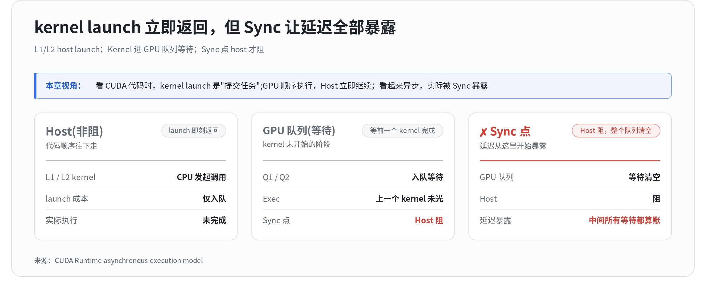
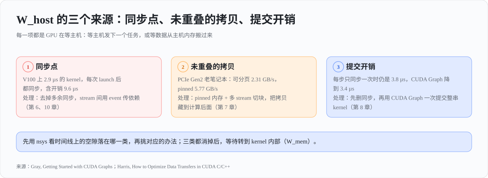
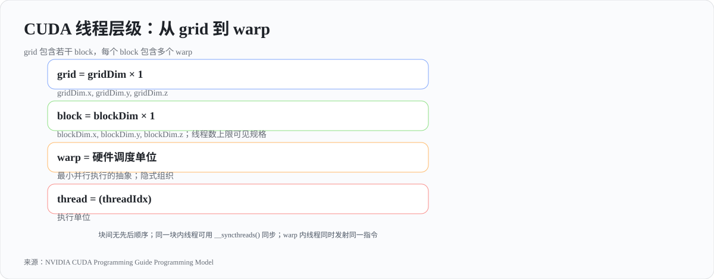
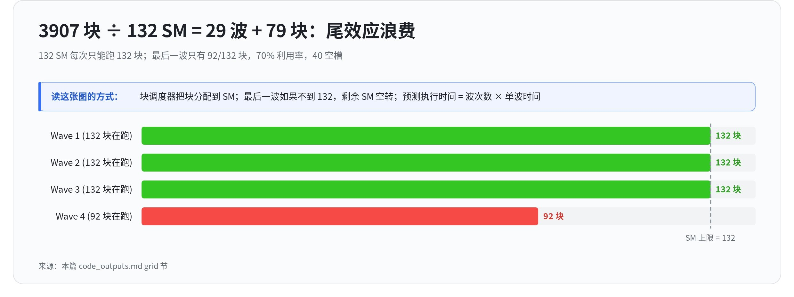
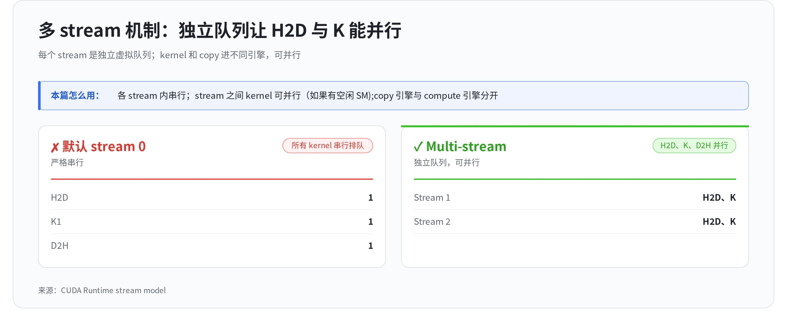
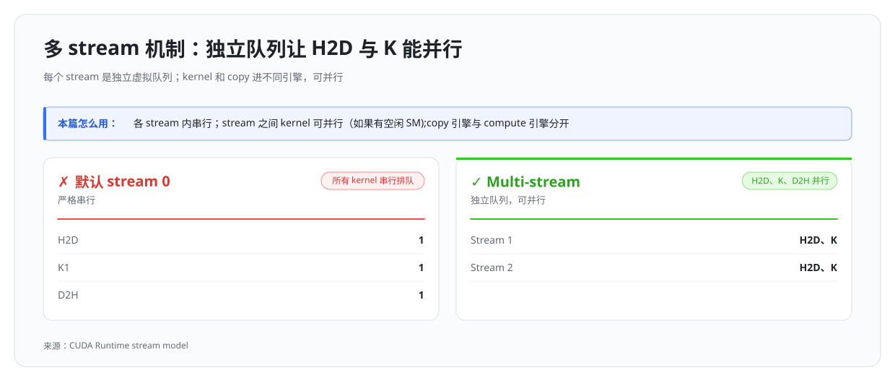
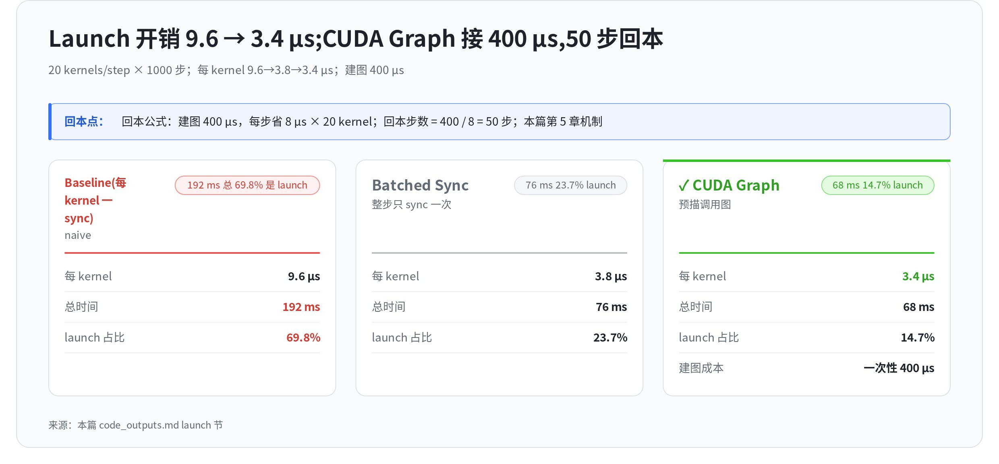

# GPU-03｜硬件｜CUDA 编程模型：线程层级、stream 与编译链

> 🎯 **这篇文档解决什么问题**：会写 PyTorch 的人很多，能说清一次 kernel launch 从主机到 GPU 经过了什么的人不多。本篇回答五个核心问题：主机与设备如何互相等待；隐式同步点挡住了哪些工作；线程层级从代码怎样映射到硬件调度；拷贝与计算怎样才能真正重叠；launch 开销何时值得用 CUDA Graph 优化。

**使用方式**：第 1 章讲起点，定位等待的指标（隐式同步点、默认 stream 和 GPU 队列的关系）。第 2-5 章讲结构，线程层级、block 调度与编译链，建立起从代码到二进制的完整认识。第 6-8 章是重点，stream、event 与异步拷贝怎样把主机与设备、拷贝与计算的等待藏起来；CUDA Graph 如何消除 launch 开销。第 9-10 章讲实战，错误检查与排错；PyTorch 侧的具体行为与陷阱。第 11 章给核对清单，验收与性能指标。

**代码**：sim_launch.py、test_launch.py 纯 Python，笔记本可直接跑。sim_launch.py 的 xfer 和 overlap 两节输出有误（拷贝时间的单位算错，overlap 各场景都输出 3.00），本篇第 6、7 章改用 Harris 博客的实测数据。

<b>🧭 主线位置</b>：GPU-00（[GPU-00｜索引｜从 0 开始 GPU 优化：路线、章节与练习](./README.md)）建立了时间账 T = T_compute + W_mem + W_host + W_comm + W_idle，GPU-02（[GPU-02｜硬件｜性能账本：Roofline、算术强度与三类瓶颈](./02-ledger.md)）给出了 Roofline 这把尺子。本篇处理的是 W_host 这一项（主机端同步等待、kernel 发射延迟、PCIe 数据搬运挡住计算）。消掉或隐藏主机侧等待后，瓶颈转向 kernel 内部 SM 等显存数据的时间（W_mem），交给 GPU-04（[GPU-04｜硬件｜访存与归约：合并访存、共享内存与 warp 归约](./04-memory.md)）。

## 导读 · 先给结论

- <b>主机只负责提交，GPU 负责执行。</b>kernel launch 和异步拷贝立即返回，任务还在 stream 里排队，真正执行的时刻由 GPU 决定（第 1 章）。[[1]](https://docs.nvidia.com/cuda/cuda-programming-guide/02-basics/asynchronous-execution.html)[[2]](https://docs.nvidia.com/cuda/cuda-runtime-api/api-sync-behavior.html)
- <b>线程层级是一份可扩展的并行约定。</b>块之间没有先后顺序保证，也不能互相等待，所以同一份代码在 40 个 SM 和 132 个 SM 的卡上都能跑，SM 多的卡同时跑的块多（第 2 章）。[[3]](https://dl.acm.org/doi/10.1145/1365490.1365500)[[4]](https://docs.nvidia.com/cuda/cuda-programming-guide/01-introduction/programming-model.html)
- <b>并行度决定数量级。</b>T4 上 100 万元素的向量加法，单线程 91.8 ms，一个 256 线程的块 2.05 ms，铺满全卡 47.5 µs，共快 1932 倍，带宽到了标称的八成以上（第 3 章）。[[5]](https://developer.nvidia.com/blog/even-easier-introduction-cuda/)
- <b>一波容量是 SM 数乘每 SM 驻留块数。</b>H100 上 3907 个块排成 4 波，最后一波 70.0% 的块位有活，4 波共 4224 个块位，空出 317 个，约 7.5%（第 4 章）。
- <b>重叠有三个前提。</b>设备支持并发拷贝和执行、kernel 和拷贝在不同的非默认 stream、主机内存是 pinned 的；拷贝引擎的数量还决定了哪种发射顺序更快（第 7 章）。[[6]](https://developer.nvidia.com/blog/how-overlap-data-transfers-cuda-cc/)
- <b>pinned 内存更快，但要复用。</b>Harris 在 PCIe Gen2 的老笔记本上测得 pinned 5.77 GB/s、可分页 2.31 GB/s，约 2.5 倍；256 MiB 分别约 46.5 ms 和 116 ms（第 1、7 章）。[[7]](https://developer.nvidia.com/blog/how-optimize-data-transfers-cuda-cc/)
- <b>短 kernel 先删同步，再上 CUDA Graph。</b>V100 上 2.9 µs 的 kernel，每次都同步时含开销 9.6 µs，每步只同步一次降到 3.8 µs，CUDA Graph 降到 3.4 µs，建图约 50 步回本（第 8 章）。[[8]](https://developer.nvidia.com/blog/cuda-graphs/)



<b>📎 与系列其他文档的分工</b>：GPU-01（[GPU-01｜硬件｜GPU 架构：SM、存储层级与延迟隐藏](./01-arch.md)）讲 warp 驻留与访存延迟隐藏，本篇讲主机与设备之间的交互；GPU-02（[GPU-02｜硬件｜性能账本：Roofline、算术强度与三类瓶颈](./02-ledger.md)）给出 Roofline 和理论时间，本篇用实测工具定位主机侧的等待；GPU-04（[GPU-04｜硬件｜访存与归约：合并访存、共享内存与 warp 归约](./04-memory.md)）处理 kernel 内部等显存的时间；GPU-15（[GPU-15｜单机｜PyTorch 运行时](./15-runtime.md)）深入 PyTorch 运行时的开销和调用链，本篇第 10 章只对上 CUDA 概念。

## 第 1 章 · 主机和设备在互相等什么

线上常见这样一幕：GPU 利用率看着不低，nsys 时间线上 kernel 和 kernel 之间却有空隙，拷贝和 kernel 一个接一个，没有交叠。这些空隙就是时间账里的 W_host：GPU 在等主机发下一个任务，或者等数据从主机内存搬过来。本章先讲主机和 GPU 怎样交接工作，再把 W_host 拆成三个来源，后面各章分头处理。

### launch 返回时，kernel 还在排队

下面两行看起来像“启动 kernel，然后等它跑完”：

*launch, then wait
*

```cpp
kernel_func<<<grid, block>>>(args);cudaDeviceSynchronize();  // host blocks until all GPU work is done
```

实际上 launch 这一行只是把 kernel 排进一个 stream。stream 里的 API 调用和 kernel launch 相对主机线程都是异步的[[1]](https://docs.nvidia.com/cuda/cuda-programming-guide/02-basics/asynchronous-execution.html)：launch 返回时，kernel 可能还没开始，主机已经可以往下执行。要拿结果，主机必须等，可以等某个 stream 清空，也可以在设备级同步[[1]](https://docs.nvidia.com/cuda/cuda-programming-guide/02-basics/asynchronous-execution.html)。上面第二行的 cudaDeviceSynchronize 就是设备级同步，主机在这里停下，直到 GPU 上所有排队的工作做完。

不指定 stream 的操作和 launch 都排进默认 stream[[1]](https://docs.nvidia.com/cuda/cuda-programming-guide/02-basics/asynchronous-execution.html)。同一个 stream 里的操作按入队顺序依次执行[[1]](https://docs.nvidia.com/cuda/cuda-programming-guide/02-basics/asynchronous-execution.html)，所以下面这段代码里，kernel 一定要等 H2D 拷贝做完才开始：

*copy then kernel in one stream
*

```cpp
cudaMemcpyAsync(d_a, h_a, nbytes, cudaMemcpyHostToDevice, stream0);kernel_func<<<grid, block, 0, stream0>>>(d_a);// stream0 now holds [H2D, kernel]; the kernel starts after the copy finishes
```

这本身没有错，kernel 本来就依赖拷贝来的数据。问题在于所有工作都挤在一个 stream 里时，设备上的拷贝引擎和 SM 只能轮流干活，即使硬件能同时拷贝和计算，也没有可以并发的操作交给它。第 6 章讲 stream 之间的并发规则，第 7 章讲怎样切块让拷贝和计算交叠。

### W_host 的三个来源



<b>同步点。</b>每次同步都让主机停下来等 GPU，GPU 做完后又要等主机提交下一个任务，两边轮流空着。Gray 在 V100 上测过一个 2.9 µs 的 kernel，每步连发 20 次、每次 launch 后都调用 cudaStreamSynchronize，用主机时钟算下来每个 kernel 9.6 µs[[8]](https://developer.nvidia.com/blog/cuda-graphs/)，开销占 (9.6 − 2.9) ÷ 9.6 ≈ 69.8%。在 PyTorch 里，.item()、打印 loss、用 GPU 张量做 if 判断都会悄悄引入同步（第 10 章）。

<b>未重叠的拷贝。</b>H2D 和 D2H 走 PCIe，速度取决于主机内存的类型。Harris 在一台 PCIe Gen2 的老笔记本（NVS 4200M）上用 16 MB 的拷贝测得：可分页内存（普通 malloc）H2D 约 2.31 GB/s，pinned 内存（cudaMallocHost 分配）约 5.77 GB/s，差约 2.5 倍[[7]](https://developer.nvidia.com/blog/how-optimize-data-transfers-cuda-cc/)。按这组带宽，256 MiB 数据可分页约 116 ms，pinned 约 46.5 ms。PCIe 5.0 x16 的理论单向带宽约 63 GB/s[[9]](https://en.wikipedia.org/wiki/PCI_Express)，所以这组绝对值只能说明相对差距，代入时间账前要用本机的 bandwidthTest 重测。拷贝没有和计算交叠时，这段时间 SM 全空着。

<b>提交开销。</b>每次 launch 都要经过主机端的驱动和 GPU 前端，kernel 越短，这笔开销的占比越高。Gray 的同一个实验里，去掉每次 launch 后的同步、每步只同步一次，每个 kernel 降到 3.8 µs；再用 CUDA Graph 把 20 个 kernel 一次提交，降到 3.4 µs[[8]](https://developer.nvidia.com/blog/cuda-graphs/)。剩下 3.4 − 2.9 = 0.5 µs 是 Graph 也消不掉的部分（第 8 章）。

三类加起来就是本篇处理的 W_host。定位时先用 nsys 看时间线上的空隙落在哪一类：kernel 之间的空隙旁边有同步调用，是第一类；拷贝和 kernel 首尾相接，是第二类；没有同步、kernel 之间仍有均匀的小缝，是第三类。

### 线程层级：同一份代码怎样铺到不同的卡上

W_host 之外，本篇还要讲清 kernel 本身怎样铺满全卡，否则主机侧的等待消掉了，SM 却有一半闲着，等待只是换成了 W_idle。launch 时指定的两个参数决定了并行度：

*grid and block size
*

```cpp
kernel_func<<<dim3(1024, 1, 1), dim3(256, 1, 1)>>>(args);// gridDim = (1024, 1, 1): 1024 blocks// blockDim = (256, 1, 1): 256 threads per block
```

这两个参数定义的是一份可扩展的并行约定：块之间没有执行顺序的保证，也不能互相等待，所以同一份代码在 SM 多的卡上同时跑的块多，在 SM 少的卡上分几批跑[[3]](https://dl.acm.org/doi/10.1145/1365490.1365500)[[4]](https://docs.nvidia.com/cuda/cuda-programming-guide/01-introduction/programming-model.html)。块数按问题规模取，不按 SM 数取，代码才能换卡不改。第 2 章讲线程、warp、块和网格怎样映射到硬件，第 3 章用向量加法看并行度带来的数量级差距，第 4 章算一波能放多少块、尾巴有多大。

> 💡 **常见误区**：用主机计时器包住一个 kernel launch，测出来只有几微秒，就以为 kernel 很快。现象是怎么改 kernel，计时都差不多，耗时却出现在后面某次同步上。原因是 launch 相对主机是异步的[[1]](https://docs.nvidia.com/cuda/cuda-programming-guide/02-basics/asynchronous-execution.html)，主机计时器量到的只是提交。改法是计时前后同步，或者用 CUDA event 在 stream 里打时间戳（第 6 章）。

> 🔑 **本章要点**：launch 相对主机异步，返回时 kernel 还在 stream 里排队；同一 stream 内按序执行。W_host 有三个来源：同步点（V100 上 2.9 µs 的 kernel 每次都同步时含开销 9.6 µs）、未重叠的拷贝（老平台上 pinned 比可分页快约 2.5 倍）、提交开销（CUDA Graph 降到 3.4 µs）。这一章是五步闭环的“定位等待”：先看时间线上的空隙属于哪一类，再到对应的章节找办法。

## 第 2 章 · 线程层级与硬件调度

### 2.1 从代码到硬件的合约

写 kernel 时用三层嵌套的索引：threadIdx 标识线程在块内的位置，blockIdx 标识块在网格内的位置。一个 launch 声明了 grid 和 block 的维度，GPU 据此创建对应数量的线程。最关键的是块之间没有执行顺序保证[[3]](https://dl.acm.org/doi/10.1145/1365490.1365500)，也不能互相等待，这是可扩展性的基础：同一份 kernel 代码可以在 40 个 SM 和 132 个 SM 的卡上直接运行，不需要改任何参数[[4]](https://docs.nvidia.com/cuda/cuda-programming-guide/01-introduction/programming-model.html)。

这个设计在逻辑上和物理层解耦了。逻辑上 kernel 声明的是线程数和同步点；物理上调度器决定哪些块在哪个 SM 上执行、什么时候。只要块之间不互相依赖，调度器就可以自由排列，充分利用硬件资源。相比之下，如果块有执行顺序（比如第一个块计算完后第二个块才能开始），那么调度器就被锁死了：必须等第一个块的所有线程跑完，才能调度第二个块，其他 SM 会闲着。这会把”所有 SM 齐心协力”的并行模式变成”流水线堵塞”。



### 2.2 块的约束与上限检查

块是调度的最小单位，一个块从头到尾待在同一个 SM 上，块内线程共享这个 SM 的共享内存（shared memory），能用 __syncthreads() 互相等待。每个块有硬上限：blockDim.x 和 y 各最大 1024，z 最大 64，块内线程总数不超过 1024[[10]](https://docs.nvidia.com/cuda/cuda-programming-guide/05-appendices/compute-capabilities.html)。这些上限从 Volta 到 Blackwell 一直没变，是硬件设计的基本约束。网格维度的上限则是 gridDim.x 最多 2^31-1，gridDim.y 和 z 各最多 65535[[10]](https://docs.nvidia.com/cuda/cuda-programming-guide/05-appendices/compute-capabilities.html)。

超出块或线程上限不会在编译时报错，launch 时才返回 cudaErrorInvalidConfiguration。如果不检查这个返回值，kernel 一个线程都不会执行，结果数组保持原样，看起来像算错了。生产代码必须检查 launch 的返回值，可以用 cudaGetLastError() 或在 debug build 中启用 CUDA 调试符号。sim_launch.py grid 的配置检查显示，grid=(70000, 1, 1) block=(256, 1, 1) 合法（总块数 70000 &lt; 2^31），但 grid=(1, 70000, 1) block=(256, 1, 1) 违反了 gridDim.y 的上限 65535，会被拒绝[[10]](https://docs.nvidia.com/cuda/cuda-programming-guide/05-appendices/compute-capabilities.html)。还有一个坑：grid=(1, 1, 1) block=(1024, 2, 1) 通过了块维度检查（1024 和 2 都合法），但块内线程总数 2048 超过上限 1024，launch 也会失败。

块大小怎么选是性能优化的第一个决策点。CUDA 最佳实践指南给的起点是 128 到 256 线程，必须是 32 的倍数，否则最后一个 warp 有空闲 lane，执行单元利用率下降。向上调时要评估寄存器和共享内存用量对占有率的影响。太小的块（32 或 64）导致块数多、调度开销相对较大；太大的块（比如 1024）导致每个 SM 驻留的块数少，超线程机会少，当一个 warp 等待内存时没有其他 warp 来填充，延迟隐藏效率下降。经验上，256 是个通用的起点，除非 kernel 的寄存器或共享内存消耗特别高。[[11]](https://docs.nvidia.com/cuda/cuda-c-best-practices-guide/)

### 2.3 warp：硬件执行的原子单位

块内的线程再按线性编号（先 x 后 y 后 z）每 32 个切成一个 warp。warp 是 SM 发射指令的基本单位，32 个 warp lane 在同一个时钟周期执行同一条指令（SIMT 模型）。分支时会串行化：如果块内有 if-else，16 个线程走 if 分支，另外 16 个走 else，GPU 必须两条分支都执行，只是不走那条分支的线程设置为 inactive，不更新结果。这叫做 warp divergence，是性能的大敌[[10]](https://docs.nvidia.com/cuda/cuda-programming-guide/05-appendices/compute-capabilities.html)。

选 32 这个数字有两个原因。首先是历史：早期 NVIDIA GPU 的浮点单元宽度就是 32 lane，warp 大小就地取材。其次是实践：warp 大小对齐硬件执行宽度能最有效地利用 ALU 和访存单元。Ampere 架构之后可选 16 线程的 warp（Cooperative Groups），但通常不用，因为会打破库生态。[[10]](https://docs.nvidia.com/cuda/cuda-programming-guide/05-appendices/compute-capabilities.html)一个块被切成 ⌈blockDim.x × blockDim.y × blockDim.z / 32⌉ 个 warp，所以块大小必须是 32 的倍数才能保证每个 warp 都满人。

### 2.4 occupancy 与驻留度的完整模型

SM 上可以同时驻留多个块，能驻留多少由几项资源中最紧的那一项决定。以 H100（计算能力 9.0）为例：每个 SM 最多驻留 64 个 warp、2048 个线程、32 个块[[10]](https://docs.nvidia.com/cuda/cuda-programming-guide/05-appendices/compute-capabilities.html)，有 64K 个 32 位寄存器[[10]](https://docs.nvidia.com/cuda/cuda-programming-guide/05-appendices/compute-capabilities.html)，共享内存最多 228 KB，CUDA 还给每个块保留 1 KB 共享内存[[12]](https://docs.nvidia.com/cuda/hopper-tuning-guide/)。

例如一个 kernel 每块 256 个线程、每线程 32 个寄存器、每块用 48 KB 共享内存：寄存器每块要 256 × 32 = 8192 个，65536 ÷ 8192 = 8 块；线程数允许 2048 ÷ 256 = 8 块；共享内存每块实占 48 + 1 = 49 KB，228 ÷ 49 ≈ 4.65，只能放 4 块。最紧的是共享内存，SM 上驻留 4 块、32 个 warp，occupancy 是 32 ÷ 64 = 50%。GPU-01（[GPU-01｜硬件｜GPU 架构：SM、存储层级与延迟隐藏](./01-arch.md)）第 2 章有完整的算法和取整规则。

occupancy（占有率）定义为 SM 上活跃 warp 数除以最大驻留 warp 数。它的作用是给调度器留出可切换的 warp：一个 warp 等内存时，调度器发射另一个 warp 的指令，执行单元就不空转。但高占有率不等于高性能，每个线程做更多独立的工作（ILP）也能隐藏延迟，GPU-01 第 5 章讲两者的换算。不想手算时，Runtime 提供了占用率计算函数 cudaOccupancyMaxActiveBlocksPerMultiprocessor，以及按占用率推荐块大小的 C++ 接口 cudaOccupancyMaxPotentialBlockSize[[13]](https://docs.nvidia.com/cuda/cuda-runtime-api/group__CUDART__OCCUPANCY.html)。

> 🔑 **本章要点**：线程层级是主机对调度器的契约，块间无序、块内可同步。块大小取 128-256 的 32 倍数，warp 是硬件执行单元，占有率高于 20% 即可隐藏访存延迟。

## 第 3 章 · 向量加法的性能阶梯

### 3.1 单线程基线：一次只有一个请求在路上

开始优化前先定天花板。Harris 在入门博客[[5]](https://developer.nvidia.com/blog/even-easier-introduction-cuda/)里用 100 万个 float 的向量加法（N = 1&lt;&lt;20）演示并行度的作用，测量卡是 T4：40 个 SM，标称带宽 320 GB/s[[5]](https://developer.nvidia.com/blog/even-easier-introduction-cuda/)。最简单的版本用 &lt;&lt;&lt;1, 1>>> 只启动一个线程，串行相加所有元素：

*serial baseline
*

```cpp
__global__ void add(int n, float *x, float *y) {  for (int i = 0; i < n; i++)    y[i] = x[i] + y[i];}
```

每个元素读 x、读 y、写 y，各 4 字节，共 12 字节；1048576 个元素共约 12.6 MB。按 320 GB/s 算，理论下限是 12.6 MB ÷ 320 GB/s ≈ 39 µs。博客实测这个版本 91.8 ms，带宽只有 137 MB/s[[5]](https://developer.nvidia.com/blog/even-easier-introduction-cuda/)，比下限慢两千多倍。原因是一个线程同一时刻只有一个访存请求在路上，每次都要等数据从显存回来才能做下一次加法，显存带宽几乎全部闲着。在时间账里，这是 W_mem：等待来自延迟，而不是带宽。

### 3.2 单块 256 线程：块内并行

把 launch 改成 &lt;&lt;&lt;1, 256>>>，一个块的 256 个线程分工处理这些元素。每个线程以 threadIdx.x 为起点、以 blockDim.x 为步长循环[[5]](https://developer.nvidia.com/blog/even-easier-introduction-cuda/)：

*one block, strided loop
*

```cpp
__global__ void add(int n, float *x, float *y) {  int index = threadIdx.x;  int stride = blockDim.x;  for (int i = index; i < n; i += stride)    y[i] = x[i] + y[i];}
```

线程 0 处理元素 0、256、512……，每个线程循环 1048576 ÷ 256 = 4096 次。这个版本耗时 2.05 ms，比单线程快 45 倍，带宽 6 GB/s[[5]](https://developer.nvidia.com/blog/even-easier-introduction-cuda/)。256 个线程是 8 个 warp，同一时刻有几百个访存请求在路上，一个 warp 等数据时，SM 的调度器可以发射另一个 warp 的指令，等待被摊开了。

块大小取 32 的倍数，是因为 warp 固定 32 个线程。如果选 200 个线程，最后一个 warp 只有 200 − 6 × 32 = 8 个线程，另外 24 个 lane 空着。

但一个块只能在一个 SM 上运行[[5]](https://developer.nvidia.com/blog/even-easier-introduction-cuda/)，T4 的 40 个 SM 里只有 1 个在干活。等待从 W_mem 变成了 W_idle：卡上大部分执行单元没有活干。

### 3.3 多个块：铺满全卡

第三个版本启动足够多的块覆盖所有元素[[5]](https://developer.nvidia.com/blog/even-easier-introduction-cuda/)：

*many blocks, grid-stride form
*

```cpp
__global__ void add(int n, float *x, float *y) {  int index = blockIdx.x * blockDim.x + threadIdx.x;  int stride = blockDim.x * gridDim.x;  for (int i = index; i < n; i += stride)    y[i] = x[i] + y[i];}int blockSize = 256;int numBlocks = (N + blockSize - 1) / blockSize;  // 4096 blocks for 1M elementsadd<<<numBlocks, blockSize>>>(N, x, y);
```

块数是 1048576 ÷ 256 = 4096，每个线程正好处理一个元素，循环只走一次。博客实测这个版本 47.5 µs，带宽 265 GB/s，是单线程的 1932 倍[[5]](https://developer.nvidia.com/blog/even-easier-introduction-cuda/)。265 GB/s 超过了 T4 标称带宽 320 GB/s 的 80%[[5]](https://developer.nvidia.com/blog/even-easier-introduction-cuda/)，算下来 265 ÷ 320 ≈ 83%。博客的解释是，数据已经在显存里时，从单块到多块的加速和 SM 数（40）成正比[[5]](https://developer.nvidia.com/blog/even-easier-introduction-cuda/)；实测 2.05 ms ÷ 47.5 µs ≈ 43 倍，接近 40。

到这一步，等待变成了卡的总带宽：kernel 已经把显存带宽用到八成以上，再加块也不会更快。在时间账里，剩下的是 W_mem 的带宽部分，要再快只能少搬字节（降精度、融合）或换带宽更高的卡。

### 3.4 grid-stride 循环：块数和数据量解耦

上面的 kernel 已经写成 grid-stride 的形式：起点是全局下标，步长是整个网格的线程数。块数正好覆盖数据时，循环只走一次；它的价值在于块数可以和数据量脱钩。Harris 的 CUDA Pro Tip 列了几点好处：

- 可以限制块数来调性能，常用的做法是取 SM 数的整数倍，让各 SM 负载均衡[[14]](https://developer.nvidia.com/blog/cuda-pro-tip-write-flexible-kernels-grid-stride-loops/)。第 4 章的波次计算算的就是这件事。
- 网格小了，线程被复用，线程创建和销毁的开销以及每个线程的初始化工作被摊薄[[14]](https://developer.nvidia.com/blog/cuda-pro-tip-write-flexible-kernels-grid-stride-loops/)。
- 用一个块、一个线程启动 grid-stride kernel，执行就串行化了，方便和串行实现对拍，printf 调试时输出顺序也是确定的[[14]](https://developer.nvidia.com/blog/cuda-pro-tip-write-flexible-kernels-grid-stride-loops/)。

### 3.5 计时前先把数据搬进显存

Harris 的例子用 cudaMallocManaged 分配统一内存。kernel 第一次碰到某一页时触发缺页，GPU 线程要停下来等这一页迁到显存[[5]](https://developer.nvidia.com/blog/even-easier-introduction-cuda/)，这段时间全算进 kernel 耗时。博客的做法是 launch 前用 cudaMemPrefetchAsync 把 x、y 一次预取到 GPU，预取之后多块版本的 kernel 降到 50 µs 以内；上面三个版本的数字都是加了预取之后测的[[5]](https://developer.nvidia.com/blog/even-easier-introduction-cuda/)。

自己测时也要注意：kernel 明明优化了，计时却没变快，往往是缺页迁移藏在 kernel 时间里。生产代码一般用 cudaMalloc 加显式拷贝，统一内存的适用场景放到 GPU-10（[GPU-10｜系统｜显存管理](./10-memory-mgmt.md)）讲。

> 🔑 **本章要点**：T4 上 100 万元素的向量加法，单线程 91.8 ms，单块 2.05 ms（快 45 倍），铺满全卡 47.5 µs（共快 1932 倍，带宽 265 GB/s，超过标称的 80%）。等待依次是访存延迟（W_mem）、SM 闲置（W_idle）、显存带宽。grid-stride 循环让块数和数据量解耦，计时前要先把数据预取进显存。

## 第 4 章 · 块调度、波次与尾效应

上一章的 grid-stride 版本在 T4 上跑到约 265 GB/s，前提是所有 SM 都分到了活。网格大小和硬件容量对不齐时，最后一批块跑的那段时间里有一部分 SM 没事做，这段时间记在账本的 W_idle 里。本章算清楚一波能放多少块、尾巴有多大，再给出三种削尾巴的办法和一套测量顺序。

### 一波能放多少块

块调度器把块分发到 SM 上，每个 SM 同时驻留的块数受线程数、寄存器和共享内存三项上限共同约束；全卡同时驻留的块数就是一波（wave）的容量。本篇 grid 子命令按 H100 的 132 个 SM、每块 256 线程、每 SM 驻留 8 块（8 × 256 = 2048 线程）计算，一波容量是 132 × 8 = 1056 块。

百万元素需要 ⌈1,000,000 ÷ 256⌉ = 3907 个块，3907 ÷ 1056 ≈ 3.7，所以要跑 4 波。前 3 波共 3168 块，最后一波只有 739 块，利用率 739 ÷ 1056 = 70.0%，空出 317 个块位（sim_launch.py grid 的输出）。

常见的算法错误是只拿 SM 数去除：⌈3907 ÷ 132⌉ = 30，这等于假设每个 SM 一次只放一个块。驻留块数由资源决定：寄存器或共享内存用得多时，每 SM 只能放 1～2 块，一波容量随之缩小，同样的网格要跑更多波。所以算波次之前先看驻留情况，ncu 的 launch__waves_per_multiprocessor 直接给出每个 SM 的波数，文档对它的说明是“Partial waves can lead to tail effects where some SMs become idle while others still have pending work to complete”[[15]](https://docs.nvidia.com/nsight-compute/ProfilingGuide/index.html)。

### 尾效应：最后一波在等谁



一波的结束时间由这一波里最慢的块决定。最后一波只有 70% 的块位在干活，其余资源空着等它跑完。4 波总共 4 × 1056 = 4224 个块位，空 317 个，占 7.5%；对这种每块都很短、彼此差不多的访存型 kernel，7.5% 大致就是尾巴能浪费的时间上限。

每块占的资源越多、一波越小，尾巴越显眼。NVIDIA 的矩阵乘性能指南给过一组实测：A100 有 108 个 SM，用 256×128 的 tile 时，N 从 1536 增到 1544，tile 数刚好越过 108 的整数倍，多出来的一波只用到 9/108 = 8.33% 的 SM，吞吐约减半、耗时约翻倍[[16]](https://docs.nvidia.com/deeplearning/performance/dl-performance-matrix-multiplication/index.html)。指南把这叫 wave quantization（波次量化），和尾效应是同一件事。

再看一个极端例子：每 SM 只能驻留 1 块、网格 133 块，在 132 个 SM 上就是 2 波，第二波只有 1 块，总耗时约等于两波，有效占用 133 ÷ 264 ≈ 50.4%。数据并行训练里每一步都在集合通信处对齐，一张卡多出的这段时间会让其他卡在同步点一起等，单卡的尾巴就变成了全组的等待。

### 三种削尾巴的办法

按改动从小到大排列：

1. 调块大小或问题切分，让块数接近一波容量的整数倍。矩阵乘里调 tile 宽度、调 batch size 都是这个思路，指南提到 cuBLAS 实际会选更窄的 tile 来减小量化效应，原话是“In practice, cuBLAS would select narrower tiles (for example, 64-wide) to reduce the quantization effect”[[16]](https://docs.nvidia.com/deeplearning/performance/dl-performance-matrix-multiplication/index.html)。
2. grid-stride 循环：块数不再由数据量决定，而由设备的 SM 数决定，每个线程按 gridDim.x × blockDim.x 的步长循环处理多个元素。Harris 的写法是运行时用 cudaDeviceGetAttribute 读出 cudaDevAttrMultiProcessorCount，再发射 32 × numSMs 个块[[14]](https://developer.nvidia.com/blog/cuda-pro-tip-write-flexible-kernels-grid-stride-loops/)。块数是 SM 数的整数倍，各 SM 分到的块一样多；换卡后 numSMs 是运行时读出的新值（A100 是 108，T4 是 40），代码不用改。
3. 持久 kernel：块数正好等于一波容量，每个块循环领取任务直到全部做完。尾巴从“块”的粒度降到“任务”的粒度，代价是要自己写任务分配和结束判断。

grid-stride 也有成本：每个元素多一次循环判断和地址累加。对访存受限的 kernel，这点整数运算通常藏在访存等待里；划不划算，用 nsys 对比两版 kernel 的时间就知道，不要凭感觉下结论。

### 按五步做一次波次排查

1. 定天花板：数据量 ÷ 显存带宽，给出 kernel 时间的下限。
2. 测实际：nsys 拿到 kernel 时间，和下限比出差距。
3. 定位等待：ncu 的 Launch Statistics 看 launch__waves_per_multiprocessor[[15]](https://docs.nvidia.com/nsight-compute/ProfilingGuide/index.html)。值带小数且波数只有个位数（比如 3.7）时，尾巴可能占得多；波数在几十以上时，尾巴最多一波，被摊薄到可以忽略。
4. 消除或隐藏：从上面三种办法里选改动最小的一种。
5. 复测：再跑 nsys 和 ncu，确认波数变成整数或尾巴占比下降，kernel 时间跟着下降。

> 🔑 **本章要点**：一波容量 = SM 数 × 每 SM 驻留块数，不是 SM 数。百万元素向量加法在 H100 上是 3.7 波、补成 4 波，空出 7.5% 的块位；每块越重、一波越小、波数越少，尾巴越贵。grid-stride 按 32 × numSMs 发块，把块数和硬件对齐，换卡不改代码。

## 第 5 章 · 编译链：PTX、SASS 与 fatbin

同一个 .cu 文件编译出来的程序，换一张卡可能直接报 “no kernel image is available”，也可能第一次启动慢得出奇。两件事的根源都在编译链：可执行文件里到底装了哪些 GPU 代码，驱动在新卡上找不到对应代码时怎么办。本章讲清这条链上的三种产物和两条兼容规则。

### nvcc 的产物：PTX、cubin 与 fatbin

nvcc 把 .cu 文件拆成主机代码和设备代码，主机代码交给 gcc、clang 或 MSVC，设备代码走 NVIDIA 自己的编译流程[[17]](https://docs.nvidia.com/cuda/cuda-compiler-driver-nvcc/index.html)。设备代码有两种形式：

- **PTX**：虚拟指令集[[18]](https://docs.nvidia.com/cuda/parallel-thread-execution/index.html)，按“虚拟架构”编号，例如支持计算能力 8.0 全部特性的虚拟架构叫 compute_80[[19]](https://docs.nvidia.com/cuda/cuda-programming-guide/01-introduction/cuda-platform.html)。
- **cubin**：针对某个具体计算能力的二进制机器码，指令就是常说的 SASS，按 sm_86 这样的编号称呼；sm_86 等同于“为计算能力 8.6 构建”[[19]](https://docs.nvidia.com/cuda/cuda-programming-guide/01-introduction/cuda-platform.html)。

可执行文件和库里的 GPU 代码装在一个叫 fatbin 的容器里，一个 fatbin 可以同时装多个目标的 cubin 和 PTX[[19]](https://docs.nvidia.com/cuda/cuda-programming-guide/01-introduction/cuda-platform.html)。nvcc 的默认展开也说明了这一点：`nvcc --gpu-architecture=sm_100` 等价于 `--gpu-architecture=compute_100 --gpu-code=sm_100,compute_100`[[17]](https://docs.nvidia.com/cuda/cuda-compiler-driver-nvcc/index.html)，即一份 sm_100 的 cubin 加一份 compute_100 的 PTX。

### 两条兼容规则

<b>cubin 只在同一主版本内向上兼容。</b>为计算能力 8.6 编译的 cubin 可以在 8.6 或 8.9 的卡上加载运行，不能在 8.0 上运行，因为卡的次版本 0 低于代码的次版本 6；不同主版本之间完全不兼容，8.6 的 cubin 不能在 9.0 的卡上加载[[19]](https://docs.nvidia.com/cuda/cuda-programming-guide/01-introduction/cuda-platform.html)。H100 和 H200 的计算能力都是 9.0，同一份 sm_90 的 cubin 两张卡都能用；A100 是 8.0，要单独一份 sm_80[[20]](https://developer.nvidia.com/cuda-gpus)。

<b>PTX 可以向任何更高的计算能力 JIT 编译。</b>程序里如果带了 compute_80 的 PTX，运行时可以把它 JIT 编译给更新的架构，例如 sm_120，不用重新构建程序[[19]](https://docs.nvidia.com/cuda/cuda-programming-guide/01-introduction/cuda-platform.html)。这是“老程序在新卡上能跑”的唯一保证，所以发布的库通常会带一份最低目标的 PTX。

Hopper 起还多了一类目标。计算能力 9.0 开始，部分专用特性（例如 Tensor Core 相关的操作）不保证在后续计算能力上都有，称为架构专属特性，要用带 a 后缀的目标（如 compute_90a、compute_100a）编译才能用；这样编出的代码只能在编译时那个确切的计算能力上运行[[10]](https://docs.nvidia.com/cuda/cuda-programming-guide/05-appendices/compute-capabilities.html)。GPU-06（[GPU-06｜硬件｜Tensor Core 与低精度：从 mma 到 FP8 和 FP4](./06-tensor-core.md)）讲的 wgmma 就要用 sm_90a 编译。用 `-arch=sm_90a` 时，nvcc 会同时加入架构专属和非专属的虚拟代码，展开为 `--gpu-architecture=compute_90a --gpu-code=sm_90a,compute_90,compute_90a`[[17]](https://docs.nvidia.com/cuda/cuda-compiler-driver-nvcc/index.html)，留一份 compute_90 的 PTX 给其他卡兜底。

### JIT 的代价：首次加载变慢

fatbin 里没有当前卡能用的 cubin、只有 PTX 时，驱动在运行时把 PTX 编译成机器码。JIT 会增加程序的加载时间，好处是能用上新驱动里编译器的改进，也能在编译时还不存在的卡上运行[[19]](https://docs.nvidia.com/cuda/cuda-programming-guide/01-introduction/cuda-platform.html)。驱动会把 JIT 结果缓存起来，下次启动不用重编；驱动升级后缓存自动失效[[19]](https://docs.nvidia.com/cuda/cuda-programming-guide/01-introduction/cuda-platform.html)。

所以 JIT 的代价主要落在“第一次”：新机器、新容器、刚升级驱动后的第一次启动。对频繁拉起新进程的推理服务或容器环境，这个首次延迟要算进时间账，归在 W_host 一项。规避办法是把目标卡的 cubin 直接编进 fatbin。和加载时间相关的还有 lazy loading：CUDA 11.7 首次引入，12.2 起在 Linux 上默认开启[[21]](https://docs.nvidia.com/cuda/cuda-programming-guide/04-special-topics/lazy-loading.html)，可以用环境变量 CUDA_MODULE_LOADING 控制[[21]](https://docs.nvidia.com/cuda/cuda-programming-guide/04-special-topics/lazy-loading.html)。

> 💡 **常见误区**：只编 `-arch=sm_90a`，以为生成的 cubin 在所有更新的卡上都能跑。现象是程序换到 Blackwell 卡上时没有可用的 cubin，只能 JIT 编译兜底的 PTX，首次启动明显变慢。原因是带 a 后缀的代码只能在编译时那个确切的计算能力上运行[[10]](https://docs.nvidia.com/cuda/cuda-programming-guide/05-appendices/compute-capabilities.html)，而 cubin 本来就不跨主版本[[19]](https://docs.nvidia.com/cuda/cuda-programming-guide/01-introduction/cuda-platform.html)。改法是按要部署的卡逐一列出 `-gencode` 目标，再保留一份最低目标的 PTX；上线前用 `cuobjdump --list-elf` 看 fatbin 里实际装了哪些 cubin。

> 🔑 **本章要点**：fatbin 里装的是 cubin（SASS）和 PTX。cubin 只在同一主版本内向上兼容，8.6 的能跑在 8.9 上、不能跑在 8.0 和 9.0 上；PTX 能 JIT 到任何更高的计算能力，代价是首次加载变慢。带 a 后缀的目标只能在确切的计算能力上运行。这一章是五步闭环的“定位等待”：首次启动慢，先查是不是在 JIT。

## 第 6 章 · stream、event 与默认 stream 的陷阱

第 1 章看到，主机提交的任务都在队列里排队。本章讲这条队列的规则：同一个 stream 里的操作按什么顺序执行，不同 stream 之间什么时候能并发，默认 stream 为什么会把并发打断，以及怎样用 event 计时和在 stream 之间传递依赖。第 7 章的拷贝重叠就建立在这些规则上。

### stream：按顺序执行的工作队列

CUDA 编程指南的说法是，stream 像一个工作队列，程序往里面加内存拷贝、kernel launch 这样的操作，按入队的顺序依次执行[[1]](https://docs.nvidia.com/cuda/cuda-programming-guide/02-basics/asynchronous-execution.html)。Harris 的定义更直白：stream 是一串在设备上执行的操作，执行顺序就是主机代码发出它们的顺序；同一 stream 内保证按序，不同 stream 的操作可以交错，在条件允许时同时运行[[6]](https://developer.nvidia.com/blog/how-overlap-data-transfers-cuda-cc/)。

所以多 stream 只是“允许”并发，能不能真的并发还取决于硬件：两个 stream 的 H2D 拷贝要抢同一个拷贝引擎，两个 kernel 要抢同一批 SM。第 7 章会看到，拷贝引擎的数量直接决定了切块重叠的效果。



### 默认 stream 会打断并发

launch 和拷贝不指定 stream 时，用的是默认 stream。传统的默认 stream（也叫 NULL stream，编号 0）是一个阻塞 stream，由所有主机线程共享[[1]](https://docs.nvidia.com/cuda/cuda-programming-guide/02-basics/asynchronous-execution.html)；它会和设备上所有其他 stream 同步[[6]](https://developer.nvidia.com/blog/how-overlap-data-transfers-cuda-cc/)。编程指南写得更具体：两个不同 stream 的操作之间，只要插进一个默认 stream 上的操作，它们就不能并发，除非这两个 stream 是非阻塞 stream[[1]](https://docs.nvidia.com/cuda/cuda-programming-guide/02-basics/asynchronous-execution.html)。

*all in the default stream
*

```cpp
cudaMemcpyAsync(d_a, h_a, 1GB, cudaMemcpyHostToDevice);kernel_func<<<grid, block>>>(d_a);  // waits for the copycudaMemcpyAsync(h_a, d_a, 1GB, cudaMemcpyDeviceToHost);
```

上面三步都在默认 stream 里，按顺序执行：H2D 完成后 kernel 才开始，kernel 完成后 D2H 才开始。设备有独立的拷贝引擎也用不上，因为同一个 stream 里没有可以并发的操作。更隐蔽的情况是，代码别处已经用了多个 stream，中间夹了一个不带 stream 参数的 launch 或 cudaMemcpy，并发就在这里断开。

有两个办法绕开这个限制：

- 用 cudaStreamCreateWithFlags 加 cudaStreamNonBlocking 标志创建非阻塞 stream；cudaStreamCreate 创建的默认是阻塞 stream[[1]](https://docs.nvidia.com/cuda/cuda-programming-guide/02-basics/asynchronous-execution.html)。
- 从 CUDA 7 起，可以让每个主机线程有自己独立的默认 stream，编译时加 nvcc 的 --default-stream per-thread 选项，或者定义 CUDA_API_PER_THREAD_DEFAULT_STREAM 宏[[1]](https://docs.nvidia.com/cuda/cuda-programming-guide/02-basics/asynchronous-execution.html)。Harris 的例子里，8 个工作 kernel 在传统默认 stream 下完全串行，换成每线程默认 stream 后，9 个 stream 完全并发[[22]](https://developer.nvidia.com/blog/gpu-pro-tip-cuda-7-streams-simplify-concurrency/)。

编程指南还给了两条提高并发的写法建议：先发出所有互不依赖的操作，再发有依赖的操作；任何形式的同步都尽量往后推[[1]](https://docs.nvidia.com/cuda/cuda-programming-guide/02-basics/asynchronous-execution.html)。

### event：在 stream 里打时间戳

GPU 操作是异步的，主机端的计时器只能量到“提交花了多久”，除非计时前后都做同步。CUDA event 的做法是在 stream 里插一个标记，GPU 执行到那里时记录下来：

*timing with events
*

```cpp
cudaEvent_t start, end;cudaEventCreate(&start);cudaEventCreate(&end);cudaEventRecord(start);  // marks a point in the streamkernel_func<<<grid, block>>>(d_a);cudaEventRecord(end);cudaEventSynchronize(end);  // host waits for endfloat ms;cudaEventElapsedTime(&ms, start, end);  // milliseconds
```

cudaEventElapsedTime 返回两个 event 之间的毫秒数，分辨率约 0.5 微秒[[23]](https://docs.nvidia.com/cuda/cuda-runtime-api/group__CUDART__EVENT.html)。所以单次测一个几微秒的短 kernel 误差很大，要么循环多次取平均，要么直接看 nsys 时间线上的 kernel 时长。cudaEventRecord 不指定 stream 时记录在默认 stream 上[[23]](https://docs.nvidia.com/cuda/cuda-runtime-api/group__CUDART__EVENT.html)，在多 stream 代码里计时，要把 event 记在被测操作所在的 stream 上。

### 主机与 stream、stream 与 stream 的同步

从重到轻有三档：

- **cudaDeviceSynchronize**：主机阻塞到设备上所有工作完成，最重，一般只在计时或程序结束时用。
- <b>cudaStreamSynchronize(stream)</b>：主机阻塞到指定 stream 里之前发出的操作全部完成[[6]](https://developer.nvidia.com/blog/how-overlap-data-transfers-cuda-cc/)，其他 stream 照常在设备上执行[[1]](https://docs.nvidia.com/cuda/cuda-programming-guide/02-basics/asynchronous-execution.html)。cudaStreamQuery 只查询、不阻塞；cudaEventSynchronize 和 cudaEventQuery 的作用类似，判断依据是某个 event 有没有完成[[6]](https://developer.nvidia.com/blog/how-overlap-data-transfers-cuda-cc/)。
- <b>cudaStreamWaitEvent(stream, event)</b>：主机不等，让 stream 里此后加入的命令推迟到 event 完成再执行[[1]](https://docs.nvidia.com/cuda/cuda-programming-guide/02-basics/asynchronous-execution.html)。这是 stream 之间传递依赖的标准做法。

最后一种的典型用法是“拷贝 stream 完成后再启动计算 stream 的 kernel”：`cudaEventRecord(copy_done, s_copy); cudaStreamWaitEvent(s_compute, copy_done); kernel<<<grid, block, 0, s_compute>>>(...);`。依赖留在 GPU 侧，主机继续往下发任务，s_copy 里排在 copy_done 之后的操作也不会挡住 s_compute。反过来，两个 stream 通过全局内存交换数据却不加这类依赖，读的一方可能读到旧数据。

> 💡 **常见误区**：建了多个 stream，nsys 时间线上 kernel 还是一个接一个。现象是代码里每个 launch 都带了 stream 参数，并发却断在某个位置。原因常常是中间某个库调用或 cudaMemcpy 落到了传统默认 stream 上，而默认 stream 会和其他阻塞 stream 同步[[1]](https://docs.nvidia.com/cuda/cuda-programming-guide/02-basics/asynchronous-execution.html)。改法是把 stream 建成 cudaStreamNonBlocking，或者用 --default-stream per-thread 编译，再看时间线确认。

> 🔑 **本章要点**：stream 内按序执行，stream 之间允许并发，但要抢同样的拷贝引擎和 SM。传统默认 stream 和所有阻塞 stream 同步，夹一个默认 stream 上的操作就会打断并发；用非阻塞 stream 或每线程默认 stream 绕开。event 计时分辨率约 0.5 微秒，短 kernel 要多次取平均；stream 间的依赖用 cudaStreamWaitEvent。这一章是五步闭环的“定位等待”：先查时间线上的串行来自哪个同步点。

## 第 7 章 · 拷贝与计算重叠

第 6 章讲了 stream 的队列模型。本章讲怎样用多个 stream 把拷贝藏到计算后面：重叠要满足哪些条件，代码怎样切块，以及同一份代码为什么在不同的卡上效果不同。这一章处理的是时间账里 W_host 中拷贝的那一段。

### 重叠的三个前提

Harris 的博客列了拷贝和计算重叠的三个前提[[6]](https://developer.nvidia.com/blog/how-overlap-data-transfers-cuda-cc/)：

- 设备支持“并发拷贝和执行”，可以从 cudaDeviceProp 的 deviceOverlap 字段或 deviceQuery 的输出查到；计算能力 1.1 及以上的设备几乎都支持[[6]](https://developer.nvidia.com/blog/how-overlap-data-transfers-cuda-cc/)。
- 要重叠的 kernel 和拷贝在不同的非默认 stream 里[[6]](https://developer.nvidia.com/blog/how-overlap-data-transfers-cuda-cc/)。默认 stream 会和设备上所有其他 stream 同步[[6]](https://developer.nvidia.com/blog/how-overlap-data-transfers-cuda-cc/)，放在默认 stream 里的操作会把重叠打断。
- 参与拷贝的主机内存是 pinned 内存[[6]](https://developer.nvidia.com/blog/how-overlap-data-transfers-cuda-cc/)，用 cudaMallocHost 或 cudaHostAlloc 分配。

pinned 内存本身也更快。Harris 在一台老笔记本（NVS 4200M，PCIe Gen2）上测 16 MB 的拷贝，可分页内存 H2D 2.31 GB/s，pinned 内存 5.77 GB/s[[7]](https://developer.nvidia.com/blog/how-optimize-data-transfers-cuda-cc/)。这两个数只说明 pinned 和可分页的相对差距，绝对值要在自己的机器上用 bandwidthTest 重测。

### 切块：把一次大拷贝拆成几段流水

做法是把数据切成 n 块，每块放进自己的 stream，依次发 H2D、kernel、D2H。块 i 的 kernel 在算的时候，块 i + 1 的 H2D 可以同时在拷贝引擎上执行：

*chunked overlap, version 1
*

```cpp
for (int i = 0; i < nStreams; ++i) {  int offset = i * streamSize;  cudaMemcpyAsync(&d_a[offset], &a[offset], streamBytes, cudaMemcpyHostToDevice, stream[i]);  kernel<<<streamSize / blockSize, blockSize, 0, stream[i]>>>(d_a, offset);  cudaMemcpyAsync(&a[offset], &d_a[offset], streamBytes, cudaMemcpyDeviceToHost, stream[i]);}
```

另一种写法是把同类操作放在一起发：先发完所有块的 H2D，再发所有 kernel，最后发所有 D2H[[6]](https://developer.nvidia.com/blog/how-overlap-data-transfers-cuda-cc/)。博客把前一种叫异步版本 1，后一种叫异步版本 2。

理想情况下，H2D、kernel、D2H 各占总时间的三分之一，切成 4 块后，三类操作能互相错开，总时间接近一类操作的时长加上流水的头尾。实际能省多少，取决于下面要讲的硬件。

### 同一份代码，不同的卡结果不同

Harris 在两张老卡上测了这两种写法，结果正好相反[[6]](https://developer.nvidia.com/blog/how-overlap-data-transfers-cuda-cc/)：

- Tesla C1060：串行 12.92 ms，异步版本 1 13.64 ms，异步版本 2 8.85 ms。
- Tesla C2050：串行 9.98 ms，异步版本 1 5.74 ms，异步版本 2 7.60 ms。



原因在拷贝引擎的数量。C1060 只有一个拷贝引擎和一个 kernel 引擎[[6]](https://developer.nvidia.com/blog/how-overlap-data-transfers-cuda-cc/)，每个引擎里的任务按发射顺序执行；版本 1 里块 i 的 D2H 排在块 i + 1 的 H2D 前面，要等块 i 的 kernel 算完才能走，H2D 也就被堵住了，结果比串行还慢。版本 2 先把 H2D 全发完，拷贝引擎不会被 D2H 卡住，博客按示意图估算版本 2 应是串行的 8/12，即约 8.7 ms，和实测一致[[6]](https://developer.nvidia.com/blog/how-overlap-data-transfers-cuda-cc/)。C2050 两个方向各有一个拷贝引擎，块 i 的 D2H 不会挡住块 i + 1 的 H2D[[6]](https://developer.nvidia.com/blog/how-overlap-data-transfers-cuda-cc/)，所以版本 1 效果好。

计算能力 3.5 起的卡（博客举的是 K20c）有 Hyper-Q，消除了对发射顺序的敏感，两种写法能拿到同样的加速[[6]](https://developer.nvidia.com/blog/how-overlap-data-transfers-cuda-cc/)。今天的卡基本不用再为发射顺序操心，但前提条件一条都不能少，而且要用时间线确认重叠真的发生了。

### 核对重叠是否真的发生

- 主机缓冲区是 pinned 的：用 cudaMallocHost 或 cudaHostAlloc 分配，不能是普通 malloc。
- 拷贝用 cudaMemcpyAsync，kernel 和拷贝都在非默认 stream 里，中间没有落到默认 stream 的操作。
- 每块的拷贝时间和计算时间在同一量级：拷贝远长于计算时，重叠后的总时间仍由拷贝决定；块切得太碎，每次拷贝和 launch 的固定开销又会变大。
- 用 nsys 的时间线看，拷贝和 kernel 在时间上真的有交叠。

> 💡 **常见误区**：写了多个 stream 和 cudaMemcpyAsync，却用普通 malloc 分配主机内存。现象是代码看起来是异步的，时间线上拷贝和 kernel 仍然一个接一个。原因是重叠要求参与拷贝的主机内存是 pinned 内存[[6]](https://developer.nvidia.com/blog/how-overlap-data-transfers-cuda-cc/)。改法是用 cudaMallocHost 分配主机缓冲区；在 PyTorch 里，对应 DataLoader 的 pin_memory=True 和 .to(device, non_blocking=True)（第 10 章）。

> 🔑 **本章要点**：重叠的三个前提是设备支持并发拷贝和执行、非默认 stream、pinned 内存。把数据切块分到多个 stream，拷贝就能藏到计算后面；但效果取决于拷贝引擎：C1060 上版本 2 从 12.92 ms 降到 8.85 ms，C2050 上版本 1 降到 5.74 ms，Hyper-Q 之后发射顺序不再敏感。这一章是五步闭环的“消除或隐藏”：把 W_host 里的拷贝藏到计算后面。

## 第 8 章 · CUDA Graph 与 launch 开销消除

kernel launch 在代码里只是一行，但每次提交都要经过主机端驱动、命令队列和 GPU 前端调度。kernel 本身只跑几微秒时，这些固定开销会和执行时间同一个量级，账本上表现为 W_host：GPU 在等主机把下一个任务送过来。本章用一组公开实测拆开这笔账，再讲 CUDA Graph 怎么把它压下去、什么时候划不来。

### 一组实测：同步方式决定开销

Gray 在 V100 上做过一个干净的实验：一个 kernel 处理 50 万个元素，用 profiler 测得执行时间 2.9 µs；每步连续提交 20 次这个 kernel，共跑 1000 步，用 CPU 墙钟时间除以总 kernel 数，得到“含开销的每 kernel 时间”[[8]](https://developer.nvidia.com/blog/cuda-graphs/)。三种写法的结果如下，本篇 sim_launch.py launch 按同样的数字复算了每步时间和开销占比：

| 写法 | 每 kernel（含开销） | 每步 20 个 kernel | 开销占比 |
|---|---|---|---|
| 每个 kernel 后 cudaStreamSynchronize | 9.6 µs | 192 µs | 69.8% |
| 每步只同步一次 | 3.8 µs | 76 µs | 23.7% |
| 每步执行一次 CUDA Graph | 3.4 µs | 68 µs | 14.7% |

开销占比 = （含开销时间 − 2.9） ÷ 含开销时间。第一种写法每个 kernel 后都让主机等 GPU 做完，下一次提交要等上一个 kernel 结束才开始，提交的整段延迟都暴露在时间线上。第二种只去掉了多余的同步，主机可以在前一个 kernel 执行时就提交下一个，提交延迟被执行时间盖住，开销从 6.7 µs 降到 0.9 µs[[8]](https://developer.nvidia.com/blog/cuda-graphs/)。这一步不需要任何新 API，所以排查 W_host 时先找多余的同步点，再考虑 Graph。

同样 0.9 µs 的提交开销，放在 1 ms 的大 kernel 上不到千分之一，可以忽略。launch 开销只对“短而多”的 kernel 序列要紧：小 batch 推理的 decode、细碎的逐元素算子链、优化器里逐参数的小更新，都是这种形态。

### CUDA Graph 的机制

Graph 把一串操作（kernel、内存拷贝、memset、事件、主机回调等）连同它们之间的依赖表达成一张图，定义一次、执行多次[[24]](https://docs.nvidia.com/cuda/cuda-programming-guide/04-special-topics/cuda-graphs.html)。常用的建图方式是流捕获：在 cudaStreamBeginCapture 和 cudaStreamEndCapture 之间提交到该 stream 的操作只被记录、不被执行，编程指南示例里的注释写得很直白，“operations issued to stream1 are recorded, not executed”[[24]](https://docs.nvidia.com/cuda/cuda-programming-guide/04-special-topics/cuda-graphs.html)。

捕获得到的图还要经过 cudaGraphInstantiate 实例化。Gray 的说明是，实例化会预先创建并初始化所有 kernel 的工作描述符，让它们之后能以最快速度反复发射；之后每次 cudaGraphLaunch 一次性提交整张图，省掉逐个提交的开销[[8]](https://developer.nvidia.com/blog/cuda-graphs/)。



建图不是免费的。Gray 的实验里，建图加实例化约 400 µs；每个 kernel 从 3.8 µs 降到 3.4 µs，每步 20 个 kernel 省 20 × 0.4 = 8 µs，所以要跑约 400 ÷ 8 = 50 步才能回本[[8]](https://developer.nvidia.com/blog/cuda-graphs/)。实验一共跑 1000 步，建图成本被摊薄；如果一张图只用几次，就是净亏。

### 什么时候能用、什么时候要重建

实例化后的图记的是建图时的参数：kernel 的 grid 和 block 维度、参数值、拷贝的地址和大小。图里记的是指针，不是指针指向的数据，所以原地更新权重、往同一块输入缓冲区写新数据，图不用改；换了一块新的缓冲区，就要更新节点参数或重新捕获。

参数变了但图的拓扑没变时，不必从头实例化：cudaGraphExecUpdate 可以用一张拓扑相同的新图去更新已实例化的图，编程指南要求“The topology of the updating graph must be identical”[[24]](https://docs.nvidia.com/cuda/cuda-programming-guide/04-special-topics/cuda-graphs.html)。拓扑变了（多一个 kernel、少一次拷贝），就只能重新捕获、重新实例化。

运行时才知道的分支，过去要么拆成几张图由主机选择，要么把判断写进 kernel 里。现在 CUDA Graph 有条件节点：IF 节点在条件值非零时执行一次子图，WHILE 节点在条件值非零时反复执行子图直到条件变成零，SWITCH 节点按条件值选第 n 个子图；条件值在设备端求值，不用回到主机[[24]](https://docs.nvidia.com/cuda/cuda-programming-guide/04-special-topics/cuda-graphs.html)。

形状会变的负载，常见做法是按几个固定档位各建一张图：把 batch size 归到少数几个档，每档预先捕获一张图，运行时把请求凑到最近的档位，用一点填充换掉每次重建的成本。

### 框架里的 Graph

多数人不会手写 cudaStreamBeginCapture，而是通过框架用上 Graph。PyTorch 提供 torch.cuda.graph 做手动捕获[[25]](https://pytorch.org/blog/accelerating-pytorch-with-cuda-graphs/)；torch.compile 的 mode 参数里，“reduce-overhead” 的说明是“reduces the overhead of python with CUDA graphs, useful for small batches”，代价是要多占一些显存来缓存工作区[[26]](https://docs.pytorch.org/docs/2.9/generated/torch.compile.html)。

判断 Graph 值不值得开，还是按五步走：nsys 时间线上看 kernel 之间的空隙有多大（测实际）；分清空隙主要来自主机提交还是同步等待（定位等待）；先去掉多余同步，再上 Graph（消除或隐藏）；最后用同一套计时方法复测，确认空隙收窄、每步时间下降。

> 💡 **常见误区**：把 CUDA Graph 当成通用加速器。它只消掉提交开销，不让 kernel 本身变快；kernel 越长，提交开销占比越小，Graph 的收益越小。另一个误区是忘了建图成本：形状频繁变化、每次都重建，400 µs 量级的建图时间可能把省下来的全部吃掉。

> 🔑 **本章要点**：V100 上 2.9 µs 的短 kernel，每次都同步时含开销 9.6 µs，去掉多余同步降到 3.8 µs，用 CUDA Graph 降到 3.4 µs。先删同步、再上 Graph；拓扑不变用 cudaGraphExecUpdate 更新参数，运行时分支用条件节点，形状会变就按档位预建多张图。

## 第 9 章 · 错误检查与排错

异步执行让 W_host 变小，也让错误报得晚。kernel 里越界访问了，launch 那一行照常返回，错误要到后面某次 API 调用才冒出来，报错的位置和出错的位置隔着好几行甚至好几步。本章讲 CUDA 的错误状态怎样传递，检查放在哪里，以及排查越界和数据竞争的工具。

### 错误状态：报在下一次检查的地方

CUDA 运行时为每个主机线程维护一个错误状态，默认是 cudaSuccess，发生错误时被覆盖[[27]](https://docs.nvidia.com/cuda/cuda-programming-guide/02-basics/intro-to-cuda-cpp.html)。读这个状态有两个函数：cudaGetLastError 返回当前状态并重置为 cudaSuccess，cudaPeekAtLastError 只返回、不重置[[27]](https://docs.nvidia.com/cuda/cuda-programming-guide/02-basics/intro-to-cuda-cpp.html)。

三尖括号的 kernel launch 本身不返回错误码[[27]](https://docs.nvidia.com/cuda/cuda-programming-guide/02-basics/intro-to-cuda-cpp.html)，所以惯例是 launch 之后立刻查一次错误状态，抓 launch 参数的错误（例如每块线程数超过 1024）和 launch 之前已经发生的异步错误[[27]](https://docs.nvidia.com/cuda/cuda-programming-guide/02-basics/intro-to-cuda-cpp.html)。这时查到 cudaSuccess，不代表 kernel 执行成功，甚至不代表它已经开始执行，只说明 launch 参数和执行配置没有触发错误[[27]](https://docs.nvidia.com/cuda/cuda-programming-guide/02-basics/intro-to-cuda-cpp.html)。

kernel 执行期间的错误要等下一次检查错误状态时才报出来，可能是 cudaGetLastError、cudaPeekAtLastError，也可能是任何一个返回 cudaError_t 的 API[[27]](https://docs.nvidia.com/cuda/cuda-programming-guide/02-basics/intro-to-cuda-cpp.html)。还有一点容易踩坑：运行时 API 返回错误时不清除错误状态，所以 kernel 非法访存这样的异步错误，会被此后每一个运行时 API 返回，直到调用 cudaGetLastError 清掉为止[[27]](https://docs.nvidia.com/cuda/cuda-programming-guide/02-basics/intro-to-cuda-cpp.html)。日志里一连串 API 都报同一个错，源头往往是更早的某个 kernel。


### 检查放在哪里

按上面的规则，检查分两类：

- **launch 之后查一次**：`CHECK_CUDA(cudaGetLastError())`。它不阻塞，只能抓到 launch 参数的错误和之前遗留的异步错误。
- **同步点上查返回值**：cudaDeviceSynchronize、cudaStreamSynchronize、cudaMemcpy 这些会等 GPU 的调用，返回值里带着执行期间的错误。把每个这类调用都包进 CHECK_CUDA，执行错误才不会漏过去。

开发和排错时，可以在每个 kernel 后加一次同步，让错误落在真正出错的那一行；PyTorch 里对应的做法是设置 CUDA_LAUNCH_BLOCKING=1 强制同步执行[[28]](https://docs.pytorch.org/docs/2.15/notes/cuda.html)。这样做会把第 8 章讲的同步开销全部加回来，测性能前要去掉。

### 工具：compute-sanitizer 找越界和竞争

知道“有错”之后，还要找到是哪一行、哪个线程。compute-sanitizer 是 CUDA Toolkit 自带的一组检查工具[[29]](https://docs.nvidia.com/compute-sanitizer/ComputeSanitizer/index.html)：

- **memcheck**：精确检测并定位越界和未对齐的内存访问，也能报告 GPU 遇到的硬件异常[[29]](https://docs.nvidia.com/compute-sanitizer/ComputeSanitizer/index.html)。默认工具，用 `compute-sanitizer ./app` 直接跑。
- **racecheck**：报告共享内存上可能造成数据竞争的访问冲突[[29]](https://docs.nvidia.com/compute-sanitizer/ComputeSanitizer/index.html)，常见于忘了 __syncthreads 的分块 kernel。
- **initcheck**：报告 GPU 读了未初始化的全局内存[[29]](https://docs.nvidia.com/compute-sanitizer/ComputeSanitizer/index.html)。
- **synccheck**：报告同步原语的非法用法[[29]](https://docs.nvidia.com/compute-sanitizer/ComputeSanitizer/index.html)，例如部分线程走不到的 __syncthreads。

要让报错带上源码行号，编译时加 nvcc 的 -lineinfo，它生成行号信息又不影响优化级别[[29]](https://docs.nvidia.com/compute-sanitizer/ComputeSanitizer/index.html)；文档给的 Linux 示例是 `nvcc -Xcompiler -rdynamic -lineinfo -o out in.cu`[[29]](https://docs.nvidia.com/compute-sanitizer/ComputeSanitizer/index.html)。插桩会让程序变慢，用小规模输入复现问题即可，测性能时不要带着它。

### nsys：把时间线上的异常找出来

compute-sanitizer 管正确性，Nsight Systems（nsys）管时间线。`nsys profile ./app` 生成 .nsys-rep 报告，可以用 GUI 打开，也可以用 nsys 的 export 命令导出成其他格式再分析[[30]](https://docs.nvidia.com/nsight-systems/UserGuide/index.html)。只想采一段（例如跳过预热），可以用 --capture-range=cudaProfilerApi，在代码里调用 cudaProfilerStart 和 cudaProfilerStop 圈出采样范围[[30]](https://docs.nvidia.com/nsight-systems/UserGuide/index.html)。

在时间线上按第 1 章的三类来源逐项看：kernel 之间的空隙旁边有没有同步调用；H2D、D2H 和 kernel 有没有交叠；kernel 之间是否还有均匀的小缝。第 7 章的重叠、第 8 章的 CUDA Graph 改完之后，也用同一份采样复测。

> 💡 **常见误区**：报错出现在一次 cudaMemcpy 上，就去查这次拷贝的参数。现象是拷贝参数怎么看都对，删掉它之后错误又出现在下一个 API 上。原因是异步错误会被此后每个运行时 API 返回，直到被 cudaGetLastError 清掉[[27]](https://docs.nvidia.com/cuda/cuda-programming-guide/02-basics/intro-to-cuda-cpp.html)，真正出错的是前面某个 kernel。改法是在每个 kernel 后临时加同步和检查，或者直接用 compute-sanitizer 跑一遍，让它指出越界的那一行。

> 🔑 **本章要点**：CUDA 的错误状态按主机线程维护，kernel 执行错误要到下一次检查才报，而且会一直被后续 API 返回。launch 后查 cudaGetLastError，同步调用查返回值；排错时临时加同步或设置 CUDA_LAUNCH_BLOCKING=1。compute-sanitizer 的四个工具找越界、竞争、未初始化和同步误用，nsys 时间线找同步点和没交叠的拷贝。这一章是五步闭环的“定位等待”在出错场景下的做法。

## 第 10 章 · PyTorch 中的 CUDA 概念

多数人不直接写 CUDA，而是通过 PyTorch 用 GPU。前面几章讲的异步执行、同步点、pinned 内存和 CUDA Graph，在 PyTorch 里都有对应的开关。本章把它们一一对上，重点是哪些写法会悄悄引入同步，让 W_host 回来。

### GPU 操作默认异步，计时要先同步

PyTorch 的 GPU 操作默认是异步的：调用一个用到 GPU 的函数，操作被排进该设备的队列，不一定马上执行[[28]](https://docs.pytorch.org/docs/2.15/notes/cuda.html)。大多数时候调用方感觉不到异步，因为每个设备按排队顺序执行操作，而且 PyTorch 在 CPU 和 GPU 之间、两块 GPU 之间拷贝数据时会自动做必要的同步[[28]](https://docs.pytorch.org/docs/2.15/notes/cuda.html)。

异步的一个后果是，不加同步的计时不准。要精确测时间，要么在计时前调用 torch.cuda.synchronize()，要么用 torch.cuda.Event 记录时间[[28]](https://docs.pytorch.org/docs/2.15/notes/cuda.html)。反过来，to() 和 copy_() 等函数接受 non_blocking 参数，可以在不需要时跳过同步[[28]](https://docs.pytorch.org/docs/2.15/notes/cuda.html)。排查 GPU 上的错误时，可以设置环境变量 CUDA_LAUNCH_BLOCKING=1 强制同步执行[[28]](https://docs.pytorch.org/docs/2.15/notes/cuda.html)，让报错落在真正出错的那一行（第 9 章）。

训练循环里最常见的隐式同步来自“把 GPU 上的值拿到 CPU 上”：打印 loss、用 .item() 取标量、用 GPU 张量的值做 Python 的 if 判断，都要把数据从 GPU 拷回 CPU，而 PyTorch 在 CPU 和 GPU 之间拷贝数据时会自动同步[[28]](https://docs.pytorch.org/docs/2.15/notes/cuda.html)，也就是要等 GPU 把前面排队的操作做完。每一步都这么做，主机就每一步都在等 GPU，第 1 章讲的隐式同步点就回来了。改法是降低这类操作的频率，比如每 N 步打印一次 loss。

### pinned 内存与 non_blocking

主机到 GPU 的拷贝从 pinned（页锁定）内存出发时快得多；CPU 张量有 pin_memory() 方法，返回一份放在 pinned 区域的副本[[28]](https://docs.pytorch.org/docs/2.15/notes/cuda.html)。张量 pin 住之后才能做异步拷贝：在 to() 或 cuda() 调用里加 non_blocking=True，就能让数据传输和计算重叠[[28]](https://docs.pytorch.org/docs/2.15/notes/cuda.html)。DataLoader 构造时传 pin_memory=True，返回的 batch 就放在 pinned 内存里[[28]](https://docs.pytorch.org/docs/2.15/notes/cuda.html)。这正是第 7 章重叠三前提里的 pinned 内存一条。

PyTorch 文档也提醒，pinned 内存用多了会在内存紧张时造成严重问题，pin 内存本身往往是个昂贵的操作[[28]](https://docs.pytorch.org/docs/2.15/notes/cuda.html)。所以合适的做法是让 DataLoader 维护一组 pinned 缓冲反复使用，而不是每个 batch 临时 pin 一次。

### DDP：梯度分桶让通信和反向计算重叠

多卡数据并行时，DDP 的 Reducer 把参数梯度组织成若干个桶，一次归约一个桶；桶的大小由 DDP 构造函数的 bucket_cap_mb 参数配置[[31]](https://docs.pytorch.org/docs/2.15/notes/ddp.html)。一个桶里的梯度全部就绪后，Reducer 就对这个桶发起异步 allreduce[[31]](https://docs.pytorch.org/docs/2.15/notes/ddp.html)，这时反向传播还在继续算后面的梯度。DDP 的性能优势就来自让 allreduce 和反向计算重叠[[31]](https://docs.pytorch.org/docs/2.15/notes/ddp.html)。通信本身的等待（W_comm）在系列后面的通信篇展开，这里只需要知道：桶太大，第一个 allreduce 开始得晚；桶太小，每次通信的固定开销占比高。

### CUDA Graph 与 torch.compile

PyTorch 用 stream capture 构建 CUDA Graph：处于捕获模式的 stream 上发出的 CUDA 工作不会真的在 GPU 上执行，而是被记录进一张图，之后可以按需多次启动[[28]](https://docs.pytorch.org/docs/2.15/notes/cuda.html)。每次重放运行同样的 kernel、同样的参数，指针参数意味着用同样的内存地址[[28]](https://docs.pytorch.org/docs/2.15/notes/cuda.html)，所以新 batch 的数据要先拷进这些固定的输入缓冲。换来的是 CPU 开销大幅下降：重放跳过了 Python、C++ 和 CUDA 驱动各层的参数准备和 kernel 分发[[28]](https://docs.pytorch.org/docs/2.15/notes/cuda.html)。这就是第 8 章 Gray 实验里 launch 开销消失的原因。

不想手写捕获，可以用 torch.compile 的 mode="reduce-overhead"：它用 CUDA Graph 降低 Python 的开销，适合小 batch，代价是多占一些显存，因为要缓存工作区内存[[26]](https://docs.pytorch.org/docs/2.9/generated/torch.compile.html)。

### 显存分配器：nvidia-smi 看到的不等于张量占用

PyTorch 用缓存分配器加速显存分配，释放显存时不需要设备同步[[28]](https://docs.pytorch.org/docs/2.15/notes/cuda.html)。代价是分配器缓存着的空闲显存，在 nvidia-smi 里仍然显示为已用[[28]](https://docs.pytorch.org/docs/2.15/notes/cuda.html)。memory_allocated() 和 max_memory_allocated() 看张量实际占用，memory_reserved() 和 max_memory_reserved() 看分配器管理的总量[[28]](https://docs.pytorch.org/docs/2.15/notes/cuda.html)。empty_cache() 会把未使用的缓存显存还给其他 GPU 程序，但张量占着的显存不会释放，所以它不能增加 PyTorch 自己可用的显存[[28]](https://docs.pytorch.org/docs/2.15/notes/cuda.html)；在训练循环里调用它没有好处。

> 💡 **常见误区**：用 time.time() 包住一段 GPU 代码计时，得到一个小得离谱的数。现象是换了实现后计时几乎不变，或者耗时全算到了后面某个 .item() 上。原因是 GPU 操作默认异步，不加同步的计时不准[[28]](https://docs.pytorch.org/docs/2.15/notes/cuda.html)。改法是计时前后调用 torch.cuda.synchronize()，或者用 torch.cuda.Event 记录起止时间[[28]](https://docs.pytorch.org/docs/2.15/notes/cuda.html)；要看每个 kernel 的时间，用 torch.profiler 或 nsys。

> 🔑 **本章要点**：PyTorch 的 GPU 操作默认异步，取标量、打印和计时都会引入同步；pin_memory 加 non_blocking 让拷贝和计算重叠；DDP 按桶发异步 allreduce，让通信和反向计算重叠；CUDA Graph 重放跳过各层分发开销，torch.compile 的 reduce-overhead 模式自动用上它。这一章是五步闭环的“消除或隐藏”在框架层的对应写法。

## 第 11 章 · 上线前核对清单与自测

前十章沿五步闭环处理了主机侧的等待：第 3、4 章定天花板、看 SM 有没有铺满，第 6 到 8 章把同步、拷贝和 launch 开销消除或隐藏，第 9、10 章讲排错和 PyTorch 里的对应写法。本章把这些压成一张上线前的核对清单，再配上代码练习和自测题。

### 📌 核对清单

| 检查项 | 怎样查 | 通过的标志 |
|---|---|---|
| 计时方法正确 | 计时前后同步，或用 CUDA event / torch.cuda.Event（第 6、10 章） | 换实现后计时随之变化，不会全算到后面某个 .item() 上 |
| 网格铺满全卡 | 块数和 SM 数对照，ncu 看波数（第 3、4 章） | 波数是整数或在几十以上，尾巴占比可以忽略 |
| 训练循环里没有多余同步 | 搜 .item()、打印 loss、用 GPU 张量做 if 判断（第 10 章） | 这类操作每 N 步才做一次 |
| 拷贝藏在计算后面 | 核对重叠三前提：并发拷贝、非默认 stream、pinned 内存（第 7 章） | nsys 时间线上拷贝和 kernel 在时间上交叠 |
| 短 kernel 的提交开销可控 | nsys 看 kernel 之间的空隙，先删同步再考虑 CUDA Graph（第 8 章） | 空隙收窄，每步时间下降 |
| fatbin 覆盖要部署的卡 | cuobjdump --list-elf 看 fatbin 里的 cubin（第 5 章） | 每种目标卡都有 cubin，另带一份最低目标的 PTX |
| 错误检查到位 | launch 后查 cudaGetLastError，开发期跑 compute-sanitizer（第 9 章） | 报错落在真正出错的那一行 |

### 代码练习

zero-to-gpu/03-cuda-model/ 下的 sim_launch.py 只需 Python。下面是每条命令的阅读要点，其中两处输出要按正文校正：

- `python3 sim_launch.py grid`：H100 上 100 万元素、每块 256 线程，3907 个块排成 4 波，最后一波 70.0% 的块位有活，对应第 4 章的波次计算。
- `python3 sim_launch.py launch`：按 Gray 的 V100 数据复算，每个 kernel 后都同步时每 kernel 9.6 µs、开销占 69.8%，每步同步一次时 3.8 µs、开销占 23.7%，对应第 8 章。
- `python3 sim_launch.py xfer`：输出的毫秒数有单位错误，256 MiB 按 pinned 5.77 GB/s 应约 46.5 ms，可分页 2.31 GB/s 约 116 ms；列出的 PCIe 带宽也偏大，PCIe 5.0 x16 单向约 63 GB/s[[9]](https://en.wikipedia.org/wiki/PCI_Express)。只看 pinned 和可分页的倍数 2.5。
- `python3 sim_launch.py overlap`：各场景的输出全是 3.00，没有算出重叠，以第 7 章 Harris 的实测为准。

### 自测题

<b>1. kernel launch 立即返回，这时 GPU 在做什么？</b>

答：launch 只是把任务排进 stream，主机拿回控制权时 GPU 可能还在执行前面排队的任务。需要结果时要同步，或者等一个 event。PyTorch 的 GPU 操作同样默认异步[[28]](https://docs.pytorch.org/docs/2.15/notes/cuda.html)。

<b>2. 写了多个 stream，时间线上拷贝和 kernel 还是一个接一个，先查什么？</b>

答：查重叠三前提：设备支持并发拷贝和执行，kernel 和拷贝在不同的非默认 stream 里，主机内存是 pinned 的[[6]](https://developer.nvidia.com/blog/how-overlap-data-transfers-cuda-cc/)。默认 stream 会和设备上所有其他 stream 同步[[6]](https://developer.nvidia.com/blog/how-overlap-data-transfers-cuda-cc/)，中间夹一个落到默认 stream 的操作就会打断重叠。

<b>3. 只编了 sm_80 的 cubin、没带 PTX，程序在 H100 上会怎样？</b>

答：跑不起来。cubin 不跨主版本，8.x 的 cubin 不能在计算能力 9.0 的卡上加载[[19]](https://docs.nvidia.com/cuda/cuda-programming-guide/01-introduction/cuda-platform.html)；没有 PTX，驱动也无从 JIT。带一份 compute_80 的 PTX，就能在更高的计算能力上 JIT 运行，代价是首次加载变慢[[19]](https://docs.nvidia.com/cuda/cuda-programming-guide/01-introduction/cuda-platform.html)。

<b>4. Gray 的实验里，CUDA Graph 的建图成本多少步回本？</b>

答：约 50 步。每步 20 个 kernel，每个 kernel 从 3.8 µs 降到 3.4 µs，每步省 20 × 0.4 = 8 µs；建图约 400 µs[[8]](https://developer.nvidia.com/blog/cuda-graphs/)，400 ÷ 8 = 50 步。按 1000 步算，建图成本只占省下时间的二十分之一；形状频繁变化、每次都要重建时就划不来。

<b>5. 为什么不该在每个 kernel 后都同步？</b>

答：同步让主机等 GPU 把前面的工作做完，下一个 kernel 要等主机重新提交，GPU 在两次提交之间空着。Gray 的 V100 实验里，2.9 µs 的 kernel 每次都同步时含开销 9.6 µs，开销占 (9.6 − 2.9) ÷ 9.6 ≈ 69.8%；每步只同步一次时降到 3.8 µs。

<b>6. pinned 内存快多少，代价是什么？</b>

答：Harris 在 PCIe Gen2 的老笔记本上测，pinned 5.77 GB/s、可分页 2.31 GB/s，约 2.5 倍[[7]](https://developer.nvidia.com/blog/how-optimize-data-transfers-cuda-cc/)；新平台的绝对值要用 bandwidthTest 重测。代价是 pinned 内存用多了会在内存紧张时造成严重问题，pin 本身也昂贵[[28]](https://docs.pytorch.org/docs/2.15/notes/cuda.html)，所以要复用一组 pinned 缓冲，不要每个 batch 临时 pin。

### 下一步

本篇处理的等待在主机侧：同步点、未重叠的拷贝、提交开销。这些消掉之后，GPU 上的时间主要花在 kernel 内部。第 3 章的向量加法已经显示了下一个问题：铺满全卡后，kernel 被显存带宽卡住，剩下的是 W_mem。GPU-04（[GPU-04｜硬件｜访存与归约：合并访存、共享内存与 warp 归约](./04-memory.md)）讲合并访存、共享内存和 warp 归约，处理 SM 等显存数据的那部分时间；用 nsys 确认时间线上没有空隙之后，再用 ncu 看 kernel 内部。

> 🔑 **本章要点**：上线前核对七项：计时方法、网格铺满、多余同步、拷贝重叠、提交开销、fatbin 覆盖、错误检查。代码练习里 xfer 的毫秒数和 overlap 的结果有误，以正文的实测为准。CUDA Graph 在 Gray 的实验里约 50 步回本。这一章是五步闭环的“复测”：主机侧的等待消掉后，下一个瓶颈是 kernel 内部的 W_mem，交给 GPU-04。

## 参考文献

按正文首次引用顺序编号，资料截至 2026 年 11 月中。

[1] NVIDIA. CUDA Programming Guide, Asynchronous Execution (2026) [docs.nvidia.com/cuda/cuda-programming-guide/02-basics/asynchronous-execution.html](https://docs.nvidia.com/cuda/cuda-programming-guide/02-basics/asynchronous-execution.html)

[2] NVIDIA. CUDA Runtime API, API Synchronization Behavior (2026) [docs.nvidia.com/cuda/cuda-runtime-api/api-sync-behavior.html](https://docs.nvidia.com/cuda/cuda-runtime-api/api-sync-behavior.html)

[3] Nickolls et al. Scalable Parallel Programming with CUDA. ACM Queue (2008) [dl.acm.org/doi/10.1145/1365490.1365500](https://dl.acm.org/doi/10.1145/1365490.1365500)

[4] NVIDIA. CUDA Programming Guide, Programming Model (2026) [docs.nvidia.com/cuda/cuda-programming-guide/01-introduction/programming-model.html](https://docs.nvidia.com/cuda/cuda-programming-guide/01-introduction/programming-model.html)

[5] Harris. An Even Easier Introduction to CUDA (Updated). NVIDIA Technical Blog (2025) [developer.nvidia.com/blog/even-easier-introduction-cuda/](https://developer.nvidia.com/blog/even-easier-introduction-cuda/)

[6] Harris. How to Overlap Data Transfers in CUDA C/C++. NVIDIA Technical Blog (2012) [developer.nvidia.com/blog/how-overlap-data-transfers-cuda-cc/](https://developer.nvidia.com/blog/how-overlap-data-transfers-cuda-cc/)

[7] Harris. How to Optimize Data Transfers in CUDA C/C++. NVIDIA Technical Blog (2012) [developer.nvidia.com/blog/how-optimize-data-transfers-cuda-cc/](https://developer.nvidia.com/blog/how-optimize-data-transfers-cuda-cc/)

[8] Gray. Getting Started with CUDA Graphs. NVIDIA Technical Blog (2019) [developer.nvidia.com/blog/cuda-graphs/](https://developer.nvidia.com/blog/cuda-graphs/)

[9] Wikipedia. PCI Express, comparison table (2026) [en.wikipedia.org/wiki/PCI_Express](https://en.wikipedia.org/wiki/PCI_Express)

[10] NVIDIA. CUDA Programming Guide, Compute Capabilities (2026) [docs.nvidia.com/cuda/cuda-programming-guide/05-appendices/compute-capabilities.html](https://docs.nvidia.com/cuda/cuda-programming-guide/05-appendices/compute-capabilities.html)

[11] NVIDIA. CUDA C++ Best Practices Guide (2026) [docs.nvidia.com/cuda/cuda-c-best-practices-guide/](https://docs.nvidia.com/cuda/cuda-c-best-practices-guide/)

[12] NVIDIA. Hopper Tuning Guide (2026) [docs.nvidia.com/cuda/hopper-tuning-guide/](https://docs.nvidia.com/cuda/hopper-tuning-guide/)

[13] NVIDIA. CUDA Runtime API, Occupancy (2026) [docs.nvidia.com/cuda/cuda-runtime-api/group__CUDART__OCCUPANCY.html](https://docs.nvidia.com/cuda/cuda-runtime-api/group__CUDART__OCCUPANCY.html)

[14] Harris. CUDA Pro Tip: Write Flexible Kernels with Grid-Stride Loops. NVIDIA Technical Blog (2013) [developer.nvidia.com/blog/cuda-pro-tip-write-flexible-kernels-grid-stride-loops/](https://developer.nvidia.com/blog/cuda-pro-tip-write-flexible-kernels-grid-stride-loops/)

[15] NVIDIA. Nsight Compute Profiling Guide (2026) [docs.nvidia.com/nsight-compute/ProfilingGuide/index.html](https://docs.nvidia.com/nsight-compute/ProfilingGuide/index.html)

[16] NVIDIA. Matrix Multiplication Background User's Guide (2023) [docs.nvidia.com/deeplearning/performance/dl-performance-matrix-multiplication/index.html](https://docs.nvidia.com/deeplearning/performance/dl-performance-matrix-multiplication/index.html)

[17] NVIDIA. NVCC Compiler Driver 文档 (2026) [docs.nvidia.com/cuda/cuda-compiler-driver-nvcc/index.html](https://docs.nvidia.com/cuda/cuda-compiler-driver-nvcc/index.html)

[18] NVIDIA. Parallel Thread Execution ISA (2026) [docs.nvidia.com/cuda/parallel-thread-execution/index.html](https://docs.nvidia.com/cuda/parallel-thread-execution/index.html)

[19] NVIDIA. CUDA Programming Guide, CUDA Platform (2026) [docs.nvidia.com/cuda/cuda-programming-guide/01-introduction/cuda-platform.html](https://docs.nvidia.com/cuda/cuda-programming-guide/01-introduction/cuda-platform.html)

[20] NVIDIA. CUDA GPU Compute Capability (2026) [developer.nvidia.com/cuda-gpus](https://developer.nvidia.com/cuda-gpus)

[21] NVIDIA. CUDA Programming Guide, Lazy Loading (2026) [docs.nvidia.com/cuda/cuda-programming-guide/04-special-topics/lazy-loading.html](https://docs.nvidia.com/cuda/cuda-programming-guide/04-special-topics/lazy-loading.html)

[22] Harris. GPU Pro Tip: CUDA 7 Streams Simplify Concurrency. NVIDIA Technical Blog (2015) [developer.nvidia.com/blog/gpu-pro-tip-cuda-7-streams-simplify-concurrency/](https://developer.nvidia.com/blog/gpu-pro-tip-cuda-7-streams-simplify-concurrency/)

[23] NVIDIA. CUDA Runtime API, Event Management (2026) [docs.nvidia.com/cuda/cuda-runtime-api/group__CUDART__EVENT.html](https://docs.nvidia.com/cuda/cuda-runtime-api/group__CUDART__EVENT.html)

[24] NVIDIA. CUDA Programming Guide, CUDA Graphs (2026) [docs.nvidia.com/cuda/cuda-programming-guide/04-special-topics/cuda-graphs.html](https://docs.nvidia.com/cuda/cuda-programming-guide/04-special-topics/cuda-graphs.html)

[25] PyTorch Blog. Accelerating PyTorch with CUDA Graphs (2021) [pytorch.org/blog/accelerating-pytorch-with-cuda-graphs/](https://pytorch.org/blog/accelerating-pytorch-with-cuda-graphs/)

[26] PyTorch. torch.compile API Reference (2.9) [docs.pytorch.org/docs/2.9/generated/torch.compile.html](https://docs.pytorch.org/docs/2.9/generated/torch.compile.html)

[27] NVIDIA. CUDA Programming Guide, Intro to CUDA C++ (2026) [docs.nvidia.com/cuda/cuda-programming-guide/02-basics/intro-to-cuda-cpp.html](https://docs.nvidia.com/cuda/cuda-programming-guide/02-basics/intro-to-cuda-cpp.html)

[28] PyTorch. CUDA semantics (2026) [docs.pytorch.org/docs/2.15/notes/cuda.html](https://docs.pytorch.org/docs/2.15/notes/cuda.html)

[29] NVIDIA. Compute Sanitizer 文档 (2026) [docs.nvidia.com/compute-sanitizer/ComputeSanitizer/index.html](https://docs.nvidia.com/compute-sanitizer/ComputeSanitizer/index.html)

[30] NVIDIA. Nsight Systems User Guide (2026) [docs.nvidia.com/nsight-systems/UserGuide/index.html](https://docs.nvidia.com/nsight-systems/UserGuide/index.html)

[31] PyTorch. Distributed Data Parallel 设计说明 (2026) [docs.pytorch.org/docs/2.15/notes/ddp.html](https://docs.pytorch.org/docs/2.15/notes/ddp.html)

---

[在 Colab 里跑本章 CPU 练习](https://colab.research.google.com/github/chenziyaos/zero-to-gpu/blob/main/colab/03-cuda.ipynb) · 上一章：[GPU-02｜硬件｜性能账本：Roofline、算术强度与三类瓶颈](./02-ledger.md) · [目录](./README.md) · 下一章：[GPU-04｜硬件｜访存与归约：合并访存、共享内存与 warp 归约](./04-memory.md)
