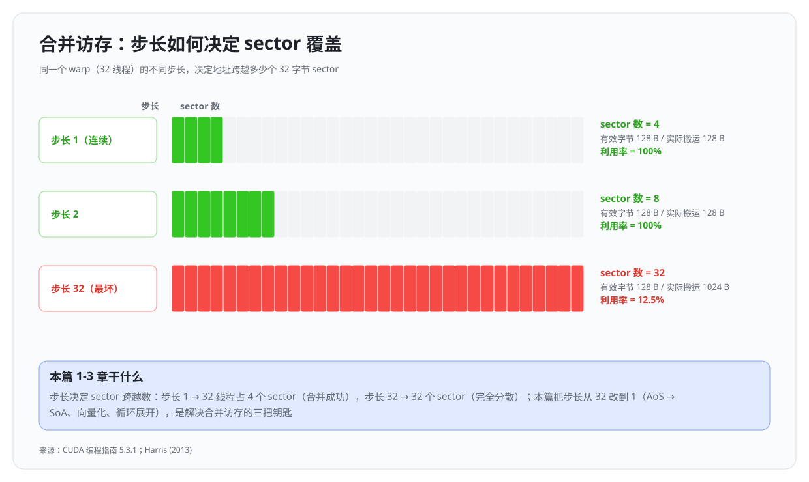
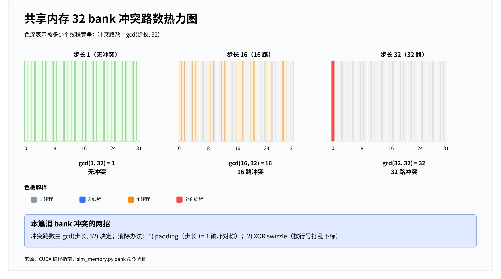
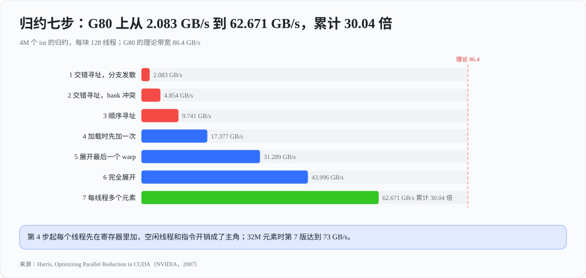
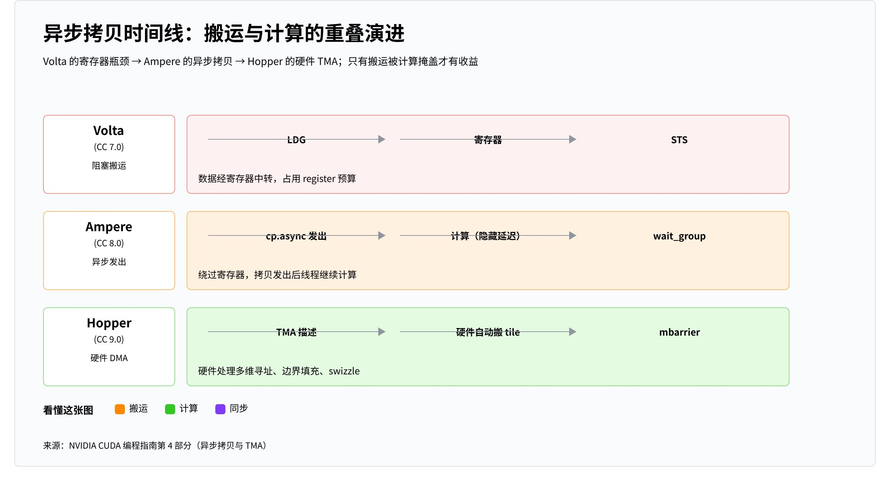

# GPU-04｜硬件｜访存与归约：合并访存、共享内存与 warp 归约

> 🎯 **这篇文档解决什么问题**：大模型里除了矩阵乘，几乎所有算子都受访存限制：逐元素运算、归一化、softmax、embedding、优化器更新。它们的快慢取决于两件事：从显存搬来的字节有多少真被用上，片上的共享内存和寄存器有没有用对。本篇从一个 warp 发出的 32 个地址讲起，算清它们会变成几个 32 字节 sector；再讲共享内存的 32 个 bank 为什么会让按列读慢下来；然后用矩阵转置和并行归约两个经典案例把规则串起来；最后讲 Ampere 以后的异步拷贝、L2 持久化，以及归约类算子为什么要融合。

**使用方式**：第 1 到 3 章讲全局内存，第 4、5 章讲共享内存，第 6、7 章讲归约，这七章是主干。第 8、9 章讲 Ampere 和 Hopper 新增的搬运手段，第 10 章讲融合，第 11 章是核对清单和练习。写框架层算子的读者重点读第 2、6、7 章和讲融合的第 10 章。

**代码**：`repo/zero-to-gpu/04-memory/`。sim_memory.py 和 test_memory.py 只需要 Python；coalesce.cu、transpose.cu、reduce.cu 和 ncu_mem.sh 需要一张 Volta 及以上的卡和 Nsight Compute，仓库没有在真卡上复测过。sim_memory.py 的部分输出有误（按列读的 sector 数、转置和归约的带宽），第 11 章逐条说明，正文的数字一律取自公开实测。

<b>🧭 主线位置</b>：GPU-00（[GPU-00｜索引｜从 0 开始 GPU 优化：路线、章节与练习](./README.md)）的时间账是 T = T_compute + W_mem + W_host + W_comm + W_idle；GPU-03（[GPU-03｜硬件｜CUDA 编程模型：线程层级、stream 与编译链](./03-cuda.md)）处理了主机侧的 W_host。本篇处理 W_mem：kernel 内部 SM 等显存数据的时间，其中很大一块来自多搬了没用的字节。读完后，访存受限的算子能逼近拷贝带宽；矩阵乘这类算力受限的算子，瓶颈转到乘加单元等数据，交给 GPU-05（[GPU-05｜硬件｜GEMM 逐步优化：从朴素循环到 warp 分块](./05-gemm.md)）用分块复用和双缓冲处理。

## 导读 · 先给结论

- <b>全局内存按 32 字节事务搬。</b>一个 warp 读 32 个连续 float 是 4 个事务；步长 2 变成 8 个，步长到 8 以后每个线程独占一个，有效字节只剩 12.5%（第 2 章）。[[1]](https://docs.nvidia.com/cuda/cuda-programming-guide/02-basics/writing-cuda-kernels.html)[[2]](https://docs.nvidia.com/cuda/cuda-c-best-practices-guide/)
- <b>先看 sectors ÷ requests。</b>GH200 上同样 2097152 个加载请求，合并版是每请求 4 个 sector，步长版是 32 个（第 2 章）。[[3]](https://developer.nvidia.com/blog/unlock-gpu-performance-global-memory-access-in-cuda/)
- <b>共享内存按 32 个 bank 并行。</b>32 位字的步长为 s 时，冲突路数是 gcd(s, 32)；32 × 32 的 tile 按列读是 32 路冲突，补一列就消掉（第 4 章）。[[1]](https://docs.nvidia.com/cuda/cuda-programming-guide/02-basics/writing-cuda-kernels.html)
- <b>转置要先合并写，再消冲突。</b>Harris 在 M2050 上从 18.8 GB/s 做到 99.5 GB/s，是同卡拷贝的 94.6%（第 5 章）。[[4]](https://developer.nvidia.com/blog/efficient-matrix-transpose-cuda-cc/)
- <b>归约七步，后四步省的是指令。</b>G80 上从 2.083 GB/s 到 62.671 GB/s，累计 30.04 倍；前三步修访存模式，后四步减空闲线程和循环开销（第 6 章）。[[5]](https://developer.download.nvidia.com/assets/cuda/files/reduction.pdf)
- <b>warp 内用 shuffle，块间可用原子。</b>shuffle 在寄存器之间交换，不用共享内存和 __syncthreads；原子加能一次 launch 做完，代价是浮点结果不再逐位可复现（第 7 章）。[[6]](https://developer.nvidia.com/blog/faster-parallel-reductions-kepler/)
- <b>归约类算子要融合。</b>BERT 训练里归一化类算子只占 0.17% 的浮点运算，却占 25.5% 的时间；softmax 融合后读写元素约降到四分之一（第 10 章）。[[7]](https://arxiv.org/abs/2007.00072)[[8]](https://triton-lang.org/main/getting-started/tutorials/02-fused-softmax.html)

<b>📎 与系列其他文档的分工</b>：SM、warp 驻留和延迟隐藏在 GPU-01（[GPU-01｜硬件｜GPU 架构：SM、存储层级与延迟隐藏](./01-arch.md)）；判断 kernel 是不是访存受限的 Roofline 在 GPU-02（[GPU-02｜硬件｜性能账本：Roofline、算术强度与三类瓶颈](./02-ledger.md)）；线程下标、stream 和编译链在 GPU-03（[GPU-03｜硬件｜CUDA 编程模型：线程层级、stream 与编译链](./03-cuda.md)）；共享内存分块在矩阵乘里的用法在 GPU-05（[GPU-05｜硬件｜GEMM 逐步优化：从朴素循环到 warp 分块](./05-gemm.md)）；online softmax 在注意力里的完整推导在 GPU-08（[GPU-08｜硬件｜注意力内核](./08-attention.md)）。

## 第 1 章 · 访存层级与粒度：SM 在等什么

逐元素、归一化、softmax 这类算子，每个元素只做几次运算，时间几乎全花在搬数据上。GPU-02 的 Roofline 会把它们判成访存受限；本章往下再走一层：数据从显存到寄存器要经过哪几层，每一层按多大的粒度搬，多搬的字节为什么藏不住。后面十章算的 sector 数和冲突路数，都建立在这一章的粒度上。

### 四层存储：延迟差一个数量级

一次全局内存加载要经过显存、全卡共享的 L2、每个 SM 一块的 L1（和共享内存共用片上存储），最后进线程私有的寄存器。Luo 等人在 H800 PCIe 上用微基准测得的延迟是：全局内存 478.8 个时钟周期，L2 263.0，L1 40.7，共享内存 29.0[[9]](https://arxiv.org/abs/2402.13499)。容量方面，H100 的 L2 从 A100 的 40 MB 增加到 50 MB，每个 SM 的共享内存最多 228 KB[[10]](https://docs.nvidia.com/cuda/hopper-tuning-guide/)。

延迟大，本身不一定是问题。GPU-01 讲过，只要每个 SM 上挂着足够多的在途请求，一个 warp 等数据时调度器就切到别的 warp，延迟被藏住。带宽藏不住：每多搬一个没用的字节，都实打实占掉一份显存带宽。所以访存受限的 kernel，第一个要问的是“搬来的字节里有多少被用上”，等了多久反倒其次。

### 三种粒度：sector、缓存行、bank

每一层都有自己的搬运粒度，粒度之内没用上的字节照样要搬：

- <b>32 字节事务（sector）</b>：全局内存按 32 字节的事务访问；一个 warp 发出加载时，32 个线程的请求被合并成满足它们所需的若干个事务，事务数取决于每个线程读的字宽和地址分布[[1]](https://docs.nvidia.com/cuda/cuda-programming-guide/02-basics/writing-cuda-kernels.html)。第 2、3 章算的就是这个数。
- **128 字节缓存行**：L1 和 L2 的缓存行由 4 个 sector 组成[[11]](https://docs.nvidia.com/nsight-compute/ProfilingGuide/index.html)，命中与否按 sector 记。
- **32 个 bank**：共享内存分成 32 个 bank，相邻的 32 位字落在相邻的 bank，每个 bank 每周期提供 32 位[[1]](https://docs.nvidia.com/cuda/cuda-programming-guide/02-basics/writing-cuda-kernels.html)。同一 warp 的多个线程访问同一 bank 的不同字时要串行，第 4 章算这个。

### 两个比值判断访存做得好不好

本篇所有实验都用两个比值判断：

- **每请求 sector 数**：Nsight Compute 里 sector 计数除以请求计数。一个 warp 读 32 个连续 float 是 4，步长很大时是 32[[3]](https://developer.nvidia.com/blog/unlock-gpu-performance-global-memory-access-in-cuda/)。这个比值说明有没有白搬。
- **有效带宽与拷贝带宽之比**：有效带宽是算法必须搬的字节除以 kernel 时间，参照物是同一张卡上一个只做拷贝的 kernel。拷贝 kernel 的带宽就是这类算子的天花板。第 5 章的转置最终做到拷贝的 94.6%[[4]](https://developer.nvidia.com/blog/efficient-matrix-transpose-cuda-cc/)。

He 把深度学习的耗时分成计算、访存和开销三类，逐元素算子和归一化基本都落在访存一类[[12]](https://horace.io/brrr_intro.html)。对这一类算子，上面两个比值就是全部的优化目标：每请求 sector 数压到 4，有效带宽逼近拷贝。

一个常见的误区是看到 kernel 慢，先去提高占用率。现象是驻留的 warp 多了，kernel 时间却没变。原因是这个 kernel 已经把显存带宽用满了，只是其中一大半是白搬的字节；更多的 warp 只会带来更多的白搬。改法是先用 ncu 看每请求 sector 数，大于 4 就先改访存模式，再谈占用率。

> 🔑 **本章要点**：H800 上全局内存延迟 478.8 周期、共享内存 29.0 周期，但访存受限的 kernel 输在带宽，不在延迟。全局内存按 32 字节事务搬，缓存行是 4 个 sector，共享内存是 32 个 bank。判断访存好坏看两个比值：每请求 sector 数和有效带宽占拷贝带宽的比例。这一章是五步闭环的“定天花板”：拷贝带宽就是这类算子的上限。

## 第 2 章 · 合并访存：每个线程的地址决定 sector 数

第 1 章说全局内存按 32 字节事务搬。本章把这条规则落到下标上：一个 warp 的 32 个线程各读一个 float，地址怎样排列时只要 4 个事务，怎样排列会变成 5 个、8 个、32 个；再用 Nsight Compute 的两个计数器把这个数量出来。

### 连续、错位与步长

最理想的情况是相邻线程读相邻的 4 字节字。编程指南的例子是：一个 warp 共请求 128 字节，用 4 个 32 字节事务取回，内存系统的利用率是 100%[[1]](https://docs.nvidia.com/cuda/cuda-programming-guide/02-basics/writing-cuda-kernels.html)。从这里出发，有三种常见的偏离：

- **错位**：地址连续，但起点没有对齐到 32 字节，就要请求 5 个 32 字节段[[2]](https://docs.nvidia.com/cuda/cuda-c-best-practices-guide/)。有用的 128 字节占搬运的 5 × 32 = 160 字节，有效占比 80%。cudaMalloc 分配的内存保证至少按 256 字节对齐[[2]](https://docs.nvidia.com/cuda/cuda-c-best-practices-guide/)，错位通常来自在大数组中间取子视图，比如 `in[i + offset]`。
- **步长 2**：相邻线程隔一个字读，在 V100 上每个 warp 要加载 8 个段，有一半字节没用上，加载效率 50%[[2]](https://docs.nvidia.com/cuda/cuda-c-best-practices-guide/)。
- **大步长**：步长继续增大，有效带宽一路下降，直到 32 个线程各自落在不同的 32 字节段，每个 warp 加载 32 个段[[2]](https://docs.nvidia.com/cuda/cuda-c-best-practices-guide/)。对 4 字节的 float，步长到 8 就到了这一步，有效占比 128 ÷ 1024 = 12.5%。

大步长最常见的来源有三个：按列读一个行主序矩阵（步长是一整行），在结构体数组里只读一个字段（步长是结构体大小，第 3 章），多维张量的维度顺序和 threadIdx.x 没有对上。

### 用 ncu 把 sector 数量出来

Devaramani 等人在 GH200 上用两个 kernel 做过对照：一个合并读，一个步长读，读的元素一样多。Nsight Compute 报出的加载请求数都是 2097152，sector 数分别是 8388608 和 67108864[[3]](https://developer.nvidia.com/blog/unlock-gpu-performance-global-memory-access-in-cuda/)，即每请求 4 个 sector 对 32 个[[3]](https://developer.nvidia.com/blog/unlock-gpu-performance-global-memory-access-in-cuda/)。同一组实验里，步长版读进来的 sector 是写出去的 8 倍[[3]](https://developer.nvidia.com/blog/unlock-gpu-performance-global-memory-access-in-cuda/)，多出来的就是白搬的字节。

这两个计数器的名字是：

- `l1tex__t_requests_pipe_lsu_mem_global_op_ld.sum`：全局加载请求数，一个 warp 的一条加载指令算一个。
- `l1tex__t_sectors_pipe_lsu_mem_global_op_ld.sum`：这些请求触及的 sector 数。

用 `ncu --metrics` 加上这两个名字就能单独抓[[3]](https://developer.nvidia.com/blog/unlock-gpu-performance-global-memory-access-in-cuda/)。两者相除，4 是理想值；明显大于 4，就去找对应的下标表达式。编译时加 -lineinfo，Nsight Compute 能把问题指到源码行[[11]](https://docs.nvidia.com/nsight-compute/ProfilingGuide/index.html)。

### 按五步走一遍

拿到一个访存受限的 kernel，按五步闭环排查合并问题：

- **定天花板**：写一个只做拷贝、读写字节数相同的 kernel，测出它的带宽。
- **测实际**：用算法必须搬的字节除以 kernel 时间，得到有效带宽，和拷贝比。
- **定位等待**：用上面两个计数器算每请求 sector 数，大于 4 的加载就是白搬的来源。
- **消除或隐藏**：调整下标或数据布局让相邻线程读相邻地址（第 3 章），实在改不了的经共享内存中转（第 4、5 章）。
- **复测**：sector 比回到 4，有效带宽向拷贝靠拢。

> 💡 **常见误区**：只看 DRAM 吞吐，看到吞吐接近峰值就以为 kernel 已经很好。现象是吞吐很高，kernel 却比同样字节数的拷贝慢好几倍。原因是吞吐里包含白搬的字节，步长版的 DRAM 一样可以很忙[[3]](https://developer.nvidia.com/blog/unlock-gpu-performance-global-memory-access-in-cuda/)。改法是同时看每请求 sector 数和有效带宽，两个比值都好才算好。

> 🔑 **本章要点**：一个 warp 读 32 个连续且对齐的 float 是 4 个 32 字节事务；错位变成 5 个，步长 2 变成 8 个，步长 8 以上变成 32 个，有效占比依次是 100%、80%、50%、12.5%。用 ncu 的 sectors ÷ requests 验证，GH200 上合并版是 4、步长版是 32。这一章是五步闭环的“定位等待”：先找出哪条加载在白搬。

## 第 3 章 · 数据布局与向量化：降低步长

第 2 章找到了白搬的加载，本章讲两种不经过共享内存的改法：调整数据布局，让 threadIdx.x 对应步长为 1 的那一维；用向量类型让每个线程一次搬 8 或 16 字节，减少指令数。两种改法都有前提，前者要能改布局，后者要地址对齐。

### AoS 改 SoA：让同一字段连续

结构体数组（AoS）把一个对象的所有字段放在一起，数组结构体（SoA）把所有对象的同一个字段放在一起。GPU 上一个 warp 的 32 个线程通常处理 32 个对象的同一个字段，AoS 下这 32 个地址的间隔是整个结构体的大小。

以每个对象 4 个 float 字段、共 16 字节为例。32 个线程读字段 x，步长是 4 个字，每个 32 字节段里只有 2 个线程的数据，32 个线程触及 16 个段，有效占比 128 ÷ 512 = 25%。改成 SoA 后，x 字段连续存放，32 个线程读 128 个连续字节，回到 4 个段。

深度学习框架的张量本身是连续的，问题出在维度顺序上：同一份数据，NCHW 和 NHWC 两种布局下“步长为 1 的那一维”不同。判断规则只有一条：写 kernel 时，确认 threadIdx.x 对应的维度在内存里步长为 1。对不上时，要么换维度和线程的对应关系，要么在上游把布局改掉；如果上游的布局改不了，就只能经共享内存中转，这正是第 5 章转置的做法。

### 向量化加载：指令少了，寄存器多了

每个线程用 float2 或 float4 读，编译器生成更宽的加载指令，SASS 里是 LDG.E.64、LDG.E.128，存储是 STG.E.64、STG.E.128[[13]](https://developer.nvidia.com/blog/cuda-pro-tip-increase-performance-with-vectorized-memory-access/)。Luitjens 和 Devaramani 的拷贝 kernel 实验里，改用 int2 和 int4 后执行的指令数分别减到二分之一和四分之一，带宽也相应提升[[13]](https://developer.nvidia.com/blog/cuda-pro-tip-increase-performance-with-vectorized-memory-access/)。

向量化有三个前提和一个代价：

- **指针要按向量大小对齐**：float4 要 16 字节对齐。cudaMalloc 的基址保证至少 256 字节对齐[[2]](https://docs.nvidia.com/cuda/cuda-c-best-practices-guide/)，从中间切出的子视图未必对齐。
- **结构体大小要是 2 的幂**：否则会出现未对齐访问或编译器填充[[13]](https://developer.nvidia.com/blog/cuda-pro-tip-increase-performance-with-vectorized-memory-access/)。
- **尾部要单独处理**：元素数不是 4 的倍数时，主循环按 float4 走，剩下的元素按标量处理；配合 grid-stride 循环，块数和数据量解耦[[14]](https://developer.nvidia.com/blog/cuda-pro-tip-write-flexible-kernels-grid-stride-loops/)。
- **代价是寄存器**：向量加载会增加寄存器压力、降低并行度，已经受寄存器限制或并行度很低的 kernel，标量加载可能更合适[[13]](https://developer.nvidia.com/blog/cuda-pro-tip-increase-performance-with-vectorized-memory-access/)。

向量化改的是指令数，不改 sector 数：一个 warp 用 float4 读 32 × 16 = 512 个连续字节，依然是每 32 字节一个事务，只是指令从 4 条变成 1 条。所以它适合已经合并、但受指令发射限制的 kernel；对步长访问，向量化救不了，要先改布局。

### 确认改动真的生效

布局改了，用第 2 章的两个计数器复测每请求 sector 数。向量化改了，看 SASS：用 `cuobjdump -sass` 反汇编，加载指令里出现 LDG.E.128 才说明生效[[15]](https://docs.nvidia.com/cuda/cuda-binary-utilities/index.html)；如果仍是一串 32 位的加载，多半是编译器无法证明对齐，回到指针类型和偏移上找原因。

一个常见的误区是把步长访问的 kernel 改成 float4，期待带宽翻倍。现象是指令数降了，kernel 时间几乎不变。原因是向量化只减少指令，每请求 sector 数没变，白搬的字节还在。改法是先让 threadIdx.x 对上步长为 1 的维度，或者经共享内存中转，sector 比回到 4 之后再考虑向量化。

> 🔑 **本章要点**：AoS 下读一个字段的步长是结构体大小，16 字节的结构体有效占比只有 25%，改 SoA 回到 100%。向量化让 int2、int4 拷贝的指令数降到二分之一、四分之一，前提是指针对齐、尾部单独处理，代价是寄存器压力。这一章是五步闭环的“消除或隐藏”：从数据布局和指令两头消掉白搬与多发的指令。

## 第 4 章 · 共享内存与 bank：冲突路数 = gcd（步长、32）

第 3 章的两种改法都要求能改下标或布局。改不了的时候，比如转置这种读写方向天生相反的操作，要靠共享内存中转：按合并的方式读进来，在片上换个顺序，再按合并的方式写出去。共享内存也有自己的粒度，就是 32 个 bank。本章算清冲突路数，再讲两种消冲突的办法。

### 共享内存的容量与用途

共享内存是每个 SM 上由程序员显式管理的存储，块内线程共享，生命周期和线程块相同。H800 上它的访问延迟是 29.0 个周期，全局内存是 478.8 个[[9]](https://arxiv.org/abs/2402.13499)。容量随架构变化：A100 每个 SM 164 KB，H100 每个 SM 228 KB，单个线程块最多用 227 KB[[10]](https://docs.nvidia.com/cuda/hopper-tuning-guide/)；静态声明的共享内存仍限 48 KB，超过要用动态分配并显式申请[[10]](https://docs.nvidia.com/cuda/hopper-tuning-guide/)。

它在访存优化里有三种用途：把不合并的全局访问改成合并的（第 5 章转置），在块内复用同一块数据（GPU-05 的矩阵乘分块），在块内线程之间交换中间结果（第 6 章归约）。

### bank 冲突怎么算

共享内存有 32 个 bank，相邻的 32 位字依次映射到相邻的 bank，每个 bank 每周期提供 32 位。同一 warp 的多个线程访问同一个 bank 里的不同元素时发生 bank 冲突，对这个 bank 的访问被串行化，直到所有请求的线程都拿到数据[[1]](https://docs.nvidia.com/cuda/cuda-programming-guide/02-basics/writing-cuda-kernels.html)。两个例外是多个线程读同一个字（广播）和写同一个字，不算冲突[[1]](https://docs.nvidia.com/cuda/cuda-programming-guide/02-basics/writing-cuda-kernels.html)。

线程 t 访问第 t × s 个 32 位字时，落在 bank (t × s) mod 32。32 个线程用到的不同 bank 数是 32 ÷ gcd(s, 32)，每个 bank 被 gcd(s, 32) 个线程访问，所以冲突路数就是 gcd(s, 32)。对照编程指南的图：步长 2 是两路冲突，步长 3 没有冲突[[1]](https://docs.nvidia.com/cuda/cuda-programming-guide/02-basics/writing-cuda-kernels.html)。按这个式子，步长 16 是 16 路，步长 32 是最坏的 32 路，所有线程挤在同一个 bank。

一个 32 × 32 的 float tile，按行读时步长是 1，没有冲突；按列读时步长是一整行 32 个字，32 路冲突。转置恰好要按列读 tile，这就是第 5 章中间版本慢的原因。Nsight Compute 的共享内存冲突计数在 Memory Workload Analysis 里，改前改后各看一次[[11]](https://docs.nvidia.com/nsight-compute/ProfilingGuide/index.html)。

### 消冲突：补一列或 swizzle

<b>补一列。</b>把 tile 声明成 `__shared__ float tile[32][33]`，每行多一个字。按列读时相邻线程的地址差变成 33 个字，gcd(33, 32) = 1，冲突消失。Harris 的转置就用这个办法，在 M2050 上把带宽从 51.3 GB/s 提到 99.5 GB/s[[4]](https://developer.nvidia.com/blog/efficient-matrix-transpose-cuda-cc/)。代价是每行多 4 字节，32 行共多 128 字节。

<b>swizzle。</b>不改行宽，改映射：第 r 行第 c 列的元素存到第 r 行第 (c XOR f(r)) 列，读写两边用同一个变换。按列读时，同一列的元素被打散到不同的 bank。swizzle 不浪费空间，但读写下标都要改，容易出错；矩阵乘库和 Hopper 的 TMA 都内置了 swizzle 布局（第 8 章），手写 kernel 一般先用补一列。

### 同步：写完再读

线程之间经共享内存交换数据，写和读之间要用 __syncthreads() 隔开，保证写入对块内所有线程可见。Volta 起 warp 内的线程可以独立调度，依赖“同一 warp 天然同步”的隐式写法不再安全[[16]](https://developer.nvidia.com/blog/using-cuda-warp-level-primitives/)；warp 内经共享内存通信要用 __syncwarp()，它提供 warp 级同步和内存栅栏，用来隔开相互依赖的读写[[16]](https://developer.nvidia.com/blog/using-cuda-warp-level-primitives/)。漏掉同步的 bug 往往只让少数元素出错，用 compute-sanitizer 的 racecheck 工具检查共享内存上的数据竞争[[17]](https://docs.nvidia.com/compute-sanitizer/ComputeSanitizer/index.html)。

> 💡 **常见误区**：把数据搬进共享内存就以为一定变快。现象是加了共享内存中转，kernel 反而慢了。原因可能有两个：读 tile 的方向撞上了 32 路冲突，或者数据只用一次，中转只多了一次读写和一次同步。改法是先按 gcd 规则算冲突路数，用补一列消掉；只用一次的数据，能改下标合并就别中转。

> 🔑 **本章要点**：共享内存 32 个 bank，每 bank 每周期 32 位；步长为 s 的访问是 gcd(s, 32) 路冲突，32 × 32 的 tile 按列读是 32 路。补一列或 swizzle 消冲突，补一列让 Harris 的转置从 51.3 GB/s 到 99.5 GB/s。写读之间要同步，Volta 起 warp 内也要显式 __syncwarp。这一章是五步闭环的“消除或隐藏”：把片上的串行访问消掉。

## 第 5 章 · 转置案例：读写合并与消冲突的完整实例

矩阵转置几乎不做计算，只把行列互换，是检验合并访存和 bank 冲突最干净的实验台。Harris 的博客用一组 kernel 逐步优化转置，每一步都给了实测带宽[[4]](https://developer.nvidia.com/blog/efficient-matrix-transpose-cuda-cc/)。本章按五步闭环把这组数据走一遍。

### 定天花板：两个拷贝 kernel

转置的读写字节数和拷贝一样，所以天花板就是拷贝。Harris 用了两个参照：直接从全局内存拷到全局内存的 copy，以及经共享内存中转的 copySharedMem。M2050 上两者分别是 105.2 和 104.6 GB/s，K20c 上是 136.0 和 152.3 GB/s（ECC 开）[[4]](https://developer.nvidia.com/blog/efficient-matrix-transpose-cuda-cc/)。copySharedMem 把共享内存中转本身的开销也算了进去，是带共享内存的转置更公平的参照。

实验的分块是：每个线程块负责一个 32 × 32 的 tile，块里 32 × 8 个线程，每个线程处理 4 个元素[[4]](https://developer.nvidia.com/blog/efficient-matrix-transpose-cuda-cc/)。

### 测实际：naive 版只有拷贝的一小部分

最直接的写法按行读输入、按列写输出。读侧相邻线程读相邻地址，是合并的；写侧相邻线程写的地址相隔一整行，每个线程独占一个 32 字节段，按第 2 章的规则是最坏的情况。实测 transposeNaive 在 M2050 上 18.8 GB/s，K20c 上 55.3 GB/s[[4]](https://developer.nvidia.com/blog/efficient-matrix-transpose-cuda-cc/)，分别只有对应 copy 的五分之一左右和四成。

定位等待：输入那一侧没问题，等待来自写。按列写无法通过调整下标改成合并，因为转置本来就要求读写方向相反。

### 消除或隐藏：先合并写，再消冲突

<b>第一步，经共享内存中转。</b>线程块按行把 tile 读进共享内存，__syncthreads() 之后，再按列从共享内存取元素、按行写回全局内存。这样全局内存的读和写都是按行的，都合并了。transposeCoalesced 在 M2050 上到 51.3 GB/s，K20c 上 97.6 GB/s[[4]](https://developer.nvidia.com/blog/efficient-matrix-transpose-cuda-cc/)，比 naive 快 51.3 ÷ 18.8 ≈ 2.7 倍，但离拷贝还远。

新的等待来自共享内存：按列从 32 × 32 的 tile 取元素，正是第 4 章说的 32 路 bank 冲突。

<b>第二步，补一列。</b>tile 声明成 `tile[32][33]`，冲突消失。transposeNoBankConflicts 在 M2050 上 99.5 GB/s，K20c 上 144.3 GB/s[[4]](https://developer.nvidia.com/blog/efficient-matrix-transpose-cuda-cc/)。

### 复测：离拷贝还差多少

M2050 上最终版是 copy 的 99.5 ÷ 105.2 ≈ 94.6%；K20c 上它甚至超过了直接 copy，和 copySharedMem 比是 144.3 ÷ 152.3 ≈ 94.7%。Harris 的总结是，补一列消掉 32 路冲突后，转置达到拷贝 kernel 约 95% 的性能[[4]](https://developer.nvidia.com/blog/efficient-matrix-transpose-cuda-cc/)。剩下的差距来自中转本身：每个 tile 多一次共享内存读写和一次 __syncthreads()。

这组数据也说明了顺序的重要性：只消冲突、不合并写，等待还在全局内存上；只合并写、不消冲突，51.3 GB/s 卡在片上。两层都处理完，转置才追上拷贝。在新卡上复现这组实验时，矩阵要取得足够大，避免整个矩阵装进 L2（H100 的 L2 是 50 MB[[10]](https://docs.nvidia.com/cuda/hopper-tuning-guide/)），否则测到的是缓存带宽。

> 💡 **常见误区**：拿转置 kernel 的带宽去和规格表上的显存峰值比，得出“只有六七成”的结论，继续往下抠。现象是怎么改都追不上峰值。原因是参照物选错了：拷贝 kernel 本身也到不了规格峰值，M2050 上 copy 只有 105.2 GB/s[[4]](https://developer.nvidia.com/blog/efficient-matrix-transpose-cuda-cc/)。改法是在同一张卡上先测拷贝，用拷贝当天花板。

> 🔑 **本章要点**：转置的天花板是同卡拷贝。M2050 上 naive 18.8 GB/s，经共享内存合并写后 51.3 GB/s，补一列消 32 路冲突后 99.5 GB/s，是 copy 的 94.6%；K20c 上最终版是 copySharedMem 的 94.7%。这一章把五步闭环完整走了一遍，“复测”的结论是：全局和片上两层都要处理，只处理一层，等待就转到另一层。

## 第 6 章 · 归约七步：从发散到指令开销

归约把 n 个数合成一个：求和、求最大值、求范数。Harris 2007 年的讲义用 G80 上 4M 个 int 的求和，把块内归约从最朴素的写法一步步优化到第 7 版，每一步都给了实测时间和带宽[[5]](https://developer.download.nvidia.com/assets/cuda/files/reduction.pdf)。这组数据最有价值的地方在于，它展示了等待怎样在优化过程中换位置：前三步修的是访存和分支，后四步修的是指令。

### 框架与天花板

块内的线程可以用 __syncthreads() 同步，块之间不行。所以归约分两遍：每个线程块把自己那段数据归约成一个部分和写回全局内存，再启动一次 kernel 归约这些部分和。讲义里所有测试都用每块 128 个线程[[5]](https://developer.download.nvidia.com/assets/cuda/files/reduction.pdf)。

归约每个元素只读一次、做一次加法，是典型的访存受限算子，天花板是显存带宽。G80 是 384 位总线、900 MHz DDR，理论带宽 384 × 1800 ÷ 8 = 86.4 GB/s[[5]](https://developer.download.nvidia.com/assets/cuda/files/reduction.pdf)。

### 第 1 到 3 步：修分支和 bank

- **第 1 版，交错寻址加分支发散**：第 s 轮让 tid % (2s) == 0 的线程做加法。同一个 warp 里有的线程干活、有的空转，取模运算也慢。8.054 ms，2.083 GB/s[[5]](https://developer.download.nvidia.com/assets/cuda/files/reduction.pdf)。
- **第 2 版，交错寻址加 bank 冲突**：改成让连续的线程干活，index = 2 × s × tid，分支发散没了，但访问共享内存的步长随轮次翻倍，带来 bank 冲突。3.456 ms，4.854 GB/s，比第 1 版快 2.33 倍[[5]](https://developer.download.nvidia.com/assets/cuda/files/reduction.pdf)。
- **第 3 版，顺序寻址**：步长从 blockDim.x ÷ 2 开始每轮减半，线程 tid 加 sdata[tid + s]。同一 warp 的线程访问连续地址，没有冲突。1.722 ms，9.741 GB/s，又快 2.01 倍，累计 4.68 倍[[5]](https://developer.download.nvidia.com/assets/cuda/files/reduction.pdf)。

第 3 版还剩一个明显的浪费：第一轮就有一半线程闲着，它们只负责把数据从全局内存搬进共享内存[[5]](https://developer.download.nvidia.com/assets/cuda/files/reduction.pdf)。

### 第 4 到 7 步：减空闲线程和指令

- **第 4 版，加载时先加一次**：每个线程从全局内存读两个元素，先加好再写进共享内存，块数减半。0.965 ms，17.377 GB/s，累计 8.34 倍[[5]](https://developer.download.nvidia.com/assets/cuda/files/reduction.pdf)。
- **第 5 版，展开最后一个 warp**：只剩 32 个以内的活跃线程时，它们都在同一个 warp 里，去掉循环和 __syncthreads()。0.536 ms，31.289 GB/s，累计 15.01 倍[[5]](https://developer.download.nvidia.com/assets/cuda/files/reduction.pdf)。
- **第 6 版，完全展开**：块大小做成模板参数，编译期展开整个循环。0.381 ms，43.996 GB/s，累计 21.16 倍[[5]](https://developer.download.nvidia.com/assets/cuda/files/reduction.pdf)。
- **第 7 版，每线程多个元素**：每个线程先用循环在寄存器里累加很多个元素，再进块内树形归约，块数大大减少。0.268 ms，62.671 GB/s，累计 30.04 倍[[5]](https://developer.download.nvidia.com/assets/cuda/files/reduction.pdf)。

第 7 版到了理论带宽的 62.671 ÷ 86.4 ≈ 72.5%；数据量加到 32M 个元素，它达到 73 GB/s[[5]](https://developer.download.nvidia.com/assets/cuda/files/reduction.pdf)。从第 4 版到第 7 版，带宽又翻了 62.671 ÷ 17.377 ≈ 3.6 倍，但这几步没有改变访存模式，省的是空闲线程、循环判断和同步。这就是定位等待的意义：访存模式修好之后，再盯着合并访存不会有收益，下一份等待在指令上。

第 5 版的写法在今天要改：它依赖同一 warp 的线程天然同步，Volta 起 warp 内线程可以独立调度，这类隐式的 warp 同步写法不安全[[16]](https://developer.nvidia.com/blog/using-cuda-warp-level-primitives/)。现代写法是用第 7 章的 shuffle 代替最后几轮共享内存操作。

> 💡 **常见误区**：照抄讲义第 5 版的 volatile 加 warp 内无同步写法。现象是在老卡上结果正确，换到新卡或新编译器后偶发结果错误。原因是这种写法依赖隐式的 warp 同步，Volta 起不再成立[[16]](https://developer.nvidia.com/blog/using-cuda-warp-level-primitives/)。改法是最后一个 warp 用 __shfl_down_sync 做归约，或者在每一步之间加 __syncwarp()。

> 🔑 **本章要点**：G80 上 4M 个 int 的归约，第 1 版 2.083 GB/s，第 3 版 9.741 GB/s（修分支和 bank），第 7 版 62.671 GB/s，累计 30.04 倍，是理论 86.4 GB/s 的 72.5%。前三步修访存，后四步省空闲线程和指令。这一章是五步闭环的“定位等待”：每一步之后重新判断等待在哪一层，访存修好后就转向指令。

## 第 7 章 · warp Shuffle、原子与 CUB：从寄存器到原子

第 6 章的七步全靠共享内存加 __syncthreads()。Kepler 之后有了两样新工具：shuffle 指令让 warp 内的线程直接读彼此的寄存器，更快的全局原子操作让归约可以一次 launch 做完。本章讲这两样工具怎样改写块内和块间的归约，再讲为什么生产代码优先用 CUB。

### warp 内：shuffle 代替共享内存

Kepler 引入的 shuffle 指令让 warp 内的线程直接读其他线程的寄存器，一条指令代替一串共享内存读写，也不需要 __syncthreads()[[6]](https://developer.nvidia.com/blog/faster-parallel-reductions-kepler/)。现在的写法是带 _sync 后缀的版本，第一个参数是参与线程的掩码；__shfl_down_sync 这类同步数据交换原语在 Volta 及以后的分支里也能正确工作[[16]](https://developer.nvidia.com/blog/using-cuda-warp-level-primitives/)。

warp 内求和用 __shfl_down_sync 做一棵树：offset 依次取 16、8、4、2、1，每轮每个线程加上 offset 之外那个线程的值，五轮之后 lane 0 持有整个 warp 的和[[6]](https://developer.nvidia.com/blog/faster-parallel-reductions-kepler/)。整个过程只用寄存器。

### 块内：两层归约

shuffle 只能在一个 warp 内用，块内归约分两层[[6]](https://developer.nvidia.com/blog/faster-parallel-reductions-kepler/)：

- 每个 warp 用 shuffle 归约自己的 32 个值，lane 0 把结果写进共享内存的一个小数组，数组长度等于块内的 warp 数，最多 32。
- __syncthreads() 之后，第 0 个 warp 读回这个数组，再做一次 shuffle 归约，得到块的和。

对比第 6 章的共享内存树，共享内存从每块一整份数据减到 32 个字，__syncthreads() 从每轮一次减到一次。处理大数组时，先让每个线程用 grid-stride 循环在寄存器里累加多个元素，再调用块内归约，这就是第 6 章第 7 版思路的现代写法[[6]](https://developer.nvidia.com/blog/faster-parallel-reductions-kepler/)。

### 块间：原子加与 warp 聚合

两遍归约要多一次 kernel 和一块临时内存。Kepler 起全局原子操作足够快，可以让每个 warp 归约完直接 atomicAdd 到结果上，一次 launch 做完；也可以先做块内归约，每块只发一次原子，减少原子竞争，代价是共享内存和 __syncthreads()[[6]](https://developer.nvidia.com/blog/faster-parallel-reductions-kepler/)。用原子做浮点归约有一个副作用：每次运行加法顺序不同，结果不再逐位一致[[6]](https://developer.nvidia.com/blog/faster-parallel-reductions-kepler/)。需要逐位可复现的场景（例如对拍、确定性训练）只能用两遍归约。

原子操作的成本取决于冲突。Adinets 在过滤（stream compaction）kernel 上演示了 warp 聚合：先在 warp 内用投票指令算出要写几个元素，由一个线程发一次原子拿到偏移，再分发给其他线程。Kepler 上这一改动最多快了 21 倍，带宽超过 80 GiB/s，和简单拷贝相当[[18]](https://developer.nvidia.com/blog/cuda-pro-tip-optimized-filtering-warp-aggregated-atomics/)。直方图是另一类原子密集的归约，Maxwell 起共享内存原子由硬件实现，先在共享内存里做局部直方图、最后合并到全局，是标准做法[[19]](https://developer.nvidia.com/blog/gpu-pro-tip-fast-histograms-using-shared-atomics-maxwell/)。

### 生产代码：先用 CUB

归约、扫描、直方图、排序在 GPU 上反复出现，NVIDIA 的 CCCL 里的 CUB 提供了 warp、block、device 三级的实现[[20]](https://nvidia.github.io/cccl/unstable/cub/index.html)。Luitjens 的结论是 CUB 会按架构、数据量和类型自动选算法，性能和手写的归约持平或更好[[6]](https://developer.nvidia.com/blog/faster-parallel-reductions-kepler/)。前缀和比归约多一层：GPU Gems 3 讲的是工作量最优的两遍扫描[[21]](https://developer.nvidia.com/gpugems/gpugems3/part-vi-gpu-computing/chapter-39-parallel-prefix-sum-scan-cuda)，CUB 的 device 级扫描用的是 Merrill 和 Garland 的单遍扫描加 decoupled look-back[[22]](https://research.nvidia.com/sites/default/files/pubs/2016-03_Single-pass-Parallel-Prefix/nvr-2016-002.pdf)。手写只在要和其他算子融合、CUB 的接口放不下时才值得。

一个常见的误区是为了省一次 launch，把所有浮点归约都改成 atomicAdd。现象是两次运行的 loss 在末几位不一样，对拍脚本时好时坏。原因是原子的加法顺序每次不同，浮点加法不满足结合律，结果不再逐位一致[[6]](https://developer.nvidia.com/blog/faster-parallel-reductions-kepler/)。改法是需要确定性的地方用两遍归约或 CUB 的 device 级归约，原子只用在能接受末位差异的地方。

> 🔑 **本章要点**：shuffle 让 warp 内归约只用寄存器，五轮完成；块内两层归约只需 32 个字的共享内存和一次 __syncthreads()。原子加能一次 launch 完成归约，代价是浮点结果不逐位可复现；warp 聚合让过滤 kernel 最多快 21 倍。生产代码先用 CUB。这一章是五步闭环的“消除或隐藏”：把共享内存往返和多余的同步、launch 消掉。

## 第 8 章 · 向量化与异步拷贝：Ampere 与 Hopper 的搬运优化

第 4 到 7 章用共享内存中转数据时，搬运是同步的：线程先把数据读进寄存器，再写进共享内存，等数据到了才能往下走。Ampere 和 Hopper 各加了一种异步搬运：LDGSTS 让线程发出拷贝后继续干活，TMA 让一个线程描述整块多维数据、由硬件算地址。本章讲它们解决什么问题、各自的约束，以及什么时候不值得用。

### 同步搬运的两个代价

传统写法是每个线程用 LDG 把数据读进寄存器，再用 STS 写进共享内存。这有两个代价：数据在寄存器里中转，占用寄存器，压低能同时驻留的 warp 数；线程要等加载回来才能写共享内存，搬运和计算只能靠 warp 之间切换来重叠。Tardy 和 Edwards 的总结是，异步拷贝省掉了寄存器中转，降低寄存器压力、提高占用率，再用 cuda::pipeline 把多级拷贝排成流水，让全局到共享内存的搬运和计算重叠[[23]](https://developer.nvidia.com/blog/controlling-data-movement-to-boost-performance-on-ampere-architecture/)。

### LDGSTS：Ampere 的逐元素异步拷贝

LDGSTS（计算能力 8.0 起，PTX 里对应 cp.async）是从全局内存到共享内存的异步拷贝，面向较小的、逐元素的搬运，发起拷贝的线程可以继续计算，由硬件异步完成拷贝[[24]](https://docs.nvidia.com/cuda/cuda-programming-guide/04-special-topics/async-copies.html)。它的约束是：

- 每次拷贝 4、8 或 16 字节[[24]](https://docs.nvidia.com/cuda/cuda-programming-guide/04-special-topics/async-copies.html)。4 和 8 字节的拷贝走 L1，同时缓存进 L1；16 字节的拷贝可以绕过 L1，不污染它[[24]](https://docs.nvidia.com/cuda/cuda-programming-guide/04-special-topics/async-copies.html)。
- 方向只有全局到共享，指针要按拷贝大小对齐；全局和共享两侧都按 128 字节对齐时性能最好[[24]](https://docs.nvidia.com/cuda/cuda-programming-guide/04-special-topics/async-copies.html)。
- 拷贝完成要有信号，C++ 里可以配合 cuda::barrier 或 cuda::pipeline 等待[[25]](https://docs.nvidia.com/cuda/cuda-programming-guide/04-special-topics/async-barriers.html)[[26]](https://docs.nvidia.com/cuda/cuda-programming-guide/04-special-topics/pipelines.html)。

典型用法是多级流水：共享内存里开几块缓冲，计算第 k 块时，第 k + 1、k + 2 块的拷贝已经在路上。级数要够多，能盖住一次全局加载的延迟（第 1 章，H800 上约 478.8 个周期[[9]](https://arxiv.org/abs/2402.13499)），又不能多到把共享内存占满、压低驻留的块数。

### TMA：Hopper 的多维批量拷贝

很多 kernel 要把多维数组的一个子块搬进共享内存，地址计算重复又容易出错。计算能力 9.0（Hopper）起有张量内存加速器 TMA，主要用来在全局内存和共享内存之间高效搬运多维数组[[24]](https://docs.nvidia.com/cuda/cuda-programming-guide/04-special-topics/async-copies.html)。用法是先在主机端建一个张量描述符（CUtensorMap），写明维度、各维大小和步长、要搬的子块形状；kernel 里一个线程发起拷贝，完成情况通过共享内存里的 mbarrier 通知等待的线程[[24]](https://docs.nvidia.com/cuda/cuda-programming-guide/04-special-topics/async-copies.html)。

在线程块集群里，批量张量拷贝还可以指定为多播：一份数据从全局内存同时搬进集群内多个线程块的共享内存[[24]](https://docs.nvidia.com/cuda/cuda-programming-guide/04-special-topics/async-copies.html)，矩阵乘里多个块共用同一个 A 或 B 子块时，省掉重复的全局读取。TMA 还能按 swizzle 布局写共享内存，配合第 4 章的 bank 规则。

手写 TMA 要处理描述符、mbarrier 的事务计数和多播掩码，实际工程大多通过 CUTLASS 和 CuTe[[27]](https://github.com/NVIDIA/cutlass)、ThunderKittens[[28]](https://arxiv.org/abs/2410.20399) 这类库使用；Colfax 的教程把 CUTLASS 里 TMA 的用法拆得比较细[[29]](https://research.colfax-intl.com/tutorial-hopper-tma/)。GPU-06（[GPU-06｜硬件｜Tensor Core 与低精度：从 mma 到 FP8 和 FP4](./06-tensor-core.md)）讲 TMA 和 wgmma 怎样配合，GPU-07（[GPU-07｜硬件｜Triton、CUTLASS 与 CuTe DSL](./07-dsl.md)）讲这些库。

> 💡 **常见误区**：给一个逐元素 kernel 加上 cp.async 或 TMA，期待它变快。现象是代码复杂了一倍，时间没变。原因是异步拷贝的收益来自省寄存器和搬运与计算重叠，逐元素 kernel 每个元素只算一两次，没有可重叠的计算，也不缺寄存器。改法是逐元素 kernel 先保证合并和向量化（第 2、3 章）；异步拷贝留给有数据复用、要在共享内存里多次计算的 kernel，比如矩阵乘和注意力。

> 🔑 **本章要点**：同步搬运经寄存器中转，占寄存器、难重叠。LDGSTS（CC 8.0 起）做 4、8、16 字节的全局到共享异步拷贝，16 字节可绕过 L1，128 字节对齐最好；TMA（CC 9.0 起）用描述符搬多维子块，可多播到集群内多个块。这一章是五步闭环的“消除或隐藏”：把搬运藏到计算后面，前提是有计算可藏。

## 第 9 章 · L2 持久化：小数据的大流量优化

### set-aside 与访问策略窗口

从 compute capability 8.0 开始，CUDA 允许把 L2 的一部分划出来，优先留给“持久化”访问。官方文档的说法是：持久化访问优先使用这块 set-aside 区域，普通访问和流式访问只有在它没被持久化访问占用时才能用[[30]](https://docs.nvidia.com/cuda/cuda-programming-guide/04-special-topics/l2-cache-control.html)。所以 set-aside 并非别人碰不得的私有区，它只是在竞争中给持久化数据更高的保留优先级。

大小用 `cudaDeviceSetLimit(cudaLimitPersistingL2CacheSize, size)` 设置，上限是设备属性 `persistingL2CacheMaxSize`；这个值和 L2 总容量 `l2CacheSize`、窗口上限 `accessPolicyMaxWindowSize` 都可以用 `cudaGetDeviceProperties` 查到[[30]](https://docs.nvidia.com/cuda/cuda-programming-guide/04-special-topics/l2-cache-control.html)。文档示例取的是“L2 的 3/4 与 persistingL2CacheMaxSize 二者中的较小值”，这只是示例写法，真正的上限以设备属性为准，不同卡要现查。

哪些访问算持久化，由访问策略窗口（accessPolicyWindow）决定。它描述一段连续的全局内存 [base_ptr, base_ptr + num_bytes)，再给出三个参数：hitRatio、hitProp、missProp。窗口可以挂在 stream 上（`cudaStreamSetAttribute` 配 `cudaStreamAttributeAccessPolicyWindow`），也可以挂在 CUDA Graph 的 kernel 节点上（`cudaGraphKernelNodeSetAttribute`）[[30]](https://docs.nvidia.com/cuda/cuda-programming-guide/04-special-topics/l2-cache-control.html)。之后在这个 stream 或节点里执行的 kernel，对窗口内地址的访问更可能留在 L2。

### hitRatio 怎么设、什么时候要重置

hitRatio 指定窗口内多大比例的访问获得 hitProp 属性，其余访问获得 missProp。哪些访问被选中是随机的，概率约等于 hitRatio[[30]](https://docs.nvidia.com/cuda/cuda-programming-guide/04-special-topics/l2-cache-control.html)。文档举的例子很能说明它的用途：set-aside 只有 16 KB、窗口有 32 KB 时，hitRatio 取 0.5，硬件随机挑 16 KB 当持久化数据，正好装下；取 1.0，硬件会试图把 32 KB 全塞进 16 KB，结果是缓存行互相驱逐，只能留下最近用过的那一半。两个并发 kernel 各带一个 16 KB 窗口、hitRatio 都取 1.0 时，也会互相挤占；各取 0.5 就不容易打架[[30]](https://docs.nvidia.com/cuda/cuda-programming-guide/04-special-topics/l2-cache-control.html)。由此得到一个简单的估算办法：让所有并发窗口的“窗口大小 × hitRatio”之和不超过 set-aside 大小。

持久化还有一个容易忽略的副作用：前一个 kernel 留下的持久化缓存行会在 L2 里停留很久，挤占后面不需要持久化的 kernel。文档给了三种重置办法：对旧窗口重新设置 `cudaAccessPropertyNormal`；调用 `cudaCtxResetPersistingL2Cache()` 一次清掉全部持久化行；或者等它们自动恢复。第三种文档明确不推荐，因为恢复要多久不确定[[30]](https://docs.nvidia.com/cuda/cuda-programming-guide/04-special-topics/l2-cache-control.html)。

环境限制有两条：GPU 处于 MIG 模式时，set-aside 功能被禁用；使用 MPS 时，进程不能用 cudaDeviceSetLimit 改 set-aside 大小，只能在 MPS 服务启动时用环境变量 `CUDA_DEVICE_DEFAULT_PERSISTING_L2_CACHE_PERCENTAGE_LIMIT` 指定[[30]](https://docs.nvidia.com/cuda/cuda-programming-guide/04-special-topics/l2-cache-control.html)[[31]](https://docs.nvidia.com/deploy/mps/)。

### 用在哪里、怎么验证

适用场景要同时满足两个条件：一小块数据被反复读，同时有大量只读一次的数据流过 L2。典型的例子是一个 batch 内被反复查表的热点 embedding 行、多个 kernel 共用的一块小参数表。反过来，如果热点数据本来就能在普通 L2 里待住，或者每个字节只读一次，设持久化没有收益；把整张几 GB 的表都标成持久化，窗口远大于 set-aside，就会出现上面说的互相驱逐。

验证按五步闭环走。**定天花板**：用 l2CacheSize 和 persistingL2CacheMaxSize 确定能留多少，用热点数据大小算出窗口和 hitRatio。**测实际**：开关持久化各跑一次，用 Nsight Compute 的 Memory Workload Analysis 对比 L2 命中率和显存读字节数；显存读字节可以用 `ncu --metrics dram__bytes_read.sum` 单独抓[[3]](https://developer.nvidia.com/blog/unlock-gpu-performance-global-memory-access-in-cuda/)[[11]](https://docs.nvidia.com/nsight-compute/ProfilingGuide/index.html)。**定位等待**：命中率上升、显存读字节下降、kernel 时间下降三者同时出现，才说明省下的是热点数据的显存往返；命中率升了而时间没降，说明保护的不是关键路径上的数据。**消除或隐藏**：调窗口范围和 hitRatio，必要时在阶段切换处调用 cudaCtxResetPersistingL2Cache。**复测**：改完用同一组指标再比一次，并检查后续不带窗口的 kernel 有没有变慢。

> 💡 **常见误区**：把 set-aside 当成“受保护的私有区”，以为其他数据进不来、持久化数据永远不会被挤出去。文档的语义是优先保留：普通访问在 set-aside 空闲时照样能用它，窗口总量超过 set-aside 时持久化数据之间也会互相驱逐。改法是按 set-aside 大小反推 hitRatio，并在阶段结束时显式重置。

> 🔑 **本章要点**：L2 持久化用 cudaLimitPersistingL2CacheSize 划出 set-aside，用挂在 stream 或 Graph 节点上的访问策略窗口指定哪些地址优先留在 L2；hitRatio 决定窗口里多大比例的访问享受持久化，所有并发窗口的“大小 × hitRatio”之和应不超过 set-aside；用完要重置，MIG 下不可用，MPS 下只能在服务启动时配置。它消掉的是热点小数据反复从显存读取的等待，前提是用 ncu 证明命中率、显存读字节和 kernel 时间同时改善。

## 第 10 章 · 归约类算子融合与验证：softmax、LayerNorm 与测试

前九章优化的都是单个 kernel。实际模型里，归一化、softmax 这类算子由好几步组成，逐步实现时每一步都把中间结果写回显存、下一步再读回来。单个 kernel 已经逼近拷贝带宽，总字节数却是必要的好几倍。本章算这笔账，再讲融合的做法和约束。

### 小算子占大时间

Ivanov 等人分析 BERT 训练时，把算子分成三类：张量收缩（矩阵乘一类）占 99.80% 的浮点运算、61.0% 的运行时间；统计归一化（softmax、LayerNorm 一类）占 0.17% 的浮点运算、25.5% 的时间；逐元素运算占 0.03% 的浮点运算、13.5% 的时间[[7]](https://arxiv.org/abs/2007.00072)。后两类加起来用不到千分之二的运算，花掉近四成时间，原因都是数据移动。

### softmax 的字节账

Triton 的 fused softmax 教程算过一笔账：M 行 N 列的输入，按 PyTorch 逐步实现（求行最大值、减最大值取指数、求行和、相除），要从显存读 5MN + 2M 个元素、写回 3MN + 2M 个[[8]](https://triton-lang.org/main/getting-started/tutorials/02-fused-softmax.html)。融合成一个 kernel，每行读进片上一次、在片上做完所有步骤、写回一次，读写各 MN 个元素，理论加速约 (8MN + 4M) ÷ 2MN，即 4 倍左右[[8]](https://triton-lang.org/main/getting-started/tutorials/02-fused-softmax.html)。

融合的约束是一行要能放进片上存储。教程的 kernel 让每个程序处理一整行，行长在编译期向上取到 2 的幂[[8]](https://triton-lang.org/main/getting-started/tutorials/02-fused-softmax.html)；行太长放不下时，就要把一行切成几段，这时“先求最大值再求和”需要两遍扫描。Milakov 和 Gimelshein 的 online softmax 在一遍扫描里同时维护当前最大值和按它缩放过的和，减少了访存次数，论文里 softmax 最多快 1.3 倍，和 TopK 融合后最多快 5 倍[[32]](https://arxiv.org/abs/1805.02867)。注意力里的 softmax 用的就是这个思路，GPU-08（[GPU-08｜硬件｜注意力内核](./08-attention.md)）展开。

### LayerNorm 与编译器融合

LayerNorm 的结构和 softmax 相同：一行先归约出均值和方差，再逐元素做标准化、缩放和平移。Triton 的 LayerNorm 教程给出了前向和反向的融合实现[[33]](https://triton-lang.org/main/getting-started/tutorials/05-layer-norm.html)，Apex 也有生产用的 fused LayerNorm[[34]](https://github.com/NVIDIA/apex)。块内求均值和方差，就是第 6、7 章的块内归约。

不想手写时，PyTorch 2 的 torch.compile 默认后端 TorchInductor 会把 PyTorch 程序翻译成 GPU 上的 Triton 代码和 CPU 上的 C++ 代码[[35]](https://pytorch.org/assets/pytorch2-2.pdf)，相邻的逐元素和归约算子会被合进同一个生成的 kernel。融合有没有发生，要看生成的 kernel 数和 profiler 里的时间，不能假定。

### 验证：按字节数核对

融合之后用两个数核对：kernel 数是否减少，显存读写的字节数是否接近理论值。后者用 ncu 的 dram__bytes_read.sum 等指标直接抓[[3]](https://developer.nvidia.com/blog/unlock-gpu-performance-global-memory-access-in-cuda/)[[11]](https://docs.nvidia.com/nsight-compute/ProfilingGuide/index.html)，和按元素数算出的 2MN × 元素字节数对照。字节数降到理论值附近、时间却没降，说明瓶颈已经不在显存，回到第 6 章的思路找指令上的等待。

一个常见的误区是看到 profiler 里 softmax、LayerNorm 每个 kernel 都只有几十微秒，就认为它们不值得优化。现象是单个 kernel 都不慢，加起来却占了训练时间的四分之一。原因是它们的浮点运算极少，时间全花在搬数据上，而且被拆成了好几个 kernel 反复读写。改法是按类别汇总 profiler 时间，对归一化和逐元素算子先做融合，再单独优化每个 kernel。

> 🔑 **本章要点**：BERT 训练里归一化类算子用 0.17% 的浮点运算花掉 25.5% 的时间。softmax 逐步实现要读 5MN + 2M、写 3MN + 2M 个元素，融合后读写各 MN，理论快约 4 倍；行放不下时用 online softmax。torch.compile 的 TorchInductor 自动生成融合的 Triton kernel。这一章是五步闭环的“复测”：用 ncu 的字节数核对融合是否真的省下了显存往返。

## 第 11 章 · 上线前核对清单与练习

前十章沿五步闭环处理了 W_mem：第 1 章定天花板，第 2 章定位白搬的加载，第 3 到 8 章用布局、向量化、共享内存、shuffle 和异步拷贝消除或隐藏等待，第 5、6 章用两个完整案例复测，第 10 章把多个 kernel 融合。本章把这些压成一张上线前的核对清单，配上代码练习和自测题。

### 📌 核对清单

| 检查项 | 怎样查 | 通过的标志 |
|---|---|---|
| 有拷贝带宽作参照 | 同一张卡上测一个读写字节数相同的拷贝 kernel（第 1、5 章） | 有效带宽和拷贝带宽之比写进性能报告 |
| 全局加载已合并 | ncu 的 sectors ÷ requests（第 2 章） | 4 字节元素的加载接近 4 |
| threadIdx.x 对上连续维 | 对照张量布局检查下标（第 3 章） | 相邻线程读相邻地址 |
| 向量化真的生效 | cuobjdump -sass 看加载指令（第 3 章） | 出现 LDG.E.128，尾部有标量处理 |
| 共享内存无冲突 | 按 gcd（步长， 32） 估算，ncu 看冲突计数（第 4 章） | 按列读的 tile 已补一列或 swizzle |
| 同步正确 | compute-sanitizer racecheck（第 4 章） | 无共享内存竞争报告；warp 内通信用 _sync 原语 |
| 归约的确定性符合要求 | 确认块间合并用的是原子还是两遍（第 7 章） | 需要逐位可复现的地方不用浮点原子 |
| 归约类算子已融合 | 数 kernel 个数，ncu 抓 DRAM 读写字节（第 10 章） | 字节数接近一读一写的理论值 |

### 代码练习

zero-to-gpu/04-memory/ 下的 Python 脚本在任何机器上都能跑，.cu 文件和 ncu_mem.sh 需要 GPU，仓库没有在真卡上复测过。下面是阅读要点，其中几处输出要按正文校正：

- `python3 test_memory.py`：16 项测试全部通过。测试只检查规则和单调性，不代表模拟器的绝对数字对。
- `python3 sim_memory.py coalesce --pattern row`：连续读 32 个 float 是 4 个 sector、利用率 100%，和第 2 章一致。
- `python3 sim_memory.py coalesce --pattern col`：输出 125 个 sector、3.2%，是按地址跨度折算的，有误。按列读时 32 个线程各占一个 32 字节段，应是 32 个 sector、12.5%，以 ncu 的计数为准。
- `python3 sim_memory.py bank --stride 16`、`--stride 32`：16 路和 32 路冲突，和第 4 章的 gcd 规则一致。
- `python3 sim_memory.py transpose` 和 `reduce`：输出的带宽和时间不是任何真实硬件的数字，代码输出说明里写的“第 4 步 28.5 GB/s”“第 7 步 warp shuffle”也与讲义不符。转置看第 5 章 Harris 的表，归约看第 6 章讲义的七步数据。
- 有 GPU 时：`ncu_mem.sh ./transpose` 和 `./reduce` 抓 sector 和冲突计数，按上面的清单逐项核对。

### 自测题

<b>1. 一个 warp 读 32 个 float，起点比 32 字节边界偏了 4 字节，要几个 32 字节事务？有效占比多少？</b>

答：5 个[[2]](https://docs.nvidia.com/cuda/cuda-c-best-practices-guide/)，有效占比 128 ÷ 160 = 80%。

<b>2. 结构体有 4 个 float 字段，32 个线程各读一个对象的同一字段，要几个事务？怎么改？</b>

答：步长 4 个字，每个 32 字节段里只有 2 个线程的数据，共 16 个事务，有效占比 25%。改成 SoA，回到 4 个事务。

<b>3. 共享内存里 float tile[32][32]，按列读是几路冲突？声明成 `tile[32][33]` 呢？</b>

答：按列读相邻线程差 32 个字，gcd(32, 32) = 32 路；补一列后差 33 个字，gcd(33, 32) = 1，没有冲突[[1]](https://docs.nvidia.com/cuda/cuda-programming-guide/02-basics/writing-cuda-kernels.html)。

<b>4. Harris 的转置从 51.3 GB/s 到 99.5 GB/s，这一步改的是什么？为什么前一步没有到位？</b>

答：前一步经共享内存中转，让全局内存的读写都合并了，但按列读 tile 是 32 路 bank 冲突；这一步补一列消掉冲突[[4]](https://developer.nvidia.com/blog/efficient-matrix-transpose-cuda-cc/)。

<b>5. 归约第 4 版到第 7 版，带宽从 17.377 GB/s 到 62.671 GB/s，访存模式变了吗？</b>

答：没有。这几步减的是空闲线程、循环和同步开销[[5]](https://developer.download.nvidia.com/assets/cuda/files/reduction.pdf)。访存模式在第 3 版就已经修好，后面的等待在指令上。

<b>6. softmax 逐步实现和融合实现的读写元素数各是多少？</b>

答：逐步实现读 5MN + 2M、写 3MN + 2M，融合后读写各 MN，理论快约 4 倍[[8]](https://triton-lang.org/main/getting-started/tutorials/02-fused-softmax.html)。

### 下一步

本篇处理的等待是 SM 等显存：多搬的字节、片上的冲突、多余的显存往返。消掉之后，访存受限的算子能逼近拷贝带宽，再快只能少搬字节。矩阵乘这类算子不同，它的运算量远大于搬运量，访存做对之后，瓶颈转到乘加单元等数据：数据从共享内存和寄存器送到计算单元的速度跟不上。GPU-05（[GPU-05｜硬件｜GEMM 逐步优化：从朴素循环到 warp 分块](./05-gemm.md)）用矩阵乘逐步优化，讲分块复用和双缓冲怎样把这份等待藏到计算后面。

> 🔑 **本章要点**：上线前核对八项：拷贝参照、合并、布局、向量化、bank 冲突、同步、归约确定性、融合。代码练习里 sim_memory.py 按列读的 sector 数、转置和归约的带宽有误，以正文的公开实测为准。这一章是五步闭环的“复测”：访存受限的算子到拷贝带宽为止，矩阵乘的下一份等待交给 GPU-05。

## 参考文献

按正文首次引用顺序编号，资料截至 2026 年 11 月中。

[1] NVIDIA. CUDA Programming Guide, Writing CUDA Kernels (2026) [docs.nvidia.com/cuda/cuda-programming-guide/02-basics/writing-cuda-kernels.html](https://docs.nvidia.com/cuda/cuda-programming-guide/02-basics/writing-cuda-kernels.html)

[2] NVIDIA. CUDA C++ Best Practices Guide (2026) [docs.nvidia.com/cuda/cuda-c-best-practices-guide/](https://docs.nvidia.com/cuda/cuda-c-best-practices-guide/)

[3] Devaramani, Bentz, Scudiero. Unlock GPU Performance: Global Memory Access in CUDA. NVIDIA Technical Blog (2025) [developer.nvidia.com/blog/unlock-gpu-performance-global-memory-access-in-cuda/](https://developer.nvidia.com/blog/unlock-gpu-performance-global-memory-access-in-cuda/)

[4] Harris. An Efficient Matrix Transpose in CUDA C/C++. NVIDIA Technical Blog (2013) [developer.nvidia.com/blog/efficient-matrix-transpose-cuda-cc/](https://developer.nvidia.com/blog/efficient-matrix-transpose-cuda-cc/)

[5] Harris. Optimizing Parallel Reduction in CUDA. NVIDIA (2007) [developer.download.nvidia.com/assets/cuda/files/reduction.pdf](https://developer.download.nvidia.com/assets/cuda/files/reduction.pdf)

[6] Luitjens. Faster Parallel Reductions on Kepler. NVIDIA Technical Blog (2014) [developer.nvidia.com/blog/faster-parallel-reductions-kepler/](https://developer.nvidia.com/blog/faster-parallel-reductions-kepler/)

[7] Ivanov et al. Data Movement Is All You Need: A Case Study on Optimizing Transformers. MLSys (2021) [arxiv.org/abs/2007.00072](https://arxiv.org/abs/2007.00072)

[8] Tillet et al. Triton 教程：Fused Softmax (2026) [triton-lang.org/main/getting-started/tutorials/02-fused-softmax.html](https://triton-lang.org/main/getting-started/tutorials/02-fused-softmax.html)

[9] Luo et al. Benchmarking and Dissecting the Nvidia Hopper GPU Architecture. arXiv (2024) [arxiv.org/abs/2402.13499](https://arxiv.org/abs/2402.13499)

[10] NVIDIA. Hopper Tuning Guide (2026) [docs.nvidia.com/cuda/hopper-tuning-guide/](https://docs.nvidia.com/cuda/hopper-tuning-guide/)

[11] NVIDIA. Nsight Compute Profiling Guide (2026) [docs.nvidia.com/nsight-compute/ProfilingGuide/index.html](https://docs.nvidia.com/nsight-compute/ProfilingGuide/index.html)

[12] He. Making Deep Learning Go Brrrr From First Principles (2022) [horace.io/brrr_intro.html](https://horace.io/brrr_intro.html)

[13] Luitjens, Devaramani. CUDA Pro Tip: Increase Performance with Vectorized Memory Access. NVIDIA Technical Blog (2025) [developer.nvidia.com/blog/cuda-pro-tip-increase-performance-with-vectorized-memory-access/](https://developer.nvidia.com/blog/cuda-pro-tip-increase-performance-with-vectorized-memory-access/)

[14] Harris. CUDA Pro Tip: Write Flexible Kernels with Grid-Stride Loops. NVIDIA Technical Blog (2013) [developer.nvidia.com/blog/cuda-pro-tip-write-flexible-kernels-grid-stride-loops/](https://developer.nvidia.com/blog/cuda-pro-tip-write-flexible-kernels-grid-stride-loops/)

[15] NVIDIA. CUDA Binary Utilities (2026) [docs.nvidia.com/cuda/cuda-binary-utilities/index.html](https://docs.nvidia.com/cuda/cuda-binary-utilities/index.html)

[16] NVIDIA Technical Blog. Using CUDA Warp-Level Primitives (2018) [developer.nvidia.com/blog/using-cuda-warp-level-primitives/](https://developer.nvidia.com/blog/using-cuda-warp-level-primitives/)

[17] NVIDIA. Compute Sanitizer 文档 (2026) [docs.nvidia.com/compute-sanitizer/ComputeSanitizer/index.html](https://docs.nvidia.com/compute-sanitizer/ComputeSanitizer/index.html)

[18] Adinets. CUDA Pro Tip: Optimized Filtering with Warp-Aggregated Atomics. NVIDIA Technical Blog (2014) [developer.nvidia.com/blog/cuda-pro-tip-optimized-filtering-warp-aggregated-atomics/](https://developer.nvidia.com/blog/cuda-pro-tip-optimized-filtering-warp-aggregated-atomics/)

[19] Sakharnykh. GPU Pro Tip: Fast Histograms Using Shared Atomics on Maxwell. NVIDIA Technical Blog (2015) [developer.nvidia.com/blog/gpu-pro-tip-fast-histograms-using-shared-atomics-maxwell/](https://developer.nvidia.com/blog/gpu-pro-tip-fast-histograms-using-shared-atomics-maxwell/)

[20] NVIDIA. CUB 文档 (2026) [nvidia.github.io/cccl/unstable/cub/index.html](https://nvidia.github.io/cccl/unstable/cub/index.html)

[21] Harris, Sengupta, Owens. Parallel Prefix Sum (Scan) with CUDA. GPU Gems 3, Chapter 39 (2007) [developer.nvidia.com/gpugems/gpugems3/part-vi-gpu-computing/chapter-39-parallel-prefix-sum-scan-cuda](https://developer.nvidia.com/gpugems/gpugems3/part-vi-gpu-computing/chapter-39-parallel-prefix-sum-scan-cuda)

[22] Merrill, Garland. Single-pass Parallel Prefix Scan with Decoupled Look-back. NVIDIA Technical Report NVR-2016-002 (2016) [research.nvidia.com/sites/default/files/pubs/2016-03_Single-pass-Parallel-Prefix/nvr-2016-002.pdf](https://research.nvidia.com/sites/default/files/pubs/2016-03_Single-pass-Parallel-Prefix/nvr-2016-002.pdf)

[23] Tardy, Edwards. Controlling Data Movement to Boost Performance on the NVIDIA Ampere Architecture. NVIDIA Technical Blog (2020) [developer.nvidia.com/blog/controlling-data-movement-to-boost-performance-on-ampere-architecture/](https://developer.nvidia.com/blog/controlling-data-movement-to-boost-performance-on-ampere-architecture/)

[24] NVIDIA. CUDA Programming Guide, Asynchronous Data Copies (2026) [docs.nvidia.com/cuda/cuda-programming-guide/04-special-topics/async-copies.html](https://docs.nvidia.com/cuda/cuda-programming-guide/04-special-topics/async-copies.html)

[25] NVIDIA. CUDA Programming Guide, Asynchronous Barriers (2026) [docs.nvidia.com/cuda/cuda-programming-guide/04-special-topics/async-barriers.html](https://docs.nvidia.com/cuda/cuda-programming-guide/04-special-topics/async-barriers.html)

[26] NVIDIA. CUDA Programming Guide, Pipelines (2026) [docs.nvidia.com/cuda/cuda-programming-guide/04-special-topics/pipelines.html](https://docs.nvidia.com/cuda/cuda-programming-guide/04-special-topics/pipelines.html)

[27] NVIDIA. CUTLASS 与 CuTe DSL 代码仓库 (2026) [github.com/NVIDIA/cutlass](https://github.com/NVIDIA/cutlass)

[28] Spector et al. ThunderKittens: Simple, Fast, and Adorable AI Kernels. arXiv (2024) [arxiv.org/abs/2410.20399](https://arxiv.org/abs/2410.20399)

[29] Colfax Research. CUTLASS Tutorial: Mastering the NVIDIA Tensor Memory Accelerator (TMA) (2024) [research.colfax-intl.com/tutorial-hopper-tma/](https://research.colfax-intl.com/tutorial-hopper-tma/)

[30] NVIDIA. CUDA Programming Guide, L2 Cache Control (2026) [docs.nvidia.com/cuda/cuda-programming-guide/04-special-topics/l2-cache-control.html](https://docs.nvidia.com/cuda/cuda-programming-guide/04-special-topics/l2-cache-control.html)

[31] NVIDIA. Multi-Process Service (2026) [docs.nvidia.com/deploy/mps/](https://docs.nvidia.com/deploy/mps/)

[32] Milakov, Gimelshein. Online normalizer calculation for softmax. arXiv (2018) [arxiv.org/abs/1805.02867](https://arxiv.org/abs/1805.02867)

[33] Tillet et al. Triton 教程：Layer Normalization (2026) [triton-lang.org/main/getting-started/tutorials/05-layer-norm.html](https://triton-lang.org/main/getting-started/tutorials/05-layer-norm.html)

[34] NVIDIA. Apex 代码仓库，fused LayerNorm (2026) [github.com/NVIDIA/apex](https://github.com/NVIDIA/apex)

[35] Ansel et al. PyTorch 2: Faster Machine Learning Through Dynamic Python Bytecode Transformation and Graph Compilation. ASPLOS (2024) [pytorch.org/assets/pytorch2-2.pdf](https://pytorch.org/assets/pytorch2-2.pdf)

---

[在 Colab 里跑本章 CPU 练习](https://colab.research.google.com/github/zyaochen/zero-to-gpu/blob/main/colab/04-memory.ipynb) · 上一章：[GPU-03｜硬件｜CUDA 编程模型：线程层级、stream 与编译链](./03-cuda.md) · [目录](./README.md) · 下一章：[GPU-05｜硬件｜GEMM 逐步优化：从朴素循环到 warp 分块](./05-gemm.md)
