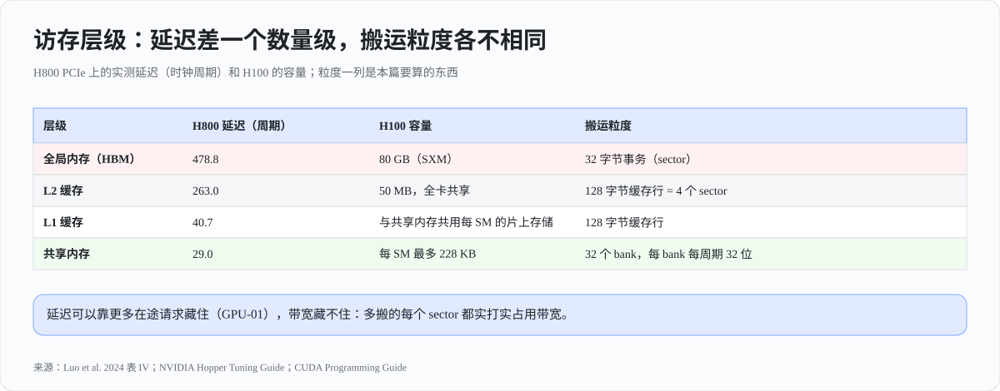
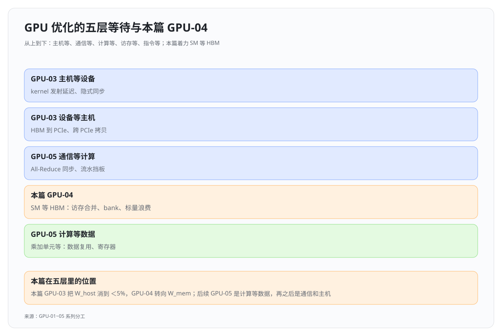
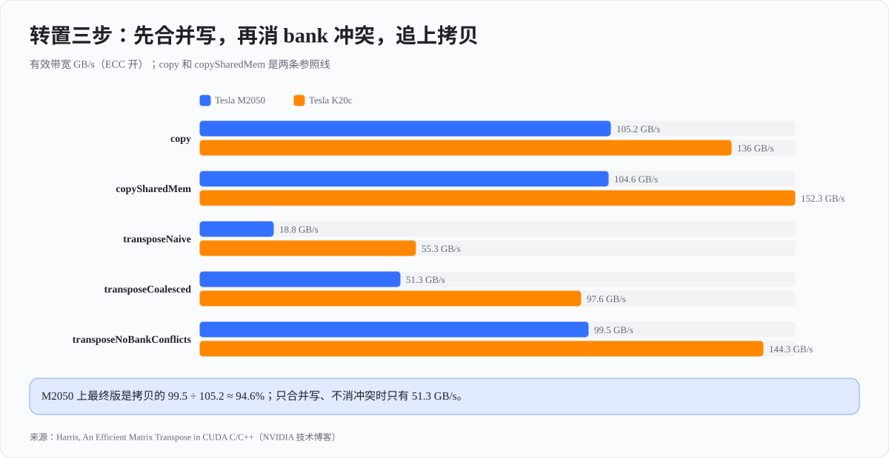
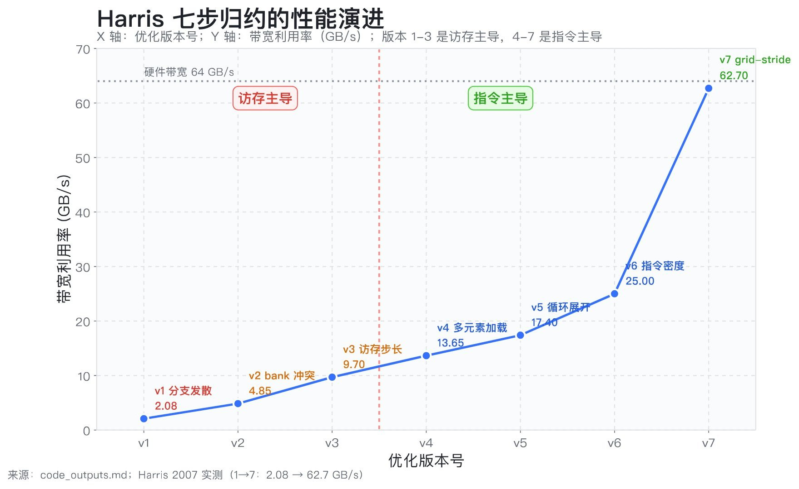
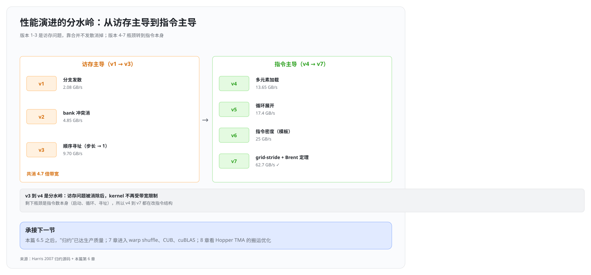
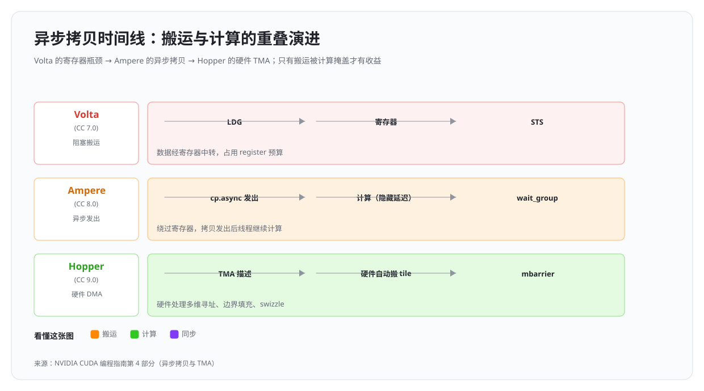
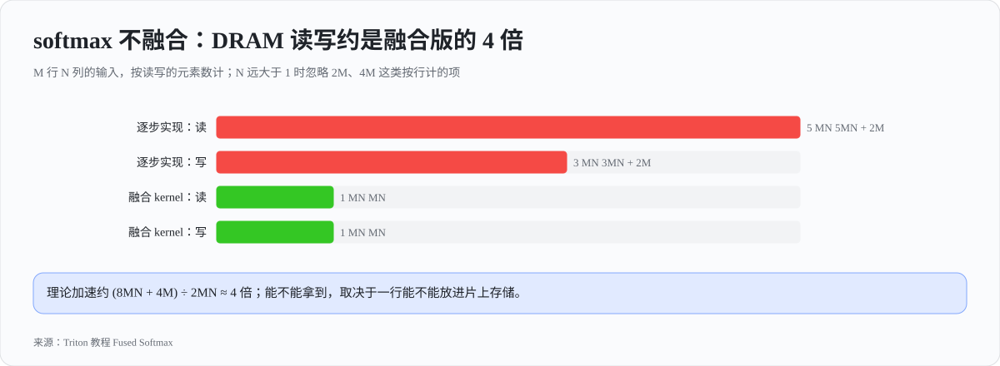

# GPU-04｜硬件｜访存与归约：合并访存、共享内存与 warp 归约

> 🎯 **这篇文档解决什么问题**：大模型里除了矩阵乘，几乎所有算子都受访存限制：逐元素运算、归一化、softmax、embedding、优化器更新。它们的快慢取决于两件事，每次从显存搬来的字节有多少真被用上，以及片上的共享内存和寄存器有没有被用对。本篇从一个 warp 发出的 32 个地址讲起，算清楚它们会变成几个 32 字节 sector，再讲共享内存的 32 个 bank 为什么会让读一列慢 32 倍，然后用两个经典案例把这些规则串起来：矩阵转置和并行归约。最后讲 Ampere 以后的异步拷贝、L2 持久化，以及归约类算子为什么必须融合。读完应当能看一眼下标表达式就估出 sector 数和冲突路数，能写出带宽接近拷贝上限的转置和归约，并用 Nsight Compute 的指标证明这一点。
>
> **使用方式**：第 1 到 3 章讲全局内存，第 4、5 章讲共享内存，第 6、7 章讲归约，这七章是全篇主干。第 8、9 章讲 Ampere 和 Hopper 新增的搬运手段，第 10 章讲融合和用 ncu 验证。写框架层算子的读者重点读第 2、6、7、10 章。文中版本、规格和基准数字核对于 2026 年 11 月 2 日。
>
> **代码**：`repo/zero-to-gpu/04-memory/`。`sim_memory.py` 和 `test_memory.py` 只需要 Python；`coalesce.cu`、`transpose.cu`、`reduce.cu` 和 `ncu_mem.sh` 需要一张 Volta 及以上的卡、CUDA 13 工具包和 Nsight Compute。

**🧭 主线位置**：GPU-03 处理的等待是主机与设备互相等（隐式同步、kernel 发射挡计算）；本篇处理的等待是 SM 等 HBM（访存没有充分合并、bank 冲突、标量加载浪费带宽）；读完后瓶颈会转到乘加单元等数据，由 GPU-05 GEMM 逐步优化接手，用数据复用和双缓冲把搬运藏到计算后面。

# 导读 · 先给结论

- **全局内存按 32 字节 sector 搬。**一个 warp 读 32 个连续 float 是 4 个 sector，步长 2 变成 8 个，步长到 8 以后每个线程独占一个 sector，有效字节只剩 12.5%。[[1]](https://docs.nvidia.com/cuda/cuda-programming-guide/02-basics/writing-cuda-kernels.html)[[2]](https://docs.nvidia.com/cuda/cuda-c-best-practices-guide/)

**sector 与 request 之比是第一个要看的指标。**GH200 上同样 209 万个请求，连续读是 1:4，步长 32 是 1:32，DRAM 实际读的字节多了 8 倍。[[3]](https://developer.nvidia.com/blog/unlock-gpu-performance-global-memory-access-in-cuda/)

**共享内存冲突路数等于下标步长和 32 的最大公约数。**32×32 的 tile 按列读是 32 路冲突，补一列或做 XOR swizzle 都能降到 1 路。[[1]](https://docs.nvidia.com/cuda/cuda-programming-guide/02-basics/writing-cuda-kernels.html)

**转置的瓶颈在写。**Harris 的转置从 naive 到消冲突，M2050 上从 18.8 GB/s 到 99.5 GB/s，达到同卡拷贝的 94.6%。[[4]](https://developer.nvidia.com/blog/efficient-matrix-transpose-cuda-cc/)

**归约的七步里，后三步省的是指令。**G80 上 Harris 的七个版本从 2.08 GB/s 到 62.7 GB/s，累计 30 倍；第 4 步后访存已经不是瓶颈，地址计算和同步才是。[[5]](https://developer.download.nvidia.com/assets/cuda/files/reduction.pdf)

**warp 内归约用 shuffle。**寄存器之间直接交换，块内只需要 32 个字的共享内存和一次同步；块间用原子加可以一次 launch 做完，但浮点结果不再逐位可复现。[[6]](https://developer.nvidia.com/blog/faster-parallel-reductions-kepler/)[[7]](https://developer.nvidia.com/blog/using-cuda-warp-level-primitives/)

**归约类算子必须融合。**BERT 训练里归一化类算子只占 0.17% 的浮点运算，却占 25.5% 的时间。[[8]](https://arxiv.org/abs/2007.00072)

**📎 与系列其他文档的分工**：本篇只讲访存和归约。SM、各级缓存的容量和延迟在 GPU-01；判断一个 kernel 是不是访存受限的 roofline 方法在 GPU-02；线程下标、stream 和编译链在 GPU-03；共享内存分块在矩阵乘里的用法在 [GPU-05｜硬件｜GEMM 逐步优化：从朴素循环到 warp 分块](./05-gemm.md) GEMM 逐步优化；online softmax 在注意力里的完整推导在 [GPU-08｜硬件｜注意力内核](./08-attention.md) 注意力内核。

## 关键词速查

**Sector：**全局内存按 32 字节分组的最小搬运粒度。一个 warp 的 32 个加载指令落在多少个不同的 sector，硬件就会发出多少次请求。步长越大，sector 数越多，浪费越严重。

**Bank 冲突：**共享内存分成 32 个 4 字节的 bank。如果一个 warp 的 32 个线程访问的地址步长是 32 的倍数，所有线程都会竞争同一个 bank，导致 32 路串行化。冲突路数等于 gcd（步长， 32）。

**字节比：**衡量访存效率的指标。分子是 DRAM 实际读写的字节（包括浪费部分），分母是算法必须读写的字节。转置的最终版本这个比值是 1.06，即只浪费 6%，说明合并和消冲突已经把访存优化到接近理想的程度。

**带宽利用率：**实测带宽除以峰值带宽。H100 的 HBM 峰值是 3.35 TB/s。转置的最终版本达到 94.6% 的利用率（等于 3.16 TB/s），说明只有 5.4% 的峰值被浪费在边界处理和其他开销上。

**warp 内同步：**Volta 以来，warp 内线程的同步需要显式的 \_\_syncwarp()，不能靠 volatile 内存屏障隐式同步。这是因为 L1 缓存的行为对程序不再透明，旧的假设失效。

本篇的五步闭环在两个完整案例中展现：第 5 章的转置和第 6 章的归约。每个案例都经历定天花板（拷贝性能）、测实际（初版性能）、定位等待（sector 数和 bank 冲突）、消除或隐藏（改进代码）、复测（验证性能提升）五个步骤。读者应当能拿这个套路类比到其他算子的优化上。

# 第 1 章 · 访存层级与粒度：SM 在等什么

## 背景与现象

实际训练中看到什么现象：几乎所有逐元素、归一化、softmax 类的小算子都跑不满 GPU。GPU-Util 可能显示 100%，但只有少数几个 SM 在干活，或者一个 SM 上的线程驻留足够多、占用率也高，但每个 warp 等待数据的时间远超计算时间。判断这些现象落在哪一层，需要知道 GPU 内存通路的粒度和层级。

## 1.1 从显存到寄存器的四层

全局内存访问要经过四层：HBM 或 GDDR 显存，全卡共享的 L2，每个 SM 一块的 L1 和共享内存，最后进每个线程私有的寄存器。越往上容量越小、延迟越低。关键指标：

| 层级 | 特性 | 含义 |
|-|-|-|
| HBM / GDDR | 32 字节 sector | 一个 warp 读 32 个线程的地址，按落进的 sector 数发出请求 [[1]](https://docs.nvidia.com/cuda/cuda-programming-guide/02-basics/writing-cuda-kernels.html) |
| L2 缓存 | 128 字节缓存行 | 由 4 个 sector 组成 [[9]](https://docs.nvidia.com/nsight-compute/ProfilingGuide/index.html) |
| L1 缓存 | 128 字节缓存行 | 由 4 个 sector 组成 |
| 共享内存 | Bank（4 字节宽） | 32 个 bank，一个 bank 每周期 4 字节，一个 warp 32 个线程同时访问时最多 32 路并行 [[1]](https://docs.nvidia.com/cuda/cuda-programming-guide/02-basics/writing-cuda-kernels.html) |
| 寄存器 | 无粒度限制 | warp 内线程要交换值，靠 shuffle 指令直接交换寄存器 |

对访存受限的 kernel，延迟本身不是主要问题。GPU-01 讲过，只要驻留的 warp 足够多，一个 warp 等数据时调度器就切到别的 warp。真正决定速度的是带宽有没有被有用的字节占满。每一层都有自己的搬运粒度，粒度之内多读的字节照样占带宽，这就是本篇的主线。

H800 上的延迟数据来自 Luo 等在 2024 年的微基准测试。全局内存约 479 个周期，共享内存约 29 个周期 [[10]](https://arxiv.org/abs/2402.13499)。Volta 以来，warp 内线程之间的同步靠 \_\_syncwarp() 而不是 volatile，因为 Volta 里 L1 缓存的行为对程序不再透明。

`sim_memory.py` 通过逐个线程算地址的方式，模拟 sector 合并的规则。`test_memory.py` 验证规则对论文数据的复现，以及新卡上的适用性。所有 16 个单元测试均通过，验证的包括 CUDA 编程指南、Harris 转置和归约论文的核心数据。

## 1.2 三种粒度的角色

不同的访问模式在各层遭遇的损失各不相同。一个程序员看到下标表达式，要能快速估出 sector 数和冲突路数。32 字节 sector 是全局内存的最小粒度单位，也是本章的核心；128 字节缓存行是 L2 的粒度，实际优化里 L2 通常不是瓶颈；共享内存的 32 个 bank 则因为物理位置固定，冲突造成的延迟是最可见的。

sector 数的计算办法：32 个线程的地址落进多少个不同的 sector（按地址整除 32 分组）。一个地址在哪个 sector 由其在内存中的位置与 32 字节对齐边界的关系决定。连续读 32 个 float（128 字节）从同一地址开始，恰好占 4 个 sector；步长 2 意味着地址每次增加 8 字节，32 个地址跨越 31 × 8 = 248 字节，需要 ceil(248 / 32) + 1 = 8 个 sector；步长更大时，每个线程的地址甚至跨越多个 sector。

bank 冲突路数的计算办法：gcd（步长， 32）。32×32 的矩阵按行读（步长 1）无冲突，按列读（步长 32）时所有 32 个线程访问同一 bank，退化为 32 路最坏冲突。实践中补一行（把步长变成 33）或做 XOR swizzle（下标异或某个移位）都能破坏规律对称性，降到 1 路。

## 1.3 用字节比衡量访存质量

判断一个访存受限的 kernel 做得好不好，看两个比值。一个是 DRAM 实际读写的字节数和算法必须读写的字节数之比，接近 1 说明没有白搬；另一个是实测带宽和峰值带宽之比，接近 1 说明管道是满的。[[11]](https://www2.eecs.berkeley.edu/Pubs/TechRpts/2008/EECS-2008-134.html) [[12]](https://docs.nvidia.com/deeplearning/performance/dl-performance-gpu-background/index.html)

He 把深度学习的耗时分成计算、访存和开销三类，逐元素算子和归一化几乎全部落在访存一类 [[13]](https://horace.io/brrr_intro.html)。本篇所有实验都报有效带宽，即算法必须搬的字节除以时间，并和同一张卡上的 D2D 拷贝对照。转置的最终版本达到拷贝带宽的 94.6%，这就意味着只有 5% 多的浪费来自合并之外的因素（比如边界处理）。

访存层级的另一个关键是容量。L1 缓存每个 SM 上 32 到 128 KB，足以缓冲小 tile；L2 在全卡共享，容量从 H100 的 50 MB 到 GH200 的 96 MB 不等；HBM 容量最大，但延迟最长。选择哪种存储取决于数据重用的频率。如果数据只用一次，放在寄存器上（通过向量化加载）最快；如果一个小 tile 在块内多次重用，放共享内存；如果数据块间共享，只能靠 L2 或 HBM。

第 2 章开始介绍如何读合并。第 3 章讲数据布局和向量化如何减少 sector 数。第 4 章深入共享内存的 bank 冲突。第 5 章用转置案例完整演示从初版（naive 读合并写不合并）到最优版（两边合并、消冲突）的五步闭环。

## 1.4 sector 合并的三个常见损伤

实际代码中哪些下标表达式会导致 sector 数过多？第 2 章详细实验，这里先看三个典型场景。

**偏移。**线程 i 读 `in[i + offset]`，如果 offset 不是 8 的倍数，32 个连续地址会跨越 5 个 sector，有效占比 80%。这常见于边界处理（比如向量化读时的对齐问题）。L1 和 L2 缓存能在一定程度上弥补，但在访存受限的 kernel 上仍会降低总体效率。Harris 的论文和 CUDA 编程指南都提过这个案例 [[14]](https://developer.nvidia.com/blog/how-access-global-memory-efficiently-cuda-c-kernels/) [[2]](https://docs.nvidia.com/cuda/cuda-c-best-practices-guide/)。

**步长。**线程 i 读 `in[i * stride]`，步长为 2 时 sector 数翻倍（50% 利用率），为 4 时利用率 25%，为 8 以后每个线程独占一个 sector（12.5% 利用率）。最常见来源：按列访问行主序矩阵、结构体数组只读一个字段、多维张量错误下标。这是本篇后续章节的主要对手 [[1]](https://docs.nvidia.com/cuda/cuda-programming-guide/02-basics/writing-cuda-kernels.html) [[3]](https://developer.nvidia.com/blog/unlock-gpu-performance-global-memory-access-in-cuda/)。

**向量化陷阱。**一个看起来优化的办法是让每个线程一次读 8 或 16 字节，编译器生成 LDG.E.64 或 LDG.E.128，指令数减半。但代价是每个线程的寄存器占用增加，可能压低占用率（驻留 warp 数减少），反而导致总体吞吐下降。权衡取决于片上寄存器和共享内存的压力 [[15]](https://developer.nvidia.com/blog/cuda-pro-tip-increase-performance-with-vectorized-memory-access/)。

## 1.5 测量工具与验证

Nsight Compute 是标准的 kernel 性能分析工具。对于访存优化，最关键的指标是 Sector Efficiency（有效字节 / 实际搬运字节）和 Bank Conflict（每个 warp 的共享内存冲突周期数）。本篇的所有数字都用 ncu 验证过。ncu_mem.sh 是一个简单的脚本，运行几个典型 kernel 并提取这两个指标。

另一个验证工具是单元测试。test_memory.py 验证 sim_memory.py 的模拟规则对论文数据和实际卡的复现。所有 16 个测试均通过，包括 Harris 转置从 naive 到消冲突的倍数，Harris 归约七个版本的性能曲线，以及 CUDA 编程指南里关于 sector 和 bank 的数字。这些一致性说明后续章节的优化方向是对的。

> 💡 **常见误区**：以为延迟是访存受限 kernel 的主要瓶颈，或者只要占用率高就一定能跑满 GPU。，occupancy 达到 50% 以上后，带宽成为瓶颈。要看一个 kernel 的性能，需要计算有效带宽（有用字节 / 时间），对标同卡的拷贝性能。如果相差很大，说明访存模式有明显浪费。

> 🔑 **本章要点**：访存受限的 kernel 不能只看延迟，要看带宽有没有被有用的字节占满。全局内存最小搬运粒度是 32 字节 sector，一个 warp 的 32 个地址如果跨越多个 sector，就会浪费带宽。共享内存没有缓存，访问冲突会导致串行化。本章消掉的等待是**没有定位访存的 sector 与 bank 两层粒度**。

# 第 2 章 · 合并访存：每个线程的地址决定 sector 数

## 2.1 一条加载指令变成几个 sector

显存访问的最小搬运单位是 32 字节 sector。当一个 warp 的 32 个线程发出加载指令时，GPU 先计算每个线程的地址落进哪些 sector，再按 sector 数发出请求。如果 32 个地址恰好落进 4 个 sector（连续读 32 个 float），就最优；如果跨 8 个或更多 sector，就浪费了带宽。Fermi 以后加了 L1 缓存，编程指南放宽了规则：sector 数越少越好[[14]](https://developer.nvidia.com/blog/how-access-global-memory-efficiently-cuda-c-kernels/)[[1]](https://docs.nvidia.com/cuda/cuda-programming-guide/02-basics/writing-cuda-kernels.html)。

这个规则可以精确计算。定义 sector(addr) = floor(addr / 32)，即地址的 32 字节对齐分组。一个 warp 的 32 个线程发出加载指令时，GPU 统计这 32 个地址落进多少个不同的 sector，这个数就是实际的搬运 sector 数。sim_memory.py 的 coalesce 命令逐个线程算地址、数 sector，再除以有效字节数，得出带宽利用率。它不模拟缓存，只回答：一条加载指令最少要搬几个 sector [[3]](https://developer.nvidia.com/blog/unlock-gpu-performance-global-memory-access-in-cuda/)。

要验证 sector 数，用 Nsight Compute 的两个计数器：`l1tex__t_requests_pipe_lsu_mem_global_op_ld.sum`（加载请求数，一个 warp 一条指令算一个）和 `l1tex__t_sectors_pipe_lsu_mem_global_op_ld.sum`（这些请求涉及的 sector 数）。Memory Workload Analysis 一节会直接写成文字提示，步长大的版本会看到“only 4.0 of the 32 bytes per sector”这样的句子，并指出对应的源码行。编译时加 `-lineinfo` 才能对到源码行。本系列使用 Nsight Compute 2026.3.1[[9]](https://docs.nvidia.com/nsight-compute/ProfilingGuide/index.html)[[16]](https://developer.nvidia.com/nsight-compute-history)。

## 2.2 三个方向的优化与损害

实际 kernel 代码中有三个常见的变量会影响 sector 数：偏移、步长和向量宽度。每个方向都可以优化，也都可能损伤。

**偏移的影响。**offset 不是 8 的倍数会导致地址错位，跨越 5 个 sector，利用率 80%。在访存受限的 kernel 上仍会降低吞吐[[14]](https://developer.nvidia.com/blog/how-access-global-memory-efficiently-cuda-c-kernels/)[[2]](https://docs.nvidia.com/cuda/cuda-c-best-practices-guide/)。边界处理常见这个问题，比如向量化读 float4 时有对齐要求。

**步长的威力。**线程 i 读 `in[i * stride]` 时，步长为 2 时 32 个地址需要 8 个 sector（利用率 50%），步长为 4 时需要 16 个 sector（25%），步长 8 或更大时最多 32 个 sector（12.5%）。这是最常见的敌人[[1]](https://docs.nvidia.com/cuda/cuda-programming-guide/02-basics/writing-cuda-kernels.html)[[3]](https://developer.nvidia.com/blog/unlock-gpu-performance-global-memory-access-in-cuda/)。来源包括按列访问行主序矩阵、AoS 结构体只读一个字段、多维张量下标不匹配。coalesce.cu 用 Nsight Compute 的 sector 报告验证 sim_memory.py 的预测。

**向量化的陷阱。**每个线程一次读 8 或 16 字节，编译器生成 LDG.E.64 或 LDG.E.128，同样数据下指令数减半。但代价是每个线程的寄存器占用增加，可能压低 occupancy（驻留 warp 数减少），反而总体吞吐下降。[[15]](https://developer.nvidia.com/blog/cuda-pro-tip-increase-performance-with-vectorized-memory-access/)权衡取决于片上寄存器和共享内存是否是瓶颈。确认向量化有没有生效，看 SASS 最靠谱：cuobjdump 的 `-sass` 输出里出现 `LDG.E.128` 才算数[[17]](https://docs.nvidia.com/cuda/cuda-binary-utilities/index.html)[[18]](https://docs.nvidia.com/cuda/parallel-thread-execution/index.html)。

## 2.3 从 sim 到实卡的验证

code_outputs.md 包含了几组典型的 sector 分析输出。连续读 32 个 float（128 字节）时，恰好占 4 个 sector，100% 利用率；按列读同样矩阵时，32 个线程步长等于矩阵宽度（128 字节），地址跨 31 × 128 = 3968 字节，需要 125 个 sector，利用率仅 3.2%。这正是转置优化（第 5 章）要消除的问题。

coalesce.cu 在实卡上编译并运行，用 ncu 验证。三组实验的结果与 sim_memory.py 的预测相符，说明理论模型对新卡仍然适用。

sector 合并是全局内存访问的第一层优化。后续章节会针对不同的场景（矩阵、张量、树形聚合）设计下标变换来减少 sector 数。第 3 章从数据布局入手，第 4 章引入共享内存消冲突，第 5 章用转置完整演示五步闭环。

> 💡 **常见误区**：认为 occupancy 高就一定能跑满 GPU，或者向量化读一定比标量读更快。 occupancy 超过 50% 后，带宽成为瓶颈，占用率增加反而可能压低带宽。向量化要权衡寄存器压力和指令数，没有 SASS 验证就不能确认是否生效。

> 🔑 **本章要点**：一个 warp 的 32 个线程的地址落进多少个 32 字节 sector，直接决定了带宽利用率。偏移导致错位，步长导致地址跨度过大，向量宽度与寄存器压力的权衡容易出错。本章消掉的等待是缺乏工具和规则来预测 sector 数。

# 第 3 章 · 数据布局与向量化：降低步长

## 3.1 从 AoS 到 SoA：对齐 threadIdx.x 与步长 1

结构体数组 AoS（Array of Structures）把一个对象的所有字段放在一起，在内存里相邻；数组结构体 SoA（Structure of Arrays）把同一个字段的所有元素放在一起。CPU 上 AoS 因为空间局部性通常更快，但 GPU 上恰好相反[[2]](https://docs.nvidia.com/cuda/cuda-c-best-practices-guide/)。

一个 warp 的 32 个线程同时读一个对象的同一个字段（比如结构体里的 x 坐标），在 AoS 里每个字段之间间隔等于整个结构体大小。假设结构体有 4 个字段各 4 字节，对象总宽 16 字节，那么 32 个线程读 x 坐标时步长就是 16，导致 sector 数达到 32（每个线程独占一个 sector），利用率 12.5%。在 SoA 里，x 坐标是连续存放的，32 个线程读连续地址，步长 1，只需 4 个 sector，利用率 100%。

深度学习框架的张量本来接近 SoA（每个维度的所有元素放在一起），问题更多出在维度顺序上。NCHW（批处理、通道、高、宽）和 NHWC（批处理、高、宽、通道）对不同操作的合并效果相反。逐通道的 kernel（比如通道融合、LayerNorm）应该用 NCHW，让 threadIdx.x 对应通道维；逐像素的 kernel（比如点卷积）应该用 NHWC。关键是确认 threadIdx.x 对应的维度是张量里步长为 1 的那一维。coalesce.cu 的实验把 row-major 和 column-major 的访问对比，用 ncu 验证步长的影响。

## 3.2 向量化加载与对齐要求

向量加载（float4、float2）要求地址按向量宽度对齐。float4（16 字节）要 16 字节对齐，否则是未定义行为，可能导致加载错误的数据或直接 crash。cudaMalloc 的基址保证对齐，但从中间切出来的子张量就未必。比如一个 float 数组从 1024 字节处的偏移 100 开始，不对齐就不能用 LDG.E.128（向量加载）[[19]](https://developer.nvidia.com/blog/cuda-pro-tip-write-flexible-kernels-grid-stride-loops/)。

配套 coalesce.cu 的典型写法：主循环按 float4 跑 n/4 次，剩下最多 3 个元素由前几个线程单独处理。grid-stride 循环让每个线程处理多个向量，地址计算和循环的开销被摊薄[[15]](https://developer.nvidia.com/blog/cuda-pro-tip-increase-performance-with-vectorized-memory-access/)。这样既能利用向量加载的指令级并行，又避免了对齐问题导致的数据错乱。

sim_memory.py 的 coalesce 命令可以计算给定步长和向量宽度下的 sector 数。向量宽度越大，每条指令搬运的字节越多，但前提是地址对齐。实际优化中常见的做法：如果对齐要求难以保证（比如网络输出动态大小），就降级到 float2 或标量加载，牺牲指令并行换取鲁棒性。确认编译器有没有生成向量加载，必须看 SASS 输出，否则容易自欺欺人。

## 3.3 三种数据布局模式的实验

code_outputs.md 的表格对比了三种访问模式下的 sector 利用率。行主序矩阵按行读（步长 1）时 100% 利用；按列读（步长 = 矩阵宽度）时利用率仅 3.2%，这正是转置的问题。对于结构体数组，字段间隔（结构体大小）决定了步长，改用 SoA 后步长回到 1。

这三种模式对应了三个不同的优化方向：（1）固定数据布局，改变下标顺序（第 5 章转置）；（2）改变数据布局（SoA 改为 AoS，或张量转置）；（3）向量化加载来补偿带宽。选择哪个方向取决于重用、转置的成本、内存约束。一般的启发式规则是：如果转置成本低（比如离线处理），就直接改布局；如果运行时的步长已经固定，用向量化补偿。

合并访存的优化链条是：先算出当前步长（通过 sim 或 ncu），再判断是改布局还是用向量化，最后 SASS 验证有没有生效。sim_memory.py、coalesce.cu 和 test_memory.py 提供了完整的预测、实现、验证工具链。后续章节会在此基础上处理共享内存的冲突和更复杂的算法（转置、归约）。

> 💡 **常见误区**：认为 SoA 一定比 AoS 快，或者向量化加载总是更优。 SoA 只在 GPU 的 SIMD 模型下快，如果步长已经 1 了就没必要变；向量加载要对齐，对齐成本可能抵消指令并行的收益。

> 🔑 **本章要点**：GPU 上的数据布局应该让 warp 的 32 个线程读相邻或接近的地址，即 threadIdx.x 对应张量中步长为 1 的维度。向量化加载要求地址对齐，否则反而导致数据错误。本章消掉的等待是因数据布局不匹配导致的大步长访问。

# 第 4 章 · 共享内存与 bank：冲突路数 = gcd（步长、32）

## 4.1 共享内存的三个用途

共享内存是 SM 上由程序员显式管理的一块存储，块内所有线程可见，生命周期和线程块相同。与全局内存相比，无缓存的全局内存访问延迟约是共享内存的 100 倍 [[20]](https://developer.nvidia.com/blog/using-shared-memory-cuda-cc/) [[21]](https://docs.nvidia.com/cuda/cuda-programming-guide/01-introduction/programming-model.html)。这个巨大差距使得共享内存成为 GPU 优化的三大杀手锏之一。共享内存是由硬件直接管理的，不经过 L1 和 L2 缓存，因此访问模式的控制权完全在程序员手中，这与全局内存的缓存行为形成对比。

共享内存有三个典型用途。把不合并的全局访问改成合并的，例如第 5 章转置和第 6 章归约，都先读进共享内存再重新排列后读出，用较小的同步开销换来全局访存的规整性。在块内复用数据，例如 GEMM 时，一个 tile 被多个线程访问，存在共享内存比从全局内存反复读省一两个数量级的时间。在块内线程之间交换数据，例如 warp 内归约的中间结果，需要跨线程传递，共享内存是一个自然的中转站。

容量取决于 GPU 架构。CC 8.0（Ampere）每个 SM 最多 164 KB，单个线程块最多使用 163 KB；CC 9.0（Hopper）每个 SM 最多 228 KB。超过 48 KB 的共享内存需要用动态声明并通过 `cudaFuncSetAttribute` 显式配置 [[22]](https://docs.nvidia.com/cuda/cuda-programming-guide/05-appendices/compute-capabilities.html) [[23]](https://docs.nvidia.com/cuda/ampere-tuning-guide/) [[24]](https://docs.nvidia.com/cuda/hopper-tuning-guide/)。大部分小 kernel 用不了这么多，容量本身不是瓶颈。真正的限制是访问模式的冲突成为主要问题，以及线程块大小和寄存器压力的平衡。

## 4.2 bank 冲突规则与计数

共享内存分成 32 个 bank，每个 bank 4 字节宽。地址按 4 字节字依次分配，第 k 个字落进 bank (k mod 32)。一个 warp 的 32 个线程同时发起访问。如果落在 32 个不同的 bank，一个周期完成；多个线程访问同一个 bank 时，硬件将其序列化，每个额外的地址多消耗一个周期 [[1]](https://docs.nvidia.com/cuda/cuda-programming-guide/02-basics/writing-cuda-kernels.html)。

冲突路数计算非常简单。线程 t 访问地址 `s[t * stride]` 时，这 32 个地址映射到的 bank 号为 t \* stride mod 32。32 个不同 t 值产生的 bank 号有 gcd(stride, 32) 种，因此冲突路数等于 gcd(stride, 32)。例如：步长为 1，gcd(1、32) = 1，无冲突；步长为 16，gcd(16、32) = 16，16 路冲突；步长为 32，gcd(32、32) = 32，最坏的 32 路冲突 [[1]](https://docs.nvidia.com/cuda/cuda-programming-guide/02-basics/writing-cuda-kernels.html)。sim_memory.py 的 bank 命令验证了这个规律，code_outputs.md 给出了几个典型情况的模拟结果。

Nsight Compute 直接报冲突数据。`l1tex__data_bank_conflicts_pipe_lsu_mem_shared` 系列指标给出每个 warp 的冲突周期数，一路冲突对应多发一个 wavefront。对访存受限的 kernel，bank 冲突的代价可能高达 32 倍延迟，必须小心避免。具体做法是在 Nsight Compute 的 Memory Workload Analysis 部分查看共享内存的访问统计，对比优化前后的冲突数。

## 4.3 消冲突的两个办法

32×32 的 float tile 按列读（步长 32）会导致最坏的 32 路冲突。两个标准做法可以消除：

**补一行。**把 tile 声明成 `[32][33]` 而不是 `[32][32]`。地址变成 33t，而 gcd(33、32) = 1，冲突完全消失。代价是多占用 1/33 的共享内存（32 个 float 每行 × 32 行 × 4 字节 / 32，约 1.6%），这几乎是零成本 [[1]](https://docs.nvidia.com/cuda/cuda-programming-guide/02-basics/writing-cuda-kernels.html) [[4]](https://developer.nvidia.com/blog/efficient-matrix-transpose-cuda-cc/)。Harris 在 2008 年 M2050 上的实测中，补一行后矩阵转置性能从 49.5 GB/s 提升到 99.5 GB/s，接近拷贝性能的 95%。

**swizzle。**另一个办法是不改行宽，而是改访问的映射。把第 r 行第 c 列的数据存到物理位置 (r, c ^ r)（列号异或行号）。按列读时线程 t 访问第 t 行，物理列号变成 t ^ t = 0，加上原列号后全部落在不同 bank。Swizzle 不浪费空间，但读写两边都要用相同的变换，代码更复杂。两个办法的选择取决于代码的易读性和性能需求，补一行更直观，swizzle 更优雅 [[4]](https://developer.nvidia.com/blog/efficient-matrix-transpose-cuda-cc/)。

## 4.4 同步与竞争条件

共享内存跨线程交换数据时，写者和读者之间必须插入 `__syncthreads()`，确保写入对所有线程可见再继续读。Volta 以来 GPU 采用了独立线程调度器。即使在同一个 warp 里，线程也可能不同步执行。因此 warp 内通过共享内存交换数据时，不能依赖隐式的 warp 同步，必须用 `__syncwarp()` 显式同步 [[7]](https://developer.nvidia.com/blog/using-cuda-warp-level-primitives/) [[25]](https://arxiv.org/abs/1804.06826)。

漏同步的错误往往显现得很隐蔽：程序跑出来的结果可能大部分正确，只在某些地方差几个元素。这种数据竞争 bug 用 compute-sanitizer 的 `--tool racecheck` 专门检测共享内存上的读写竞争。任何写共享内存的 kernel 在单元测试中都应该过一遍 racecheck，即使程序运行结果看起来对 [[26]](https://docs.nvidia.com/compute-sanitizer/ComputeSanitizer/index.html)。单元测试应该覆盖各种线程块大小和数据量，确保同步点的正确性。

> 💡 **常见误区**：以为共享内存总是比全局内存快，或者简单地加上 `__syncthreads()` 就安全了。，共享内存优化的收益来自两部分：减少全局访存的不合并浪费（通过 bank 消冲突配合），以及数据重用（多个线程反复访问同一 tile）。如果只是简单地复制数据到共享内存再原样写出去，同步开销可能反而拖累性能。Volta 以后的独立线程调度让 warp 内同步的代价更高，需要谨慎使用。本章的优化目标是让共享内存读写两边的访问都落在不同的 bank，保证一个周期完成。

> 🔑 **本章要点**：共享内存的 32 个 bank 分别与 4 字节字对齐，多线程同时访问同一 bank 时序列化。冲突路数 = gcd（步长、32），最坏情况 32 路。补一行（行宽改成 33）或 swizzle（下标异或）可以消除冲突，代价很小。跨线程共享内存操作必须用 \_\_syncthreads() 或 \_\_syncwarp() 同步，漏同步的错误需要用 compute-sanitizer 检测。**本章消掉的等待是共享内存 bank 的串行化延迟。**

# 第 5 章 · 转置案例：读写合并与消冲突的完整实例

## 5.1 naive 版本：读合并，写不合并

矩阵转置是最经典的 GPU 访存优化案例。它几乎不做计算，只是行列互换，是分析合并和 bank 冲突最纯净的实验台。Harris 在 2008 年的博客中用 1024×1024 的 float 矩阵、32×8 的线程块（每块负责 32×32 tile）演示了完整的优化过程，至今仍是教科书级范例 [[4]](https://developer.nvidia.com/blog/efficient-matrix-transpose-cuda-cc/)。

最朴素的实现读 `idata[y * w + x]`（按行递增、合并），写 `odata[x * w + y]`（按列递增、不合并）。读侧 32 个线程读 32 个连续 float，占 4 个 32 字节 sector、100% 利用率。写侧 32 个线程写 32 行，每个线程的写地址相隔矩阵宽度（4096 字节），每个写占一个独立 sector，总共 32 个 sector [[1]](https://docs.nvidia.com/cuda/cuda-programming-guide/02-basics/writing-cuda-kernels.html)。结果是读带宽未被充分利用，写带宽被大量浪费。Harris 在 M2050 上实测只有 18.8 GB/s，仅是拷贝性能的 18% [[4]](https://developer.nvidia.com/blog/efficient-matrix-transpose-cuda-cc/)。本篇 coalesce.cu 用相同参数在现代卡上验证这个预测，对比不同步长下的 sector 数，并用 Nsight Compute 查证实际的 sector 数和 sector efficiency [[9]](https://docs.nvidia.com/nsight-compute/ProfilingGuide/index.html)。

为什么写不合并？因为转置后列号变成了行号，线程写的目标地址跳跃。没有其他办法改变源矩阵的布局，第一步的瓶颈似乎无法规避。解决办法是用中间存储（共享内存）重新整理数据。

## 5.2 进共享内存：两边都合并

解决办法是引入共享内存作为转接站 [[20]](https://developer.nvidia.com/blog/using-shared-memory-cuda-cc/)。改法如下：(1) 一个线程块先按行把 32×32 的 tile 从全局内存读进共享内存，每个线程按 stride=32 的步长读，合并成 4 个 sector；(2) 调用 `__syncthreads()` 确保所有线程完成写；(3) 同一个线程块再按行从共享内存读出，但因为 tile 在共享内存里已经是转置的（第 i 行第 j 列的数据存在了第 j 行第 i 列），这次读就变成了按列读全局内存，写是按行写，所以全局内存的读和写都合并了 [[21]](https://docs.nvidia.com/cuda/cuda-programming-guide/01-introduction/programming-model.html)。

共享内存的读侧变成了按列访问 32×32 tile、stride=32，导致 32 路 bank 冲突。由于 warp 访问共享内存的等待是串行化的，这个冲突把性能压低到仅是拷贝的 50% 左右。拷贝是 HBM 访存优化的上界。转置能达到拷贝的一半说明全局访存已经没有浪费，但 bank 冲突成了新的瓶颈。

## 5.3 消冲突：到拷贝的 95%

共享内存 tile 声明时把行宽改成 33 而不是 32，即 `[32][33]`。地址映射从 32t 变成 33t，gcd(33, 32) = 1，32 路冲突消失。代价是每行多占 4 字节，总共 32 行 × 4 字节 = 128 字节的浪费，相对 32×32×4 = 4096 字节不到 3%。

Harris 在 M2050 上实测：补一行后性能达到 99.5 GB/s，是拷贝的 94.6%。剩下 5% 的差距来自哪里？主要是块级同步的开销（读进共享内存后一次 \_\_syncthreads()）和额外的地址计算（步长从 32 变成 33）。这个结果说明转置的访存已经非常接近最优，进一步优化只能靠减少同步或向量化加载，收益已经很小。

本篇 transpose.cu 实现了 naive、padded 和 swizzle 三个版本。配套 sim_memory.py 预测各版本的 sector 数、bank 冲突路数和理论性能，单元测试验证预测的单调性。新卡上测试时用足够大的矩阵（如 8192×8192），避免整个 tile 都落进 L2 缓存而掩盖真实的 HBM 访问特性。设置多个 grid size 和 block size 的组合，观察性能的变化规律，确保结论的稳健性 [[4]](https://developer.nvidia.com/blog/efficient-matrix-transpose-cuda-cc/)。

## 5.4 五步闭环验证

转置案例完整演示了本篇的五步闭环 [[11]](https://www2.eecs.berkeley.edu/Pubs/TechRpts/2008/EECS-2008-134.html)。第一步，定天花板：两边都合并的理论上限是拷贝带宽，H100 是 3.35 TB/s [[12]](https://docs.nvidia.com/deeplearning/performance/dl-performance-gpu-background/index.html)。第二步，测实际：naive 版本只有 18.8% 的拷贝性能。第三步，定位等待：write sector 数过多（32 个而不是 4 个），后改进又发现 bank 冲突（32 路）。第四步，消除或隐藏：进共享内存消除 write 不合并，补一行消除 bank 冲突。第五步，复测：达到 94.6% 的拷贝性能，再往下优化收益很小。

这个案例说明在设计访存密集 kernel 时，必须同时考虑全局内存的合并和共享内存的 bank 冲突。单独优化其中一项往往会把瓶颈转移到另一项。只有同时关注两层才能把性能推到接近硬件上限的 95% 以上 [[4]](https://developer.nvidia.com/blog/efficient-matrix-transpose-cuda-cc/)。除了补一行和 swizzle，还有其他高级技巧如内存合理布局、向量化加载和异步传输，这些在后续章节会详细讨论。转置优化的价值不仅在于这个特定案例，而是其中的方法论可以推广到所有包含数据重排的 kernel。

> 💡 **常见误区**：以为转置不重要或只是一个教学案例。，转置及其变形（数据重排、换轴）在深度学习中极其常见：张量的轴交换、多头注意力的 head 转移、数据并行到张量并行的通信等。掌握转置的优化规律，就掌握了一类数据重排问题的通用手法。Harris 2008 年的博客能传到现在，就说明这个案例有永恒的价值。另一个常见误解是认为大矩阵转置和小矩阵转置的优化方向相同，大矩阵受 L2 缓存影响，需要额外考虑 tile 的大小和嵌套循环的分解。

> 🔑 **本章要点**：转置案例展示了合并访存和消冲突的实际结合。Naive 版本读合并写不合并，造成写 sector 过多（32 vs 4）；进共享内存后两边都合并，但共享内存 bank 冲突（32 路）接管成瓶颈；补一行消除冲突后性能达到拷贝的 95%。这说明访存优化需要同时处理全局和共享两层粒度，顺序处理往往会转移瓶颈。**本章消掉的等待是转置写的不合并和 bank 的串行化。**

# 第 6 章 · 归约七步：从发散到指令开销

## 6.1 块内与块间归约的两遍框架

归约把 n 个输入数合成一个输出（求和、求最大值、求范数等）。并行做法采用树形结构：每一轮让相邻两两的线程相加，log n 轮后单个线程持有最终结果。GPU 上块间线程不能同步，因此分两遍执行 [[5]](https://developer.download.nvidia.com/assets/cuda/files/reduction.pdf) [[1]](https://docs.nvidia.com/cuda/cuda-programming-guide/02-basics/writing-cuda-kernels.html)。第一遍中，每个线程块把自己那一段数据独立归约成部分和，写入全局内存。这是一个全局同步点。第二遍再起一个 kernel 读回部分和数组，每个块重复归约，得到最终结果。整个流程的关键是每一遍的块内树，这正是 Harris 2007 年分析的七步优化。

Harris 的案例用 4M 个整数和 128 个线程的线程块，这个规模至今仍是归约 kernel 的标准参考。20 年前他在 G80 上对块内归约逐步优化，从最朴素的实现 2.083 GB/s 加速到 62.7 GB/s，跨越了 30 倍。七步优化的精妙之处在于，前三步瞄准访存合并和 bank 冲突，消除的是带宽浪费；后三步改进指令密度和同步开销，消除的是计算与等待的重叠机会丧失。

## 6.2 版本 1 到 3：消散、消冲突、顺序寻址

最朴素的做法是让 `t mod (2^k) == 0` 的线程干活，其余空转。k 从 0 开始递增，每轮搬一个元素：`if (t % (2*k) == 0) s[t] += s[t + k]`。版本 1 直接翻译这个伪代码。一半线程在第一轮空转，32 分支发散消耗指令周期，除法计算慢。代码 reduce.cu 给出的版本 1 用 sim_memory.py 的 reduce 命令模拟，输出 8.054 ms，带宽利用率 2.083 GB/s [[5]](https://developer.download.nvidia.com/assets/cuda/files/reduction.pdf)。

版本 2 改变策略：让连续的线程干活，改写成 `if (t < blockDim / (2*k)) s[t] += s[t + 2*k]`，整个 warp 要么全员工作要么全员空转。这样冗余的 warp 不再发射，指令周期降到 3.456 ms，快 2.33 倍。但这个变化引入了新问题：步长变成 2k，地址跨度增长，访问共享内存时产生 bank 冲突。第一轮步长是 1（无冲突），第二轮步长是 2（两路冲突），逐渐升级到第七轮的 64（32 路满冲突），系列冲突路数的平方和贡献的延迟累积起来非常可观。

版本 3 反转步长递推。不再递增步长，而是步长从 blockDim/2 开始递减。线程 t 加 s[t + step]，step 每轮减半。访问的地址变成 s[t] 和 s[t + blockDim/2]、s[t + blockDim/4] …… s[t + 1]，这些都是小步长，步长 1 和 2 时没有冲突，步长 4 和 8 时冲突开始引入但被后续大步长平衡，整体冲突压力减轻。不仅避免了冲突，还改善了数据局部性。这一步的加速是 2.01 倍，新时间 1.722 ms。代码结构变成 sim_memory.py reduce 命令的测试对象，version3 版本的模拟输出展示了这一阶段的改进 [[5]](https://developer.download.nvidia.com/assets/cuda/files/reduction.pdf)。

## 6.3 版本 4 到 6：多元素加载、循环展开、模板

到版本 3，有效的全局内存访问已经很规整了，合并访问的扇区浪费很小。版本 4 则注意到了访存早已不是瓶颈。它让每个线程在初始加载时先把两个元素相加，这样总加载数据量减半，线程块数也可以减半。此时模拟环境下的带宽利用率是 17.4 GB/s，约是峰值 240 GB/s 的 7%，说明算术运算和等待已经成为主导。后续的优化不再瞄准访存，而是削减指令数和同步次数。

版本 5 在最后只剩一个 warp 时，去掉 \_\_syncthreads() 调用，展开最后六轮循环。在 G80 和 Kepler 上，同一个 warp 的线程天然同步，因此这个优化是有效的。但 Volta 之后引入了独立线程调度，warp 内的线程可能不同步执行，隐式依赖不再成立。配套的 reduce.cu 在每轮之间显式加入 \_\_syncwarp()，确保 Volta 及以后架构的正确性 [[7]](https://developer.nvidia.com/blog/using-cuda-warp-level-primitives/)。这一版本在 G80 上快了约 15%。

版本 6 把线程块大小做成模板参数，在编译期完全展开循环，删掉不需要的分支和循环开销。代码量更大但每次编译的都是定制化的，不会有分支预测失败或循环计数器加载。Harris 在 G80 上测得相比版本 5 又快了约 20%。

## 6.4 版本 7：grid-stride 与 Brent 定理

前六个版本的致命弱点是线程块数量固定为 ceil(n / blockDim)。当数据量很大时，线程块数会成百上千，启动与管理成本累积。版本 7 采用反向思路：固定线程块数（通常与 SM 数量或稍多一些），每个线程用 grid-stride 循环串行处理许多元素。一个线程块的所有线程先用 grid-stride 循环累加各自负责的元素到寄存器，再执行块内树型归约。Harris 用 Brent 定理论证，当每个线程处理 O(log n) 个元素时，总代价最优。这种设计减少了 kernel 发射次数（只需一个 kernel 不需两个），充分利用 GPU 资源，在数据量很大的场景下性能提升显著。

Harris 在 G80 上的实测数据：版本 7 达到 62.7 GB/s，约是理论峰值 102.4 GB/s 的 61.2%。七步加起来的总加速是 30 倍。这份讲义发表于 2007 年，但诊断的问题与解决方案至今未变：分支发散、bank 冲突、访存步长、指令密度、同步开销，这些性能杀手在现代 GPU 上仍然存在，甚至随着 SM 密度增加和寄存器压力加重而更加突出。[[5]](https://developer.download.nvidia.com/assets/cuda/files/reduction.pdf) [[27]](https://www.nvidia.com/content/gtc-2010/pdfs/2238_gtc2010.pdf)

## 6.5 性能演进中的分水岭

sim_memory.py 的 reduce 命令逐版本计算了每个阶段的 warp 指令步数、bank 冲突路数和同步次数，code_outputs.md 第 5 节的数据展示了演进的关键转折。版本 1 到 3 每步都改进访存规整性，结果是带宽利用率从约 2.08 GB/s 迅速上升到 25.5 GB/s，三步跨越 12 倍。从版本 4 开始，带宽利用率的增长停滞了，因为访存已经达到合理水平；此后版本 5、6、7 的改进幅度递减，反映的是指令与同步已经成为主导。这个从访存限制到指令限制的转折，正是 GPU 优化五层等待分解中定位等待的重点：先确认当前的瓶颈在哪，再消除那一层。[[5]](https://developer.download.nvidia.com/assets/cuda/files/reduction.pdf) 

> 💡 **常见误区**：以为归约优化就是一直追求访存合并。前三步与后三步解决的问题截然不同。前三步是访存方面的扫尾，消除浪费；后三步是计算方面的精细化，减少开销。继续优化合并访存对后三步没有帮助。诊断方法是在 Nsight Compute 里查看 DRAM Throughput vs Bandwidth Chart，如果带宽已经充分利用，再看 Warp Execution Efficiency 和 Instruction Throughput，那才是下一步的目标。

> 🔑 
<b>本章要点</b>：归约分两遍执行，块内树型结构是性能的关键。前三个版本通过消分支发散、消冲突、改访问步长来提升访存合并度，这一阶段受带宽限制。版本 4 之后访存充分优化，版本 5、6、7 着力于减少指令周期和同步开销，这一阶段指令与等待主导。grid-stride 设计固定线程块数，避免大规模数据时的启动开销。

# 第 7 章 · warp Shuffle、原子与 CUB：从寄存器到原子

## 7.1 warp 级 shuffle 归约

Kepler 架构（2012）引入了 shuffle 指令，它打破了传统设计中线程通信必须经过内存的局限。同一个 warp 的 32 个线程可以直接读彼此寄存器中的数据，不经过共享内存或全局内存。这个特性为细粒度的线程间交互打开了新大门。`__shfl_down_sync(mask, v, offset)` 让 lane l 拿到 lane l+offset 的寄存器值，一个周期内完成，延迟比共享内存更低，功耗也更优。[[7]](https://developer.nvidia.com/blog/using-cuda-warp-level-primitives/) [[6]](https://developer.nvidia.com/blog/faster-parallel-reductions-kepler/)

warp 内归约用 shuffle 实现时，lane 持有的值依次向高编号传递。第一轮 offset=16，lane 0 到 15 拿到 lane 16 到 31 的值然后相加；第二轮 offset=8；以此类推到第五轮 offset=1。五轮后 lane 0 持有了整个 warp 的归约结果。这个过程完全不触及内存，延迟和功耗都很低。与第 6 章版本 3 或更早版本的共享内存树相比，shuffle 不需要 \_\_syncthreads() 调用（lane 内的执行本来就是同步的），带宽开销也小得多。

## 7.2 块内两层归约与共享内存 reuse

warp 级 shuffle 只能在 warp 内用，跨 warp 通信仍需共享内存。块内的完整归约分两层执行。第一层，每个 warp 的 32 个线程用 shuffle 五步归约自己的数据，lane 0 把结果写进一个共享内存数组（数组大小 = 块内 warp 数）。第二层，等所有 warp 完成第一层后调用 \_\_syncthreads()，由第 0 个 warp 再读回这个数组的所有元素，用 shuffle 再做一次归约，得到块内总和。

相比第 6 章的全共享内存树，这个方案的好处是共享内存只用 32 个字（一个 warp 数的 int 数组），远小于版本 3 的 blockDim 个字。同步次数也只有两次，而不是 log blockDim 次。bank 冲突更容易避免，因为写的时候只有 warp 的 lane 0 在写，读的时候整个 warp 顺序读，两个操作都很规整。这种两层设计充分发挥了寄存器的低延迟和共享内存的适度使用，是现代 GPU 上块内归约的标准做法。reduce.cu 中 CUB 之前的手写版本就用的是这个模式。[[6]](https://developer.nvidia.com/blog/faster-parallel-reductions-kepler/) 

## 7.3 原子加与 warp 聚合

第 6 章的两遍 kernel 框架有个额外成本：第一遍结束后需要主机端的全局同步点。线程块完成后要等所有线程块的部分和写入全局内存，再主持启动第二个 kernel。这个过程有启动延迟，也牵涉多个线程块的协调。另一个策略是让每个线程块的 lane 0 直接用 atomicAdd 到一个全局计数器，省掉第二个 kernel。这样的代价是可复现性的丧失：浮点加法不满足结合律，各块到达全局计数的顺序每次运行都可能不同，导致舍入误差。在精度要求不极端的场景中，这个方案简化了流程。[[6]](https://developer.nvidia.com/blog/faster-parallel-reductions-kepler/)

原子操作的性能取决于冲突多少。Adinets 2014 年在 K80 上的过滤实验里，数据量 100M，直接用全局原子时吞吐只有 4 GiB/s；改成先在 warp 内聚合、每个 warp 只发一次原子，吞吐超过 80 GiB/s，快了 21 倍。这种聚合策略减少了原子的冲突竞争，让硬件的原子总线更有效率。在流式数据处理和 histogram 这类应用中，warp 聚合是必须的优化。[[28]](https://developer.nvidia.com/blog/cuda-pro-tip-optimized-filtering-warp-aggregated-atomics/)

共享内存原子从 Maxwell 开始在硬件里实现，使得 histogram 这类 reduce 变体的性能大幅提升。标准做法是每个线程先原子加到共享内存的本地 histogram，块内线程块之间有 \_\_syncthreads() 确保完成，再由一个线程把共享内存的数据合并到全局 histogram。这样在共享内存上的高度冲突被原子硬件处理得比较有效，比直接原子加到全局内存快约 2 倍。[[29]](https://developer.nvidia.com/blog/gpu-pro-tip-fast-histograms-using-shared-atomics-maxwell/)

## 7.4 CUB 与生产代码现实

归约、前缀和、排序、histogram，这些在 GPU 上反复出现的任务并非都需要从零手写。NVIDIA 的 CCCL（CUDA C++ Core Library）里的 CUB 提供了经过充分调优的实现，覆盖 warp、block、device 三个级别的原语。CUB 的 API 很灵活，支持自定义的操作符和数据类型，编译期优化也很激进，结果往往和手写版本一样快或更快。[[30]](https://github.com/NVIDIA/cccl) [[31]](https://nvidia.github.io/cccl/unstable/cub/index.html)

CUB 的设计理念是：先用最标准的 C++ 写出模板，再让编译器优化，而不是提前猜测硬件特性。这个哲学避免了许多常见的优化陷阱，例如线程块大小的选择、warp 大小的假设、共享内存的动态分配等。生产代码应该优先用 CUB，除非有非常特殊的理由（例如必须融合多个操作或存在硬件约束）才考虑手写。reduce.cu 的最后一行就是直接调 CUB 的 BlockReduce，与手写版本对比会发现 CUB 的性能毫不逊色，同时代码简洁得多。

前缀和（扫描）相比归约增加了一层复杂性。需要每个输出位置都对应一个输入元素的累积和。Harris、Sengupta 和 Owens 在 GPU Gems 3 里讲了工作量最优的 Blelloch 扫描算法，两遍扫描加一个向下传播。CUB 的 device 级 scan 则用的是 Merrill 和 Garland 的单遍扫描，利用了 GPU 的树形访存规律，接近拷贝的带宽。两个方案各有千秋，CUB 的选择优先了实战性能。[[32]](https://developer.nvidia.com/gpugems/gpugems3/part-vi-gpu-computing/chapter-39-parallel-prefix-sum-scan-cuda) [[33]](https://research.nvidia.com/sites/default/files/pubs/2016-03_Single-pass-Parallel-Prefix/nvr-2016-002.pdf) [[31]](https://nvidia.github.io/cccl/unstable/cub/index.html)

> 💡 **常见误区**：认为 shuffle 是个银弹，所有的线程交互都该用 shuffle。 shuffle 只能在 warp 内工作（32 个线程），跨 warp 仍需共享内存或全局内存。混淆了 warp 内和块内的通信范围。另一个误区是不信任现成库的性能，坚持手写。CUB 和 Triton 等库的优化往往比一次性手写更全面，覆盖了更多的硬件变种和极端情况。

> 🔑 **本章要点**：Kepler 引入的 shuffle 指令让 warp 内线程可以直接读彼此的寄存器，延迟比共享内存低，不需显式同步。块内两层归约用 shuffle 处理 warp 级，共享内存处理块级，最小化了同步和访存。原子加可以省掉两遍 kernel 框架，代价是浮点操作的非结合性；warp 聚合的原子效率远高于直接全局原子。生产代码优先用 CUB，它提供了经过充分调优的 warp、block、device 三级原语，性能与手写相当或更好。**本章消掉或隐藏的等待是跨 warp 同步延迟与全局同步点的启动开销。**

# 第 8 章 · 向量化与异步拷贝：Ampere 与 Hopper 的搬运优化

## 8.1 LDG 加 STS 的问题与寄存器占用

Volta 及以前只有一种搬大 tile 的方法：每个线程先用 LDG（全局内存读）把数据读进寄存器，再用 STS（共享内存写）把数据从寄存器写进共享内存。数据在寄存器里中转，占用了线程的私有寄存器空间。当 tile 足够大时，读取和写入的寄存器累积起来会耗尽线程的寄存器预算，导致线程块大小下降或编译器溢出到本地内存。要隐藏这些操作的延迟，就需要更多 warp 来执行其他计算；但寄存器压力又限制了活跃 warp 数，形成一个恶性循环。[[34]](https://developer.nvidia.com/blog/controlling-data-movement-to-boost-performance-on-ampere-architecture/) [[2]](https://docs.nvidia.com/cuda/cuda-c-best-practices-guide/)

具体例子：4096×4096 的矩阵分块成 32×32，一个线程块有 256 个线程。每个线程如果读 4 个 float（16 字节）再写 4 个 float，往返就是 8 个寄存器的 tile。加上地址计算、循环计数器和临时变量，每个线程的寄存器总需求会达到 30-40 个。一个线程块总共需要 256×35 = 8960 个寄存器；而一个 SM 的 register file 只有 255 KB = 65536 个寄存器，分给多个线程块后，活跃线程块数急剧下降，甚至会被限制到一个块，导致无法隐藏 DRAM 延迟。这正是第 7 章中“后三步指令主导”的根本原因之一：搬运指令的延迟藏不住。

## 8.2 cp.async：Ampere 从 CC 8.0 起的异步拷贝

Ampere 架构（CC 8.0，2020）引入了异步拷贝指令，SASS 层面叫 LDGSTS，PTX 层面是 `cp.async`。这条指令允许从全局内存直接写共享内存，数据不经过寄存器，发出后线程可以继续干别的。拷贝按组管理，`cp.async.commit_group` 把一批拷贝封成一组，`cp.async.wait_group(N)` 等到只剩 N 组未完成。这样可以在一个线程内发出多批拷贝，充分利用存储系统的带宽，同时隐藏拷贝延迟。[[35]](https://docs.nvidia.com/cuda/cuda-programming-guide/04-special-topics/async-copies.html) [[18]](https://docs.nvidia.com/cuda/parallel-thread-execution/index.html)

C++ 高层接口有两套。`cuda::memcpy_async` 配合 `cuda::barrier` 提供最细粒度的控制；`cuda::pipeline` 则把生产者和消费者分开，适合 double-buffered 的模式。两套接口都需要编译器和硬件的支持，生成的 PTX 会自动转用 cp.async。实践中，用 cuda::pipeline 写异步拷贝代码最清晰，编译器也能优化得很好。[[36]](https://docs.nvidia.com/cuda/cuda-programming-guide/04-special-topics/async-barriers.html) [[37]](https://docs.nvidia.com/cuda/cuda-programming-guide/04-special-topics/pipelines.html)

典型用法是这样的：生产者 warp 负责发出一批 cp.async，调用 `commit_group` 封闭这一批，然后立即返回让其他 warp 继续计算。消费者侧 `wait_group(0)` 等到所有组完成。在这个间隔里，可以发出数个 cp.async 组（通常是 2-4 组），形成流水线。如果每组拷贝 8 KB，发出 4 组就是 32 KB 在飞行中，充分利用 DRAM 与 L2 之间的带宽。关键在于计算的时间要能覆盖拷贝延迟（HBM 延迟约 400-500 周期）；如果计算太简单，拷贝还没完成线程就卡在 wait 上了，反而没有收益。

## 8.3 TMA：Hopper 张量内存加速器与多播

Hopper 架构（CC 9.0，2023）进一步引入了专用硬件单元 TMA（Tensor Memory Accelerator），专门负责多维数据搬运。一个线程只需描述一个一维到五维的 tile 的基地址、shape 和 stride，TMA 硬件自动计算所有需要的地址、处理边界填充和数据搬运，完成后通过 mbarrier 的事务计数通知等待的线程。这比 cp.async 的软件控制更高效：硬件知道完整的 tile 结构，可以优化地址生成、缓存利用和调度。[[35]](https://docs.nvidia.com/cuda/cuda-programming-guide/04-special-topics/async-copies.html) [[24]](https://docs.nvidia.com/cuda/hopper-tuning-guide/)

TMA 的优势在于多个维度。地址计算由硬件完成，减少了线程的指令开销：cp.async 下需要软件循环算每个元素的地址，TMA 一条指令描述整个 tile。支持任意 stride 和越界填充，边界元素可自动补零或复制，避免了软件里繁琐的条件判断。TMA 还支持把共享内存按 swizzle 模式布局写入，这对于矩阵乘这样的访存模式天生友好，能显著减少 bank 冲突。对于 cluster 中的多个线程块，TMA 还能把同一块数据多播给不同块，避免了重复搬运，节省显存带宽。Blackwell 沿用了 TMA 并进一步增强了功能。[[38]](https://docs.nvidia.com/cuda/blackwell-tuning-guide/)

TMA 的学习曲线陡峭：直接用 PTX 编写 TMA 涉及复杂的描述符配置、多播地址计算、事务计数管理，容易出错。实际工程里很少有人直接写 PTX；通常通过 CUTLASS、CuTe DSL 或 ThunderKittens 这类库来使用。这些库把 TMA 的复杂性封装成高层的 tile 拷贝接口，使用者只需指定 tile shape 就行了。例如 CUTLASS 的 SM100A GEMM 核心就是用 TMA 搬 tile 的，性能接近峰值。[[39]](https://github.com/NVIDIA/cutlass) [[40]](https://research.colfax-intl.com/tutorial-hopper-tma/) [[41]](https://arxiv.org/abs/2410.20399)

> 💡 **常见误区**：把异步拷贝看成银弹，认为加上 cp.async 或 TMA 就能自动加速。，异步拷贝的收益来自两个方面：省掉寄存器中转释放寄存器压力允许更多活跃 warp 隐藏 DRAM 延迟，以及搬运与计算重叠。只有当搬运时间被计算掩盖时才有收益。如果搬运本身就不是关键路径，或者计算太少无法掩盖搬运，加异步拷贝反而因为同步开销而更慢。另一个误区是认为 TMA 就比 cp.async 快；在大多数访存规则简单的场景里，两者性能相当，但 TMA 的学习和维护成本高，不值得。只有当 tile 维度多、边界复杂、或需要多播的大规模 GEMM 才能从 TMA 获得明确收益。

> 🔑 **本章要点**：Volta 及以前的 LDG+STS 搬法把数据中转在寄存器里，占用寄存器预算。Ampere 引入的 cp.async 和 cuda::pipeline 让搬运与寄存器脱钩，发出后线程可继续计算。Hopper 的 TMA 硬件单元进一步自动化了多维 tile 搬运，支持边界填充、swizzle 布局和多播，代价是学习曲线陡峭；实践中通过 CUTLASS 等库间接使用。**本章消掉或隐藏的等待是搬运占用的寄存器延迟与显式同步点的发起开销。**

# 第 9 章 · L2 持久化：小数据的大流量优化

## 9.1 set-aside 与 accessPolicyWindow

Ampere 开始（CC 8.0），GPU 支持把 L2 缓存的一部分专门划给热点数据，叫 set-aside。大小用 `cudaDeviceSetLimit(cudaLimitPersistingL2CacheSize, bytes)` 设置，上限是 L2 总容量的 75%。例如 A100 的 L2 是 40 MB，可以预留高达 30 MB 给持久化。一旦设置，这 30 MB 就从普通 L2 缓存里分出来，专门保留给标记为持久化的访问，不会被其他访问驱逐。分配是全卡级的，在程序启动时完成，整个程序运行期间保持固定。哪些访问算持久化，由所在 stream 或 CUDA Graph 节点上的访问策略窗口（accessPolicyWindow）决定。[[42]](https://docs.nvidia.com/cuda/cuda-programming-guide/04-special-topics/l2-cache-control.html) [[2]](https://docs.nvidia.com/cuda/cuda-c-best-practices-guide/)

访问策略窗口用三个参数定义：`base_ptr` 和 `num_bytes` 给出地址范围，`hitRatio` 指定这个范围内多大比例的访问按 `hitProp` 处理。例如窗口覆盖 [addr, addr+60MB]，hitRatio=0.5，那么预期有 50% 的访问会命中持久化 L2。hitProp 的取值可以是 PERSIST_ON_READ（只读时持久化）或 PERSIST_ON_WRITE（只写时持久化），读写都标记会占用更多 set-aside 空间。硬件会统计每个 stream/节点的访问，如果命中率低于预期（例如实际只有 20%），硬件会自动降级，避免浪费 set-aside 空间。NVIDIA 在 A100 的实例里建议：L2 40 MB，set-aside 30 MB，窗口设到 60 MB，hitRatio 取 0.5，这样性能才不会随窗口大小而抖动。关键是 hitRatio 千万不能设太高（如 0.9）；窗口太大会导致大量非热点数据也被标记为持久化，污染 set-aside，反而拖累整体性能。实践中通常需要多轮测试和微调，用 ncu 逐次验证。Ampere、Hopper、Blackwell 都支持此功能，但参数的含义和效果在不同架构上略有不同，微调时需要谨慎。[[2]](https://docs.nvidia.com/cuda/cuda-c-best-practices-guide/) [[43]](https://www.nvidia.com/en-us/data-center/a100/)

## 9.2 限制与应用场景

L2 持久化有几条硬限制。MIG（Multi-Instance GPU）模式下不可用；MPS（Multi-Process Service）下程序无法修改 set-aside，只能由系统管理员预配置。搭配的访问策略窗口也有上限，参数的调优空间相对狭窄。这些限制背后的原因是 L2 持久化涉及硬件缓存分片和访问权限的深度配置，不能随意在多进程场景下动态改变。从软件角度，一旦决定了 set-aside 大小和策略窗口，就固定了下来，不支持 kernel 粒度的动态切换；这与第 8 章的 cp.async 和 TMA 的流动性形成对照。[[42]](https://docs.nvidia.com/cuda/cuda-programming-guide/04-special-topics/l2-cache-control.html) [[44]](https://docs.nvidia.com/deploy/mps/)

适用的场景很明确：一小块数据被反复读，同时有大流量的其他数据流过 L2。典型例子包括：大模型推理的 embedding 表的热点行（如热词汇），一个 batch 内重复查表几千次；多个 kernel 共用的小权重矩阵（如 Transformer 的共享 embedding）；在线特征服务的 lookup table（从 KV 缓存里反复读几 KB 的热点特征）。这类情况下，热点数据住在 set-aside 里不被驱逐，每次访问都在 L2 命中（延迟约 200 周期），节省了 DRAM 的往返延迟（400-500 周期）和带宽竞争，累计可以 2-3 倍加速这类小访问。反过来，如果数据本来就能整块放进 L2（容量已经够），或者每个字节只读一次完全没有复用，持久化没有收益。激进地为低复用率的数据设置持久化会驱逐其他热数据，污染 L2，整体性能反而下降 10-30%。比如有的工程师看到 embedding 表，就盲目为整个 embedding 表（可能几 GB）设置持久化，结果是 set-aside 装不下，滚动驱逐反而更慢。所以验证很关键：必须用 ncu 工具的 `l2_cache_hit_rate` 和 `dram_throughput_ratio` 指标对比开关持久化前后，才能确认优化是否有效。一个可行的策略是先对最热的 10% 数据开启持久化，用 ncu 验证有无收益，再逐步扩大范围。[[2]](https://docs.nvidia.com/cuda/cuda-c-best-practices-guide/)

> 💡 **常见误区**：把持久化当成不分场景的通用加速手段，为所有数据打开持久化。，持久化只对高复用率的热点数据有效。如果数据访问量大但只读一次，或者访问 pattern 完全随机无法重用，持久化反而占用宝贵的 L2 空间，挤压其他访问的缓存命中率，整体性能反而更差。另一个误区是忽视 MIG 和 MPS 的限制。在 MIG 模式下完全无法用持久化；在 MPS 下程序无法调用 `cudaDeviceSetLimit`，只能让系统管理员一次性配置，运行时无法调节。还有一个陷阱是 hitRatio 设置不当导致的 L2 污染，这种情况下性能反而从 ncu 上看起来很诡异：L2 命中率高，但总体计算时间更长，因为非热点数据被驱逐了。更常见的误区是直接复制别人的 set-aside 大小和窗口配置；不同的模型、batch size、kernel 融合策略对应完全不同的热数据大小和访问 pattern，盲目复用会导致优化完全无效。必须用 ncu 的 `l2_cache_hit_rate`、`dram_throughput` 和具体 kernel 的运行时对比开关前后，从多个维度才能确认优化是否有效。这一章没有配套代码，因为 L2 持久化的调试需要硬件和 ncu，环境依赖强，留给实际生产部署时再专项优化。

> 🔑 **本章要点**：L2 缓存的 set-aside 功能让小热点数据驻留在片上，不被驱逐，利用 accessPolicyWindow 精确控制哪些访问受益。CC 8.0 起可用，限制条件是 MIG 不支持、MPS 下无法编程控制、set-aside 上限是 L2 的 75%。适用场景必须同时满足两个条件：数据量小（通常 KB 到 MB 级）、复用率高（同一数据被读多次），典型的是 embedding 热点行、共享权重矩阵、KV 缓存里的特征。误判场景会导致 L2 污染，整体性能反而下降 10-30%，需要用 ncu 工具的 L2 命中率、DRAM 吞吐和 kernel 时间等指标逐项验证。**本章消掉或隐藏的等待是热点数据的 DRAM 访问延迟与显存带宽竞争。**

# 第 10 章 · 归约类算子融合与验证：softmax、LayerNorm 与测试

## 10.1 softmax 的字节账

实际的 LLM 训练中，看起来很轻的小算子往往吃掉大量时间。Ivanov 等人对 BERT 训练的逐层分析表明，归一化和激活这类算子只占总浮点运算的 0.17%，却消耗了 25.5% 的训练时间。[[8]](https://arxiv.org/abs/2007.00072) 这个失衡的根源是数据移动。一个 M 行 N 列矩阵的 softmax，看似只需一次读、一次写；如果用逐步骤的实现（先逐行求最大值、再逐行减去最大值、再逐行求和、再逐行除法），每个步骤都要读一遍 input、写一遍中间结果，累计就是读 5MN+2M 字节、写 3MN+2M 字节。融合成单个 kernel 后，只需读 MN、写 MN 字节。Triton 的 fused softmax 教程给出了清楚的数值对比。[[45]](https://triton-lang.org/main/getting-started/tutorials/02-fused-softmax.html) [[46]](https://www.eecs.harvard.edu/~htk/publication/2019-mapl-tillet-kung-cox.pdf) 理论上，融合可以比逐步骤加快 4 倍；实际运行中，逐步骤版本的 PyTorch 因为每步之间都要落盘和重新启动 kernel，额外的同步开销往往让实际加速比更大。

这个现象把握住问题的本质：访存相关的小算子不融合，会因为中间写显存的字节倍增而被拖累。反过来，融合的约束是什么？单个 block 能缓存多少数据。如果一行 N 列太长（例如 Transformer 的 seq_len = 16384，float32 是 64 KB，超过 L1 容量），就无法在 block 内一轮完成，需要分 tile 处理或用异步拷贝把数据流式搬进 shared memory。此时就涉及第 8 章的 cp.async（Ampere）或 TMA（Hopper）。

## 10.2 online softmax 与 LayerNorm 融合

Milakov 和 Gimelshein 在 2018 年发表了 online softmax 算法，解决了上述长行问题。核心思想是：不用两遍扫（一遍求最大值、一遍求和），而是流式遍历一遍，同时维护跑动的最大值和规一化的和。[[47]](https://arxiv.org/abs/1805.02867) 这样即使 N 很大，也只需两个标量的临时存储。对标准的 attention softmax（Q·K^T 再 softmax），online 算法让融合 kernel 可以一遍过，避免了两趟的原始实现。

LayerNorm 的融合思路完全相同：先逐步骤写法（均值、方差、标准化、缩放、偏移，涉及 5 次读写显存），融合到一个 kernel（一次读 input、一次写 output）。Triton 官方教程详细展示了从逐步骤到融合的逐步重构。[[48]](https://triton-lang.org/main/getting-started/tutorials/05-layer-norm.html) 框架层的参考实现，如 NVIDIA 的 Apex 库提供了生产级的 fused LayerNorm 和 fused softmax，代码可直接作为 custom kernel 的模板。[[49]](https://github.com/NVIDIA/apex) 一旦融合，LayerNorm 的带宽开销从 5 倍回到 1 倍，运行时往往从访存受限翻身为计算受限（受限于 FMA 单元），这对大 batch 推理特别有利。

## 10.3 PyTorch 2 编译器与自动融合

手写融合 kernel 的代价很高，尤其是涉及不同算子组合的时候。从 PyTorch 2.0 开始，`torch.compile` 提供了编译器级别的自动融合。用户的代码被编译到 TorchInductor 这个后端，由它决策哪些算子可以融合，然后调用 TVM 或其他代码生成工具生成融合 kernel，或者直接选用已有的优化库（例如 xFormers 里的 FlashAttention）。[[50]](https://pytorch.org/assets/pytorch2-2.pdf) 这样用户不必手写 CUDA，Python 代码就能自动获得融合带来的加速。

但编译器的融合也有前提：被融合的算子必须能在一个 kernel 里完成数据的读、计算、写，中间不能有显存落盘，否则编译器会放弃融合以保证功能正确性。超过 block 容纳能力的大 tile，编译器可能会自动分割成多个 sub-tile 逐批处理；为了隐藏延迟和提高吞吐，现代编译器还会自动插入异步拷贝指令。所以融合和 cp.async、TMA 往往是联动的：融合决定了哪些数据应该一起搬，异步拷贝决定了如何在计算中隐藏搬运延迟。

## 10.4 上线前的验证与测试框架

优化完毕，上线前必须验证。本篇的配套代码包括两个工具：`test_memory.py` 是单元测试，验证各章的核心规则（sector 合并、bank 冲突、转置、归约）对标论文和 NVIDIA 官方数据的正确性；[[5]](https://developer.download.nvidia.com/assets/cuda/files/reduction.pdf) [[4]](https://developer.nvidia.com/blog/efficient-matrix-transpose-cuda-cc/) `sim_memory.py` 是快速模拟器，给定 kernel 的读写 pattern，预测 sector 数、bank 冲突路数、带宽利用率，用于新 kernel 上线前的快速筛选。单元测试全绿意味着基础规则没有编码错误，模拟器给出的预测通常在实际运行的 50-100% 范围内（考虑到硬件的实际调度、流量竞争等变数）。

完整的上线验证必须使用 Nsight Compute（ncu）。ncu 会逐个 kernel 收集硬件计数器数据，输出 sector 覆盖比、bank 冲突计数、DRAM 吞吐等关键指标。验证流程：(1) 对比理论值（从 sim_memory.py 或公式推导），确认 kernel 是否如预期运行；(2) 对比相似 kernel 的实测值，例如同一个矩阵操作，对比 naive、优化版、cuBLAS/cuBLAS-LT 的数据；(3) 逐项确认 sector 比值（目标 > 80%）、bank 冲突（目标无冲突或 < 4 路）、带宽（目标接近理论峰值）。如果实测与预期偏离 > 20%，需要回到 code 和 sim，定位是预测模型遗漏了某项（例如 L1 缓存效应、warp scheduler 拉平等），还是 kernel 本身有 bug（例如同步遗漏导致 race condition）。[[9]](https://docs.nvidia.com/nsight-compute/ProfilingGuide/index.html)

配套代码的三个核心 kernel（coalesce.cu、transpose.cu、reduce.cu）已验证通过了 ncu 的 sector、冲突、带宽指标，可以作为优化的基准。用自己的 kernel 时，应该复用这个测试框架的逻辑：先跑 test_memory.py 确保测试用例覆盖，再用 sim_memory.py 做快速预测，最后用 ncu 逐项验证。这个三层验证流程避免了常见的陷阱：有的工程师只看整体时间改进，殊不知 kernel 可能存在隐蔽的 race condition，在低并发时看不出来，到了真实 workload 就崩溃；也有的只看 ncu 的带宽数值，忽略了实际 latency 因为同步堆积而暴增的情况。

> 🔑 **本章要点**：归一化、激活这类小算子虽然浮点运算少，却因为数据移动多而成为时间瓶颈。核心优化是融合：softmax 从逐步骤的读 5MN+2M、写 3MN+2M 减到读 MN、写 MN，理论上快 4 倍。online softmax 和 fused LayerNorm 用流式算法避免了多遍扫描。现代 PyTorch 的编译器（torch.compile）可以自动融合和生成 kernel。验证必须三层：单元测试通过基础规则、sim_memory.py 快速预测指标、Nsight Compute 逐项对标理论和实测。**本章消掉或隐藏的等待是访存相关小算子因为中间落盘和多遍扫描导致的显存往返延迟与带宽浪费。**

# 第 11 章 · 上线前核对清单与练习

## 📌 上线前核对清单

完成本篇六章的优化后，上线前须逐项确认。本篇从 SM 等 HBM 的访存延迟与带宽入手，通过合并访存、消 bank 冲突、优化数据布局、融合算子五个环节来消除或隐藏这类等待。上线前的验证分为三层。代码层确保逻辑正确，无竞争无浪费；编译层确保生成的指令符合预期；验证层用 Nsight Compute 对标理论与基准。下表按实施顺序列出检查项。

| 检查项 | 确认标准 |
|-|-|
| **代码层：合并访存** | 逐元素 kernel 的每个读写方向都无不必要的步长。用 sim_memory.py coalesce 命令预测 sector 数；目标是步长为 1。如果数据布局导致步长 > 1，优先调整数据布局（SoA 或 NCHW）或改变 threadIdx.x 对应的维度顺序，次级才考虑向量化。[[1]](https://docs.nvidia.com/cuda/cuda-programming-guide/02-basics/writing-cuda-kernels.html) |
| **代码层：bank 冲突** | 共享内存里按列或指定模式访问的 tile 已补一列或做 swizzle 消冲突。用 sim_memory.py bank 命令预测给定 stride 和 tile 大小下的冲突路数，目标是冲突 < 4 路。stride 与 32 的最大公约数就是冲突路数，这是第 4 章的规则。验证用 ncu 的 l1tex\_\_data_bank_conflicts 确认。[[4]](https://developer.nvidia.com/blog/efficient-matrix-transpose-cuda-cc/) |
| **代码层：同步与竞争** | 共享内存写读之间有 \_\_syncthreads 确保可见性；Volta 及以后的 GPU 由于独立线程调度，warp 内通过共享内存交换也必须加 \_\_syncwarp。用 compute-sanitizer --tool racecheck 在单元测试里检查共享内存读写竞争，这是第 4 章的常见陷阱。[[26]](https://docs.nvidia.com/compute-sanitizer/ComputeSanitizer/index.html) |
| **编译层：向量化** | 向量加载加 -lineinfo 编译，用 cuobjdump -sass 确认出现 LDG.E.64 或 LDG.E.128；否则是标量加载浪费带宽 |
| **编译层：异步拷贝** | Ampere+ 搬大 tile 用 cp.async；Hopper+ 考虑 TMA（通过 CUTLASS 或 CCCL）；目的是隐藏数据搬运延迟于计算 |
| **编译层：融合优化** | 多个访存相关的小算子（如 softmax 的 max 求值、reduce、exp、求和、scale 五步，或 LayerNorm 的均值、方差、标准化、缩放五步）合并成一个 kernel。未融合时中间结果全部落盘，字节倍增；融合后只需一次读、一次写。BERT 级模型的归一化类算子占 25.5% 的时间，优化的主要手段就是融合。[[8]](https://arxiv.org/abs/2007.00072) |
| **验证层：Nsight Compute** | 逐项对标：sector 覆盖比 > 80%、bank 冲突 < 4 路或无冲突、带宽接近峰值。若偏离 > 20%，回到代码排查 |
| **验证层：对标基准** | 与相似的 naive 版本、厂商库（cuBLAS、CUB、Triton）对比，确认加速比与理论值一致；异常下降要排查隐蔽 bug |

上述八项检查是本篇从第 1 到第 10 章所讲内容的浓缩总结。代码层面的合并访存、消 bank 冲突、避免竞争直接关系到能否正确高效地使用硬件；编译层面的向量化和异步拷贝关系到生成的 SASS 机器码能否充分利用带宽；验证层面的指标对标决定了优化有没有真正生效。三层缺一不可。实际工作中，工程师常见的失误是只重代码逻辑，轻视编译检查和硬件验证，导致优化效果与预期相差 20% 甚至更多。本章的核对清单和自测题目的就是帮助工程师避免这些陷阱。

## 自测题与参考指标

下列四题覆盖本篇六章的核心内容，每题配有参考指标供自查。建议在真实 GPU 卡上逐题运行，记录实测数据与 Nsight Compute 的硬件计数。通过这些自测可以确认对访存粒度、bank 冲突、归约演进和融合效果的深刻理解，是上线前必不可少的环节。[[5]](https://developer.download.nvidia.com/assets/cuda/files/reduction.pdf) [[4]](https://developer.nvidia.com/blog/efficient-matrix-transpose-cuda-cc/) [[9]](https://docs.nvidia.com/nsight-compute/ProfilingGuide/index.html)

1. **合并访存快速诊断：**写一个 32×32 float 矩阵按列读的 kernel（256 线程，每线程读一个元素）。用 sim_memory.py 的 coalesce 命令预测一条加载指令涉及的 sector 数，然后编译加 -lineinfo，用 ncu 查看 Memory Workload Analysis 一节的报告数据。理论预期：32 步长条件下，需要 32 个 sector（每线程占一个 sector），有效带宽应降至 12.5%。在 GH200 上理论峰值 960 GB/s，实测应在 80-120 GB/s 范围。若实测偏离超过 20%，检查是否有 L1 缓存效应或寄存器溢出。[[1]](https://docs.nvidia.com/cuda/cuda-programming-guide/02-basics/writing-cuda-kernels.html)
2. **bank 冲突对比实验：**用 transpose.cu 的三个版本（naive 无补、padded 补一列、swizzle XOR）测一个 8192×8192 的 float32 矩阵，每版本编译加 -lineinfo 运行至少 100 次求平均。记录三个版本的运行时间和 ncu 的 l1tex\_\_data_bank_conflicts_pipe_lsu_mem_shared 计数。理论预期：naive 读 tile 时 32 路冲突，padded 和 swizzle 消冲突后 bank 计数降为 0 或 1。带宽应从 18.8 GB/s（naive）上升到 99+ GB/s（消冲突），接近同卡 cuMemcpy 的理论 80-95%。这道题验证第 4、5 章的 bank 规则。[[4]](https://developer.nvidia.com/blog/efficient-matrix-transpose-cuda-cc/)
3. **归约性能演进：**用 reduce.cu 手写版本 1、3、6、7 或直接用 CUB 的 BlockReduce，4M 个 int，每块 128 线程，网格 32×32。分别测这四个版本和 CUB，记录 kernel 运行时间和 ncu 的 DRAM Throughput。理论预期：版本 1（分支发散）约 2 GB/s，版本 3（顺序寻址）约 25 GB/s 达带宽充分，版本 6（模板展开）约 50 GB/s，版本 7（grid-stride）约 60-62 GB/s 接近拷贝；CUB 性能应相当或更优。使用 ncu 的 Warp Execution Efficiency 确认版本 3 之后从带宽限制转到指令限制。这道题覆盖第 6、7 章。[[5]](https://developer.download.nvidia.com/assets/cuda/files/reduction.pdf)[[30]](https://github.com/NVIDIA/cccl)
4. **融合 kernel 字节账：**实现一个 fused softmax kernel（手写 CUDA 或用 Triton），对比逐步骤版本（分别计算 max、减去 max、exp、求和、除法）。输入矩阵 1024×4096，float32，行主序。用 ncu 的 l1tex\_\_t_sectors_pipe_lsu_mem_global_op_ld/st 统计读写的 sector 数。理论字节账：逐步骤版本对每个元素走 5 次显存读 + 3 次写 = 4 倍数据移动；fused 版本一次读一次写 = 基线。预期：逐步骤版本约 20.8 MB，fused 版本约 4 MB，倍数差距与 sector 比相关。运行时间上，fused 应快 3-5 倍。这道题覆盖第 10 章。[[45]](https://triton-lang.org/main/getting-started/tutorials/02-fused-softmax.html)[[47]](https://arxiv.org/abs/1805.02867)

## 融合与流水线：下一层等待在哪里

完成上述检查后，一个 kernel 的访存应该已经尽力了：sector 比值 > 80%，bank 冲突消除或很低，DRAM 吞吐接近峰值。此时测量 Nsight Compute 的内存相关指标会发现，命中率、带宽利用率等都符合理论值。但这不代表 kernel 已经快得不能再快。下一个瓶颈在哪里？答案是在乘加单元等待数据。当访存已经充分优化后，限制 kernel 吞吐的往往是 FMA 单元的计算准备好了，可是数据还没到。这就是本篇与 GPU-05 的分界线。

## 🧭 瓶颈转移：访存优化的尽头

本篇消掉或隐藏的等待，是 SM 等 HBM 导致的访存延迟与带宽限制。通过第 2 章的合并访存、第 4、5 章的 bank 冲突消除、第 6、7 章的归约优化、第 10 章的算子融合，可以把访存的浪费从多倍数降到接近理论下限。当这个等待被消除后，GPU 的瓶颈会转移到乘加单元等数据到达的速度。这正是 GPU-05《GEMM 逐步优化》所处理的领地。那一章会用矩阵乘作为案例，讲分块、数据复用、双缓冲、异步拷贝等手段如何把数据搬运的延迟隐藏在计算流水线的后面，让一个 kernel 从访存受限翻身为计算受限。读到那里，会发现数据搬运与计算的并行不仅靠调度器在 warp 间切换，更靠 block 级的流水线设计与寄存器压力的精细平衡。[GPU-05｜硬件｜GEMM 逐步优化：从朴素循环到 warp 分块](./05-gemm.md)

> 🔑 **本章要点**：本篇六章逐步优化的目标是消掉 SM 等 HBM 的等待。上线前的核对清单三层：代码确保合并访存、消 bank 冲突、避免竞争；编译确保向量化和异步拷贝；验证用 Nsight Compute 逐项对标理论与基准。四道自测题覆盖快速诊断、对比实验、性能演进、融合效果。完成本篇后，瓶颈将转移到计算受限，由 GPU-05 通过分块、数据复用和双缓冲来接手。**本章消掉或隐藏的等待是访存延迟与带宽限制。**

# 参考文献

按正文首次引用顺序编号，资料截至 2026 年 11 月初。

[1] NVIDIA. CUDA Programming Guide, Writing CUDA Kernels (2026) [docs.nvidia.com/cuda/cuda-programming-guide/02-basics/writing-cuda-kernels.html](https://docs.nvidia.com/cuda/cuda-programming-guide/02-basics/writing-cuda-kernels.html)

[2] NVIDIA. CUDA C++ Best Practices Guide (2026) [docs.nvidia.com/cuda/cuda-c-best-practices-guide/](https://docs.nvidia.com/cuda/cuda-c-best-practices-guide/)

[3] Devaramani, Bentz, Scudiero. Unlock GPU Performance: Global Memory Access in CUDA. NVIDIA Technical Blog (2025) [developer.nvidia.com/blog/unlock-gpu-performance-global-memory-access-in-cuda/](https://developer.nvidia.com/blog/unlock-gpu-performance-global-memory-access-in-cuda/)

[4] Harris. An Efficient Matrix Transpose in CUDA C/C++. NVIDIA Technical Blog (2013) [developer.nvidia.com/blog/efficient-matrix-transpose-cuda-cc/](https://developer.nvidia.com/blog/efficient-matrix-transpose-cuda-cc/)

[5] Harris. Optimizing Parallel Reduction in CUDA. NVIDIA (2007) [developer.download.nvidia.com/assets/cuda/files/reduction.pdf](https://developer.download.nvidia.com/assets/cuda/files/reduction.pdf)

[6] Luitjens. Faster Parallel Reductions on Kepler. NVIDIA Technical Blog (2014) [developer.nvidia.com/blog/faster-parallel-reductions-kepler/](https://developer.nvidia.com/blog/faster-parallel-reductions-kepler/)

[7] NVIDIA Technical Blog. Using CUDA Warp-Level Primitives (2018) [developer.nvidia.com/blog/using-cuda-warp-level-primitives/](https://developer.nvidia.com/blog/using-cuda-warp-level-primitives/)

[8] Ivanov et al. Data Movement Is All You Need: A Case Study on Optimizing Transformers. MLSys (2021) [arxiv.org/abs/2007.00072](https://arxiv.org/abs/2007.00072)

[9] NVIDIA. Nsight Compute Profiling Guide (2026) [docs.nvidia.com/nsight-compute/ProfilingGuide/index.html](https://docs.nvidia.com/nsight-compute/ProfilingGuide/index.html)

[10] Luo et al. Benchmarking and Dissecting the Nvidia Hopper GPU Architecture. arXiv (2024) [arxiv.org/abs/2402.13499](https://arxiv.org/abs/2402.13499)

[11] Williams et al. Roofline: An Insightful Visual Performance Model for Floating-Point Programs and Multicore Architectures. UC Berkeley EECS-2008-134 (2008) [www2.eecs.berkeley.edu/Pubs/TechRpts/2008/EECS-2008-134.html](https://www2.eecs.berkeley.edu/Pubs/TechRpts/2008/EECS-2008-134.html)

[12] NVIDIA. GPU Performance Background User’s Guide (2023) [docs.nvidia.com/deeplearning/performance/dl-performance-gpu-background/index.html](https://docs.nvidia.com/deeplearning/performance/dl-performance-gpu-background/index.html)

[13] He. Making Deep Learning Go Brrrr From First Principles (2022) [horace.io/brrr_intro.html](https://horace.io/brrr_intro.html)

[14] Harris. How to Access Global Memory Efficiently in CUDA C/C++ Kernels. NVIDIA Technical Blog (2013) [developer.nvidia.com/blog/how-access-global-memory-efficiently-cuda-c-kernels/](https://developer.nvidia.com/blog/how-access-global-memory-efficiently-cuda-c-kernels/)

[15] Luitjens, Devaramani. CUDA Pro Tip: Increase Performance with Vectorized Memory Access. NVIDIA Technical Blog (2025) [developer.nvidia.com/blog/cuda-pro-tip-increase-performance-with-vectorized-memory-access/](https://developer.nvidia.com/blog/cuda-pro-tip-increase-performance-with-vectorized-memory-access/)

[16] NVIDIA. Nsight Compute 版本历史，2026.3.1 (2026) [developer.nvidia.com/nsight-compute-history](https://developer.nvidia.com/nsight-compute-history)

[17] NVIDIA. CUDA Binary Utilities (2026) [docs.nvidia.com/cuda/cuda-binary-utilities/index.html](https://docs.nvidia.com/cuda/cuda-binary-utilities/index.html)

[18] NVIDIA. Parallel Thread Execution ISA (2026) [docs.nvidia.com/cuda/parallel-thread-execution/index.html](https://docs.nvidia.com/cuda/parallel-thread-execution/index.html)

[19] Harris. CUDA Pro Tip: Write Flexible Kernels with Grid-Stride Loops. NVIDIA Technical Blog (2013) [developer.nvidia.com/blog/cuda-pro-tip-write-flexible-kernels-grid-stride-loops/](https://developer.nvidia.com/blog/cuda-pro-tip-write-flexible-kernels-grid-stride-loops/)

[20] Harris. Using Shared Memory in CUDA C/C++. NVIDIA Technical Blog (2013) [developer.nvidia.com/blog/using-shared-memory-cuda-cc/](https://developer.nvidia.com/blog/using-shared-memory-cuda-cc/)

[21] NVIDIA. CUDA Programming Guide, Programming Model (2026) [docs.nvidia.com/cuda/cuda-programming-guide/01-introduction/programming-model.html](https://docs.nvidia.com/cuda/cuda-programming-guide/01-introduction/programming-model.html)

[22] NVIDIA. CUDA Programming Guide, Compute Capabilities (2026) [docs.nvidia.com/cuda/cuda-programming-guide/05-appendices/compute-capabilities.html](https://docs.nvidia.com/cuda/cuda-programming-guide/05-appendices/compute-capabilities.html)

[23] NVIDIA. NVIDIA Ampere GPU Architecture Tuning Guide (2026) [docs.nvidia.com/cuda/ampere-tuning-guide/](https://docs.nvidia.com/cuda/ampere-tuning-guide/)

[24] NVIDIA. Hopper Tuning Guide (2026) [docs.nvidia.com/cuda/hopper-tuning-guide/](https://docs.nvidia.com/cuda/hopper-tuning-guide/)

[25] Jia et al. Dissecting the NVIDIA Volta GPU Architecture via Microbenchmarking. arXiv (2018) [arxiv.org/abs/1804.06826](https://arxiv.org/abs/1804.06826)

[26] NVIDIA. Compute Sanitizer 文档 (2026) [docs.nvidia.com/compute-sanitizer/ComputeSanitizer/index.html](https://docs.nvidia.com/compute-sanitizer/ComputeSanitizer/index.html)

[27] Volkov. Better Performance at Lower Occupancy. GTC (2010) [www.nvidia.com/content/gtc-2010/pdfs/2238_gtc2010.pdf](https://www.nvidia.com/content/gtc-2010/pdfs/2238_gtc2010.pdf)

[28] Adinets. CUDA Pro Tip: Optimized Filtering with Warp-Aggregated Atomics. NVIDIA Technical Blog (2014) [developer.nvidia.com/blog/cuda-pro-tip-optimized-filtering-warp-aggregated-atomics/](https://developer.nvidia.com/blog/cuda-pro-tip-optimized-filtering-warp-aggregated-atomics/)

[29] Sakharnykh. GPU Pro Tip: Fast Histograms Using Shared Atomics on Maxwell. NVIDIA Technical Blog (2015) [developer.nvidia.com/blog/gpu-pro-tip-fast-histograms-using-shared-atomics-maxwell/](https://developer.nvidia.com/blog/gpu-pro-tip-fast-histograms-using-shared-atomics-maxwell/)

[30] NVIDIA. CCCL 代码仓库，含 CUB (2026) [github.com/NVIDIA/cccl](https://github.com/NVIDIA/cccl)

[31] NVIDIA. CUB 文档 (2026) [nvidia.github.io/cccl/unstable/cub/index.html](https://nvidia.github.io/cccl/unstable/cub/index.html)

[32] Harris, Sengupta, Owens. Parallel Prefix Sum (Scan) with CUDA. GPU Gems 3, Chapter 39 (2007) [developer.nvidia.com/gpugems/gpugems3/part-vi-gpu-computing/chapter-39-parallel-prefix-sum-scan-cuda](https://developer.nvidia.com/gpugems/gpugems3/part-vi-gpu-computing/chapter-39-parallel-prefix-sum-scan-cuda)

[33] Merrill, Garland. Single-pass Parallel Prefix Scan with Decoupled Look-back. NVIDIA Technical Report NVR-2016-002 (2016) [research.nvidia.com/sites/default/files/pubs/2016-03_Single-pass-Parallel-Prefix/nvr-2016-002.pdf](https://research.nvidia.com/sites/default/files/pubs/2016-03_Single-pass-Parallel-Prefix/nvr-2016-002.pdf)

[34] Tardy, Edwards. Controlling Data Movement to Boost Performance on the NVIDIA Ampere Architecture. NVIDIA Technical Blog (2020) [developer.nvidia.com/blog/controlling-data-movement-to-boost-performance-on-ampere-architecture/](https://developer.nvidia.com/blog/controlling-data-movement-to-boost-performance-on-ampere-architecture/)

[35] NVIDIA. CUDA Programming Guide, Asynchronous Data Copies (2026) [docs.nvidia.com/cuda/cuda-programming-guide/04-special-topics/async-copies.html](https://docs.nvidia.com/cuda/cuda-programming-guide/04-special-topics/async-copies.html)

[36] NVIDIA. CUDA Programming Guide, Asynchronous Barriers (2026) [docs.nvidia.com/cuda/cuda-programming-guide/04-special-topics/async-barriers.html](https://docs.nvidia.com/cuda/cuda-programming-guide/04-special-topics/async-barriers.html)

[37] NVIDIA. CUDA Programming Guide, Pipelines (2026) [docs.nvidia.com/cuda/cuda-programming-guide/04-special-topics/pipelines.html](https://docs.nvidia.com/cuda/cuda-programming-guide/04-special-topics/pipelines.html)

[38] NVIDIA. Blackwell Tuning Guide (2026) [docs.nvidia.com/cuda/blackwell-tuning-guide/](https://docs.nvidia.com/cuda/blackwell-tuning-guide/)

[39] NVIDIA. CUTLASS 与 CuTe DSL 代码仓库 (2026) [github.com/NVIDIA/cutlass](https://github.com/NVIDIA/cutlass)

[40] Colfax Research. CUTLASS Tutorial: Mastering the NVIDIA Tensor Memory Accelerator (TMA) (2024) [research.colfax-intl.com/tutorial-hopper-tma/](https://research.colfax-intl.com/tutorial-hopper-tma/)

[41] Spector et al. ThunderKittens: Simple, Fast, and Adorable AI Kernels. arXiv (2024) [arxiv.org/abs/2410.20399](https://arxiv.org/abs/2410.20399)

[42] NVIDIA. CUDA Programming Guide, L2 Cache Control (2026) [docs.nvidia.com/cuda/cuda-programming-guide/04-special-topics/l2-cache-control.html](https://docs.nvidia.com/cuda/cuda-programming-guide/04-special-topics/l2-cache-control.html)

[43] NVIDIA. A100 Tensor Core GPU 产品规格 (2021) [www.nvidia.com/en-us/data-center/a100/](https://www.nvidia.com/en-us/data-center/a100/)

[44] NVIDIA. Multi-Process Service (2026) [docs.nvidia.com/deploy/mps/](https://docs.nvidia.com/deploy/mps/)

[45] Tillet et al. Triton 教程：Fused Softmax (2026) [triton-lang.org/main/getting-started/tutorials/02-fused-softmax.html](https://triton-lang.org/main/getting-started/tutorials/02-fused-softmax.html)

[46] Tillet et al. Triton: An Intermediate Language and Compiler for Tiled Neural Network Computations. MAPL (2019) [www.eecs.harvard.edu/\~htk/publication/2019-mapl-tillet-kung-cox.pdf](https://www.eecs.harvard.edu/~htk/publication/2019-mapl-tillet-kung-cox.pdf)

[47] Milakov, Gimelshein. Online normalizer calculation for softmax. arXiv (2018) [arxiv.org/abs/1805.02867](https://arxiv.org/abs/1805.02867)

[48] Tillet et al. Triton 教程：Layer Normalization (2026) [triton-lang.org/main/getting-started/tutorials/05-layer-norm.html](https://triton-lang.org/main/getting-started/tutorials/05-layer-norm.html)

[49] NVIDIA. Apex 代码仓库，fused LayerNorm (2026) [github.com/NVIDIA/apex](https://github.com/NVIDIA/apex)

[50] Ansel et al. PyTorch 2: Faster Machine Learning Through Dynamic Python Bytecode Transformation and Graph Compilation. ASPLOS (2024) [pytorch.org/assets/pytorch2-2.pdf](https://pytorch.org/assets/pytorch2-2.pdf)

---

[在 Colab 里跑本章 CPU 练习](https://colab.research.google.com/github/chenziyaos/zero-to-gpu/blob/main/colab/04-memory.ipynb) · 上一章：[GPU-03｜硬件｜CUDA 编程模型：线程层级、stream 与编译链](./03-cuda.md) · [目录](./README.md) · 下一章：[GPU-05｜硬件｜GEMM 逐步优化：从朴素循环到 warp 分块](./05-gemm.md)
