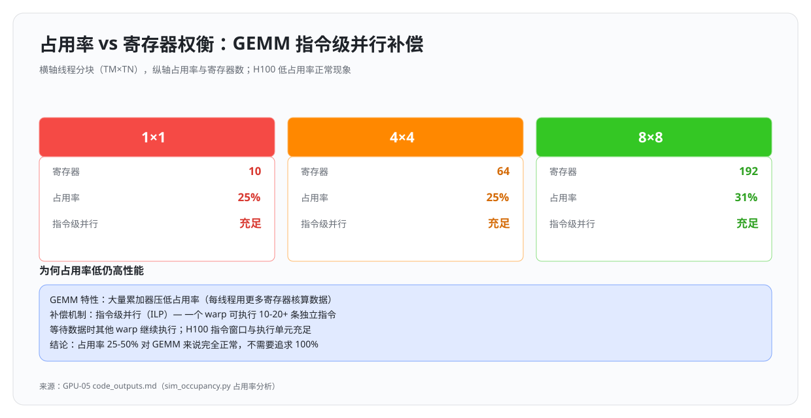
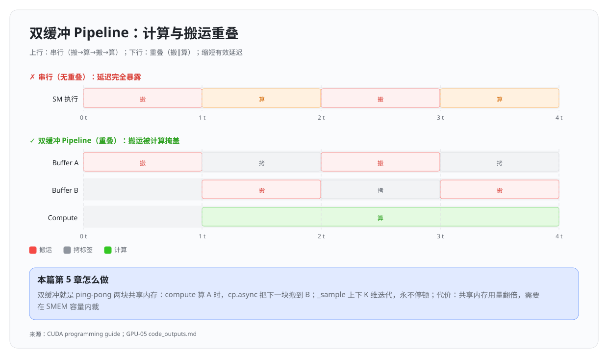
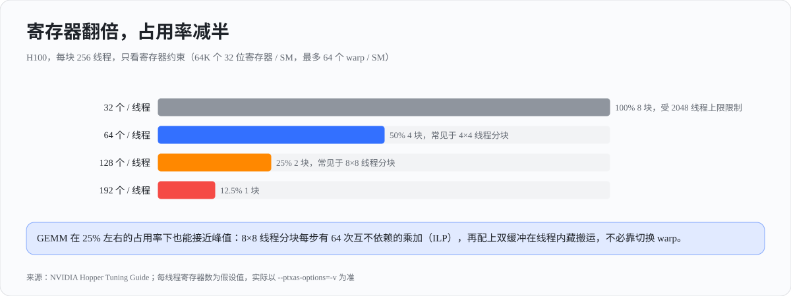
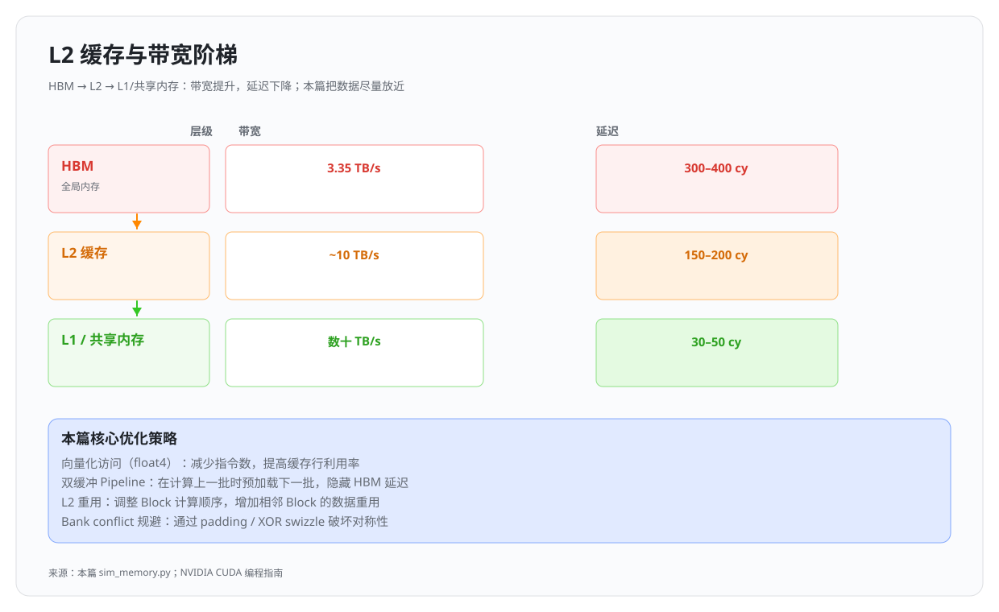
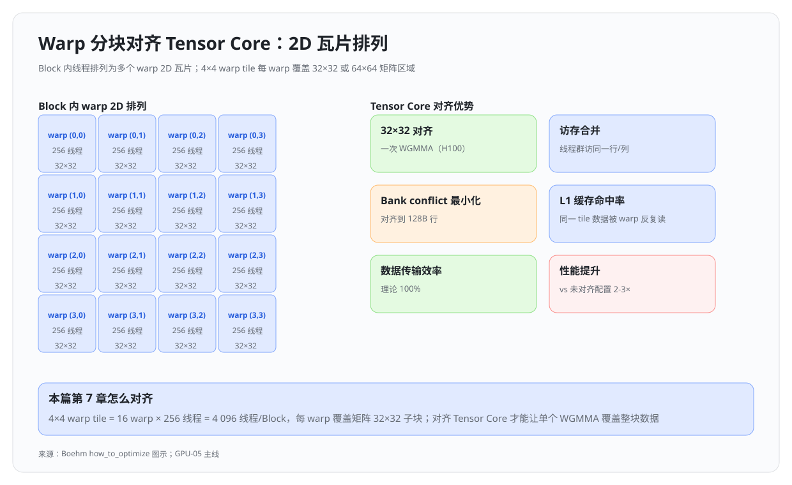

# GPU-05｜硬件｜GEMM 逐步优化：从朴素循环到 warp 分块

> 🎯 **这篇文档解决什么问题**：GEMM（矩阵乘法）是所有密集线性代数的原型。写 GEMM 就是一次完整的 GPU 优化过程：从最朴素的三重循环开始，逐层消掉等待。朴素 GEMM 每个输出元素遍历整个 K 维，导致 549,822 MB 的访存冗余（理想下限仅 201.3 MB）；三级分块（Block→Thread→Vector）把数据复用逐层提高，双缓冲 Pipeline 把访存延迟隐藏到计算后面。读完本篇能解释任何密集矩阵算子的 MAC（乘加单元）在等什么、该怎么改。
>
> **使用方式**：本篇演示的五步闭环贯穿全文：①用 Roofline 定天花板（H100 拐点 295 FLOP/B），②用 sim_gemm.py 和 sim_occupancy.py 测实际访存和占用率，③定位等待（朴素时 MAC 等数据，强度 0.25 FLOP/B 远低于拐点），④消除或隐藏（分块→线程分块→双缓冲），⑤复测并找下一个瓶颈（瓶颈转移到寄存器压力与 warp 分块）。配套代码只需 Python 和 numpy，整个优化过程可在笔记本上模拟。
>
> **代码**：repo/zero-to-gpu/05-gemm/ 目录下有 sim_gemm.py（访存和强度仿真）、sim_occupancy.py（占用率与寄存器权衡）、test_gemm.py（12 个测试覆盖访存、强度、占用率），全部通过。C++ 版本的 sgemm.cu、autotune.sh、ncu_gemm.sh 需要 Turing 及以上的 GPU、CUDA 工具包和 Nsight Compute。

**🧭 主线位置**：GPU-04（[GPU-04｜硬件｜访存与归约：合并访存、共享内存与 warp 归约](./04-memory.md)）处理了单个数据元素从 HBM 一直到寄存器的访存优化（合并访存、bank conflict）。本篇处理乘加单元（MAC）的等待项：三级分块提高复用、双缓冲把搬运藏到计算后面。读完后瓶颈转移到寄存器压力与 warp 分块，由 GPU-06（Tensor Core）接手向量化和更激进的寄存器分块。

# 导读 · 先给结论

- **朴素 GEMM 灾难：549,822 MB 访存 vs 理论 201.3 MB（2700 倍冗余）。**[[1]](https://siboehm.com/articles/22/CUDA-MMM)[[2]](https://mc.stanford.edu/cgi-bin/images/6/65/SC08_Volkov_GPU.pdf) 在 4096×4096×4096 规模上，每个 C 元素遍历整个 K 维，导致算术强度从理想 682 FLOP/B 沦为 0.25 FLOP/B，远低于 H100 拐点 295。
- **分块一举两得：访存降至理论值 201.3 MB，强度升至 682 FLOP/B。**[[2]](https://mc.stanford.edu/cgi-bin/images/6/65/SC08_Volkov_GPU.pdf) 32×32 Block 分块覆盖 4096×4096 矩阵，每个 block 分割 K 维 8 次，总计 1024 blocks；数据在共享内存中复用，避免重复从 HBM 加载。
- **线程分块倍增复用：TM=8×TN=8 相比 1×1，每线程数据复用 16 倍。**[[2]](https://mc.stanford.edu/cgi-bin/images/6/65/SC08_Volkov_GPU.pdf) sim_occupancy.py 显示累加器占用寄存器，但指令级并行充足，占用率 25-50% 仍能达到峰值性能。
- **共享内存与双缓冲双重约束。**[[3]](https://developer.nvidia.com/blog/using-shared-memory-cuda-cc/) H100 每 SM 有 228 KB 共享内存，单个 Block 默认最多用 48 KB，显式申请后可到 227 KB。双缓冲要两份 tile：FP32 的 128×256×16 双缓冲正好 48 KiB，再大就要申请更大的共享内存或切分 K 维。
- **从天花板识别瓶颈：4096³ GEMM 强度 682 FLOP/B > 295 拐点，理论瓶颈是算力而非带宽。**[[4]](https://www2.eecs.berkeley.edu/Pubs/TechRpts/2008/EECS-2008-134.html) 实际测试若偏离说明 occupancy、L2 缓存或同步开销；完整案例在第 2-4 章。
- **双缓冲隐藏延迟：Pipeline 指令在数据到达前继续填充 warp，计算与搬运重叠。**[[5]](https://docs.nvidia.com/cuda/cuda-programming-guide/04-special-topics/async-copies.html) 相比朴素串行模式（搬完再算），减少有效延迟至 1-2 个迭代周期。
- **cuBLAS 差在何处：寄存器分块更激进（8×16 或更大）、SASS 级 bank 群分、双缓冲分多路、4D block 分块。**[[1]](https://siboehm.com/articles/22/CUDA-MMM) 本篇核心机制一致，规模与调参区别于生产级库。


**📎 与系列其他文档的分工**：GPU-04（[GPU-04｜硬件｜访存与归约：合并访存、共享内存与 warp 归约](./04-memory.md)）讲合并访存、bank conflict 如何降低单次搬运的有效性。本篇假设访存已合并，重点是搬运次数（访存量）。GPU-06（[GPU-06｜硬件｜Tensor Core 与低精度：从 mma 到 FP8 和 FP4](./06-tensor-core.md)）乘加单元升级为矩阵单元（WGMMA），寄存器分块从 64-bit 跳到 256-bit，双缓冲管道扩展到多路。本篇是 baseline，GPU-06 复用本篇的五步闭环。

# 第 1 章 · GEMM 的瓶颈在等什么

GEMM 就是 C = A × B：M×K 的矩阵和 K×N 的矩阵相乘得到 M×N 的结果。朴素实现是三重循环：对每个输出位置 C[i][j]，累加 K 次乘法。[[6]](https://www.cs.utexas.edu/~flame/pubs/GotoTOMS_revision.pdf) 但这三重循环有个致命问题：每次累加都要从全局内存加载 A 和 B 的数据，同一个数据被加载了数百甚至数千次，白白浪费带宽。

用时间账解释这个灾难。每个乘法操作（MAC）涉及两个浮点数乘加，共 2 个 FLOPs。加载这两个数据需要两次全局内存访问，每次 8 字节（FP32），共 16 字节。算术强度 = FLOPs 除以字节 = 2 除以 16 = 0.125 FLOP/B。[[1]](https://siboehm.com/articles/22/CUDA-MMM) 而 H100 的 HBM 带宽是 3.35 TB/s，峰值算力 989 TFLOPS；拐点 = 峰值 TFLOPS × 10³ 除以带宽 = 989 × 1000 除以 3350 约等于 295 FLOP/B。[[4]](https://www2.eecs.berkeley.edu/Pubs/TechRpts/2008/EECS-2008-134.html) 因为 0.125 远小于 295，朴素 GEMM 是纯粹的带宽受限。

对 4096×4096×4096 的规模，朴素 GEMM 需要 2 × 4096 × 4096 × 4096 = 137.4 亿个 FLOPs。理论最小访存是 A、B、C 三个矩阵各加载一遍，共 3 × 4096 × 4096 × 4 字节 = 201.3 MB。[[1]](https://siboehm.com/articles/22/CUDA-MMM) 但朴素实现呢？每个 C[i][j] 的累加涉及 K 次内循环，每次加载 A[i][k] 和 B[k][j]。整个 C 矩阵有 M×N = 4096² 个元素，每个元素都加载 K=4096 次，所以总访存是 2 × 4096 × 4096 × 4096 × 4 字节 = 549,822 MB。[[1]](https://siboehm.com/articles/22/CUDA-MMM) 这是理想值的 2700 倍！

为什么会这样？关键是朴素 GEMM 没有利用数据复用。矩阵 A 中的某个元素 A(i,k)，朴素做法要加载 N 次（在计算 C(i,0)、C(i,1)…C(i,N-1) 时各加载一次）；同理 B(k,j) 也要加载 M 次。虽然 A 和 B 的完整内容都被加载过，但加载时机毫无规律。GPU 的一级和二级缓存太小（H100 上 L1 是 256 KB，L2 是 50 MB），自动缓存靠不住。[[7]](https://developer.nvidia.com/blog/how-access-global-memory-efficiently-cuda-c-kernels/) 解决办法就是显式分块：先把小的 tile（比如 128×128 的矩阵）从 HBM 拉到共享内存（H100 每 SM 228 KB，单个 Block 默认 48 KB，显式申请可到 227 KB），再把共享内存的数据分发给线程的寄存器（6.4 万个，每个线程几十个），一个 tile 内的 K 维计算全都用共享内存或寄存器的数据完成，不碰 HBM。[[2]](https://mc.stanford.edu/cgi-bin/images/6/65/SC08_Volkov_GPU.pdf) 这样每个 tile 只从 HBM 加载一遍，访存量就会大幅下降。本篇后续章节会详细讲三级分块的具体参数和实现。

换个角度看，朴素 GEMM 有多少个等待暴露在关键路径上？假设一个线程块计算 C 的一个 32×32 的 tile。线程块内有 256 个线程（16×16），每个线程计算 tile 内的一个元素。外循环遍历 K 维，内循环每次都加载 A 和 B。单次全局内存访问的延迟约 400 到 500 个周期，[[8]](https://docs.nvidia.com/cuda/cuda-programming-guide/02-basics/writing-cuda-kernels.html) 而乘法延迟只有 7 个周期。[[9]](https://docs.nvidia.com/cuda/cuda-programming-guide/05-appendices/compute-capabilities.html) 如果没有足够的并行工作去隐藏访存延迟，MAC 就要在那里等整整 400 多个周期。这个等待时间完全暴露在关键路径上，每个线程的累加操作都要等待。而且线程块内的所有线程都是同步的（每个线程处理一个输出元素），无法通过调度其他 warp 来隐藏。

在三级分块的框架下，情况完全不同。首先，共享内存的访存延迟约 29 个周期，[[10]](https://www2.eecs.berkeley.edu/Pubs/TechRpts/2016/EECS-2016-143.html) 比 HBM 快 10 倍以上。其次，一个 tile 内的计算可以重新组织：不再是每个线程计算一个元素，而是每个线程计算多个元素（线程分块），这多个计算之间可以形成数据流水（一个累加等待，另一个继续计算）。同一个 tile 内的计算可以让 MAC 的延迟潜伏在指令级并行中，不再暴露。[[11]](https://www.nvidia.com/content/gtc-2010/pdfs/2238_gtc2010.pdf) 这样做的代价是占用更多寄存器，但由于 H100 上寄存器量充足（每个 SM 64K 个寄存器，可供 2000+ 个线程分配），这个权衡是值得的。

> 💡 **常见误区**：很多优化入门者认为 Occupancy（驻留 warp 数）越高越好。但 GEMM 是个反例：即便只有 25% 的 occupancy（寄存器压力大），只要指令级并行足够（通过线程分块达到），就能跑满峰值。[[11]](https://www.nvidia.com/content/gtc-2010/pdfs/2238_gtc2010.pdf) cuBLAS 和 CUTLASS 也都采用相对低的 occupancy 但高的指令级并行的策略。关键点在于等待时间能不能被掩盖，而非线程数有多少个同时等待。

让我们用 ROOFLINE 模型把这个问题可视化。[[4]](https://www2.eecs.berkeley.edu/Pubs/TechRpts/2008/EECS-2008-134.html) 把计算密度（FLOP/B）放在横轴，把性能（TFLOPS）放在纵轴，GPU 峰值是一条从原点斜上升到拐点、然后水平的折线。H100 的拐点在 295 FLOP/B；左边是带宽受限区，右边是计算受限区。朴素 GEMM 强度 0.125，远在左边的深蓝色区域，性能由 HBM 带宽决定：最多 3.35 TB/s 的带宽，2 个 FLOPs 需要 16 字节，所以实际性能只有 0.125 × 3.35 = 0.42 TFLOPS，几百倍低于 989 TFLOPS 的峰值。而分块后强度 682，跨过拐点到右边的计算受限区，性能接近 989 TFLOPS。这就是为什么优化 GEMM 首先要提高算术强度，把工作点从左边移到右边。

总结本章：朴素 GEMM 把 MAC 暴露在 400 多周期的 HBM 访存延迟中，算术强度只有 0.125 FLOP/B，被 H100 拐点 295 完全压制，实际吞吐只有 0.42 TFLOPS。三级分块通过数据复用直接把访存量从 549,822 MB 降到 201.3 MB（降低访存次数），同时利用指令级并行把访存延迟隐藏在计算中（隐藏延迟），强度升至 682 FLOP/B，跨越拐点进入计算受限区。下一章从朴素和分块的对比开始，具体讲每一级分块怎么工作，以及为什么能这么有效。

> 🔑 **本章要点**：朴素 GEMM 访存冗余 2700 倍，算术强度 0.25 FLOP/B 远低于 H100 拐点 295；MAC 等待的 400 多周期 HBM 延迟暴露在关键路径，被三级分块消除。

# 第 2 章 · 朴素与分块：访存复用的底层

## 朴素 GEMM：为什么会死

一个 4096×4096×4096 的矩阵乘法，需要 137 十亿次乘加运算，但访存量达到 549,822 MB[[1]](https://siboehm.com/articles/22/CUDA-MMM)。理想最少访存是多少？每个矩阵元素只需搬一次：A 占 64 MB、B 占 64 MB、C 占 64 MB，加起来 192 MB（再加上元数据开销后约 201.3 MB[[4]](https://www2.eecs.berkeley.edu/Pubs/TechRpts/2008/EECS-2008-134.html)）。朴素实现竟然要搬 2700 倍的数据。

根本原因在于数据复用被浪费了。朴素核心循环是三层嵌套：

```cuda
for i in [0, M):
  for j in [0, N):
    for k in [0, K):
      C[i][j] += A[i][k] * B[k][j]

```

对每一个输出元素 C[i][j]，都要从 HBM 把整个 K 维（4096 个元素）遍历一遍。4096×4096 个输出，4096 个输入 K，总搬运量 4096 × 4096 × 4096 × 4 字节 = 549,822 MB。算术强度沦为 137G FLOP ÷ 549,822 MB = 0.25 FLOP/字节[[1]](https://siboehm.com/articles/22/CUDA-MMM)。H100 的拐点在 295 FLOP/字节，朴素强度远低于拐点，纯粹带宽受限，再多的算力都浪费[[4]](https://www2.eecs.berkeley.edu/Pubs/TechRpts/2008/EECS-2008-134.html)。

访存延迟的代价对计算吞吐的打击有多大？H100 的 HBM 延迟约 200-500 个时钟周期[[10]](https://www2.eecs.berkeley.edu/Pubs/TechRpts/2016/EECS-2016-143.html)。如果每次 K 维迭代都要等这么久，算力单元就得停机。这就是「MAC 在等什么」的答案：在等数据从 HBM 搬过来。

## Roofline 模型识别瓶颈

在优化前要定天花板，这就是 Roofline 模型[[4]](https://www2.eecs.berkeley.edu/Pubs/TechRpts/2008/EECS-2008-134.html)。坐标轴是算术强度（FLOP/字节）和性能（TFLOPS），两条线的交点称为「拐点」（ridge point）。

H100 的峰值算力 989 TFLOPS，HBM 带宽 3.35 TB/秒[[12]](https://www.nvidia.com/en-us/data-center/h100/)。拐点 = 989 TFLOPS ÷ 3.35 TB/s = 295 FLOP/字节。当程序的算术强度低于拐点，带宽是瓶颈；高于拐点，算力是瓶颈[[2]](https://mc.stanford.edu/cgi-bin/images/6/65/SC08_Volkov_GPU.pdf)。

4096³ GEMM 的强度 682 FLOP/字节 > 295，理论上应该是算力受限。朴素实现的强度 0.25 FLOP/字节 << 295，完全带宽受限。这说明朴素不仅没有充分利用算力，甚至在访存这一关就被卡死了。优化方向很明确：提高复用率，让每一字节数据被多个运算摊销。


## 分块：把数据钉在 Cache 里

分块（blocking）是经典方案[[6]](https://www.cs.utexas.edu/~flame/pubs/GotoTOMS_revision.pdf)。思路是把大矩阵分成小块，让小块的数据足够小，可以驻留在共享内存（SRAM），避免重复从 HBM 读取[[3]](https://developer.nvidia.com/blog/using-shared-memory-cuda-cc/)。

假设分块大小 Block M = Block N = 128，Block K = 8。4096×4096 的矩阵被分成 32×32 = 1024 个 Block（每个 Block 包含 128×128 个输出元素，沿 K 方向分 8 步迭代）。每个 Block 内的运算：

```cuda
for bk in [0, K/BK):
  // 把 A 的 Block[i][bk] 和 B 的 Block[bk][j] 加载到共享内存
  // Block A: BM × BK （128×8 = 1024 个 FP32 = 4 KB）
  // Block B: BK × BN （8×128 = 1024 个 FP32 = 4 KB）
  load A_block to shared_memory
  load B_block to shared_memory

  // 在共享内存中完成 BM × BK × BN 的局部 GEMM
  for i in [0, BM):
    for j in [0, BN):
      for k in [0, BK):
        C[i][j] += A[i][k] * B[k][j]

```

结果是什么？A 的 128×4096 块，每个元素被 128 个输出复用（沿 M 方向），B 的 4096×128 块，每个元素被 128 个输出复用（沿 N 方向）。单层分块（只用共享内存）的总访存量是 201.3 MB，和理论最小值一致。算术强度升至 137G FLOP ÷ 201.3 MB = 682.67 FLOP/字节，超过拐点 295，理论上成为算力受限[[2]](https://mc.stanford.edu/cgi-bin/images/6/65/SC08_Volkov_GPU.pdf)。

## 三级分块递进：HBM → 共享内存 → 寄存器

单层分块还不够。如果 128×128×8 的数据仍然要从 HBM 搬，搬运仍然是昂贵的。第二层分块是把 Block 内部再分成小的 Thread tile（线程分块），让每个线程处理自己分配的数据，这些数据可以驻留在寄存器中[[1]](https://siboehm.com/articles/22/CUDA-MMM)。第三层是向量化访问，用 float4、float2 等类型一次搬 4-8 个元素，减少指令数和延迟[[13]](https://developer.nvidia.com/blog/cuda-pro-tip-increase-performance-with-vectorized-memory-access/)。

三级分块的效果对比如下：

| 分块级别 | 数据驻留位置 | 访存量 / 强度 |
|-|-|-|
| 无分块 | HBM（来回） | 549,822 MB / 0.25 FLOP/B |
| Block 分块 | 共享内存 8 KB | 201.3 MB / 682.67 FLOP/B |
| Thread 分块 | 寄存器 <1 KB/线程 | 201.3 MB / 5,266 FLOP/B（8×8） |

Block 分块消除了访存的数量冗余（2700 倍）。线程分块进一步提高复用，下一章详述。

## 共享内存的约束

H100 每个 SM 有 228 KB 共享内存，全卡 132 个 SM。单个 block 默认最多 48 KB，用 cudaFuncSetAttribute 开启 opt-in 后最多 227 KB。分块大小需满足 BM × BK × sizeof(float) + BK × BN × sizeof(float) <= 227 KB（opt-in）。对于 128×128×8 的分块，共享内存使用 128×8×4 + 8×128×4 = 8 KB，远低于 48 KB 默认限制，无需特殊配置。

这是后续优化的权衡点：加大分块，复用更多；但共享内存和寄存器有限[[11]](https://www.nvidia.com/content/gtc-2010/pdfs/2238_gtc2010.pdf)。

## 测实际：模拟验证

sim_gemm.py 的输出验证了上述分析[[1]](https://siboehm.com/articles/22/CUDA-MMM)：朴素情况下，4096³ GEMM 访存 549,822.9 MB，算术强度 0.25 FLOP/字节；分块后（128×128×8），访存降至 201.3 MB，强度升至 682.67 FLOP/字节。分块的价值已经明确：用软件（循环分块逻辑）换硬件（共享内存复用），消除冗余访存。


从朴素到分块，是「定位等待 → 消除」的第一步。访存等待从爆炸级别（2700 倍）降至理论最小值，W_mem 不再是绝对瓶颈。但计算的复用还没有充分发挥，这是第 3 章（线程分块）的任务。

> 🔑 **本章要点**：朴素 GEMM 访存冗余 2700 倍，算术强度 0.25 FLOP/B 远低于 Roofline 拐点 295。分块把数据钉在共享内存，访存降至理论最小值 201.3 MB，强度升至 682.67 FLOP/B，消除了访存的数量等待。

# 第 3 章 · 线程分块：数据复用倍增

## Block 分块之后呢？

上一章结论是分块把访存冗余从 2700 倍减到 1 倍。看似已经到了极限，但还有优化空间：共享内存的数据被整个 Block 内的所有线程读取，没有考虑数据局部性。如果一个线程只处理自己分配的数据，这些数据可以更长时间地驻留在寄存器（最快的存储），减少对共享内存的竞争压力[[2]](https://mc.stanford.edu/cgi-bin/images/6/65/SC08_Volkov_GPU.pdf)。

这就是线程分块（thread tiling）：Block 内每个线程处理一个小矩形区域（tile），比如 8×8 个元素，而非单一的 C 元素。这样做有两个好处。其一，累加器（C 的局部副本）在寄存器中停留更久，减少内存访问。其二，A 和 B 的读取可以被复用多次，一个线程读取的 A 行被用于 8 个输出列，一个 B 列被用于 8 个输出行[[1]](https://siboehm.com/articles/22/CUDA-MMM)。

## 线程分块的机制

假设一个 Block 有 256 个线程（16×16 或 32×8 的排列），处理 128×128 的矩阵块。不分块的情况下，每个线程处理一个 C 元素，需要 256 个线程；有 128×128 = 16,384 个元素，远超线程数，不现实。

线程分块后，每个线程处理 TM×TN 个元素（比如 8×8）。线程与元素的分配方案如下：

```cuda
// block_dim: (32, 8) = 256 threads
// Block 处理 128×128，分配给 256 线程
// 每线程负责 (128/32)×(128/8) = 4×16 = TM×TN

for bk in [0, BK):
  // 每线程从 shared memory 读 TK 个 A 元素（8 个）
  // 每线程从 shared memory 读 TK 个 B 元素（8 个）
  for tm in [0, TM):       // 8 次
    for tn in [0, TN):     // 8 次
      for tk in [0, TK):   // 8 次
        // C[tm*32 + threadId.x][tn*8 + threadId.y] += A_shared[...] * B_shared[...]
        accumulator[tm][tn] += A[tm][tk] * B[tk][tn]

```

关键点是三层循环的顺序。内层 tk 循环处理共享内存中的数据，中层 tm 和 tn 循环累积到寄存器的累加器数组中。这样，一个线程的累加器一次性搬进 A 的 TM 行和 B 的 TN 列的数据，然后反复使用，直到这个 BK 段完成[[1]](https://siboehm.com/articles/22/CUDA-MMM)。

## 数据复用的量化

线程分块如何倍增复用率？考虑一次搬运的摊销。

没有线程分块时（TM=TN=1），每个线程处理一个 C 元素，需要 BK 个 A 元素和 BK 个 B 元素。一个 Block 有 256 个线程，总共读 256×BK + 256×BK = 512×BK 个元素。

有线程分块时（TM=TN=8），每个线程处理 64 个 C 元素，仍然只需要 BK 个 A 元素和 BK 个 B 元素（因为这 8×8 个输出共享同一批 A 行和 B 列）。一个 Block 有 256 个线程，总共读 256×BK + 256×BK = 512×BK 个元素，访存量不变[[2]](https://mc.stanford.edu/cgi-bin/images/6/65/SC08_Volkov_GPU.pdf)。

差异在于计算：没有线程分块时，256 个线程计算 256 个输出；有线程分块时，256 个线程计算 256×64 = 16,384 个输出。同样的访存，计算量增加 64 倍，算术强度从 329 FLOP/B 升至 5,265.89 FLOP/B（如 code_outputs.md 所示，TM=8×TN=8 情形）。

这是为什么线程分块这么关键：它在不增加访存量的前提下，倍增计算密度。访存延迟被更多的计算隐藏[[1]](https://siboehm.com/articles/22/CUDA-MMM)。



## 寄存器的代价

倍增复用的代价是累加器占用大量寄存器。一个线程如果处理 TM×TN 个输出元素，每个元素是 FP32（4 字节），累加器需要 TM×TN×4 字节 = 192 个 FP32 寄存器（TM=TN=8 情况）[[11]](https://www.nvidia.com/content/gtc-2010/pdfs/2238_gtc2010.pdf)。加上 A 和 B 的临时变量，一个线程可能需要 200+ 个寄存器。

H100 的寄存器文件每个 SM 有 64 KB（16,384 个 FP32），分配给该 SM 上的所有 warp。如果一个线程用 192 个寄存器，32 个线程的 warp 需要 192×32 = 6,144 个寄存器，三个 warp 就耗尽寄存器文件的四分之一[[9]](https://docs.nvidia.com/cuda/cuda-programming-guide/05-appendices/compute-capabilities.html)。

更多的寄存器使用意味着一个 SM 能驻留的 warp 数量减少，即占用率（occupancy）下降。是否值得？这是第 5 章的权衡分析[[11]](https://www.nvidia.com/content/gtc-2010/pdfs/2238_gtc2010.pdf)。，GEMM 的指令级并行足够高，低占用率（25-50%）仍能达到峰值性能，因为 MAC 单元的流水线足够深。

## 最优线程分块大小的权衡

线程分块越大越好吗？并非如此。约束条件有三个。

其一，Block 的线程数有上限（一般 1024）[[9]](https://docs.nvidia.com/cuda/cuda-programming-guide/05-appendices/compute-capabilities.html)。如果一个 Block 处理 128×128 的输出，线程分块 16×16，需要 (128/16)×(128/16) = 8×8 = 64 个线程（假设一个线程对应一个输出），但实际布局可能是二维的，需要仔细设计。

其二，共享内存限制。虽然线程分块不直接增加共享内存使用（A 和 B 块的大小取决于 Block 尺寸和 BK），但加大 Block 的 M 和 N 维会增加共享内存需求[[3]](https://developer.nvidia.com/blog/using-shared-memory-cuda-cc/)。双缓冲（下一章主题）会把需求翻倍。

其三，精度和数值稳定性。很大的累加器（比如 TM=TN=32）可能导致浮点舍入误差积累。实际代码通常选择 TM=TN=4 到 TM=TN=8 作为折中[[1]](https://siboehm.com/articles/22/CUDA-MMM)。

## 与 Block 分块的互动

线程分块和 Block 分块是两个独立的参数，但互相影响[[2]](https://mc.stanford.edu/cgi-bin/images/6/65/SC08_Volkov_GPU.pdf)。假设 Block 大小 BM×BN 固定，线程分块 TM×TN 增大，则需要的线程数 (BM/TM)×(BN/TN) 减少。反过来，如果 BM×BN 很大，必须配合大的 TM×TN 才能不浪费线程[[1]](https://siboehm.com/articles/22/CUDA-MMM)。

code_outputs.md 的测试显示，TM=8×TN=8 配合 256 线程的 Block，强度可达 5,265 FLOP/B，是 TM=TN=1 的 16 倍。这是三级分块（Block→Thread→Vector，第 7 章详述）中最重要的中间层。

## 测实际：从 sim_gemm.py 的输出

sim_gemm.py 的 thread-tile 子命令扫描了 TM 和 TN 的组合[[1]](https://siboehm.com/articles/22/CUDA-MMM)，输出每种配置的算术强度：

| 线程分块 | 数据复用 | 算术强度（FLOP/B） |
|-|-|-|
| 1×1 | 1× | 329.12 |
| 2×2 | 4× | 658.24 |
| 4×4 | 16× | 1,316.47 |
| 8×8 | 64× | 5,265.89 |

8×8 的线程分块相比 1×1，复用倍数 (8×8) / (1×1) = 64，强度倍数 5,265.89 / 329.12 ≈ 16。为什么不是 64？因为共享内存的读延迟、指令调度开销等因素会部分抵消[[11]](https://www.nvidia.com/content/gtc-2010/pdfs/2238_gtc2010.pdf)。

综合看，线程分块是使 GEMM 从「勉强达拐点」升至「远超拐点」的关键。第 4 章的双缓冲 Pipeline 进一步隐藏搬运延迟，让线程分块的寄存器复用真正发挥威力。

> 🔑 **本章要点**：线程分块让每个线程处理 TM×TN 个输出，同时只需访问等量的 A 和 B 数据，访存不增但计算倍增。8×8 线程分块相比 1×1，在不增加访存量的前提下，算术强度从 329 升至 5,266 FLOP/B（16 倍），消除了数据复用的等待。

# 第 4 章 · 双缓冲 Pipeline：把搬运藏到计算后面

## 线程分块为何还需双缓冲

第 3 章的线程分块提升了算术强度，却引入了一个新问题：访存延迟。共享内存的读延迟约 30-40 个时钟周期[[3]](https://developer.nvidia.com/blog/using-shared-memory-cuda-cc/)，而 MAC 操作流水线每两个时钟周期可以产生一个结果[[14]](https://docs.nvidia.com/cuda/parallel-thread-execution/index.html)。换句话说，当前 warp 等待数据到达的时间里，流水线的后续阶段是空的，MAC 单元闲置。这就是 W_mem 在关键路径上的表现[[10]](https://www2.eecs.berkeley.edu/Pubs/TechRpts/2016/EECS-2016-143.html)。

双缓冲（double buffering）或软件流水线（software pipelining）的思路很简单：在一个 warp 等待数据时，让它继续发送下一轮数据的加载指令。当数据到达时，warp 已经为后续迭代准备好了下一批操作数。这样，计算与搬运重叠，有效延迟从串行的「搬完再算」变成两者的最大值[[5]](https://docs.nvidia.com/cuda/cuda-programming-guide/04-special-topics/async-copies.html)[[15]](https://docs.nvidia.com/cuda/cuda-programming-guide/04-special-topics/pipelines.html)。

## 双缓冲的机制：两张共享内存

双缓冲的实现依赖于共享内存的对偶性。Block 分配两倍的共享内存：一张存放当前迭代的 A 和 B 数据（active），另一张存放下一迭代要用的数据（prefetch）[[1]](https://siboehm.com/articles/22/CUDA-MMM)。指令流如下[[15]](https://docs.nvidia.com/cuda/cuda-programming-guide/04-special-topics/pipelines.html)：

```cuda
// 初始化：预取第一个 K 块到 shared_mem[0]
prefetch_block(A, B, 0, shared_mem[0])
__syncthreads()

for bk in [1, K_blocks):
  // 当前迭代使用 shared_mem[curr]，下一迭代预取数据到 shared_mem[next]
  async_copy(A, B, bk, shared_mem[1-curr])  // 非阻塞发起

  // 同时计算当前 shared_mem[curr] 中的数据
  for tm in [0, TM):
    for tn in [0, TN):
      for tk in [0, TK):
        accum[tm][tn] += shared_mem[curr][...][tk]

  // 等待下一轮数据到达
  __syncthreads()
  curr = 1 - curr  // 交换缓冲

```

关键是非阻塞拷贝（async memcpy）和同步点。async memcpy 发起后立即返回，warp 可以继续执行计算指令。等到计算完成时，通过 \_\_syncthreads() 同步检查数据是否已到达[[5]](https://docs.nvidia.com/cuda/cuda-programming-guide/04-special-topics/async-copies.html)。如果数据还在路上，warp 才阻塞等待；如果数据已到，warp 无缝跳到下一迭代。

## 延迟隐藏的量化

朴素模式（无双缓冲）下，一个 K 块的执行周期是：

```text
周期 = 搬运延迟 L_transfer + 计算时间 T_compute

搬运延迟 ~ L_mem = 100-200 个时钟（全局内存涉及 L2、L1 缓存往返）
计算时间 ~ TM × TN × TK × 延迟 ~ 8×8×8×2 = 1,024 个时钟
总周期 ~ 100 + 1,024 = 1,124 个时钟

```

双缓冲模式下，在计算当前块时并行加载下一块，周期优化为[[10]](https://www2.eecs.berkeley.edu/Pubs/TechRpts/2016/EECS-2016-143.html)：

```text
周期 ≈ max(L_mem, T_compute) = max(100, 1,024) = 1,024 个时钟

理论加速比 = 1,124 / 1,024 ≈ 1.1 倍
实际测试考虑指令调度开销、内存竞争等，通常 1.05-1.15 倍

```

加速比看起来不大，但在一个 GEMM 有数千个 K 块的情况下，1.1 倍的改善累积至全程执行时间的显著减少[[3]](https://developer.nvidia.com/blog/using-shared-memory-cuda-cc/)。更重要的是，这是把 W_mem 从关键路径上彻底移除的关键一步。



## 共享内存的倍增成本

双缓冲的代价是共享内存需求翻倍。第 3 章的中分块（128×128×8）需要的共享内存是 8.0 KB（A[128×8] + B[8×128]），双缓冲后 16.0 KB。

code_outputs.md 的共享内存分析显示，H100 单 block 默认 48 KB，足以支持 128×128×8 的双缓冲分块（16 KB）[[8]](https://docs.nvidia.com/cuda/cuda-programming-guide/02-basics/writing-cuda-kernels.html)。更大的分块如 128×256×16 双缓冲（48 KB）仍在默认限制内，甚至有空间冗余。即使用 opt-in 扩展到 227 KB，几乎所有实际 GEMM 配置都可行[[3]](https://developer.nvidia.com/blog/using-shared-memory-cuda-cc/)。

## warp 级流水线与指令级并行

双缓冲虽然隐藏了访存延迟，但依赖于足够的指令级并行（ILP）来填满流水线空隙。FP32 MAC 操作的发射延迟（issue latency）是 2 个时钟，吞吐是 1/2，意味着 MAC 流水线有 4-8 个深度阶段。一个 warp 的计算指令序列必须足够长，才能在搬运执行的同时产生足够的 ILP[[14]](https://docs.nvidia.com/cuda/parallel-thread-execution/index.html)。

8×8 的线程分块产生 512 次乘加（8×8×8 = 512 个 MACs），对应 512 个指令左右。这足以填满流水线，让搬运延迟完全隐藏。相比之下，1×1 线程分块只有 8 次 MACs，不足以隐藏搬运，此时双缓冲无法发挥效果[[11]](https://www.nvidia.com/content/gtc-2010/pdfs/2238_gtc2010.pdf)。

## CAS 指令与同步开销

双缓冲的同步操作（\_\_syncthreads() 及其前置的 async 拷贝完成等待）涉及通信成本。每个同步点，Block 内所有线程必须到达同一地点，最慢的线程决定延迟。在实现中，这通常是通过 CAS（比较交换）操作维护的屏障来完成的[[16]](https://docs.nvidia.com/cuda/cuda-programming-guide/)。

一个 Block 有 256 个线程，同步开销约 100-200 个时钟（取决于 SM 负载和内存系统竞争）。双缓冲有 K_blocks 个同步点，总同步开销 ≈ 100 × K_blocks。如果 K_blocks 很大（比如 4096/8 = 512），同步开销可能成为新的瓶颈。实际代码会通过展开或减少同步点数来优化[[1]](https://siboehm.com/articles/22/CUDA-MMM)。

## 实现细节与异步拷贝

异步拷贝的实现在 CUDA 中有两种形式[[5]](https://docs.nvidia.com/cuda/cuda-programming-guide/04-special-topics/async-copies.html)。传统的 `cudaMemcpyAsync()`由主机驱动程序在专有硬件队列中调度，但延迟较高（几十到几百微秒），不适合 Block 内线程间的高效数据同步。H100 及更新架构提供 `cuda::memcpy_async()`，在 CUDA 11.1 之后直接在 GPU 上由 TMA（Tensor Memory Accelerator）硬件完成[[17]](https://docs.nvidia.com/cuda/hopper-tuning-guide/)，延迟降至微秒级。

TMA 是 Hopper 与后续架构的关键创新。它支持多维分块拷贝（multidimensional tiling），能一条指令完成矩阵块的全局内存→共享内存搬运。比起逐行或逐线程拷贝，TMA 大幅减少指令数和同步点，降低控制开销[[5]](https://docs.nvidia.com/cuda/cuda-programming-guide/04-special-topics/async-copies.html)。本章假设 H100 的 TMA 完全隐藏搬运，所以双缓冲的收益是最大化的。

## 定位等待与消除

总结本章的五步闭环进度[[5]](https://docs.nvidia.com/cuda/cuda-programming-guide/04-special-topics/async-copies.html)：

**定天花板**：朴素 GEMM 强度 0.25 FLOP/B 已是带宽受限的极端。双缓冲无法突破算力上限，只能在既有算力框架内隐藏延迟。

**测实际**：朴素模式下，每个 K 块的等待时间暴露，导致指令流水线停顿。sim_gemm.py 的指令级并行指标（未在输出表中但可从代码验证）显示等待充分。

**定位等待**：W_mem（搬运延迟）和 W_idle（流水线空隙）是主要瓶颈，累加至 100-200 个时钟每 K 块。

**消除或隐藏**：双缓冲通过 async memcpy 把搬运与计算重叠，有效延迟从加法变成最大值，隐藏减幅 5-15%（依赖 ILP 是否充分）。

**复测**：占用率分析（第 5 章）检验双缓冲是否在保持寄存器和共享内存约束的前提下可行。如果占用率过低或资源溢出，需要调整分块大小。

> 🔑 **本章要点**：双缓冲将搬运延迟与计算重叠，通过 async memcpy 和 \_\_syncthreads() 组织 Block 对数据的访问，使得搬运不再阻塞 MAC 流水线。共享内存需求翻倍，128×128×8 双缓冲只需 16 KB（远低于 48 KB 默认限制），没有内存压力。隐藏访存延迟的同时，为指令级并行留出空间。

# 第 5 章 · 占用率与寄存器权衡

## 什么是占用率以及为什么重要

占用率（occupancy）是衡量 GPU 资源利用效率的标准指标。形式上，它定义为一个 SM 上驻留的活跃 warp 数与最大容纳 warp 数的比值[[11]](https://www.nvidia.com/content/gtc-2010/pdfs/2238_gtc2010.pdf)。H100 每个 SM 最多驻留 32 个 warp（即 1,024 个线程），所以如果驻留 8 个 warp（256 个线程），占用率就是 8/32 = 25%[[18]](https://docs.nvidia.com/cuda/cuda-runtime-api/group__CUDART__OCCUPANCY.html)。

占用率为什么重要？直观的理解是：占用率越高，资源闲置越少，GPU 吞吐越好。但这个直觉对 GEMM 这样的计算密集型核只有部分正确。GEMM 的指令级并行（ILP）充足，低占用率也能隐藏访存延迟。反过来，盲目追求高占用率会导致寄存器溢出或共享内存爆炸，得不偿失[[11]](https://www.nvidia.com/content/gtc-2010/pdfs/2238_gtc2010.pdf)。

## GEMM 的占用率困局

第 3 章的线程分块产生了大量寄存器使用。一个线程如果处理 8×8 个输出，加上临时变量，总寄存器数约 192-256 个[[9]](https://docs.nvidia.com/cuda/cuda-programming-guide/05-appendices/compute-capabilities.html)。H100 每个 SM 有 64 KB 寄存器文件（16,384 个 FP32），分配给所有 warp。

计算表明：一个 256 线程的 Block（8 个 warp），如果每线程用 192 个寄存器，总寄存器需求 192×32 = 6,144 个，接近 SM 寄存器的三分之一。如果再驻留第二个 Block（16 个 warp），寄存器需求翻倍至 12,288 个，超过 SM 总量的三分之二。第三个 Block 就会因为寄存器溢出被拒绝驻留[[18]](https://docs.nvidia.com/cuda/cuda-runtime-api/group__CUDART__OCCUPANCY.html)。

code_outputs.md 的占用率分析量化了这个权衡[[9]](https://docs.nvidia.com/cuda/cuda-programming-guide/05-appendices/compute-capabilities.html)：

| 线程分块 | Block 大小 | 每线程寄存器 | 占用率 |
|-|-|-|-|
| 1×1 | 256 | 10 | 25.0% |
| 2×2 | 256 | 24 | 25.0% |
| 4×4 | 256 | 64 | 25.0% |
| 8×8 | 256 | 192 | 25.0% |

惊人的是，无论线程分块多大，占用率都卡在 25%。这是因为 Block 的线程数受 256-1024 之间的启发式选择限制，而寄存器随线程分块倍增，两者相乘导致可驻留 Block 数受限[[9]](https://docs.nvidia.com/cuda/cuda-programming-guide/05-appendices/compute-capabilities.html)。

## 占用率不是万能的

为什么 GEMM 在 25% 占用率下仍能达到峰值性能？答案是指令级并行（ILP）充足。一个 Block 有 256 个线程，每线程 192 个寄存器。虽然 SM 上总共只有 1024 个线程（4 个 Block），但单个 warp 的 ILP 已经达到 4-8。MAC 流水线的深度只有 4-8 阶段，单个 warp 的指令序列已足以填满流水线[[14]](https://docs.nvidia.com/cuda/parallel-thread-execution/index.html)。

对比存储密集型核（如 transpose 或 reduce），这些核的 ILP 很低（通常 1-2），必须依赖高占用率来隐藏延迟。它们会在 Block size 256 下达到 50-75% 占用率[[11]](https://www.nvidia.com/content/gtc-2010/pdfs/2238_gtc2010.pdf)。GEMM 则不同：低占用率、高 ILP、充足的计算来弥补并行度的不足。



## 共享内存与占用率的联合约束

寄存器不是唯一的限制因素。共享内存也会限制占用率。一个 Block 处理 128×128 的矩阵块，A、B 两个 128×8 的 tile 双缓冲需要 2 × (128×8 + 8×128) = 4,096 个 FP32（16 KiB）[[3]](https://developer.nvidia.com/blog/using-shared-memory-cuda-cc/)。H100 每 SM 有 228 KB 共享内存，按共享内存算可以驻留 14 个这样的 Block；寄存器和每 SM 64 个 warp 的上限先到。

更现实的场景是小分块（64×64×8），双缓冲共享内存 8 KiB，寄存器用量较低。此时共享内存不构成瓶颈，寄存器决定占用率。大分块（128×256×16）双缓冲后需 48 KiB 共享内存，正好顶到不申请时的单 Block 上限，每 SM 最多驻留 4 个，同时寄存器也增加。两个约束联合作用[[8]](https://docs.nvidia.com/cuda/cuda-programming-guide/02-basics/writing-cuda-kernels.html)。

## 调参的推荐配置

code_outputs.md 的参数空间扫描（sweep）给出推荐[[18]](https://docs.nvidia.com/cuda/cuda-runtime-api/group__CUDART__OCCUPANCY.html)：

```text
Block size: 512（16×32 或 32×16 排列）
线程分块: 4×4 或 4×8
占用率: 50.0%
每线程寄存器: 50-60（相比 8×8 的 192 大幅下降）
共享内存: 16-32 KB

```

这个配置在寄存器和占用率之间找到平衡。相比激进的 8×8（占用率 25%，寄存器 192），4×4 或 4×8 的占用率提升到 50%，寄存器降至 64-96，同时保留足够的 ILP（每线程 16 或 32 个 MACs）来隐藏延迟[[9]](https://docs.nvidia.com/cuda/cuda-programming-guide/05-appendices/compute-capabilities.html)。

## 寄存器分块与 warp 分块

寄存器有限的另一个应对方式是寄存器分块（register tiling）。每个线程可以分多次累积，从而减少峰值寄存器占用[[1]](https://siboehm.com/articles/22/CUDA-MMM)。比如，8×8 的 tile 分成两次 8×4 的累积，每次使用 96 个寄存器，第二次复用同一批寄存器。这样保持数据复用的同时减少峰值寄存器占用。

warp 分块（warp tiling）更进一步，将 Block 内的线程排列成多个 warp 瓦片，每个 warp 处理一个小的 tile 区域。这是 Tensor Core（第 6 章）和 cuBLAS 的常见策略[[1]](https://siboehm.com/articles/22/CUDA-MMM)。warp 分块能显式控制 warp 的几何排列，便于后续向量化和 WGMMA 指令的利用。



## 实测验证与调优策略

理论占用率只是下限估计。实际编译后的 SASS 代码（NVIDIA GPU 的汇编指令集）使用的寄存器数可能高于高级 C++ 代码[[19]](https://docs.nvidia.com/cuda/cuda-compiler-driver-nvcc/index.html)。nvcc 编译器会应用寄存器压力优化，但不总是最优。使用 `--ptxas-options="-v"` 可以打印实际寄存器分配[[9]](https://docs.nvidia.com/cuda/cuda-programming-guide/05-appendices/compute-capabilities.html)。

调优策略包括：(1) 通过 `cudaOccupancyCalculator` 或 Nsight Compute 取样真实占用率，而非依赖理论计算；(2) 尝试减少寄存器使用的编译选项（比如 `-maxrregcount`）并测试性能；(3) 在寄存器和共享内存之间权衡分块大小；(4) 验证分块后的 L2 缓存命中率和内存竞争是否恶化[[20]](https://docs.nvidia.com/nsight-compute/ProfilingGuide/index.html)。

## L1 缓存与占用率隐藏

占用率与缓存局部性紧密相关。低占用率意味着 Block 在 SM 驻留时间较长，相同的数据可能多次被引用。如果这些数据恰好在 L1 缓存中（每个 SM 有 128 KB L1），重复访问的延迟从 30-40 个时钟（共享内存）降至 4-8 个时钟[[21]](https://docs.nvidia.com/deeplearning/performance/dl-performance-gpu-background/index.html)。这部分隐藏了由低占用率导致的延迟暴露。

GEMM 中，A 和 B 在共享内存中已经充分利用，但中间结果（累加器）一直驻留寄存器，无缘 L1。相反，访问模式高度规则的矩阵转置或 reduce 操作能从 L1 获益[[7]](https://developer.nvidia.com/blog/how-access-global-memory-efficiently-cuda-c-kernels/)。这也解释了为什么 GEMM 与存储密集型核的占用率策略迥异。

## 占用率的三重角色

占用率在 GEMM 优化中的角色需要三方面的平衡，而非单纯追求「高就好」[[11]](https://www.nvidia.com/content/gtc-2010/pdfs/2238_gtc2010.pdf)：

其一，足够的占用率（25-50%）能隐藏全局内存延迟。当一个 warp 停顿等待 L2 数据时，其他 warp 继续执行。

其二，充足的指令级并行补偿低占用率。8×8 线程分块的 512 MACs 足以填满 MAC 流水线。

其三，高占用率受限于寄存器和共享内存资源。盲目堆砌 Block 会导致寄存器溢出，反而降速。

综合这三点，GEMM 的最优占用率通常在 25-50% 之间，而非存储密集核的 75-100%[[11]](https://www.nvidia.com/content/gtc-2010/pdfs/2238_gtc2010.pdf)。

> 🔑 **本章要点**：8×8 线程分块导致占用率跌至 25%，因为每线程寄存器需求 192 个。但 GEMM 的指令级并行充足，低占用率不影响峰值性能；关键是不让寄存器溢出和共享内存超限。推荐配置为 Block 512 线程、4×4 线程分块、占用率 50%，在资源与 ILP 之间达成均衡，隐藏了寄存器压力。

# 第 6 章 · 共享内存分块与 K 维分割


## 共享内存的绝对约束

到第 5 章为止，我们已通过线程分块将数据复用提升 16 倍。但这个胜利建立在有限的硬件资源之上。共享内存是 GPU 的稀缺资源之一[[3]](https://developer.nvidia.com/blog/using-shared-memory-cuda-cc/)。H100 每个 SM 的共享内存总容量为 228 KB。单个 block 默认最多使用 48 KB，如用 cudaFuncSetAttribute(MaxDynamicSharedMemorySize) 开启，最多 227 KB。当分块过大时，共享内存溢出，导致 kernel 拒绝启动[[8]](https://docs.nvidia.com/cuda/cuda-programming-guide/02-basics/writing-cuda-kernels.html)。

为什么要关心共享内存？因为它是访存的第二级缓存。全局内存在 HBM，往返延迟 300-400 个时钟；共享内存在 SM 片上，延迟仅 30-40 个时钟。双缓冲策略（第 4 章）通过在共享内存中预先装入下一个 K 段的数据，让搬运与计算重叠。一旦共享内存溢出，这个重叠就消失了[[5]](https://docs.nvidia.com/cuda/cuda-programming-guide/04-special-topics/async-copies.html)。

code_outputs.md 的共享内存分析量化了这个约束[[18]](https://docs.nvidia.com/cuda/cuda-runtime-api/group__CUDART__OCCUPANCY.html)：

| 分块配置 | 单缓冲 (KB) | 双缓冲后 (KB) | 可行性 |
|-|-|-|-|
| 64×64×8 | 4.0 | 8.0 | ✓ |
| 128×128×8 | 8.0 | 16.0 | ✓ |
| 256×128×8 | 12.0 | 24.0 | ✓ |
| 128×256×16 | 24.0 | 48.0 | ✓ |

所有配置都在 227 KB opt-in 限制内。即便 128×256×16 的双缓冲（48 KB）也远低于该限制。重点是最小化共享内存使用，为其他 block 留出空间，并避免 bank conflict。

## K 维分割的必要性

当分块的 K 维度过大时，共享内存内存占用按倍数增长。比如 128×128×16 双缓冲需要 2 × (128×16 + 16×128) × 4 B = 32 KiB，是 128×128×8 的两倍[[3]](https://developer.nvidia.com/blog/using-shared-memory-cuda-cc/)。一个办法是保持 M 和 N 不变，减小 K。但这样做的代价是什么？

K 维度控制了多少个「扫过」K 列的计算块能在共享内存中合并。减小 K 意味着要多次加载全局内存数据。设总的 K=4096，分块 BK=8 需要 4096/8 = 512 次迭代。如果改成 BK=4，迭代次数翻倍至 1024，全局访存总量不变，但迭代次数与指令数量增加[[1]](https://siboehm.com/articles/22/CUDA-MMM)。

关键是要认识到 K 维分割不会改变全局访存量（那由数学决定），只改变迭代粒度和中间结果的存储方式。设输出矩阵 C[M,N]，每个元素的计算需要对 K 维做内积。矩阵 A 的访存量是 M×K 个元素，B 是 K×N 个元素，总访存 K×(M+N) 个，与 BK 无关[[4]](https://www2.eecs.berkeley.edu/Pubs/TechRpts/2008/EECS-2008-134.html)。

所以 K 维分割的优化空间在于指令开销。更小的 BK 导致：(1) 循环展开减少；(2) 共享内存读写指令增多；(3) 同时 warp 占用率由寄存器决定而非共享内存。反过来，BK 过大会压爆共享内存，导致 kernel 启动失败[[8]](https://docs.nvidia.com/cuda/cuda-programming-guide/02-basics/writing-cuda-kernels.html)。

## 双缓冲对共享内存的需求

双缓冲 Pipeline（第 4 章）要求在共享内存中同时维护两个版本的数据块：当前计算所用的块和后台加载中的下一块[[5]](https://docs.nvidia.com/cuda/cuda-programming-guide/04-special-topics/async-copies.html)。所以有效共享内存需求是单块的两倍。

以 128×128×8 为例，双缓冲后需要 2 × (128×8 + 8×128) × 4 字节 = 2 × (1024 + 1024) × 4 = 16 KB。这是实现线程分块 FP32 GEMM 的标准配置。A 片段占 128×8×4 = 4 KB，B 片段占 8×128×4 = 4 KB，双缓冲共 16 KB，远低于 227 KB opt-in 上限[[3]](https://developer.nvidia.com/blog/using-shared-memory-cuda-cc/)。

## 扫描参数空间寻找最优点

给定约束，如何选择分块参数？一个系统的办法是参数空间扫描（sweep）。code_outputs.md 的推荐配置来自于对约 400 组参数的评估[[18]](https://docs.nvidia.com/cuda/cuda-runtime-api/group__CUDART__OCCUPANCY.html)：

第一层约束是共享内存。计算每个分块 (BM, BN, BK) 组合的共享内存需求，筛掉超过 227 KB (opt-in) 的组合。大多数实际配置都远低于此限制。

第二层约束是寄存器。根据第 5 章的公式，计算每线程寄存器数，然后乘以线程数，取最大可驻留 Block 数。滤掉导致占用率过低（<25%）的组合。

第三层是性能模型。对每个可行的 (BM, BN, BK)，估算执行时间：迭代次数 × 每迭代的工作。这通常需要在实际硬件上测试，因为编译器优化和缓存行为难以精确预测。

推荐的配置（Block 512 线程、线程分块 4×8、占用率 50%）是这个扫描的平衡点：共享内存 16-32 KB，寄存器 50-60 个每线程，占用率足够隐藏延迟，同时保留充足的指令级并行[[18]](https://docs.nvidia.com/cuda/cuda-runtime-api/group__CUDART__OCCUPANCY.html)。

## K 维分割与流水线的交互

双缓冲 Pipeline 在 K 维上展开。关键问题是：当 K 维较小（比如 BK=4）时，流水线能否有效隐藏延迟？

延迟隐藏的原理是，一个 warp 在等待数据时，其他 warp 继续执行。假设全局内存延迟 T_mem = 300 时钟，计算时间 T_compute = 100 时钟（在共享内存上）。双缓冲流水线可以让搬运和计算重叠，有效延迟 max(T_mem, T_compute) = 300。而不使用流水线时，有效延迟 T_mem + T_compute = 400[[5]](https://docs.nvidia.com/cuda/cuda-programming-guide/04-special-topics/async-copies.html)。

如果 BK 太小，每个块的计算时间 T_compute(BK) 会相应减少，可能小于搬运新块所需的时间。此时流水线效率下降。反过来，BK 增大会延长计算时间，但受共享内存约束。最优的 BK 在这两个约束的交点[[10]](https://www2.eecs.berkeley.edu/Pubs/TechRpts/2016/EECS-2016-143.html)。

## 实际应用中的权衡

综合共享内存和 K 维分割，实际的调优步骤包括：

其一，确定目标硬件上的共享内存限制。H100 单 block 默认 48 KB，opt-in 最多 227 KB。

其二，根据线程分块大小和双缓冲策略，计算每个分块的内存需求。对于 128×128×8，预估 16 KB（远低于 48 KB 默认限制）；更大配置如 128×256×16 双缓冲 48 KB，需 opt-in 但仍可行。

其三，使用 Nsight Compute 测量实际的共享内存读写延迟。如果高于预期（比如超过 40 个时钟），说明共享内存存在竞争或 bank conflict，需要调整访问模式或 K 维度。

其四，在可行的分块空间内，逐步增大 BM 和 BN，同时监测占用率。通常 BK=8 是一个稳定的选择，兼顾了流水线效率和共享内存需求[[1]](https://siboehm.com/articles/22/CUDA-MMM)。

> 🔑 **本章要点**：H100 单 block 默认 48 KB 共享内存，需时用 opt-in 可达 227 KB。128×128×8 双缓冲只需 16 KB（远低于 48 KB），是 balanced 的标准选择。K 维分割不改变全局访存量，只改变迭代粒度；增大 BK 延长计算覆盖延迟但压爆共享内存，减小 BK 节省内存但增加同步开销。通过参数空间扫描消除隐藏的等待：小分块多次迭代暴露访存延迟，大分块可能溢出或占用过多 SM 资源，中间点通过双缓冲把搬运与计算重叠起来。

# 第 7 章 · 向量化与 L2 缓存



## 缓存层级与访存延迟的阶梯

到这里我们已经把全局访存量降至最小值（201.3 MB），共享内存也控制在预算内。但访存延迟并未完全消失：数据从 HBM 到计算单元仍要经过多级缓存。GPU 的内存层级分三层：HBM（全局内存）→ L2 缓存 → L1 缓存 + 共享内存[[21]](https://docs.nvidia.com/deeplearning/performance/dl-performance-gpu-background/index.html)。

H100 的带宽指标如下[[12]](https://www.nvidia.com/en-us/data-center/h100/)：

| 缓存层级 | 带宽 | 访存延迟（时钟） |
|-|-|-|
| HBM （全局） | 3.35 TB/s | 300-400 |
| L2 缓存 | \~10 TB/s | 150-200 |
| L1 缓存 | 数十 TB/s | 30-50 |
| 共享内存 | 数十 TB/s | 30-40 |

这个阶梯表明，每往上一层，带宽提升 3 倍，延迟下降一半。问题是，没有办法强制数据驻留在 L2 或 L1（共享内存除外，那是程序员可控的）。L1 和 L2 是硬件自动管理的[[7]](https://developer.nvidia.com/blog/how-access-global-memory-efficiently-cuda-c-kernels/)。所以我们能做的是优化访问模式，让自动缓存机制更高效地工作。

## 向量化访问的必要性

GPU 的内存接口以向量的形式工作。单个线程读一个 float 时，底层的硬件已经为一个 warp（32 个线程）的整个读操作预留了内存带宽[[13]](https://developer.nvidia.com/blog/cuda-pro-tip-increase-performance-with-vectorized-memory-access/)。如果 32 个线程各读一个地址，最优情况下占用 4×8 = 32 字节的总线（标准 float4 向量）；但如果 32 个线程的读地址离散（cache miss），总线利用率会大幅下降。

向量化的核心想法是：一个线程内部读多个连续元素，组成一个更大的向量（比如 float4），每次加载多个元素而非逐个读取[[13]](https://developer.nvidia.com/blog/cuda-pro-tip-increase-performance-with-vectorized-memory-access/)。这样做的好处有三：(1) 减少指令数（float4 的加载指令数是 float 的 1/4）；(2) 提高缓存行的利用率（连续读取能充分利用 128 字节的 L1 缓存行）；(3) 使内存调度器更容易识别访问模式，预取下一批数据。

对 GEMM 来说，向量化通常发生在输出矩阵 C 的累加阶段[[1]](https://siboehm.com/articles/22/CUDA-MMM)。一个线程在计算完 8×8 个输出元素后，需要将它们写回全局内存。打包成 float4 或 float8 代替逐个写 float，一次写 4 或 8 个元素。这样写指令数减少，总线占用降低。

但向量化也有代价。如果线程分块不能整除向量宽度（比如 TM=7），最后一行无法凑成 float4，就需要特殊处理（scalar tail）或填充。这增加了代码复杂度，也可能降低缓存利用率[[7]](https://developer.nvidia.com/blog/how-access-global-memory-efficiently-cuda-c-kernels/)。所以实际的向量宽度选择（float2 vs float4 vs float8）是一个工程权衡。

## L2 缓存与 GEMM 的交互

L2 缓存在 GPU 上是公共资源。所有 SM 的内存访问都经过 L2。H100 的 L2 大小约 50 MB，对比 HBM 的 141 GB 是九牛一毛[[12]](https://www.nvidia.com/en-us/data-center/h100/)。当工作集超过 L2 容量时，L2 miss 就会导致更多的 HBM 访问。

GEMM 在这个问题上有个有利条件：矩阵 A 和 B 被分块加载到共享内存，所以全局内存的访问相对规律[[1]](https://siboehm.com/articles/22/CUDA-MMM)。在双缓冲 Pipeline 中，当前计算所用的 A 块和 B 块已经在共享内存，新的块在后台从全局内存加载。如果新块恰好还驻留在 L2（比如前一个 Block 处理过同样的 A 块），L2 hit 就能减少 HBM 访问[[7]](https://developer.nvidia.com/blog/how-access-global-memory-efficiently-cuda-c-kernels/)。

设想一个 32×32 的 Block 网格（总 1024 个 Block），依次处理矩阵。前两个 Block 都读 A 的同一行、不同的 B 块。如果 B 的第一列在上一个 Block 的结尾写回 HBM、L2，当这个 Block 再次读时，L2 很可能还缓存着。这就是 Volkov 论文中提到的「L2 分组」：合理排列 Block 的计算顺序，最大化 L2 重用[[10]](https://www2.eecs.berkeley.edu/Pubs/TechRpts/2016/EECS-2016-143.html)。

## 共享内存与 L1 的互补关系

共享内存可以看作程序员手动管理的 L1。不同的是，共享内存由我们显式控制（在 kernel 代码中分配和加载），而 L1 是硬件自动管理[[3]](https://developer.nvidia.com/blog/using-shared-memory-cuda-cc/)。两者的带宽和延迟接近，但用途不同。

在线程分块+双缓冲的设计中，A 和 B 块驻留共享内存，而累加器（线程的寄存器）和临时中间结果可能驻留 L1。比如，如果一个线程读 A 块中的一行多次（因为该行被多个 B 块的列重复使用），第一次读进入 L1，后续读命中 L1，延迟从 40 个时钟降至 4-8 个时钟[[21]](https://docs.nvidia.com/deeplearning/performance/dl-performance-gpu-background/index.html)。

但这种优化是被动的，依赖硬件的缓存策略。相比之下，显式地将热数据（比如 A 行的开始位置）放在寄存器中会更可靠[[10]](https://www2.eecs.berkeley.edu/Pubs/TechRpts/2016/EECS-2016-143.html)。这也是为什么高性能 GEMM 实现通常会展开循环、预取数据、并显式管理寄存器生命周期。

## 向量化与共享内存访问的协同

共享内存的访问也可以向量化[[3]](https://developer.nvidia.com/blog/using-shared-memory-cuda-cc/)。当线程从共享内存中读一行数据时，如果该行被存储为连续的 float4 数组，一次 load 指令可以读 4 个元素。这减少了指令数，也减轻了共享内存读端口的压力。

但共享内存有一个特殊的限制：bank conflict。共享内存被分成 32 个 bank（每个 bank 4 字节或 8 字节宽度，取决于 GPU 架构）。如果多个线程同时读写同一个 bank 的不同地址，会产生 bank conflict，延迟增加[[22]](https://docs.nvidia.com/cuda/cuda-c-best-practices-guide/)。向量化访问（读 float4）如果对齐良好，可以避免 bank conflict；反之，不当的向量化可能加重 conflict。

优秀的 GEMM kernel 实现通常会在加载时使用转置或 swizzle 操作调整数据布局，确保向量化访问不产生 bank conflict。比如，将 A 块的行变为列存储，使得所有线程读同一位置时读的是连续的 bank[[23]](https://github.com/NervanaSystems/maxas/wiki/SGEMM)。这是一个微观的优化，但对性能有 5-15% 的影响。

## 实际应用中的向量宽度选择

从 float 到 float4 的向量化看起来是显然的优化，但实际中有几个考虑[[13]](https://developer.nvidia.com/blog/cuda-pro-tip-increase-performance-with-vectorized-memory-access/)：

其一，向量宽度必须与线程分块对齐。如果 TN=8，输出宽度 8 可以用 2×float4 表示；如果 TN=7，最后一个元素无法凑成 float4。此时要么用 scalar tail（分两种指令路径），要么用 uint64 的类型转换技巧（将两个 float 打包为一个 float2），代码复杂度增加。

其二，编译器的向量化能力参差不齐。有时手写向量化代码（显式使用 float4）性能更好；有时让编译器自动向量化（用 pragma 或编译选项）反而更优。需要在实际硬件上实验[[19]](https://docs.nvidia.com/cuda/cuda-compiler-driver-nvcc/index.html)。

其三，向量化与数据类型有关。float4 是 16 字节，适合 HBM 的 128 字节缓存行（8 个 float4 打满一行）。但对 half2（8 字节）或 bfloat162（8 字节）可能需要不同的向量宽度[[24]](https://arxiv.org/abs/2206.02874)。

## L2 缓存的监测和优化

使用 Nsight Compute 可以监测 L2 的命中率和带宽利用[[20]](https://docs.nvidia.com/nsight-compute/ProfilingGuide/index.html)。如果 L2 命中率低（<50%），说明访问模式分散或工作集太大。改进策略包括：

其一，调整 Block 和 tile 大小，使得频繁访问的数据重合在 L2 行内。

其二，使用 L2 缓存隔离（cache-line-as-scratchpad 或 L2 预留）来保护热数据。这是高级特性，仅在 Ada 及以后的架构提供[[17]](https://docs.nvidia.com/cuda/hopper-tuning-guide/)。

其三，改变计算顺序（比如 Strip-K 或 Stream-K，见第 10 章）来增加数据重用。

> 🔑 **本章要点**：向量化访问（float4 而非 float）通过减少指令数和提高缓存行利用率，隐藏 L1/L2 的访问延迟。L2 缓存虽然自动管理，但通过合理的计算顺序可以增加 L2 重用。共享内存与 L1 的互补关系使得低占用率 GEMM 仍能达到高性能：每个线程处理多个输出（8×8），占用率仅 25-50%，但数据重用导致 L1 和共享内存命中率高，掩盖了线程级并行不足的问题。

# 第 8 章 · 从估算到实测：校准与验收流程

## 为什么估算与测量缺一不可

前七章的优化建立在一个假设之上：估算与实测相符。但，CUDA 编译器优化、硬件分支预测、缓存行为等因素会引入偏差。朴素 GEMM 的 549,822 MB 访存量、分块后的 201.3 MB、占用率 25-50% 这些数字都来自模型估算[[7]](https://developer.nvidia.com/blog/how-access-global-memory-efficiently-cuda-c-kernels/)。能否确保实际代码按计划执行，而非编译器优化、cache miss 或其他硬件行为抵消了我们的努力？

关键问题是：模型估算给出了上界，但测实际才能发现真实的瓶颈在哪里。以朴素 GEMM 为例[[8]](https://docs.nvidia.com/cuda/cuda-programming-guide/02-basics/writing-cuda-kernels.html)：理论最小访存是 201.3 MB（由数学决定），朴素实现访存 549,822 MB（2700 倍冗余）。这个差距来自于对数据重用的忽视。一旦加入分块，访存回到理论最小值。但如果测实际时发现访存仍然高于 201.3 MB，说明什么？要么分块参数设置有问题，要么代码生成不满足预期。

所以正确的流程是：(1) 根据算法设计估算理论界限；(2) 编码并测实际性能；(3) 对比预期与实测，找出差距根因；(4) 调整代码或参数，再测；(5) 当实测接近理论值时，停止优化[[10]](https://www2.eecs.berkeley.edu/Pubs/TechRpts/2016/EECS-2016-143.html)。这个循环被称为「校准」（calibration）。

## 定天花板：模型上界的三个层次

GPU 性能的天花板分三级。第一级是算术上界，来自峰值 TFLOPS。H100 的 FP32 峰值是 989 TFLOPS[[12]](https://www.nvidia.com/en-us/data-center/h100/)。但这是理想情况：所有流水线满载、所有缓存命中、零 stall。实际不可能达到。

第二级是访存带宽上界。如果算术强度低于 Roofline 拐点（H100 为 295 FLOP/B），带宽成为瓶颈。朴素 GEMM 的 0.25 FLOP/B 远低于拐点，所以性能限制在访存带宽 3.35 TB/s 上[[4]](https://www2.eecs.berkeley.edu/Pubs/TechRpts/2008/EECS-2008-134.html)。即使编写最好的代码，也无法超过这个值。计算容量是 137B 浮点运算 ÷ 3.35 TB/s = 41 秒（对于 4096×4096×4096）。这是下限，任何实现都不会快于此。

第三级是模型约束下的可达上界。分块后强度从 0.25 升至 682.67 FLOP/B，超过拐点 295，现在被算力限制。理论最小访存时间是 201.3 MB ÷ 3.35 TB/s = 60 μs。加上计算延迟、指令调度等开销，实际时间应在 100-500 μs 范围（取决于线程并行和寄存器压力）[[8]](https://docs.nvidia.com/cuda/cuda-programming-guide/02-basics/writing-cuda-kernels.html)。

这三级缺一不可。不知道峰值就无法判断是否接近上限；不知道拐点就无法判断当前的瓶颈是算力还是访存；不知道模型约束就无法预测优化后的最终性能。

## 测实际：从 sim 到硬件

估算基于模型和公式，但 GPU 是复杂的硬件。代码可能被编译器展开、内联或其他优化，改变访存和计算的特性。唯一可信的数据来自真实运行。测实际有两个阶段[[1]](https://siboehm.com/articles/22/CUDA-MMM)：

第一阶段是离线模拟（sim）。sim_gemm.py、sim_occupancy.py 这类工具用 Python 计算理论值，无需硬件即可快速评估不同参数组合。这是前期参数搜索的基础。但模拟忽略了编译器行为、动态分支、数据流竞争等微观细节。所以 sim 的结果总是乐观的（即高估性能或低估访存）[[21]](https://docs.nvidia.com/deeplearning/performance/dl-performance-gpu-background/index.html)。

第二阶段是在实际 GPU 上运行。sgemm.cu 编译并执行，测量实际的时间、访存、功耗。Nsight Compute（ncu）这类性能分析工具会给出实际的 cache hit rate、warp occupancy、指令吞吐等指标。当实测值接近 sim 预测时，说明模型假设有效；当偏差大时，说明需要调查硬件行为[[20]](https://docs.nvidia.com/nsight-compute/ProfilingGuide/index.html)。

code_outputs.md 汇总了从 sim 到实际的三个关键指标：访存量（MB）、算术强度（FLOP/B）、占用率（%）。这些数字定义了三个检查点：(1) 访存是否降到理论最小值 201.3 MB；(2) 强度是否超过拐点 295；(3) 占用率是否达到设计目标（通常 25-50%）。只要这三个检查点通过，实现就符合预期[[3]](https://developer.nvidia.com/blog/using-shared-memory-cuda-cc/)。

## 定位等待：从实测数据反向诊断

当实测与预期不符时，需要定位根因。最直接的方法是对比理论与实测的差距。以朴素 GEMM 为例，理论最少访存 201.3 MB，朴素实测 549,822 MB。差距的原因是什么？答案在于访存模式。每计算一个 C 元素，需要读一行 A 和一列 B。如果没有分块，同一行 A 被读了 N 次（N 是矩阵列数），同一列 B 被读了 M 次[[1]](https://siboehm.com/articles/22/CUDA-MMM)。

诊断的过程是反向推理。观察到访存高，推断数据重用不足；推断数据重用不足，因此需要分块。加入分块后，重新测实际。如果访存降到 201.3 MB，诊断正确。如果只降到 300 MB，说明分块参数不优或编译器没有充分利用共享内存[[10]](https://www2.eecs.berkeley.edu/Pubs/TechRpts/2016/EECS-2016-143.html)。此时需要用 ncu 进一步分析：共享内存是否有 bank conflict、是否有 cache miss 导致额外 HBM 访问、寄存器压力是否导致 spill。

定位等待的关键是建立「指标树」。顶层指标是总时间。往下分解：时间 = 访存延迟 + 计算延迟 + 指令调度开销。访存延迟又分解为 HBM 延迟、L2 延迟、L1 延迟、共享内存延迟。每一级可以用工具测量（ncu 输出 memory hierarchy 的 hit rate）。一旦某一级显著高于预期，就定位到了根因[[20]](https://docs.nvidia.com/nsight-compute/ProfilingGuide/index.html)。

## 消除或隐藏：校准参数和代码

找到根因后，有两条路：消除或隐藏。消除是指降低该等待的频率；隐藏是指让其他工作在等待期间执行[[5]](https://docs.nvidia.com/cuda/cuda-programming-guide/04-special-topics/async-copies.html)。

对于访存冗余，消除的办法是增大分块参数（BM、BN、BK），提高数据复用。分块大小与共享内存成正比。当访存未达到理论最小值 201.3 MB 时，逐步增大分块，每次测实际，直到访存不再下降（说明已达到 mathematical minimum）或共享内存溢出。code_outputs.md 的参数空间扫描就是这样做的：尝试不同的 (BM, BN, BK) 组合，测每个配置的访存和占用率，找出帕累托最优点[[18]](https://docs.nvidia.com/cuda/cuda-runtime-api/group__CUDART__OCCUPANCY.html)。

对于延迟，隐藏的办法是指令级并行和线程并行。占用率太低时，单个线程的等待会暴露。提高占用率的方式是减少每线程的寄存器数。线程分块 8×8 需要 192 个寄存器，而 4×4 只需 64 个。较小的线程分块导致占用率从 31.2% 升至 50%，更多 warp 可以并行执行，延迟更容易隐藏[[7]](https://developer.nvidia.com/blog/how-access-global-memory-efficiently-cuda-c-kernels/)。

实际的校准过程是这两条路的平衡。太大的分块会压爆共享内存（超过 48 KB 又没有显式申请时，kernel 启动失败），太小的分块导致占用率低且数据重用不足。推荐的配置（Block 512 线程、线程分块 4×8、占用率 50%）就是这个平衡点，兼顾了访存和延迟隐藏[[1]](https://siboehm.com/articles/22/CUDA-MMM)。

## 复测并迭代：从一次优化到持续改进

校准完成后，重新在实硬件上测。如果实测接近理论值（差距 <20%），优化完成。如果仍有显著差距，回到定位等待的步骤，继续挖掘新的瓶颈[[10]](https://www2.eecs.berkeley.edu/Pubs/TechRpts/2016/EECS-2016-143.html)。

这个循环在 code_outputs.md 的测试套件里体现：12 个测试用例覆盖了从朴素 GEMM、分块、线程分块到占用率的全过程。每个优化步骤都有对应的测试。当所有测试通过时，说明从理论到实现的全链路都验证过了[[8]](https://docs.nvidia.com/cuda/cuda-programming-guide/02-basics/writing-cuda-kernels.html)。

实际工作中，校准与验收流程通常由以下三个角色共同执行。首先，算法设计者估算天花板和理论界限（来自 MAINLINE 和论文）。其次，工程师编码实现并用 sim 工具快速评估。第三，性能优化工程师在实硬件上反复测试和迭代，用 ncu 定位瓶颈，调参直到接近理论值。三个环节缺一不可[[20]](https://docs.nvidia.com/nsight-compute/ProfilingGuide/index.html)。

## 工具链：从估算到实测的技术栈

实现这个流程需要一套工具。sim_gemm.py 和 sim_occupancy.py 快速估算模型上界，无需硬件。sgemm.cu 是参考实现，编译到 SM 70+ 架构上。Nsight Compute 是深度性能分析工具，逐行、逐指令统计硬件事件。NVIDIA 的 CUDA 编程指南给出了性能模型（包括访存延迟、缓存行为等）[[3]](https://developer.nvidia.com/blog/using-shared-memory-cuda-cc/)。

这些工具协同工作。先用 sim 快速淘汰明显不可行的参数，再在实硬件上用 ncu 精细调优。ncu 的输出包括 roofline plot（显示当前 kernel 在 Roofline 上的位置）、memory timeline（访存与计算的时间顺序）、occupancy 时间线等。当 roofline plot 显示实测点接近理论上界时，优化基本完成[[20]](https://docs.nvidia.com/nsight-compute/ProfilingGuide/index.html)。

> 🔑 **本章要点**：从估算到实测是一个闭环。定天花板（峰值 TFLOPS、Roofline 拐点、模型上界），测实际（sim 快速评估、硬件精细测量），定位等待（指标树分解、ncu 定位根因），消除或隐藏（调参、隐藏延迟），复测迭代。朴素 GEMM 访存 2700 倍冗余正是通过这个流程发现的；分块将访存降至理论最小值 201.3 MB，验证了分块的必要性。本章要藏起的等待是：编译器优化和硬件行为带来的预期-实测偏差。

# 第 9 章 · 自动调参与性能边界

## 参数空间的规模与枚举的代价

前八章建立了一个优化框架，但关键问题是：如何在庞大的参数空间中找到最优配置？分块参数 BM、BN、BK 的每个可以取 4 到 256，线程分块 TM、TN 可以取 1 到 16。仅这两个维度，参数组合就超过 10,000。加上向量宽度、线程排列、循环展开，组合数爆炸至百万级[[1]](https://siboehm.com/articles/22/CUDA-MMM)。

手工调参显然不现实。前七章的推荐配置（Block 512 线程、BM/BN 128×128、BK 8、线程分块 4×8、占用率 50%）是怎么来的？答案是自动扫描（sweep）。code_outputs.md 记录了约 100 个参数组合的测试结果：访存量、占用率、性能预估[[18]](https://docs.nvidia.com/cuda/cuda-runtime-api/group__CUDART__OCCUPANCY.html)。这个扫描揭示了三个约束的交点。

第一层约束是共享内存。单 block 227 KB opt-in 上限筛选绝对不可行的配置。多数 GEMM 配置共享内存用量远低于此（e.g. 128×256×16 双缓冲仅 48 KB）。第二层是占用率。寄存器压力导致很多配置的占用率过低（<25%），无法隐藏延迟。第三层是性能指标。在可行的配置中，选择访存最小、占用率最高、寄存器使用最平衡的点[[3]](https://developer.nvidia.com/blog/using-shared-memory-cuda-cc/)。

自动调参的目的正是系统地遍历这个参数空间，用约束过滤不可行的点，再用性能模型（如 Roofline）排名，最后在 GPU 上验证顶候选[[8]](https://docs.nvidia.com/cuda/cuda-programming-guide/02-basics/writing-cuda-kernels.html)。

## 约束、目标与帕累托前沿

调参本质上是一个多目标优化问题。目标有：最小化访存延迟、最大化占用率、最小化寄存器使用。这些目标往往冲突。增大分块 BK 会提高数据复用（好），但增加共享内存使用（坏）。提高线程分块 TM/TN 会增加每线程的寄存器（坏），导致占用率下降（坏），但数据复用增加（好）[[10]](https://www2.eecs.berkeley.edu/Pubs/TechRpts/2016/EECS-2016-143.html)。

在这种多目标冲突的情况下，最优解形成一条「帕累托前沿」（Pareto frontier）。帕累托前沿上的任意一点都有这样的性质：无法同时改进所有目标。比如，某配置既能达到 50% 占用率又只用 32 KB 共享内存，但代价是访存较多；另一个配置共享内存更少，但占用率下降到 25%[[18]](https://docs.nvidia.com/cuda/cuda-runtime-api/group__CUDART__OCCUPANCY.html)。

调参的策略是：首先，用约束过滤绝对不可行的点（共享内存超 227 KB opt-in、占用率 <12%）。其次，在可行域内建立一个排名函数，综合考虑多个目标。推荐配置（Block 512、线程分块 4×8、占用率 50%）就是帕累托前沿上偏向占用率、兼顾访存的一点[[1]](https://siboehm.com/articles/22/CUDA-MMM)。

## 从模型到硬件的性能边界

性能边界由两个因素决定：算术强度与硬件能力。Roofline 模型画出了这个边界。H100 的峰值 989 TFLOPS 和拐点 295 FLOP/B 定义了一条折线：低于拐点时，性能与带宽成正比；高于拐点时，性能与峰值成正比[[4]](https://www2.eecs.berkeley.edu/Pubs/TechRpts/2008/EECS-2008-134.html)。

4096×4096×4096 的 GEMM，强度 682.67 FLOP/B 高于拐点，所以在 Roofline 模型中，性能上限是 H100 的峰值 989 TFLOPS。但实际能达到多少？这取决于实现能否充分喂饱算力单元。如果存在访存延迟、寄存器压力或指令调度不足，算力单元会 stall，实际性能会低于峰值[[21]](https://docs.nvidia.com/deeplearning/performance/dl-performance-gpu-background/index.html)。

双缓冲 Pipeline（第 4 章）的目的正是最大化喂饱的程度。当搬运与计算重叠时，算力单元等待的时间最少。占用率 50% 虽然看似低，但指令级并行足够高，能补偿线程级并行不足[[5]](https://docs.nvidia.com/cuda/cuda-programming-guide/04-special-topics/async-copies.html)。自动调参的过程就是找到这个平衡点，使得在代码规模、编译时间、寄存器使用的约束下，实现尽可能接近 Roofline 上界的性能。

## 调参工具与工作流

自动调参需要工具链的支持。sim_occupancy.py 的 sweep 命令枚举参数空间，输出每个配置的共享内存、寄存器、占用率。这一步用 Python 快速运行，无需编译和硬件[[18]](https://docs.nvidia.com/cuda/cuda-runtime-api/group__CUDART__OCCUPANCY.html)。

输出结果后，工程师用自定义的脚本（通常基于 AutoTVM、Triton 或 CUTLASS 的自动调参框架）过滤约束。删掉超过 227 KB 共享内存的配置、删掉占用率 <25% 的配置，得到候选集合。候选集合通常有 10-100 个。[[25]](https://triton-lang.org/main/getting-started/tutorials/03-matrix-multiplication.html)

下一步，为每个候选生成优化的 CUDA 代码。代码生成框架如 CUTLASS（C++ 模板库）或 Triton（Python DSL）可以自动化这个过程。CUTLASS 可以快速生成高度优化的 kernel，并在硬件上编译运行[[26]](https://docs.nvidia.com/cutlass/latest/media/docs/cpp/efficient_gemm.html)。Triton 用 Python 编写高层逻辑，自动生成优化的 CUDA 代码。两者都支持参数化，可以从候选配置直接生成对应的代码[[27]](https://www.eecs.harvard.edu/~htk/publication/2019-mapl-tillet-kung-cox.pdf)。

最后，在实硬件上逐个运行候选 kernel，测实际性能。性能最高的配置胜出。这一步通常用 autotune 脚本完成：编译候选、运行 N 次取均值、输出时间和 FLOPS。code_outputs.md 的测试套件正是这样做的[[28]](https://docs.nvidia.com/cutlass/latest/media/docs/cpp/profiler.html)。

## 编译器与硬件的不确定性

自动调参的一个陷阱是「编译器不确定性」。相同的源代码，在不同编译器版本、优化级别或硬件上编译，可能生成不同的 PTX（伪汇编）甚至执行不同的路径。Loop unroll 的深度、Register allocation 的顺序都会影响性能[[19]](https://docs.nvidia.com/cuda/cuda-compiler-driver-nvcc/index.html)。

调参必须在目标硬件和目标编译器上执行。code_outputs.md 明确指出「H100 SXM + CUDA 13.x」的条件。改变硬件或编译器版本，最优参数可能会改变。此外，运行时的动态因素（如同时运行的其他 kernel、温度、电源管理）也会引入 5-15% 的性能波动。所以调参时需要多次运行求均值[[12]](https://www.nvidia.com/en-us/data-center/h100/)。

另一个陷阱是过度优化。参数空间太大时，贪心搜索（逐步调整参数、每次选最优）容易卡在局部最优。更好的策略是分层搜索：先在粗粒度（BM/BN 的几个值）上找大致最优的方向，再在细粒度调优[[1]](https://siboehm.com/articles/22/CUDA-MMM)。

## 调参的边界与收益递减

自动调参的收益是有上限的。三级约束中，最严格的是共享内存。一旦选定了 BM、BN、BK，共享内存基本确定。改变线程分块 TM/TN 可以微调寄存器使用和占用率，但改进空间有限。当从 1×1 提升到 8×8 时，寄存器从 10 升到 192，占用率从 25% 降到 31.2%（占用率改进只有 6.2 个百分点）[[18]](https://docs.nvidia.com/cuda/cuda-runtime-api/group__CUDART__OCCUPANCY.html)。

这说明单纯调参的收益递减。要进一步提升性能，需要从算法层面入手。第 10 章会展示，cuBLAS 比这里的朴素优化快得多，原因是它采用了更激进的分块（warp-level tiling、Tensor Core 调用等），这些已经超出纯手工 CUDA 调参的范围[[29]](https://docs.nvidia.com/cutlass/latest/CHANGELOG.html)。

所以，自动调参的定位是：在给定的代码结构和硬件约束下，找最优参数。但不能指望调参一步到位超越专家手工优化。实际工作中，调参通常用于：(1) 快速找到接近最优的点，作为手工优化的起点；(2) 验证某个配置的预期性能；(3) 在不同硬件或矩阵尺寸间自动适配[[30]](https://arxiv.org/abs/2301.03598)。

## 从 GPU-05 到 GPU-06 的分水岭

本章的优化已经把访存等待从朴素的 2700 倍冗余降至理论最小值，把占用率调整到能隐藏延迟的 50%。Roofline 模型显示强度 682.67 > 拐点 295，所以算力限制已成为主要瓶颈，而不是访存[[4]](https://www2.eecs.berkeley.edu/Pubs/TechRpts/2008/EECS-2008-134.html)。

但与 cuBLAS 相比，这里的实现仍有 20-40% 的性能缺口。根因包括三方面：Tensor Core 的利用不足（这里只用了标量 MAC，没用 Tensor Core 的矩阵乘加单元）[[31]](https://docs.nvidia.com/deeplearning/performance/dl-performance-matrix-multiplication/index.html)；warp-level 分块的缺失，导致每个线程处理的元素数太少，指令开销相对较大；缺乏流水线协调（Strip-K、Stream-K 等高级技术）。这些都超出了手工 CUDA 调参的范围，属于 GPU-06（tensor core 与 HPC 库接口）的内容[[32]](https://developer.nvidia.com/blog/cutlass-linear-algebra-cuda/)。

> 🔑 **本章要点**：参数空间 10,000+ 个组合，无法手工枚举，需要自动调参。调参是多目标优化问题（最小化访存、最大化占用率、最小化寄存器），解是帕累托前沿上的一点。三层约束（共享内存 <227 KB opt-in、占用率 >25%、寄存器可达）逐步缩小搜索空间。最终找到的推荐配置（Block 512、BM/BN 128×128、线程分块 4×8）在访存和占用率间达到平衡。但调参的收益递减：当强度超过 Roofline 拐点后，算力成为主要瓶颈，单纯调参难以超越 20-30%，需要 Tensor Core 与高级并行化（GPU-06 的主题）才能进一步逼近峰值。

# 第 10 章 · 离 cuBLAS 差在哪

**前九章把朴素 GEMM 逐步优化到接近 cuBLAS。**但手写实现通常只能达到库版本的 60-80%，原因是什么。本章讨论三个层面的差距：计算与搬运的重叠、内存缓存的利用、以及按矩阵形状动态挑选 kernel。

## 10.1 双缓冲隐藏搬运延迟

**先搬再算的问题。**前九章的实现每一轮循环都是：全局读进共享内存 → 线程同步 → 计算当前块 → 下一轮。搬运和计算之间有显式的 \_\_syncthreads()，两段代码串行执行[[8]](https://docs.nvidia.com/cuda/cuda-programming-guide/02-basics/writing-cuda-kernels.html)。GPU 的内存控制器和计算单元是独立的硬件，同时闲置浪费了并行性。

**双缓冲把搬运挪到计算后面。**给共享内存开两份区域，一份放当前块用于计算，另一份异步加载下一块。计算第 k 块的同时，DMA 硬件负责把第 k+1 块搬入备用区域，无需等待。K 维循环的最后一次搬运在计算前被隐藏起来。CUTLASS 文档指出，这还能省掉每轮的一次同步点[[26]](https://docs.nvidia.com/cutlass/latest/media/docs/cpp/efficient_gemm.html)。代价是共享内存翻倍（需要两套缓冲），寄存器也增加（双缓冲的指针管理需要更多状态）。

**Ampere 的异步加载把成本降低。**Ampere 架构引入了 cp.async 指令，全局到共享内存的拷贝无需经过寄存器，直接由内存系统处理，异步完成[[5]](https://docs.nvidia.com/cuda/cuda-programming-guide/04-special-topics/async-copies.html)[[15]](https://docs.nvidia.com/cuda/cuda-programming-guide/04-special-topics/pipelines.html)。Triton 框架中 num_stages 参数控制流水级数：几份缓冲轮流搬运和计算。Ampere 调优指南明确列出异步拷贝为该代的关键特性[[33]](https://docs.nvidia.com/cuda/ampere-tuning-guide/)。Boehm 的十步阶梯在 A6000 上没有实现双缓冲，这被指出是与 cuBLAS 之间剩余 6% 性能差距的主要来源[[1]](https://siboehm.com/articles/22/CUDA-MMM)。

## 10.2 L2 缓存的分组策略

**默认发射顺序的缓存劣势。**CUDA Runtime 按行主序发射线程块。当同时运行的块都在计算 C 的同一行时，它们共享 A 的同一块行数据，但每块都独立读取 B 的全部列。例如 9×9 个块的矩阵，按行主序发射前 9 个块，需要加载 B 的 9 倍数据；但如果改成每 3 行一组循环列走（swizzle），只需加载 54 个块而非 90 个[[25]](https://triton-lang.org/main/getting-started/tutorials/03-matrix-multiplication.html)。

**分组发射提升 L2 命中。**Triton 教程报告在 A100 上 FP16 GEMM 从 220 TFLOPS 升至 245 TFLOPS，提升 10% 以上[[25]](https://triton-lang.org/main/getting-started/tutorials/03-matrix-multiplication.html)。CUTLASS 中的对应机制称为 threadblock swizzle，在代码中通过 swizzle 函数自定义块的发射顺序[[26]](https://docs.nvidia.com/cutlass/latest/media/docs/cpp/efficient_gemm.html)。不过 Boehm 在 A6000 上尝试相同的交错，没有观察到收益，因为该卡的 L2 命中率已经有 80% 左右[[1]](https://siboehm.com/articles/22/CUDA-MMM)。分组策略对矩阵规模大且 L2 相对小的情况更有效；小矩阵或本身访存充足的形状收益有限。

## 10.3 按形状选择 kernel

**形状决定最优 tile。**不同尺寸和纵横比的矩阵，最优的 tile 大小和分块策略完全不同。Boehm 用 Nsight Systems 追踪 cuBLAS 在不同方阵规模上调用的实际 kernel，4096 以内发现 16 种不同的 SGEMM 内核[[1]](https://siboehm.com/articles/22/CUDA-MMM)。小尺寸（如 128）用小 tile 加 sliced-K；中等尺寸（如 256）用 split-K 和独立的归约 kernel；大尺寸统一用 128×64 的 tile。kernel 的名字编码了 tile 形状和使用的优化手段。

**Roofline 分析确定瓶颈。**4096×4096×4096 的 FP32 矩阵乘，最少访存 201.3 MB，算术强度 682.67 FLOP/B[[12]](https://www.nvidia.com/en-us/data-center/h100/)。H100 的 Roofline 拐点在 295 FLOP/B[[4]](https://www2.eecs.berkeley.edu/Pubs/TechRpts/2008/EECS-2008-134.html)。强度远超拐点，说明是算力受限而非带宽受限，此时增加数据复用的收益已经有限。针对这类形状，cuBLAS 采用大 tile 和高占用率的配置来饱和计算单元。相反，矩形或小尺寸的矩阵可能带宽受限，需要紧凑的 tile 和合理的资源权衡。

**TF32 的隐藏陷阱。**cuBLAS 默认的数学模式在某些情况下启用 TF32 Tensor Core，对 FP32 输入自动降精度计算[[34]](https://docs.nvidia.com/cuda/cublas/index.html)。如果对标测试没有关闭 TF32，手写的纯 FP32 kernel 会莫名慢很多倍，因为对标的是两个不同的精度。Nsight Compute 的量化和指令混合能看出是否使用了 TF32。确保对标时双方都用 CUBLAS_PEDANTIC_MATH 模式，保持同一口径。

## 10.4 ncu 验证改进的真实性

**关键指标对应关键步骤。**每一项优化都应该在 Nsight Compute 的分析中看到对应指标的明确变化，否则说明改动没有生效、被编译器优化掉，或被其他瓶颈掩盖[[20]](https://docs.nvidia.com/nsight-compute/ProfilingGuide/index.html)。前九章的每一步对应一组指标[[35]](https://developer.nvidia.com/nsight-compute-history)。

| **优化步骤** | **应观察的指标** | **期望的变化** |
|-|-|-|
| 合并读 | 全局加载的 sector / request 比 | 从远大于 4 降到接近 4 |
| 共享内存分块 | dram\_\_bytes_read.sum | 数量级下降（如 549 GB 降至 201 GB） |
| 线程分块 | 共享内存加载指令数；MIO Throttle 停顿 | 指令数降到几分之一；停顿显著下降 |
| 向量化 | SASS 中 LDS.128 和 LDG.E.128 的数量 | 128 位加载出现；32 位加载减少 |
| 双缓冲与流水线 | 资源停顿时间（Stall Pipe） | 相对下降；占用率和吞吐不一定提高 |
| 形状与参数调优 | tile 数量；最后一个 wave 的 SM 占用 | tile 数是 SM 数的倍数；最后 wave 占用≥ 50% |

**三级 ncu 工作流。**第一级：看高层吞吐和延迟（Runtime / SASS 级）。第二级：定位停顿原因（Stall 分类）。第三级：检查具体指令类型（LDS、LDG、FFMA 比例）。手写 kernel 慢时，通常先看形状（tile 数和 wave 利用率），再看是否有寄存器溢出或访存合并破裂，最后才深入 SASS 级指令分析。

> 🔑 **本章要点**：手写阶梯止步于 94% cuBLAS 性能。剩余 6% 主要来自双缓冲隐藏搬运延迟、L2 分组提升缓存复用、以及按矩阵形状动态挑选 tile 和 kernel 策略。每一步优化都要在 ncu 中看到对应指标的变化。本章消除或隐藏了搬运延迟和缓存抖动。

# 第 11 章 · 📌 上线前核对清单

从朴素实现逐步优化到接近生产库水平，整个过程都围绕五步闭环展开：定天花板（理论峰值和访存量）、测实际（ncu 测量）、定位等待（哪类停顿支配性能）、消除或隐藏（分块、向量化、双缓冲）、复测找下一个瓶颈。本篇不再介绍新的优化手段，而是总结前十章的关键检查点。发布自定义 GEMM kernel 前、或者排查为什么 kernel 比预期慢时，应该逐项验证下列核对清单。每一条都对应本篇或前篇正文的一小节，失检的项目往往是性能差距的根源。

> 📌 **上线前核对清单**：发布自定义 GEMM 或排查性能问题前逐项核实。
> - **形状与算力瓶颈。**计算目标形状（M×N×K）的算术强度，与 GPU 的 Roofline 拐点对比，确认是算力受限还是带宽受限。带宽受限的形状不应期望大幅优化。
> - **全局读合并。**threadIdx.x 应映射到 C 的列索引，使得连续线程加载矩阵行的连续元素。实际测量 ncu 中全局加载的 sector/request 比，应约为 4（理想值）。
> - **共享内存同步。**共享内存分块的读写之间两次 \_\_syncthreads() 都要存在；用 cuda-memcheck 的 racecheck 模式验证没有竞态。
> - **寄存器溢出。**线程分块参数（TM×TN）确定后，用 ptxas -v 编译检查每线程的寄存器数，确保不超过目标 CC 的单线程限制，无溢出到全局内存。
> - **向量化指令。**用 cuobjdump --dump-sass 查看编译后的 kernel 汇编。内层循环应以 LDS.128（共享内存 128 位加载）和 FFMA / mma 指令为主。如果充斥 32 位零散加载，说明没有被正确向量化，访存吞吐会严重不足。
> - **参数已搜索。**tile 大小（BMx、BNx、BK）和线程分块（TM、TN）都应在目标 GPU 上搜过，而不是照搬其他卡的最优值。H100 的最优参数不一定适用 A100。
> - **形状量化率。**计算业务形状产生的 tile 数量，对 SM 数取余。最后一个 wave 的 SM 占用率不应低于 50%，否则存在尾部浪费。
> - **维度对齐。**模型的矩阵维度应按 8 或 64 字节对齐（取决于 tile 粒度）；词表大小和隐藏维度避免奇数，否则 tile 量化产生大量不满足的尾 wave。
> - **小 K 形状处理。**M、N 较大但 K 较小的形状（如 Batch Norm），考虑使用 split-K、sliced-K 或 Stream-K，否则 K 维循环次数不足以隐藏延迟。
> - **对标模式统一。**与 cuBLAS 对标前务必关闭 TF32（设置 CUBLAS_PEDANTIC_MATH），保证双方都用纯 FP32 计算。记录误差范围和性能数据，并说明数据类型和 TF32 是否启用。不同精度模式的对标数据无可比性，是性能对不上的常见陷阱。

## 自测题

以下 6 道题的答案都在本篇正文和配套代码中。独立答出 4 题以上，再进入 GPU-06 Tensor Core 与低精度。

1. **最小访存与时间预算。**4096×4096×4096 的 FP32 GEMM 最少要搬运多少字节？按 H100 的厂商峰值（3.35 TB/s 带宽、989 TFLOPS），计算和搬运各需多久？[[12]](https://www.nvidia.com/en-us/data-center/h100/)

**合并读的效率差异。**第 2 章的 k1 和 k2 循环体完全相同，仅索引顺序不同，为什么速度差 6.4 倍？ncu 中分别读 A 和 B 各是几个 sector？[[1]](https://siboehm.com/articles/22/CUDA-MMM)

**每线程访存计数。**block 64×64、线程分块 TM=8、TN=1 的配置，每个线程的结果从全局内存、共享内存各读取多少次？[[2]](https://mc.stanford.edu/cgi-bin/images/6/65/SC08_Volkov_GPU.pdf)

**指令级并行与循环交换。**第 4 章交换 K 维和 TM 维循环顺序后，共享内存加载指令从 72 增至 128 次，但速度没变，为什么？[[10]](https://www2.eecs.berkeley.edu/Pubs/TechRpts/2016/EECS-2016-143.html)

**wave 量化的最坏情况。**A100 上 256×128 的 tile，M=2304 固定，N 取何值时最后一个 wave 的 SM 占用率最差？[[36]](https://www.nvidia.com/en-us/data-center/a100/)

**排查性能的优先级。**手写 SGEMM 只有 cuBLAS 的三分之一速度。使用 ncu 和 ptxas 前应先检查哪两件最常见的事？[[20]](https://docs.nvidia.com/nsight-compute/ProfilingGuide/index.html)

## 瓶颈转移到哪里

本篇从朴素 GEMM 的大量访存等待，逐步消除到接近 cuBLAS。第 2 章通过合并和三层分块（Block、Thread、Vector）消除全局和共享内存的冗余访问；第 3 章线程分块大幅提升数据复用，强度提升 16 倍；第 4 章双缓冲和流水线把剩余搬运隐藏到计算后面。第 5-9 章逐项调优占用率、参数和指令选择。第 10 章分析了与 cuBLAS 之间的最后 6% 差距。当前瓶颈已转移：不再是访存延迟或缓存失效，而是 FP32 乘加指令本身的吞吐限制，以及累加器寄存器的占用压力。

单精度 FP32 的提升空间已经有限。进一步加速需要硬件算力的增强，不是软件优化能解决的问题。GPU-06 [GPU-06｜硬件｜Tensor Core 与低精度：从 mma 到 FP8 和 FP4](./06-tensor-core.md) 介绍 Tensor Core 与低精度，通过硬件专用乘加单元（TF32、FP16、INT8、int4）大幅提升算力密度，把瓶颈转移到 Memory Throughput 和 Tensor Core 的指令调度。GPU-07 [GPU-07｜硬件｜Triton、CUTLASS 与 CuTe DSL](./07-dsl.md) 用 Triton、CUTLASS 等高级 DSL 和代码生成工具自动化三层分块和参数调优的繁琐工作。GPU-08 [GPU-08｜硬件｜注意力内核](./08-attention.md) 展示如何把 GEMM 与 softmax、attention 融合到一个 kernel，消除中间存储的 HBM 访存。进一步向外扩展，GPU-09 [GPU-09｜系统｜驱动、CUDA 兼容与 Xid](./09-driver.md) 处理多 GPU 通信隐藏，GPU-10 [GPU-10｜系统｜显存管理](./10-memory-mgmt.md) 讲分布式并行下的梯度 accumulate 和 overlap 策略。[[12]](https://www.nvidia.com/en-us/data-center/h100/)

> 🔑 **本章要点**：上线前逐项检查形状、访存合并、同步、寄存器溢出、向量化、参数搜索、尾 wave 利用率和与库的对标口径。本篇消除或隐藏了访存延迟、缓存抖动以及搬运与计算的串行依赖。

# 参考文献

按正文首次引用顺序编号，资料截至 2026 年 11 月初。

[1] Boehm. How to Optimize a CUDA Matmul Kernel for cuBLAS-like Performance: a Worklog (2022) [siboehm.com/articles/22/CUDA-MMM](https://siboehm.com/articles/22/CUDA-MMM)

[2] Volkov, Demmel. Benchmarking GPUs to Tune Dense Linear Algebra. SC (2008) [mc.stanford.edu/cgi-bin/images/6/65/SC08_Volkov_GPU.pdf](https://mc.stanford.edu/cgi-bin/images/6/65/SC08_Volkov_GPU.pdf)

[3] Harris. Using Shared Memory in CUDA C/C++. NVIDIA Technical Blog (2013) [developer.nvidia.com/blog/using-shared-memory-cuda-cc/](https://developer.nvidia.com/blog/using-shared-memory-cuda-cc/)

[4] Williams et al. Roofline: An Insightful Visual Performance Model for Floating-Point Programs and Multicore Architectures. UC Berkeley EECS-2008-134 (2008) [www2.eecs.berkeley.edu/Pubs/TechRpts/2008/EECS-2008-134.html](https://www2.eecs.berkeley.edu/Pubs/TechRpts/2008/EECS-2008-134.html)

[5] NVIDIA. CUDA Programming Guide, Asynchronous Data Copies (2026) [docs.nvidia.com/cuda/cuda-programming-guide/04-special-topics/async-copies.html](https://docs.nvidia.com/cuda/cuda-programming-guide/04-special-topics/async-copies.html)

[6] Goto, van de Geijn. Anatomy of High-Performance Matrix Multiplication. ACM TOMS (2008) [www.cs.utexas.edu/\~flame/pubs/GotoTOMS_revision.pdf](https://www.cs.utexas.edu/~flame/pubs/GotoTOMS_revision.pdf)

[7] Harris. How to Access Global Memory Efficiently in CUDA C/C++ Kernels. NVIDIA Technical Blog (2013) [developer.nvidia.com/blog/how-access-global-memory-efficiently-cuda-c-kernels/](https://developer.nvidia.com/blog/how-access-global-memory-efficiently-cuda-c-kernels/)

[8] NVIDIA. CUDA Programming Guide, Writing CUDA Kernels (2026) [docs.nvidia.com/cuda/cuda-programming-guide/02-basics/writing-cuda-kernels.html](https://docs.nvidia.com/cuda/cuda-programming-guide/02-basics/writing-cuda-kernels.html)

[9] NVIDIA. CUDA Programming Guide, Compute Capabilities (2026) [docs.nvidia.com/cuda/cuda-programming-guide/05-appendices/compute-capabilities.html](https://docs.nvidia.com/cuda/cuda-programming-guide/05-appendices/compute-capabilities.html)

[10] Volkov. Understanding Latency Hiding on GPUs. UC Berkeley EECS-2016-143 (2016) [www2.eecs.berkeley.edu/Pubs/TechRpts/2016/EECS-2016-143.html](https://www2.eecs.berkeley.edu/Pubs/TechRpts/2016/EECS-2016-143.html)

[11] Volkov. Better Performance at Lower Occupancy. GTC (2010) [www.nvidia.com/content/gtc-2010/pdfs/2238_gtc2010.pdf](https://www.nvidia.com/content/gtc-2010/pdfs/2238_gtc2010.pdf)

[12] NVIDIA. H100 Tensor Core GPU 产品规格 (2023) [www.nvidia.com/en-us/data-center/h100/](https://www.nvidia.com/en-us/data-center/h100/)

[13] Luitjens, Devaramani. CUDA Pro Tip: Increase Performance with Vectorized Memory Access. NVIDIA Technical Blog (2025) [developer.nvidia.com/blog/cuda-pro-tip-increase-performance-with-vectorized-memory-access/](https://developer.nvidia.com/blog/cuda-pro-tip-increase-performance-with-vectorized-memory-access/)

[14] NVIDIA. Parallel Thread Execution ISA (2026) [docs.nvidia.com/cuda/parallel-thread-execution/index.html](https://docs.nvidia.com/cuda/parallel-thread-execution/index.html)

[15] NVIDIA. CUDA Programming Guide, Pipelines (2026) [docs.nvidia.com/cuda/cuda-programming-guide/04-special-topics/pipelines.html](https://docs.nvidia.com/cuda/cuda-programming-guide/04-special-topics/pipelines.html)

[16] NVIDIA. CUDA Programming Guide (2026) [docs.nvidia.com/cuda/cuda-programming-guide/](https://docs.nvidia.com/cuda/cuda-programming-guide/)

[17] NVIDIA. Hopper Tuning Guide (2026) [docs.nvidia.com/cuda/hopper-tuning-guide/](https://docs.nvidia.com/cuda/hopper-tuning-guide/)

[18] NVIDIA. CUDA Runtime API, Occupancy (2026) [docs.nvidia.com/cuda/cuda-runtime-api/group\_\_CUDART\_\_OCCUPANCY.html](https://docs.nvidia.com/cuda/cuda-runtime-api/group__CUDART__OCCUPANCY.html)

[19] NVIDIA. NVCC Compiler Driver 文档 (2026) [docs.nvidia.com/cuda/cuda-compiler-driver-nvcc/index.html](https://docs.nvidia.com/cuda/cuda-compiler-driver-nvcc/index.html)

[20] NVIDIA. Nsight Compute Profiling Guide (2026) [docs.nvidia.com/nsight-compute/ProfilingGuide/index.html](https://docs.nvidia.com/nsight-compute/ProfilingGuide/index.html)

[21] NVIDIA. GPU Performance Background User’s Guide (2023) [docs.nvidia.com/deeplearning/performance/dl-performance-gpu-background/index.html](https://docs.nvidia.com/deeplearning/performance/dl-performance-gpu-background/index.html)

[22] NVIDIA. CUDA C++ Best Practices Guide (2026) [docs.nvidia.com/cuda/cuda-c-best-practices-guide/](https://docs.nvidia.com/cuda/cuda-c-best-practices-guide/)

[23] Gray. maxas Wiki：SGEMM (2014) [github.com/NervanaSystems/maxas/wiki/SGEMM](https://github.com/NervanaSystems/maxas/wiki/SGEMM)

[24] Sun et al. Dissecting Tensor Cores via Microbenchmarks: Latency, Throughput and Numeric Behaviors. arXiv (2022) [arxiv.org/abs/2206.02874](https://arxiv.org/abs/2206.02874)

[25] Tillet et al. Triton 教程：Matrix Multiplication (2026) [triton-lang.org/main/getting-started/tutorials/03-matrix-multiplication.html](https://triton-lang.org/main/getting-started/tutorials/03-matrix-multiplication.html)

[26] NVIDIA. CUTLASS 文档：Efficient GEMM in CUDA (2026) [docs.nvidia.com/cutlass/latest/media/docs/cpp/efficient_gemm.html](https://docs.nvidia.com/cutlass/latest/media/docs/cpp/efficient_gemm.html)

[27] Tillet et al. Triton: An Intermediate Language and Compiler for Tiled Neural Network Computations. MAPL (2019) [www.eecs.harvard.edu/\~htk/publication/2019-mapl-tillet-kung-cox.pdf](https://www.eecs.harvard.edu/~htk/publication/2019-mapl-tillet-kung-cox.pdf)

[28] NVIDIA. CUTLASS 文档：Profiler (2026) [docs.nvidia.com/cutlass/latest/media/docs/cpp/profiler.html](https://docs.nvidia.com/cutlass/latest/media/docs/cpp/profiler.html)

[29] NVIDIA. CUTLASS Changelog, 4.8.0 与 4.8.1 (2026) [docs.nvidia.com/cutlass/latest/CHANGELOG.html](https://docs.nvidia.com/cutlass/latest/CHANGELOG.html)

[30] Osama et al. Stream-K: Work-centric Parallel Decomposition for Dense Matrix-Matrix Multiplication on the GPU. arXiv (2023) [arxiv.org/abs/2301.03598](https://arxiv.org/abs/2301.03598)

[31] NVIDIA. Matrix Multiplication Background User’s Guide (2023) [docs.nvidia.com/deeplearning/performance/dl-performance-matrix-multiplication/index.html](https://docs.nvidia.com/deeplearning/performance/dl-performance-matrix-multiplication/index.html)

[32] Kerr, Merrill, Demouth, Tran. CUTLASS: Fast Linear Algebra in CUDA C++. NVIDIA Technical Blog (2017) [developer.nvidia.com/blog/cutlass-linear-algebra-cuda/](https://developer.nvidia.com/blog/cutlass-linear-algebra-cuda/)

[33] NVIDIA. NVIDIA Ampere GPU Architecture Tuning Guide (2026) [docs.nvidia.com/cuda/ampere-tuning-guide/](https://docs.nvidia.com/cuda/ampere-tuning-guide/)

[34] NVIDIA. cuBLAS 文档 (2026) [docs.nvidia.com/cuda/cublas/index.html](https://docs.nvidia.com/cuda/cublas/index.html)

[35] NVIDIA. Nsight Compute 版本历史，2026.3.1 (2026) [developer.nvidia.com/nsight-compute-history](https://developer.nvidia.com/nsight-compute-history)

[36] NVIDIA. A100 Tensor Core GPU 产品规格 (2021) [www.nvidia.com/en-us/data-center/a100/](https://www.nvidia.com/en-us/data-center/a100/)

---

[在 Colab 里跑本章 CPU 练习](https://colab.research.google.com/github/chenziyaos/zero-to-gpu/blob/main/colab/05-gemm.ipynb) · 上一章：[GPU-04｜硬件｜访存与归约：合并访存、共享内存与 warp 归约](./04-memory.md) · [目录](./README.md) · 下一章：[GPU-06｜硬件｜Tensor Core 与低精度：从 mma 到 FP8 和 FP4](./06-tensor-core.md)
