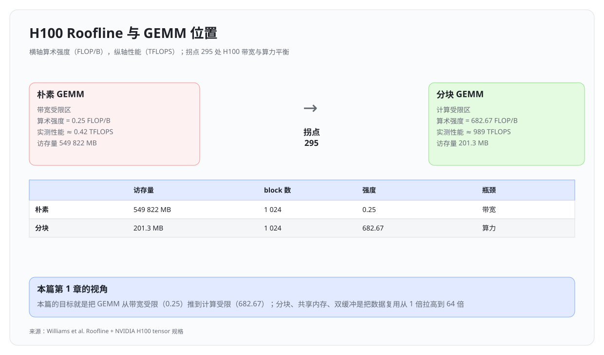
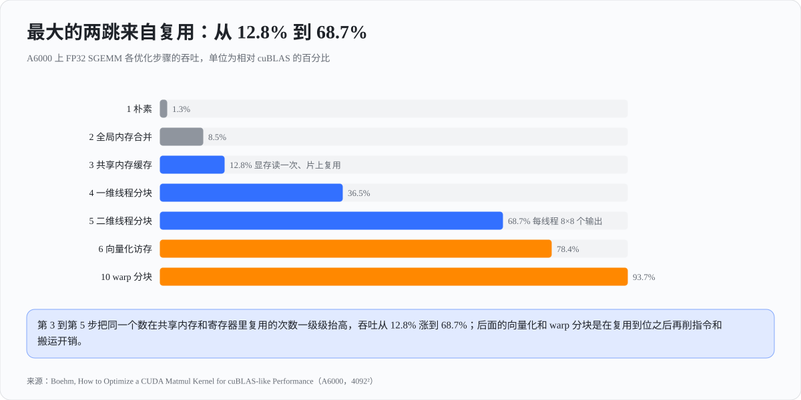
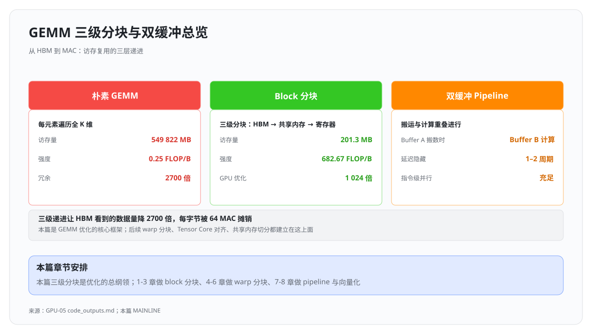
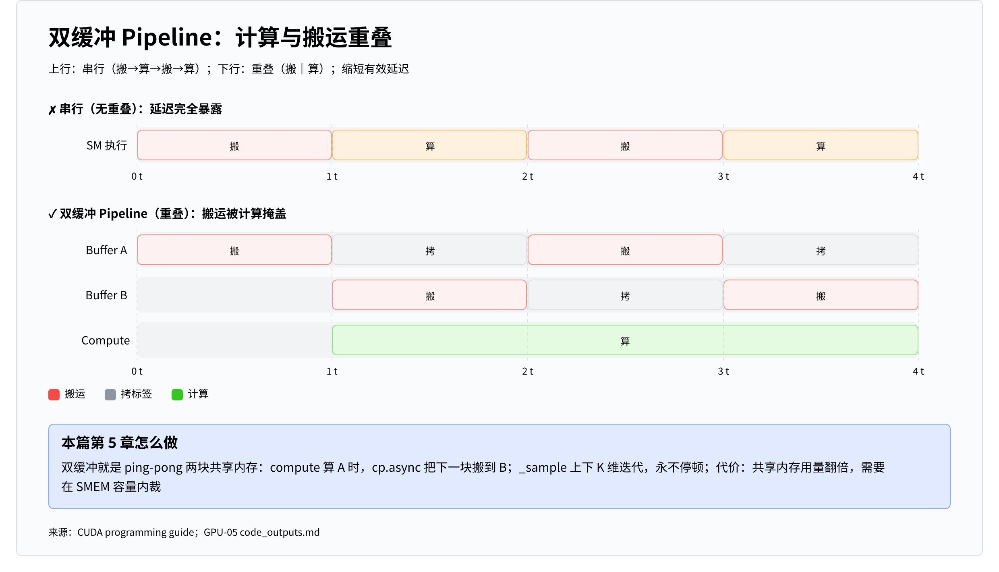
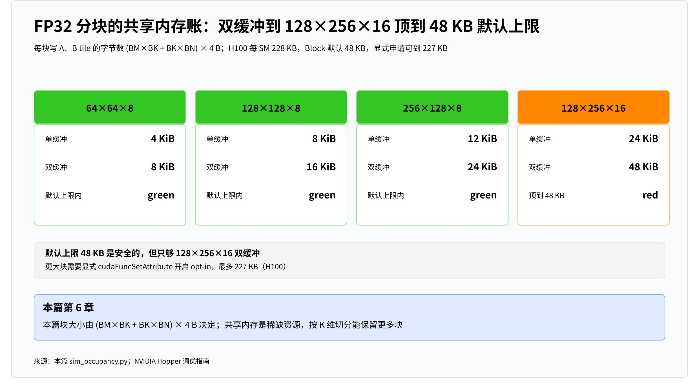
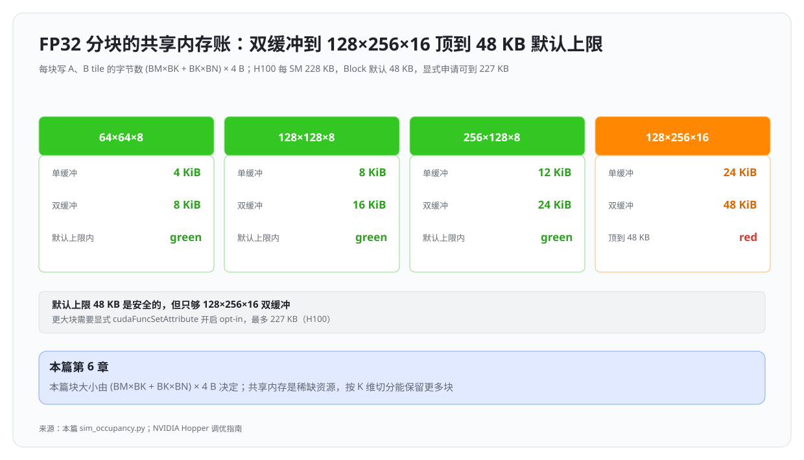

# GPU-05｜硬件｜GEMM 逐步优化：从朴素循环到 warp 分块

> 🎯 **这篇文档解决什么问题**：GEMM（矩阵乘法）是密集计算的原型，写一遍 GEMM 就是走一遍完整的 GPU 优化。本篇用 FP32、不用 Tensor Core 的写法，从朴素三重循环出发，把乘加单元的等待分成“搬得太多”和“等得太久”两类，分别用分块复用和流水重叠消掉，最后对照 cuBLAS 验收。读完能解释任何密集矩阵算子的乘加单元在等什么、该怎么改。
>
> **使用方式**：按五步闭环读：第 1 章定天花板（H100 FP32 67 TFLOPS、拐点 20 FLOP/B），第 2、3 章消“搬得太多”，第 4 到 7 章消“等得太久”和资源约束，第 8、9 章讲实测验收和调参，第 10 章对照 cuBLAS，第 11 章是清单和自测。
>
> **代码**：repo/zero-to-gpu/05-gemm/ 下有 sim_gemm.py（访存和强度的纸面计算）、sim_occupancy.py（占用率估算）、test_gemm.py；sgemm.cu、autotune.sh、ncu_gemm.sh 需要真实 GPU、CUDA 工具包和 Nsight Compute。sim 的几处模型假设与 H100 不符，正文在对应章节注明，验收以卡上实测为准。

<b>🧭 主线位置</b>：GPU-04（[GPU-04｜硬件｜访存与归约：合并访存、共享内存与 warp 归约](./04-memory.md)）把单次搬运做到不浪费（合并访存、bank 冲突、归约）。本篇处理乘加单元的等待：分块让同一个数被反复使用，流水让搬运和计算重叠。读完后 FP32 路径上的等待基本消完，由 GPU-06（Tensor Core）换到更快的执行路径。

## 导读 · 先给结论

- <b>天花板先用对精度。</b>H100 SXM 的 FP32 峰值 67 TFLOPS，拐点 67 ÷ 3.35 = 20 FLOP/B；989 TFLOPS 是 Tensor Core 的数[[1]](https://www.nvidia.com/en-us/data-center/h100/)。4096³ 的计算下限 2.05 ms，访存下限 201.3 MB。
- <b>朴素实现强度 0.25 FLOP/B。</b>每次乘加都去显存取两个数，A、B 共读约 549.8 GB；Boehm 在 A6000 上的朴素 SGEMM 只有 cuBLAS 的 1.3%[[2]](https://siboehm.com/articles/22/CUDA-MMM)。
- <b>块分块：显存读量降两个数量级。</b>A、B 读量 = 4 B × MNK × (1/BN + 1/BM)；128×128 子块降到约 4.3 GB，强度 32，越过 FP32 拐点。201.3 MB 是每个元素只读一次的下限，分块到不了。
- <b>线程分块：共享内存读降一级。</b>8×8 线程分块让每次乘加的共享内存读从 2 次降到 0.25 次；Boehm 实测从 12.8% 升到 68.7%（相对 cuBLAS）[[2]](https://siboehm.com/articles/22/CUDA-MMM)。
- <b>双缓冲：搬运和计算重叠。</b>GEMM 寄存器多、占用率低，要在线程内做软件流水[[3]](https://docs.nvidia.com/cutlass/latest/media/docs/cpp/efficient_gemm.html)；Ampere 起的 LDGSTS 把显存数据直接拷进共享内存，Hopper 的 TMA 负责多维整块搬运[[4]](https://docs.nvidia.com/cuda/cuda-programming-guide/04-special-topics/async-copies.html)。
- <b>低占用率不是病。</b>H100 每 SM 64 个 warp、64K 个寄存器[[5]](https://docs.nvidia.com/cuda/hopper-tuning-guide/)；每线程 128 个寄存器时占用率 25%，GEMM 靠 ILP 和流水照样能跑满。
- <b>验收看实测、对 cuBLAS。</b>每个估算量配一个 ncu 实测量；Boehm 的手写阶梯停在 cuBLAS 的 93.7%，剩下的差在 bank 冲突、双缓冲和按形状挑 kernel[[2]](https://siboehm.com/articles/22/CUDA-MMM)。



<b>📎 与系列其他文档的分工</b>：GPU-02（[GPU-02｜硬件｜性能账本：Roofline、算术强度与三类瓶颈](./02-ledger.md)）给出 Roofline 和时间账的口径；GPU-03（[GPU-03｜硬件｜CUDA 编程模型：线程层级、stream 与编译链](./03-cuda.md)）讲波次和尾效应；GPU-04（[GPU-04｜硬件｜访存与归约：合并访存、共享内存与 warp 归约](./04-memory.md)）讲合并访存、共享内存 bank 和 L2 驻留控制。本篇假设单次搬运已经合并，重点是搬运次数和搬运时机。GPU-06（[GPU-06｜硬件｜Tensor Core 与低精度：从 mma 到 FP8 和 FP4](./06-tensor-core.md)）把乘加单元换成 Tensor Core，复用本篇的分块和流水思路。

## 第 1 章 · GEMM 的瓶颈在等什么

GEMM 是 C = A × B：M×K 的矩阵乘 K×N 的矩阵，得到 M×N 的结果，共 2MNK 次浮点运算。本篇用 FP32、不用 Tensor Core 的写法讲清分块的道理，Tensor Core 的版本留给 GPU-06。先把天花板定对，再看朴素实现离它有多远、差距记在账本的哪一项上。

### 先定天花板：用对精度的峰值

H100 SXM 的规格页同时列着几种峰值：FP32 是 67 teraFLOPS，BF16 Tensor Core 是 1,979 teraFLOPS（带星号的稀疏口径，稠密减半约 989），HBM 带宽 3.35 TB/s[[1]](https://www.nvidia.com/en-us/data-center/h100/)。本篇的 kernel 跑在 CUDA core 上做 FP32 乘加，能用的峰值是 67 TFLOPS，拐点是 67 ÷ 3.35 = 20 FLOP/B；989 TFLOPS 和 295 FLOP/B 是 Tensor Core 的数，拿来衡量 FP32 kernel 会把“离峰值多远”夸大十几倍。

以 4096×4096×4096 为例，运算量 2 × 4096³ = 137.4 G FLOP，按 67 TFLOPS 算至少要 2.05 ms，这是计算侧的下限。访存侧的下限是 A、B 各读一遍、C 写一遍，3 × 4096² × 4 B = 201.3 MB，按 3.35 TB/s 只要 0.060 ms。下限之比说明一件事：只要访存量控制在下限的 30 倍左右以内（201.3 MB × 30 ≈ 6 GB，搬运约 1.8 ms），这个 GEMM 就该是算力受限的。整篇的工作就是把实际访存量往这个范围里压，再把剩下的搬运藏到计算后面。

### 朴素实现：每次乘加都去显存取数

朴素写法给每个输出 C[i][j] 开一个线程，沿 K 维循环，每次读 A[i][k] 和 B[k][j] 各 4 字节，做一次乘加（2 FLOP）。如果每次读都落到 HBM，强度是 2 ÷ 8 = 0.25 FLOP/B，总访存 2 × 4096³ × 4 B ≈ 549.8 GB，按 3.35 TB/s 要约 164 ms，是计算下限的 80 倍。本篇 sim_gemm.py naive 子命令按同样的模型算出 549,822.9 MB（多出的部分是 C 的读写），强度 0.25 FLOP/字节。

真实的朴素 kernel 不会这么差，因为同一 warp 里的线程读同一个 A[i][k]，L1 和 L2 会挡掉一部分重复读。但它离峰值依然很远。Boehm 在 A6000 上把 FP32 SGEMM 从朴素版本一步步优化到接近 cuBLAS，起点的朴素 kernel 只有 309.0 GFLOPs/s，是 cuBLAS 的 1.3%[[2]](https://siboehm.com/articles/22/CUDA-MMM)。

### 差距记在账本哪一项

按 T = T_compute + W_mem + W_host + W_comm + W_idle 的时间账，朴素 GEMM 的 T_compute 只有 2 ms 量级，其余几乎全是 W_mem：一类是“搬得太多”，同一个数被从显存反复读；另一类是“等得太久”，每次乘加之前都要等一次全局内存读回来，而这次读没有足够的独立工作去掩盖。前一类靠提高数据复用来消除，后一类靠流水和指令级并行来隐藏，本篇后面的章节分别处理这两类等待。

Boehm 的优化阶梯正好对应这两类等待[[2]](https://siboehm.com/articles/22/CUDA-MMM)：

| kernel | GFLOPs/s | 相对 cuBLAS | 主要消除的等待 |
|---|---|---|---|
| 1 朴素 | 309.0 | 1.3% | — |
| 2 全局内存合并 | 1,986.5 | 8.5% | 每次搬运的浪费（GPU-04） |
| 3 共享内存缓存 | 2,980.3 | 12.8% | 重复读显存（第 2 章） |
| 4 一维线程分块 | 8,474.7 | 36.5% | 重复读共享内存（第 3 章） |
| 5 二维线程分块 | 15,971.7 | 68.7% | 同上，复用更高 |
| 6 向量化访存 | 18,237.3 | 78.4% | 访存指令数（第 7 章） |
| 10 warp 分块 | 21,779.3 | 93.7% | 寄存器与共享内存的组织 |



阶梯里最大的两跳在第 3 到第 5 步：数据从显存搬上片后被复用多少次，决定了 kernel 能离峰值多近。这也是本篇章节的顺序：第 2 章算清块分块把显存访存降到多少，第 3 章把共享内存的读次数再降一级，第 4 章把剩下的搬运藏到计算后面，第 5 章处理寄存器和占用率的取舍。

> 💡 **常见误区**：拿 Tensor Core 峰值给 FP32 kernel 算利用率。同一张卡，FP32 CUDA core 峰值和 BF16 Tensor Core 稠密峰值差约 15 倍，拐点也从 20 变成 295；先确认 kernel 实际用的是哪条执行路径，再选天花板。

> 🔑 **本章要点**：H100 上 FP32 GEMM 的天花板是 67 TFLOPS、拐点 20 FLOP/B。4096³ 的计算下限 2.05 ms，访存下限 201.3 MB；朴素实现强度 0.25 FLOP/B，差距几乎全记在 W_mem 上，分成“搬得太多”和“等得太久”两类，分别靠复用和流水处理。

## 第 2 章 · 朴素与分块：访存复用的底层

朴素实现慢在同一个数被反复从显存读。块分块（block tiling）让一个线程块先把 A 和 B 的一小片搬进共享内存，块内所有线程从共享内存反复取用，显存只读一次这一片。本章算清分块之后显存访存到底降到多少，它和 201.3 MB 的下限还差多远，以及共享内存装不装得下。

### 朴素 GEMM 的访存账

*朴素 GEMM 核心（伪代码）
*

```cuda
for i in [0, M):  for j in [0, N):    for k in [0, K):      C[i][j] += A[i][k] * B[k][j]
```

每个输出 C[i][j] 都把 A 的第 i 行和 B 的第 j 列完整读一遍。A 的每个元素被读 N 次，B 的每个元素被读 M 次。4096³ 时总共读 2 × 4096³ × 4 B ≈ 549.8 GB，是 201.3 MB 下限的约 2700 倍，强度 0.25 FLOP/B[[2]](https://siboehm.com/articles/22/CUDA-MMM)。

### 块分块：每个元素少读多少次

让一个线程块负责 C 的一个 BM×BN 子块。它沿 K 维每次前进 BK：把 A 的 BM×BK 片和 B 的 BK×BN 片读进共享内存，块内做完这一段的乘加，再读下一段。

*块分块 GEMM 结构
*

```cuda
// 每个线程块算 C 的一个 BM×BN 子块for bk in [0, K/BK):  load A[BM×BK] -> smemA     // 128×8 个 FP32 = 4 KB  load B[BK×BN] -> smemB     // 8×128 个 FP32 = 4 KB  __syncthreads()  在 smemA、smemB 上做 BM×BN×BK 次乘加  __syncthreads()
```

换个角度数：C 被切成 (M/BM)×(N/BN) 个子块，A 的每一行片要被同一行上的 N/BN 个子块各读一次，B 的每一列片要被 M/BM 个子块各读一次。所以显存读量是

A + B 读量 = 4 B × MNK × (1/BN + 1/BM)

相比朴素的 4 B × MNK × 2，降低的倍数是 BM×BN 的量级：每个从显存读上来的数，在片上被用了 BM 或 BN 次。对应的强度（忽略 C 的读写）是 BM×BN ÷ (2 × (BM + BN)) FLOP/B。

以 4096³、FP32 为例（MNK × 4 B ≈ 274.9 GB）：

| 子块 BM×BN | A + B 显存读量 | 强度（FLOP/B） | 相对 FP32 拐点 20 |
|---|---|---|---|
| 朴素 | 549.8 GB | 0.25 | 带宽受限 |
| 32×32 | 17.2 GB | 8 | 带宽受限 |
| 64×64 | 8.6 GB | 16 | 接近拐点 |
| 128×128 | 4.3 GB | 32 | 越过拐点 |
| 256×128 | 3.2 GB | 42.7 | 越过拐点 |
| 下限（每个元素只读一次） | 0.13 GB（另加 C 写 0.07 GB） | 682.7 | — |



128×128 子块把显存读量从 549.8 GB 降到约 4.3 GB，降了 128 倍，强度从 0.25 升到 32，跨过 FP32 的拐点 20。按 3.35 TB/s 搬 4.3 GB 约 1.3 ms，已经低于 2.05 ms 的计算下限，显存带宽不再是第一瓶颈。

### 为什么到不了 201.3 MB

201.3 MB 的前提是 A 和 B 的每个元素只从显存读一次，这要求片上一次放下一整行片或一整列片。4096×4096 的 A、B 各约 67 MB，H100 每个 SM 的共享内存 228 KB、全卡 L2 50 MB，都放不下。实际 kernel 的显存流量介于上表的分块值和下限之间：同时在跑的线程块共享 A、B 的行片和列片，L2 会挡掉一部分重复读。Boehm 在 A6000 上测 4092² 的 cuBLAS kernel，全程从全局内存读约 500 MB，而这个尺寸的理论最少是 278 MB[[2]](https://siboehm.com/articles/22/CUDA-MMM)。

本篇配套的 sim_gemm.py blocked 子命令把 128×128 分块的访存直接记成 201.3 MB、强度 682.67，那是“每个元素只读一次”的下限，不是 128×128 分块的实际显存访存。估算请用上面的公式，实测请用 ncu 的 dram__bytes_read.sum 去核对（第 8 章）。

### 共享内存装得下吗

单缓冲时一段 A、B 片占 (BM + BN) × BK × 4 B：128×128×8 是 8 KB，256×128×8 是 12 KB。H100 每个 SM 有 228 KB 共享内存，单个线程块最多可用 227 KB；每块超过 48 KB 时必须用动态共享内存并显式申请（cudaFuncSetAttribute）[[5]](https://docs.nvidia.com/cuda/hopper-tuning-guide/)[[6]](https://docs.nvidia.com/cuda/cuda-programming-guide/05-appendices/compute-capabilities.html)。第 4 章的双缓冲会把这个数翻倍，加大 BK 也会线性增加，第 6 章再算上限。

块分块只解决了显存这一层。块内每个线程如果仍然只算一个输出，每次乘加都要从共享内存读两个数，共享内存带宽和读指令成了新瓶颈：Boehm 的共享内存缓存版本只有 cuBLAS 的 12.8%[[2]](https://siboehm.com/articles/22/CUDA-MMM)。下一章把复用再推一级，推到寄存器。

> 🔑 **本章要点**：块分块的显存读量是 4 B × MNK × (1/BN + 1/BM)，强度约 BM×BN ÷ (2 × (BM + BN))。4096³ 用 128×128 子块，显存读量从 549.8 GB 降到约 4.3 GB，强度 32，越过 FP32 拐点 20；201.3 MB 是每个元素只读一次的下限，分块到不了，L2 只能帮着往下压一部分。

## 第 3 章 · 线程分块：数据复用倍增

块分块把显存访存压下来以后，瓶颈上移到共享内存：每个线程算一个输出时，每做一次乘加就要从共享内存读两个数。线程分块（thread tiling）让每个线程负责 TM×TN 个输出，把读进寄存器的数在寄存器里反复用。本章算清它省掉多少共享内存读、要付出多少寄存器。

### 一个线程算一个输出：共享内存成了新瓶颈

在上一章的块分块 kernel 里，每个线程沿 BK 循环，每步从 smemA 读一个数、从 smemB 读一个数，做一次乘加。共享内存读和乘加是 2 比 1，读指令本身就占满了发射槽，共享内存带宽也先于 FP32 单元见顶。Boehm 的 kernel 3 就是这个形态，只有 cuBLAS 的 12.8%[[2]](https://siboehm.com/articles/22/CUDA-MMM)。

### 线程分块：读一次，用多次

让每个线程负责 C 子块里的 TM×TN 个输出。沿 K 每走一步，线程把 A 的 TM 个数、B 的 TN 个数从共享内存读进寄存器，然后做 TM×TN 次乘加，累加到 TM×TN 个寄存器累加器里。

*线程分块的内层循环（每线程 TM×TN 个输出）
*

```cuda
float acc[TM][TN] = {0};for (int k = 0; k < BK; ++k) {  float a[TM], b[TN];  for (int m = 0; m < TM; ++m) a[m] = smemA[(ty * TM + m) * BK + k];  for (int n = 0; n < TN; ++n) b[n] = smemB[k * BN + tx * TN + n];  for (int m = 0; m < TM; ++m)    for (int n = 0; n < TN; ++n)      acc[m][n] += a[m] * b[n];   // TM×TN 次乘加只用 TM+TN 次共享内存读}
```

每次乘加对应的共享内存读次数是 (TM + TN) ÷ (TM × TN)：

| 线程分块 TM×TN | 每步共享内存读 | 每步乘加 | 每次乘加的读次数 |
|---|---|---|---|
| 1×1 | 2 | 1 | 2 |
| 8×1（一维） | 9 | 8 | 1.125 |
| 4×4 | 8 | 16 | 0.5 |
| 8×8 | 16 | 64 | 0.25 |

8×8 把每次乘加的共享内存读从 2 次降到 0.25 次，降了 8 倍。Boehm 的实测和这个趋势一致：一维分块（每线程沿一个方向算多个输出）到 cuBLAS 的 36.5%，二维分块（每线程 8×8 个输出）到 68.7%[[2]](https://siboehm.com/articles/22/CUDA-MMM)。

块大小和线程分块要一起定。128×128 的子块配 8×8 的线程分块，正好需要 (128 ÷ 8) × (128 ÷ 8) = 256 个线程。子块不变时 TM×TN 越大，需要的线程越少；子块越大，就得配更大的线程分块才不会超出每块 1024 线程的上限。


### 寄存器的代价

8×8 线程分块光累加器就要 64 个 FP32 寄存器，再加 a[8]、b[8] 两组操作数 16 个，以及地址和循环变量，每线程很容易用到 100 个以上。H100 每个 SM 的寄存器文件是 64K 个 32 位寄存器，每线程最多 255 个[[5]](https://docs.nvidia.com/cuda/hopper-tuning-guide/)。每线程用得越多，一个 SM 上能同时驻留的线程就越少，第 5 章会把这笔账算清。

寄存器不够时编译器会把变量溢出到 local memory，实际落在 L1 和显存上，刚省下的读又加了回来。用 nvcc 的 --ptxas-options=-v 可以在编译时看每个 kernel 的寄存器数和溢出字节，Boehm 的文章里就是用它读出寄存器和共享内存用量的[[2]](https://siboehm.com/articles/22/CUDA-MMM)。

### sim_gemm.py 的 thread-tile 输出怎么读

本篇 code_outputs.md 的 thread-tile 节给出的“性能指标”从 1×1 的 329.12 涨到 8×8 的 5,265.89，比值约 16。这一列不是显存的算术强度，也不对应上表的共享内存读次数，不要拿它和拐点比较。判断线程分块是否生效，看两样东西：编译输出里没有寄存器溢出，ncu 里共享内存相关的停顿和读指令数随 TM×TN 增大而下降。

> 🔑 **本章要点**：线程分块让每个线程读 TM+TN 个数、做 TM×TN 次乘加，每次乘加的共享内存读从 1×1 的 2 次降到 8×8 的 0.25 次。Boehm 的实测从 12.8% 升到 68.7%（相对 cuBLAS）；代价是每线程上百个寄存器，用 --ptxas-options=-v 确认不溢出。

## 第 4 章 · 双缓冲 Pipeline：把搬运藏到计算后面

前两章处理的是“搬得太多”：分块把显存读量降了两个数量级，线程分块把共享内存读又降了一级。剩下的问题是“等得太久”：每个 K 段都要先把 A、B 片从显存搬进共享内存，搬完才能算，这段搬运时间如果没有别的工作去填，就整段记在 W_mem 上。本章讲双缓冲怎么让下一段的搬运和这一段的计算重叠。

### 为什么 GEMM 不能只靠多驻留 warp 来藏

隐藏访存延迟的常规手段是多驻留几个 warp：一个 warp 在等数据，调度器切到另一个 warp 去算。GEMM 恰恰缺这个余量。CUTLASS 的文档说得很直接：分块结构要求每个线程持有大量寄存器，累加器通常至少占线程寄存器预算的一半，因此占用率比其他类型的负载低，靠在 SM 内切换线程来藏延迟的能力有限[[3]](https://docs.nvidia.com/cutlass/latest/media/docs/cpp/efficient_gemm.html)。

所以 GEMM 要在同一个线程内部把搬运和计算重叠起来。CUTLASS 的做法就是软件流水，原话是“CUTLASS uses software pipelining to overlap memory accesses with other computation within a thread”，具体手段是在两个层次上做双缓冲[[3]](https://docs.nvidia.com/cutlass/latest/media/docs/cpp/efficient_gemm.html)。

### 双缓冲的机制：两份共享内存轮换

线程块分配两份共享内存 tile：一份给当前这一段计算用，另一份接收从显存搬来的下一段数据，下一轮两份互换角色。CUTLASS 在寄存器层也做同样的事：一份 fragment 交给计算单元，另一份接收下一次从共享内存读回的数据[[3]](https://docs.nvidia.com/cutlass/latest/media/docs/cpp/efficient_gemm.html)。

*块级双缓冲（伪代码）
*

```cuda
load(A, B, k=0) -> smem[0]wait; __syncthreads()for (k = 0; k < K/BK; ++k) {  cur = k % 2;  if (k + 1 < K/BK)    async_load(A, B, k+1) -> smem[1-cur]   // 先发起下一段的搬运  compute on smem[cur]                      // 同时算这一段  wait for smem[1-cur]; __syncthreads()     // 下一段到齐再进入下一轮}
```

单缓冲时，一段的时间约等于“搬运 + 计算”；双缓冲后，只要计算这一段的时间不短于搬运下一段的时间，搬运就被盖住，一段的时间接近“计算”本身。搬运比计算还长时，双缓冲也只能把时间降到“搬运”，这时要回头去加大分块、提高强度。

### 异步搬运：从寄存器中转到直达共享内存

“先发起下一段的搬运”有两种实现。老办法是先把下一段从显存读进寄存器，算完这一段再把寄存器里的数写进共享内存；这要额外占一组寄存器暂存数据，而 GEMM 的寄存器本来就紧张。

计算能力 8.0（Ampere）起有 LDGSTS 指令，可以把数据从全局内存异步直接拷进共享内存，不经过寄存器，编程接口是 cuda::memcpy_async 等[[4]](https://docs.nvidia.com/cuda/cuda-programming-guide/04-special-topics/async-copies.html)。编程指南写明它支持 4、8、16 字节的拷贝，其中 16 字节拷贝走 L1 BYPASS 模式、不污染 L1[[4]](https://docs.nvidia.com/cuda/cuda-programming-guide/04-special-topics/async-copies.html)，所以 GEMM 通常按 16 字节（一个 float4）一份来发起。计算能力 9.0（Hopper）起又有 TMA（Tensor Memory Accelerator），专门负责多维数组的整块搬运，把地址计算从线程身上卸下来[[4]](https://docs.nvidia.com/cuda/cuda-programming-guide/04-special-topics/async-copies.html)。

两级缓冲不是上限。cuda::memcpy_async 的流水线示例把级数做成模板参数 num_stages，默认值是 2[[4]](https://docs.nvidia.com/cuda/cuda-programming-guide/04-special-topics/async-copies.html)；显存延迟越长、每段计算越短，越需要更多级在途，代价是共享内存按级数线性增加。



### 共享内存的账

每一级占 (BM + BN) × BK × 4 B。按此计算：

| 分块 BM×BN×BK | 每级 | 两级 | 三级 |
|---|---|---|---|
| 128×128×8 | 8 KB | 16 KB | 24 KB |
| 128×128×16 | 16 KB | 32 KB | 48 KB |
| 128×256×16 | 24 KB | 48 KB | 72 KB |

每块超过 48 KB 就要改用动态共享内存并显式申请[[6]](https://docs.nvidia.com/cuda/cuda-programming-guide/05-appendices/compute-capabilities.html)；H100 单块最多 227 KB，每个 SM 共 228 KB[[5]](https://docs.nvidia.com/cuda/hopper-tuning-guide/)。共享内存用得越多，一个 SM 上能同时驻留的线程块就越少，这和寄存器一起决定占用率，第 5 章接着算。

### 同步与代价

单缓冲每段要两次 __syncthreads()：一次保证搬完再算，一次保证算完再覆盖。双缓冲把读和写分到两份缓冲上，一段只需要一次栅栏保证下一段到齐。栅栏本身的代价由块内最慢的 warp 决定，块越大、各 warp 进度差越大，等得越久。

Boehm 的 A6000 实验做到 warp 分块、达到 cuBLAS 的 93.7% 时，还没有实现双缓冲，他在文中把它列为剩下的优化机会之一，原话是“we haven’t implemented any double buffering (which the CUTLASS docs seem to suggest is pretty useful)”[[2]](https://siboehm.com/articles/22/CUDA-MMM)。双缓冲能拿回多少，取决于这一段计算能不能盖住下一段搬运，要用 ncu 实测，不能套固定比例。

### 按五步做一次流水排查

1. 定天花板：按第 1 章的口径，FP32 计算下限 2.05 ms（4096³）。
2. 测实际：nsys 拿 kernel 时间，ncu 看显存吞吐和 SM 吞吐都没打满。
3. 定位等待：ncu 的 warp 状态里，等全局内存（Long Scoreboard 类）和等栅栏（Barrier 类）的停顿占比高，说明搬运没被盖住。
4. 消除或隐藏：上双缓冲；寄存器紧张时改用 cuda::memcpy_async 直达共享内存；延迟仍盖不住再加级数。
5. 复测：确认上述两类停顿下降、kernel 时间下降，同时检查占用率有没有因为共享内存翻倍而掉下来。

> 🔑 **本章要点**：GEMM 寄存器多、占用率低，不能只靠切换 warp 藏延迟，要在线程内做软件流水。双缓冲让下一段搬运和这一段计算重叠，一段时间从“搬运 + 计算”变成两者中较大的那个；Ampere 起的 LDGSTS 直达共享内存、不占暂存寄存器，Hopper 的 TMA 负责多维整块搬运。代价是共享内存按级数翻倍。

## 第 5 章 · 占用率与寄存器权衡

线程分块和双缓冲都在往每个线程、每个线程块身上加资源：寄存器、共享内存。资源用得越多，一个 SM 上能同时驻留的 warp 就越少。本章按 H100 的官方上限把占用率算清楚，再说明 GEMM 为什么可以在低占用率下跑得快，以及什么时候低占用率真的会拖慢它。

### 占用率怎么算

占用率是一个 SM 上活跃 warp 数和该 SM 最多能容纳的 warp 数之比[[2]](https://siboehm.com/articles/22/CUDA-MMM)。H100 的上限是：每 SM 最多 64 个 warp（2048 个线程）、最多 32 个线程块，寄存器文件 64K 个 32 位寄存器，每线程最多 255 个寄存器[[5]](https://docs.nvidia.com/cuda/hopper-tuning-guide/)；共享内存每 SM 228 KB，单块最多 227 KB[[5]](https://docs.nvidia.com/cuda/hopper-tuning-guide/)。

能驻留几个线程块，取下面几项里最小的那个：线程数上限、块数上限、寄存器、共享内存。以每块 256 线程（8 个 warp）为例，忽略寄存器分配粒度的取整，只看寄存器这一项：

| 线程分块 | 每线程寄存器（假设） | 每块寄存器 | 每 SM 可驻留块数 | 活跃 warp | 占用率 |
|---|---|---|---|---|---|
| 1×1 | 32 | 8,192 | 8（受线程数 2048 限制） | 64 | 100% |
| 4×4 | 64 | 16,384 | 4 | 32 | 50% |
| 8×8 | 128 | 32,768 | 2 | 16 | 25% |
| 8×8 | 192 | 49,152 | 1 | 8 | 12.5% |

每线程寄存器数是假设值，实际以编译输出为准（--ptxas-options=-v）。本篇 code_outputs.md 里 sim_occupancy.py 的四行都是 25%，那是因为它把每 SM 最大 warp 数记成 32、并且只按一个线程块计，和 H100 的 64 个 warp 不符；读那张表时请按上面的方法重算。CUDA 运行时也提供 cudaOccupancyMaxActiveBlocksPerMultiprocessor，可以直接问某个 kernel 在给定块大小和动态共享内存下每 SM 能驻留几个块[[7]](https://docs.nvidia.com/cuda/cuda-runtime-api/group__CUDART__OCCUPANCY.html)。


### 为什么低占用率也能跑得快

占用率高的意义是：一个 warp 等数据时，有别的 warp 可以接着发指令。但并行也可以来自同一线程内互相独立的指令。Volkov 在 GTC 2010 的报告里把两种并行并列：线程级并行（多驻留 warp）和指令级并行（一个线程里多条独立运算）；他举的例子是 G80 上，即使没有 ILP，25% 占用率就能接近峰值，如果每个线程能同时发出 3 条独立运算，8% 占用率就够[[8]](https://www.nvidia.com/content/gtc-2010/pdfs/2238_gtc2010.pdf)。同一份报告还列了库的实例：CUBLAS 2.0 的每块线程数从 1.1 版的 512 降到 64，占用率从 67% 降到 33%，性能从 128 升到 204 Gflop/s[[8]](https://www.nvidia.com/content/gtc-2010/pdfs/2238_gtc2010.pdf)。

8×8 线程分块的内层循环正好提供这种 ILP：每一步 64 次乘加写 64 个不同的累加器，彼此没有依赖，调度器可以连续发射。所以 GEMM 的常态是低占用率、高 ILP，CUTLASS 文档也把“占用率相对较低”当成分块 GEMM 的固有特征，并用软件流水来补偿[[3]](https://docs.nvidia.com/cutlass/latest/media/docs/cpp/efficient_gemm.html)。

### 低占用率什么时候会出问题

低占用率不是目标，是代价。三种情况下它会真的拖慢 kernel：

1. ILP 不够：线程分块太小（比如 1×1），一个线程里没有足够的独立乘加，又没有足够的 warp 可切换，延迟直接暴露。
2. 流水没做：只驻留一两个块时，如果块内没有双缓冲，所有 warp 会在同一个栅栏前一起等搬运，SM 整段空转（第 4 章）。
3. 寄存器溢出：为了提高占用率用 -maxrregcount 强行压低每线程寄存器数，编译器把累加器溢出到 local memory，省下的访存又加了回来[[9]](https://docs.nvidia.com/cuda/cuda-compiler-driver-nvcc/index.html)。

### 在资源之间取舍

寄存器、共享内存和占用率是一组联动参数，调一个会牵动其他几个：

- 加大线程分块：共享内存读更少、ILP 更高，但每线程寄存器更多、驻留 warp 更少。
- 加大块分块或加流水级数：显存读更少、搬运更容易被盖住，但每块共享内存更多、驻留块数更少。
- warp 分块：在块和线程之间再加一层，让每个 warp 负责一个更规整的子区域，改善共享内存访问和寄存器复用；Boehm 的实验里它把吞吐从 84.8%（自动调参后）推到 93.7%[[2]](https://siboehm.com/articles/22/CUDA-MMM)。

这些取舍没有封闭解，常用做法是限定一个合法的参数空间、逐个编译实测，第 9 章讲自动调参。判断一组参数是否合格，看三样：编译输出无溢出；ncu 的 Occupancy 部分给出的理论和实际占用率与估算一致；kernel 时间是否随参数变化朝预期方向走[[10]](https://docs.nvidia.com/nsight-compute/ProfilingGuide/index.html)。

> 💡 **常见误区**：把“占用率低”当成 GEMM 的性能问题去修。占用率只是“有多少 warp 可以切换”，GEMM 主要靠单线程内的 ILP 和软件流水藏延迟；先看停顿原因和 kernel 时间，再决定要不要为占用率牺牲线程分块。

> 🔑 **本章要点**：H100 每 SM 64 个 warp、64K 个寄存器；每块 256 线程时，每线程 64 个寄存器对应 50% 占用率，128 个对应 25%。GEMM 靠 ILP 和双缓冲在低占用率下跑满，Volkov 的例子是 CUBLAS 2.0 占用率减半、性能升 1.6 倍；真正要防的是 ILP 不够、流水没做和寄存器溢出。

## 第 6 章 · 共享内存分块与 K 维分割

前几章的参数都在 M、N 两个方向上：子块 BM×BN 决定显存读量，线程分块 TM×TN 决定共享内存读量。本章转到 K 方向，回答两个问题：块内每一段取多长（BK），它决定共享内存占用和流水能不能盖住搬运；M、N 都很小、K 很长时，要不要把 K 切开交给多个线程块并行（split-K），否则卡上大部分 SM 没活干。



### BK 不改变显存读量，改变的是每段的节奏

第 2 章的公式里，A + B 的显存读量是 4 B × MNK × (1/BN + 1/BM)，里面没有 BK：沿 K 走得快一点慢一点，A 的行片和 B 的列片照样各读那么多遍。BK 影响的是三件事：

- 共享内存：每一级占 (BM + BN) × BK × 4 B，BK 翻倍占用就翻倍（第 4 章的表）。
- 同步次数：一个子块要走 K / BK 段，每段至少一次 __syncthreads()；K = 4096 时，BK = 8 要走 512 段，BK = 16 走 256 段。
- 每段的计算量：一段里每个线程做 TM × TN × BK 次乘加，BK 越大，这一段的计算越有可能盖住下一段的搬运。

所以 BK 的选择是“同步与流水”对“共享内存与占用率”的取舍：BK 太小，每段计算太短，栅栏和搬运延迟露出来；BK 太大，共享内存占用涨、驻留块数降。Boehm 的 A6000 SGEMM 在二维线程分块版本里用的是 BK = 8，后来自动调参又在一组候选值里重新挑[[2]](https://siboehm.com/articles/22/CUDA-MMM)。

### 小 M、N、长 K：只靠子块铺不满 SM

输出 C 只有 (M/BM) × (N/BN) 个子块。M、N 小而 K 大时，子块数可能比 SM 数还少。比如 M = N = 512、K = 16384、128×128 子块，一共只有 16 个线程块，H100 的 132 个 SM 大部分闲着，这段时间记在账本的 W_idle 上，和第 4 章的流水无关。

CUTLASS 文档把这种情况写得很明确：问题小的时候，线程块太少，铺不满整张卡；对策是把内积里沿 K 的规约也并行化，把 K 维切成几段，每段交给一组额外的线程块[[3]](https://docs.nvidia.com/cutlass/latest/media/docs/cpp/efficient_gemm.html)。CUTLASS 把这叫 parallel reduction splitK，它需要两个 kernel：先按 K 分段各自做 GEMM，再做一次批量规约把各段的部分和加起来[[3]](https://docs.nvidia.com/cutlass/latest/media/docs/cpp/efficient_gemm.html)。

| M = N = 512，K = 16384，128×128 子块 | 线程块数 | 每块走的 K 段（BK = 8） | 额外开销 |
|---|---|---|---|
| 不切 K | 16 | 2048 | 无 |
| 切成 4 段 | 64 | 512 | 4 份 512×512 的 FP32 部分和，各 1 MiB，再规约 |
| 切成 8 段 | 128 | 256 | 8 份部分和，共 8 MiB，再规约 |

切成 8 段后线程块数接近 SM 数，代价是额外的部分和读写和一次规约 kernel。切多少段要看两边的账：多出来的并行度能省多少 W_idle，规约要多搬多少字节、多一次 launch。M、N 足够大时（比如 4096×4096 已有 1024 个子块）不需要 split-K。

### 换个调度顺序：让同时在跑的块共用 L2 里的数据

子块的发射顺序也会影响显存流量。同时在跑的线程块如果正好落在 C 的同一片区域，它们读的是同一批 A 行片和 B 列片，L2 能挡掉一部分重复读。CUTLASS 定义了一组 threadblock swizzle 函数，把相邻发射的线程块映射到问题里紧凑的二维区域，提高它们在差不多同一时刻访问同一批全局内存 tile 的概率[[3]](https://docs.nvidia.com/cutlass/latest/media/docs/cpp/efficient_gemm.html)。

这个优化不是每次都有收益。Boehm 在 A6000 上试过同样的 thread swizzling，没有提速，他的解释是 L2 命中率本来就在 80% 左右，最后删掉了这段代码[[2]](https://siboehm.com/articles/22/CUDA-MMM)。是否值得做，先用 ncu 看 L2 命中率和显存读字节数。

### 按五步选 K 方向的参数

1. 定天花板：按第 1 章算计算下限，再看子块数够不够铺满 SM（子块数至少是 SM 数的几倍）。
2. 测实际：nsys 看 kernel 时间，ncu 看 launch__waves_per_multiprocessor 和 SM 吞吐。
3. 定位等待：波数远小于 1，是 W_idle，考虑 split-K；栅栏停顿多、搬运没盖住，是 BK 太小或流水级数不够。
4. 消除或隐藏：调 BK 和级数，或切 K；切 K 后把规约 kernel 的时间算进去。
5. 复测：总时间（两个 kernel 加起来）是否下降；共享内存和占用率是否仍在第 5 章的范围内。

> 🔑 **本章要点**：BK 不改变显存读量，只改变共享内存占用、同步次数和每段计算能否盖住搬运。M、N 小、K 大时子块铺不满 SM，用 split-K 把 K 切给多组线程块，再用一次规约合并，代价是部分和的读写；swizzle 调度能提高 L2 复用，但要先实测命中率再决定做不做。

## 第 7 章 · 向量化与 L2 缓存

到第 6 章，显存读量、共享内存读量、流水和调度都处理过了，剩下的开销在“指令”上：同样搬 16 字节，用 4 条 32 位指令还是 1 条 128 位指令，指令发射槽和访存流水的压力差 4 倍。本章讲 GEMM 里三处向量化（显存读、共享内存读、结果写回），以及共享内存 bank 冲突和 L2 的作用。

### 向量化访存：一条指令搬 16 字节

NVIDIA 的 Pro Tip 文章说明，LDG.E.64、LDG.E.128、STG.E.64、STG.E.128 这类宽指令能减少指令数、提高带宽利用；CUDA C++ 里用 int2、int4、float2、float4 等向量类型、配合 reinterpret_cast，就能让编译器生成这些指令[[11]](https://developer.nvidia.com/blog/cuda-pro-tip-increase-performance-with-vectorized-memory-access/)。前提是对齐：指针必须按向量类型的大小对齐，数据结构的大小必须是 2 的幂字节，否则会出现不对齐访问或编译器补齐[[11]](https://developer.nvidia.com/blog/cuda-pro-tip-increase-performance-with-vectorized-memory-access/)。

对 FP32 GEMM，float4 正好 16 字节，是一条 128 位指令能搬的量。Ampere 起的异步拷贝 LDGSTS 也是 16 字节一份时走 L1 BYPASS（第 4 章），两者对齐方式一致。

### GEMM 里的三处向量化

Boehm 的 kernel 6 同时做了两件事：把共享内存里的 A 片转置存放，以及用 float4 读写全局内存[[2]](https://siboehm.com/articles/22/CUDA-MMM)。

1. 共享内存读。线程分块的内层循环每步要读 A 的 TM 个数、B 的 TN 个数（第 3 章）。B 片按行存放时，TN 个连续元素可以用一条 LDS.128 读进来；A 片按行存放时，TM 个元素在 K 方向上相隔 BK，读出来是一个个 32 位的 LDS。把 A 片在写入共享内存时转置，A 的读也变成连续的，编译器就能生成 LDS.128。Boehm 实测这一步带来约 500 GFLOPs、约 3% 的提升[[2]](https://siboehm.com/articles/22/CUDA-MMM)。
2. 全局内存读。从显存搬 A、B 片时，每个线程用 float4 一次读 4 个相邻元素，搬 A 的同时完成转置后写进共享内存[[2]](https://siboehm.com/articles/22/CUDA-MMM)。
3. 结果写回。每个线程的 TM×TN 个累加器写回 C 时，TN 方向相邻的 4 个数合成一个 float4 写出。

向量化的边界条件要处理：矩阵维度不是 4 的倍数，或者起始地址没有 16 字节对齐，就不能直接 reinterpret_cast 成 float4，要么对数据补齐，要么给尾部单独写一条标量路径。

### 共享内存 bank 冲突

共享内存被分成大小相同、可以同时访问的 bank；一次访问的 n 个地址如果落在 n 个不同的 bank 上，就能同时完成，等效带宽是单个 bank 的 n 倍[[12]](https://docs.nvidia.com/cuda/cuda-c-best-practices-guide/)。多个线程访问同一个 bank 的不同地址时，访问要分几次完成，这就是 bank 冲突。

GEMM 里冲突最常出现在转置写入共享内存的那一步：一个 warp 的线程按列写，相邻线程的地址相隔一整行，容易落进同一个 bank。常见的对策是给每行多补一个元素（padding），或者按一定规律打乱存放位置（swizzle），让同一次访问的地址分散到不同 bank。Boehm 的 kernel 6 达到 19 TFLOPs 后，profiler 仍然报告共享内存 bank 冲突，他指出这是 cuBLAS 避免了而他的实现还没处理的问题之一[[2]](https://siboehm.com/articles/22/CUDA-MMM)。ncu 的共享内存相关指标会给出冲突次数，改完布局后用它复核。

### L2：能帮忙，但不能指望

H100 的 L2 是 50 MB，比 A100 的 40 MB 大，到 SM 的 L2 带宽也提高了；Hopper 和 Ampere 一样，允许用户控制数据在 L2 里的驻留[[5]](https://docs.nvidia.com/cuda/hopper-tuning-guide/)。4096×4096 的 A、B 各约 67 MB，整个放不进 L2，L2 的作用是让同时在跑的线程块共用最近读过的 A 行片和 B 列片，第 6 章的 swizzle 调度就是为了提高这种共用。

L2 驻留控制（accessPolicyWindow）适合“一小块数据被反复读、其余数据只读一次”的场景，比如推理时反复用到的一小块权重；对 GEMM 本身这种均匀流式读 A、B 的负载，划出一块驻留区反而挤占了其余数据的缓存空间。具体机制和配置在 GPU-04 第 9 章。

### 按五步复核向量化

1. 定天花板：计算下限不变，向量化只削指令和访存流水的开销。
2. 测实际：ncu 看发射槽利用率和访存流水停顿，SASS 里数 LDS/LDG 指令的宽度。
3. 定位等待：SASS 里 A 片的读还是 32 位 LDS、显存读还是 32 位 LDG，说明向量化没生效；共享内存冲突次数高，说明布局有问题。
4. 消除或隐藏：转置 A 片、float4 读写、padding 或 swizzle 消冲突。
5. 复测：SASS 里出现 LDS.128、LDG.E.128，冲突次数下降，kernel 时间下降。

> 🔑 **本章要点**：向量化让一条 128 位指令搬 4 个 float，前提是 16 字节对齐。GEMM 里有三处：共享内存读（转置 A 片后用 LDS.128，Boehm 实测约 +3%）、显存读和结果写回（float4）。转置写入要防 bank 冲突，用 padding 或 swizzle；H100 的 50 MB L2 放不下 4096³ 的 A、B，只能靠调度提高复用。

## 第 8 章 · 从估算到实测：校准与验收流程

前七章的数字都是估算：显存读量按公式算，占用率按上限除，共享内存按 tile 尺寸乘。估算的价值是给实测一个对照：两者对得上，说明 kernel 按设计在工作；对不上，差额就是下一处要查的等待。本章把每个估算值和 ncu 里对应的实测量一一配对，形成一张验收表。

### 估算和实测要配对

本篇配套的 sim_gemm.py、sim_occupancy.py 只做纸面计算，不碰 GPU；它们的价值在于把公式写成可复跑的程序，但前几章已经指出几处模型假设和 H100 不符（分块访存记成下限、每 SM 最大 warp 记成 32）。所以验收不能拿 sim 输出当“实测”，必须在卡上跑 sgemm.cu，用 Nsight Compute 采集。

| 估算量（本篇章节） | 4096³、128×128×8 时的估算 | ncu 里看什么 |
|---|---|---|
| kernel 时间下限（第 1 章） | FP32 计算 2.05 ms | Duration；SpeedOfLight 里 SM 吞吐占峰值的比例 |
| 显存读量（第 2 章） | A + B 约 4.3 GB，L2 能挡掉一部分 | dram__bytes_read.sum |
| 共享内存读次数（第 3 章） | 每次乘加 0.25 次 | Memory Workload Analysis 里共享内存的指令数和冲突 |
| 占用率（第 5 章） | 按寄存器和共享内存算出的理论值 | Occupancy 部分的理论占用率与实际占用率 |
| 流水是否盖住搬运（第 4 章） | 停顿应以计算类为主 | Warp State Statistics 的停顿分布 |

ncu 的 SpeedOfLight 部分给出计算和访存各单元的吞吐占其峰值的百分比，Memory Workload Analysis 部分细分各级存储的使用，Warp State Statistics 部分统计 warp 在各种状态上花的周期，Launch Statistics 部分给出网格和块的资源配置[[10]](https://docs.nvidia.com/nsight-compute/ProfilingGuide/index.html)。显存读字节用 dram__bytes_read.sum，NVIDIA 的全局内存访问博客就用这个指标核对一个 kernel 实际从显存读了多少数据[[13]](https://developer.nvidia.com/blog/unlock-gpu-performance-global-memory-access-in-cuda/)。

### 四种典型的对不上

1. 显存读量远高于分块估算：线程块调度让同时在跑的块读不同的行片和列片，L2 挡不住；或者访存没合并、一次读取浪费了大半 sector（GPU-04）。先看 L2 命中率，再看每次请求的 sector 数。
2. 显存读量正常、SM 吞吐低、停顿以等全局内存为主：搬运没被流水盖住，回到第 4 章加双缓冲或加级数。
3. 停顿以等栅栏为主：块内 warp 进度不齐，或每段计算太短、栅栏太密，回到第 6 章调 BK。
4. 实际占用率明显低于理论值：块数不够铺满（第 6 章的 split-K），或尾波太长（GPU-03 第 4 章）。

每一种对不上都对应时间账里的一项：前两种是 W_mem，第三种是同步造成的等待，第四种是 W_idle。验收表的作用就是把“慢”翻译成“哪一项多了”。

### 验收线定在哪里

“接近峰值”要说清是哪个峰值。本篇是 FP32、不用 Tensor Core，对照的是 67 TFLOPS；同一张卡上 cuBLAS 的 FP32 SGEMM 是更现实的参照，因为它代表这条执行路径上工程能做到的程度。Boehm 的 A6000 实验就是以 cuBLAS 为 100% 记录每一步，最终 warp 分块版本到 93.7%[[2]](https://siboehm.com/articles/22/CUDA-MMM)。持续满载时还要考虑功耗墙：GPU-02 第 3 章介绍过 MAMF 和 MSMF，持续值可能比短时最好成绩低一截，验收时用同样的负载时长去测参照和自己的 kernel。

验收报告至少写清五件事：GPU 型号和频率状态、CUDA 与驱动版本、矩阵尺寸和数据类型、参照实现（cuBLAS 版本）的时间、自己 kernel 的时间和上面那张表的实测列。缺了任何一项，别人复测时就对不上号。

### 按五步走一遍

1. 定天花板：算出计算下限和显存读量估算，记在表的第二列。
2. 测实际：同一尺寸跑 cuBLAS 和自己的 kernel，ncu 采集上面几个部分。
3. 定位等待：按“四种对不上”逐条排查，确认差额落在哪一项。
4. 消除或隐藏：只改一处，改完立刻重测，避免多处改动的效果互相掩盖。
5. 复测：更新表的实测列，和上一版对比。

> 🔑 **本章要点**：sim 只是纸面计算，验收必须在卡上用 ncu 实测。每个估算量都有对应的实测量：时间对 Duration 和 SpeedOfLight，显存读量对 dram__bytes_read.sum，占用率对 Occupancy，流水对 Warp State Statistics。对不上的地方就是账本里多出来的那一项；验收线以同卡同精度的 cuBLAS 为参照。

## 第 9 章 · 自动调参与性能边界

到这里，一个分块 GEMM 已经有五个模板参数：BM、BN、BK 决定从显存缓存多少数据到共享内存，TM、TN 决定从共享内存缓存多少到寄存器；再加上流水级数和每块线程数。它们互相牵制，没有一组值在所有卡、所有尺寸上都最好。本章讲怎么系统地挑参数，以及调参能走到哪里为止。

### 先限定合法空间，再逐个实测

Boehm 的做法很朴素：写一个 bash 脚本，遍历所有合理的参数组合并实测运行时间[[2]](https://siboehm.com/articles/22/CUDA-MMM)。关键在“合理”：他要求共享内存的读全部向量化，所以 BM × BK 必须能被 4 × 线程数整除，否则一次 4 宽的加载凑不齐；去掉不合法的组合后，剩下约 400 组，kernel 对它们都能正确运行[[2]](https://siboehm.com/articles/22/CUDA-MMM)。

合法性约束大致有四类，都可以在编译前算出来：

- 形状：BM、BN 能被 TM、TN 整除，每块线程数 (BM/TM) × (BN/TN) 不超过 1024；搬运循环能被线程数整除。
- 向量化：参与 float4 读写的维度是 4 的倍数（第 7 章）。
- 共享内存：级数 × (BM + BN) × BK × 4 B 不超过单块上限，超过 48 KB 要显式申请（第 4 章）。
- 寄存器：编译后每线程不超过 255 个，且没有溢出（第 5 章）。

占用率不要当硬约束。第 5 章说明了 GEMM 常在 25% 上下跑满；用“占用率至少 50%”去筛，会把最好的那批配置筛掉。

### 最优参数随卡和尺寸变

Boehm 的结论是，最优参数在不同 GPU 型号之间差别相当大，他推测这正是 Triton 这类编译器提供自动调参功能的原因，并推测 cuBLAS 在库里存了一张从 GPU 型号、矩阵尺寸、数据类型到最优实现的映射[[2]](https://siboehm.com/articles/22/CUDA-MMM)。他的实验里，自动调参把吞吐从 kernel 6 的 78.4% 推到 84.8%（相对 cuBLAS）[[2]](https://siboehm.com/articles/22/CUDA-MMM)。

Triton 把这件事做成了语言特性：被 triton.jit 修饰的函数可以再加 triton.autotune 装饰器，给它一组 triton.Config，每个 Config 指定一组元参数（比如 BLOCK_SIZE_M）和编译选项（比如 num_warps），再给一个 key；key 里的值（比如 M、N、K）一变，就把所有 Config 重新跑一遍挑最快的[[14]](https://triton-lang.org/main/getting-started/tutorials/03-matrix-multiplication.html)。Triton 官方矩阵乘教程里给 CUDA 后端的第一组候选是 BLOCK_SIZE_M = 128、BLOCK_SIZE_N = 256、BLOCK_SIZE_K = 64，num_stages = 3，num_warps = 8[[14]](https://triton-lang.org/main/getting-started/tutorials/03-matrix-multiplication.html)，可以看到级数和块尺寸都是参数的一部分。

CUTLASS 走的是另一条路：把各种 tile 尺寸、数据类型和布局实例化成一个库，用命令行工具 cutlass_profiler 对每个 GEMM kernel 实测；为了控制编译时间，默认每种数据类型、数学指令和布局只实例化一种 tile 尺寸（通常是 128×128），要全部实例化需另设环境变量[[15]](https://docs.nvidia.com/cutlass/latest/media/docs/cpp/profiler.html)。



### 调参的边界

调参只能在一个固定的 kernel 结构里挑参数，结构本身的限制它跨不过去。本篇的 kernel 用 CUDA core 做 FP32 乘加，天花板是 67 TFLOPS；同一张 H100，TF32 Tensor Core 的规格页峰值是 989 TFLOPS（带星号的稀疏口径，稠密减半）[[1]](https://www.nvidia.com/en-us/data-center/h100/)，差距不是调参能补的，要换执行路径，这是 GPU-06 的内容。

结构内还有几类调参覆盖不了的优化：共享内存 bank 冲突要改布局（第 7 章），双缓冲要改代码结构（第 4 章），warp 分块要在块和线程之间再加一层。Boehm 的实验里，自动调参之后的 warp 分块又从 84.8% 推到 93.7%[[2]](https://siboehm.com/articles/22/CUDA-MMM)，这一步靠的是改结构，不是换参数。

### 调参的工作流

1. 定天花板：确认 kernel 的执行路径（CUDA core 还是 Tensor Core）和对应峰值，算出目标尺寸的计算下限。
2. 测实际：对合法空间里的每组参数编译、预热、多次计时取中位数，同时记录 cuBLAS 的时间作参照。
3. 定位等待：对排名前几的配置跑 ncu，看它们的差额落在第 8 章验收表的哪一行。
4. 消除或隐藏：参数解决不了的问题（冲突、流水、warp 组织）回去改结构，改完重新调参。
5. 复测：按目标卡、目标尺寸分别保存最优参数；换卡或换尺寸区间时重新调。

> 💡 **常见误区**：在一张卡上调出一组参数，就写死在代码里给所有卡用。最优参数随 GPU 型号和矩阵尺寸变化，库的做法是按（型号、尺寸、类型）建映射，或者像 Triton 一样按 key 在运行时重调。

> 🔑 **本章要点**：调参是“限定合法空间 + 逐个实测”，Boehm 的约 400 组合法配置把吞吐从 78.4% 推到 84.8%（相对 cuBLAS）。最优参数随卡和尺寸变，Triton 用 autotune 按 key 重调，CUTLASS 用 profiler 实测实例库。调参跨不过结构的限制：FP32 CUDA core 和 Tensor Core 的峰值差一个数量级，要换执行路径。

## 第 10 章 · 离 cuBLAS 差在哪

<b>前九章把朴素 GEMM 一步步推近 cuBLAS。</b>Boehm 在 A6000 上的手写阶梯最后停在 93.7%[[2]](https://siboehm.com/articles/22/CUDA-MMM)，剩下的差距在哪里？本章讨论三个层面：计算与搬运的重叠、内存缓存的利用、以及按矩阵形状动态挑选 kernel。

### 10.1 双缓冲隐藏搬运延迟

<b>先搬再算的问题。</b>前九章的实现每一轮循环都是：全局读进共享内存 → 线程同步 → 计算当前块 → 下一轮。搬运和计算之间有显式的 __syncthreads()，两段代码串行执行[[16]](https://docs.nvidia.com/cuda/cuda-programming-guide/02-basics/writing-cuda-kernels.html)。GPU 的内存控制器和计算单元是独立的硬件，同时闲置浪费了并行性。

<b>双缓冲把搬运挪到计算后面。</b>给共享内存开两份区域，一份放当前块用于计算，另一份异步加载下一块。计算第 k 块的同时，第 k+1 块的搬运已经发出，等它到齐时第 k 块也差不多算完，CUTLASS 在块级共享内存和 warp 级寄存器 fragment 两个层次上都这样做[[3]](https://docs.nvidia.com/cutlass/latest/media/docs/cpp/efficient_gemm.html)。代价是共享内存翻倍（两套缓冲）。

<b>Ampere 的异步加载把成本降低。</b>Ampere 架构引入了 cp.async 指令，全局到共享内存的拷贝无需经过寄存器，直接由内存系统处理，异步完成[[4]](https://docs.nvidia.com/cuda/cuda-programming-guide/04-special-topics/async-copies.html)[[17]](https://docs.nvidia.com/cuda/cuda-programming-guide/04-special-topics/pipelines.html)。Triton 框架中 num_stages 参数控制流水级数：几份缓冲轮流搬运和计算。Ampere 调优指南明确列出异步拷贝为该代的关键特性[[18]](https://docs.nvidia.com/cuda/ampere-tuning-guide/)。Boehm 的阶梯在 A6000 上没有实现双缓冲，他把它和 bank 冲突、过高的占用率一起列为还没做的优化机会[[2]](https://siboehm.com/articles/22/CUDA-MMM)。

### 10.2 L2 缓存的分组策略

<b>默认发射顺序的缓存劣势。</b>CUDA Runtime 按行主序发射线程块。当同时运行的块都在计算 C 的同一行时，它们共享 A 的同一块行数据，但每块都独立读取 B 的全部列。Triton 教程举的例子是 9×9 个输出块：按行主序算前 9 个输出块，要往片上加载 90 个输入块；改成分组顺序（每 3 行一组），只需加载 54 个[[14]](https://triton-lang.org/main/getting-started/tutorials/03-matrix-multiplication.html)。

<b>分组发射提升 L2 命中。</b>Triton 教程报告在 A100 上 FP16 GEMM 从 220 TFLOPS 升至 245 TFLOPS，提升 10% 以上[[14]](https://triton-lang.org/main/getting-started/tutorials/03-matrix-multiplication.html)。CUTLASS 中的对应机制称为 threadblock swizzle，在代码中通过 swizzle 函数自定义块的发射顺序[[3]](https://docs.nvidia.com/cutlass/latest/media/docs/cpp/efficient_gemm.html)。不过 Boehm 在 A6000 上尝试相同的交错，没有观察到收益，因为该卡的 L2 命中率已经有 80% 左右[[2]](https://siboehm.com/articles/22/CUDA-MMM)。分组策略对矩阵规模大且 L2 相对小的情况更有效；小矩阵或本身访存充足的形状收益有限。

### 10.3 按形状选择 kernel

<b>形状决定最优 tile。</b>不同尺寸和纵横比的矩阵，最优的 tile 大小和分块策略完全不同。Boehm 用 Nsight Systems 追踪 cuBLAS 在不同方阵规模上调用的实际 kernel，4096 以内发现 16 种不同的 SGEMM 内核[[2]](https://siboehm.com/articles/22/CUDA-MMM)。他记录的结果是：128 用 ampere_sgemm_32x32_sliced1x4_nn；256 用 64x32 的 sliced kernel，后面再跟一个 splitKreduce_kernel；1024 到 4096 都用 ampere_sgemm_128x64_nn[[2]](https://siboehm.com/articles/22/CUDA-MMM)。kernel 的名字编码了 tile 形状和使用的优化手段。

<b>Roofline 分析确定瓶颈。</b>大方阵块数多、每块工作量大，用大 tile 提高复用；小尺寸块数少，铺不满 SM，于是用 sliced-K、split-K 把 K 方向也拆开并行（第 6 章）。所以和 cuBLAS 对比时要按同一组尺寸逐个比，某个尺寸上的胜负不能外推到其他尺寸。

<b>TF32 的隐藏陷阱。</b>cuBLAS 的默认模式 CUBLAS_DEFAULT_MATH 保证计算精度不低于请求的精度，所以默认的 SGEMM 不会走 TF32；但如果代码或框架把数学模式设成了 TF32（CUBLAS_TF32_TENSOR_OP_MATH），对 FP32 输入就会用 TF32 Tensor Core 计算，手写的纯 FP32 kernel 就成了和另一种精度比[[19]](https://docs.nvidia.com/cuda/cublas/index.html)。对标前确认数学模式；环境变量 NVIDIA_TF32_OVERRIDE=0 可以强制关闭 NVIDIA 库里的 TF32 加速[[19]](https://docs.nvidia.com/cuda/cublas/index.html)。用 nsys 看 cuBLAS 实际调用的 kernel 名也能判断走的是哪条路径。

### 10.4 ncu 验证改进的真实性

<b>关键指标对应关键步骤。</b>每一项优化都应该在 Nsight Compute 的分析中看到对应指标的明确变化，否则说明改动没有生效、被编译器优化掉，或被其他瓶颈掩盖[[10]](https://docs.nvidia.com/nsight-compute/ProfilingGuide/index.html)。前九章的每一步对应一组指标[[20]](https://developer.nvidia.com/nsight-compute-history)。

| **优化步骤** | **应观察的指标** | **期望的变化** |
|---|---|---|
| 合并读 | 全局加载的 sector / request 比 | 从远大于 4 降到接近 4 |
| 共享内存分块 | dram__bytes_read.sum | 数量级下降（4096³ 用 128×128 子块时，估算从 549.8 GB 降到约 4.3 GB） |
| 线程分块 | 共享内存加载指令数；MIO Throttle 停顿 | 指令数降到几分之一；停顿显著下降 |
| 向量化 | SASS 中 LDS.128 和 LDG.E.128 的数量 | 128 位加载出现；32 位加载减少 |
| 双缓冲与流水线 | 资源停顿时间（Stall Pipe） | 相对下降；占用率和吞吐不一定提高 |
| 形状与参数调优 | tile 数量；最后一个 wave 的 SM 占用 | tile 数是 SM 数的倍数；最后 wave 占用≥ 50% |

<b>三级 ncu 工作流。</b>第一级：看高层吞吐和延迟（Runtime / SASS 级）。第二级：定位停顿原因（Stall 分类）。第三级：检查具体指令类型（LDS、LDG、FFMA 比例）。手写 kernel 慢时，通常先看形状（tile 数和 wave 利用率），再看是否有寄存器溢出或访存合并破裂，最后才深入 SASS 级指令分析。

> 🔑 **本章要点**：Boehm 的手写阶梯停在 cuBLAS 的 93.7%。剩下的差距对应几件还没做的事：双缓冲隐藏搬运、消除 bank 冲突、按形状挑 tile 和 kernel（cuBLAS 在 4096 以内的方阵上就用了 16 种 SGEMM kernel）；L2 分组在有的卡上有用（Triton 在 A100 上 220 到 245 TFLOPS），在有的卡上没用（Boehm 的 A6000）。每一步优化都要在 ncu 中看到对应指标的变化。本章消除或隐藏了搬运延迟和缓存抖动。

## 第 11 章 · 📌 上线前核对清单

本篇按五步闭环把一个 FP32 GEMM 从朴素循环推到接近 cuBLAS：先定对天花板，再把“搬得太多”（分块、线程分块）和“等得太久”（双缓冲、调度）分别处理。这一章不再引入新手段，把前十章的检查点收成一张清单，发布自定义 GEMM 或排查它为什么慢时逐项过一遍。

> 📌 **上线前核对清单**：发布自定义 GEMM 或排查性能问题前逐项核实。
>
> - <b>天花板用对精度。</b>确认 kernel 走的是 CUDA core 还是 Tensor Core，用对应的峰值算计算下限；FP32 CUDA core 和 Tensor Core 的峰值差一个数量级（第 1 章）。
> - <b>显存读量对得上。</b>按 4 B × MNK × (1/BN + 1/BM) 估算 A、B 的显存读量，用 ncu 的 dram__bytes_read.sum 核对；远高于估算就查合并和 L2 命中（第 2、8 章）。
> - <b>全局读合并。</b>相邻线程读相邻地址，ncu 里每次全局加载请求的 sector 数接近 4（GPU-04）。
> - <b>共享内存同步与竞态。</b>单缓冲每段两次 __syncthreads()，双缓冲至少一次；用 compute-sanitizer 的 racecheck 工具查共享内存竞态。
> - <b>寄存器无溢出。</b>--ptxas-options=-v 看每线程寄存器数和溢出字节，不超过 255，溢出为 0（第 3、5 章）。
> - <b>向量化生效。</b>SASS 里共享内存读是 LDS.128、全局读写是 128 位指令；地址按 16 字节对齐，维度不是 4 的倍数时有尾部路径（第 7 章）。
> - <b>共享内存冲突。</b>转置写入共享内存的那一步没有 bank 冲突，必要时 padding 或 swizzle（第 7 章）。
> - <b>流水盖住搬运。</b>Warp State Statistics 里等全局内存和等栅栏的停顿不占主导（第 4 章）。
> - <b>铺得满 SM。</b>子块数远大于 SM 数，尾波不长；M、N 小而 K 大时考虑 split-K，并把规约 kernel 的时间算进去（第 6 章、GPU-03 第 4 章）。
> - <b>参数在目标卡上搜过。</b>按目标 GPU 和目标尺寸区间实测挑参数，不照搬其他卡的结果（第 9 章）。
> - <b>对标口径一致。</b>和 cuBLAS 比之前确认数学模式：默认模式不会把 FP32 降到 TF32，若被设成 TF32 模式就是在和另一种精度比；NVIDIA_TF32_OVERRIDE=0 可以强制关闭（第 10 章）。记录卡型号、CUDA 版本、尺寸和精度。

### 自测题

以下 6 道题的答案都在本篇正文里。独立答出 4 题以上，再进入 GPU-06。

1. <b>天花板。</b>4096×4096×4096 的 FP32 GEMM 在 H100 SXM 上不用 Tensor Core，计算下限是多少？A、B、C 各读写一次的访存下限是多少，搬完要多久？[[1]](https://www.nvidia.com/en-us/data-center/h100/)
2. <b>分块的显存读量。</b>同一尺寸用 128×128 的子块，A、B 的显存读量大约是多少？对应的强度是多少，越过 FP32 拐点了吗？
3. <b>线程分块。</b>TM×TN 从 1×1 换成 8×8，每次乘加对应的共享内存读次数从几次降到几次？代价是什么？[[2]](https://siboehm.com/articles/22/CUDA-MMM)
4. <b>占用率。</b>H100 上每块 256 线程、每线程 128 个寄存器，只看寄存器，每个 SM 能驻留几个块、占用率多少？为什么 GEMM 在这个占用率下仍可能跑满？[[5]](https://docs.nvidia.com/cuda/hopper-tuning-guide/)
5. <b>双缓冲。</b>128×256×16 的分块用两级流水要多少共享内存？用三级呢？超过多少要显式申请？
6. <b>小 M、N、长 K。</b>M = N = 512、K = 16384、128×128 子块时一共几个线程块？在 132 个 SM 上会出现什么问题，CUTLASS 的对策是什么，代价是什么？[[3]](https://docs.nvidia.com/cutlass/latest/media/docs/cpp/efficient_gemm.html)

**参考答案要点**：① 137.4 G FLOP ÷ 67 TFLOPS ≈ 2.05 ms；201.3 MB ÷ 3.35 TB/s ≈ 0.060 ms。② 约 4.3 GB，强度 32 FLOP/B，越过拐点 20。③ 从 2 次降到 0.25 次；每线程寄存器上百个，占用率下降。④ 2 个块、16 个 warp、25%；8×8 的 64 次独立乘加提供 ILP，双缓冲在线程内藏搬运。⑤ 两级 48 KB，三级 72 KB；超过 48 KB 要用动态共享内存并显式申请。⑥ 16 个块，大部分 SM 空闲（W_idle）；split-K 把 K 切给多组线程块再规约，代价是部分和的读写和多一个 kernel。

### 瓶颈转移到哪里

把本篇的手段都用上后，FP32 GEMM 的等待基本只剩 FP32 乘加本身：Boehm 的手写阶梯到了 cuBLAS 的 93.7%，剩下的差距在 bank 冲突、双缓冲和按形状挑 kernel 上[[2]](https://siboehm.com/articles/22/CUDA-MMM)。再往上走要换执行路径，更细的调参补不上：GPU-06（[GPU-06｜硬件｜Tensor Core 与低精度：从 mma 到 FP8 和 FP4](./06-tensor-core.md)）讲 Tensor Core 与低精度，计算单元快了一个数量级以后，搬运必须彻底异步化（cp.async、TMA），每个元素的字节数还要更小（FP8、FP4）。GPU-07（[GPU-07｜硬件｜Triton、CUTLASS 与 CuTe DSL](./07-dsl.md)）讲 Triton、CUTLASS 与 CuTe DSL 怎样把分块、流水和调参交给编译器和模板库。GPU-08（[GPU-08｜硬件｜注意力内核](./08-attention.md)）把 GEMM 和 softmax 融合进注意力内核，让中间结果不落显存。

> 🔑 **本章要点**：上线前逐项核对天花板口径、显存读量、合并、同步、寄存器溢出、向量化、bank 冲突、流水、SM 铺满、参数搜索和对标口径。FP32 CUDA core 路径上的等待基本消完，下一步换到 Tensor Core 路径（GPU-06）。

## 参考文献

按正文首次引用顺序编号，资料截至 2026 年 11 月中。

[1] NVIDIA. H100 Tensor Core GPU 产品规格 (2023) [www.nvidia.com/en-us/data-center/h100/](https://www.nvidia.com/en-us/data-center/h100/)

[2] Boehm. How to Optimize a CUDA Matmul Kernel for cuBLAS-like Performance: a Worklog (2022) [siboehm.com/articles/22/CUDA-MMM](https://siboehm.com/articles/22/CUDA-MMM)

[3] NVIDIA. CUTLASS 文档：Efficient GEMM in CUDA (2026) [docs.nvidia.com/cutlass/latest/media/docs/cpp/efficient_gemm.html](https://docs.nvidia.com/cutlass/latest/media/docs/cpp/efficient_gemm.html)

[4] NVIDIA. CUDA Programming Guide, Asynchronous Data Copies (2026) [docs.nvidia.com/cuda/cuda-programming-guide/04-special-topics/async-copies.html](https://docs.nvidia.com/cuda/cuda-programming-guide/04-special-topics/async-copies.html)

[5] NVIDIA. Hopper Tuning Guide (2026) [docs.nvidia.com/cuda/hopper-tuning-guide/](https://docs.nvidia.com/cuda/hopper-tuning-guide/)

[6] NVIDIA. CUDA Programming Guide, Compute Capabilities (2026) [docs.nvidia.com/cuda/cuda-programming-guide/05-appendices/compute-capabilities.html](https://docs.nvidia.com/cuda/cuda-programming-guide/05-appendices/compute-capabilities.html)

[7] NVIDIA. CUDA Runtime API, Occupancy (2026) [docs.nvidia.com/cuda/cuda-runtime-api/group__CUDART__OCCUPANCY.html](https://docs.nvidia.com/cuda/cuda-runtime-api/group__CUDART__OCCUPANCY.html)

[8] Volkov. Better Performance at Lower Occupancy. GTC (2010) [www.nvidia.com/content/gtc-2010/pdfs/2238_gtc2010.pdf](https://www.nvidia.com/content/gtc-2010/pdfs/2238_gtc2010.pdf)

[9] NVIDIA. NVCC Compiler Driver 文档 (2026) [docs.nvidia.com/cuda/cuda-compiler-driver-nvcc/index.html](https://docs.nvidia.com/cuda/cuda-compiler-driver-nvcc/index.html)

[10] NVIDIA. Nsight Compute Profiling Guide (2026) [docs.nvidia.com/nsight-compute/ProfilingGuide/index.html](https://docs.nvidia.com/nsight-compute/ProfilingGuide/index.html)

[11] Luitjens, Devaramani. CUDA Pro Tip: Increase Performance with Vectorized Memory Access. NVIDIA Technical Blog (2025) [developer.nvidia.com/blog/cuda-pro-tip-increase-performance-with-vectorized-memory-access/](https://developer.nvidia.com/blog/cuda-pro-tip-increase-performance-with-vectorized-memory-access/)

[12] NVIDIA. CUDA C++ Best Practices Guide (2026) [docs.nvidia.com/cuda/cuda-c-best-practices-guide/](https://docs.nvidia.com/cuda/cuda-c-best-practices-guide/)

[13] Devaramani, Bentz, Scudiero. Unlock GPU Performance: Global Memory Access in CUDA. NVIDIA Technical Blog (2025) [developer.nvidia.com/blog/unlock-gpu-performance-global-memory-access-in-cuda/](https://developer.nvidia.com/blog/unlock-gpu-performance-global-memory-access-in-cuda/)

[14] Tillet et al. Triton 教程：Matrix Multiplication (2026) [triton-lang.org/main/getting-started/tutorials/03-matrix-multiplication.html](https://triton-lang.org/main/getting-started/tutorials/03-matrix-multiplication.html)

[15] NVIDIA. CUTLASS 文档：Profiler (2026) [docs.nvidia.com/cutlass/latest/media/docs/cpp/profiler.html](https://docs.nvidia.com/cutlass/latest/media/docs/cpp/profiler.html)

[16] NVIDIA. CUDA Programming Guide, Writing CUDA Kernels (2026) [docs.nvidia.com/cuda/cuda-programming-guide/02-basics/writing-cuda-kernels.html](https://docs.nvidia.com/cuda/cuda-programming-guide/02-basics/writing-cuda-kernels.html)

[17] NVIDIA. CUDA Programming Guide, Pipelines (2026) [docs.nvidia.com/cuda/cuda-programming-guide/04-special-topics/pipelines.html](https://docs.nvidia.com/cuda/cuda-programming-guide/04-special-topics/pipelines.html)

[18] NVIDIA. NVIDIA Ampere GPU Architecture Tuning Guide (2026) [docs.nvidia.com/cuda/ampere-tuning-guide/](https://docs.nvidia.com/cuda/ampere-tuning-guide/)

[19] NVIDIA. cuBLAS 文档 (2026) [docs.nvidia.com/cuda/cublas/index.html](https://docs.nvidia.com/cuda/cublas/index.html)

[20] NVIDIA. Nsight Compute 版本历史，2026.3.1 (2026) [developer.nvidia.com/nsight-compute-history](https://developer.nvidia.com/nsight-compute-history)

---

[在 Colab 里跑本章 CPU 练习](https://colab.research.google.com/github/chenziyaos/zero-to-gpu/blob/main/colab/05-gemm.ipynb) · 上一章：[GPU-04｜硬件｜访存与归约：合并访存、共享内存与 warp 归约](./04-memory.md) · [目录](./README.md) · 下一章：[GPU-06｜硬件｜Tensor Core 与低精度：从 mma 到 FP8 和 FP4](./06-tensor-core.md)
