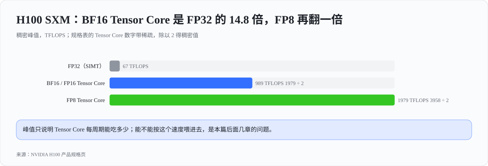
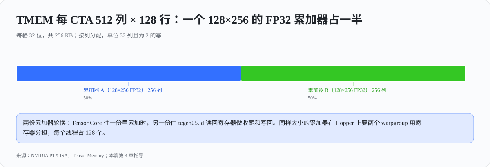
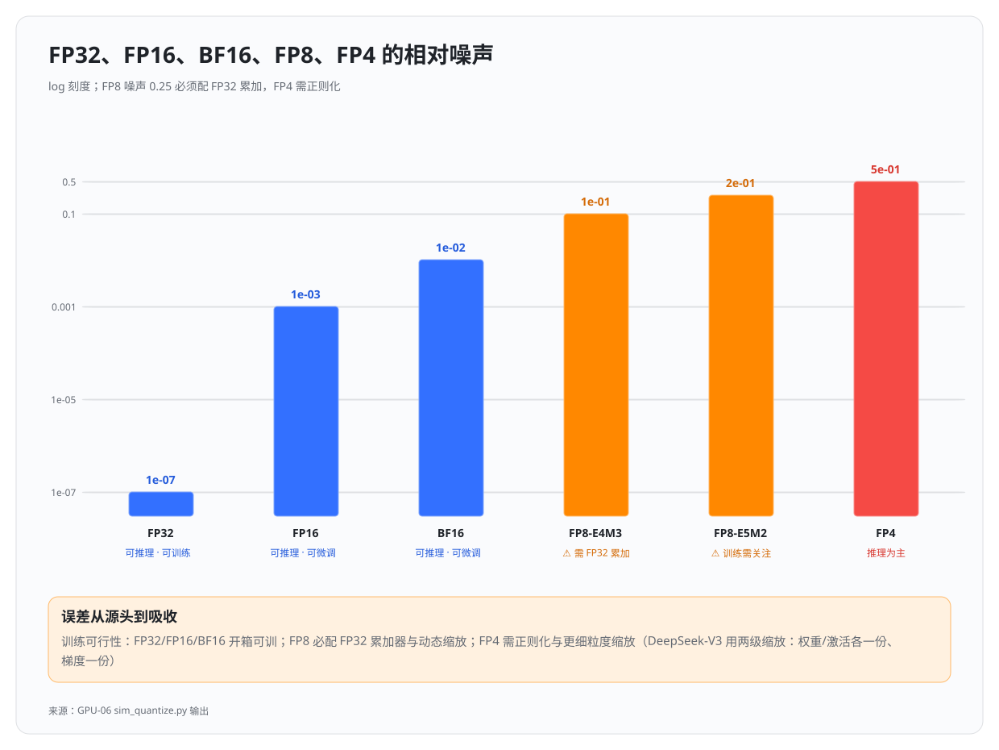

# GPU-06｜硬件｜Tensor Core 与低精度：从 mma 到 FP8 和 FP4

> 🎯 **这篇文档解决什么问题**：H100 上同样的乘加，Tensor Core 比 FP32 SIMT 快一个数量级，FP8 再翻一倍。算力涨得这么快，矩阵乘的瓶颈就从“算不过来”变成“喂不过来”：操作数要从显存搬到共享内存、再送进 Tensor Core，搬运和计算一旦串行，峰值就只是纸面数字。本篇沿两条线回答这个问题。一条是指令：从 mma.sync 到 wgmma 再到 tcgen05，每一代怎样让搬运和计算并行、让线程少干搬运的活。另一条是数值：FP8、FP4 让每个数更小，搬得更快、算得更快，代价是精度，要靠缩放和高精度累加兜住。读完应当能说清一条 Tensor Core 指令从哪取操作数、结果放哪、谁在等，能读懂 FP8 和 FP4 的格式与缩放方案，并知道上线前要验收什么。
>
> **使用方式**：第 1 章算两笔账（算力账和喂数账），第 2 到 4 章按代讲指令，第 5 到 7 章讲低精度格式、缩放和精度兜底，第 8 章是核对清单和自测。写 kernel 的读者重点看第 1 到 4 章；做训练或推理精度方案的读者可以从第 5 章读起。Volta 到 Hopper 每一代为什么要重写 kernel，GPU-33（[GPU-33｜LLM｜Tensor Core 三代跃迁：Volta→Turing→Ampere→Hopper，为什么每代都要重写 kernel](./33-tensor-core-generations.md)）有更完整的演进史；本篇的重点在 Hopper 和 Blackwell。
>
> **代码**：zero-to-gpu/06-tensor-core/ 下有 sim_tc.py（峰值、算术强度、流水模型）、sim_quantize.py（格式范围）和 test_tc.py，只需 Python。两处输出要对照本篇使用：sim_tc.py fragment 一栏标着“寄存器”的数字实际是每个线程持有的元素数，真实的寄存器数见第 2 章；sim_quantize.py format 里 E4M3 的最小值与 FP8 论文不符，以第 5 章的表为准。

<b>🧭 主线位置</b>：GPU-00（[GPU-00｜索引｜从 0 开始 GPU 优化：路线、章节与练习](./README.md)）的时间账 T = T_compute + W_mem + W_host + W_comm + W_idle 里，本篇处理 W_mem 在片上的那一段：**搬运与计算串行**。GPU-05（[GPU-05｜硬件｜GEMM 逐步优化：从朴素循环到 warp 分块](./05-gemm.md)）用分块和双缓冲把乘加单元等数据的时间藏到计算后面；换成 Tensor Core 之后，计算快了一个数量级，同样的搬运方式就藏不住了。本篇的办法有两条：让硬件替线程搬、让指令一次吃更多数据（异步化），以及让每个数变小（低精度）。读完后，GEMM 内核怎样用库和 DSL 写出来交给 GPU-07（[GPU-07｜硬件｜Triton、CUTLASS 与 CuTe DSL](./07-dsl.md)），注意力这类不规则的融合内核交给 GPU-08（[GPU-08｜硬件｜注意力内核](./08-attention.md)）。

## 导读 · 先给结论

- <b>算力几乎都在 Tensor Core。</b>H100 SXM 的 FP32 是 67 TFLOPS，BF16 Tensor Core 稠密约 989 TFLOPS，FP8 约 1979 TFLOPS[[1]](https://www.nvidia.com/en-us/data-center/h100/)（规格表的 Tensor Core 数字含稀疏，除以 2 得稠密值）。
- <b>瓶颈在喂数。</b>H100 每个 SM 每周期能做 2048 个 FP16 乘加，共享内存每周期只能送 128 字节；操作数如果每次都从共享内存直接取，分块至少要 64×64 才喂得上（第 1 章）。
- <b>指令越来越大、越来越异步。</b>mma.sync 是一个 warp 同步执行的 m16n8k16；wgmma 由 4 个 warp 异步执行，最大 m64n256k16，B 直接从共享内存取[[2]](https://docs.nvidia.com/cuda/parallel-thread-execution/index.html)；tcgen05 由单个线程发起，累加器放进 Tensor Memory[[2]](https://docs.nvidia.com/cuda/parallel-thread-execution/index.html)。
- <b>Hopper 上要用 wgmma 才吃得满。</b>Luo 等人在 H800 上实测，mma 只到 FP16 峰值的约 65%，wgmma 到 88% 到 96%[[3]](https://arxiv.org/abs/2402.13499)。
- <b>格式越窄，精度和范围让步越多。</b>FP8 的 E4M3 在 1 附近相邻两个数差 1/8，E5M2 差 1/4，最大值分别是 448 和 57344[[4]](https://arxiv.org/abs/2209.05433)；FP4（E2M1）只能表示 0 到 6 之间的 8 个非负数[[5]](https://developer.nvidia.com/blog/introducing-nvfp4-for-efficient-and-accurate-low-precision-inference/)。
- <b>缩放是低精度的前提。</b>粒度从整张量一个缩放因子，细到 DeepSeek-V3 的 1×128 和 128×128[[6]](https://arxiv.org/abs/2412.19437)，再到 NVFP4 每 16 个元素一个[[5]](https://developer.nvidia.com/blog/introducing-nvfp4-for-efficient-and-accurate-low-precision-inference/)。
- <b>精度靠高精度累加和验收兜住。</b>DeepSeek-V3 发现 H800 上 FP8 GEMM 的累加只保留约 14 位，于是每 128 个元素把部分和提升到 FP32；最终相对 BF16 基线的 loss 误差低于 0.25%[[6]](https://arxiv.org/abs/2412.19437)。

<b>📎 与系列其他文档的分工</b>：GPU-01（[GPU-01｜硬件｜GPU 架构：SM、存储层级与延迟隐藏](./01-arch.md)）讲了 cp.async 和 TMA 怎样把搬运从线程手里拿走，本篇讲它们怎样和 Tensor Core 指令配合。GPU-02（[GPU-02｜硬件｜性能账本：Roofline、算术强度与三类瓶颈](./02-ledger.md)）的 Roofline 是本篇第 1 章算账用的尺子。GPU-05（[GPU-05｜硬件｜GEMM 逐步优化：从朴素循环到 warp 分块](./05-gemm.md)）的分块是本篇的前提。GPU-07（[GPU-07｜硬件｜Triton、CUTLASS 与 CuTe DSL](./07-dsl.md)）讲用 Triton、CUTLASS 和 CuTe 把这些指令写出来，GPU-08（[GPU-08｜硬件｜注意力内核](./08-attention.md)）讲注意力内核，GPU-21（[GPU-21｜LLM｜训练并行：TP、PP、DP、ZeRO 与 FP8](./21-train-parallel.md)）讲 FP8 在大模型训练并行里的用法。

## 第 1 章 · Tensor Core 在等什么：算力账和喂数账

讨论 Tensor Core 之前先算两笔账。算力账回答“最多能多快”，喂数账回答“操作数送得上吗”。前者看规格表就有，后者要拿每个 SM 每周期的计算量和共享内存每周期能送的字节数对比。两笔账对不上的部分，就是本篇要消掉的等待。

### 算力账：Tensor Core 比 SIMT 快一个数量级

H100 SXM 的规格表上，FP32 是 67 TFLOPS；BF16 Tensor Core 标的是 1,979 TFLOPS，FP8 Tensor Core 是 3,958 TFLOPS，但这两项带星号，含义是含结构化稀疏[[1]](https://www.nvidia.com/en-us/data-center/h100/)。稠密矩阵乘要除以 2：BF16 约 989 TFLOPS，FP8 约 1979 TFLOPS。BF16 Tensor Core 是 FP32 SIMT 的约 14.8 倍。

这个差距决定了一件事：只要计算能写成矩阵乘，就应该交给 Tensor Core；FP32 的 CUDA core 留给逐元素运算、归约和收尾。也正因为 Tensor Core 太快，GPU-02（[GPU-02｜硬件｜性能账本：Roofline、算术强度与三类瓶颈](./02-ledger.md)）的 Roofline 拐点被推得很高：989 TFLOPS 除以 3.35 TB/s，每从显存读一个字节要做约 295 次浮点运算，才不被带宽卡住。一个 4096 × 4096 × 4096 的 BF16 矩阵乘，A、B、C 各读写一遍，算术强度约 1365 FLOP/B，远在拐点之上（sim_tc.py strength 输出）。从整个矩阵看，它是算力受限的。

### 喂数账：共享内存每周期送不了多少

但整个矩阵的算术强度只说明显存不是瓶颈。数据进了芯片，还要从共享内存送进 Tensor Core，这一段有自己的账。

算力一侧：A100 每个 SM 有 4 个 Tensor Core，每周期共做 1024 个稠密 FP16 乘加[[7]](https://developer.nvidia.com/blog/nvidia-ampere-architecture-in-depth/)；H100 每个 SM 在同类数据上是 A100 的 2 倍，FP8 是 4 倍[[8]](https://developer.nvidia.com/blog/nvidia-hopper-architecture-in-depth/)。所以 H100 每个 SM 每周期做 2048 个 FP16 乘加，即 4096 次浮点运算。

供给一侧：共享内存 32 个 bank，每个 bank 每周期 32 位[[9]](https://docs.nvidia.com/cuda/cuda-c-best-practices-guide/)，合起来每周期 128 字节；Luo 等人在 H800 上实测为每 SM 每周期 127.9 字节[[3]](https://arxiv.org/abs/2402.13499)。两者一比，操作数如果每次都从共享内存直接读，每读一个字节要做 4096 ÷ 128 = 32 次浮点运算，Tensor Core 才不会空等。

一个 M × N 的输出分块，每推进一步 k，要读 A 的 M 个和 B 的 N 个元素，做 2MN 次运算。BF16 每个元素 2 字节，每字节对应的运算数是 MN ÷（M + N）。64 × 64 的分块正好是 32，刚够；128 × 128 是 64；128 × 256 约 85。这就是为什么 Tensor Core 内核的分块越做越大：分块小了，共享内存先喂不动。Hopper 的 wgmma 一条指令就是 64 × N 的分块（N 最大 256），Blackwell 的 tcgen05 还能把 M 做到 128 或两个 SM 合作做到 256（第 3、4 章）。

### 本篇处理的等待

两笔账合起来看，Tensor Core 在等的是操作数：从显存到共享内存的搬运有几百个周期的延迟（GPU-01 第 1 章），从共享内存到 Tensor Core 的带宽有上限。在时间账 T = T_compute + W_mem + W_host + W_comm + W_idle 里，这属于 W_mem 在片上的部分。处理办法分三类：

- **让搬运和计算并行**：用 cp.async、TMA 异步搬运，多级缓冲，搬第 k + 1 块时算第 k 块（第 2、3 章）。
- **让每条指令吃更多数据**：指令的分块越大，同样的计算需要的发射次数和读取字节越少；累加器从寄存器搬进 Tensor Memory，又给更大的分块腾出空间（第 3、4 章）。
- **让每个数变小**：FP8、FP4 让同样的字节数装下更多元素，同时 Tensor Core 的速率也翻倍；代价是精度，要靠缩放和高精度累加兜住（第 5 到 7 章）。

> 💡 **常见误区**：拿规格表上带星号的数字当峰值。现象是自己的 GEMM 只跑到“峰值”的一半，以为 kernel 有大问题。原因是 H100 规格表的 Tensor Core 数字含结构化稀疏[[1]](https://www.nvidia.com/en-us/data-center/h100/)，稠密矩阵乘的上限只有它的一半。改法是对标时一律用稠密值，并写清数据类型和口径；GPU-02 的 MFU 也要按稠密峰值算。

> 🔑 **本章要点**：H100 SXM 稠密 BF16 约 989 TFLOPS，是 FP32 的约 14.8 倍，FP8 再翻一倍。每个 SM 每周期 4096 次运算，共享内存每周期只送 128 字节，从共享内存直接喂时分块至少要 64 × 64。这一章是五步闭环的“定天花板”：算力账给出上限，喂数账指出等待在哪里。

## 第 2 章 · warp 级同步指令：wmma 与 mma.sync

Hopper 之前，Tensor Core 都由一个 warp 驱动：32 个线程各自拿着矩阵的一小片，一起发一条指令，一起等结果。本章讲这一代指令的两个要点，片段怎样分到线程上，以及搬运和计算怎样靠软件流水重叠。这些是读懂 wgmma 和 tcgen05 改了什么的基础。

### wmma：布局不公开的 warp 级接口

Volta 的每个 Tensor Core 是一个 4×4×4 的矩阵乘加阵列，每周期做 64 个混合精度乘加[[10]](https://developer.nvidia.com/blog/programming-tensor-cores-cuda-9/)。CUDA 9 没有让程序直接面对这个阵列，而是让一个 warp 的线程合起来提供一次 16×16×16 的矩阵运算[[10]](https://developer.nvidia.com/blog/programming-tensor-cores-cuda-9/)，封装成 wmma 接口：load_matrix_sync 把一块矩阵装进片段，mma_sync 做乘加，store_matrix_sync 写回。

wmma 的特点是片段布局不公开：矩阵元素怎样分到各个线程的片段里是不透明的，程序不应依赖它[[10]](https://developer.nvidia.com/blog/programming-tensor-cores-cuda-9/)。好处是写法简单，坏处是无法按布局手工优化搬运，也没法在片段上直接做逐元素的收尾操作。

### mma.sync：公开布局的 PTX 指令

PTX 的 mma 指令从 Turing 起提出并持续扩展[[3]](https://arxiv.org/abs/2402.13499)，最常用的形状是 m16n8k16。它把布局写死在文档里。以 f16 或 bf16 输入、f32 累加为例，每个线程持有[[2]](https://docs.nvidia.com/cuda/parallel-thread-execution/index.html)：

- A（16×16）：4 个 .f16x2 寄存器，每个装两个元素，共 8 个元素。
- B（16×8）：2 个 .f16x2 寄存器，共 4 个元素。
- C 和 D（16×8）：4 个 .f32 寄存器，共 4 个元素。

每个线程共 10 个寄存器、40 字节。32 个线程的元素数加起来正好是三个矩阵的大小：A 256 个、B 128 个、C 128 个。元素落在哪个线程，由 lane 号算出：groupID = lane ÷ 4，组内序号 = lane mod 4，再按这两个值算行号和列号[[2]](https://docs.nvidia.com/cuda/parallel-thread-execution/index.html)。

布局公开以后，搬运可以按布局写。ldmatrix 指令从共享内存为 mma 协同加载一个或多个 8×8 矩阵；读 8×8 矩阵时，每 4 个相邻线程读 16 字节，即一整行[[2]](https://docs.nvidia.com/cuda/parallel-thread-execution/index.html)。装完之后各线程寄存器里的元素排列，正好是 mma 要的片段，不需要线程逐个元素搬。Luo 等人反汇编发现，Hopper 上 m16n8k16 的 mma 编译成 SASS 指令 HMMA.16816[[3]](https://arxiv.org/abs/2402.13499)。

### 搬运和计算靠软件流水重叠

mma.sync 本身是同步的：一个 warp 发出指令，要等操作数都在寄存器里。要让搬运和计算重叠，只能在软件里排流水。Ampere 的标准做法是 GPU-01 第 7 章讲的 cp.async 加多级缓冲：共享内存里开几块缓冲，用 cp.async 把第 k + 1 块从显存拷进来，同时用 ldmatrix 和 mma.sync 算第 k 块，拷贝完成靠异步栅栏通知。

这一代的局限也在这里。所有工作都压在同一批 warp 上：同一个 warp 既要发 cp.async，又要发 ldmatrix，还要发 mma.sync，三类指令挤同一批发射槽。累加器在寄存器里，一个 warp 负责的输出块越大，寄存器越紧，GPU-01 第 5 章讲的寄存器台阶会把 occupancy 往下拉。Luo 等人的结论是，Hopper 上 wmma 和 mma 接口仍然可用，但 Tensor Core 的全部潜力只有 wgmma 能发挥[[3]](https://arxiv.org/abs/2402.13499)，第 3 章给出实测数字。

估算寄存器压力时有个常见的错：把 m16n8k16 的片段大小当成“16 个寄存器”，结果和编译器报告对不上。原因是混淆了元素数和寄存器数：16 位输入两个元素装一个 .f16x2 寄存器，A 的 8 个元素只占 4 个寄存器[[2]](https://docs.nvidia.com/cuda/parallel-thread-execution/index.html)。改法是按 PTX 片段表数寄存器：f16 输入、f32 累加时每线程 A 4 个、B 2 个、C 4 个，共 10 个。

> 🔑 **本章要点**：wmma 一个 warp 做 16×16×16，布局不公开；mma.sync 的 m16n8k16 布局公开，每线程 10 个寄存器，配 ldmatrix 按布局从共享内存装片段。搬运和计算的重叠全靠软件流水，同一批 warp 既搬又算，累加器占寄存器。这一章是五步闭环的“定位等待”：等待在操作数进寄存器这一步。

## 第 3 章 · Hopper：wgmma 与 TMA 让搬运和计算并行

Hopper 在两头同时动手：搬运交给 TMA，由硬件生成地址、一次搬一整块；计算换成 wgmma，由 4 个 warp 一起发一条更大的异步指令，B 直接从共享内存取。两者靠异步栅栏交接，kernel 的结构从“每个 warp 既搬又算”变成“一部分 warp 搬，一部分 warp 算”。

### wgmma：4 个 warp 一起发，一条指令更大

wgmma 以 warpgroup 为单位执行，一个 warpgroup 是 4 个连续的 warp[[2]](https://docs.nvidia.com/cuda/parallel-thread-execution/index.html)。f16 和 bf16 输入的稠密形状是 m64nNk16，N 从 8 到 256，按 8 递增；FP8（e4m3、e5m2）是 m64nNk32[[2]](https://docs.nvidia.com/cuda/parallel-thread-execution/index.html)。最大的 m64n256k16 一条指令做 64 × 256 × 16 = 262144 次乘加，是 m16n8k16 的 128 倍。

操作数的位置也变了。A 可以放在寄存器里，也可以和 B 一样用一个 64 位的矩阵描述符指向共享内存；累加器 D 仍在寄存器里，分布在参与的线程上[[2]](https://docs.nvidia.com/cuda/parallel-thread-execution/index.html)。B 不再需要先用 ldmatrix 读进寄存器，Tensor Core 直接从共享内存取。

wgmma 是异步的。发出之后线程可以继续做别的事，要用结果之前，用 wgmma.commit_group 把已发出的 wgmma 打成一组，再用 wgmma.wait_group 等这一组完成[[2]](https://docs.nvidia.com/cuda/parallel-thread-execution/index.html)。ncu 的文档提醒了它的另一面：warpgroup 级的 MMA 像一道横跨 SM 四个 warp 调度器的栅栏[[11]](https://docs.nvidia.com/nsight-compute/ProfilingGuide/index.html)，4 个 warp 要一起到场。

### 实测：Hopper 上 mma 吃不满，wgmma 接近峰值

Luo 等人在 H800 上分别测了两种指令（FP16 输入、FP32 累加，稠密）[[3]](https://arxiv.org/abs/2402.13499)：

- mma m16n8k16：延迟 24.1 个周期，吞吐 490.7 TFLOPS。
- wgmma m64n256k16，A、B 都在共享内存：延迟 128 个周期，全零数据 728.5 TFLOPS，随机数据 665.4 TFLOPS。

同一篇论文给出的 H800 FP16 峰值是 756.5 TFLOPS[[3]](https://arxiv.org/abs/2402.13499)。mma 只到约 64.9%，wgmma 到 88% 到 96.3%。wgmma 的延迟是 mma 的约 5.3 倍，做的乘加却是 128 倍，摊到每次乘加上的发射和等待少得多。FP8 的 wgmma m64n256k32 在 FP32 累加下测到 1447.5 TFLOPS，是 FP8 峰值 1513 的约 95.7%[[3]](https://arxiv.org/abs/2402.13499)。

全零和随机数据的差别也值得注意：同一条指令，随机数据比全零慢约 9%，论文把两种数据分开列出[[3]](https://arxiv.org/abs/2402.13499)。自己做 Tensor Core 吞吐对标时，也要写清输入数据是什么分布。

### TMA 搬，wgmma 算，两组 warp 分工

GPU-01 第 7 章讲过 TMA：一个线程建好拷贝描述符后启动，地址生成和数据搬运都由硬件完成，在全局内存和共享内存之间搬大块数据[[8]](https://developer.nvidia.com/blog/nvidia-hopper-architecture-in-depth/)。它和 wgmma 一配合，kernel 的典型结构就成了 warp 专用化：Colfax 的教程指出，TMA 的异步性让 warp 专用化的调度成为可能[[12]](https://research.colfax-intl.com/tutorial-hopper-tma/)。

- 生产者 warp：只负责发 TMA，把下一块 A、B 搬进共享内存的环形缓冲，搬完通过异步栅栏通知。
- 消费者 warpgroup：等栅栏，发 wgmma 直接从共享内存取操作数计算，用完一块缓冲就通知生产者可以覆盖。

和 Ampere 相比，变化有三点：搬运不占消费者的发射槽；B（以及选择放在共享内存里的 A）不经过寄存器；一条指令的分块大到足以让共享内存喂得上（第 1 章）。CUTLASS 的示例 48（Hopper warp 专用化 GEMM）就是这种结构的参考实现[[13]](https://github.com/NVIDIA/cutlass/tree/main/examples/48_hopper_warp_specialized_gemm)。

### 没解决的问题：累加器还在寄存器里

wgmma 的累加器在寄存器里。一个 m64n256 的 FP32 累加器有 64 × 256 = 16384 个元素，分到一个 warpgroup 的 128 个线程上，每个线程 128 个寄存器。每线程寄存器上限是 255 个（GPU-01 第 2 章），累加器占去一半，留给地址、循环变量和流水的就不多了，输出分块也很难再加大。Blackwell 把累加器从寄存器里搬走，是第 4 章的内容。

> 💡 **常见误区**：把 Ampere 上调好的 mma.sync kernel 直接拿到 H100 上跑，以为会自动用上新 Tensor Core。现象是 H100 上的 GEMM 只比 A100 快一点，离峰值很远。原因是 mma 指令在 Hopper 上只能跑到峰值的约三分之二，Tensor Core 的全部潜力只有 wgmma 能发挥[[3]](https://arxiv.org/abs/2402.13499)。改法是用已经针对 Hopper 实现的库（cuBLAS、CUTLASS 3.x 的 Hopper 内核），或在 Triton 等编译器里确认生成了 wgmma；用 ncu 的指令统计看 SASS 里是 HGMMA 还是 HMMA。

> 🔑 **本章要点**：wgmma 由 4 个 warp 一起异步执行，最大 m64n256k16，B 直接从共享内存取，累加器仍在寄存器。H800 上 mma 只到 FP16 峰值的约 65%，wgmma 到 88% 到 96%。TMA 加 wgmma 让生产者和消费者 warp 分工，搬运和计算真正并行。这一章走了五步闭环的“测实际”和“消除或隐藏”：先用实测确认 mma 在 Hopper 上吃不满，再把搬运藏到计算后面。

## 第 4 章 · Blackwell：tcgen05 与 Tensor Memory

第 3 章留下一个问题：wgmma 的累加器在寄存器里，一个大分块就要占去每个线程一半的寄存器。Blackwell 的第五代 Tensor Core 给出的答案是专用的片上存储 Tensor Memory（TMEM），累加器放在那里；配套的 tcgen05 指令由单个线程发起。本章讲 TMEM 的结构、tcgen05 的形状和操作数位置，以及这对 kernel 结构意味着什么。

### Tensor Memory：每 CTA 512 列 × 128 行

PTX 文档对 TMEM 的描述是：第五代 Tensor Core 专用的片上存储，组织成二维矩阵，行叫 lane，列叫 column；在 sm_100a / sm_100f 上，每个 CTA 有 512 列、128 行，每格 32 位[[2]](https://docs.nvidia.com/cuda/parallel-thread-execution/index.html)。算下来是 512 × 128 × 4 = 262144 字节，即 256 KB。Blackwell Ultra 的架构博客也写明每个 SM 有 256 KB TMEM，紧贴计算单元[[14]](https://developer.nvidia.com/blog/inside-nvidia-blackwell-ultra-the-chip-powering-the-ai-factory-era/)。

TMEM 要显式管理：必须由 CTA 里的一个 warp 用专门的分配指令申请，按列分配，单位是 32 列，列数必须是 2 的幂；分配一列就占下这一列的全部 128 个 lane；kernel 退出前必须显式释放[[2]](https://docs.nvidia.com/cuda/parallel-thread-execution/index.html)，而且申请和释放要由同一个 warp 做[[15]](https://research.colfax-intl.com/cutlass-tutorial-writing-gemm-kernels-using-tensor-memory-for-nvidia-blackwell-gpus/)。数据在 TMEM 和寄存器之间靠 tcgen05.ld、tcgen05.st 搬，其中 tcgen05.ld 是从 TMEM 到寄存器的异步集体加载[[2]](https://docs.nvidia.com/cuda/parallel-thread-execution/index.html)。访问有限制：TMEM 按 lane 均分成 4 块，warpgroup 里的每个 warp 只能访问其中一块，4 个 warp 合起来才能访问全部 lane[[2]](https://docs.nvidia.com/cuda/parallel-thread-execution/index.html)。所以把整个累加器读回寄存器，要一整个 warpgroup 一起做[[15]](https://research.colfax-intl.com/cutlass-tutorial-writing-gemm-kernels-using-tensor-memory-for-nvidia-blackwell-gpus/)。

一个 128 × 256 的 FP32 累加器有 32768 个元素，按 128 个 lane 排，占 256 列，正好是 TMEM 的一半。剩下一半可以放第二份累加器：Tensor Core 往一份里累加时，另一份由 tcgen05.ld 读回寄存器做收尾和写回，两份轮换。同样大小的累加器放在 Hopper 的寄存器里，要两个 warpgroup 分担，每个线程占 128 个寄存器（第 3 章）。

### tcgen05.mma：单线程发起，操作数不经寄存器

tcgen05.mma 是单线程语义，和 mma.sync、wgmma 这类集体指令不同：一个线程发出 tcgen05.mma，就启动了整个矩阵乘加[[2]](https://docs.nvidia.com/cuda/parallel-thread-execution/index.html)。发射这件事不再需要整个 warp 或 warpgroup 到场，计算 warp 的发射槽空了出来。

操作数的位置是：累加矩阵 D 在 TMEM；A 可以在 TMEM，也可以用描述符指向共享内存；B 用描述符指向共享内存[[2]](https://docs.nvidia.com/cuda/parallel-thread-execution/index.html)。矩阵乘本身完全不经过寄存器，寄存器只在收尾时从 TMEM 读回结果。

形状也变大了。以 f16 和 bf16 输入为例[[2]](https://docs.nvidia.com/cuda/parallel-thread-execution/index.html)：

- 单个 CTA（cta_group::1）：M 为 64 或 128，N 从 8 到 256 按 8 递增，K 为 16。
- 两个 CTA 合作（cta_group::2）：M 为 128 或 256，N 从 16 到 256 按 16 递增，K 为 16。

两个 CTA 合作的模式，对应 Blackwell Ultra 博客说的双线程块 MMA：成对的 SM 合作完成一次 MMA，共享操作数，减少重复的显存流量[[14]](https://developer.nvidia.com/blog/inside-nvidia-blackwell-ultra-the-chip-powering-the-ai-factory-era/)。这和 GPU-05 的分块复用是同一个道理：同一份 B 被两个 SM 的计算共用，只搬一次。

### kernel 结构的变化

从 wgmma 到 tcgen05，kernel 里的分工又细了一层：

- 搬运：仍由 TMA 把 A、B 搬进共享内存。
- 发射：一个线程发 tcgen05.mma，结果累加进 TMEM。
- 收尾：一个 warpgroup 用 tcgen05.ld 把上一块的累加结果从 TMEM 读回寄存器，做缩放、激活、类型转换后写回显存。

三者都异步：tcgen05.mma 完成后用 tcgen05.commit 通知一个 mbarrier，收尾的 warp 等到这个 mbarrier 再发 tcgen05.ld[[2]](https://docs.nvidia.com/cuda/parallel-thread-execution/index.html)。Colfax 的总结是，TMEM 和 tcgen05.mma 对矩阵乘做的事，就是 TMA 对拷贝做过的事：变成单线程发起、异步、不占寄存器的操作，寄存器主要留给调度和融合的收尾运算[[15]](https://research.colfax-intl.com/cutlass-tutorial-writing-gemm-kernels-using-tensor-memory-for-nvidia-blackwell-gpus/)。好处是寄存器压力从“装下整个累加器”降到“装下收尾时的一小片”，分块可以更大、流水可以更深；代价是同步关系更多，TMEM 的分配和释放也要自己写对。CUTLASS 的示例 70 有 FP16 和 FP8 两个 Blackwell GEMM 参考实现[[16]](https://github.com/NVIDIA/cutlass/tree/main/examples/70_blackwell_gemm)，Colfax 的系列教程从 CuTe 示例出发逐行讲了 TMEM 的用法[[15]](https://research.colfax-intl.com/cutlass-tutorial-writing-gemm-kernels-using-tensor-memory-for-nvidia-blackwell-gpus/)。实际工作中，这一层通常交给 CUTLASS、cuBLAS 或 GPU-07（[GPU-07｜硬件｜Triton、CUTLASS 与 CuTe DSL](./07-dsl.md)）讲的 DSL。

> 💡 **常见误区**：认为 Tensor Memory 是 Hopper 就有的，或者以为 TMA 能直接把数据搬进 TMEM。现象是照着 Hopper 的资料去找 TMEM 相关的 API，或者按 TMEM 的思路去估 H100 的寄存器用量。原因是 TMEM 是第五代 Tensor Core 才有的存储，PTX 文档把它列在 tcgen05 一族下，结构说明针对 sm_100a / sm_100f[[2]](https://docs.nvidia.com/cuda/parallel-thread-execution/index.html)；TMA 搬运的两端是全局内存和共享内存[[8]](https://developer.nvidia.com/blog/nvidia-hopper-architecture-in-depth/)。改法是按代区分：Hopper 的累加器在寄存器，Blackwell 的在 TMEM，进 TMEM 要走 tcgen05 的指令。

> 🔑 **本章要点**：TMEM 每 CTA 512 列 × 128 行、每格 32 位，共 256 KB，由一个 warp 按 32 列为单位申请和释放。tcgen05.mma 单线程发起，D 在 TMEM，B 在共享内存，A 两者皆可；两个 CTA 合作时 M 可到 256。一个 128 × 256 的 FP32 累加器占 TMEM 一半，两份轮换就能让计算和收尾并行。这一章仍是“消除或隐藏”：把累加器占用的寄存器腾了出来。

## 第 5 章 · 低精度格式：位数怎样换成速度、范围和精度

第 2 到 4 章靠指令把搬运藏到计算后面。本篇的另一条路是让每个数变小：同样的字节装下更多元素，Tensor Core 每周期也能多算一倍。本章先算这笔账能省下什么、省不下什么，再看各格式的位怎样分配，以及每种分配在范围和精度上让出了什么。

### 低精度省下什么，省不下什么

算力一侧，H100 每个 SM 的 Tensor Core 在 FP8 上的速率是 A100 SM 同类数据的 4 倍，FP16 上是 2 倍[[8]](https://developer.nvidia.com/blog/nvidia-hopper-architecture-in-depth/)，所以 FP8 是 FP16 的 2 倍。规格表上的稠密值也是这个关系：FP8 约 1979 TFLOPS，BF16 约 989 TFLOPS[[1]](https://www.nvidia.com/en-us/data-center/h100/)。

显存一侧，每个元素从 2 字节变成 1 字节，同一个矩阵乘读写的字节数减半，Roofline 上的算术强度翻倍。权重从显存读进来的时间、多卡之间传输激活的时间，都跟着减半。

但第 1 章的喂数账不会因此变松。H100 每个 SM 每周期做 4096 次 FP16 运算，FP8 是 8192 次；共享内存每周期仍只送 128 字节，从共享内存直接喂时每字节要做 8192 ÷ 128 = 64 次运算。FP8 的 64 × 64 分块每字节正好对应 64 次运算：元素小了一半，运算快了一倍，两者抵消，分块不能因此变小。低精度省的是显存和带宽，片上的喂数仍要靠第 3、4 章的大指令和异步搬运。

### 位分配：指数管范围，尾数管精度

浮点数由符号、指数、尾数三部分组成。指数位数决定能表示多大和多小的数，尾数位数决定相邻两个数靠得多近：尾数有 m 位时，1 和下一个可表示数的差是 2 的负 m 次方。各格式的位分配如下：

- **BF16**：8 位指数、7 位尾数，指数和 FP32 一样宽，范围约 1e-38 到 1e38，表示权重、激活和梯度的分布都不需要缩放因子[[17]](https://developer.nvidia.com/blog/floating-point-8-an-introduction-to-efficient-lower-precision-ai-training/)。1 附近的间距是 2^-7。
- **FP16**：5 位指数、10 位尾数，最大值 65,504[[18]](https://arxiv.org/abs/1710.03740)，绝对值小于 2^-24 的数变成 0[[18]](https://arxiv.org/abs/1710.03740)。1 附近的间距是 2^-10，比 BF16 细 8 倍，范围却窄得多，所以 FP16 训练要配 loss scaling（第 7 章）。
- **FP8 E4M3**：4 位指数、3 位尾数。最大值 448，最小正规数 2^-6，最小次正规数 2^-9（约 0.00195）[[4]](https://arxiv.org/abs/2209.05433)。1 附近的间距是 1/8。
- **FP8 E5M2**：5 位指数、2 位尾数。最大值 57344，最小正规数 2^-14，最小次正规数 2^-16[[4]](https://arxiv.org/abs/2209.05433)。1 附近的间距是 1/4。
- **FP4 E2M1**：2 位指数、1 位尾数，非负数只有 0、0.5、1、1.5、2、3、4、6 这 8 个[[5]](https://developer.nvidia.com/blog/introducing-nvfp4-for-efficient-and-accurate-low-precision-inference/)，范围约 -6 到 6[[5]](https://developer.nvidia.com/blog/introducing-nvfp4-for-efficient-and-accurate-low-precision-inference/)。4 和 6 之间没有别的数，间距是 2。

E4M3 的最大值有个细节：它不按 IEEE 的惯例表示无穷大，NaN 也只占一个尾数编码，省下来的编码给了更大的数[[4]](https://arxiv.org/abs/2209.05433)；如果照搬 IEEE 的规则，最大值只有 240[[4]](https://arxiv.org/abs/2209.05433)。448 和 240 差了将近一倍，对一个只有 8 位的格式，这点范围很值钱。

### 两种 FP8 各管一头

E4M3 多一位尾数，精度高、范围窄；E5M2 多一位指数，范围宽、精度低。FP8 论文的推荐用法是权重和激活用 E4M3，梯度用 E5M2[[4]](https://arxiv.org/abs/2209.05433)。论文也说明了为什么要两种格式：不同网络需要的动态范围不同；有的网络只用 E4M3 或只用 E5M2 就能训练，有的网络两种都要[[4]](https://arxiv.org/abs/2209.05433)。这条推荐也不是唯一答案：DeepSeek-V3 在所有张量上都用 E4M3，换取更高的精度，范围的不足交给细粒度缩放[[6]](https://arxiv.org/abs/2412.19437)（第 6 章）。

FP4 更极端。4 位只有 16 个编码。按就近舍入，绝对值小于 0.25 的数都会变成 0，0.25 到 0.75 之间的数都会变成 0.5；一个绝对值大多不到 0.1 的权重张量直接转换过去，几乎全是 0。FP4 能用，全靠每 16 或 32 个元素配一个缩放因子，这是第 6 章的主题。

> 💡 **常见误区**：把高精度张量直接转换成 FP8，不加缩放。现象是训练 loss 不收敛，或者推理精度明显下降。原因是 E4M3 的范围只到 448，最小的次正规数是 2^-9[[4]](https://arxiv.org/abs/2209.05433)：一个最大值几千的激活张量，超出部分无法表示；一个绝对值大多在 1e-4 量级的梯度张量，几乎全部变成 0。改法是转换前先乘缩放因子，把数值移进格式的可表示范围[[4]](https://arxiv.org/abs/2209.05433)，见第 6 章。核对格式范围时以 FP8 论文的表为准，不要用 sim_quantize.py format 输出里 E4M3 的最小值。

> 🔑 **本章要点**：FP8 让 Tensor Core 速率翻倍、显存字节减半，但片上喂数账不变，分块不能变小。指数管范围、尾数管精度：E4M3 最大 448、1 附近间距 1/8，E5M2 最大 57344、间距 1/4，FP4 只有 8 个非负值。这一章是五步闭环的“定天花板”：给出每种格式能表示什么、不能表示什么。

## 第 6 章 · 缩放：让数值落进格式的范围

第 5 章的结论是，FP8 和 FP4 的范围太窄，张量不能直接转换。补救办法是缩放：转换前乘一个缩放因子，把数值移到格式能表示的区间，算完再除回去。本章讲缩放因子怎样选、按多大一组元素共用一个，以及硬件怎样把缩放并进 Tensor Core 的乘加里。

### 逐张量缩放：最简单，怕离群值

FP8 论文的做法是：高精度的值转换成 FP8 之前，先乘一个缩放因子，把它们移进和 FP8 可表示范围更重叠的区间[[4]](https://arxiv.org/abs/2209.05433)。这和 FP16 混合精度里 loss scaling 的目的相同。论文指出，有的网络需要逐张量的缩放因子，因为 FP8 的范围覆盖不了所有张量的重要数值[[4]](https://arxiv.org/abs/2209.05433)；选缩放因子的基本思路是让张量的最大绝对值接近格式的最大可表示值[[4]](https://arxiv.org/abs/2209.05433)。

这种做法的弱点在最大值本身。DeepSeek-V3 的技术报告描述过：标准做法是把输入张量的最大绝对值缩放到 FP8 的最大可表示值[[6]](https://arxiv.org/abs/2412.19437)，这让低精度训练对激活里的离群值非常敏感，会严重损害量化精度[[6]](https://arxiv.org/abs/2412.19437)。道理可以用 E4M3 的数字说明：如果一个张量里有一个值是其余值的 1000 倍，缩放后它贴着 448，其余值就落在 0.448 附近甚至更小，用上的只是格式底部那一小段；更小的值掉到 2^-9 以下，直接变成 0。

### 细粒度缩放：一小组元素共用一个缩放因子

解决办法是把缩放粒度变细，一组元素各配一个缩放因子，离群值只能拖累它所在的那一组。几种有代表性的方案：

- <b>DeepSeek-V3（FP8 训练）</b>：激活按 1×128 的 tile 分组，即每个 token 每 128 个通道一个缩放因子；权重按 128×128 的块分组[[6]](https://arxiv.org/abs/2412.19437)。每个 tile 或块的最大绝对值在线计算[[6]](https://arxiv.org/abs/2412.19437)，所有张量都用 E4M3[[6]](https://arxiv.org/abs/2412.19437)。报告的说法是，这样量化可以按更小的元素组调整缩放，更好地容纳离群值[[6]](https://arxiv.org/abs/2412.19437)。
- **MXFP4**：每 32 个 4 位值共享一个 2 的幂缩放因子[[5]](https://developer.nvidia.com/blog/introducing-nvfp4-for-efficient-and-accurate-low-precision-inference/)，缩放用 E8M0 编码。E8M0 只能把缩放取到最近的 2 的整数次幂，可能带来较大的量化误差[[5]](https://developer.nvidia.com/blog/introducing-nvfp4-for-efficient-and-accurate-low-precision-inference/)。每个值摊到 8 ÷ 32 = 0.25 位缩放开销，合 4.25 位。
- **NVFP4**：每 16 个值配一个 E4M3 缩放因子，另加每张量一个 FP32 缩放因子[[5]](https://developer.nvidia.com/blog/introducing-nvfp4-for-efficient-and-accurate-low-precision-inference/)。缩放本身有 3 位尾数，比 2 的幂精细；E4M3 范围窄的问题由第二级 FP32 缩放补上。每个值合 4.5 位，显存占用约为 FP16 的 1/3.5、FP8 的 1/1.8[[5]](https://developer.nvidia.com/blog/introducing-nvfp4-for-efficient-and-accurate-low-precision-inference/)。NVIDIA 报告它在 DeepSeek-R1-0528 的评测上相对 FP8 的精度损失在 1% 以内[[5]](https://developer.nvidia.com/blog/introducing-nvfp4-for-efficient-and-accurate-low-precision-inference/)。

粒度越细，额外的字节和计算越多：NVFP4 比 MXFP4 每个值多 0.25 位，缩放因子的读取和应用也多一倍。粒度怎样选，最终看精度验收（第 7 章）。

### 缩放在哪里乘回去

缩放因子沿 K 维分组以后，矩阵乘不能一口气做完：每一组的部分和要先乘上 A、B 两侧的缩放因子，再累加。在 Hopper 上，Tensor Core 不认缩放因子，DeepSeek-V3 的做法是把部分和从 Tensor Core 拷到 CUDA Core，乘上缩放因子后加进 FP32 寄存器[[6]](https://arxiv.org/abs/2412.19437)，报告称这样做额外的计算开销很小[[6]](https://arxiv.org/abs/2412.19437)。第 7 章会看到，这一步和提高累加精度是同一个操作。

报告同时承认，部分和在 Tensor Core 和 CUDA Core 之间频繁搬动，仍然限制了计算效率[[6]](https://arxiv.org/abs/2412.19437)，并建议未来的芯片让 Tensor Core 直接接收缩放因子，做分组缩放的矩阵乘[[6]](https://arxiv.org/abs/2412.19437)。Blackwell 做到了这一点。tcgen05.mma 有块缩放的版本，kind 包括 mxf8f6f4、mxf4 和 mxf4nvf4，A 和 B 的缩放因子作为操作数从 Tensor Memory 读入[[2]](https://docs.nvidia.com/cuda/parallel-thread-execution/index.html)。NVIDIA 的说法是，第五代 Tensor Core 在硬件里处理 NVFP4 的元素分组、动态缩放和 4 位矩阵运算[[5]](https://developer.nvidia.com/blog/introducing-nvfp4-for-efficient-and-accurate-low-precision-inference/)。缩放因子和累加器一样进了 TMEM，不再占寄存器，也不再需要 CUDA Core 中途插手。

> 💡 **常见误区**：认为 FP4 的缩放开销可以忽略，按每个值 4 位估算显存和带宽。现象是估出来的显存占用比实际偏小，FP4 相对 FP8 的带宽收益也没有估的那么大。原因是缩放因子也要存、也要读：MXFP4 每 32 个值一个 8 位缩放，NVFP4 每 16 个值一个，合每值 4.5 位[[5]](https://developer.nvidia.com/blog/introducing-nvfp4-for-efficient-and-accurate-low-precision-inference/)。改法是按格式的实际位数估算，NVFP4 相对 FP8 按约 1.8 倍的显存节省计[[5]](https://developer.nvidia.com/blog/introducing-nvfp4-for-efficient-and-accurate-low-precision-inference/)，不按 2 倍。

> 🔑 **本章要点**：缩放把数值移进格式的范围，逐张量缩放怕离群值，所以粒度越做越细：DeepSeek-V3 是 1×128 和 128×128，MXFP4 每 32 个值，NVFP4 每 16 个值加每张量一个 FP32。Hopper 上缩放要在 CUDA Core 上乘回，Blackwell 的块缩放 tcgen05.mma 把缩放因子放进 TMEM，在 Tensor Core 里完成。这一章是五步闭环的“消除或隐藏”：用缩放换来低精度的速度，又把缩放的开销藏进了硬件。

## 第 7 章 · 精度兜底：高精度主权重、高精度累加和对照验收

缩放解决的是“数能不能表示”。低精度还有两处会丢精度：权重更新太小，加到权重上被舍掉；矩阵乘的部分和累加得太长，误差越滚越大。这两处的补救从 FP16 混合精度起就有了，FP8 训练沿用并加强。本章讲这些兜底措施，最后讲上线前怎样验收。

### FP16 混合精度的三件套

Micikevicius 等人 2017 年的混合精度训练论文提出了三项技术：保留一份 FP32 的主权重，用 loss scaling 防止梯度值变成 0，FP16 运算配 FP32 累加[[18]](https://arxiv.org/abs/1710.03740)。三项各对应一个具体问题：

- **FP32 主权重**：每次迭代取一份 FP16 副本做前向和反向[[18]](https://arxiv.org/abs/1710.03740)，优化器在 FP32 主权重上更新。原因是 FP16 尾数只有 10 位，权重比更新大 2048 倍以上时，更新在相加时被移出尾数，变成无法恢复的 0[[18]](https://arxiv.org/abs/1710.03740)。
- **loss scaling**：FP16 里绝对值小于 2^-24 的数都会变成 0[[18]](https://arxiv.org/abs/1710.03740)，论文统计的一个网络里约 5% 的权重梯度指数小于 -24[[18]](https://arxiv.org/abs/1710.03740)。先把 loss 乘一个因子，梯度跟着放大，就能留在 FP16 的范围里；论文试过的常数因子从 8 到 32K 不等，很多网络根本不需要[[18]](https://arxiv.org/abs/1710.03740)。
- **FP32 累加**：乘法用 FP16，部分和在 FP32 里累加。Tensor Core 从 Volta 起就是这样设计的：FP16 输入、FP32 累加[[10]](https://developer.nvidia.com/blog/programming-tensor-cores-cuda-9/)。

BF16 的指数和 FP32 一样宽，表示权重、激活和梯度都不需要缩放因子[[17]](https://developer.nvidia.com/blog/floating-point-8-an-introduction-to-efficient-lower-precision-ai-training/)，所以 BF16 训练通常不用 loss scaling，但主权重和累加仍保留 FP32。

### FP8：累加精度要自己补

到了 FP8，三件套还在，累加这一项出了新问题。DeepSeek-V3 的技术报告发现，H800 上 FP8 GEMM 的累加只保留约 14 位，远低于 FP32[[6]](https://arxiv.org/abs/2412.19437)；内维 K 越大问题越明显[[6]](https://arxiv.org/abs/2412.19437)。他们的初步测试里，两个 K = 4096 的随机矩阵相乘，最大相对误差接近 2%[[6]](https://arxiv.org/abs/2412.19437)。

DeepSeek-V3 的补法是定期提升精度：Tensor Core 先用有限位宽累加，每累加 N_C 个元素，把部分和拷到 CUDA Core 的 FP32 寄存器里做全精度累加[[6]](https://arxiv.org/abs/2412.19437)，N_C 取 128[[6]](https://arxiv.org/abs/2412.19437)。FP8 的 wgmma 每条 K = 32（第 3 章），128 个元素就是 4 条 wgmma 提升一次。第 6 章的缩放因子也在这一步乘上，两件事合成一次操作。

这个提升会降低单个 warpgroup 的 wgmma 发射率。报告的解释是，H800 上通常有两个 wgmma 同时在跑：一个 warpgroup 做提升时，另一个可以继续做矩阵乘[[6]](https://arxiv.org/abs/2412.19437)。这正是第 3 章讲的思路，把一部分工作藏到另一部分后面。Blackwell 的块缩放 tcgen05.mma 在 Tensor Core 里完成缩放（第 6 章），部分和不再需要在 Tensor Core 和 CUDA Core 之间来回搬。

DeepSeek-V3 也没有把所有计算都换成 FP8。线性层的三个 GEMM（前向、激活梯度、权重梯度）用 FP8 输入[[6]](https://arxiv.org/abs/2412.19437)，输出 BF16 或 FP32[[6]](https://arxiv.org/abs/2412.19437)；嵌入层、输出头、MoE 门控、归一化和注意力算子保留 BF16 或 FP32[[6]](https://arxiv.org/abs/2412.19437)；主权重、权重梯度和优化器状态也存成更高精度[[6]](https://arxiv.org/abs/2412.19437)。

### 对照验收：和高精度基线比

低精度方案的验收标准是和高精度基线比，而不是看 loss 曲线“看起来正常”。DeepSeek-V3 在两个规模上（接近 DeepSeek-V2-Lite 和 DeepSeek-V2）各训练约 1 万亿 token 做验证[[6]](https://arxiv.org/abs/2412.19437)，FP8 训练相对 BF16 基线的 loss 相对误差始终低于 0.25%[[6]](https://arxiv.org/abs/2412.19437)，报告认为这在训练随机性的可接受范围内[[6]](https://arxiv.org/abs/2412.19437)。推理的 FP4 也一样，NVFP4 的结论是在 DeepSeek-R1-0528 的评测上相对 FP8 损失 1% 以内[[5]](https://developer.nvidia.com/blog/introducing-nvfp4-for-efficient-and-accurate-low-precision-inference/)。

落到自己的工作上，验收至少包括：

- 同一份数据、同一组超参，跑一份 BF16 基线，和低精度版本比 loss 曲线，记下相对误差的最大值，而不只是最后一步。
- 推理方案在目标任务的评测集上比准确率，基线用上一档精度（FP4 比 FP8，FP8 比 BF16）。
- 单个 GEMM 先做数值对拍：同一组输入，低精度 kernel 的输出和 FP32 参考实现比相对误差，K 取实际模型里的大小，因为 K 越大累加误差越大。

代码目录里 sim_quantize.py 的 noise 输出是简化模型给出的量化噪声估算，可以用来理解格式之间的相对差别，不能代替上面的实测验收。

> 💡 **常见误区**：认为 Tensor Core 的累加器标着 FP32，FP8 矩阵乘的累加就是全精度的。现象是小规模测试精度正常，换到 K 很大的真实模型后误差明显变大。原因是 DeepSeek-V3 测得 H800 上 FP8 GEMM 的累加只保留约 14 位[[6]](https://arxiv.org/abs/2412.19437)，K 越大误差越大[[6]](https://arxiv.org/abs/2412.19437)。改法是选用会定期把部分和提升到 FP32 的 kernel（DeepSeek-V3 的做法是每 128 个元素一次），并按实际 K 做数值对拍。

> 🔑 **本章要点**：FP16 混合精度的三件套是 FP32 主权重、loss scaling 和 FP32 累加。FP8 在 H800 上的累加只有约 14 位，DeepSeek-V3 每 128 个元素把部分和提升到 FP32，并让两个 warpgroup 交替做提升和矩阵乘。验收要对照高精度基线：FP8 训练相对 BF16 的 loss 误差低于 0.25%，NVFP4 推理相对 FP8 损失 1% 以内。这一章是五步闭环的“复测”：确认低精度的速度没有用正确性换。

## 第 8 章 · 核对清单、练习与自测

前七章按五步闭环走了一遍：第 1 章定天花板，第 2 章定位等待，第 3、4 章用异步指令把搬运藏到计算后面，第 5、6 章用低精度和缩放换速度，第 7 章复测精度。本章把这些压成一张上线前的核对清单，配上可以直接跑的代码练习和自测题。

### 📌 核对清单

| 检查项 | 怎样查 | 通过的标志 |
|---|---|---|
| 对标的峰值口径正确 | 查规格表，带稀疏标注的数字除以 2（第 1 章） | MFU 按稠密峰值算，写清数据类型 |
| kernel 用上了这一代的 Tensor Core 指令 | ncu 或 cuobjdump 看 SASS（第 3 章） | H100 上看到 HGMMA，而不是只有 HMMA |
| 分块够大，共享内存喂得上 | 按 MN ÷（M + N）算每字节运算数，和第 1 章的 32（FP16）或 64（FP8）比 | 分块的每字节运算数不低于要求 |
| 搬运和计算真的并行 | ncu 看 Tensor Core 利用率和 warp 停顿原因 | 主要停顿不在等待共享内存或全局内存数据 |
| 低精度张量都经过缩放 | 检查每个 FP8 或 FP4 张量的缩放粒度（第 6 章） | 没有不经缩放直接转换的张量 |
| FP8 累加会定期提升精度 | 查所用 kernel 或框架的实现，按实际 K 做单 GEMM 对拍（第 7 章） | 和 FP32 参考实现的误差不随 K 明显变大 |
| 精度对照了基线 | 同数据、同超参跑高一档精度的基线（第 7 章） | 误差在团队事先定好的阈值内；可参考 DeepSeek-V3 的 0.25%[[6]](https://arxiv.org/abs/2412.19437) |

### 代码练习

zero-to-gpu/06-tensor-core/ 下的脚本只需 Python，在任何机器上都能跑。下面每条命令都附上了阅读要点：

- `python3 sim_tc.py peak --dtype fp8`：H100 SXM 的 FP8 稠密峰值 1979 TFLOPS，是 BF16 的 2 倍，和第 1 章的算力账一致。
- `python3 sim_tc.py strength`：4096 × 4096 × 4096 的 BF16 GEMM，数学强度 1365.33 FLOP/B，Roofline 拐点 295，判为算力受限。
- `python3 sim_tc.py fragment --api mma.sync`：输出里标作“寄存器”的 8、4、4 实际是每个线程持有的元素数；f16 输入、f32 累加时，真实的寄存器数是 4、2、4，共 10 个（第 2 章）。
- `python3 sim_tc.py pipeline --mode sync`、`--mode double-buffer`、`--mode multistage --stages 4`：一个示意的流水模型，三种模式的吞吐依次约为 448、820、989 TFLOPS，说明多级流水能把加载延迟藏起来。模型里 600 周期的加载延迟是假设值，代码注释写的出处 Luo 等人的论文里找不到这个数，所以只看趋势，不要引用具体数字。
- `python3 sim_quantize.py format`：各格式的最大值可以对照第 5 章；E4M3 的最小值 1.52e-4 与 FP8 论文不符（最小次正规数应为 2^-9，约 0.00195[[4]](https://arxiv.org/abs/2209.05433)），以论文为准。
- `python3 test_tc.py`：16 项测试全部通过。

### 自测题

<b>1. H100 SXM 的规格表写着 BF16 Tensor Core 1,979 TFLOPS，自己的稠密 BF16 GEMM 实测 742 TFLOPS，MFU 是多少？</b>

答：75%。规格表的 Tensor Core 数字含结构化稀疏[[1]](https://www.nvidia.com/en-us/data-center/h100/)，稠密峰值约 989 TFLOPS，742 ÷ 989 = 0.75。按 1,979 算会得出约 37.5%，误以为 kernel 很差。

<b>2. mma.sync m16n8k16（f16 输入、f32 累加）每个线程用几个寄存器？</b>

答：10 个。A 占 4 个 .f16x2，B 占 2 个 .f16x2，C 占 4 个 .f32[[2]](https://docs.nvidia.com/cuda/parallel-thread-execution/index.html)。16 位元素两个装一个寄存器，所以元素数（8、4、4）和寄存器数不同。

<b>3. 同一个 GEMM 从 mma.sync 换成 wgmma，Hopper 上为什么会快？</b>

答：两方面。一条 wgmma m64n256k16 做的乘加是 m16n8k16 的 128 倍，B 直接从共享内存取，配合 TMA 让生产者和消费者 warp 分工，搬运和计算并行（第 3 章）。实测上，H800 的 mma 只到 FP16 峰值的约 65%，wgmma 到 88% 到 96%[[3]](https://arxiv.org/abs/2402.13499)。

<b>4. 一个 128 × 256 的 FP32 累加器，在 Hopper 和 Blackwell 上各放在哪里、占多少？</b>

答：Hopper 上放在寄存器里，由两个 warpgroup 共 256 个线程分担，每个线程 128 个寄存器。Blackwell 上放在 TMEM 里，32768 个元素按 128 个 lane 排，占 256 列，是每 CTA 512 列的一半[[2]](https://docs.nvidia.com/cuda/parallel-thread-execution/index.html)，剩下一半可以放第二份累加器做轮换（第 4 章）。

<b>5. FP8 训练在 H800 上为什么要每 128 个元素把部分和提升到 FP32？</b>

答：DeepSeek-V3 测得 H800 上 FP8 GEMM 的累加只保留约 14 位[[6]](https://arxiv.org/abs/2412.19437)，K = 4096 时最大相对误差接近 2%[[6]](https://arxiv.org/abs/2412.19437)。每 N_C = 128 个元素（即 4 条 K = 32 的 FP8 wgmma）把部分和拷到 CUDA Core 的 FP32 寄存器累加[[6]](https://arxiv.org/abs/2412.19437)，分组缩放因子也在这一步乘上。

<b>6. NVFP4 和 MXFP4 的缩放有什么不同？每个值实际占几位？</b>

答：MXFP4 每 32 个值共享一个 2 的幂缩放（E8M0），合每值 4.25 位；NVFP4 每 16 个值一个 E4M3 缩放，另加每张量一个 FP32 缩放[[5]](https://developer.nvidia.com/blog/introducing-nvfp4-for-efficient-and-accurate-low-precision-inference/)，合每值 4.5 位[[5]](https://developer.nvidia.com/blog/introducing-nvfp4-for-efficient-and-accurate-low-precision-inference/)。E4M3 缩放带尾数，比 2 的幂精细，量化误差更小。

### 下一步

本篇处理的等待是搬运与计算串行：异步指令把搬运藏到计算后面，低精度让每个数变小，缩放和高精度累加兜住精度。剩下的问题是怎样把这些写出来。warp 专用化、TMA 描述符、TMEM 分配、mbarrier 交接，手写起来很容易出错。GPU-07（[GPU-07｜硬件｜Triton、CUTLASS 与 CuTe DSL](./07-dsl.md)）讲怎样用 Triton、CUTLASS 和 CuTe 把这些细节交给库和编译器；注意力这类在矩阵乘之间夹着 softmax 的不规则内核，交给 GPU-08（[GPU-08｜硬件｜注意力内核](./08-attention.md)）；FP8 在大模型训练并行里怎样和通信配合，见 GPU-21（[GPU-21｜LLM｜训练并行：TP、PP、DP、ZeRO 与 FP8](./21-train-parallel.md)）。

> 🔑 **本章要点**：上线前按清单核对七项：峰值口径、指令代际、分块大小、搬运与计算并行、缩放覆盖、累加提升、基线对照。代码练习里有三处输出要按正文校正：fragment 的“寄存器”是元素数，pipeline 的延迟是假设值，format 的 E4M3 最小值有误。本篇在五步闭环里走完一圈，下一个瓶颈是写 kernel 的工程量，交给 GPU-07。

**延伸阅读**：Maarten Grootendorst 的 [A Visual Guide to Quantization](https://newsletter.maartengrootendorst.com/p/a-visual-guide-to-quantization)（2024 年 7 月）用示意图讲对称和非对称量化、离群值裁剪、GPTQ、GGUF 的分块量化和 BitNet，适合在读本篇的账本之前先建立直觉。它不讲推理引擎里的 kernel 选择和 KV cache 量化，这两块以本篇为准。

## 参考文献

按正文首次引用顺序编号，资料截至 2026 年 11 月中。

[1] NVIDIA. H100 Tensor Core GPU 产品规格 (2023) [www.nvidia.com/en-us/data-center/h100/](https://www.nvidia.com/en-us/data-center/h100/)

[2] NVIDIA. Parallel Thread Execution ISA (2026) [docs.nvidia.com/cuda/parallel-thread-execution/index.html](https://docs.nvidia.com/cuda/parallel-thread-execution/index.html)

[3] Luo et al. Benchmarking and Dissecting the Nvidia Hopper GPU Architecture. arXiv (2024) [arxiv.org/abs/2402.13499](https://arxiv.org/abs/2402.13499)

[4] Micikevicius et al. FP8 Formats for Deep Learning. arXiv (2022) [arxiv.org/abs/2209.05433](https://arxiv.org/abs/2209.05433)

[5] NVIDIA Technical Blog. Introducing NVFP4 for Efficient and Accurate Low-Precision Inference (2025) [developer.nvidia.com/blog/introducing-nvfp4-for-efficient-and-accurate-low-precision-inference/](https://developer.nvidia.com/blog/introducing-nvfp4-for-efficient-and-accurate-low-precision-inference/)

[6] DeepSeek-AI. DeepSeek-V3 Technical Report. arXiv (2024) [arxiv.org/abs/2412.19437](https://arxiv.org/abs/2412.19437)

[7] NVIDIA Technical Blog. NVIDIA Ampere Architecture In-Depth (2020) [developer.nvidia.com/blog/nvidia-ampere-architecture-in-depth/](https://developer.nvidia.com/blog/nvidia-ampere-architecture-in-depth/)

[8] NVIDIA Technical Blog. NVIDIA Hopper Architecture In-Depth (2022) [developer.nvidia.com/blog/nvidia-hopper-architecture-in-depth/](https://developer.nvidia.com/blog/nvidia-hopper-architecture-in-depth/)

[9] NVIDIA. CUDA C++ Best Practices Guide (2026) [docs.nvidia.com/cuda/cuda-c-best-practices-guide/](https://docs.nvidia.com/cuda/cuda-c-best-practices-guide/)

[10] NVIDIA Technical Blog. Programming Tensor Cores in CUDA 9 (2017) [developer.nvidia.com/blog/programming-tensor-cores-cuda-9/](https://developer.nvidia.com/blog/programming-tensor-cores-cuda-9/)

[11] NVIDIA. Nsight Compute Profiling Guide (2026) [docs.nvidia.com/nsight-compute/ProfilingGuide/index.html](https://docs.nvidia.com/nsight-compute/ProfilingGuide/index.html)

[12] Colfax Research. CUTLASS Tutorial: Mastering the NVIDIA Tensor Memory Accelerator (TMA) (2024) [research.colfax-intl.com/tutorial-hopper-tma/](https://research.colfax-intl.com/tutorial-hopper-tma/)

[13] NVIDIA. CUTLASS 示例 48_hopper_warp_specialized_gemm (2026) [github.com/NVIDIA/cutlass/tree/main/examples/48_hopper_warp_specialized_gemm](https://github.com/NVIDIA/cutlass/tree/main/examples/48_hopper_warp_specialized_gemm)

[14] NVIDIA Technical Blog. Inside NVIDIA Blackwell Ultra: The Chip Powering the AI Factory Era (2025) [developer.nvidia.com/blog/inside-nvidia-blackwell-ultra-the-chip-powering-the-ai-factory-era/](https://developer.nvidia.com/blog/inside-nvidia-blackwell-ultra-the-chip-powering-the-ai-factory-era/)

[15] Colfax Research. CUTLASS Tutorial: Writing GEMM Kernels Using Tensor Memory for NVIDIA Blackwell GPUs (2025) [research.colfax-intl.com/cutlass-tutorial-writing-gemm-kernels-using-tensor-memory-for-nvidia-blackwell-gpus/](https://research.colfax-intl.com/cutlass-tutorial-writing-gemm-kernels-using-tensor-memory-for-nvidia-blackwell-gpus/)

[16] NVIDIA. CUTLASS 示例 70_blackwell_gemm (2026) [github.com/NVIDIA/cutlass/tree/main/examples/70_blackwell_gemm](https://github.com/NVIDIA/cutlass/tree/main/examples/70_blackwell_gemm)

[17] NVIDIA Technical Blog. Floating-Point 8: An Introduction to Efficient, Lower-Precision AI Training (2025) [developer.nvidia.com/blog/floating-point-8-an-introduction-to-efficient-lower-precision-ai-training/](https://developer.nvidia.com/blog/floating-point-8-an-introduction-to-efficient-lower-precision-ai-training/)

[18] Micikevicius et al. Mixed Precision Training. ICLR (2018) [arxiv.org/abs/1710.03740](https://arxiv.org/abs/1710.03740)

---

[在 Colab 里跑本章 CPU 练习](https://colab.research.google.com/github/zyaochen/zero-to-gpu/blob/main/colab/06-tensor-core.ipynb) · 上一章：[GPU-05｜硬件｜GEMM 逐步优化：从朴素循环到 warp 分块](./05-gemm.md) · [目录](./README.md) · 下一章：[GPU-07｜硬件｜Triton、CUTLASS 与 CuTe DSL](./07-dsl.md)
