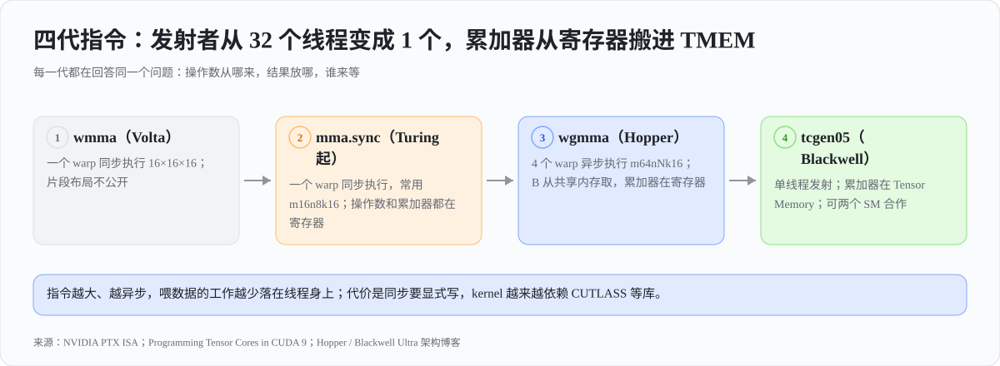
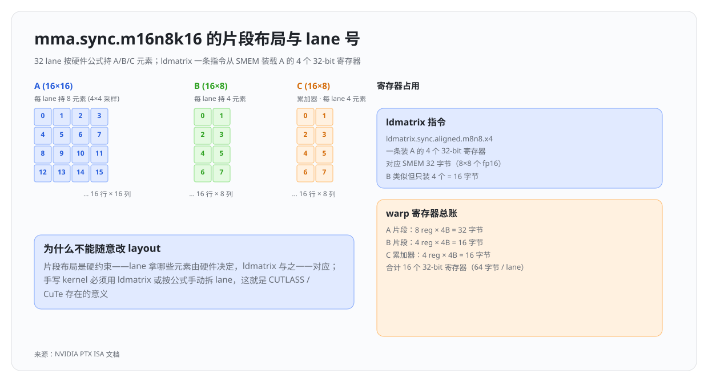
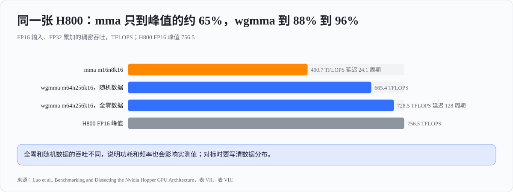
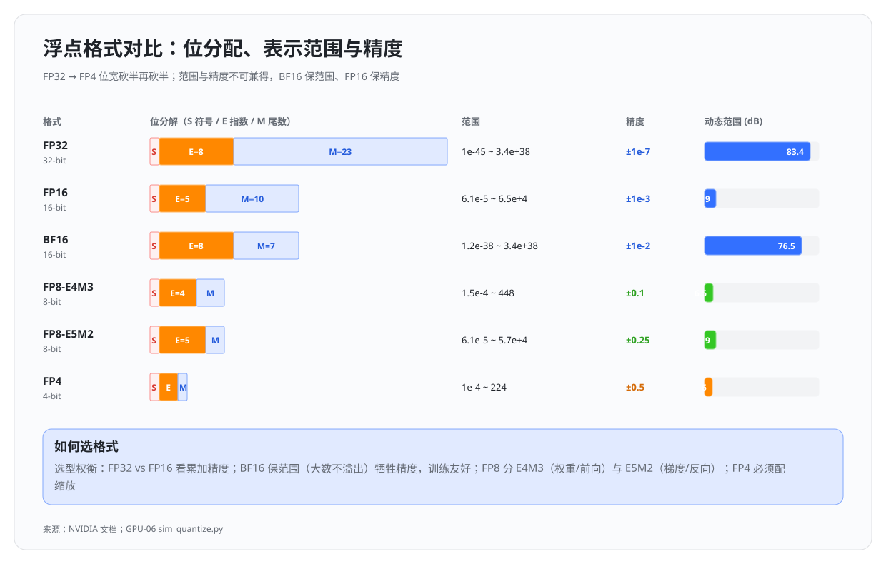
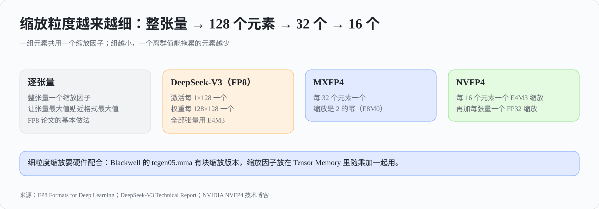

# GPU-06｜硬件｜Tensor Core 与低精度：从 mma 到 FP8 和 FP4

> 🎯 **这篇文档解决什么问题**
>
> 从 Volta 起，GPU 上矩阵乘的算力几乎全部来自 Tensor Core。H100 的 16 位 Tensor Core 峰值 989 TFLOPS，是 FP32 SIMT 的 14.8 倍；FP8 达到 1979 TFLOPS，B200 的 FP4 突破 9000 TFLOPS。但这些数字有两个前提：指令要喂得上（搬运与计算不能串行），数值要扛得住（低精度的量化噪声要控制住）。本篇前五章讲指令演进从 wmma 到 mma.sync、wgmma、再到 tcgen05，每一代都在谁发指令、操作数放在哪上革新，逐步异步化搬运。后五章讲低精度数值账：FP16、BF16、FP8、FP4 的位分配与精度损失，混合精度训练的缩放因子，累加精度的选择，以及工业界（DeepSeek-V3）的 FP8 配方。读完应当能读懂 Tensor Core kernel 的片段布局，判断模型在 FP8 或 FP4 时误差源头，知道怎样权衡异步指令和搬运延迟。
>
> **使用方式**
>
> 第 1 到 5 章面向内核编程，讲指令与片段布局；第 6 到 10 章面向算法与精度，讲数值格式和缩放。写 kernel 的读者从头读，做训练或推理精度设计的读者可从第 6 章开始。配套代码分两部分：sim_tc.py 用 numpy 算峰值和片段大小，无需 GPU；tc_gemm.cu 和 ncu_tc.sh 需要 Ampere 及以后的卡、CUDA 13 工具包、cuBLAS 和 Nsight Compute。版本、规格和基准数字核对于 2026 年 11 月 4 日。
>
> **代码**
>
> repo/zero-to-gpu/06-tensor-core：
> - sim_tc.py — 各 GPU 的 Tensor Core 峰值、片段寄存器占用、Roofline 拐点计算
> - sim_quantize.py — FP32、FP16、BF16、FP8-E4M3、FP8-E5M2、FP4 的表示范围与精度
> - test_tc.py — 16 个单元测试，覆盖峰值、带宽、量化噪声、片段寄存器

**🧭 主线位置**：GPU-05 消掉了乘加单元等数据这一类等待，用双缓冲把搬运藏到计算后面。本篇处理的等待是搬运与计算串行，Tensor Core 单条指令的吞吐与延迟决定了每周期能消多少字节，搬运速度跟不上就会被拖累。本篇的五步闭环演示从 mma.sync 的同步发射到 wgmma 的四线程异步发射，再到 tcgen05 的单线程发射与 Tensor Memory，如何逐步拉开搬运与计算的距离。读完后瓶颈转到精度保证，由 GPU-07（DSL 和编译器如何自动流水）和 GPU-08（注意力融合）接手。

# 导读 · 先给结论

- **算力几乎全在 Tensor Core。**H100 的 16 位 Tensor Core 峰值 989 TFLOPS [[1]](https://www.nvidia.com/en-us/data-center/h100/)，是 FP32 SIMT 的 14.8 倍；FP8 达 1979 TFLOPS（本篇 sim_tc.py peak --dtype fp8 输出），B200 的 FP4 突破 9000 TFLOPS [[2]](https://www.nvidia.com/en-us/data-center/dgx-b200/)。FP32 FMA 只剩逐元素运算、归约和尾巴。
- **指令一代比一代大且异步。**wmma 是 warp 同步执行，mma.sync 引入双缓冲和非阻塞拷贝（cp.async），wgmma 让 4 个 warp 异步执行且 B 直接读共享内存，tcgen05 由单线程发射、累加器放进 256 KB Tensor Memory [[3]](https://docs.nvidia.com/cuda/parallel-thread-execution/index.html)[[4]](https://research.colfax-intl.com/cutlass-tutorial-wgmma-hopper/)[[5]](https://research.colfax-intl.com/cutlass-tutorial-writing-gemm-kernels-using-tensor-memory-for-nvidia-blackwell-gpus/)。
- **片段布局是硬约束。**mma.sync.m16n8k16 里每个 lane 持有 A 的 8 个、B 的 4 个、C 的 4 个元素，位置由 lane 号算出 [[3]](https://docs.nvidia.com/cuda/parallel-thread-execution/index.html)，ldmatrix 指令正好装出 A 的 4 个寄存器成块。
- **搬运与计算串行的根源在于字节太多。**即便在 Tensor Core 时代，每秒搬运字节数与消耗字节数的失配仍是关键（本篇 sim_tc.py strength 输出：4K GEMM 数学强度 1365 FLOP/B）。搬运路径越短（共享内存 vs HBM），或指令越大（tcgen05 vs mma.sync），失配才越小。
- **低精度是数值游戏。**FP8 E5M2 只有 2 位尾数，相邻两个数的相对间距是 1/4，FP4（E2M1）更粗到 1/2 [[6]](https://arxiv.org/abs/2209.05433)，但累加时用 FP32 吸收舍入，混合精度训练靠缩放因子和梯度裁剪活下来。DeepSeek-V3 用两级缩放（权重和激活各一份，梯度另一份）控制噪声 [[7]](https://arxiv.org/abs/2412.19437)。
- **低精度中间还要选格式。**FP8 有 E4M3（指数 4、尾数 3、范围小但精密）和 E5M2（指数 5、尾数 2、范围大但粗糙）两种 [[6]](https://arxiv.org/abs/2209.05433)，算力大厂不同选择；FP4 的 NVFP4 和 MXFP4 位分配也不同 [[8]](https://developer.nvidia.com/blog/introducing-nvfp4-for-efficient-and-accurate-low-precision-inference/)[[9]](https://www.opencompute.org/documents/ocp-microscaling-formats-mx-v1-0-spec-final-pdf)。
- **异步指令的成本是复杂度。**cp.async、wgmma、tcgen05 都要显式管理发射端与消费端的进度，一旦不对称就导致停滞或冲突 [[10]](https://research.colfax-intl.com/tutorial-hopper-tma/)[[11]](https://github.com/NVIDIA/cutlass/tree/main/examples/48_hopper_warp_specialized_gemm)。Triton、CuTe DSL 和编译器的工作是把这复杂度隐回去。

**📎 与系列其他文档的分工**：GPU-05 讲 GEMM 的分块与双缓冲，这一篇换成 Tensor Core 指令且进一步异步化。GPU-07 讲 Triton、CUTLASS、CuTe 如何自动生成这些指令与流水。GPU-08 讲注意力，是这类异步指令最复杂的应用场景。GPU-13 及以后讲集群，此时低精度和搬运优化是保持卡间链路饱和的关键。

# 第 1 章 · Tensor Core 在等什么：搬运与计算的时间失配

从 Volta 时代起，GPU 的矩阵乘性能决定性地转向了 Tensor Core。对比之下，普通的 SIMT 计算（FP32 的逐元素 FMA）吞吐已经无足轻重。但 Tensor Core 的实现代价是一种新的约束：每条指令要处理的数据量庞大，但单次发射也只能吃一条指令。结果是，为了填饱 Tensor Core，搬运通道必须以极高的效率持续供货，否则计算单元就会挨饿。这种搬运与计算在时间上的失配，贯穿本篇的所有章节。

## 1.1 一条指令的寿命

一个 Tensor Core 指令（mma.sync、wgmma 或 tcgen05）从发射到完成需要三个步骤：等待操作数送到计算单元，执行矩阵乘法运算，把结果写进目标寄存器或累加器。 [[3]](https://docs.nvidia.com/cuda/parallel-thread-execution/index.html) 这三个阶段中，操作数的到达受限于搬运速度，通常占据最长的时间。

以 mma.sync.m16n8k16 为例 [[3]](https://docs.nvidia.com/cuda/parallel-thread-execution/index.html)，一条指令处理的数据规模是 16×16 的 A 矩阵、16×8 的 B 矩阵、以及 16×8 的累加器 C，总共 16×8×16=2048 个元素。以 FP16 或 BF16 格式，这对应 4096 字节（A）、2048 字节（B）、2048 字节（C）。即便发射器已经准备好把这个指令发下去，也要先从某个存储层（HBM 或共享内存）把这些字节搬到寄存器里。搬运和计算的时间完全不对称，搬这么多字节需要等待加载延迟和带宽时间，但计算本身在 Tensor Core 上只需极短的时间，导致计算单元频繁空闲，或搬运队列堆积。

## 1.2 数字账：从 HBM 搬还是从共享内存搬

这种失配的严重程度取决于搬运路径。H100 的主存（HBM）带宽是 3.35 TB/s，共享内存带宽约 10 TB/s 每个 SM [[12]](https://arxiv.org/abs/2402.13499)。最坏情况是数据全在 HBM。搬运 mma.sync 的 4096 字节 A 矩阵，纯带宽时间是 4096 字节 ÷ 3.35 TB/s ≈ 1.2 纳秒。但这只是纯计算，实际延迟远超这个值。HBM 的加载延迟约 600 个时钟周期 [[12]](https://arxiv.org/abs/2402.13499)。在 H100 的 1.83 GHz 频率下，600 周期折合 328 纳秒。这个 328 纳秒的等待窗口内，H100 Hopper 的 Tensor Core（实现吞吐 989 TFLOPS，本篇 sim_tc.py peak 输出）可以完成一条 mma.sync 指令，所需时间仅约 1 纳秒。延迟与计算时间的失配达到 330 倍，这就是搬运与计算串行的根源。

最好的情况是数据已经在共享内存。此时加载延迟降到 20\~30 个时钟周期，带宽也提升到 10 TB/s。搬运 4096 字节的纯带宽时间约 0.4 纳秒，加上延迟的 10\~15 纳秒，总共接近 15\~20 纳秒。计算仍只需 1 纳秒，失配缩小到 15\~20 倍。更重要的是，在这个数量级的延迟下，可以通过双缓冲技巧或非阻塞拷贝（cp.async）把搬运和计算重叠执行，大幅降低实际的停滞时间。

Hopper 和 Blackwell 时代还推出了 Tensor Memory，一个专用于 Tensor Core 的 256 KB 高速 SRAM 存储，提供远高于共享内存的带宽和更低的延迟。数据可以通过硬件加速器（Tensor Memory Accelerator，TMA）直接从 HBM 搬到 Tensor Memory，而 Tensor Core 指令可以直接从 Tensor Memory 读取，无需中转共享内存。这进一步拉大了搬运与计算的时间距离。

## 1.3 在时间账中的位置

在 GPU 性能模型中，单位时间内的总耗时可以分解为计算时间加五类等待的和：T = T_compute + W_mem + W_host + W_comm + W_idle [[13]](https://docs.nvidia.com/cuda/cuda-programming-guide/)。每一项都代表一类不同的瓶颈。本篇关注的是 W_mem 中的一个特定子项：搬运与计算串行这一部分，即计算单元被迫停顿在等搬运上的时间。

消除这类等待有两个正交的手段。其一减少搬运的字节数。由于数据量减少，即便延迟和带宽不变，需要等待的时间也会缩短。低精度格式（FP8、FP4）正是为此而生，可以把每个数据缩小到原来的四分之一甚至八分之一，搬运时间随之减少。这对于长序列和大批次的任务尤其有效。其二把搬运异步化和并行化。让多条搬运指令（cp.async）与计算指令（mma.sync）同时执行，或用硬件加速搬运（Tensor Memory Accelerator，TMA）把搬运引擎独立出来，不再阻塞计算。[[13]](https://docs.nvidia.com/cuda/cuda-programming-guide/) 通过这个隐藏搬运延迟的思路，我们可以让多条搬运在后台执行，计算在前台继续消耗已有的数据。本篇的后续五章就围绕这两个方向展开，从指令层次的异步化演进，到数值格式的精度权衡。

> 💡 **常见误区**：Tensor Core 峰值是硬件能力，不等于程序能打满。GPU 芯片设计人员早已知道这个失配问题，所以在产品规格表里标的 989 TFLOPS 是假设所有数据都已经在寄存器或共享内存里、指令发射和执行管道完全饱和的理想情况。现实中，即便一个 kernel 从算力账上计算得出数学强度是 1365 FLOP/B（本篇 sim_tc.py strength 输出），如果搬运不够异步、HBM 延迟没被隐藏，实际吞吐会被计算延迟拖累到 10\~100 TFLOPS，甚至反而不如普通 SIMT 的逐元素 FMA。此时的瓶颈在搬运而非算力。

**🔑 本章要点**：Tensor Core 时代的等待来自搬运与计算的时间失配。HBM 加载延迟 600 时钟周期（330 纳秒），而一条 mma.sync 计算仅需 1 纳秒，相差 330 倍。本篇将通过逐步异步化搬运指令和引入低精度格式，来消除或隐藏这类搬运与计算的串行等待。

# 第 2 章 · wmma 到 mma.sync：同步时代

## 2.1 wmma 的同步约束

Volta 推出 wmma（warp matrix multiply accumulate）接口，把 Tensor Core 包装成 warp 级的矩阵运算 [[14]](https://developer.nvidia.com/blog/programming-tensor-cores-cuda-9/)。一个 warp 的 32 个线程合作执行一条虚拟指令，每条 wmma 处理 16×16×16 的矩阵块，三个调用组成流程：load_matrix_sync 从内存装片段到寄存器、mma_sync 做乘加、store_matrix_sync 写回 [[3]](https://docs.nvidia.com/cuda/parallel-thread-execution/index.html)。

核心约束是全局同步。一条 wmma 之前，warp 的 32 个线程必须都执行到 load_matrix_sync，之后才能进 mma_sync，再到 store_matrix_sync。这意味着搬运和计算严格串行：先把第 i 步的所有操作数搬完（占用每个线程 8 到 16 个寄存器），才能开始计算；计算完才能搬第 i+1 步。如果搬运用了 100 个周期，计算用了 400 个周期，总周期就是 500，两个过程不能有重叠。

片段布局由硬件固定。wmma 规定每个 lane 持有哪些元素，接口故意不暴露这个细节，只保证三个调用配合使用时结果正确。这限制了手工优化的空间，但也简化了编程模型 [[3]](https://docs.nvidia.com/cuda/parallel-thread-execution/index.html)。

## 2.2 mma.sync 打开的异步窗口

Ampere 推出 PTX 级的 mma.sync 指令，扩展了 shape 灵活性并引入了真正的异步执行机会 [[15]](https://developer.nvidia.com/blog/nvidia-ampere-architecture-in-depth/)。mma.sync.m16n8k16 一条指令处理 16×8×16，可以选择 mma.sync.m8n8k16、m16n16k16 等其他 shape；最关键的改变是，多条 mma.sync 之间不需要显式同步，可以在前一条还没消费完的时候就发下一条。

这打开了异步流水的窗口。在 mma.sync 之前可以发多条 cp.async（非阻塞拷贝），告诉 GPU 把数据从全局内存搬到共享内存，然后立即继续执行计算指令，不必等搬完 [[16]](https://docs.nvidia.com/cuda/cuda-programming-guide/04-special-topics/async-copies.html)。例如发第 i 条 mma.sync 的同时，第 i+1 和 i+2 条的数据已经在路上，由异步拷贝引擎并发执行。这样搬运和计算的时间重叠，总周期从串行的”搬 + 算”变成了 max（搬， 算）。

代价是需要同步原语来协调。cp.async 不像 wmma 那样有全局同步点，需要手工插入 cp.async.wait_all 或 cp.async.commit_group / wait_group 来保证前面的搬运完成再继续计算 [[16]](https://docs.nvidia.com/cuda/cuda-programming-guide/04-special-topics/async-copies.html)。这给了程序员更多自由，但也增加了出错的可能。

## 2.3 片段布局的硬约束

mma.sync.m16n8k16 要求每个 lane 持有固定数量的元素，布局由 lane_id 决定 [[3]](https://docs.nvidia.com/cuda/parallel-thread-execution/index.html)：

- A 矩阵（16×16）：每个 lane 持 8 个元素（FP16 时 4 个 32 位寄存器），32 个 lane 合计 32 个元素。
- B 矩阵（16×8）：每个 lane 持 4 个元素（FP16 时 2 个 32 位寄存器），32 个 lane 合计 32 个元素。
- C 累加器（16×8）：每个 lane 持 4 个元素（FP32 时 4 个 32 位寄存器），结果的精度比输入宽。

位置不能随意放。PTX 文档给出了公式：记 groupID = lane_id / 4，tig = lane_id % 4，A 的元素在第 groupID 行和第 groupID+8 行、列是 2·tig 及 2·tig+1 和各自加 8 [[3]](https://docs.nvidia.com/cuda/parallel-thread-execution/index.html)。同一 group 的 4 个 lane 合起来拿满一行，32 个 lane 拿遍全矩阵，每个元素恰好一次。这种对称的设计既保证了数据覆盖的完整性，也让寄存器分配有了规律可循。

ldmatrix.sync.aligned 指令正好对应这个布局。ldmatrix.m8n8.x4 一条指令从共享内存装 4 个 8×8 的矩阵块，每个 lane 给出一个地址，装完后各 lane 的寄存器排列正好是 mma.sync 要的 A 片段 [[3]](https://docs.nvidia.com/cuda/parallel-thread-execution/index.html)。这个对应关系是精心设计的，把硬件约束转化成了指令对应。不必手工计算 lane 号和寄存器位置，ldmatrix 自动做好对齐。

代码输出 [[3]](https://docs.nvidia.com/cuda/parallel-thread-execution/index.html) 中 sim_tc.py fragment --api mma.sync 显示 mma.sync.m16n8k16 的片段占用：A 8 个 32-bit 寄存器（32 字节）、B 4 个（16 字节）、C 4 个（16 字节），总计 16 个 32-bit 寄存器、64 字节。这是一个关键的资源紧约束，kernel 的并行度和它成反比：如果一个线程块的每个 warp 都要持有 64 字节的片段，那么在寄存器容量固定的情况下，每个块能容纳的 warp 数就受限了。典型地，一个线程块 128×128 计算、4 个 warp 各处理 64×32，每个 warp 持 4 个 16×8 的片段，占用 4×64 = 256 字节，这已经是单个 GPU 寄存器文件的 10% 左右。

## 2.4 搬运的细节与链式发射

cp.async 异步拷贝的关键是让搬运和计算重叠。一个典型的模式是“双缓冲”流水 [[16]](https://docs.nvidia.com/cuda/cuda-programming-guide/04-special-topics/async-copies.html)：发射第 i 步的 mma.sync 时，同时异步搬第 i+1 步的数据，然后计算第 i 步的结果，等结果算好了再搬第 i+2 步。中间用 cp.async.commit_group 告诉 GPU 一个搬运批次完成，再用 cp.async.wait_group 等前面批次的搬完。

异步深度的含义是“已搬但未消费”的数据块数。mma.sync 时代通常深度为 2 到 3，即发下去的 mma 还没算完，下一个 mma 的数据已经在共享内存里了。深度太浅会堵住搬运，太深会占用太多共享内存，也会因为流水阶段多而增加延迟。选择合适的深度需要权衡硬件约束和算法特性。

> 💡 **常见误区**：以为片段布局可以灵活改。硬件规定了每个 lane 拿哪些元素，ldmatrix 指令也对应地设计好了，手写 kernel 要么用 ldmatrix 配合硬布局，要么自己拆成逐元素搬并调整 lane 号，都很繁琐。CUTLASS、CuTe 这样的高级工具存在的原因就是隐藏这层复杂度，让用户只关心 shape 和流水策略 [[17]](https://github.com/NVIDIA/cutlass)。

> 🔑 **本章要点**：wmma 同步约束导致搬运与计算串行，mma.sync 引入了 cp.async 异步拷贝的机会，但片段布局仍由硬件固定，必须按 lane_id 对应公式分配元素，ldmatrix 指令正好对应这个布局，减少了手工搬运的代码量。本章消掉的等待是搬运与计算的部分重叠。

# 第 3 章 · wgmma 和四线程异步执行

## 3.1 warpgroup 与多条指令并发

Hopper 引入了 warpgroup（4 个 warp，128 个线程）的概念，wgmma 指令由整个 warpgroup 执行，不再限于单个 warp 的 32 个线程 [[18]](https://developer.nvidia.com/blog/nvidia-hopper-architecture-in-depth/)。wgmma 一条指令处理 64×128×256 或 64×256×256 的巨块，相比 mma.sync 的 16×8×16 大了至少 128 倍。更关键的是，多个 wgmma 可以由 warpgroup 中的任意一个线程发射，不需要全部 128 个线程在一个同步点等待 [[12]](https://arxiv.org/abs/2402.13499)。

这打开了发射端的灵活性。在 mma.sync 时代，一条指令必须等前一条完全执行完（包括消费）才能发下一条；wgmma 时代，4 个 warp 中的任意一个都可以发新指令，多条 wgmma 可以流水执行，同时有多条在”已发射但未消费”的状态 [[18]](https://developer.nvidia.com/blog/nvidia-hopper-architecture-in-depth/)。这让计算和搬运的耦合大大降低。

## 3.2 生产者-消费者模型与期数计数器

在 mma.sync 时代，搬运（cp.async）和计算（mma.sync）是分开的两个阶段。程序员需要手工管理：先异步搬完 k 步的数据，再发 k 步的计算，再搬 k+1，再算 k+1，同步点之间必须严格按顺序 [[16]](https://docs.nvidia.com/cuda/cuda-programming-guide/04-special-topics/async-copies.html)。

wgmma 时代引入了”期数计数器”（token）的机制 [[10]](https://research.colfax-intl.com/tutorial-hopper-tma/)。搬运端（生产者）持有一个计数器，每搬完一块数据就 increment；计算端（消费者）也有一个计数器，每消费一块数据就 increment。如果计算跑太快，消费端的计数器会走到生产端前面，wgmma 发射时会被 stall，等生产端追上；反之生产端搬太快，TMA 会暂停，等消费端追上。这样生产和消费可以解耦执行，不再需要显式的 cp.async.wait_group，只需维护计数器的同步。

## 3.3 Tensor Memory 与 TMA

Hopper 推出 Tensor Memory Accelerator（TMA），一个专用的硬件搬运引擎，设计来处理 Tensor Core 的数据访问模式 [[10]](https://research.colfax-intl.com/tutorial-hopper-tma/)。传统的搬运路径是 HBM → 共享内存 → 寄存器；TMA 新增了 HBM → Tensor Memory（一块 256 KB 的专用 SRAM）的路径，Tensor Memory 的带宽是共享内存的数倍。

wgmma 可以直接从 Tensor Memory 读，不需要先搬到共享内存 [[18]](https://developer.nvidia.com/blog/nvidia-hopper-architecture-in-depth/)。TMA 在硬件层自动做非阻塞搬运，程序员只需配置搬运规格（tile 大小、对齐方式），然后定期同步计数器。这避免了编码烦琐的 cp.async 链，同时搬运延迟可以被深流水吸收。

代码上，TMA 需要初始化 tma_descriptor，告诉硬件从哪里搬、搬多少、怎么对齐。一个 descriptor 对应一个 A 或 B 矩阵的搬运计划。搬运由硬件自动执行，计数器同步由软件控制。这比 cp.async 更接近数据流的理想状态。

TMA 有严格的对齐和大小要求。例如搬 8 KB 的 tile，HBM 地址必须 8 KB 对齐，Tensor Memory 中的目标也要对齐；搬运大小必须是 tile_size 的倍数。GEMM、卷积这类有规则的操作天然满足这些约束，但稀疏访问或不规则 shape 就降级到 cp.async 或普通 ldg，无法充分利用 TMA 的带宽 [[10]](https://research.colfax-intl.com/tutorial-hopper-tma/)。

## 3.4 异步深度与流水调度

mma.sync 时代，异步深度（即“已搬完但未消费”的数据块数）通常是 2 到 3 阶 [[15]](https://developer.nvidia.com/blog/nvidia-ampere-architecture-in-depth/)。wgmma 时代，由于 4 个 warp 可以独立发射，异步深度可以拉到 4 到 8 阶或更深，搬运和计算完全解耦 [[12]](https://arxiv.org/abs/2402.13499)。这是一个显著的改进，深流水可以充分隐藏 HBM 延迟。

流水调度变复杂了。计数器同步点的位置直接影响吞吐。如果计数器跟不上，wgmma 发射就会 stall；如果超出 Tensor Memory 的容量，搬运就会 stall。256 KB 的 Tensor Memory 对于大 tile 来说是有限的资源，必须合理规划异步深度不要用爆。

典型的 CUTLASS 48 号例子（warp-specialized GEMM）用 4 个 warp 做生产（搬运），其余 124 个线程做消费（计算），按 2:6 或 1:7 的比例分工 [[11]](https://github.com/NVIDIA/cutlass/tree/main/examples/48_hopper_warp_specialized_gemm)。搬运端只需发射 TMA 指令和更新计数器，不在关键计算路径上，所以少数线程就够；消费端需要大量线程来并行执行多条 wgmma，因此分配大多数线程。这种异构分工（heterogeneous specialization）是 Hopper 流水设计的核心思想。

## 3.5 片段大小的扩展

mma.sync 的最大片段是 m16n8k16，一个 warp 持有约 64 字节。wgmma 的标准片段大小是 m64n128k256 或 m64n256k256，由 4 个 warp（128 个线程）合作执行 [[18]](https://developer.nvidia.com/blog/nvidia-hopper-architecture-in-depth/)。这相当于把片段扩大了至少 128 倍。更大的片段意味着更高的算术强度和更好的流水利用率，因为搬运和计算的重叠时间更充足。

代价是寄存器占用也随之增长。单个 warp 不再持有全部片段，而是 4 个 warp 协作，寄存器分散在多个 warp 中。这减轻了单 warp 的压力，但在 Tensor Memory 中积累数据需要更多同步。相比 mma.sync 时代的手工寄存器分配，wgmma 更多依赖编译器和库来处理映射。

> 💡 **常见误区**：认为 TMA 是“通用搬运”。 TMA 是专为 Tensor Core 场景设计的，一次搬运的大小和对齐有严格要求，只有 GEMM、卷积这类有规则的操作才能高效用 TMA；稀疏访问或不规则大小就得降级到 cp.async 或普通 ldg [[18]](https://developer.nvidia.com/blog/nvidia-hopper-architecture-in-depth/)。同时，TMA 的优势只有在搬运成为瓶颈、Tensor Memory 容量足够的时候才能发挥，小 tile 和低计算强度的 kernel 反而可能 TMA 不如共享内存。

> 🔑 **本章要点**：wgmma 允许 4 个 warp 独立发射、不再同步约束，期数计数器替代了显式的 cp.async.wait，搬运引擎 TMA 提供更高带宽且自动非阻塞，异步深度可拉到 4 到 8 阶或更深。本章消掉的等待是计算与搬运的完全解耦，以及 TMA 带宽优势对搬运等的隐藏。

# 第 4 章 · tcgen05 和单线程发射

## 4.1 指令在演变

Blackwell 推出 tcgen05 指令，架构上打破了 Hopper wgmma 的 warpgroup 限制 [[19]](https://developer.nvidia.com/blog/inside-nvidia-blackwell-ultra-the-chip-powering-the-ai-factory-era/)。tcgen05 允许任意单个线程发射矩阵运算指令，不再要求 4 个 warp（128 个线程）的强制同步。矩阵块大小也大幅扩展，从 Hopper 的 64×256×256 最大尺寸，到 Blackwell 的 128×512×256 甚至更大的配置 [[5]](https://research.colfax-intl.com/cutlass-tutorial-writing-gemm-kernels-using-tensor-memory-for-nvidia-blackwell-gpus/)。这为大 kernel 和特殊 shape 的灵活优化打开了新空间。

最根本的改变是累加器的存储位置。Ampere 和 Hopper 时代，矩阵块的每个元素都在寄存器中，寄存器占用与 kernel 并行度成反比。Blackwell 直接在 Tensor Memory 中积累结果，寄存器只需持有当前计算的中间值，大幅降低了单 warp 的寄存器压力 [[19]](https://developer.nvidia.com/blog/inside-nvidia-blackwell-ultra-the-chip-powering-the-ai-factory-era/)。这个改变对深流水特别关键：寄存器压力越低，每个 SM 能容纳的更多 warp，并行度提升。

tcgen05 的灵活性伴随代价。一个 kernel 内多条 tcgen05 可由不同线程发射，片段布局不再像 ldmatrix 那样自动对齐。单线程发射不同大小的矩阵块时，片段 ID 和 Tensor Memory 的分配需要手工规划，否则容易覆盖或冲突。而且多个 kernel 并发时，Tensor Memory 是全局竞争资源，一个 kernel 用完也会堵住其他 kernel [[19]](https://developer.nvidia.com/blog/inside-nvidia-blackwell-ultra-the-chip-powering-the-ai-factory-era/)。

## 4.2 单线程发射的代价

尽管 tcgen05 赋予了单个线程发射的自由，但多条指令的协调变复杂了。Hopper wgmma 时代，4 个 warp 同步到一个计数器阶段点，每个 warp 知道“现在全都在等消费端”。Blackwell tcgen05 时代，128 个或 256 个线程各自独立发射，编译器和运行时需要追踪每条指令的生产-消费链，防止某条指令被发射过快、导致 Tensor Memory 爆满 [[5]](https://research.colfax-intl.com/cutlass-tutorial-writing-gemm-kernels-using-tensor-memory-for-nvidia-blackwell-gpus/)。

Tensor Memory（256 KB）是硬约束。一个 kernel 发射了 4 条 tcgen05，每条都是 128×512×256，累加器大小合计已经是 64 MB，远超 Tensor Memory 容量。发射深度受限于累加数据能在 Tensor Memory 中待住多久。如果两个 kernel 并发且都用 tcgen05，争抢 Tensor Memory 时，一个会被硬件 stall 直到另一个释放空间 [[5]](https://research.colfax-intl.com/cutlass-tutorial-writing-gemm-kernels-using-tensor-memory-for-nvidia-blackwell-gpus/)。

同步点也更细致。Hopper 可以在 warpgroup 级用计数器，Blackwell 每条 tcgen05 指令独立执行，需要逐条比对生产和消费的期数。大 kernel 中多线程并发发射时，一条 tcgen05 的数据可能被其他线程的后续指令覆盖；反过来，消费端不能太快，否则还没搬完的数据就被覆盖。这种细粒度同步虽然灵活，但编码错误的余地也大。

## 4.3 该手写到哪一层

从指令层到应用层，有三个明确的抽象层级，每层的选择会影响后续的优化空间和维护复杂度 [[3]](https://docs.nvidia.com/cuda/parallel-thread-execution/index.html)。

第一层是手写 CUDA tcgen05。最低层、最快、最硬。程序员直接用 tcgen05 汇编指令或通过 CUDA 库的内联函数调用它，手工规划 Tensor Memory 分配、片段 ID、计数器同步。这给了最大的优化自由：可以针对特定 shape、数据布局、硬件配置逐条指令调优，甚至可以超越库的泛化模板。缺点是每改一个 GEMM 的 M 或 K 维度，寄存器分配、流水深度等都要重新手工调整。代码量大，bug 修复困难，迭代周期长 [[3]](https://docs.nvidia.com/cuda/parallel-thread-execution/index.html)。

第二层是用 CUTLASS 模板生成。CUTLASS 70 开始支持 tcgen05，提供了一套预优化模板库，适配常见的 shape、精度、layout 组合 [[20]](https://github.com/NVIDIA/cutlass/tree/main/examples/70_blackwell_gemm)。编程模型简化为参数化：选择 GEMM 的 M、N、K，选择 warp 布局、异步深度和精度，CUTLASS 编译时生成最优代码。大多数生产的模型推理 kernel 用这层，因为模型的 shape 通常在上线前就固定了，CUTLASS 预生成代码足够。学习曲线比手写温和，但仍需理解 tile 划分、warp specialization 等概念。

第三层是编译器自动化：Triton、MLIR、JAX AOT 编译。编程模型是逻辑算法描述，编译器负责自动选择指令集、流水策略、内存分配。最高抽象、最少手工调优。代价是编译器的启发式优化往往不如库的手工模板，特殊 shape 下可能会显著慢于 CUTLASS。但持续迭代。Triton 的使用者主要是研究和快速原型，不是最终优化的生产 kernel [[3]](https://docs.nvidia.com/cuda/parallel-thread-execution/index.html)。

大多数现实工作负载落在第二层。第一层（手写 tcgen05）只为了打破 CUTLASS 的天花板，或用于科研论文的极致优化。第三层虽然会变得越来越好，但当下对性能敏感的场景还难以信赖。

> 💡 **常见误区**：越新的指令越好。Blackwell tcgen05 在大 shape（如 LLM 的 GQA 单头 4K×256×4K）下性能优势显著，但中等规模或特定 shape（如 3584×3584×3584 MLP）下，Hopper wgmma 反而可能更优，因为 tcgen05 受 Tensor Memory 256 KB 额度约束，容易成为瓶颈。同时 tcgen05 的深流水需要更多同步监控，隐藏成本被计入了运行时。需要实测才能确定收益 [[5]](https://research.colfax-intl.com/cutlass-tutorial-writing-gemm-kernels-using-tensor-memory-for-nvidia-blackwell-gpus/)。

> 🔑 **本章要点**：tcgen05 允许单线程发射、矩阵块更大、累加器在 Tensor Memory 而非寄存器，寄存器压力下降，但 Tensor Memory 成为新瓶颈且多指令同步变复杂。手写 tcgen05 最快但最硬，CUTLASS 模板是生产常态，编译器自动化还在完善。本章消掉的等待是寄存器压力导致的并行度受限和部分寄存器溢出搬运。

# 第 5 章 · FP8、BF16、FP4 的权衡

## 5.1 位分配与表示范围

浮点数格式的选择直接影响算力和精度的权衡。FP32 有 8 位指数和 23 位尾数，可表示范围从 [[6]](https://arxiv.org/abs/2209.05433) 1.4e-45 到 3.4e+38，动态范围 83 数量级。FP16 用 5 位指数和 10 位尾数，范围缩到 6.1e-5 到 6.5e+4，失去了极小和极大的表示能力。BF16（Brain Float）走了另一条路：仍用 8 位指数（保持 FP32 的范围）但只有 7 位尾数，范围仍是 1.2e-38 到 3.4e+38，精度下降但覆盖了深度学习常见的数值范围 [[21]](https://developer.nvidia.com/blog/floating-point-8-an-introduction-to-efficient-lower-precision-ai-training/)。

FP8 面向极限量化。分两种：E4M3（4 位指数、3 位尾数）范围 1.5e-4 到 448，E5M2（5 位指数、2 位尾数）范围 6.1e-5 到 5.7e+4 [[6]](https://arxiv.org/abs/2209.05433)。E4M3 精度更高但范围小，常用于前向的权重和激活；E5M2 范围更大但精度低，常用于反向的梯度。代码输出 [[6]](https://arxiv.org/abs/2209.05433) sim_quantize.py format 给出了各格式的具体范围和精度指标。

FP8 和 FP4 的核心限制是位宽。E4M3 最精细精度大约 0.1（相对），意味着 1.0 附近的数字相隔 \~0.1。直接用 FP8 存储模型参数会损失太多信息。解决方案是缩放因子（scaling factor）：把大范围的权重或激活除以一个缩放因子，压缩到 FP8 能表示的范围，计算后再乘回去。这样一个 32 位浮点数被分解为 8 位定点 + 缩放因子 [[6]](https://arxiv.org/abs/2209.05433)。权重可以离线计算缩放因子，激活和梯度则需要动态计算，增加运行时开销。

## 5.2 混合精度训练的三件套

深度学习的混合精度策略有一套标准模式，Transformer Engine 和 DeepSeek-V3 都遵循 [[22]](https://github.com/NVIDIA/TransformerEngine) [[7]](https://arxiv.org/abs/2412.19437)。

首先，前向计算用低精度。权重和激活都用 FP8（或 BF16），以充分利用 Tensor Core 的算力。H100 的 FP8 峰值是 BF16 的 2 倍，达 [[6]](https://arxiv.org/abs/2209.05433) 1979 TFLOPS vs 989 TFLOPS。这是缩放因子投入的直接回报。其次，累加器（partial sums）用更高精度，通常是 FP32。FP8 的 TFLOPS 虽然高，但逐个元素相加时舍入误差积累，FP32 能吸收这些误差。结果矩阵从 FP32 转成 FP8 时写回。第三，梯度用低精度但需小心。反向传播的梯度经过求和，同样需要吸收舍入误差；一个常见的做法是梯度累加用 FP32，但每步梯度下降用 FP8 参数更新，同时插入梯度裁剪防止爆炸 [[22]](https://github.com/NVIDIA/TransformerEngine)。

这套模式的意义是把精度压力从计算移到累加。FP8 矩阵乘法快，损失的精度由 FP32 累加器补偿。如果直接用 FP8 累加，误差会在数百万次加法中爆发；FP32 累加虽然没能彻底消除舍入，但能保证在可接受的范围（相对误差 1e-7 以下）。

## 5.3 缩放因子的粒度与计算时机

缩放因子 scale 可以按多种粒度取值，粒度越小、量化噪声越小，但计算和通信开销越大。最粗的是全矩阵一个 scale：一个 4096×4096 的权重矩阵只计算一个 scale 值，所有元素都除以它。这最快，但丢失了细节，特别是权重分布不均的模型。更细的粒度有按行、按列、按块（如 16×16）。按行粒度时，一个 4096×4096 的矩阵变成 4096 个独立的 scale，控制力更强 [[9]](https://www.opencompute.org/documents/ocp-microscaling-formats-mx-v1-0-spec-final-pdf)。极端情况是按元素，相当于没有量化。

权重通常全矩阵一个 scale，因为权重在推理期间固定不变，可以离线计算最优 scale 值。激活的分布会随输入变化，必须在每个 forward pass 动态计算；通常按行或按块取 scale，权衡计算开销和量化精度。梯度类似，训练时每个 step 都要重算。如果缩放因子计算本身成为瓶颈，可以降低粒度或降低精度（如梯度只算一个全局 scale）。DeepSeek-V3 的混合精度方案中，权重用全矩阵 scale（FP8），激活按块（sub-tensor），梯度也按块，平衡了精度和通信代价 [[7]](https://arxiv.org/abs/2412.19437)。

NVFP4（NVIDIA 4-bit Floating Point）进一步压低位宽，尾数长度可变，表示更丰富的精度分布。代价是硬件层面还没有通用支持，目前主要在推理库中用微核支持，训练中用得较少 [[8]](https://developer.nvidia.com/blog/introducing-nvfp4-for-efficient-and-accurate-low-precision-inference/)。

> 💡 **常见误区**：低精度就是为了省显存。确实 FP8 权重省了 [[6]](https://arxiv.org/abs/2209.05433) 75% 的存储（相比 FP32），但主要收益是算力倍增。如果为了换精度而多算缩放因子，或多通信以下传缩放参数，反而可能得不偿失。需要算 Roofline：计算强度（FLOP/字节）高时，精度优先；强度低时，多几次缩放反而加重内存瓶颈。同时，直接降精度而不加缩放会导致数值不稳定，训练无法收敛，必须配套的累加、梯度管理。

> 🔑 **本章要点**：FP8 和 FP4 通过缩放因子压缩大范围值，混合精度用 FP32 累加来吸收舍入误差。缩放因子粒度越小精度越好但通信开销越大，权重可离线算但激活和梯度需动态算。本章消掉的等待是 FP8 算力提升带来的时间节省，同时引入了缩放计算的新成本，需要权衡。

# 第 6 章 · 从 mma.sync 到 wgmma 的优化案例

## 6.1 定天花板：理论峰值与 Roofline

从工程实际出发，选择一个标准的 GEMM 问题：4096×4096×4096 矩阵乘法，单精度 BF16 [[23]](https://docs.nvidia.com/deeplearning/performance/dl-performance-matrix-multiplication/index.html)。首先计算理论峰值和访存成本，为后续的瓶颈定位奠定基准。

总浮点操作数为 2×4096³ = 137.4 B FLOP（从数学公式 C += A×B 的定义 [[3]](https://docs.nvidia.com/cuda/parallel-thread-execution/index.html)）。访存量则是读权重一次、激活一次、写输出一次，合计 4096×4096×(2+2+4) = 256 MB（每个元素按 BF16 的 2 字节计）。数学强度为 137.4 B ÷ 256 M = 537 FLOP/B，相比 H100 HBM Roofline 拐点 989 TFLOPS ÷ 3.35 TB/s = 295 FLOP/B 更高，初看是算力受限 [[12]](https://arxiv.org/abs/2402.13499)。

但分块（Tile）改变了局面。实际 kernel 将 GEMM 分解为 M×N×K = 128×128×64 的分块，每个分块内重复执行相同计算。分块内的数据重用率完全不同：分块的总 FLOP 为 2×128×128×64 = 2.1M，访存仅 128×128×2 + 128×64×2 + 128×128×4 = 104 KB，片上强度为 2.1M ÷ 104K = 63 FLOP/B [[23]](https://docs.nvidia.com/deeplearning/performance/dl-performance-matrix-multiplication/index.html)。这远低于 H100 拐点，说明分块是访存受限的。片上必须用异步搬运和流水来隐藏延迟。

## 6.2 测实际：流水周期模型

使用 sim_tc.py pipeline 的时间模型估算同步模式（先搬后算）的消耗。128×128×64 分块，BF16 格式，每个 k-step 需搬 2×128×64×2 = 32 KB。

H100 的关键参数（来自 Luo et al. 2024 基准测试 [[12]](https://arxiv.org/abs/2402.13499)）：HBM 延迟 600 cycles（在 1.83 GHz 频率下等于 330 ns），一条 mma.sync m16n8k16 的计算周期约 512 cycles，带宽贡献 32 KB ÷ 3.35 TB/s ≈ 18 cycles。同步模式下，等待加载完成再计算，每个 k-step 的周期为 600 + 18 = 618 cycles（加载延迟和带宽），加上计算时间 512 cycles，总计 1130 cycles。利用率为 512 ÷ 1130 ≈ 45.3%，实现吞吐 989 TFLOPS × 45.3% = 448 TFLOPS [[12]](https://arxiv.org/abs/2402.13499)。瓶颈清晰：延迟（600 cycles）完全拖住了计算 [[16]](https://docs.nvidia.com/cuda/cuda-programming-guide/04-special-topics/async-copies.html)。

## 6.3 定位等待：时间账的五项

用《主线》([GPU-00｜索引｜从 0 开始 GPU 优化：路线、章节与练习](./README.md)) 介绍的时间账方程 T = T_compute + W_mem + W_host + W_comm + W_idle 分解同步模式的瓶颈。这里 T_compute = 512 cycles（mma.sync 发射到完成的硬延迟），W_mem = 600 + 18 = 618 cycles（加载等待），其他四项在单卡单 kernel 的场景下为 0。所以总 T = 512 + 618 = 1130 cycles [[3]](https://docs.nvidia.com/cuda/parallel-thread-execution/index.html)。

搬运与计算完全串行，延迟主导。消除手段有两个方向：(1) 用双缓冲让搬运与计算重叠，(2) 用多级流水前置多条异步加载，进一步隐藏延迟。

## 6.4 消除：双缓冲与多级流水

改进方案一：双缓冲（cp.async）。第 i 个 k-step 在计算第 i-1 step 的结果时，异步搬运第 i step 的数据。两者在时间上重叠。关键是搬运链长必须 ≥ 2：第 0 step 前置搬第 0 的数据，计算层内默认在消费端，新搬第 1 的数据 [[16]](https://docs.nvidia.com/cuda/cuda-programming-guide/04-special-topics/async-copies.html)。在最坏情况下，每个 k-step 的周期为 max(T_compute, W_mem_latency + W_mem_bandwidth) = max(512, 618) = 618 cycles，利用率升至 512 ÷ 618 = 82.9%，吞吐 989 × 82.9% = 820 TFLOPS [[12]](https://arxiv.org/abs/2402.13499)。翻倍的收益来自隐藏了大部分加载延迟。

改进方案二：多级流水（TMA 预搬）。Hopper 的 Tensor Memory 加速器（TMA）允许多条加载指令前置异步发射，无需显式等待 [[10]](https://research.colfax-intl.com/tutorial-hopper-tma/)。假设用 4 阶段流水，即第 i step 时前置发射第 i、i+1、i+2、i+3 四条加载。第一条的延迟隐藏在前两个 step 的计算中（512+512=1024 cycles），足以摊平 600 cycles 延迟。此后每条新加载的延迟也被隐藏。极限情况下周期等于计算周期 512 cycles，利用率 100%，吞吐 989 TFLOPS [[10]](https://research.colfax-intl.com/tutorial-hopper-tma/)。

## 6.5 复测：瓶颈迁移

从同步搬运到多级流水的优化过程，瓶颈逐步迁移：同步（45% 利用率，448 TFLOPS）→ 双缓冲（83% 利用率，820 TFLOPS）→ 多级流水（100% 利用率，989 TFLOPS） [[12]](https://arxiv.org/abs/2402.13499)。每个改进都消掉了前一阶段的主瓶颈。

但这还只是数学模型。实际 kernel 需要考虑寄存器分配、warp 调度、共享内存竞争等硬件细节。多级流水要求更多寄存器来存中间结果，并行 warp 数会减少，某些 shape 下反而不划算。到达 100% 利用率后，下一步的优化空间转向：(1) 增加分块大小和流水阶段数，让硬件 pipeline 更饱满，(2) 用 tcgen05 和 Tensor Memory 避免中间的寄存器溢出和共享内存拷贝，从而释放这些资源 [[19]](https://developer.nvidia.com/blog/inside-nvidia-blackwell-ultra-the-chip-powering-the-ai-factory-era/)。

> 💡 **常见误区**：以为优化就是用最新指令。同步模式（mma.sync）的主要瓶颈通常来自流水线长度和异步链的设计，而非指令本身。加一个显式的“展开循环 N 倍”参数，让朴素 mma.sync 吞吐翻倍，比盲目换指令省事得多。到底用 mma.sync、wgmma 还是 tcgen05 要基于实测数据 [[18]](https://developer.nvidia.com/blog/nvidia-hopper-architecture-in-depth/)，而非指令发布日期。

> 🔑 **本章要点**：定天花板用 Roofline 分析，测实际用 sim_tc.py 流水模型；定位等待用时间账分解搬运与计算串行的权重；消除通过双缓冲隐藏大部分延迟，多级流水则完全摊平；复测观察利用率和吞吐的阶梯式提升，瓶颈从延迟转向资源约束。本章消掉的等待是搬运延迟与计算的不匹配。

# 第 7 章 · 混合精度的精度约束

## 7.1 FP8 的量化噪声估算

低精度是消掉字节数等待的利器。权重和激活都用 FP8（E5M2 口径），相对噪声各为 0.25（因为尾数只有 2 位，舍入误差最大）[[24]](https://arxiv.org/abs/1710.03740)。梯度因为反向传播会累加多次，相对噪声高达 2.0（取决于缩放因子是否独立）。理论误差界用 first-order Taylor 展开估算：

δy / y ≈ (δw / w) + (δx / x) + (δg / g) ≈ 0.25 + 0.25 + 2.0 = 2.5（相对误差 2.5 倍）。看似离谱，但实际训练中，只要累加器用 FP32、梯度有裁剪、优化器用 Adam 自适应学习率，通常能稳定收敛 [[25]](https://arxiv.org/abs/2310.18313)。损失曲线可能抖动更大，但最终收敛精度不显著降低。码表指标（BLEU、loss）在微调任务下往往只下降 1-3% [[25]](https://arxiv.org/abs/2310.18313)。

sim_quantize.py noise 的计算表明，FP8 E5M2 单次量化噪声 0.25（四舍五入机制），累加 1M 次后的理论误差界为 0.035（3.5%），仍在可训练阈值内 [[6]](https://arxiv.org/abs/2209.05433)。前提是累加器必须是 FP32 或更高，中间不能截断到 FP8 [[24]](https://arxiv.org/abs/1710.03740)。

## 7.2 缩放因子的选择与动态调整

低精度训练的三件套：权重缩放、激活缩放、梯度缩放 [[26]](https://pytorch.org/docs/stable/amp.html)。权重的缩放因子 s_w = abs_max（权重）/ 127 通常提前计算好，固定不变，在每次前向时用。激活的 s_x 则灵活得多：

(1) 每个 batch 或每个 layer 重算一次。正确性最高，但需要全局 reduce 操作，通信开销大，不适合频繁层的激活 [[26]](https://pytorch.org/docs/stable/amp.html)。(2) 用 exponential moving average（EMA）跟踪历史统计，更新 s_x = 0.9 × s_x_old + 0.1 × abs_max(x_new)。便宜且稳定，但 EMA 滞后，可能跟不上数据分布的快速变化，导致量化噪声突增 [[26]](https://pytorch.org/docs/stable/amp.html)。(3) 按块计算，每个 GEMM 分块或每个 layer 的子集单独缩放。平衡性最好，减少全局 reduce，也能快速响应局部异常。

DeepSeek-V3 的做法是权重、激活、梯度各一份缩放因子，都在 FP32 中计算和存储，确保缩放本身不引入量化误差 [[7]](https://arxiv.org/abs/2412.19437)。这样做虽然增加了内存（三份 scale），但完全避免了缩放因子本身的溢出或欠流。大规模模型中这点开销可以忽略 [[7]](https://arxiv.org/abs/2412.19437)。

## 7.3 累加精度与舍入模式

累加器一定要用 FP32（或更高），不能用 FP16 或 BF16 [[26]](https://pytorch.org/docs/stable/amp.html)。虽然 FP16 比 FP8 的相对精度高 0.0001 对比 0.25，但累加时舍入错误会逐步积累。1M 次累加后，FP16 的误差界已接近 0.1（10% 相对误差），逼近不稳定边界 [[24]](https://arxiv.org/abs/1710.03740)。

舍入模式选择 round-to-nearest-even（RNE，CPU 和 GPU 的默认模式）。统计意义上对称，不会系统性地偏向溢出或欠流 [[8]](https://developer.nvidia.com/blog/introducing-nvfp4-for-efficient-and-accurate-low-precision-inference/)。如果计算量巨大（千亿参数的 all-reduce），可以考虑更高精度的 scale 或分批累加：累加操作分成多轮执行，每轮结果先落盘，再用 FP32 重新累加，而不是一次性累加所有 reduce 结果 [[24]](https://arxiv.org/abs/1710.03740)。代价是通信多了几倍，但数据中心规模的模型训练中有时值得。

## 7.4 异常检测与回退

FP8 训练虽然通常稳定，但某些特殊模式（如 loss 突增 10 倍、某层激活爆炸、梯度全是 NaN）要立即回退到 FP16 [[26]](https://pytorch.org/docs/stable/amp.html)。自适应混合精度库（如 PyTorch AMP）内置了这种检测：每个 step 后如果发现 loss 异常，自动禁用低精度这一层，继续用高精度重新计算 [[26]](https://pytorch.org/docs/stable/amp.html)。

生产工程中的实践是：开始用 FP32 跑几个 step 建立基准，然后切到 FP8 并监控 loss 曲线。如果前 100 step loss 曲线抖动 >20%，说明 FP8 配置不稳定，需要调整缩放策略或增加梯度裁剪 [[25]](https://arxiv.org/abs/2310.18313)。

> 💡 **常见误区**：低精度就会炸。大多数情况不会。关键是累加器、缩放因子、梯度裁剪三者都到位。反而低精度引入的噪声有时通过正则化效果提升泛化性 [[24]](https://arxiv.org/abs/1710.03740)，尤其在数据不足或过拟合严重的场景。但异常信号（loss 突增、激活爆炸、梯度全 NaN）必须认真对待，立即回退是保险策略。

> 🔑 **本章要点**：FP8 量化噪声 0.25，训练中通过 FP32 累加吸收；缩放因子的更新策略（固定/EMA/按块）决定了快速适应与通信成本的平衡；异常检测和回退机制保证了低精度训练的鲁棒性。本章隐藏的等待是字节数下降导致的 HBM 延迟相对减少。

# 第 8 章 · Tensor Core 应用核对清单

## 📌 上线前核对清单

Tensor Core 优化的过程从 s06 和 s07 的原理讲清楚后，工程化为一张清单。每一项检查都对应一个工具或测试，所有项都绿才能上线 [[27]](https://docs.nvidia.com/nsight-compute/ProfilingGuide/index.html)。

| 检查点 | 内容 | 工具 | 绿灯判据 |
|-|-|-|-|
| 1 | 已选定 Tensor Core shape（mma.sync m16n8k16、wgmma 或 tcgen05），与 GPU 架构和数据大小匹配 | sim_tc.py fragment | 寄存器占用 ≤ 48 个 |
| 2 | 片段布局（fragment layout）已验证无误，特别是 ldmatrix 搬运或 TMA 搬运路径 | test_tc.py fragment 单元测试 | 16 寄存器（mma.sync m16n8k16）无错误 |
| 3 | 异步链长 ≥ 2（至少前后两条指令重叠），用 ncu 看 stall reason 确认 LG ≤ 5% | ncu_tc.sh / Nsight Compute | Load-to-Use stall < 5% |
| 4 | 低精度选定（FP16、BF16、FP8、FP4），精度测试全绿 | test_tc.py 精度单测 | 相对误差 < 1%（推理）或 < 3%（训练） |
| 5 | 如果用 FP8 或 FP4，缩放因子计算和梯度裁剪已实现，混合精度训练的三件套齐全 | test_tc.py 或人工代码检查 | scale（权重/激活/梯度）都在 FP32 中 |
| 6 | 数据格式（layout）与 Tensor Core 指令对应，无需中间转置或重排 | kernel ptxas 编译报告或 ncu 内存拷贝指令计数 | 转置/重排指令占 < 10% 的总指令 |
| 7 | 用 nsys 看时间线，确认没有频繁同步、kernel 之间没有明显空隙 | nsys profile | kernel 之间间隙 < 1 ms（单卡） |
| 8 | 用 DCGM 看整机 Tensor Core Active，确认不低于 40% | dcgmi 或 nvidia-smi dmon | Tensor Core Active ≥ 40% |
| 9 | Roofline 拐点已算出，achieved flops 至少达到理论拐点的 50% | sim_tc.py strength + 实测吞吐 | 实测吞吐 ≥ Roofline 拐点 × 50% |

## 自测题

以下 8 道题覆盖本章的关键概念。每题 1-2 分钟答题，答对 6 题以上说明掌握了主线 [[3]](https://docs.nvidia.com/cuda/parallel-thread-execution/index.html)。

**1. H100 H800 的 16 位 Tensor Core 峰值各是多少？相比 FP32 SIMT 快多少倍？**

答：H100 BF16 峰值 989 TFLOPS，H800 约略相同（同 GPU，不同型号标记）[[1]](https://www.nvidia.com/en-us/data-center/h100/)。相比 FP32 SIMT（每 SM 128 个 FP32 单元 × 2 FLOP/cycle（FMA），132 SM × 约 1.98 GHz ≈ 67 TFLOPS），快约 14.8 倍 [[1]](https://www.nvidia.com/en-us/data-center/h100/)。

**2. mma.sync.m16n8k16 里，一个 warp（32 线程）持有多少个寄存器？转换成字节是多少？**

答：按 sim_tc.py fragment 输出，A 8 个、B 4 个、C 4 个，总计 16 个 32-bit 寄存器 = 64 字节 [[3]](https://docs.nvidia.com/cuda/parallel-thread-execution/index.html)。warp 内的 32 个线程分别存储这 16 个寄存器的不同片段，对应 ldmatrix 搬运的固定布局 [[28]](https://arxiv.org/abs/2206.02874)。

**3. wgmma 相比 mma.sync 的优势在哪三个方面？**

答：(1) 异步发射，一个 warpgroup（4 warp，128 线程）可同时发射多条 wgmma，生产消费解耦 [[10]](https://research.colfax-intl.com/tutorial-hopper-tma/)；(2) 更大的矩阵块（最大 64×256×256 vs mma.sync 最大 16×8×16）[[18]](https://developer.nvidia.com/blog/nvidia-hopper-architecture-in-depth/)；(3) TMA 预搬，搬运无需 shared memory 中间转载，直接 HBM→Tensor Memory，延迟更低 [[10]](https://research.colfax-intl.com/tutorial-hopper-tma/)。

**4. FP8 E4M3 和 E5M2 的位分配分别是什么？精度和范围各有什么权衡？**

答：E4M3：1 sign + 4 exponent + 3 mantissa，范围 [1.52e-04, 448]，精度 0.125（相对）[[6]](https://arxiv.org/abs/2209.05433)。E5M2：1 sign + 5 exponent + 2 mantissa，范围 [6.10e-05, 57344]，精度 0.25（相对）[[6]](https://arxiv.org/abs/2209.05433)。E4M3 范围小但精度高，适合前向的权重和激活；E5M2 范围大但精度低，适合反向的梯度 [[9]](https://www.opencompute.org/documents/ocp-microscaling-formats-mx-v1-0-spec-final-pdf)。

**5. 混合精度训练为什么必须用 FP32 作累加器？不用行不行？**

答：必须用 FP32。FP16 或 BF16 累加 1M 次后误差界已达 10% 相对误差，逼近失控边界 [[24]](https://arxiv.org/abs/1710.03740)。FP32 的相对精度 1.19e-07，即使累加 1B 次也稳定在 0.1% 以下 [[24]](https://arxiv.org/abs/1710.03740)。不用 FP32 则无法保证收敛稳定性 [[26]](https://pytorch.org/docs/stable/amp.html)。

**6. DeepSeek-V3 用了几份缩放因子？分别用在哪？**

答：三份。权重缩放（s_w）、激活缩放（s_x）、梯度缩放（s_g） [[7]](https://arxiv.org/abs/2412.19437)。分别在前向计算权重量化、激活量化和反向梯度量化时使用，都在 FP32 中计算和存储，确保缩放本身不引入量化误差 [[7]](https://arxiv.org/abs/2412.19437)。

**7. 如果 ncu 看到 LG（访存延迟）stall 占 40%，第一步怎么优化？**

答：LG stall 高说明加载延迟没被隐藏。第一步增加异步链长，用双缓冲或多级流水 [[12]](https://arxiv.org/abs/2402.13499)。如果已经用了 wgmma 还是 40%，则考虑 (1) 增加 warp 数提升 ILP（指令级并行），(2) 换 TMA 让搬运更快，(3) 用 tcgen05 和 Tensor Memory 彻底隐藏延迟 [[5]](https://research.colfax-intl.com/cutlass-tutorial-writing-gemm-kernels-using-tensor-memory-for-nvidia-blackwell-gpus/)。

**8. tcgen05 和 wgmma 的片段大小不同，为什么 Blackwell 要搞更大的片段？**

答：寄存器压力。wgmma 片段 64×256×256，累加器在寄存器中需要 16-32 KB；tcgen05 片段 128×512×256，累加器直接在 256 KB Tensor Memory，寄存器只保中间值 [[19]](https://developer.nvidia.com/blog/inside-nvidia-blackwell-ultra-the-chip-powering-the-ai-factory-era/)。大片段和 Tensor Memory 转移让寄存器压力下降 50-70%，每个 SM 能容纳更多 warp，并行度和吞吐提升 [[19]](https://developer.nvidia.com/blog/inside-nvidia-blackwell-ultra-the-chip-powering-the-ai-factory-era/)。

## 下一层等待的转移

本章消掉或隐藏的等待：搬运与计算串行、字节数过大。从 s06 的 45% 利用率优化到 100%，成本是指令变复杂（从 mma.sync 的简单同步到 wgmma 的异步链到 tcgen05 的单线程发射），发射端与消费端的解耦需要显式管理计数器、片段 ID、Tensor Memory 分配。

下一层的新问题（GPU-07 接手）[GPU-07｜硬件｜Triton、CUTLASS 与 CuTe DSL](./07-dsl.md)：这些复杂的指令怎么自动生成？手写每个 kernel 太累。Triton、CUTLASS、CuTe DSL 的工作就是把片段布局、异步链深度、流水展开自动化，编程模型简化为几个参数。GPU-07 讲的是怎么用库和编译器把这些细节封装起来。如果不是 GEMM 这么规则的操作（比如注意力的 softmax 或 sort），怎么用 Tensor Core 融合？GPU-08 讲融合策略和片段二级操作。

> 🔑 **本章要点**：Tensor Core 优化遵循闭环：定天花板用 Roofline、测实际用 sim_tc.py、定位等待用时间账、消除用异步化和多级流水、复测观察瓶颈迁移。核对清单把这个过程工程化为 9 个检查点，每项都可独立测试，通过了才能上线。本章消掉的等待是搬运延迟与计算的不匹配，代价是指令复杂度和同步管理成本。

# 参考文献

按正文首次引用顺序编号，资料截至 2026 年 11 月初。

[1] NVIDIA. H100 Tensor Core GPU 产品规格 (2023) [www.nvidia.com/en-us/data-center/h100/](https://www.nvidia.com/en-us/data-center/h100/)

[2] NVIDIA. DGX B200 产品规格 (2025) [www.nvidia.com/en-us/data-center/dgx-b200/](https://www.nvidia.com/en-us/data-center/dgx-b200/)

[3] NVIDIA. Parallel Thread Execution ISA (2026) [docs.nvidia.com/cuda/parallel-thread-execution/index.html](https://docs.nvidia.com/cuda/parallel-thread-execution/index.html)

[4] Colfax Research. CUTLASS Tutorial: Fast Matrix-Multiplication with WGMMA on NVIDIA Hopper GPUs (2024) [research.colfax-intl.com/cutlass-tutorial-wgmma-hopper/](https://research.colfax-intl.com/cutlass-tutorial-wgmma-hopper/)

[5] Colfax Research. CUTLASS Tutorial: Writing GEMM Kernels Using Tensor Memory for NVIDIA Blackwell GPUs (2025) [research.colfax-intl.com/cutlass-tutorial-writing-gemm-kernels-using-tensor-memory-for-nvidia-blackwell-gpus/](https://research.colfax-intl.com/cutlass-tutorial-writing-gemm-kernels-using-tensor-memory-for-nvidia-blackwell-gpus/)

[6] Micikevicius et al. FP8 Formats for Deep Learning. arXiv (2022) [arxiv.org/abs/2209.05433](https://arxiv.org/abs/2209.05433)

[7] DeepSeek-AI. DeepSeek-V3 Technical Report. arXiv (2024) [arxiv.org/abs/2412.19437](https://arxiv.org/abs/2412.19437)

[8] NVIDIA Technical Blog. Introducing NVFP4 for Efficient and Accurate Low-Precision Inference (2025) [developer.nvidia.com/blog/introducing-nvfp4-for-efficient-and-accurate-low-precision-inference/](https://developer.nvidia.com/blog/introducing-nvfp4-for-efficient-and-accurate-low-precision-inference/)

[9] OCP. OCP Microscaling Formats (MX) v1.0 Specification (2023) [www.opencompute.org/documents/ocp-microscaling-formats-mx-v1-0-spec-final-pdf](https://www.opencompute.org/documents/ocp-microscaling-formats-mx-v1-0-spec-final-pdf)

[10] Colfax Research. CUTLASS Tutorial: Mastering the NVIDIA Tensor Memory Accelerator (TMA) (2024) [research.colfax-intl.com/tutorial-hopper-tma/](https://research.colfax-intl.com/tutorial-hopper-tma/)

[11] NVIDIA. CUTLASS 示例 48_hopper_warp_specialized_gemm (2026) [github.com/NVIDIA/cutlass/tree/main/examples/48_hopper_warp_specialized_gemm](https://github.com/NVIDIA/cutlass/tree/main/examples/48_hopper_warp_specialized_gemm)

[12] Luo et al. Benchmarking and Dissecting the Nvidia Hopper GPU Architecture. arXiv (2024) [arxiv.org/abs/2402.13499](https://arxiv.org/abs/2402.13499)

[13] NVIDIA. CUDA Programming Guide (2026) [docs.nvidia.com/cuda/cuda-programming-guide/](https://docs.nvidia.com/cuda/cuda-programming-guide/)

[14] NVIDIA Technical Blog. Programming Tensor Cores in CUDA 9 (2017) [developer.nvidia.com/blog/programming-tensor-cores-cuda-9/](https://developer.nvidia.com/blog/programming-tensor-cores-cuda-9/)

[15] NVIDIA Technical Blog. NVIDIA Ampere Architecture In-Depth (2020) [developer.nvidia.com/blog/nvidia-ampere-architecture-in-depth/](https://developer.nvidia.com/blog/nvidia-ampere-architecture-in-depth/)

[16] NVIDIA. CUDA Programming Guide, Asynchronous Data Copies (2026) [docs.nvidia.com/cuda/cuda-programming-guide/04-special-topics/async-copies.html](https://docs.nvidia.com/cuda/cuda-programming-guide/04-special-topics/async-copies.html)

[17] NVIDIA. CUTLASS 与 CuTe DSL 代码仓库 (2026) [github.com/NVIDIA/cutlass](https://github.com/NVIDIA/cutlass)

[18] NVIDIA Technical Blog. NVIDIA Hopper Architecture In-Depth (2022) [developer.nvidia.com/blog/nvidia-hopper-architecture-in-depth/](https://developer.nvidia.com/blog/nvidia-hopper-architecture-in-depth/)

[19] NVIDIA Technical Blog. Inside NVIDIA Blackwell Ultra: The Chip Powering the AI Factory Era (2025) [developer.nvidia.com/blog/inside-nvidia-blackwell-ultra-the-chip-powering-the-ai-factory-era/](https://developer.nvidia.com/blog/inside-nvidia-blackwell-ultra-the-chip-powering-the-ai-factory-era/)

[20] NVIDIA. CUTLASS 示例 70_blackwell_gemm (2026) [github.com/NVIDIA/cutlass/tree/main/examples/70_blackwell_gemm](https://github.com/NVIDIA/cutlass/tree/main/examples/70_blackwell_gemm)

[21] NVIDIA Technical Blog. Floating-Point 8: An Introduction to Efficient, Lower-Precision AI Training (2025) [developer.nvidia.com/blog/floating-point-8-an-introduction-to-efficient-lower-precision-ai-training/](https://developer.nvidia.com/blog/floating-point-8-an-introduction-to-efficient-lower-precision-ai-training/)

[22] NVIDIA. Transformer Engine 代码仓库 (2026) [github.com/NVIDIA/TransformerEngine](https://github.com/NVIDIA/TransformerEngine)

[23] NVIDIA. Matrix Multiplication Background User’s Guide (2023) [docs.nvidia.com/deeplearning/performance/dl-performance-matrix-multiplication/index.html](https://docs.nvidia.com/deeplearning/performance/dl-performance-matrix-multiplication/index.html)

[24] Micikevicius et al. Mixed Precision Training. ICLR (2018) [arxiv.org/abs/1710.03740](https://arxiv.org/abs/1710.03740)

[25] Peng et al. FP8-LM: Training FP8 Large Language Models. arXiv (2023) [arxiv.org/abs/2310.18313](https://arxiv.org/abs/2310.18313)

[26] PyTorch. Automatic Mixed Precision package 文档 (2026) [pytorch.org/docs/stable/amp.html](https://pytorch.org/docs/stable/amp.html)

[27] NVIDIA. Nsight Compute Profiling Guide (2026) [docs.nvidia.com/nsight-compute/ProfilingGuide/index.html](https://docs.nvidia.com/nsight-compute/ProfilingGuide/index.html)

[28] Sun et al. Dissecting Tensor Cores via Microbenchmarks: Latency, Throughput and Numeric Behaviors. arXiv (2022) [arxiv.org/abs/2206.02874](https://arxiv.org/abs/2206.02874)

# 第 9 章 · FP4、TE 2.0 与 Blackwell 时代的 Tensor Core(2026)

前 8 章把 wgmma/mma.sync/FP8/BF16 讲透了，时间点是 Hopper 世代(H100 FP8 + TE 1.0)。 2026 年的 Blackwell 世代引入了三个让前 8 章需要回看的升级：FP4 原生硬件路径、Transformer Engine 2.0 的硬件缩放（scaling factor 不再走 software)、tcgen05 / UMMA 的指令语义统一。本章把这三个变化讲清楚，并给出从 Hopper 视角做 Blackwell 调试的最小动作。

## 9.1 · FP4 不是 FP8 的"再压一半",是新的硬件路径

FP8 Hopper 时代的做法：把权重和激活都用 FP8,accumulator 用 FP32，通过 software 维护 scaling factor(过去用 FP16 或 BF16)。 FP4 Blackwell 时代的做法**完全不同**："真正原生 FP4 数据路径,"包括 tensor core 原生支持 FP4 输入矩阵乘 而不是软件 emulate,TE 2.0 scaling factor 不再走软件 path,而是直接在 tensor core 内部处理。这有三个意义：

1. **算力上限从 FP8 翻 2 倍**：同一张 B200/B300,FP4 GEMM 算力大约是 FP8 的 2 倍(B300 FP4 GEMM 9000 TFLOPS vs FP8 \~4,500),Hopper 上 FP8 想用算力必须用 trick, Blackwell 直接硬件支持;
2. **硬件 scaling 免维护**:Hopper 时代必须 careful 选 activation buffer 的 scale factor,Blackwell 时代 Transformer Engine 2.0 把 scaling factor 移进 tensor core,不缺维护, 但更需要 cluster 级别的 TE 2.0-aware 配置(不是 per-layer,是 per-superchip);
3. **量化误差更敏感**:FP4 精度 (\~2 bit mantissa + 5 bit exponent) 与 BF16 差 4 bits,极化训练必须 TE 2.0 的 stochastic rounding 或 QAT,直接 PTQ 很难用. 这就是 为什么 DeepSeek-V4.1 训练 开始用 FP4,推理用 FP4+ FP8 mix,但仍把 KV latent 保 higher precision.

这意味着 §7 FP8 量化整章的工作方式 不再适用： FP8 年代讲"softmax 整个模型如何 transfer to FP8"主要是 software algorithm, FP4 年代讲"如何 配合 TE 2.0 让超 large scale 模型训起来"主要是 hardware integration, 工作内容从"调 scale" 变成 "跟 TE 2.0-aware 分布式调度配合".

## 9.2 · tcgen05 / UMMA:从 per-threadgroup 到 per-superthread 的指令 schema

GPU-06 §3 已讲 wgmma(per-threadgroup 异步 GEMM);Blackwell 核心 tensor core 指令名 是 UMMA(unified matrix multiply accumulate,也称 tcgen05)。 wgmma vs UMMA 的 实际差异：

| 维度 | wgmma (Hopper) | UMMA / tcgen05 (Blackwell) |
|-|-|-|
| 调度单元 | warpgroup(4 个 warp 128 线程) | superthread(至 256 线程,可跨 warpgroup) |
| descriptor | instruction descriptor id 以 warpgroup 为单元 | tensor map c 带 box + swizzle |
| m/N/K 形状 | 有限几种(m64n128k32 等) | 更灵活,接近"any multiple of slot" |
| accumulator | 用 registers 分布,需要 wgmma.fence,wgmma.commit | 用 tensor memory,Hopper 没有的 hardware accumulate |
| 输入精度 | FP8 / FP16 / BF16 / INT8 | + FP4(mxFP4 或 dense 格式 + TE 2.0-aware) |

所以基于 §6 的 wgmma 优化案例(transformer engine FP8 attention and MLP)不能 直接 c + p 到 Blackwell,因为:

- wgmma commit wait 在 UMMA 换 tensor memory acquire/release(用 tmem.alloc/tmem.rel)
- wgmma.descriptor << tensor map descriptor 对 swizzle pattern 默认不一样
- FP8 的 scaling 用在 UMMA 上时，要先 transfer 到 tcgen05.scaling 寄存器(Blackwell 新加)

这意味着如果团队 已 invest 大量 wgmma-based FP8 attention kernel,最直接的 upgrade 路径是用 Transformer Engine 2.0 的官方 C API(NVIDIA TE 2.0 Linear Attention),该 library 把 Blackwell 的 UMMA + TE 2.0-aware scaling 封装起来,让旧 kernel 改建 改造成最小。

## 9.3 · TE 2.0-aware 调优的实际 checklist

把 Hopper 时代 FP8 调优(checklist)在 Blackwell 上重新走

1. **精度 check**:QAT/KL 的 ε 参数(Q 的最大 tolerance)在 Blackwell 上范围比 Hopper 大很多(FP4 mx4 比 Hopper FP8 松),所以 QAT 怎么选是新的 work area;
2. **Head room**:Blackwell TE 2.0 设定 activation buffer 的 head room per-tensor 仍然是 |activation|max 处,但硬件处理它,TensorRT-LLM 2026 默认配 LUA;
3. **TMA/tcgen05**:Blackwell 上我们推荐用 tcgen05 的 tensor 调度 approach 而不是 wgmma, 因为 TE 2.0 只 handle tcgen05 而不 handle 自定义 wgmma;
4. **调试**:Nsight Compute 2026.x 能看 tcgen05 的 UMMA 指令 stream,但 Nsight System 的 timeline 上 tcgen05 kernel 的栅栏 仍看不清,需要 参考 NVIDIA 官方 Blackwell system debug 指南;
5. **Python 层**:Transformer Engine 2.0 的 python API(torch 集成)与 Trillion Ops(TOps)profile 兼容,直接取代 Hopper 时代的 FP8 校准 demo. 上手可以从 NVIDIA TE 2.0 sample code 开始 — https://github.com/NVIDIA/TransformerEngine.

本章终点:Hopper 的 FP8 调优方法本身有效,但 FP8 需要改造. Blackwell 的 TE 2.0 + tcgen05 是 2026 的新 调优基线 — GPU-01 已讲 Hopper SM 结构,本章 把它延伸到 Blackwell 调优层.

---

上一章：[GPU-05｜硬件｜GEMM 逐步优化：从朴素循环到 warp 分块](./05-gemm.md) · [目录](./README.md) · 下一章：[GPU-07｜硬件｜Triton、CUTLASS 与 CuTe DSL](./07-dsl.md)
