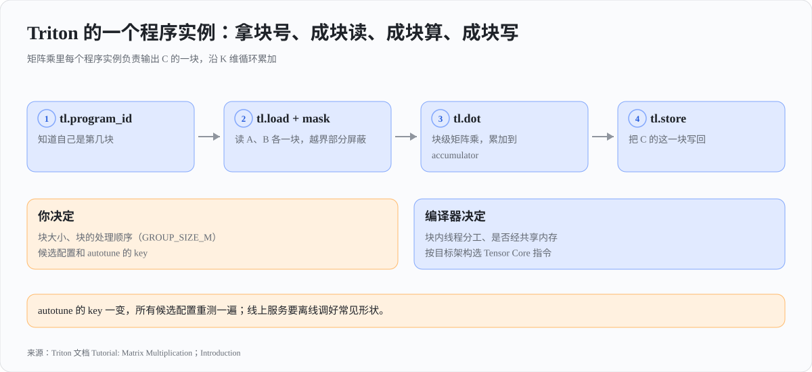
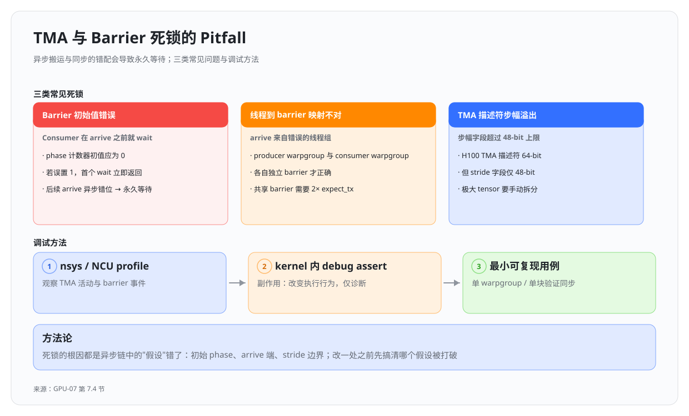
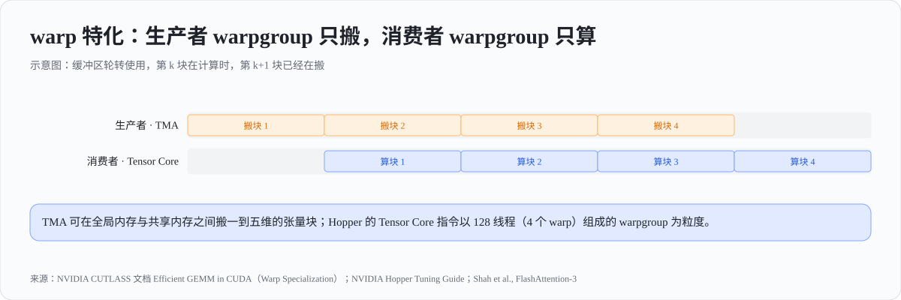
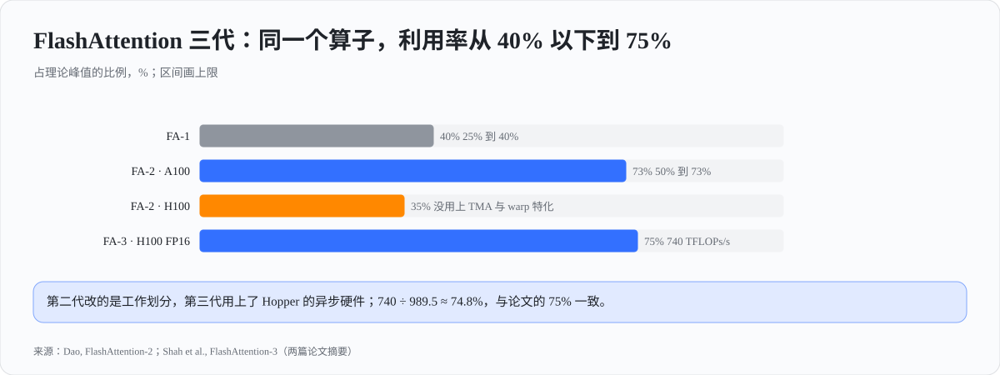
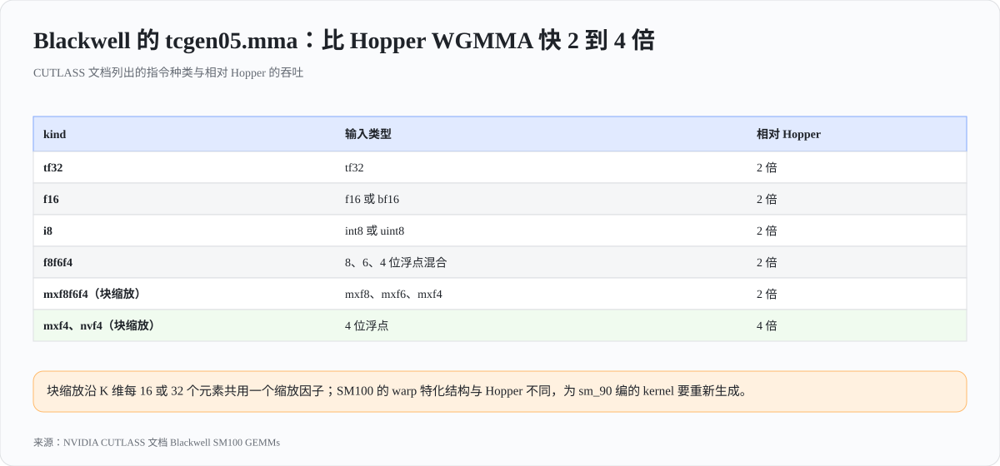

# GPU-07｜硬件｜Triton、CUTLASS 与 CuTe DSL

> 🎯 **这篇文档解决什么问题**：GPU-05 和 GPU-06 用 CUDA C++ 把矩阵乘从朴素循环写到 Tensor Core，每一步都要手算分块、共享内存、同步和流水，换一代架构又要重来。厂商库快，但难以定制，比如把激活函数融进矩阵乘。本篇讲手写之外的两条路：Triton 把块内的线程细节交给编译器，CUTLASS 和 CuTe DSL 把 GEMM 拆成可组合的部件、用布局描述数据和线程的对应。读完你能判断一个算子该停在哪一层，以及每一层要你自己负责什么。

**使用方式**：第 1 章定比较的尺子。第 2、3 章讲 Triton 的块程序和官方矩阵乘教程。第 4、5 章讲 CuTe 布局和 CUTLASS 3.x 的分层，以及 CuTe DSL。第 6 章讲 Hopper 的 TMA 与 warp 特化，第 7 章用 FlashAttention 三代看融合的回报，第 8 章讲 Blackwell 的 tcgen05。第 9 章讲调试和选层，第 10 章给清单和自测。

**代码**：zero-to-gpu/07-dsl/ 下的 sim_dsl.py、sim_autotune.py、test_dsl.py 只需 Python；gpu_triton_mm.py、gpu_cute_add.py、bench_dsl.sh 需要 GPU。CPU 模拟里的 H100 共享内存上限、“L2 改善”百分比、持久化网格大小和 swizzle 冲突减少比例与公开资料不符，第 10 章逐条说明。

<b>🧭 主线位置</b>：GPU-00（[GPU-00｜索引｜从 0 开始 GPU 优化：路线、章节与练习](./README.md)）建立了时间账 T = T_compute + W_mem + W_host + W_comm + W_idle。GPU-04 到 GPU-06 在 CUDA C++ 里处理 kernel 内部的 W_mem 和 Tensor Core 喂数问题。本篇不新增等待项，处理的是同一批等待“交给谁来消”：哪些流水、分块和异步留给编译器或库，哪些仍要自己写。抽象层最大的回报是融合，最重要的融合算子注意力交给 GPU-08（[GPU-08｜硬件｜注意力内核](./08-attention.md)）。

## 导读 · 先给结论

- <b>Triton 分块的是程序，不是线程。</b>一个程序实例处理一整块数据，线程分工、共享内存和指令选择交给编译器；块大小、warp 数和流水级数交给 autotune，key 一变就全部重测（第 1、2 章）。[[1]](https://triton-lang.org/main/programming-guide/chapter-1/introduction.html)[[2]](https://triton-lang.org/main/getting-started/tutorials/03-matrix-multiplication.html)
- <b>块的顺序影响 L2。</b>官方教程的 9 × 9 例子里，前 9 个输出块按行优先要读 90 块，分组顺序只读 54 块，A100 上从 220 TFLOPS 提到 245 TFLOPS（第 3 章）。[[2]](https://triton-lang.org/main/getting-started/tutorials/03-matrix-multiplication.html)
- <b>配置要先放得下。</b>H100 单个线程块最多 227 KB 共享内存，静态分配限 48 KB；autotune 的候选集合要按目标卡过滤（第 3 章）。[[3]](https://docs.nvidia.com/cuda/hopper-tuning-guide/index.html)
- <b>CuTe 把下标写成布局。</b>布局是 Shape 加 Stride，表示从坐标到索引的函数；组合、补集、除法、乘积把分块和按线程划分统一成布局运算，swizzle 用一次异或打散 bank（第 4 章）。[[4]](https://docs.nvidia.com/cutlass/latest/media/docs/cpp/cute/01_layout.html)[[5]](https://docs.nvidia.com/cutlass/latest/media/docs/cpp/cute/02_layout_algebra.html)
- <b>CUTLASS 按层组装 GEMM。</b>Device、Kernel、Collective、Atom 四层，定制通常只改一层；CUTLASS 4.x 的 CuTe DSL 用 Python 写同一套概念（第 5 章）。[[6]](https://docs.nvidia.com/cutlass/latest/media/docs/cpp/gemm_api_3x.html)[[7]](https://docs.nvidia.com/cutlass/latest/media/docs/pythonDSL/overview.html)
- <b>Hopper 起搬运和计算分给不同 warp。</b>生产者 warpgroup 用 TMA 搬数据，消费者 warpgroup 做 Tensor Core 计算；FlashAttention-3 用这套办法在 H100 上 FP16 到 740 TFLOPs/s、75%，而第二代只有 35%（第 6、7 章）。[[8]](https://docs.nvidia.com/cutlass/latest/media/docs/cpp/efficient_gemm.html)[[9]](https://arxiv.org/abs/2407.08608)
- <b>Blackwell 换了指令。</b>tcgen05.mma 支持 4、6、8 位浮点和块缩放，CUTLASS 文档称比 WGMMA 快 2 到 4 倍；warp 特化的结构也变了，为 Hopper 编的 kernel 要重新生成（第 8 章）。[[10]](https://docs.nvidia.com/cutlass/latest/media/docs/cpp/blackwell_functionality.html)

<b>📎 与系列其他文档的分工</b>：GPU-05（[GPU-05｜硬件｜GEMM 逐步优化：从朴素循环到 warp 分块](./05-gemm.md)）用 CUDA C++ 逐步优化 GEMM，本篇看同一件事在更高的抽象层怎么写。GPU-06（[GPU-06｜硬件｜Tensor Core 与低精度：从 mma 到 FP8 和 FP4](./06-tensor-core.md)）讲 wgmma、TMA、tcgen05 和低精度格式的指令细节，本篇只讲它们对写法的影响。GPU-08（[GPU-08｜硬件｜注意力内核](./08-attention.md)）讲注意力内核。GPU-14（[GPU-14｜单机｜性能分析与 Profiling](./14-profiling.md)）讲 Nsight Compute 等分析工具，本篇用到时只说看什么。

## 第 1 章 · 三层抽象：流水和分块由谁来排

GPU-05 用 CUDA C++ 把矩阵乘从朴素循环一步步改到 warp 分块，GPU-06 换上了 Tensor Core。每一步都要手算分块大小、共享内存布局、同步点和流水深度。本章先看清手写之外的两条路分别替你做了哪些事，又把哪些事留给你，再定下本篇比较的尺子。

### 手写 CUDA：线程是单位，什么都自己排

CUDA 的编程模型是标量程序加分块的线程：你写一个线程做什么，再决定多少线程组成一个块。Triton 的文档把两者的差别概括成一组对照：CUDA 是“标量程序、分块线程”，Triton 是“分块程序、标量线程”[[1]](https://triton-lang.org/main/programming-guide/chapter-1/introduction.html)。在 CUDA 里，分块大小、哪些数据进共享内存、什么时候同步、几级流水、用哪条 Tensor Core 指令，全由写 kernel 的人决定。好处是没有任何东西挡在你和硬件之间；代价是每换一代架构，这些决定大多要重做一遍。

### Triton 和 CUTLASS：两种分工

**Triton** 把分块的单位从线程提到程序：一个程序实例处理一整块数据，块内怎么分给线程、怎么合并访存、怎么排流水，交给编译器[[1]](https://triton-lang.org/main/programming-guide/chapter-1/introduction.html)。你仍然决定块多大、块按什么顺序处理、要试哪些配置。

**CUTLASS** 走另一条路。它是 C++ 模板库，把 GEMM 拆成设备、kernel、collective、原子操作几层可以组合的部件[[6]](https://docs.nvidia.com/cutlass/latest/media/docs/cpp/gemm_api_3x.html)；底下的 CuTe 用布局（Layout）描述数据和线程怎么对应[[4]](https://docs.nvidia.com/cutlass/latest/media/docs/cpp/cute/01_layout.html)。从 3.0 起，接口按 GEMM 算法本身的结构来分层，不再绑在某一代 GPU 上[[11]](https://docs.nvidia.com/cutlass/latest/media/docs/cpp/cutlass_3x_design.html)。CUTLASS 4.x 又加了 Python 写法 CuTe DSL，概念和 CuTe C++ 一一对应[[7]](https://docs.nvidia.com/cutlass/latest/media/docs/pythonDSL/overview.html)。

为什么不直接调厂商库？Triton 矩阵乘教程给的理由是：cuBLAS 这类库多半闭源，难以按深度学习的需要定制，例如把激活函数融进矩阵乘[[2]](https://triton-lang.org/main/getting-started/tutorials/03-matrix-multiplication.html)。需要定制、又不想从线程写起，就落到这两层。

### 尺子：同一个矩阵乘，和谁比

比较三层写法要用同一把尺子。理论上限查 GPU-02 的 Roofline：H100 SXM 规格页上 BF16 Tensor Core 是 1,979 TFLOPS，星号注明这是含稀疏的数[[12]](https://www.nvidia.com/en-us/data-center/h100/)，稠密矩阵乘按一半算，约 989.5 TFLOPS。实际对照用同卡同形状的 cuBLAS，PyTorch 里的 `torch.matmul` 就是它。Triton 教程本身的单元测试也是拿 `torch.matmul` 校对结果[[2]](https://triton-lang.org/main/getting-started/tutorials/03-matrix-multiplication.html)。

按五步闭环，本篇的读法是：

- **定天花板**：规格表稠密峰值，或同卡 cuBLAS 的实测。
- **测实际**：用同一组形状测你的 kernel，结果先和 torch.matmul 对齐，再比吞吐。
- **定位等待**：差距落在块调度、共享内存、流水还是指令选择上（第 2 到 6 章）。
- **消除或隐藏**：在你所在的那一层改；这一层表达不了，再往下走一层。
- **复测**：同形状、同计时方法再测。

一个常见的误区是拿规格表上的 1,979 TFLOPS 当矩阵乘目标。现象是怎么调都只有“一半”。原因是那是含稀疏的数，稠密矩阵乘的上限是它的一半。改法是先用稠密口径定天花板，再和同卡 cuBLAS 比。

> 🔑 **本章要点**：CUDA 以线程为单位，分块、共享内存、同步、流水全由人排；Triton 以块为单位，块内细节交给编译器；CUTLASS 把 GEMM 拆成可组合的模板部件，用 CuTe 布局描述数据与线程的对应，4.x 起有 Python 写法。比较时用稠密口径和同卡 cuBLAS 作尺子。这一章是五步闭环的“定天花板”。

## 第 2 章 · Triton 的块程序：你写块，编译器排线程

第 1 章说 Triton 以块为单位。本章看这个模型具体长什么样：一个程序实例拿到什么、读写怎么表达、配置怎么交给自动调优。读懂这一层，后面两章的矩阵乘案例才看得懂改的是什么。

### 一个程序实例处理一块

Triton 文档的说法是：它重新审视了 GPU 上的 SPMD 执行模型，提出一个变体，被分块的是程序而不是线程[[1]](https://triton-lang.org/main/programming-guide/chapter-1/introduction.html)。写法上，用 `@triton.jit` 装饰一个函数，启动时给一个网格；每个程序实例用 `tl.program_id(axis)` 知道自己是第几个，用 `tl.arange` 生成块内的一组偏移，再用 `tl.load`、`tl.store` 成块读写，越界的部分用 mask 屏蔽。矩阵乘里，每个程序实例负责输出矩阵 C 的一个 BLOCK_SIZE_M × BLOCK_SIZE_N 块，沿 K 维循环，每次读 A、B 各一块，用 `tl.dot` 累加[[2]](https://triton-lang.org/main/getting-started/tutorials/03-matrix-multiplication.html)。

这一层看不到线程号，也看不到共享内存。数据要不要先放进共享内存、warp 怎么分工、要不要用 Tensor Core 指令，由编译器根据块大小和目标架构决定。你能影响它的，是块的大小、`num_warps`（一个程序实例用几个 warp）和 `num_stages`（软件流水的级数）。

### 配置交给 autotune

块多大、几个 warp、几级流水，最优值随形状和架构变化。Triton 的做法是把候选配置列成一组 `triton.Config`，交给 `@triton.autotune` 装饰器；装饰器还要一个 key，key 里的参数值一变，就把所有候选配置重测一遍[[2]](https://triton-lang.org/main/getting-started/tutorials/03-matrix-multiplication.html)。矩阵乘教程用的 key 是 M、N、K 三个维度，CUDA 上的候选配置第一组是 128 × 256 × 64 的块、3 级流水、8 个 warp[[2]](https://triton-lang.org/main/getting-started/tutorials/03-matrix-multiplication.html)。

这带来两个工程问题。重测有成本，形状变化多的服务里，每来一个新形状就要试一轮全部配置；测出来的最优值也只对当时那张卡、那个 Triton 版本成立。生产上的常见做法是离线对常用形状调好，把结果固定下来，换卡或升级 Triton 后重调。

按五步闭环用这一章：

- **定天花板**：同卡同形状的 torch.matmul。
- **测实际**：用 `triton.testing` 里的基准工具或教程自带的 benchmark 测吞吐。
- **定位等待**：看最优配置落在候选集合的边上还是中间；落在边上，说明候选集合不够。
- **消除或隐藏**：补候选配置，或按形状区间分别调。
- **复测**：固定配置后再测，确认不是测量噪声选出来的。

一个常见的误区是在线上让 autotune 现场选配置。现象是服务刚起来或遇到新形状时，前几次调用特别慢。原因是 key 变了，全部候选配置要重测。改法是离线调好常见形状，上线时直接用固定配置。

> 🔑 **本章要点**：Triton 里被分块的是程序：每个程序实例用 program_id 定位自己的块，用 load、store、dot 成块读写和计算，线程、共享内存和指令选择交给编译器。块大小、num_warps、num_stages 交给 autotune，key 一变就全部重测。这一章是五步闭环的“测实际”：先把配置和计时方法定下来。

## 第 3 章 · Triton 矩阵乘：块的顺序和共享内存预算

第 2 章讲了模型，本章看官方矩阵乘教程里两个和性能直接相关的决定：程序实例按什么顺序处理输出块，以及一组配置要占多少共享内存。前者是 L2 缓存的事，后者决定配置能不能跑。

### 块的顺序决定 L2 命中

每个程序实例算 C 的一块，要读 A 的一整行块和 B 的一整列块。同一时刻在跑的程序实例如果读的是相同的行块和列块，数据就能在 L2 里复用。教程举的例子是：A、B 都是 9 × 9 个块，按行优先顺序算出前 9 个输出块，要往 SRAM 里读 90 块；按分组顺序只要读 54 块[[2]](https://triton-lang.org/main/getting-started/tutorials/03-matrix-multiplication.html)。

做法是在 `tl.program_id` 之后重排编号：先在 M 方向上走 GROUP_SIZE_M 行，再换到下一列，让相邻的程序实例共享 A 的行块和 B 的列块。教程说，这在某些架构上能让矩阵乘快 10% 以上，举的例子是 A100 上从 220 TFLOPS 到 245 TFLOPS[[2]](https://triton-lang.org/main/getting-started/tutorials/03-matrix-multiplication.html)。CUTLASS 里对应的部件叫 threadblock swizzle，目的相同：让同时运行的线程块大致在同一时间访问相同的全局内存块[[8]](https://docs.nvidia.com/cutlass/latest/media/docs/cpp/efficient_gemm.html)。

### 共享内存预算：配置要先放得下

块越大、流水越深，同时驻留在共享内存里的 A、B 块就越多。粗算教程第一组配置：FP16 下 A 块 128 × 64、B 块 64 × 256，3 级流水各存一份，(128 × 64 + 64 × 256) × 2 字节 × 3 ≈ 144 KiB。这是粗算，编译器实际分配可能有出入，用来判断量级够了。

和硬件对照：H100 每个 SM 的共享内存最多 228 KB，单个线程块最多用 227 KB；为了兼容，静态分配仍限 48 KB，超过 48 KB 要走动态分配并显式申请[[3]](https://docs.nvidia.com/cuda/hopper-tuning-guide/index.html)。所以 144 KiB 这组配置在 H100 上放得下，但在共享内存更小的卡上就要被剔掉。autotune 的候选集合要按目标卡的上限先过滤，不然一半时间花在编译注定跑不了的配置上。

按五步闭环走一遍：

- **定天花板**：同卡同形状的 torch.matmul。
- **测实际**：教程 kernel 在默认顺序和分组顺序下各测一次。
- **定位等待**：两者差得多，说明 L2 复用是问题；用 Nsight Compute 看 L2 命中率印证（GPU-14 讲工具）。
- **消除或隐藏**：调 GROUP_SIZE_M；按目标卡的共享内存上限过滤配置，再让 autotune 在剩下的里面挑。
- **复测**：同形状再测，和 torch.matmul 比差距。

一个常见的误区是在 A100 上调好的配置直接搬到 H100 或别的卡。现象是有的配置编译失败，有的能跑但明显变慢。原因是共享内存上限、SM 数和 L2 大小都不同，最优块大小和 GROUP_SIZE_M 跟着变。改法是每种目标卡单独跑一遍 autotune，候选集合按该卡的共享内存上限过滤。

> 🔑 **本章要点**：程序实例按分组顺序处理输出块，前 9 个输出块的读入量从 90 块降到 54 块，教程报告 A100 上快 10% 以上。配置要先过共享内存预算：H100 单块最多 227 KB，静态分配限 48 KB。这一章是五步闭环的“定位等待”：先查块顺序和共享内存，再谈指令。

## 第 4 章 · CuTe 布局：把下标公式变成可组合的对象

Triton 把下标藏进编译器。CUTLASS 走相反的路：把下标公式显式写成一个对象，叫布局（Layout），再给它一套运算，让分块、分线程、重排都用同一套运算表达。本章讲布局是什么、它的几种运算各做什么，以及 swizzle 怎么挂在布局上。

### 布局是 Shape 加 Stride

CuTe 文档的定义：布局是 Shape 和 Stride 组成的元组，它把 Shape 范围内的任意坐标，通过 Stride 映射到一个索引[[4]](https://docs.nvidia.com/cutlass/latest/media/docs/cpp/cute/01_layout.html)。说得更直白些，布局是从坐标空间到索引空间的函数[[4]](https://docs.nvidia.com/cutlass/latest/media/docs/cpp/cute/01_layout.html)。文档里的例子：Shape 为 (4,2)、Stride 为 (1,4) 的布局，是一个 4 × 2 的列主序矩阵，沿列方向步长为 1，跨列步长为 4[[4]](https://docs.nvidia.com/cutlass/latest/media/docs/cpp/cute/01_layout.html)。坐标 (i, j) 对应的索引就是 i × 1 + j × 4。

这个对象的用处在于它可以嵌套。Shape 和 Stride 都可以是嵌套的整数元组，于是“一个 warp 里 32 个线程怎么排”“一块数据在共享内存里怎么排”“一个 Tensor Core 指令要求寄存器里怎么排”都能用同一种对象写出来，再互相组合。

### 四种运算：组合、补集、除法、乘积

CuTe 给布局定义了一套代数：函数组合、用一个布局去复制另一个布局的乘积，以及用一个布局去拆分另一个布局的除法[[5]](https://docs.nvidia.com/cutlass/latest/media/docs/cpp/cute/02_layout_algebra.html)。几种运算的分工：

- <b>组合（composition）</b>：把一个布局当作从另一个布局里挑坐标的函数，是其余运算的基础[[5]](https://docs.nvidia.com/cutlass/latest/media/docs/cpp/cute/02_layout_algebra.html)。
- <b>补集（complement）</b>：找出一个布局没有碰到的那些元素，用另一个布局表示这些“剩下的”[[5]](https://docs.nvidia.com/cutlass/latest/media/docs/cpp/cute/02_layout_algebra.html)。分块时，块本身是一个布局，块与块之间怎么排就是它的补集。
- <b>除法（logical_divide）</b>：把布局 A 按 B 拆成两个 mode，第一个 mode 是 B 指到的元素，第二个是其余的[[5]](https://docs.nvidia.com/cutlass/latest/media/docs/cpp/cute/02_layout_algebra.html)。把数据按线程划分的工具都建立在除法上[[5]](https://docs.nvidia.com/cutlass/latest/media/docs/cpp/cute/02_layout_algebra.html)。
- <b>乘积（logical_product）</b>：第一个 mode 是 A，第二个 mode 按 B 复制 A[[5]](https://docs.nvidia.com/cutlass/latest/media/docs/cpp/cute/02_layout_algebra.html)，用来从小块拼出大块。

### swizzle：在索引上做一次异或

共享内存按 bank 组织，同一 warp 的多个线程访问同一 bank 的不同地址时会被串行化（GPU-04 讲过）。CuTe 的 Swizzle 是一个作用在索引上的函数：取索引里的一段位 YYY，与另一段位 ZZZ 做异或，结果写回 ZZZ 的位置[[13]](https://raw.githubusercontent.com/NVIDIA/cutlass/main/include/cute/swizzle.hpp)。把它和布局组合起来，逻辑坐标不变，物理地址被打散到不同的 bank。选哪几位、移多少位，由数据类型和访问方式决定，CUTLASS 为常用的 Tensor Core 路径预先配好了。

按五步闭环用布局：

- **定天花板**：GPU-04 里共享内存无冲突时的带宽。
- **测实际**：在 Nsight Compute 里看共享内存的 bank 冲突计数。
- **定位等待**：冲突来自哪一次读写，对应哪个布局。
- **消除或隐藏**：给那个布局组合上 swizzle，或者换一种划分（除法的 B 换一个）。
- **复测**：冲突计数和 kernel 时间一起看。

一个常见的误区是在布局之外再手写一套下标，“临时”修一个越界。现象是换了块大小以后结果出错，或者 bank 冲突突然变多。原因是手写的下标和布局描述的不再一致，CuTe 能在编译期检查的前后条件也就失效了。改法是所有映射都用布局和它的运算表达，需要特殊排列就写一个新布局。

> 🔑 **本章要点**：CuTe 的布局是 Shape 加 Stride，表示从坐标到索引的函数，可以嵌套。组合、补集、除法、乘积四种运算把分块、按线程划分、拼大块统一成布局运算；swizzle 用一次异或把地址打散到不同 bank。这一章是五步闭环的“消除或隐藏”：用布局把共享内存冲突消掉。

## 第 5 章 · CUTLASS 3.x 与 CuTe DSL：按层组装一个 GEMM

第 4 章的布局是零件。本章看 CUTLASS 怎么把零件装成一个完整的 GEMM：分几层、每层管什么，以及 CUTLASS 4.x 的 Python 写法改变了什么。

### 四层 API：从主机接口到原子指令

CUTLASS 3.0 的 GEMM API 从高到低分四层：Device、Kernel、Collective，以及最底下的 Tiled MMA 和 Copy Atom[[6]](https://docs.nvidia.com/cutlass/latest/media/docs/cpp/gemm_api_3x.html)。各层的分工：

- **Device**：主机侧接口，负责启动 kernel、管理可复用的主机侧参数；用户的 .cu 代码就是通过它调用 CUTLASS 的单卡 GEMM[[6]](https://docs.nvidia.com/cutlass/latest/media/docs/cpp/gemm_api_3x.html)。
- **Kernel**：把 collective 排到彼此独立的输出块上，决定网格和块调度。
- **Collective**：一个线程块内主循环和尾声的实现。不同的并行单位可以有不同角色，例如在 warp 特化的算法里，有的 warp 负责拷数据，有的负责计算[[6]](https://docs.nvidia.com/cutlass/latest/media/docs/cpp/gemm_api_3x.html)。
- **Tiled MMA / Copy Atom**：对应单条 Tensor Core 指令和单次拷贝，用 CuTe 布局描述。

这种分层的出发点，按设计文档的说法，是让接口围绕 GEMM 算法本身的结构，而不是某一代 GPU，这样换架构时上层代码不必跟着改[[11]](https://docs.nvidia.com/cutlass/latest/media/docs/cpp/cutlass_3x_design.html)。实际用起来，常见的路是：选一个现成的 collective 和 kernel 调度，给定数据类型、布局、块形状，组合出一个 kernel；要定制尾声（比如把激活函数或量化融进去），只改 epilogue 那一层。

### CuTe DSL：同一套概念，用 Python 写

CUTLASS 4.x 起有了 Python 的 kernel 编写栈，在 Python 语法下保留对显存、线程和数据层次的显式控制[[7]](https://docs.nvidia.com/cutlass/latest/media/docs/pythonDSL/overview.html)。其中的 CuTe DSL 提供和 CuTe C++ 一致的概念：布局、张量、拷贝原子、MMA 原子和分块操作[[7]](https://docs.nvidia.com/cutlass/latest/media/docs/pythonDSL/overview.html)。它是面向动态编译的 Python DSL[[14]](https://docs.nvidia.com/cutlass/latest/media/docs/pythonDSL/cute_dsl_general/dsl_introduction.html)，用 `@jit` 写主机侧的 JIT 函数，用 `@kernel` 写 GPU kernel；同一个函数重复调用时会复用缓存的中间表示[[14]](https://docs.nvidia.com/cutlass/latest/media/docs/pythonDSL/cute_dsl_general/dsl_introduction.html)。

对比 Triton，差别在控制粒度。Triton 里线程和共享内存是看不见的；CuTe DSL 里它们仍然显式存在，只是不用再写 C++ 模板和等长时间的编译。选哪个，看你需要控制到哪一层：要改 warp 分工、改 TMA 和 Tensor Core 指令的组织方式，用 CuTe DSL 或 C++；只需要换一种融合或块调度，Triton 往往够用。

按五步闭环用 CUTLASS：

- **定天花板**：同卡同形状的 cuBLAS。
- **测实际**：用 CUTLASS Profiler 跑同一组形状（第 9 章）。
- **定位等待**：看差距是块形状、调度方式还是尾声带来的。
- **消除或隐藏**：换 collective 或 kernel 调度，或只改 epilogue。
- **复测**：用 Profiler 先校验再测速。

一个常见的误区是为了一个融合需求，从 Atom 层开始写整套 kernel。现象是工作量很大，性能还不如现成组合。原因是大部分定制只发生在尾声或某一层，其余各层 CUTLASS 已经调好。改法是先找最接近的现成组合，只替换需要定制的那一层。

> 🔑 **本章要点**：CUTLASS 3.x 的 GEMM 分 Device、Kernel、Collective、Atom 四层，接口按算法结构而不是硬件代际组织；定制通常只改其中一层，比如 epilogue。CUTLASS 4.x 的 CuTe DSL 用 Python 写同一套概念，保留对线程和共享内存的显式控制，并缓存编译结果。这一章是五步闭环的“消除或隐藏”：在合适的那一层改。

## 第 6 章 · Hopper：TMA、warpgroup 和 warp 特化

前两章讲的是写法。本章看 Hopper 这一代硬件加了什么，为什么 CUTLASS 和 FlashAttention-3 这类 kernel 要按“生产者、消费者”重新组织，以及这对三层写法分别意味着什么。

### TMA：搬张量块的专用引擎

Hopper 在 Ampere 的异步拷贝基础上，加了一个更复杂的异步拷贝引擎，叫 Tensor Memory Accelerator（TMA）[[3]](https://docs.nvidia.com/cuda/hopper-tuning-guide/index.html)。它能在全局内存和共享内存之间双向传输一维到五维的张量，也能在同一个 cluster 内不同 SM 的共享内存之间传输[[3]](https://docs.nvidia.com/cuda/hopper-tuning-guide/index.html)。和逐线程发 load 相比，一个线程发起一次 TMA 就能搬一整块，其余线程可以去做别的事。

同一代还加了 thread block cluster：一个线程块可以读写、原子操作同一 cluster 内其他线程块的共享内存，这叫分布式共享内存[[3]](https://docs.nvidia.com/cuda/hopper-tuning-guide/index.html)。共享内存本身也变大了，H100 每个 SM 最多 228 KB，比 A100 的 164 KB 多 39%[[3]](https://docs.nvidia.com/cuda/hopper-tuning-guide/index.html)。

### warpgroup：Tensor Core 指令的新粒度

Hopper 的 Tensor Core 指令（CUTLASS 文档里叫 GMMA）以 128 个线程、也就是 4 个 warp 为粒度执行，这 4 个 warp 合称一个 warpgroup[[15]](https://docs.nvidia.com/cutlass/latest/media/docs/cpp/cute/0t_mma_atom.html)。一条指令覆盖的矩阵块比 Ampere 的 mma 大，寄存器里的数据排布也更复杂，这正是 CuTe 用布局描述 MMA 原子的原因。指令本身的用法见 GPU-06（[GPU-06｜硬件｜Tensor Core 与低精度：从 mma 到 FP8 和 FP4](./06-tensor-core.md)）第 3 章，本章只看它对写法的影响。

### warp 特化：一部分 warp 只搬，一部分只算

有了 TMA 和 warpgroup，CUTLASS 从 Hopper 开始把线程块分成两组：生产者 warpgroup 和消费者 warpgroup[[8]](https://docs.nvidia.com/cutlass/latest/media/docs/cpp/efficient_gemm.html)。生产者用 TMA 把数据从全局内存搬进共享内存的缓冲区[[8]](https://docs.nvidia.com/cutlass/latest/media/docs/cpp/efficient_gemm.html)；消费者等缓冲区就绪后发 Tensor Core 指令，用完再把缓冲区还给生产者。搬运和计算由不同的 warp 负责，两者在时间上交叠。FlashAttention-3 用的是同样的思路：利用 Tensor Core 和 TMA 的异步性，通过 warp 特化让计算和数据搬运重叠[[9]](https://arxiv.org/abs/2407.08608)。

三层写法对此的处理不同。CUTLASS 和 CuTe DSL 里，warp 特化是你选的 kernel 调度，生产者、消费者和中间的屏障都显式存在。Triton 里你看不到这些，是否用 TMA、怎么排流水由编译器决定；Triton 的持久化矩阵乘教程单独演示了 TMA 版本的写法[[16]](https://triton-lang.org/main/getting-started/tutorials/09-persistent-matmul.html)。

按五步闭环看 Hopper 上的 kernel：

- **定天花板**：稠密 BF16 约 989.5 TFLOPS（第 1 章），或同卡 cuBLAS。
- **测实际**：同形状测吞吐。
- **定位等待**：Nsight Compute 里看 Tensor Core 是否在等数据，搬运是否和计算交叠。
- **消除或隐藏**：换成 TMA 加 warp 特化的调度，或加深流水。
- **复测**：同形状再测。

一个常见的误区是在 Hopper 上直接跑为 Ampere 写的 kernel，就以为用上了新硬件。现象是能跑，吞吐却和 Ampere 时代的写法差不多。原因是 TMA、warpgroup 指令和 warp 特化都要显式选用，或者依赖编译器和库针对 Hopper 的版本。改法是换用针对 sm_90 的 CUTLASS 调度或新版 Triton，并用 Nsight Compute 确认实际执行的指令。

> 🔑 **本章要点**：Hopper 加了 TMA（一维到五维张量的异步搬运引擎）、thread block cluster 与分布式共享内存，Tensor Core 指令以 128 线程的 warpgroup 为粒度。CUTLASS 据此把线程块分成生产者和消费者 warpgroup，让搬运和计算交叠，FlashAttention-3 也用了这种 warp 特化。这一章是五步闭环的“消除或隐藏”：把搬运藏到计算后面。

## 第 7 章 · 融合的回报：FlashAttention 三代的利用率

前几章都以矩阵乘为例。抽象层真正值钱的地方，是把几个算子融成一个 kernel，而厂商库不提供这种组合。注意力是最典型的例子。本章用 FlashAttention 三代论文的公开数字，看融合和硬件特性各贡献了多少；注意力内核本身的细节留给 GPU-08（[GPU-08｜硬件｜注意力内核](./08-attention.md)）。

### 第一代：先把 HBM 往返省掉

标准注意力要先算出完整的分数矩阵，写回 HBM，再读出来做 softmax，再读出来乘 V。FlashAttention 的出发点是让注意力算法“IO 感知”：它是精确的注意力算法，用分块减少 HBM 和片上 SRAM 之间的读写次数[[17]](https://arxiv.org/abs/2205.14135)。中间的分数矩阵不再完整写回 HBM，只在片上分块处理。这一步省的是 W_mem。

### 第二代：分工改好，A100 上到 50% 到 73%

省掉往返之后，FlashAttention 仍远不如矩阵乘快，只达到理论峰值的 25% 到 40%[[18]](https://arxiv.org/abs/2307.08691)。作者把原因归到线程块之间、warp 之间的工作划分不好，导致占用率低或者多余的共享内存读写[[18]](https://arxiv.org/abs/2307.08691)。FlashAttention-2 调整了划分，在 A100 上达到理论峰值的 50% 到 73%；用于端到端训练 GPT 类模型时，每张 A100 最高 225 TFLOPs/s[[18]](https://arxiv.org/abs/2307.08691)。这一步没有新硬件，改的是第 2、3 章那类“块怎么分、谁做什么”。

### 第三代：在 H100 上用好异步

FlashAttention-2 拿到 H100 上，利用率只有 35%[[9]](https://arxiv.org/abs/2407.08608)。差距来自它没用上 Hopper 的新能力。FlashAttention-3 用了第 6 章的那一套：借助 Tensor Core 和 TMA 的异步性，用 warp 特化让计算和数据搬运重叠，再把分块矩阵乘和 softmax 交错执行；FP16 最高 740 TFLOPs/s，利用率 75%，FP8 接近 1.2 PFLOPs/s[[9]](https://arxiv.org/abs/2407.08608)。拿第 1 章的稠密峰值核对：740 ÷ 989.5 ≈ 74.8%，和论文的 75% 一致。

三代合起来看，融合省掉 HBM 往返是前提，工作划分决定在同一代硬件上能拿到多少，用上新一代的异步硬件又是一次跃升。这三件事分别落在本篇的三层写法上：融合和划分在 Triton 里就能写；warp 特化和 TMA 的细致编排，FlashAttention-3 是用 CUTLASS 和 CuTe 这一层实现的。

按五步闭环评估一个融合 kernel：

- **定天花板**：融合后剩下的 FLOPs 除以稠密峰值。
- **测实际**：同一组序列长度和头维度，测吞吐并换算利用率。
- **定位等待**：利用率低，先看是否还有中间结果写回 HBM，再看工作划分，最后看搬运是否和计算交叠。
- **消除或隐藏**：按这个顺序改。
- **复测**：利用率和端到端训练吞吐都看。

一个常见的误区是拿某一代 FlashAttention 在 A100 上的利用率去估 H100。现象是换卡后提速远低于两卡峰值之比。原因是 FlashAttention-2 在 H100 上只有 35% 的利用率，没有用上 TMA 和 warp 特化。改法是按目标架构选实现版本，并在目标卡上实测利用率。

> 🔑 **本章要点**：FlashAttention 用 IO 感知的分块省掉分数矩阵的 HBM 往返，但第一代只到峰值的 25% 到 40%；第二代改工作划分，A100 上到 50% 到 73%；第三代在 H100 上用 TMA 和 warp 特化，FP16 到 740 TFLOPs/s、75%，而第二代在 H100 上只有 35%。这一章是五步闭环的“复测”：同一个算子，每改一层都要重新量利用率。

## 第 8 章 · Blackwell：tcgen05 和更低的精度

Hopper 的写法刚稳定，Blackwell 又换了一套 Tensor Core 指令。本章只讲 CUTLASS 文档里已经写明的变化，以及它对三层写法的影响；tcgen05 和 Tensor Memory 的指令细节、低精度格式本身见 GPU-06（[GPU-06｜硬件｜Tensor Core 与低精度：从 mma 到 FP8 和 FP4](./06-tensor-core.md)）第 4、5 章。

### tcgen05.mma：新指令和新数据类型

Blackwell SM100 引入了 tcgen05.mma 指令[[10]](https://docs.nvidia.com/cutlass/latest/media/docs/cpp/blackwell_functionality.html)。它支持原有的 tf32、half、bfloat16、int8 等类型，也支持新的 4 位、6 位和 8 位浮点类型，可以带缩放因子，也可以不带[[10]](https://docs.nvidia.com/cutlass/latest/media/docs/cpp/blackwell_functionality.html)。CUTLASS 文档给出的对比是，这些指令比 Hopper 的 WGMMA 快 2 到 4 倍[[10]](https://docs.nvidia.com/cutlass/latest/media/docs/cpp/blackwell_functionality.html)：f16、bf16、tf32、int8、fp8 这些类型是 2 倍，带块缩放的 FP4 是 4 倍。

块缩放的意思是：沿矩阵乘的 K 维，每 16 或 32 个元素共用一个缩放因子[[10]](https://docs.nvidia.com/cutlass/latest/media/docs/cpp/blackwell_functionality.html)。缩放因子本身也是要读的数据，它的布局、搬运和 A、B 矩阵一起进入 kernel 的设计。

### 对三层写法的影响

CUTLASS 文档提醒，Blackwell SM100 的 kernel 在 warp 特化的结构上和 Hopper 差别很大，但区分生产者和消费者的思路仍然适用[[8]](https://docs.nvidia.com/cutlass/latest/media/docs/cpp/efficient_gemm.html)。也就是说，第 6 章的概念留着，具体的调度要换一套。CUTLASS 为 SM100 提供了按 1 个 SM 或 2 个 SM 协作的 kernel 调度。

Triton 这边，持久化矩阵乘教程里已经包含一个 Blackwell 上两个 CTA 协作的 TMA 变体[[16]](https://triton-lang.org/main/getting-started/tutorials/09-persistent-matmul.html)。对只写 Triton 的人，换到 Blackwell 的主要工作是升级 Triton 版本、重新 autotune，并核对编译出来的 kernel 是否用上了新指令。

按五步闭环迁移一个 kernel：

- **定天花板**：查目标卡在对应精度下的稠密峰值，注意规格表是否含稀疏。
- **测实际**：同形状、同精度测吞吐。
- **定位等待**：用 Nsight Compute 确认执行的是 tcgen05 指令；块缩放格式还要看缩放因子的读取是否成了瓶颈。
- **消除或隐藏**：换用 SM100 的 CUTLASS 调度或新版 Triton，重新调块形状。
- **复测**：数值结果和吞吐一起核对。

一个常见的误区是把为 sm_90 编好的 kernel 直接拿到 Blackwell 上，以为能自动用上新指令。现象是能跑，吞吐和 Hopper 时差不多。原因是 WGMMA 这类 Hopper 指令换成 tcgen05 需要重新生成代码，warp 特化的结构也变了。改法是按目标架构重新编译，用 Profiler 或 Nsight Compute 核对指令和吞吐。

> 🔑 **本章要点**：Blackwell SM100 引入 tcgen05.mma，支持 4、6、8 位浮点和块缩放（每 16 或 32 个元素一个缩放因子），CUTLASS 文档称比 Hopper 的 WGMMA 快 2 到 4 倍。warp 特化的思路保留，结构换了；Triton 已有 Blackwell 上两个 CTA 协作的 TMA 示例。这一章是五步闭环的“定天花板”：换代时先把峰值和指令认清楚。

## 第 9 章 · 调试、校验和选层

抽象层越高，出错时离现场越远。本章讲三件事：Triton 出错怎么查，CUTLASS 的 kernel 怎么同时校验和测速，以及一个算子最后该停在哪一层。

### Triton：先在 CPU 上跑解释器

Triton 有一个解释器模式：把环境变量 `TRITON_INTERPRET` 设为 1，所有 Triton kernel 跳过编译，由解释器用 numpy 模拟执行[[19]](https://triton-lang.org/main/programming-guide/chapter-3/debugging.html)。这样可以在 kernel 里直接 print 中间结果，或者挂 pdb 单步调试。它有限制：不支持 bfloat16 运算，要先转成 float32；也不支持先 load 一个指针再用它去 load 的间接访问[[19]](https://triton-lang.org/main/programming-guide/chapter-3/debugging.html)。

Triton 还有四个调试操作：`static_print`、`static_assert` 在编译期用，`device_print`、`device_assert` 在运行期用；其中 device_assert 只有在 `TRITON_DEBUG` 设为 1 时才执行[[19]](https://triton-lang.org/main/programming-guide/chapter-3/debugging.html)。在 NVIDIA GPU 上，查数据竞争和越界访问用 compute-sanitizer，在命令前加上它即可[[19]](https://triton-lang.org/main/programming-guide/chapter-3/debugging.html)。

### CUTLASS：Profiler 先校验再测速

CUTLASS Profiler 默认的模式是先做常规校验，再做性能测试[[20]](https://docs.nvidia.com/cutlass/latest/media/docs/cpp/profiler.html)。校验时浮点误差阈值默认是 0.05，设成 0 要求逐元素相等[[20]](https://docs.nvidia.com/cutlass/latest/media/docs/cpp/profiler.html)。要注意它的默认编译范围：为了控制编译时间，每种数据类型、数学指令和布局只实例化一种块大小（通常是 128 × 128）和一种 cluster 大小（通常是 2 × 1 × 1）[[20]](https://docs.nvidia.com/cutlass/latest/media/docs/cpp/profiler.html)。拿 Profiler 的默认结果说“CUTLASS 只能跑到多少”，比的只是一种块形状。

### 该停在哪一层

按本篇各章的内容，可以按下面的顺序决定：

- 厂商库直接满足：用 cuBLAS 或 cuDNN，不必写。
- 需要融合或改块调度，对 warp 分工没有要求：用 Triton。块级写法加 autotune，通常能接近库的水平（第 2、3 章）。
- 需要控制 warp 特化、TMA 和 Tensor Core 指令的组织，或者要用最新架构的特性：用 CUTLASS 或 CuTe DSL（第 4 到 6 章、第 8 章）。
- 上面都表达不了：才回到手写 CUDA。

按五步闭环收尾一个自写 kernel：

- **定天花板**：同卡 cuBLAS 或厂商库。
- **测实际**：Triton 用教程的 benchmark，CUTLASS 用 Profiler。
- **定位等待**：结果不对时，Triton 先上解释器，再上 compute-sanitizer；性能不够时用 Nsight Compute。
- **消除或隐藏**：在当前层改，改不动再往下一层。
- **复测**：校验和测速一起做。

一个常见的误区是在解释器里调通就认为 kernel 没问题。现象是 GPU 上结果偶尔不对，或者只在某些形状下出错。原因是解释器按顺序逐个执行程序实例，碰不到真正并行时的竞争；它也不支持 bfloat16，调试时换成 float32 会掩盖精度问题。改法是解释器调通后，再在 GPU 上用 compute-sanitizer 跑一遍，并用目标精度和 torch 的结果比对。

> 🔑 **本章要点**：Triton 用 TRITON_INTERPRET=1 在 CPU 上逐个模拟程序实例，device_assert 要配 TRITON_DEBUG=1，竞争和越界交给 compute-sanitizer。CUTLASS Profiler 默认先校验再测速，误差阈值 0.05，但默认每类只编一种块大小。选层的顺序是厂商库、Triton、CUTLASS 或 CuTe DSL、手写 CUDA。这一章是五步闭环的“复测”：正确性和速度一起验。

## 第 10 章 · 上线前核对清单与自测

前九章沿五步闭环比较了三层写法：第 1 章定尺子，第 2、3 章在 Triton 里测实际、查块顺序和共享内存，第 4 到 6 章用 CuTe 布局和 Hopper 的 warp 特化消除或隐藏等待，第 7 章用 FlashAttention 复测融合的回报，第 8、9 章讲换代和调试。本章把这些压成一张清单，再配代码练习和自测题。

### 📌 核对清单

| 检查项 | 怎样查 | 通过的标志 |
|---|---|---|
| 尺子用对了 | 规格表看是否含稀疏；同卡同形状跑 torch.matmul 或 cuBLAS（第 1 章） | 天花板用的是稠密口径或同卡库的实测 |
| 结果正确 | 和 torch 结果比对；Triton 先用解释器，再用 compute-sanitizer；CUTLASS 用 Profiler 校验（第 9 章） | 目标精度下误差在阈值内，sanitizer 无报错 |
| 配置离线定好 | 看 autotune 的 key 和候选集合（第 2 章） | 常见形状已调好并固定，线上不现场重测 |
| 候选配置放得下 | 粗算每组配置的共享内存，对照目标卡上限（第 3 章） | 候选集合已按目标卡过滤 |
| 块顺序照顾 L2 | 默认顺序和分组顺序各测一次（第 3 章） | 选了更快的那种，GROUP_SIZE_M 按卡调过 |
| 共享内存没有冲突 | Nsight Compute 看 bank 冲突；CuTe 布局加 swizzle（第 4 章） | 冲突计数接近 0 |
| 用上了目标架构的硬件 | Nsight Compute 看执行的指令和搬运方式（第 6、8 章） | Hopper 上有 TMA 和 warpgroup 指令，Blackwell 上有 tcgen05 |
| 停在合适的层 | 按第 9 章的顺序复核 | 能用库的没自己写，能用 Triton 的没下到 CUDA |

### 代码练习

zero-to-gpu/07-dsl/ 下的 sim_dsl.py、sim_autotune.py 和 test_dsl.py 只需 Python；gpu_triton_mm.py、gpu_cute_add.py 和 bench_dsl.sh 需要 GPU。CPU 上的几个模拟有几处和正文核实过的资料不符，跑的时候对照着看：

- `python3 sim_dsl.py block-order`：9 × 9 个块、GROUP_SIZE_M 为 8 的分组算对了，但输出的“L2 改善 88.9%”是 (81 − 9) ÷ 81 算出来的，不是 L2 的指标。教程给的对比是前 9 个输出块要读 90 块和 54 块（第 3 章）[[2]](https://triton-lang.org/main/getting-started/tutorials/03-matrix-multiplication.html)。
- `python3 sim_dsl.py config-search` 和 `python3 sim_autotune.py smem-usage`：把 H100 的共享内存上限写成 96 KB，实际是每个线程块最多 227 KB、静态分配限 48 KB[[3]](https://docs.nvidia.com/cuda/hopper-tuning-guide/index.html)。128 × 128 × 32 的 FP32 双缓冲算出 67584 字节，这个算术对。
- `python3 sim_autotune.py persistent-grid`：输出说持久化网格和普通网格一样是 4096 个块，这不对。Triton 的持久化教程里，网格取 SM 数和输出块数中较小的那个，每个程序实例循环处理多个输出块[[16]](https://triton-lang.org/main/getting-started/tutorials/09-persistent-matmul.html)。
- `python3 sim_dsl.py swizzle`：“冲突减少 87.5%”是脚本自设的理论值，没有出处。swizzle 的效果要用 Nsight Compute 的冲突计数测（第 4 章）。
- `python3 test_dsl.py`：13 个测试全过，只说明代码和它自己的假设一致。

### 自测题

<b>1. 规格页上 H100 SXM 的 BF16 是 1,979 TFLOPS，写稠密矩阵乘该拿多少当天花板？</b>

答：约 989.5 TFLOPS。规格页的星号注明那是含稀疏的数[[12]](https://www.nvidia.com/en-us/data-center/h100/)，稠密按一半算；更实际的尺子是同卡同形状的 cuBLAS。

<b>2. Triton 和 CUDA 的编程模型差在哪？</b>

答：CUDA 是标量程序、分块线程，Triton 是分块程序、标量线程[[1]](https://triton-lang.org/main/programming-guide/chapter-1/introduction.html)。Triton 里一个程序实例处理一整块，线程分工、共享内存和指令选择交给编译器。

<b>3. 为什么改程序实例的处理顺序就能变快？</b>

答：同时在跑的程序实例若读相同的行块和列块，就能在 L2 里复用。教程的 9 × 9 例子里，前 9 个输出块按行优先要读 90 块，分组顺序只读 54 块；A100 上从 220 到 245 TFLOPS[[2]](https://triton-lang.org/main/getting-started/tutorials/03-matrix-multiplication.html)。

<b>4. CuTe 的布局是什么，logical_divide 用来做什么？</b>

答：布局是 Shape 和 Stride 组成的元组，把坐标映射到索引[[4]](https://docs.nvidia.com/cutlass/latest/media/docs/cpp/cute/01_layout.html)。logical_divide 把布局 A 按 B 拆成两个 mode，第一个是 B 指到的元素，第二个是其余的；按线程划分数据的工具都建立在它上面[[5]](https://docs.nvidia.com/cutlass/latest/media/docs/cpp/cute/02_layout_algebra.html)。

<b>5. Hopper 上 CUTLASS 为什么把线程块分成生产者和消费者？</b>

答：生产者 warpgroup 用 TMA 把数据搬进共享内存，消费者 warpgroup 用 Tensor Core 计算[[8]](https://docs.nvidia.com/cutlass/latest/media/docs/cpp/efficient_gemm.html)，两者交叠，搬运藏到了计算后面。FlashAttention-3 用同样的 warp 特化，在 H100 上 FP16 到 740 TFLOPs/s[[9]](https://arxiv.org/abs/2407.08608)。

<b>6. Triton kernel 在解释器里结果正确，GPU 上偶尔出错，下一步做什么？</b>

答：解释器按顺序逐个执行程序实例[[19]](https://triton-lang.org/main/programming-guide/chapter-3/debugging.html)，碰不到并行时的竞争。下一步在 GPU 上用 compute-sanitizer 查竞争和越界[[19]](https://triton-lang.org/main/programming-guide/chapter-3/debugging.html)，并用目标精度和 torch 结果比对。

### 下一步

本篇比较的是同一个算子用哪一层写。第 7 章已经看到，抽象层的最大回报来自融合，而最重要的融合算子是注意力。GPU-08（[GPU-08｜硬件｜注意力内核](./08-attention.md)）专门讲注意力内核：在线 softmax 怎么分块和重缩放，FlashAttention 从第一代到 Blackwell 上的第四代各改了什么，以及推理 decode 侧的 Flash-Decoding。

> 🔑 **本章要点**：上线前核对八项：尺子、正确性、配置固定、共享内存预算、块顺序、bank 冲突、目标架构指令、所在层次。代码练习里的 96 KB 上限、“L2 改善 88.9%”、持久化网格和 swizzle 87.5% 与资料不符，以正文为准。这一章是五步闭环的“复测”：每个自写 kernel 上线前按清单过一遍。

## 参考文献

按正文首次引用顺序编号，资料截至 2026 年 11 月中。

[1] Triton documentation. Introduction [triton-lang.org/main/programming-guide/chapter-1/introduction.html](https://triton-lang.org/main/programming-guide/chapter-1/introduction.html)

[2] Triton documentation. Tutorial: Matrix Multiplication [triton-lang.org/main/getting-started/tutorials/03-matrix-multiplication.html](https://triton-lang.org/main/getting-started/tutorials/03-matrix-multiplication.html)

[3] NVIDIA. Hopper Tuning Guide [docs.nvidia.com/cuda/hopper-tuning-guide/index.html](https://docs.nvidia.com/cuda/hopper-tuning-guide/index.html)

[4] NVIDIA. CUTLASS Documentation: CuTe Layouts [docs.nvidia.com/cutlass/latest/media/docs/cpp/cute/01_layout.html](https://docs.nvidia.com/cutlass/latest/media/docs/cpp/cute/01_layout.html)

[5] NVIDIA. CUTLASS Documentation: CuTe Layout Algebra [docs.nvidia.com/cutlass/latest/media/docs/cpp/cute/02_layout_algebra.html](https://docs.nvidia.com/cutlass/latest/media/docs/cpp/cute/02_layout_algebra.html)

[6] NVIDIA. CUTLASS Documentation: CUTLASS 3.0 GEMM API [docs.nvidia.com/cutlass/latest/media/docs/cpp/gemm_api_3x.html](https://docs.nvidia.com/cutlass/latest/media/docs/cpp/gemm_api_3x.html)

[7] NVIDIA. CUTLASS Documentation: CUTLASS Python Overview [docs.nvidia.com/cutlass/latest/media/docs/pythonDSL/overview.html](https://docs.nvidia.com/cutlass/latest/media/docs/pythonDSL/overview.html)

[8] NVIDIA. CUTLASS Documentation: Efficient GEMM in CUDA [docs.nvidia.com/cutlass/latest/media/docs/cpp/efficient_gemm.html](https://docs.nvidia.com/cutlass/latest/media/docs/cpp/efficient_gemm.html)

[9] Shah et al. FlashAttention-3: Fast and Accurate Attention with Asynchrony and Low-precision. arXiv:2407.08608 [arxiv.org/abs/2407.08608](https://arxiv.org/abs/2407.08608)

[10] NVIDIA. CUTLASS Documentation: Blackwell SM100 GEMMs [docs.nvidia.com/cutlass/latest/media/docs/cpp/blackwell_functionality.html](https://docs.nvidia.com/cutlass/latest/media/docs/cpp/blackwell_functionality.html)

[11] NVIDIA. CUTLASS 3.0 Design [docs.nvidia.com/cutlass/latest/media/docs/cpp/cutlass_3x_design.html](https://docs.nvidia.com/cutlass/latest/media/docs/cpp/cutlass_3x_design.html)

[12] NVIDIA. H100 Tensor Core GPU [www.nvidia.com/en-us/data-center/h100/](https://www.nvidia.com/en-us/data-center/h100/)

[13] NVIDIA. CUTLASS source: include/cute/swizzle.hpp [raw.githubusercontent.com/NVIDIA/cutlass/main/include/cute/swizzle.hpp](https://raw.githubusercontent.com/NVIDIA/cutlass/main/include/cute/swizzle.hpp)

[14] NVIDIA. CUTLASS Documentation: CuTe DSL Introduction [docs.nvidia.com/cutlass/latest/media/docs/pythonDSL/cute_dsl_general/dsl_introduction.html](https://docs.nvidia.com/cutlass/latest/media/docs/pythonDSL/cute_dsl_general/dsl_introduction.html)

[15] NVIDIA. CUTLASS Documentation: CuTe MMA Atoms [docs.nvidia.com/cutlass/latest/media/docs/cpp/cute/0t_mma_atom.html](https://docs.nvidia.com/cutlass/latest/media/docs/cpp/cute/0t_mma_atom.html)

[16] Triton documentation. Tutorial: Persistent Matmul [triton-lang.org/main/getting-started/tutorials/09-persistent-matmul.html](https://triton-lang.org/main/getting-started/tutorials/09-persistent-matmul.html)

[17] Dao et al. FlashAttention: Fast and Memory-Efficient Exact Attention with IO-Awareness. arXiv:2205.14135 [arxiv.org/abs/2205.14135](https://arxiv.org/abs/2205.14135)

[18] Dao. FlashAttention-2: Faster Attention with Better Parallelism and Work Partitioning. arXiv:2307.08691 [arxiv.org/abs/2307.08691](https://arxiv.org/abs/2307.08691)

[19] Triton documentation. Debugging Triton [triton-lang.org/main/programming-guide/chapter-3/debugging.html](https://triton-lang.org/main/programming-guide/chapter-3/debugging.html)

[20] NVIDIA. CUTLASS Documentation: CUTLASS Profiler [docs.nvidia.com/cutlass/latest/media/docs/cpp/profiler.html](https://docs.nvidia.com/cutlass/latest/media/docs/cpp/profiler.html)

---

[在 Colab 里跑本章 CPU 练习](https://colab.research.google.com/github/zyaochen/zero-to-gpu/blob/main/colab/07-dsl.ipynb) · 上一章：[GPU-06｜硬件｜Tensor Core 与低精度：从 mma 到 FP8 和 FP4](./06-tensor-core.md) · [目录](./README.md) · 下一章：[GPU-08｜硬件｜注意力内核](./08-attention.md)
