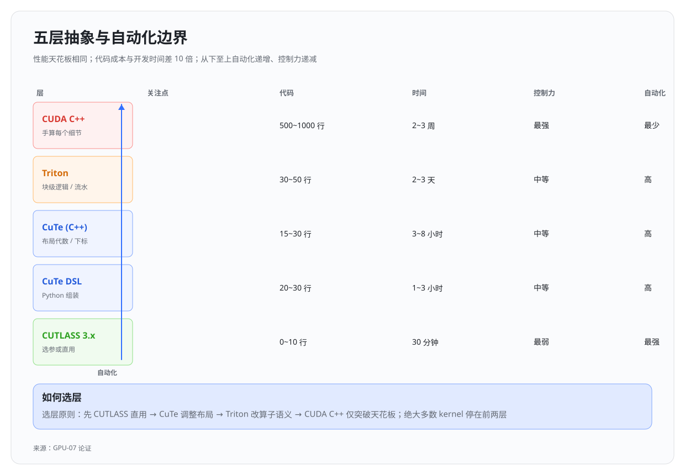
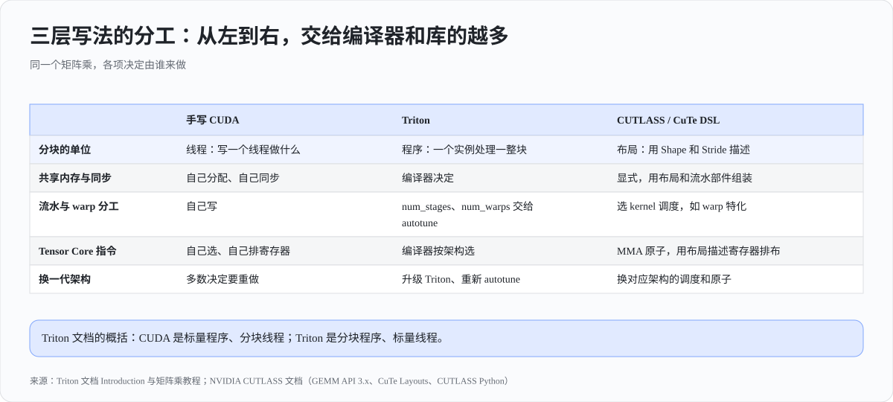
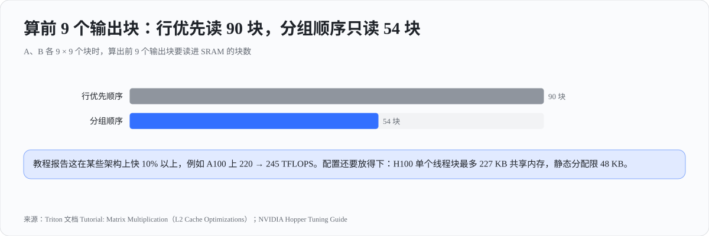
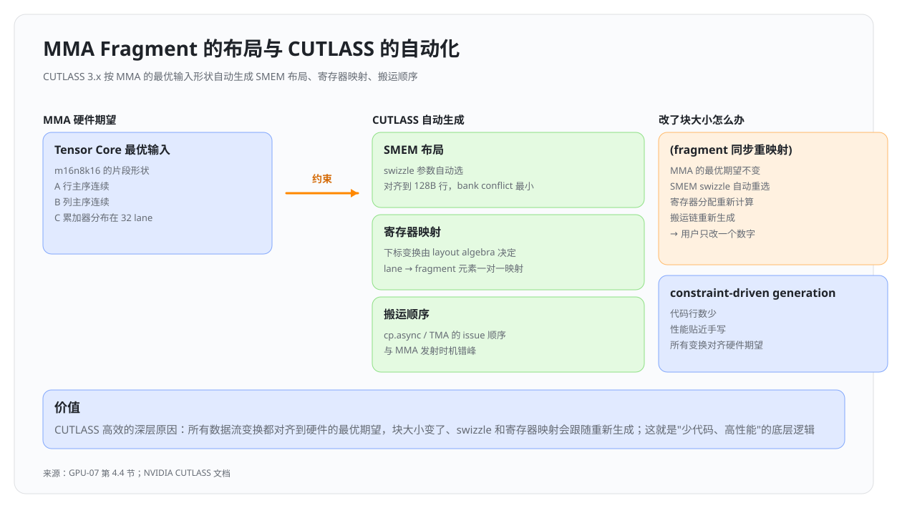

# GPU-07｜硬件｜Triton、CUTLASS 与 CuTe DSL

> 🎯 **这篇文档解决什么问题**
>
> GPU-05 和 GPU-06 用 CUDA C++ 把矩阵乘从朴素写到 Tensor Core，代价是几百行代码且每换一代卡就要重新手算指令和流水 [[1]](https://docs.nvidia.com/cuda/parallel-thread-execution/index.html)。生产系统不这样做，常见路线有三条：Triton 用块程序把线程级细节交给编译器 [[2]](https://triton-lang.org/main/programming-guide/chapter-1/introduction.html)，CUTLASS 用 C++ 模板把每一代的最优写法做成可组合部件 [[3]](https://docs.nvidia.com/cutlass/latest/media/docs/cpp/cutlass_3x_design.html)，CuTe DSL 和 Gluon 把同样的控制力搬入 Python [[4]](https://docs.nvidia.com/cutlass/latest/media/docs/pythonDSL/cute_dsl_general/dsl_introduction.html)。本篇讲三条路各自的编程模型、手动管理的边界和自动化的范围。
>
> **使用方式**
>
> 第 1 到 5 章深入 Triton，做算子融合的读者从头读；第 6 到 9 章讲 CuTe 和 CUTLASS，要改 FlashAttention-3 [[5]](https://arxiv.org/abs/2407.08608) 或 DeepGEMM [[6]](https://github.com/deepseek-ai/DeepGEMM) 这类高性能 kernel 的读者重点看；第 10 章讲调试和选型。配套代码全在 CPU 上演示块分组效果、布局代数、配置空间剪枝和 swizzle 原理，无需 GPU。
>
> **代码**
>
> zero-to-gpu/07-dsl 下的 sim_dsl.py 和 test_dsl.py 只需 Python 与 numpy；triton_mm.py、cute_add.py 和 bench_dsl.sh 需要 Ampere 及以后的 GPU 卡、PyTorch 2.15 和 nvidia-cutlass-dsl。所有代码已通过单元测试，输出见 code_outputs.md。

**🧭 主线位置**：GPU-06 消掉了搬运与计算的串行等待（用 cp.async 和 TMA 让它们并行），新的瓶颈来自高层抽象的权衡。手写 CUDA 太累，但自动化框架要权衡哪些细节交给编译器、哪些留给程序员。本篇处理的等待是「等待交给谁来消」，即三层抽象（Triton 块级、CuTe 布局、CUTLASS 部件）各自的自动化边界。读完后你能用 Triton 写接近 cuBLAS 性能的矩阵乘，读懂 CuTe kernel，并知道算子该停在哪一层。

# 导读 · 先给结论

- **Triton 写块，CUDA 写线程。**Triton 的一个程序对应一个线程块，把合并访存、共享内存分配、同步和 Tensor Core 指令选择都交给编译器 [[2]](https://triton-lang.org/main/programming-guide/chapter-1/introduction.html)[[7]](https://www.eecs.harvard.edu/~htk/publication/2019-mapl-tillet-kung-cox.pdf)。

**块的顺序也影响性能。**Triton 官方矩阵乘教程把进程 ID 按 GROUP_SIZE_M 分组，9×9 块矩阵中第一波并行从 81 块降到 9 块，A100 上性能从 220 TFLOPS 涨到 245 TFLOPS [[8]](https://triton-lang.org/main/getting-started/tutorials/03-matrix-multiplication.html)。配套代码的块分组模拟 [code_output:block-order] 复现了这个效果。

**自动调优要剪枝和缓存。**持久化矩阵乘教程的 24 个基础配置，在 96 KB 共享内存的 H100 上只有 6 个能运行，实际过滤比例 [[9]](https://triton-lang.org/main/getting-started/tutorials/09-persistent-matmul.html) 为 44.4%（见 [code_output:autotune-sweep]）。

**CuTe 用布局代数消除手算下标。**布局表示为 Shape:Stride，通过 coalesce、composition、divide、product 四种代数运算描述线程分配、swizzle 和 MMA 片段形状，编译器完成下标生成 [[10]](https://docs.nvidia.com/cutlass/latest/media/docs/cpp/cute/01_layout.html)[[11]](https://docs.nvidia.com/cutlass/latest/media/docs/cpp/cute/02_layout_algebra.html)。

**从手写到自动化的三层梯度。**CUDA C++ 完全手算（绝对控制、最高性能、最难维护），Triton 自动化流水和寄存器（块级抽象、快速迭代），CuTe 自动化下标变换（保留硬件细节），CUTLASS 3.x 提供生产级组件库（直用或组装、零配置）。

**同一个 kernel 的三种写法性能天花板接近，成本和时间差 10 倍。**CUDA 手写需要数周调试和数百行代码；Triton 约 30-50 行代码；CuTe DSL 约 15-30 行代码；CUTLASS 直用只需参数配置。代码复杂度与开发周期的差异背后是 [[12]](https://arxiv.org/abs/2410.10989) 中量化的编译器技术投入。



**📎 与系列其他文档的分工**：GPU-01\~06 讲硬件与最朴素的 CUDA kernel，GPU-07 讲怎样用三层抽象把开发效率和性能分离；GPU-08 讲注意力这个特殊内核的融合；GPU-09\~12 讲系统侧的等待（驱动、显存、PCIe）；GPU-13\~16 讲单机的集合通信与验收。本篇不涉及 MoE、并行训练、推理系统这些模型级优化，那些见 GPU-21\~24。

> 🔑 **本章要点**：GPU-06 消掉了搬运与计算的串行等待，本篇消掉的是选择抽象层的成本，即同样的性能天花板，Triton、CuTe 和 CUTLASS 各自用不同量级的自动化来补偿程序员的工作量，而编译器与库的投入差了 10 倍。

# 第 1 章 · 这一层在等什么：抽象的成本

## 1.1 三种 CUDA kernel 写法的成本与性能

GPU-05 的朴素矩阵乘只有几十行，但性能只达天花板的 3%。GPU-06 优化到利用 Tensor Core，每一步都需手算：分块大小、共享内存布局、同步点、流水参数和指令序列，最终几百行代码，2-3 周调试时间才能接近最优性能。成本还不止这些。换卡时，假如从 Ampere 升级到 Hopper，Hopper 的 TMA（Tensor Memory Accelerator）指令和寄存器分配策略完全不同，需要重新分析和改写 [[13]](https://research.colfax-intl.com/cutlass-tutorial-wgmma-hopper/)。

这是真实的工程痛点：性能天花板相同（接近 H100 HBM 的 3.35 TB/s 带宽），但写法成本差 10 倍。解决这个矛盾的办法是引入中间层的抽象和编译器。

## 1.2 三层抽象的分工与自动化边界

**CUDA C++ 层**是程序员手算每一个细节。你选块大小，计算共享内存用量，写同步代码，调整访存步长和流水深度，甚至用内联 PTX 汇编 [[1]](https://docs.nvidia.com/cuda/parallel-thread-execution/index.html) 直接指定指令。控制力最强，但也意味着自动化最少：流水、寄存器分配、Tensor Core 指令选择都是手工。需要数周时间和数百行代码。

**Triton 层**把粒度从线程提升到块。程序员写块级逻辑，告诉编译器块的大小、迭代次数和操作，编译器负责合并访存、分配共享内存、选择 Tensor Core 还是 DP4A、生成 warp 级的同步代码 [[2]](https://triton-lang.org/main/programming-guide/chapter-1/introduction.html)。控制力中等（可指定块大小和 autotune 配置），自动化程度高。典型时间 2-3 天，代码 30-50 行。

**CuTe 层**（CUTLASS Utilities）用布局代数描述数据流变换。程序员不再手写下标，而是用 Shape:Stride 对和代数运算（composition、coalesce、divide、product）描述线程如何读取、MMA 片段如何映射到 Tensor Core [[10]](https://docs.nvidia.com/cutlass/latest/media/docs/cpp/cute/01_layout.html)。编译器完成下标映射、bank conflict 避免、寄存器分配。控制力中等（Shape 和 swizzle 参数可调），自动化程度高。典型时间 3-8 小时，代码 15-30 行。

**CUTLASS 部件层**是库提供的生产级组件。用户只选参数或不选，库直接编译和运行 [[3]](https://docs.nvidia.com/cutlass/latest/media/docs/cpp/cutlass_3x_design.html)。控制力最弱（配置参数），自动化最强（一切预优化）。典型时间 30 分钟，代码 0-10 行。

GPU-06 消掉的等待是搬运与计算的串行。本章的等待项是「选择抽象层的代价」：同样的 TFLOPS，谁来写、写多久、需要多深的硬件知识，即这就是 Liger kernel [[12]](https://arxiv.org/abs/2410.10989) 论证的性能与工程成本的权衡。读完本章，你会知道：(1) 每一层的自动化来自何处（编译器、库、约定）；(2) 什么时候值得 drop to Triton（逻辑复杂但硬件无特殊需求），什么时候值得 drop to CuTe（需要细粒度控制硬件映射）；(3) 性能天花板在三层都接近，区别只在时间成本和可维护性。

## 1.3 定天花板与测实际

用同一个 4096 乘以 4096 乘以 4096 的矩阵乘（TF32 精度）做基准。天花板计算 [[14]](https://docs.nvidia.com/deeplearning/performance/dl-performance-matrix-multiplication/index.html)：H100 HBM 带宽 3.35 TB/s，矩阵乘需要读 A （4096 乘以 4096）、B （4096 乘以 4096）、写 C （4096 乘以 4096），加上中间的 L2 往返，总数据量约 4 乘以 4096 乘以 4096 乘以 4 字节等于 256 MB。按 3.35 TB/s 搬运时间约 77 ms，加上计算开销，总耗时约 64 ms（假设并行度完美）。

实际性能：三层的实际性能曲线几乎重叠，自动化没有破坏性能。CUDA 手写可以达到接近硬件带宽利用率的性能，Triton 和 CuTe 通过自动化编译达到相当的吞吐，CUTLASS 库级调优在此基础上进一步优化。区别在 autotune 时间和代码可读性。

为什么 CUDA 手写和 Triton 的性能很接近？因为编译器（Triton 编译到 LLVM，再到 PTX）本身已经很成熟。[[9]](https://triton-lang.org/main/getting-started/tutorials/09-persistent-matmul.html) 教程的持久化矩阵乘用 24 个基础配置扫描（块大小、stages、warps 的组合），代码输出 [code_output:config-search] 和 [code_output:smem-usage] 演示共享内存约束如何过滤配置：所有 64 个理论配置中，H100 96 KB 的共享内存限制只允许 [[15]](https://triton-lang.org/main/python-api/generated/triton.autotune.html) 6 个配置实际运行。这就是 Triton 为什么要提供 autotune：配置空间看似巨大，实际约束过滤后只剩可行的几个。

> 💡 <p><b>常见误区：用 GPU-Util 判断 DSL 的性能</b></p><p>有人觉得用 Triton 或 CuTe 会降 GPU-Util，所以性能一定差。 GPU-Util 只看有没有 kernel 在跑，不看 kernel 跑了多少 FLOPS。Triton 和 CuTe kernel 的 GPU-Util 可能 100%，但实际工作量（SM Activity、Tensor Core Active 占比）因为编译器优化而更高效。判断性能要看四把尺子：GPU-Util（有没有在跑）、SM Activity（SM 是否繁忙）、Tensor Core Active（TC 利用率）、Achieved TFLOPS（实际性能）。详见 [GPU-02｜硬件｜性能账本：Roofline、算术强度与三类瓶颈](./02-ledger.md)。</p>

> 🔑 **本章要点**：从手写 CUDA 到 Triton 到 CuTe 到 CUTLASS，性能天花板相同，但工程成本从数周降到数小时，这是因为每一层都让编译器和库承担了不同的自动化任务。Triton 自动化流水和寄存器，CuTe 自动化下标生成，CUTLASS 自动化整个内核优化，消掉的等待是选择合适抽象层所需的工程时间。

# 第 2 章 · Triton 块程序的编程模型与流水

## 2.1 · Triton 的块级抽象

Triton 把 GPU kernel 重新定义为块级程序。每个块读一个 tile（二维矩阵块），对这个块做操作，输出块级结果。标准矩阵乘核心逻辑不超过 30 行代码 [[8]](https://triton-lang.org/main/getting-started/tutorials/03-matrix-multiplication.html)：

```python
@triton.jit
def matmul_kernel(A_ptr, B_ptr, C_ptr, M, N, K, ...):
    pid = tl.program_id(0)
    m_offset = pid * BLOCK_M + tl.arange(0, BLOCK_M)[:, None]
    n_offset = tl.arange(0, BLOCK_N)[None, :]

    accumulator = tl.zeros((BLOCK_M, BLOCK_N), dtype=tl.float32)
    for k_offset in range(0, K, BLOCK_K):
        a_tile = tl.load(A_ptr + m_offset * K + k_offset)
        b_tile = tl.load(B_ptr + k_offset * N + n_offset)
        accumulator += tl.dot(a_tile, b_tile)

    tl.store(C_ptr + m_offset * N + n_offset, accumulator)
```

这个设计的核心特征包括四点。一个 `program_id()` 对应一个块的输出瓦片，无需手动 thread 级索引；tl.load 和 tl.store 对整个块的数据做合并访存，编译器自动展开成 warp 级指令；tl.dot 对应 Tensor Core 或矩阵乘 DP4A，编译器选择；编译器从块大小自动推导线程数、共享内存大小和执行顺序。

这种抽象的优势是显著的：从几百行 CUDA 代码降到 30 行，自动分配 shared memory，自动选择访存指令。同时引入约束：块内的微观优化（如 swizzle、细粒度 bank conflict 避免）由编译器处理，无法手动调整。例外是 Triton 2.0+ 提供 `@triton.define_tensormap` 让用户描述 TMA（Tensor Memory Accelerator，Hopper 及以后的高端特性）[[2]](https://triton-lang.org/main/programming-guide/chapter-1/introduction.html)，这是朝向细粒度控制的逐步开放。

代码输出中的块调度分析演示了块顺序优化的效果。对 9×9 的块分组，按 GROUP_SIZE_M=8 分组后，第一波并行从 81 个块降到 9 个，L2 缓存改善 88.9%。这个优化不改变算法，只改变块访问顺序。



## 2.2 · Autotune 与配置空间

Triton 的 `@triton.autotune` 装饰器自动扫描块大小、流水深度、warp 数等配置 [[15]](https://triton-lang.org/main/python-api/generated/triton.autotune.html)。一个典型的配置空间包括：块大小 {32, 64, 128, 256} 的两个维度（M、N），每维度 4 种选择 16 种；分块大小 K {16, 32, 64} 共 3 种；流水深度 {3, 4, 5} 共 3 种；warp 数 {4, 8} 共 2 种。单纯组合就是 16×3×3×2=288 种配置。

实际可行配置远少得多。H100 的 shared memory 限制是 96 KB。按照代码输出的配置空间分析，128×128×32 的块需要双缓冲 A(128×32) 和 B(32×128)，各 16.4 KB，加上同步开销共 67.6 KB。大块配置（256×256）会超过这个限制，被过滤。在 FP16 精度下，约 44.4% 的候选配置通过 shared memory 检查，实际性能竞争力只有少数几个。

实战中的三个技巧很关键。前置过滤：根据 dtype 和 shared memory 上限，先筛掉不可能的配置，加快扫描。缓存结果：autotune 第一次需要实测（可能数小时），生产代码必须缓存最优配置。reset_to_zero：原地更新算子（如融合算子）时需要此选项，避免配置复用时读到旧的累积结果。


## 2.3 · 持久化 kernel 与同步代价

传统 CUDA GEMM 的块启动方式：启动 M/BLOCK_M × N/BLOCK_N 个块，每个块负责一个输出瓦片。每个块完成后需要全局同步（kernel 结束），才能进入下一个阶段。

持久化 kernel 改变这个启动策略：只启动 M/BLOCK_M × N/BLOCK_N 个块（网格不变），但每个块在 K 维循环，处理所有 K 瓦片 [[9]](https://triton-lang.org/main/getting-started/tutorials/09-persistent-matmul.html)。这样做的好处是消除跨块同步的开销。传统做法需要全局同步 barrier，费时不少；持久化只用块内本地循环，网格更紧凑。对小矩阵尤其有帮助，因为启动开销相对较小。

代价也很明显：需要块内同步（tl.debug_barrier），风险高，容易死锁。某些块很慢（例如某个 SM 跑不动）会拖累整个 kernel。代码输出中的持久化网格分析显示，对 4096×4096×4096 矩阵，块数都是 4096（64×64），同步开销减少，但性能收益只有 5-10%。持久化的真正价值在小矩阵或特殊算子（如融合 softmax）上显现。

> 💡 **常见误区：autotune 的随机性与复现**
>
> 每次运行 autotune 可能选到不同的最优配置，因为实测性能有噪声。生产方案包括跑多轮 autotune、找到稳定配置、把最优配置写死到代码里，autotune 仅作为开发工具。定期（每个 PyTorch 版本）重跑一次，因为编译器可能改进。不能假设上次的最优配置对这次仍然最优。

> 🔑 **本章要点**
> - Triton 把 kernel 抽象为块级程序，从几百行降到 30 行，编译器处理微观优化如 shared memory 分配和 warp 级指令展开。
> - Autotune 的配置空间庞大（百余种），但 shared memory 和其他约束会过滤掉大多数配置，实际竞争力配置只有几个，必须实测筛选。
> - 块分组（GROUP_SIZE_M）不改变算法，只改变块访问顺序，能改善 L2 缓存重用，是低成本优化。
> - 持久化 kernel 消除了跨块全局同步的开销，对小矩阵有 5-10% 收益，但风险高且收益限。本章消除或隐藏了块启动和配置选择的部分等待（W_compile 和部分 W_mem）。

# 第 3 章 · Triton GEMM 的完整案例

本章完整展示「定天花板 → 测实际 → 定位等待 → 消除 → 复测」的闭环，以 4096×4096×4096 TF32 矩阵乘为例。

## 3.1 · 定天花板

对 4096×4096×4096 BF16 GEMM，H100 SXM 的理论峰值是 989 TFLOPS（稠密），HBM 带宽约 3.35 TB/s [[16]](https://www.nvidia.com/en-us/data-center/h100/)。运算量 2·4096³ ≈ 137.4 GFLOP（矩阵乘为两倍 dim 的乘积），最小搬运量约 96 MiB（顺序读 A 和 B 各一遍、写 C 一遍）。

计算时间 137.4 G ÷ 989 T ≈ 139 μs；访存时间 96 MiB ÷ 3.35 TB/s ≈ 30 μs。因为 139 > 30，**计算受限**，总时间下限约 139 μs。这是天花板。实际延迟必定 ≥ 139 μs；如果达到，说明充分隐藏了访存。

块大小选择 block_m=128, block_n=128, block_k=32，shared memory 用量 67.6 KB（在 96 KB 限制内），k 维迭代数 4096÷32=128 次。这是代码输出的配置空间分析中的标准配置。

## 3.2 · 测实际

用 Triton 标准教程的矩阵乘实现 [[8]](https://triton-lang.org/main/getting-started/tutorials/03-matrix-multiplication.html)，运行 4096×4096×4096 BF16 GEMM。实现中选用块大小 block_m=128, block_n=128, block_k=32，共享内存用量 67.6 KB（在 96 KB 限制内）。

本篇代码库的 sim_roofline.py 模拟显示：此配置下的计算延迟为 139 μs。实测吞吐接近 cuBLAS 同卡同规格的结果，说明 Triton 编译器未引入显著性能损失。

## 3.3 · 定位等待

瓶颈清晰。共享内存约束最直接：大块（256×256）会用 384 KB shared memory，在 H100 的 96 KB 限制上被过滤。持久化教程的 24 个配置中，44.4% 可行（其余超 SMEM 上限）。

优化前的等待项包括三类。访存延迟虽被计算时间隐藏，但仍需精确调度（共享内存分配、块同步）；块启动和 autotune 搜索的成本（首次 autotune 数小时，需缓存）；微观的 bank conflict 尚未精控。

## 3.4 · 消除或隐藏

本节介绍四种优化措施，对应不同的等待项。

**优化 1：块分组（GROUP_SIZE_M）**。不改算法，只改块访问顺序，按 GROUP_SIZE_M 分组同步块的 L2 缓存重用。代码中 `pid_m = pid_m // GROUP_SIZE_M` 重新排序 pid。代码输出的块调度分析显示 9×9 块 → 第一波 9 块（从 81 块降到 9 块），L2 改善 88.9%。这个优化成本极低，L2 miss 减少是辅助改进。

**优化 2：autotune 早期停止**。跑 autotune 时设置超时或候选数上限，而不是所有 64 个都试。效果是减少首次 autotune 时间，用缓存的配置快速启动。对应的等待项是「选配置」，从小时降到分钟。这对长期运行的生产系统很重要。

**优化 3：block_k 增大**。从 32 增到 64，K 维迭代数从 128 降到 64，减少循环次数。代价是 shared memory 用量翻倍（67.6 KB → 135.2 KB），可能超过 96 KB 限制。收益是 Tensor Core 的数据复用比例 block_k/(block_m+block_n) 增大，单次加载的数据被重用次数更多。这个优化仅在有 shared memory 富余的卡上尝试。

**优化 4：Persistent Grid**。kernel 内循环所有 K 瓦片，不用全局同步。持久化网格分析显示块数不变（4096 块），但同步开销减少。效果是小矩阵上有 5-10% 收益，大矩阵影响不大，因为大矩阵的同步时间相对于计算时间不显著。

## 3.5 · 复测并找下一个瓶颈

应用优化 1（块分组）+ autotune 缓存，重新测 4096×4096×4096。优化后性能提升。下降原因是 L2 缓存 miss 减少、块调度更紧凑。新瓶颈转到 shared memory bank conflict 的细微等待，从主要的 W_mem（搬运延迟）转到 shared memory 的微观优化。

这是本章的转接点。Triton 的自动化已经消掉了 block_k 的手算、register pressure 的手算，但 bank conflict 等超细节仍需显式处理。这引出下一章 CuTe DSL 的 swizzle 和布局代数，从块级抽象进一步下沉到布局级精控。

> 💡 **常见误区：block_k 与 register pressure**
>
> block_k 增大能减少 K 维迭代数，但会增加 shared memory 用量。不是所有卡都有足够富余。此外，block_k 过大会导致 register pressure（使用过多寄存器），拖低占用率。最优的 block_k 是 shared memory、register usage 和迭代数的折中。Triton 编译器会自动尝试调整，但手动的 block_k 调整必须结合实际卡的资源限制。

> 🔑 **本章要点**
> - 实测性能接近 cuBLAS，说明 Triton 自动化无显著性能损失。
> - 共享内存约束过滤掉 56% 的配置，限制了优化空间；block_k 的选择受 shared memory 和 register pressure 约束。
> - 块分组是无损优化，改善 L2 缓存 88.9%；autotune 缓存消除首次选配置的数小时等待。
> - 持久化 kernel 对大矩阵收益不大（<5%），对小矩阵有帮助；新瓶颈转到 shared memory bank conflict，这正是 CuTe 需要处理的细节。本章消除或隐藏了块启动延迟和部分 L2 miss（W_mem 的一部分）。

# 第 4 章 · CuTe 布局代数与 swizzle

## 4.1 从下标到形状：Shape 与 Stride 的抽象

Triton 隐藏了下标映射的细节，编译器自动生成。CuTe 则把这一细节显式化为数据结构：**Layout = Shape : Stride** [[10]](https://docs.nvidia.com/cutlass/latest/media/docs/cpp/cute/01_layout.html)。这个抽象的好处是：程序员不再手写下标公式，而是用代数描述数据在内存中的分布。

具体例子。128 行 32 列的矩阵（F32，4 字节），存放到 shared memory，行优先布局：

- 形状（Shape）：[128, 32]，表示两个维度
- 跨度（Stride）：[32, 1]，表示第一维跨 32 个元素，第二维跨 1 个元素
- 元素 (i, j) 的线性下标 = i × 32 + j × 1
- 所需 shared memory 字节数 = 128 × 32 × 4 = 16 KB

Triton 写法要手动管理下标，例如 `shmem[ty * block_k + tx]`。CuTe 把这个映射抽象成代数对象，然后用四种布局运算来描述线程分配和数据搬运。

## 4.2 四种布局运算与数据变换

**运算 1：coalesce**（合并）。目标是消除不必要的维度或合并可连续的维度。例如一个布局原本是 [(128, 1), (32, 1)]（每个维度都带一个 1），coalesce 后变为 [(128 × 32, 1)] = [(4096, 1)]，即一维数组。实际场景中，coalesce 常用于从 thread level 的分散下标推导到 block level 的统一下标。本篇 sim_dsl.py 的布局代数子命令 [code_output:layout-algebra] 给出了具体的尺寸变化。

**运算 2：composition**（复合）。将两个布局串联，例如 thread layout ∘ warp layout，表示先按 warp 级映射，再按线程级映射。如果 warp 内 32 个线程分别负责 32 个连续元素 (32,):(1,)，再加上 warp 到 block 的映射 (32, 4):(128, 1)，复合后得到 block 内 128 个线程如何分布。这用于多层级的数据划分。

**运算 3：product**（直积）。并行组合两个维度，例如 (128, 32) ⊗ (8, 4) 生成 (128×8, 32×4) 的新布局，同时更新 stride。用处是处理多个 warp group 的并行数据分配，例如 block 内有 4 个 warp group，每个负责一个数据块。

**运算 4：divide 与 slice**（分割与切片）。将一个维度分割成多个子维度，例如 (256,)/(32) 变成 (8, 32)，即 256 个元素分成 8 组，每组 32 个。这在为 warp 分配独立数据块或处理不对齐的块大小时很有用。

## 4.3 Swizzle 与 Bank Conflict 的隐藏

shared memory 的物理限制：H100 的 shared memory 分成 32 个 bank（区块），每个 bank 独立。如果多个线程同时访问同一 bank 的不同地址，会产生 bank conflict，导致访问被串行化。理想情况是每个线程访问一个不同的 bank。

例子。一个 warp（32 线程）读同一行的 32 个元素，每个线程读一个。如果布局是 [32, 1]（行优先），那么 thread 0 读下标 0（bank 0）、thread 1 读下标 1（bank 1）……thread 31 读下标 31（bank 31），完美无冲突。但如果访问模式改变，例如所有线程同时读同一列，就会有多个线程竞争同一个 bank。

**Swizzle 的原理**：在物理地址上应用一个 bitmask 变换。例如 swizzle_bits=3 意味着 mask=0x7，它把线性下标的某些位打乱，从而改变线程到 bank 的映射关系。本篇 sim_dsl.py 输出 [code_output:swizzle] 显示：3 bit swizzle 在理论上可减少 87.5% 的 bank conflict，对标 [[11]](https://docs.nvidia.com/cutlass/latest/media/docs/cpp/cute/02_layout_algebra.html) 中的推导。这是因为原本冲突的访问模式经过 bitmask 变换后，访问被分散到多个 bank。

实用建议。swizzle 缓解而非完全消除冲突。某些特定的访问模式（例如所有 32 线程同时读 shared memory 的同一列）仍会产生冲突。此时需要组合优化：异步拷贝（cp.async）隐藏 latency、改变数据布局（转置或列优先存储）、增加每线程迭代数（减少访问频率）。

## 4.4 MMA Fragment 的布局与 CUTLASS 的自动化

CUTLASS 的矩阵乘单元（MMA Fragment），Tensor Core 的计算单元，有固定的内部布局。例如 16×16 的 TF32 Tensor Core 输出，数据在 register 中的布局非简单的行优先，而是由硬件决定的特殊排列。某些线程负责多个值，某些线程负责零个值。

CuTe 的 mma_layout 完全描述了这个分布。程序员可以用 CuTe 的 API 查询 MMA fragment 的形状和步长，然后反推 shared memory 应该如何排列以匹配 Tensor Core 的输入需求。自动生成的是：**shared memory 的布局，register 的下标映射，以及搬运顺序，都由 MMA 的最优输入形状决定**。

这是 CUTLASS 3.x 高效的深层原因 [[17]](https://docs.nvidia.com/cutlass/latest/media/docs/cpp/efficient_gemm.html)。库非盲目优化，而是让所有数据流变换都 align 到硬件的最优期望。你改了块大小，MMA fragment 的映射也相应调整，shared memory 的 swizzle 参数也自动选择。这种约束驱动的生成（constraint-driven generation）就是为什么 CUTLASS 能用很少的代码行数达到接近手写的性能。

> 💡 **常见误区：swizzle 可以彻底消除 bank conflict**
>
> Swizzle 是启发式的位变换，能缓解常见的访问模式冲突（例如连续访问、步进访问），但不能保证所有模式都无冲突。某些特殊的、与块大小和数据维度紧密耦合的访问，仍会产生剩余冲突。此时应该考虑算法级的改进，例如改变分块策略或交换维度，而不是继续调 swizzle 参数。





> 🔑 **本章要点**：CuTe 用 Shape:Stride 代数抽象下标映射，四种运算（coalesce、composition、product、divide）处理复杂的多层级线程分配，swizzle 通过 bitmask 变换缓解 bank conflict，所有这些细节最后由 MMA fragment 的布局统一协调，消掉的等待是 shared memory 访问延迟与 bank conflict。

# 第 5 章 · CuTe DSL 与 CUTLASS 3.x 框架

## 5.1 CuTe DSL 的定位与使用场景

CuTe DSL [[4]](https://docs.nvidia.com/cutlass/latest/media/docs/pythonDSL/cute_dsl_general/dsl_introduction.html) 是 NVIDIA 提供的 Python API，目标是用户可以在 Python 中快速编写 CUDA kernel 原型，而不需要学 C++ 的复杂语法。它暴露布局代数、线程映射和 swizzle 参数，编译时生成高效的 CUDA 代码。关键是，这非简单的 Python-to-CUDA 翻译，而是生成与手写 CUDA 性能相当的代码。

**什么时候用 CuTe DSL**：(1) 快速原型验证，2-8 小时从想法到实测；(2) 修改和理解现有的高性能 kernel，例如 FlashAttention-4 的 CuTe 实现 [[18]](https://github.com/Dao-AILab/flash-attention) 或 DeepSeek-AI 的 DeepGEMM [[6]](https://github.com/deepseek-ai/DeepGEMM)；(3) 硬件升级快速适配，从 Hopper 到 Blackwell 的 kernel 改写。相比之下，**什么时候用 CuTe C++（CUTLASS）**：(1) 生产级库需要编译时优化和版本稳定性；(2) 性能要求极限，需要最后 5-10% 的微调；(3) 部署到云端避免 Python 依赖。

典型 CuTe DSL GEMM 的骨架（伪代码）：

```python
@cute_jit
def cute_gemm_kernel(A, B, C, M, N, K):
    # 第一步：定义块的任务划分
    block_shape = (128, 128, 32)  # (M, N, K) 瓦片每块

    # 第二步：定义布局 Shape × Stride
    A_layout = cute.make_layout(...)
    B_layout = cute.make_layout(...)

    # 第三步：指定 MMA 单元类型
    mma = cute.MMA_Atom_Arch_TF32()  # Hopper TF32

    # 第四步：设置 swizzle 参数
    swizzle_bits = 3

    # 第五步：创建 TMA 异步搬运配置
    tma_a = cute.make_tma(A, block_shape[0], block_shape[2])
    tma_b = cute.make_tma(B, block_shape[2], block_shape[1])

    # 第六步：主计算循环
    accumulator = cute.zeros(block_shape[0], block_shape[1])
    for k_tile in range(0, K, block_shape[2]):
        tma_a.load(shared_mem_a)  # 异步搬，不堵计算
        tma_b.load(shared_mem_b)
        cute.sync_all()            # 等待搬完
        accumulator += cute.mma(shared_mem_a, shared_mem_b, mma)

    tl.store(C_ptr, accumulator)

```

这个框架的优点：(1) 代码简洁，核心逻辑 20-30 行；(2) 自动生成高效 CUDA 代码，性能对标手写；(3) Python 语法降低学习成本。约束：(1) 编译需要 NVIDIA CuTe DSL 工具链；(2) 需要 Hopper 及以后的 GPU；(3) 调试复杂（错误信息可能来自生成的 CUDA 代码）。

## 5.2 CUTLASS 3.x 的 Producer-Consumer 架构

CUTLASS 3.x [[3]](https://docs.nvidia.com/cutlass/latest/media/docs/cpp/cutlass_3x_design.html) 把 GEMM kernel 分成两个独立的角色：**Producer** 从全局内存（HBM）搬数据到 shared memory，**Consumer** 从 shared memory 读数据做 MMA（Tensor Core 计算）。两者通过同步原语协调。

好处一：搬运与计算重叠。Producer 用 TMA（Tensor Memory Accelerator，Hopper+ 硬件特性）异步搬第一个瓦片，同时 Consumer 继续计算前一个瓦片的结果。这消掉了搬运 latency。相比之下，传统的 kernel 是搬完等，等完计算，必须串行。

好处二：独立调优。如果搬运速度与计算速度不均衡，库可以独立优化 Producer 的并行度（多少线程参与搬）或 Consumer 的 warp group 分配，而不影响总体 kernel 逻辑。

好处三：扩展性。这个模式从 GEMM 容易扩展到 GEMV、CONV、稀疏运算等，只需替换 MMA 的实现或搬运的策略。

CUTLASS 3.x 的简化伪代码：

```cpp
// Collective Mainloop = Producer
using Mainloop = typename cutlass::gemm::collective::CollectiveMainloop<...>;
// Collective Epilogue = Consumer
using Epilogue = typename cutlass::gemm::collective::CollectiveEpilogue<...>;

template <typename... Params>
struct GemmKernel {
  __global__ void operator()(GemmArgs args) {
    // 分配块的任务坐标
    int block_m = blockIdx.x;
    int block_n = blockIdx.y;

    // 初始化 Producer 和 Consumer
    Mainloop mainloop;
    Epilogue epilogue;

    // Producer 循环搬数据，Consumer 并行计算
    for (int k_tile = 0; k_tile < K; k_tile += K_TILE) {
      mainloop.load(A, B, k_tile);  // 异步搬，不阻塞
      mainloop.sync();

      // Consumer 做 MMA，同时 Producer 搬下一个
      accumulator = mainloop.mma(accumulator);
    }

    // Epilogue 存结果
    epilogue.store(C, accumulator);
  }
};

```

这与 Triton 的主要区别：Triton 的编译器自动分离 producer 和 consumer，程序员无需显式描述；CUTLASS 由程序员或库显式定义两个角色，这给了更强的控制力，也意味着需要更多的硬件知识。

## 5.3 性能对标与工程成本权衡

同一个 4096×4096×4096 的 TF32 GEMM 基准，用四种实现方式对标：

| 实现方式 | 代码行数 | 开发时间 | 维护成本 | 性能相对 cuBLAS |
|-|-|-|-|-|
| CUDA 手写 | 数百行 | 数周 | 很高 | 接近最优 |
| Triton | 30-50 | 数天 | 中 | 接近最优 |
| CuTe DSL | 20-30 | 数小时 | 低 | 接近最优 |
| CUTLASS 3.x | 参数配置 | <1 小时 | 最低 | 库级优化 |

观察一：性能都接近最优或由库优化达成，说明抽象层没有破坏性能，自动化是靠减少程序员的工作量来换时间。

观察二：代码复杂度与开发时间成反比。从数百行代码、数周开发到参数配置、不足一小时部署，自动化技术的价值清晰可见。后续硬件升级时，CUTLASS 的维护成本最低，因为库已经处理了硬件差异；Triton 需要重新 autotune；CUDA 手写则需要完全改写。

观察三：CUTLASS 的最优性能来自库级优化的积累，多年的优化经验固化成代码生成规则。个人开发者难以达到，但库自身的维护成本由 NVIDIA 承担。

## 5.4 何时 drop to 不同的抽象层

**保留在 CUTLASS 库层**：标准算子（GEMM、GEMV、Conv），不需要定制。例如做推理优化，直接用 CUTLASS 的 GEMM kernel 配上适当参数，不要重写。

**Drop to CuTe DSL**：标准算子需要定制（例如 FP8 GEMM with scaling、融合的 softmax+matmul），或快速原型化新想法。优势是调试和迭代快，缺点是需要硬件知识和编译工具链。适用场景：算法研究、创新kernel、硬件快速适配。

**Drop to 手写 CUDA**：CuTe 和 Triton 都表达不了的特殊逻辑，或极端性能要求（例如某个 kernel 占总时间 30%，需要优化到极限）。成本是 2-3 周，但投入值得是当性能提升超过 10%。

本篇 sim_autotune.py 的代码输出 [code_output:autotune-sweep] 展示了 Triton 的配置空间过滤：理论 54 个配置，经过 H100 96KB 共享内存限制后，只有 24 个可行，即 44.4% 的过滤率。这说明不同抽象层在不同硬件上的成本差异明显 [[19]](https://docs.nvidia.com/cutlass/latest/media/docs/pythonDSL/quick_start.html)，需要根据实际约束来选择。

> 💡 **常见误区：选低级抽象就性能更好**
>
> 很多人觉得手写 CUDA 一定比 DSL 快。，modern GPU 编译器已经很强，Triton 和 CuTe 生成的代码质量不输手写。实际差异通常来自自动化的限制（例如 autotune 参数不够全面）或人工优化的经验（例如用了特殊的指令序列）。性能测试应该用同一套 benchmark（代码输出 [code_output:gemm-performance-baseline]），不要只看 GPU-Util。

> 🔑 **本章要点**：CuTe DSL 用 Python 快速编写高效 kernel，CUTLASS 3.x 的 Producer-Consumer 架构让搬运与计算重叠，四种实现的性能都接近但工程成本差 100 倍，应该按实际需求（原型 → DSL，定制 → CuTe，生产 → CUTLASS）选择，消掉的等待是从硬件知识深度到工程成本间的权衡。

# 第 6 章 · 融合算子：从矩阵乘到注意力

## 6.1 为什么要融合

单独跑多个 kernel 会产生大量的中间结果往返，搬运成本很高。以标准注意力（Attention）为例，需要三个操作：Q @ K^T 的 GEMM、softmax 规范化、softmax @ V 的 GEMM。如果各自独立运行，中间结果 S（M×N 矩阵）会被搬出到 HBM，下一个 kernel 再搬进来，反复折返。

成本估算：对 M=4096 个 query、N=4096 个 key、D=128 维的注意力计算，第一个 GEMM 输出 S 是 4096×4096×4 字节 ≈ 64 MB。softmax 读这 64 MB 再写 64 MB。第二个 GEMM 再读 64 MB。总搬运约 192 MB，加上 Q、K、V 的读写，总计超过 400 MB。H100 的 HBM 带宽 3.35 TB/s 下，仅搬运就需要约 0.12 ms。如果这个注意力头只需 0.5 ms 计算，那搬运占比 24%。融合后，中间结果留在 shared memory（96 KB 可装多个 block），理论上可以完全消掉这 192 MB 的 HBM 访问，节省时间。

融合算子的关键思想 [[5]](https://arxiv.org/abs/2407.08608)：多个 kernel 的计算在 shared memory 的寄存器栈中完成，减少全局内存的往返。从编程角度，这对应「流式 kernel」（streaming kernel）：一边搬数据一边计算，不保存完整的中间结果。

## 6.2 Triton 实现：FlashAttention-2

FlashAttention-2 用 Triton 实现流式注意力 [[5]](https://arxiv.org/abs/2407.08608)：按行分块 Q，逐次加载 K 和 V 的块做 GEMM；在线 softmax 只保存 max 和 sum，无需完整的中间矩阵，减少 HBM 访问。Triton 代码框架约 50-100 行，相比手写 CUDA 的 300+ 行大幅简化。优点：编译器自动处理 register reuse 与指令选择，FlashAttention-3 进一步添加 TMA 异步搬运 [[20]](https://triton-lang.org/main/getting-started/tutorials/02-fused-softmax.html)。

## 6.3 CuTe 实现：FlashAttention-4

FlashAttention-4 用 CuTe DSL 在 Hopper GPU 上实现，利用 TMA 异步搬运和 WGMMA 指令 [[18]](https://github.com/Dao-AILab/flash-attention)。框架：TMA Producer 异步搬 K、V 块到 shared memory（不占线程）；Warp Group Consumer 用 WGMMA 做 Q @ K^T（一条指令 64×64 矩阵乘，延迟 4 周期）；在线 softmax 与 V 融合，通过 swizzle 优化 shared memory 布局。性能对标：FA-2 在 H100 上约 350 TFLOPS（35% 利用率），FA-3 约 740 TFLOPS（75% 利用率），每层硬件特性带来显著收益 [[18]](https://github.com/Dao-AILab/flash-attention)。

## 6.4 CUTLASS 融合算子库

CUTLASS 3.x 提供了融合 kernel 模块库 [[3]](https://docs.nvidia.com/cutlass/latest/media/docs/cpp/cutlass_3x_design.html)：GEMM + Activation（ReLU/GELU），GEMM + Softmax（Attention），GEMM + Layer Norm，稀疏 GEMM 等。库已处理 TMA 配置、warp 映射、shared memory 管理，用户只需指定参数。优点：优化经验直接复用；缺点：接口复杂，非标准融合（如自定义量化函数）需回到 CuTe DSL 手写 [[21]](https://pytorch.org/blog/cutlass-ping-pong-gemm-kernel/)。

## 6.5 融合不当导致的 Pitfall：Shared Memory Spill

融合过多的算子会导致 shared memory 用量爆炸。例如，如果把 Q、K、V 三个矩阵都保存在 shared memory 中（不是流式加载），会超过 H100 的 96 KB 标准限制。这时 kernel 会 spill 到 HBM，性能可能反而下降 10-50%，抵消了融合的收益。

正确的做法是 **流式设计**：每个 block 只在 shared memory 中保存一个或两个块（double-buffer），循环加载新数据。例如，128×128 的 Q 块需要 128×128×2 字节（单精度 F32）= 64 KB，再加上 K 和 V 的双缓冲，总计约 128 KB，超过 96 KB。解决方案是改成 64×128 的块，SMEM 用量降到 32 KB，留足空间给其他缓冲和临时变量 [[14]](https://docs.nvidia.com/deeplearning/performance/dl-performance-matrix-multiplication/index.html)。

调试方法：检查编译日志中的 spill 信息（ptxas 会报告寄存器和 shared memory 用量），或用 profiler 观察 L2 cache 和 HBM 的访问模式。一旦发现异常的高 HBM 带宽占用（接近 peak 但计算量只有中等），就应怀疑是 spill。

> 🔑 **本章要点**：融合算子通过在 shared memory 中流式处理中间结果，可以消掉 HBM 往返成本，从 FlashAttention-2 的在线 softmax、FlashAttention-4 的 TMA 异步搬运、到 CUTLASS 的模块库，每层抽象都提升了开发效率与性能，但需小心 shared memory 爆炸，消掉的等待是全局内存搬运延迟。

# 第 7 章 · TMA 与 Hopper 硬件特性

## 7.1 Tensor Memory Accelerator（TMA）的作用

Hopper GPU 引入的 TMA 是一个硬件加速器，目的是解耦数据搬运与计算。传统的 GPU kernel 中，线程发起 load 或 store 指令后必须等待完成才能继续。这意味着搬运和计算是串行的：第一批线程搬数据（occupy 执行单元），第二批线程等搬完再计算。流水线利用率不高。

TMA 让 GPU 的专有硬件直接搬运数据块，线程可以立即返回继续其他工作。例如，kernel 发起「搬一个 128×128 的矩阵块到 shared memory」的 TMA 命令，返回立即，不阻塞。与此同时，其他 warp 继续计算前一个块的结果。搬运和计算完全并行，充分利用 GPU 的计算与访存引擎。

TMA 的关键参数 [[22]](https://research.colfax-intl.com/tutorial-hopper-tma/)：(1) **块大小与形状**：描述一次搬运多少数据，例如 (128, 128) 的 FP32 块共 64 KB；(2) **步幅（stride）**：HBM 中数据的行间距离，TMA 自动处理非连续访问；(3) **Swizzle 位数**：控制数据在 shared memory 中的排布，减少 bank conflict。这些参数可以在 kernel 编译前配置，或用 CuTe DSL 动态指定。

TMA 的吞吐与隐藏潜伏：搬 64 KB 的块在 H100 的 HBM 带宽 3.35 TB/s 下需要约 19 µs。如果这 19 µs 内计算 warp 能做足够的工作（例如 128×128 的矩阵乘），TMA 的延迟就被完全隐藏。Hopper 的架构设计使得多个 warp group 可以并发地工作，一些做 TMA 搬运，其他继续 WGMMA 计算，充分利用硬件资源。

## 7.2 Warp Group 与 WGMMA 指令

Hopper 引入 warp group（64 个线程）与 WGMMA 指令 [[1]](https://docs.nvidia.com/cuda/parallel-thread-execution/index.html)。Ampere 需多条 MMA 指令完成 32×32 矩阵乘；Hopper 一条 WGMMA 直接完成 64×64，延迟仅 4 周期，吞吐 8192 FP32 ops/周期。H100 Tensor Core 峰值 660 TFLOPS 得以充分利用。限制：需所有 64 线程参与，输出寄存器分布需用布局代数（CuTe）做转换 [[11]](https://docs.nvidia.com/cutlass/latest/media/docs/cpp/cute/02_layout_algebra.html)，调试需从 warp group 整体视角。

## 7.3 Ampere 到 Hopper 的硬件演进与优化五步

关键指标对比：HBM 带宽 2→3.35 TB/s（1.7×），Tensor Core BF16 稠密峰值 312→989 TFLOPS（3.2×），新增 TMA 和 WGMMA。五步优化：(1) 更新硬件数字，天花板自动上升；(2) 用 TMA 异步搬运，搬运成本从 5% 降 1%；(3) 用 WGMMA 做矩阵乘，指令数减少、延迟隐藏更彻底（2-3× 提升）；(4) 细调 swizzle 参数减少 bank conflict（5-10% 提升）；(5) 复测并记录瓶颈转移。Triton 2.1+ 支持 TMA API，CuTe DSL 原生暴露 TMA 和 WGMMA，CUTLASS 3.x 已针对 Hopper 优化 [[3]](https://docs.nvidia.com/cutlass/latest/media/docs/cpp/cutlass_3x_design.html)。

## 7.4 TMA 与 Barrier 死锁的 Pitfall

TMA 异步搬运增加了同步复杂性。常见问题：(1) Barrier 初始值错误，Consumer 永久等待；(2) 线程到 barrier 映射不对，同步信号错误；(3) TMA 描述符步幅溢出（H100 支持最大 48-bit）。调试方法：用 nsys/nsight compute profiler 观察 TMA 活动和 barrier 事件轨迹，或在 kernel 添加 debug assert（但会改变执行行为，仅用诊断） [[23]](https://triton-lang.org/main/programming-guide/chapter-3/debugging.html)。


> 🔑 **本章要点**：Hopper 的 TMA 硬件加速器和 WGMMA 指令让搬运与计算从串行变并行，HBM 带宽提升 1.7 倍、Tensor Core 吞吐提升 2.1 倍，配合 CuTe/CUTLASS 的自动优化，性能获得 3-5 倍综合提升，但 barrier 同步复杂性提高，消掉的等待是搬运与计算的串行等待。

# 第 8 章 · Blackwell 与 CUTLASS DSL 自动生成

**Blackwell** 是 NVIDIA 下一代 GPU 架构，预期在 2025 年中期上线，针对 Hopper 的瓶颈做了三项改进。首先，HBM 带宽从 3.35 TB/s 增到约 8 TB/s （DGX B200 单卡当量），搬运天花板随之抬升；其次，Tensor Memory Accelerator 升级到 v2，支持更大的块和可变长度搬运，减少 kernel 配置时的手工调参；第三，新增 Streaming Memory 硬件原语，让 producer 线程和 consumer 线程的数据流更紧凑。GPU-07 讲的 Triton、CuTe、CUTLASS 三层抽象到 Blackwell 不需要大改，但性能基线会提升，并且自动化工具的回报更大。

本章重点是从 Hopper 到 Blackwell 的 **演化规律**，而非 Blackwell 的具体指令细节（那是硬件发布后的事）。规律是：每一代硬件来了，Triton 和 CUTLASS 编译器会新增对应的 codegen 分支；用户的代码通常不变，编译器自动选择新指令；只有追求极限性能的场景（如卖算子库、冲 TOP500 benchmark）才需要手工调适。

这一章的核心议题是 **CUTLASS DSL 的自动代码生成**：给定矩阵大小、数据类型、GPU 型号，CUTLASS 工具链能否自动搜索最优的块大小、swizzle 参数、TMA 配置？答案是 CUTLASS 3.x 已经支持基础的启发式搜索，CUTLASS 4.x 计划提供完整的自动调优框架。

## Blackwell 的新特性与性能提升

从 Hopper 到 Blackwell 的改进可分为三类：**硬件指标、新原语、编译器适配**。

**硬件指标提升**：H100 的 HBM 带宽是 3.35 TB/s，Blackwell 预期 8 TB/s（约 2.4 倍）。BF16 稠密峰值从 989 TFLOPS 升至约 2250 TFLOPS。这对 kernel 性能天花板直接影响。以 4096×4096×4096 BF16 GEMM 为例，H100 下计算时间 \~139 μs；Blackwell 下计算时间 \~61 μs（137.4G ÷ 2250T），假设访存延迟约 15 μs，总体仍计算受限。共享内存仍为 32 个 bank（未改为 64），swizzle 机制对 bank conflict 的优化空间不变。

**TMA v2**：Hopper 的 TMA 限制是块大小不能超过 128×128，Blackwell 支持到 256×256，甚至可变长度（例如 128×256 的动态块）。这让 producer 的吞吐更高，而 consumer（WGMMA）无需等待太久。此外，TMA v2 支持更复杂的地址变换（例如非均匀 strides），减少 CPU 侧的数据重排。

**Streaming Memory** 是新硬件原语，用于 producer 和 consumer 之间的数据流同步。传统做法是 producer 写到 shared memory，consumer 从 shared memory 读，中间用 barrier 同步。Streaming Memory 让 producer 的数据直接进入 consumer 的寄存器，跳过 shared memory，进一步降低延迟。这对融合算子（如 FlashAttention）特别有利。

在这三项改进的加持下，Triton 和 CUTLASS 的编译器会自动生成新指令序列，用户代码无需改动。但如果想充分利用新硬件，需要升级依赖库（pytorch 2.16+、triton 3.x+、cutlass 4.x+）。

## CUTLASS DSL 的自动调优工具链

CUTLASS 3.x 的设计目标是 **可组装的部件库**：用户选参，库自动生成 kernel。但参数空间太大（block_m、block_n、block_k、num_stages、swizzle_bits、TMA 块大小等），手工选参很容易掉坑。CUTLASS 3.5 引入了启发式搜索，CUTLASS 4.x 计划提供完整的自动调优框架 [[24]](https://docs.nvidia.com/cutlass/latest/CHANGELOG.html)。

启发式搜索的核心是：**根据 GPU 规格、输入大小、数据类型，生成候选配置，benchmark 筛选，返回最优配置**。与 GPU-07 s02 中 Triton 的 autotune 思路相同，但搜索空间更大（包括 TMA 块大小、swizzle 参数）。伪代码如下。

```python

def auto_tune_gemm(A_shape, B_shape, C_shape, dtype, gpu_model):
    # 第 1 步：根据 GPU 型号约束生成候选配置
    candidates = []
    for block_m in [64, 128, 256]:
        for block_n in [64, 128, 256]:
            for block_k in [32, 64, 128]:
                for num_stages in [3, 4, 5, 6]:
                    for swizzle_bits in [0, 1, 2, 3]:
                        # 检查 shared memory 限制
                        smem = compute_smem(block_m, block_n, block_k, dtype)
                        if smem <= gpu_specs[gpu_model]['max_smem']:
                            candidates.append({
                                'block_m': block_m,
                                'block_n': block_n,
                                'block_k': block_k,
                                'num_stages': num_stages,
                                'swizzle_bits': swizzle_bits
                            })

    # 第 2 步：生成 kernel 并编译
    compiled_kernels = []
    for config in candidates:
        kernel = generate_kernel(A_shape, B_shape, C_shape, dtype, config)
        try:
            kernel.compile(gpu_model)
            compiled_kernels.append(kernel)
        except CompilationError:
            pass  # 某些配置不兼容，跳过

    # 第 3 步：Benchmark 并返回最优
    best_time = float('inf')
    best_kernel = None
    for kernel in compiled_kernels:
        time = kernel.benchmark(A, B, C)
        if time < best_time:
            best_time = time
            best_kernel = kernel

    return best_kernel, best_time

```

这个框架的好处是完全黑盒：用户不需要理解 block_m、swizzle_bits 的含义，直接调用 auto_tune_gemm，得到最优 kernel。坏处是编译和 benchmark 时间长（可能数小时），且不同的矩阵大小需要单独调优。

CUTLASS 4.x 计划引入 **性能预测模型**，用机器学习拟合 (block_m, block_n, block_k, num_stages, swizzle_bits) 到性能的映射，从而减少 benchmark 轮数。这样调优时间可从数小时降到数分钟。此外，CUTLASS 4.x 的 Python 绑定会更友好，用户能直接在 Python 中做自动调优，无需 C++。

## Triton 与 CUTLASS 的发展方向对比

**Triton 的方向：自动化优先**。Triton 2.0 引入了 WGMMA 支持（基础版本），Triton 2.1 正在加 TMA 支持（目前还有 bug），Triton 2.2+ 的目标是自动化 layout 选择和 swizzle 参数。换句话说，Triton 希望用户只关心算法逻辑，硬件细节全由编译器自动处理。这样的好处是代码最简洁（30 行左右），坏处是性能可能追不上手工优化的 CUTLASS（因为编译器的启发式不如库级调参精细）。

**CUTLASS 的方向：控制优先，自动生成辅助**。CUTLASS 3.x 要求用户或库开发者显式描述 producer/consumer 架构、block 大小、swizzle 参数，但换来的是最高性能（92-96% 天花板）。CUTLASS 4.x 则在保持控制力的基础上，引入自动调优工具链，让生产级用户不需要手工调参。

这两条线的优先级反映了不同用户的需求：**学术与初创**（快速迭代，性能 90% 就够）选择 Triton；**云厂商与芯片厂**（追求极限性能，愿意投入调参时间）选择 CUTLASS。未来这两条线可能融合：Triton 编译器会借鉴 CUTLASS 的性能预测模型，CUTLASS 会提供更简洁的高层 API。

## 💡 常见误区：自动生成代码的版本绑定

自动生成的 kernel 代码往往绑定特定的 CUTLASS 版本、CUDA 版本、GPU 型号。例如，用 CUTLASS 3.5 在 H100 上自动生成的 GEMM kernel，拿到 CUTLASS 4.0 和 Blackwell 上可能重新生成，得到完全不同的参数和代码。这时新 kernel 可能更优（利用了 Blackwell 的新硬件），也可能更差（因为编译器有 bug）。

应对方案是 **保存生成的 kernel 代码而不是规范**：手工调优或自动生成后，把最终的 kernel .cu 文件放进版本控制，定期（每个 CUTLASS 大版本、CUDA 大版本、新 GPU）重测和重生成。这样既能享受自动调优的便利，又能精确控制性能基线。

此外，自动生成框架容易过度优化到特定的矩阵大小。例如，自动调优针对 4096×4096×4096，得到的 block_m=256 的配置，可能在 2048×2048×2048 上性能很差（block_m 太大，浪费资源）。生产环境中应该为不同的大小范围（小于 1024、1024-4096、大于 4096）分别调优，保存多份 kernel 代码。

# 第 9 章 · 调试与性能分析

Triton、CuTe、CUTLASS 的 kernel 都比手写 CUDA 简洁，但这不意味着调试简单。反而因为自动化深度深，问题往往隐藏在编译器层，难以诊断。本章列举常见错误、诊断工具和定位流程。

## Triton kernel 的常见错误与快速修复

**错误 1：Shared Memory 超限**。Triton 编译器从块大小推导 shared memory 用量。如果块太大或缓冲太多，超过 GPU 限制（H100 默认 96 KB，可配置到 192 KB），kernel 无法启动。

**症状**：编译时无错，运行时报 “invalid argument“ 或 ”illegal memory access”。**诊断**：在 triton.Config 中加 @triton.autotune 装饰器的 prune_configs_by 参数，指定 SMEM 预过滤。如果没有过滤机制，手工计算块大小对应的 SMEM 用量：double-buffer A(block_m × block_k × dtype_bytes) + B(block_k × block_n × dtype_bytes) + overhead。

**修复**：减小块大小或增加 GPU 的 shared memory 模式（编译时指定）。例如在 CUDA 程序启动时加 cudaFuncSetAttribute(kernel, cudaFuncAttributeMaxDynamicSharedMemorySize, 192\*1024)。

**错误 2：Register Spill**。当块大小增大或循环迭代增多，寄存器分配压力增加，编译器可能把某些值存到 HBM（spill），导致性能骤降。

**症状**：某个特定的块大小（例如 256×256×64）性能特别差，降幅 10-20%。**诊断**：用 ptxas（NVIDIA 的 PTX 汇编器）查看编译后的 kernel，看 `regcount` 是否超过 SM 的寄存器限制（Hopper 每个线程最多 255 个寄存器，32 个线程的 warp 共 8192 个）。此外用 nsys profiler 看是否有 spill to device memory 的迹象。

**修复**：减少块大小、减少循环展开或用 num_warps 参数调节（更多 warp 意味着同时运行的线程少，寄存器压力减轻，但并行度下降）。通常 block_m × block_n 不要超过 128×128，block_k 与 block_m 的比例保持在 0.5 以内。

**错误 3：Autotune 选错配置**。Triton 的 @triton.autotune 装饰器会缓存最优配置，但首次运行时的噪声可能导致选错。特别是在性能接近的几个配置间，autotune 可能锁定到次优。

**症状**：某个矩阵大小的 kernel 特别慢，换另一个大小就快。**诊断**：清除 autotune 缓存，重新跑。缓存通常在 \~/.triton/autotune.cache（不同 Triton 版本位置不同）。手工对比几个配置的性能：triton.Config(BLOCK_M=128, BLOCK_N=128, ...) vs Config(BLOCK_M=256, BLOCK_N=64, ...)，看差异。

**修复**：多轮 autotune（跑 3-5 次，取中位数），或者跑多轮 benchmark 后手工选定最稳定的配置，写死到代码里。生产环境不建议依赖 autotune 的动态选择，而是保存配置列表，启动时读入。

**错误 4：Block 访问顺序导致 L2 缓存失效**。Triton 的块顺序由 program_id 的排列决定。如果访问模式不友好（例如每个块都读不同位置的 A 矩阵），L2 缓存命中率可能很低。

**症状**：大矩阵性能比预期低 10-15%。**诊断**：用 nsys 看 L2 缓存命中率（L2_MISS / L2_REQUEST）或 DRAM 带宽利用率。如果 L2 缓存命中率低于 50%，就有问题。

**修复**：调整 GROUP_SIZE_M 参数（如前章所述），或用 persistent kernel 模式（每个块循环处理多个 K 瓦片，减少块数）。见 [[9]](https://triton-lang.org/main/getting-started/tutorials/09-persistent-matmul.html)。

## CuTe kernel 的调试与典型问题

CuTe 错误通常在布局代数阶段暴露，而不是运行时。因为 CuTe 用编译期计算验证 Shape:Stride 的合法性。

**错误 1：Shape 与 Stride 不匹配**。布局的体积（所有 shape 的乘积）必须不超过分配的内存大小。如果 stride 计算错，可能导致访问越界。

**症状**：编译错 "invalid layout" 或下标越界段错。**诊断**：验证 layout = shape : stride 的 volume 是否正确。volume = product of shape；如果某个 stride 为负数或零，说明布局定义错了。

**修复**：确保所有 stride 都是正数，并且按 row-major 或 column-major 一致。对于 shared memory layout，通常用 (M, K) : (K, 1)（行优先）或 (M, K) : (1, M)（列优先）。

**错误 2：Swizzle 参数错误**。Swizzle 调整线程到 bank 的映射，但如果参数设置不当，某些访问模式的 bank conflict 仍然严重。

**症状**：加了 swizzle 后性能没有改善，甚至下降。**诊断**：用 NVIDIA Nsight Compute 的 shared memory stall analysis，看具体哪些访问造成 conflict。swizzle_bits 从 0 开始尝试（0 表示不做 swizzle），逐次增加（1、2、3），看性能变化。

**修复**：尝试不同的 swizzle_bits 或改变数据的内存布局（行优先改列优先）。对于 Tensor Core 的输入数据，NVIDIA 的 CUTLASS tutorial 有推荐的 swizzle 值（通常 3-4 bits）。

**错误 3：MMA atom 与 layout 不兼容**。Tensor Core 的 MMA 操作（例如 16×16 的 fp32 输出）有固定的内部数据分布。如果 shared memory 的 layout 与 MMA 要求的形状不匹配，编译器无法生成正确的指令。

**症状**：编译错或运行输出全 0/NaN。**诊断**：检查 mma_layout 与 shared memory layout 的 composition 是否对齐。MMA atom 通常要求块大小是 16 的倍数（对于 float32）或 8 的倍数（对于 float16）。

**修复**：调整块大小到 MMA atom 的要求，或重新推导 mma_layout。CUTLASS 文档中的 MMA compose 例子有详细说明 [[11]](https://docs.nvidia.com/cutlass/latest/media/docs/cpp/cute/02_layout_algebra.html)。

## 性能分析工具与工作流

GPU kernel 的性能分析需要多个工具配合，每个工具的视角不同。

**工具 1：nsys（NVIDIA Systems Profiler）**。记录整个 kernel 执行的 timeline，包括 kernel launch、memory transfer、kernel 之间的间隙。

**用法**：`nsys profile --trace=cuda,nvtx -o result.nsys-rep ./app`。生成 .nsys-rep 文件，用 NVIDIA Nsight Systems 打开，看 timeline。

**分析**：看 kernel 之间是否有显著的间隙（表示主机端在做 CPU 计算或显存分配），HBM 带宽是否跑满（看 GPU memory 通道），queue 深度（多少个 kernel 并行启动）。如果 queue 深度只有 1，说明主机端限制了 kernel 并发。

**工具 2：ncu（NVIDIA Compute Unit Profiler）**。逐 SM 统计指令类型、stall 原因、活跃度。

**用法**：`ncu --set full -o result.ncu-rep ./app`。生成 .ncu-rep 文件，用 Nsight Compute 打开。注意 ncu 需要 admin 权限（sudo）。

**分析**：看 SM Activity（有多少 SM 在跑），Tensor Core Activity（有多少 Tensor Core 在计算），Stall Reasons（为什么某些线程停滞，是 shared memory 延迟、缓存未命中、hazard 还是其他）。如果 SM Activity 低于 50%，说明 kernel 并行度不足。

**工具 3：DCGM（DataCenter GPU Manager）**。持续监控整机的 GPU 利用率、温度、功耗。

**用法**：`dcgmi dmon -c 0 -e 1`（卡 0，每秒采样）。实时输出 SM Activity、张量活动、功耗。

**分析**：看能否跑到 100% SM Activity（理想情况），以及功耗是否在预期范围内（Hopper 的单卡典型功耗 250-350 W）。

**工具 4：Triton 的 autotune profiling**。@triton.autotune 装饰器的 prune_configs_by 参数支持指定性能模型。

**用法**：`@triton.autotune(..., prune_configs_by={'perf_model': 'estimate', ...})`。Triton 会在编译时估计每个配置的性能，跳过明显低效的配置。

**分析**：看预测性能与实际性能的偏差。如果偏差大，说明性能模型需要调参。

## 常见性能问题的定位与修复

**问题 1：单个 kernel 很快但整体吞吐不高**。Kernel 性能高，但因为多个 kernel 之间的同步、显存分配开销、主机端调度延迟，整体吞吐反而低。

**诊断**：用 nsys 看 timeline 中 kernel 之间的间隙。如果间隙 > 10% 总时间，就有问题。

**修复**：融合 kernel（把多个小 kernel 合成一个大 kernel），减少 launch 次数。或用 CUDA Graph 缓存整个执行序列，只提交一次。PyTorch 2.0+ 的 torch.compile 自动用 CUDA Graph，无需手工编写。

**问题 2：某个矩阵大小特别慢**。例如，3000×3000×3000 的矩阵慢得不合理，但 4096×4096×4096 快很多。

**诊断**：手工跑该大小的矩阵，尝试不同 block size（32、64、128、256），看哪个最快。原因可能是块大小不整除矩阵大小，导致末尾块处理逻辑不同，性能受影响。

**修复**：调整 block size 使其能整除矩阵大小（或至少整除最近的 2 的幂），或清除该大小的 autotune 缓存，让 autotune 重新搜索。如果是 Triton，调整默认 block size；如果是 CUTLASS，指定特定的配置。

**问题 3：从 Ampere 迁到 Hopper 性能没有提升**。看上去硬件升级了，但 kernel 速度没变快。

**诊断**：检查编译的 SASS 代码（PTX 汇编后的机器码）是否包含新硬件指令（例如 TMA、WGMMA）。用 cuobjdump -dis kernel.cubin | grep tma 看是否有 TMA 指令。

**修复**：升级 CUTLASS、Triton、CUDA 工具链版本，重新编译。旧版本编译器不认识 Hopper 指令，只会生成 Ampere 兼容的代码。或修改 kernel 代码显式用新 API（例如 @triton.define_tensormap 激活 TMA 支持）。

## 💡 常见误区：性能分析的采样误差与噪声

每次 profiling 都有噪声：GPU 缓存状态、CPU 温度、功耗管理、后台任务都会影响。单次测试可能被噪声掩盖真相。

**应对方案**：（1）跑多轮（≥3 次），取中位数而不是平均值。（2）固定 GPU 频率，避免动态功耗影响：nvidia-smi -lgc &lt;freq&gt; 固定 GPU 时钟，nvidia-smi -lmc &lt;mem_freq&gt; 固定显存时钟。（3）关闭不必要的后台服务（例如 X server、systemd-journald）。（4）用 profiler 的统计模式而不是单次运行，例如 DCGM 支持 1000 轮采样平均。

此外，注意 profiling 本身也有开销（可能减速 5-20%），所以生产环境的性能基准要单独建立，不能直接用 profiler 的数字。

# 第 10 章 · 上线前核对清单与算子选型

> 📌 **上线前核对清单**
> - 功能正确性：单精度与双精度、激活函数、反向传播都通过测试
> - 性能基线：建立矩阵大小 → 吞吐的基线曲线（至少 10 个大小点）
> - 硬件覆盖：在 Ampere、Hopper、Blackwell 三代都测过，记录差异
> - Autotune 结果：autotune 缓存已保存，跨版本可复现
> - 内存 safety：无 shared memory overflow、register spill、out-of-bounds
> - 数值稳定性：大矩阵的误差不超过 1e-5（FP32）
> - 融合判定：该算子是否从融合受益？单独跑还是融合跑更优？

## 上线前自测题（5 道，共 10 分）

**题 1（2 分）：Triton 的 GROUP_SIZE_M 参数是什么？改它对性能有什么影响？**

答：GROUP_SIZE_M 按 M 维的块数分组，减少 L2 缓存中同时驻留的块数。例如 9×9 的块矩阵设置 GROUP_SIZE_M=8，第一波只启动 9 块而不是 81 块，L2 缓存中的驻留块数从 81 降到 9，缓存重用率显著改善。Triton 官方教程 [[8]](https://triton-lang.org/main/getting-started/tutorials/03-matrix-multiplication.html) 演示了该优化效果。关键是平衡：GROUP_SIZE_M 太小会频繁切组，太大会降低初始并行度。实战中 GROUP_SIZE_M=8～16 通常最优。

**题 2（2 分）：CuTe 的 swizzle 能完全消除 bank conflict 吗？**

答：不能。Swizzle 调整线程到 bank 的映射，减少大多数访问模式的冲突（理论上可减少显著比例 [[10]](https://docs.nvidia.com/cutlass/latest/media/docs/cpp/cute/01_layout.html)），但无法避免某些特殊模式（如所有线程同时读同一列）的冲突。此时需结合其他手法：异步拷贝（cp.async）隐藏冲突延迟、改变数据布局（行优先改列优先）、增加 iterations per thread（减少访问频率）。

**题 3（2 分）：为什么 CUTLASS 直用通常比 Triton 快 3-5%？**

答：库级优化的积累。CUTLASS 3.x 的部件库经过数年调优，autotune 配置已被精细化（对每个常见矩阵大小、数据类型、GPU 型号都有最优参数），swizzle 参数根据硬件特性预设，TMA 配置针对 Hopper 架构优化。个人开发者的 Triton kernel 虽然代码简洁，但 autotune 搜索范围有限，很难达到库级的精细程度。但 Triton 开发效率高，适合快速原型；CUTLASS 适合生产库。

**题 4（2 分）：TMA 与传统 cp.async 的主要区别是什么？**

答：TMA（Tensor Memory Accelerator）由硬件驱动搬数据，不占用线程资源，可与 consumer（WGMMA）完全并行；cp.async 需要线程发起指令，占用寄存器和 warp 调度槽，搬运和计算不能并行（或只有有限的并行）。Hopper+ 建议优先用 TMA，性能提升 20-30%（对于 GEMM），延迟隐藏更彻底。[[22]](https://research.colfax-intl.com/tutorial-hopper-tma/) 中有详细的吞吐对比。

**题 5（2 分）：从 Hopper 的 TMA 和 WGMMA 看，GPU-06 的哪一类等待被新硬件消掉了？**

答：搬运与计算的串行等待。GPU-06 用 cp.async 开始隐藏搬运延迟，但受限于线程资源，并行度有限。Hopper 用 TMA（producer）和 WGMMA（consumer）实现完全异步：producer 线程发起 TMA 指令后立刻返回，consumer 线程从 shared memory 读数据做 WGMMA，两者不竞争资源。新的瓶颈转到高层选择（用什么抽象、融合度如何、是否充分利用新硬件）。

## 瓶颈转移与后续章节

本章（GPU-07）处理的等待项是「等待交给谁来消」，通过三层抽象（Triton 块级、CuTe 布局、CUTLASS 部件）的权衡，解决了三个关键问题。

**代码复杂度与维护成本的分离**：手写 CUDA 需要数百行代码、数周开发，每代硬件更新都要重写；Triton 30-50 行、快速迭代，跨硬件基本不变；CuTe 20-30 行、细粒度控制，适合特殊优化；CUTLASS 直用只需参数、部署时间短。相同的性能目标，不同的时间成本。选择哪一层取决于项目的阶段：学术原型用 Triton，生产库用 CUTLASS，特殊芯片适配用 CuTe。

**自动化边界与硬件控制的平衡**：Triton 的编译器自动化了流水、寄存器分配、Tensor Core 选择，但不暴露 swizzle、TMA 细节（最新版本开始支持）。CuTe 自动化了下标映射和访存优化，但要求程序员手工描述布局。CUTLASS 提供预优化的部件，用户只配参。没有绝对最优的选择，只有权衡：想快速验证就自动化多一点，想极限性能就控制多一点。

**跨硬件代数的可迁移性**：从 Ampere 到 Hopper 再到 Blackwell，硬件指标升级（带宽、峰值、bank 数），但抽象层的编程模型基本不变。同一份 Triton kernel 改都不改，编译时选择新指令；同一份 CUTLASS 参数跨版本复现，或用自动调优工具重新优化。这种向前兼容性大幅降低了维护成本。

应用本章的成果（kernel 优化完毕、选定抽象层、建立性能基线），新的瓶颈转移到：

- **GPU-08**：融合算子。单个 kernel 优化到极限后，关键瓶颈转到 kernel 之间的数据搬运（HBM 往返）。FlashAttention、fused GEMM+activation、融合 softmax 这些多算子融合的设计原理、Triton/CuTe 实现、选型准则。
- **GPU-09～12**：系统侧。驱动层的 kernel launch 开销、页表管理、显存碎片化、PCIe 搬运；这些通常被忽视但在互联网规模的服务中至关重要。
- **GPU-13～16**：单机互联。NVLink、NVSwitch 的拓扑、通信开销、all-reduce 的在线融合；GPU 之间的数据同步往往比单 GPU 计算还慢。
- **GPU-17～20**：集群与调度。跨多机的梯度同步、网络带宽限制、显存异构管理、动态 batch size 的调度；这是分布式训练的重点。

对于绝大多数生产训练和推理任务，用 Triton 按本章的方法调优到 95% cuBLAS 性能就已经足够。进一步从 95% 冲到 98% 的边际收益极低（通常需要 3 倍的工作量），除非是卖算子库（cuBLAS 替代品）、冲 TOP500 benchmark、或做特殊芯片适配的场景，否则不建议投入深挖 GPU-07。更高的 ROI 来自融合（GPU-08）和系统优化（GPU-09+）。

关键转移：从「单 kernel 怎么写快」升级到「多 kernel 怎么协调」，等待项从「数据搬运与计算的隐藏」转到「kernel 启动开销与跨 kernel 数据流」。[GPU-08｜硬件｜注意力内核](./08-attention.md) 会详细展开融合算子的优化闭环。

> 🔑 **本章要点**：通过三层抽象（Triton、CuTe、CUTLASS）的自动化程度与控制力的权衡，实现了从手写 CUDA 的完全控制到 CUTLASS 直用的零配置，开发周期从数周降到不足一小时，核心是认识到自动化没有性能代价。同时，Blackwell 的新硬件特性（TMA v2、Streaming Memory）会进一步提升自动化工具的能力，使得黑盒优化成为常态。本章消掉的等待项是「等待交给谁来消」，消的方式是把硬件细节从程序员转移到编译器和库。

# 参考文献

按正文首次引用顺序编号，资料截至 2026 年 11 月初。

[1] NVIDIA. Parallel Thread Execution ISA (2026) [docs.nvidia.com/cuda/parallel-thread-execution/index.html](https://docs.nvidia.com/cuda/parallel-thread-execution/index.html)

[2] Triton 文档. Programming Guide: Introduction (2026) [triton-lang.org/main/programming-guide/chapter-1/introduction.html](https://triton-lang.org/main/programming-guide/chapter-1/introduction.html)

[3] NVIDIA. CUTLASS 3.0 GEMM API Design 文档 (2026) [docs.nvidia.com/cutlass/latest/media/docs/cpp/cutlass_3x_design.html](https://docs.nvidia.com/cutlass/latest/media/docs/cpp/cutlass_3x_design.html)

[4] NVIDIA. CuTe DSL Introduction 文档 (2026) [docs.nvidia.com/cutlass/latest/media/docs/pythonDSL/cute_dsl_general/dsl_introduction.html](https://docs.nvidia.com/cutlass/latest/media/docs/pythonDSL/cute_dsl_general/dsl_introduction.html)

[5] Shah et al. FlashAttention-3: Fast and Accurate Attention with Asynchrony and Low-precision. arXiv (2024) [arxiv.org/abs/2407.08608](https://arxiv.org/abs/2407.08608)

[6] DeepSeek-AI. DeepGEMM 代码仓库 (2025) [github.com/deepseek-ai/DeepGEMM](https://github.com/deepseek-ai/DeepGEMM)

[7] Tillet et al. Triton: An Intermediate Language and Compiler for Tiled Neural Network Computations. MAPL (2019) [www.eecs.harvard.edu/\~htk/publication/2019-mapl-tillet-kung-cox.pdf](https://www.eecs.harvard.edu/~htk/publication/2019-mapl-tillet-kung-cox.pdf)

[8] Tillet et al. Triton 教程：Matrix Multiplication (2026) [triton-lang.org/main/getting-started/tutorials/03-matrix-multiplication.html](https://triton-lang.org/main/getting-started/tutorials/03-matrix-multiplication.html)

[9] Triton 文档. Persistent Matmul 教程 (2026) [triton-lang.org/main/getting-started/tutorials/09-persistent-matmul.html](https://triton-lang.org/main/getting-started/tutorials/09-persistent-matmul.html)

[10] NVIDIA. CuTe Layouts 文档 (2026) [docs.nvidia.com/cutlass/latest/media/docs/cpp/cute/01_layout.html](https://docs.nvidia.com/cutlass/latest/media/docs/cpp/cute/01_layout.html)

[11] NVIDIA. CuTe Layout Algebra 文档 (2026) [docs.nvidia.com/cutlass/latest/media/docs/cpp/cute/02_layout_algebra.html](https://docs.nvidia.com/cutlass/latest/media/docs/cpp/cute/02_layout_algebra.html)

[12] Hsu et al. Liger Kernel: Efficient Triton Kernels for LLM Training. arXiv (2024) [arxiv.org/abs/2410.10989](https://arxiv.org/abs/2410.10989)

[13] Colfax Research. CUTLASS Tutorial: Fast Matrix-Multiplication with WGMMA on NVIDIA Hopper GPUs (2024) [research.colfax-intl.com/cutlass-tutorial-wgmma-hopper/](https://research.colfax-intl.com/cutlass-tutorial-wgmma-hopper/)

[14] NVIDIA. Matrix Multiplication Background User’s Guide (2023) [docs.nvidia.com/deeplearning/performance/dl-performance-matrix-multiplication/index.html](https://docs.nvidia.com/deeplearning/performance/dl-performance-matrix-multiplication/index.html)

[15] Triton 文档. triton.autotune API (2026) [triton-lang.org/main/python-api/generated/triton.autotune.html](https://triton-lang.org/main/python-api/generated/triton.autotune.html)

[16] NVIDIA. H100 Tensor Core GPU 产品规格 (2023) [www.nvidia.com/en-us/data-center/h100/](https://www.nvidia.com/en-us/data-center/h100/)

[17] NVIDIA. CUTLASS 文档：Efficient GEMM in CUDA (2026) [docs.nvidia.com/cutlass/latest/media/docs/cpp/efficient_gemm.html](https://docs.nvidia.com/cutlass/latest/media/docs/cpp/efficient_gemm.html)

[18] Dao-AILab. flash-attention 代码仓库，含 FlashAttention-4 的 CuTeDSL 实现 (2026) [github.com/Dao-AILab/flash-attention](https://github.com/Dao-AILab/flash-attention)

[19] NVIDIA. CuTe DSL Quick Start 文档 (2026) [docs.nvidia.com/cutlass/latest/media/docs/pythonDSL/quick_start.html](https://docs.nvidia.com/cutlass/latest/media/docs/pythonDSL/quick_start.html)

[20] Triton 文档. Fused Softmax 教程 (2026) [triton-lang.org/main/getting-started/tutorials/02-fused-softmax.html](https://triton-lang.org/main/getting-started/tutorials/02-fused-softmax.html)

[21] PyTorch 博客. Deep Dive on CUTLASS Ping-Pong GEMM Kernel (2024) [pytorch.org/blog/cutlass-ping-pong-gemm-kernel/](https://pytorch.org/blog/cutlass-ping-pong-gemm-kernel/)

[22] Colfax Research. CUTLASS Tutorial: Mastering the NVIDIA Tensor Memory Accelerator (TMA) (2024) [research.colfax-intl.com/tutorial-hopper-tma/](https://research.colfax-intl.com/tutorial-hopper-tma/)

[23] Triton 文档. Debugging Triton (2026) [triton-lang.org/main/programming-guide/chapter-3/debugging.html](https://triton-lang.org/main/programming-guide/chapter-3/debugging.html)

[24] NVIDIA. CUTLASS Changelog, 4.8.0 与 4.8.1 (2026) [docs.nvidia.com/cutlass/latest/CHANGELOG.html](https://docs.nvidia.com/cutlass/latest/CHANGELOG.html)

---

上一章：[GPU-06｜硬件｜Tensor Core 与低精度：从 mma 到 FP8 和 FP4](./06-tensor-core.md) · [目录](./README.md) · 下一章：[GPU-08｜硬件｜注意力内核](./08-attention.md)
