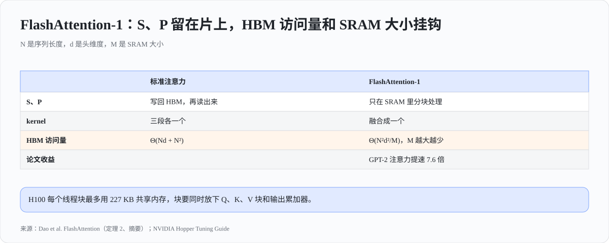
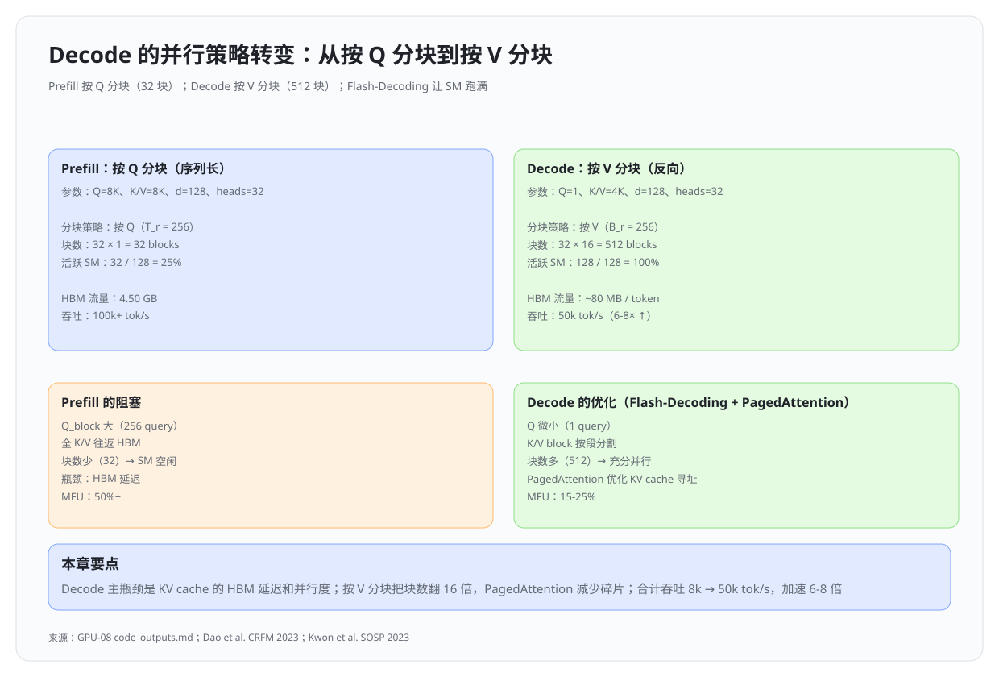
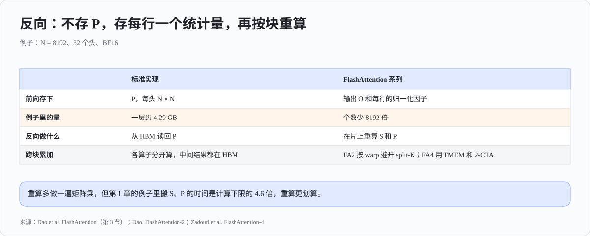
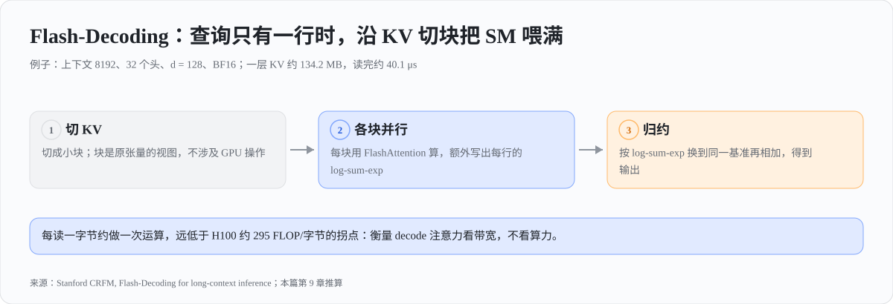
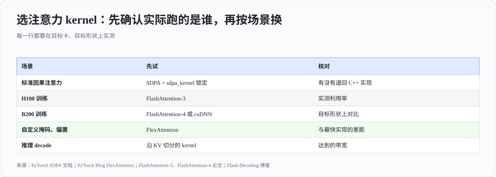

# GPU-08｜硬件｜注意力内核

> 🎯 **这篇文档解决什么问题**：注意力是大模型里最常用、也最容易写慢的算子。按公式直接写，N×N 的分数矩阵要在显存里写一遍、读一遍，序列一长，搬运的时间就远超计算。FlashAttention 四代把这个算子从“等显存”一步步推到接近矩阵乘的利用率，每一代处理的等待都不同：先是中间矩阵的往返，然后是工作划分，再是 Hopper 上没用起来的异步硬件，最后是 Blackwell 上跟不上 Tensor Core 的指数单元。本篇沿这条线讲清每一代改了什么、为什么有效，以及训练、推理、自定义变体各该选哪个 kernel。

**使用方式**：第 1 章用一个具体形状算账，定天花板。第 2 章讲在线 softmax，第 3、4 章讲 FlashAttention-1、2，第 5 章用 Triton 教程读一遍 FA2 的前向代码。第 6、7 章讲 Hopper 上的 FlashAttention-3 和 Blackwell 上的 FlashAttention-4。第 8 章讲反向，第 9 章讲推理 decode，第 10 章讲选型，第 11 章给清单和自测。

**代码**：zero-to-gpu/08-attention/ 下的 sim_attn.py、sim_online_softmax.py、test_attn.py 只需 Python；gpu_attn_ref.cu 需要 GPU。模拟器的算力下限、96 KB 共享内存假设、IO 下界和附录里的 FA3 数字与公开资料不符，第 11 章逐条说明，正文以核实过的资料为准。

<b>🧭 主线位置</b>：GPU-00（[GPU-00｜索引｜从 0 开始 GPU 优化：路线、章节与练习](./README.md)）建立了时间账 T = T_compute + W_mem + W_host + W_comm + W_idle。GPU-04 到 GPU-06 处理了 kernel 内的 W_mem 和 Tensor Core 喂数，GPU-07（[GPU-07｜硬件｜Triton、CUTLASS 与 CuTe DSL](./07-dsl.md)）讲了把这些交给 Triton、CUTLASS 和 CuTe 的写法。本篇把前面所有手段用在一个算子上：注意力的 W_mem 来自 N×N 中间矩阵的往返，消掉之后，瓶颈依次转到工作划分、异步重叠和指数单元。硬件篇到此结束，下一篇 GPU-09（[GPU-09｜系统｜驱动、CUDA 兼容与 Xid](./09-driver.md)）进入系统层，讲驱动、CUDA 兼容与 Xid。

## 导读 · 先给结论

- <b>标准注意力的时间大多花在搬 S 和 P 上。</b>N = 8192、d = 128、32 个头时，H100 上计算下限约 1.11 ms，S、P 的读写约 17.2 GB、5.13 ms，是计算的 4.6 倍（第 1 章）。[[1]](https://www.nvidia.com/en-us/data-center/h100/)
- <b>在线 softmax 让注意力可以分块。</b>维护每行的最大值和指数和，最大值变大时乘 exp(m − m′) 换基准，不必等整行到齐（第 2 章）。[[2]](https://arxiv.org/abs/1805.02867)
- <b>FlashAttention-1 消掉中间矩阵的往返，FlashAttention-2 改进分工。</b>前者 GPT-2 注意力提速 7.6 倍；后者在 A100 上从峰值的 25% 到 40% 提到 50% 到 73%（第 3、4 章）。[[3]](https://arxiv.org/abs/2205.14135)[[4]](https://arxiv.org/abs/2307.08691)
- <b>Hopper 上要把 softmax 藏到矩阵乘后面。</b>FlashAttention-2 在 H100 上只有 35%；FlashAttention-3 用 warp 特化和 pingpong 调度，FP16 到 740 TFLOPs/s、75%（第 6 章）。[[5]](https://arxiv.org/abs/2407.08608)
- <b>Blackwell 上指数单元成了新瓶颈。</b>Tensor Core 每 SM 每周期运算翻倍到 8192 次，MUFU 仍是 16 次；FlashAttention-4 用 FMA 模拟 exp 和条件重缩放，B200 上到 1613 TFLOPs/s、71%（第 7 章）。[[6]](https://arxiv.org/abs/2603.05451)[[7]](https://arxiv.org/pdf/2603.05451)
- <b>反向重算，decode 切 KV。</b>反向只存每行的归一化因子，按块重算 S 和 P；decode 时查询只有一行，Flash-Decoding 沿 KV 切块并行，超长序列生成最多快 8 倍（第 8、9 章）。[[8]](https://arxiv.org/pdf/2205.14135)[[9]](https://crfm.stanford.edu/2023/10/12/flashdecoding.html)
- <b>先确认实际跑的是哪个 kernel。</b>SDPA 输入不满足限制时会换实现，用 sdpa_kernel 锁定；自定义变体用 FlexAttention，A100 上前向达到 FlashAttention-2 的 90%（第 10 章）。[[10]](https://docs.pytorch.org/docs/main/generated/torch.nn.functional.scaled_dot_product_attention.html)[[11]](https://pytorch.org/blog/flexattention/)

<b>📎 与系列其他文档的分工</b>：GPU-04（[GPU-04｜硬件｜访存与归约：合并访存、共享内存与 warp 归约](./04-memory.md)）讲显存层次和访存优化，GPU-06（[GPU-06｜硬件｜Tensor Core 与低精度：从 mma 到 FP8 和 FP4](./06-tensor-core.md)）讲 Tensor Core、WGMMA 和 tcgen05 指令，GPU-07（[GPU-07｜硬件｜Triton、CUTLASS 与 CuTe DSL](./07-dsl.md)）讲 Triton、CUTLASS 和 CuTe 的写法，本篇把它们用在注意力上。KV cache 的分页管理和推理引擎调度在 GPU-23（[GPU-23｜LLM｜推理系统：KV cache、PagedAttention 与 PD 分离](./23-inference.md)），FlexAttention 依赖的 torch.compile 在 GPU-15（[GPU-15｜单机｜PyTorch 运行时](./15-runtime.md)）。

## 第 1 章 · 注意力在等什么：分数矩阵的来回搬运

GPU-07 说抽象层最大的回报是融合，注意力是最典型的例子。本章先算一笔账：标准写法的注意力，时间花在哪里。结论是，大部分时间花在把一个随序列长度平方增长的中间矩阵写回显存、再读出来，矩阵乘本身只占一小部分。

### 标准写法的三段

注意力的计算是 S = QKᵀ，P = softmax(S)，O = PV。按三个独立的算子写，每一步的结果都要写回 HBM，下一步再读出来：S 写一次读一次，P 也写一次读一次。FlashAttention 论文开头指出，自注意力的时间和内存复杂度都随序列长度二次增长[[3]](https://arxiv.org/abs/2205.14135)，增长的正是 S 和 P 这两个 N × N 的矩阵。

### 算一个例子

取序列长度 N = 8192、头维度 d = 128、32 个头、BF16、batch 为 1，在 H100 SXM 上：

- **计算量**：前向两次矩阵乘共 4 × N² × d × 头数 ≈ 1.1 TFLOP。H100 SXM 的 BF16 Tensor Core 在规格页上是 1,979 TFLOPS，星号注明含稀疏[[1]](https://www.nvidia.com/en-us/data-center/h100/)，稠密按约 989.5 TFLOPS 算，计算下限约 1.11 ms。
- **分数矩阵**：S 有 N² × 头数个元素，BF16 下约 4.29 GB；P 一样大。写 S、读 S、写 P、读 P，共约 17.2 GB。
- **搬运时间**：H100 SXM 的显存带宽 3.35 TB/s[[1]](https://www.nvidia.com/en-us/data-center/h100/)，17.2 GB 要约 5.13 ms，是计算下限的 4.6 倍。

这只是粗算，没算 Q、K、V、O 本身的读写，也假设带宽跑满。但量级已经够说明问题：标准写法下，注意力是被 HBM 带宽卡住的，W_mem 远大于 T_compute。而且 S 和 P 随 N² 增长，序列越长越糟。

### 要消掉的是哪一块

FlashAttention 系列的出发点就在这里：让 S 和 P 不再完整地写回 HBM，只在片上的 SRAM 里分块处理[[3]](https://arxiv.org/abs/2205.14135)。片上空间有限，H100 每个 SM 的共享内存最多 228 KB[[12]](https://docs.nvidia.com/cuda/hopper-tuning-guide/index.html)，放不下 4.29 GB 的 S，所以必须分块；分块又碰上 softmax 要先知道整行最大值和总和的问题，这是第 2 章的在线 softmax 要解决的。

按五步闭环读本篇：

- **定天花板**：注意力的 FLOPs 除以稠密峰值，例子里约 1.11 ms。
- **测实际**：同形状测一次标准写法和一次 FlashAttention，换算成利用率。
- **定位等待**：标准写法的时间主要花在 S、P 的搬运上；FlashAttention 之后，等待依次转到非矩阵乘运算、搬运与计算的交叠、硬件单元的不对称（第 4、6、7 章）。
- **消除或隐藏**：分块和在线 softmax 消掉 S、P 的搬运（第 2、3 章）。
- **复测**：每一代改进后重算利用率。

一个常见的误区是用 FLOPs 估注意力的耗时。现象是实测比估算慢好几倍，而且序列越长差得越多。原因是标准写法下注意力受限于 HBM 带宽，耗时由 S、P 的读写量决定，它随 N² 增长。改法是同时算 FLOPs 和中间矩阵的搬运量，两者取大。

> 🔑 **本章要点**：标准注意力要把 N × N 的 S 和 P 各写一次、读一次。N = 8192、d = 128、32 个头时，计算下限约 1.11 ms，而 S、P 的搬运约 17.2 GB、约 5.13 ms，是计算的 4.6 倍。要消掉的是中间矩阵的 HBM 往返。这一章是五步闭环的“定天花板”：先分清时间是算掉的还是搬掉的。

## 第 2 章 · 在线 softmax：边读边改，不等整行到齐

第 1 章的结论是 S 和 P 不能整个写回显存，只能分块处理。难点在 softmax：每个元素都要除以整行的指数和，而且为了数值稳定，还要先减去整行最大值。块是一块一块到的，整行要到最后才齐。本章讲在线 softmax 怎么绕过这个限制。

### 安全 softmax 要三遍

数值稳定的 softmax 一般这样算：第一遍求整行最大值 m，第二遍求 Σ exp(xᵢ − m)，第三遍算每个元素 exp(xᵢ − m) 除以这个和。三遍意味着整行数据要读三次。Milakov 和 Gimelshein 提出了一种访存更少的算法来计算经典 softmax[[2]](https://arxiv.org/abs/1805.02867)，核心是把前两遍合成一遍。

### 一遍里同时维护最大值和归一化和

做法是边读边维护两个量：到目前为止的最大值 m，和以 m 为基准的指数和 l。读到一个新块时：

- 先求新块的最大值，和旧的 m 比，得到新的 m′。
- 旧的 l 是以旧 m 为基准算的，要乘上 exp(m − m′) 换算到新基准，再加上新块的 Σ exp(xᵢ − m′)。

读完整行时，m 和 l 恰好等于三遍算法里的最大值和指数和。论文的测试里，单独的 softmax 提速最多 1.3 倍，和 TopK 融合后最多 5 倍[[2]](https://arxiv.org/abs/1805.02867)。

### 放进注意力：输出也要跟着重缩放

注意力里还有一步 O = PV。FlashAttention 把同样的思路推到输出上：每个 Q 块维护自己的 m、l 和一个未归一化的输出累加器。每读进一个 K、V 块，先算出这一块的分数，更新 m 和 l；之前累加的输出是按旧 m 算的，乘上 exp(m − m′) 换到新基准，再加上这一块的贡献。最后除以 l 得到真正的输出。前向只需要额外存下每行的 m 和 l，反向时用它们在片上重算（第 8 章）。

代价是多出来的非矩阵乘运算：每个块都要做 exp、乘缩放因子、比较最大值。在 A100 上，这类运算比矩阵乘贵很多倍（第 4 章），所以后续几代 FlashAttention 都在想办法减少重缩放的次数。

按五步闭环检查一个在线 softmax 实现：

- **定天花板**：整行只读一次时的访存量。
- **测实际**：和三遍写法比较结果与耗时。
- **定位等待**：exp 和缩放的开销占多少。
- **消除或隐藏**：减少重缩放次数，例如最大值没变时跳过（第 7 章 FA4 的做法）。
- **复测**：和 torch 的 softmax 逐元素比对，在 FP32 累加下误差应很小。

一个常见的误区是更新了 l，却忘了同时重缩放已经累加的输出。现象是结果和参考实现对不上，误差随序列长度变大。原因是前面块的贡献仍按旧的最大值计算，和新块的基准不一致。改法是 m 变化时，l 和输出累加器都乘以同一个 exp(m − m′)。

> 🔑 **本章要点**：在线 softmax 一遍读完整行，同时维护最大值 m 和以 m 为基准的指数和 l；m 变大时用 exp(m − m′) 把 l 换到新基准。FlashAttention 把同样的重缩放用在输出累加器上，前向只多存每行的 m 和 l。代价是额外的非矩阵乘运算。这一章是五步闭环的“消除或隐藏”：去掉 softmax 需要整行到齐这个限制。

## 第 3 章 · FlashAttention-1：分块加融合，HBM 访问量降一个量级

有了在线 softmax，S 和 P 就可以分块在片上算完。本章看 FlashAttention-1 的分块方式、论文证明的 IO 复杂度，以及它在训练里带来的实际收益。

### 分块方式

FlashAttention 是精确的注意力算法，不做近似；它用分块减少 HBM 和片上 SRAM 之间的读写[[3]](https://arxiv.org/abs/2205.14135)。Q、K、V 按行切成块，块的大小由 SRAM 容量决定。一个块的 Q、K、V 读进 SRAM 后，在片上算出这一块的分数、做在线 softmax、乘 V、更新输出累加器，S 和 P 从头到尾不写回 HBM。整个注意力融合成一个 kernel[[3]](https://arxiv.org/abs/2205.14135)。

### IO 复杂度：和 SRAM 大小有关

论文的定理 2 比较了两种写法的 HBM 访问量[[8]](https://arxiv.org/pdf/2205.14135)：设序列长度为 N、头维度为 d、SRAM 大小为 M，标准注意力需要 Θ(Nd + N²) 次 HBM 访问，FlashAttention 需要 Θ(N²d²/M) 次。在常见的 d 和 M 下，FlashAttention 的 HBM 访问要少很多倍[[8]](https://arxiv.org/pdf/2205.14135)。摘要的说法是，它比标准注意力访问 HBM 更少，并且在一段 SRAM 大小范围内是最优的[[3]](https://arxiv.org/abs/2205.14135)。

这个式子也说明了片上容量的作用：M 越大，分块越大，访问量越少。H100 每个 SM 的共享内存最多 228 KB，比 A100 的 164 KB 多 39%[[12]](https://docs.nvidia.com/cuda/hopper-tuning-guide/index.html)，单个线程块最多用 227 KB[[12]](https://docs.nvidia.com/cuda/hopper-tuning-guide/index.html)。块大小要在这个上限内同时放下 Q、K、V 块和输出累加器。

### 实际收益

论文报告，在 GPT-2 上，因为不再读写 N × N 的注意力矩阵，注意力计算提速 7.6 倍[[8]](https://arxiv.org/pdf/2205.14135)。端到端训练里，BERT-large（序列长度 512）比 MLPerf 1.1 的训练速度纪录快 15%[[3]](https://arxiv.org/abs/2205.14135)。注意力只是整个模型的一部分，所以端到端的提速比注意力本身小得多。

按五步闭环用 FlashAttention-1：

- **定天花板**：第 1 章的计算下限。
- **测实际**：同形状测吞吐，换算利用率。
- **定位等待**：S、P 的搬运已经消掉；剩下的差距在哪，是第 4 章的问题。
- **消除或隐藏**：在 SRAM 上限内选更大的块。
- **复测**：端到端训练吞吐也要测，注意力的提速会被其余部分稀释。

一个常见的误区是拿注意力本身的提速倍数去估整个训练的提速。现象是换上 FlashAttention 后，端到端只快了一截，远不到注意力 kernel 的倍数。原因是注意力只占一部分时间，其余的矩阵乘、通信、数据加载不受影响。改法是先用 profiler 量出注意力占总时间的比例，再估端到端收益。

> 🔑 **本章要点**：FlashAttention-1 把 Q、K、V 分块读进 SRAM，结合在线 softmax 把整个注意力融合成一个 kernel，S、P 不再写回 HBM。HBM 访问量从 Θ(Nd + N²) 降到 Θ(N²d²/M)，M 越大越少。GPT-2 上注意力提速 7.6 倍，BERT-large 端到端快 15%。这一章是五步闭环的“消除或隐藏”：消掉中间矩阵的 HBM 往返。

## 第 4 章 · FlashAttention-2：换循环顺序、改 warp 分工

FlashAttention-1 消掉了 S、P 的往返，但离矩阵乘的效率还差得远。本章看 FlashAttention-2 找到的原因和三处改动。这一代没有用新硬件，改的全是“块怎么分、谁做什么”。

### 只到峰值的 25% 到 40%

FlashAttention-2 的论文开头就指出，FlashAttention 远不如优化过的矩阵乘快，只达到理论峰值的 25% 到 40%[[4]](https://arxiv.org/abs/2307.08691)。作者把原因归到 GPU 上线程块之间、warp 之间的工作划分不好，结果要么占用率低，要么多出不必要的共享内存读写[[4]](https://arxiv.org/abs/2307.08691)。

### 三处改动

<b>减少非矩阵乘运算。</b>以 A100 为例，FP16/BF16 矩阵乘的理论吞吐是 312 TFLOPs/s，非矩阵乘的 FP32 运算只有 19.5 TFLOPs/s[[13]](https://arxiv.org/pdf/2307.08691)；换句话说，每个非矩阵乘 FLOP 比矩阵乘 FLOP 贵 16 倍[[13]](https://arxiv.org/pdf/2307.08691)。在线 softmax 的 exp、缩放、比较都属于这一类。FlashAttention-2 调整算法，减少这类运算，例如输出累加器不在每一块都除以 l，留到最后统一除。

<b>换循环顺序，按序列维并行。</b>原论文外层循环走 K、V 列块，内层走 Q 行块；FlashAttention-2 反过来，外层走行块，内层走列块[[13]](https://arxiv.org/pdf/2307.08691)。外层循环沿序列长度方向彼此独立，可以分给不同的线程块，彼此不用通信[[13]](https://arxiv.org/pdf/2307.08691)。batch 和头数较小时，按序列维并行能提高占用率[[13]](https://arxiv.org/pdf/2307.08691)。

<b>改 warp 分工，避开 split-K。</b>FlashAttention 在一个线程块内把 K、V 分给 4 个 warp，每个 warp 算一部分，最后要把中间结果写进共享内存、同步、再相加，这叫 split-K[[13]](https://arxiv.org/pdf/2307.08691)。FlashAttention-2 改为把 Q 分给各个 warp，K、V 大家共用，各 warp 算完自己那几行就结束，省掉了中间结果的共享内存读写和同步。

### 结果

三处改动合起来，比 FlashAttention 快约 2 倍，在 A100 上达到理论峰值的 50% 到 73%，接近矩阵乘的效率[[4]](https://arxiv.org/abs/2307.08691)。端到端训练 GPT 类模型时，每张 A100 最高 225 TFLOPs/s，模型 FLOPs 利用率 72%[[4]](https://arxiv.org/abs/2307.08691)。

按五步闭环看这一代：

- **定天花板**：A100 的 312 TFLOPs/s。
- **测实际**：FlashAttention 只有 25% 到 40%。
- **定位等待**：非矩阵乘运算贵，占用率低，split-K 带来多余的共享内存读写。
- **消除或隐藏**：减少非矩阵乘运算，换循环顺序，按 Q 分 warp。
- **复测**：A100 上 50% 到 73%。

一个常见的误区是看到注意力的 FLOPs 大部分是矩阵乘，就忽略 softmax 的开销。现象是矩阵乘部分已经很快，整体利用率仍上不去。原因是非矩阵乘运算的吞吐只有矩阵乘的十六分之一，占比不大的 FLOPs 也会占掉可观的时间。改法是按两类运算各自的吞吐分别估时间，优先削减 exp 和缩放的次数。

> 🔑 **本章要点**：FlashAttention 只到峰值的 25% 到 40%，原因是工作划分不好。FlashAttention-2 减少非矩阵乘运算（A100 上它们贵 16 倍），外层改走 Q 行块并按序列维分给线程块，warp 按 Q 分工避开 split-K；A100 上达到 50% 到 73%，训练每卡 225 TFLOPs/s。这一章是五步闭环的“定位等待”：同一代硬件上，差距来自分工。

## 第 5 章 · 用 Triton 读一遍 FA2 前向

前两章讲的是算法。本章对照 Triton 官方的融合注意力教程，看第 2 到 4 章的几件事在代码里落在哪：Q 块留在片上、K、V 块循环读入、在线 softmax 的修正因子、causal 掩码怎么分段。Triton 的块程序模型见 GPU-07（[GPU-07｜硬件｜Triton、CUTLASS 与 CuTe DSL](./07-dsl.md)）。

### 教程的整体结构

教程开宗明义：这是 Tri Dao 的 FlashAttention v2 算法的 Triton 实现[[14]](https://triton-lang.org/main/getting-started/tutorials/06-fused-attention.html)。每个程序实例负责一个 Q 块，Q 读进来以后整个过程都留在 SRAM 里[[14]](https://triton-lang.org/main/getting-started/tutorials/06-fused-attention.html)；K、V 块在内层函数 `_attn_fwd_inner` 里循环读入，函数参数里带着输出累加器 acc、行和 l_i、行最大值 m_i 和 q[[14]](https://triton-lang.org/main/getting-started/tutorials/06-fused-attention.html)。这就是第 4 章“外层走 Q 行块、内层走 K、V 列块”的写法。

### 在线 softmax 的三行

内层循环里，每读进一块，先算出新的行最大值 m_ij，再算这一块的 p，然后用 `alpha = exp2(m_i − m_ij)` 求出修正因子[[14]](https://triton-lang.org/main/getting-started/tutorials/06-fused-attention.html)，把旧的 l_i 和 acc 乘上 alpha，再加上新块的贡献。这正是第 2 章的重缩放。

教程用的是以 2 为底的指数。进入循环前，缩放系数先乘上 1.44269504，也就是 1/ln 2[[14]](https://triton-lang.org/main/getting-started/tutorials/06-fused-attention.html)，之后所有指数都用 exp2 计算。数学上 exp(x) = exp2(x / ln 2)，结果不变，但 exp2 在 GPU 上更直接。

### causal 掩码：分两段走

causal 注意力里，Q 块只看它前面的 K。教程把内层循环拆成两段：完全在对角线以下的块不需要掩码，直接算；跨对角线的那一块单独处理，加上掩码。代码里用一个 STAGE 参数区分，causal 时外层传 3，内层先以 1 调用处理非对角块[[14]](https://triton-lang.org/main/getting-started/tutorials/06-fused-attention.html)。这样大部分块不用逐元素判断掩码，省掉了非矩阵乘运算。

按五步闭环用这份教程：

- **定天花板**：第 1 章的算法，注意 causal 时 FLOPs 约减半。
- **测实际**：教程自带 benchmark，和 PyTorch 的 SDPA 比（第 10 章）。
- **定位等待**：块大小、num_warps、num_stages 是否适合目标卡。
- **消除或隐藏**：调块大小，或换用针对目标架构的实现（第 6、7 章）。
- **复测**：和 torch 结果比对，再比吞吐。

一个常见的误区是在 causal 情况下仍按完整 N² 计算 FLOPs，再除以时间算利用率。现象是 causal 版的“利用率”看上去比非 causal 低一半。原因是对角线以上的块根本没算，实际 FLOPs 约为一半。改法是按实际算过的块计 FLOPs，或者分别报告 causal 和非 causal 的结果。

> 🔑 **本章要点**：Triton 教程实现 FA2：每个程序实例一个 Q 块，Q 全程留在 SRAM，K、V 块在 _attn_fwd_inner 里循环；修正因子 alpha = exp2(m_i − m_ij)，缩放先乘 1/ln 2 以便用 exp2；causal 时把对角块和非对角块分开处理。这一章是五步闭环的“测实际”：读懂代码，才知道调的是什么。

## 第 6 章 · FlashAttention-3：在 H100 上把 softmax 藏到矩阵乘后面

FlashAttention-2 在 A100 上接近矩阵乘的效率，搬到 H100 上却只剩 35%。本章看差距从哪来，以及 FlashAttention-3 用 Hopper 的哪些能力补上。TMA、warpgroup 指令和 warp 特化的写法见 GPU-06（[GPU-06｜硬件｜Tensor Core 与低精度：从 mma 到 FP8 和 FP4](./06-tensor-core.md)）和 GPU-07（[GPU-07｜硬件｜Triton、CUTLASS 与 CuTe DSL](./07-dsl.md)）。

### H100 上只有 35%

FlashAttention-3 论文指出，FlashAttention-2 在 H100 上的利用率只有 35%[[5]](https://arxiv.org/abs/2407.08608)。原因是它没有用上 Hopper 的新能力：Tensor Core 指令和 TMA 都是异步的，可以一边搬、一边算、一边做 softmax，而 FlashAttention-2 的写法还是按顺序一步接一步。

### 三项技术

论文的三项技术都建立在 Tensor Core 和 TMA 的异步性上[[5]](https://arxiv.org/abs/2407.08608)：

- <b>warp 特化，让搬运和计算重叠。</b>生产者 warp 用 TMA 读 K、V，消费者 warpgroup 做矩阵乘。TMA 发起读取后不必等别的读取完成[[15]](https://arxiv.org/pdf/2407.08608)。
- <b>块级矩阵乘和 softmax 交错。</b>softmax 里的乘加、exp 吞吐低，FlashAttention-3 把它们和异步的 WGMMA 矩阵乘重叠起来[[15]](https://arxiv.org/pdf/2407.08608)。论文里的 pingpong 调度，就是让一个 warpgroup 做 softmax 时，另一个 warpgroup 在做矩阵乘[[15]](https://arxiv.org/pdf/2407.08608)。
- <b>FP8 的块量化和非相干处理。</b>利用硬件的 FP8 支持，同时控制误差；FP8 版本的数值误差比基线 FP8 注意力低 2.6 倍[[5]](https://arxiv.org/abs/2407.08608)。

### 结果

在 H100 上，FlashAttention-3 比 FlashAttention-2 快 1.5 到 2.0 倍；FP16 最高 740 TFLOPs/s，利用率 75%；FP8 接近 1.2 PFLOPs/s[[5]](https://arxiv.org/abs/2407.08608)。拿 H100 SXM 的稠密 BF16 峰值核对：规格页的 1,979 TFLOPS 含稀疏[[1]](https://www.nvidia.com/en-us/data-center/h100/)，稠密约 989.5，740 ÷ 989.5 ≈ 74.8%，和论文的 75% 一致。

这一代的瓶颈和第 4 章不同。FlashAttention-2 处理的是同一代硬件上的工作划分；FlashAttention-3 处理的是新硬件上搬运、矩阵乘和 softmax 三者串行造成的等待。

按五步闭环看这一代：

- **定天花板**：H100 稠密 BF16 约 989.5 TFLOPS。
- **测实际**：FlashAttention-2 只有 35%。
- **定位等待**：搬运、矩阵乘、softmax 按顺序执行，异步硬件闲着。
- **消除或隐藏**：warp 特化加 pingpong，把 softmax 藏到另一个 warpgroup 的矩阵乘后面。
- **复测**：FP16 到 75%。

一个常见的误区是在 H100 上沿用 FlashAttention-2，认为换卡就能按峰值之比提速。现象是 H100 比 A100 快得有限，利用率只有三成多。原因是 FlashAttention-2 没用上 TMA 和异步 Tensor Core 指令。改法是在 Hopper 上用 FlashAttention-3 或针对 sm_90 的实现，并在目标卡上实测利用率。

> 🔑 **本章要点**：FlashAttention-2 在 H100 上只有 35% 利用率。FlashAttention-3 用 warp 特化让 TMA 搬运和矩阵乘重叠，用 pingpong 调度把一个 warpgroup 的 softmax 藏到另一个的矩阵乘后面，再加上 FP8 块量化；FP16 到 740 TFLOPs/s、75%，FP8 接近 1.2 PFLOPs/s。这一章是五步闭环的“消除或隐藏”：把低吞吐的 softmax 藏起来。

## 第 7 章 · FlashAttention-4：Blackwell 上 Tensor Core 翻倍，exp 单元没跟上

到了 Blackwell，瓶颈又变了。本章看 FlashAttention-4 论文说的“硬件不对称扩展”：Tensor Core 吞吐翻倍，其他单元没跟上，于是 softmax 里的指数运算重新成了瓶颈。tcgen05 和 Tensor Memory 的指令细节见 GPU-06（[GPU-06｜硬件｜Tensor Core 与低精度：从 mma 到 FP8 和 FP4](./06-tensor-core.md)）。

### 不对称：矩阵乘快了，指数没快

论文的判断是：Blackwell 上 Tensor Core 吞吐翻倍，而共享内存带宽、指数单元等其他功能单元增长更慢，或者没变[[6]](https://arxiv.org/abs/2603.05451)。具体数字：B200 的 Tensor Core 每 SM 每周期 8192 次运算，是 Hopper 4096 次的两倍[[7]](https://arxiv.org/pdf/2603.05451)；这个数由理论峰值推出，2.25 PFLOPS 除以 1850 MHz 时钟、再除以 148 个 SM[[7]](https://arxiv.org/pdf/2603.05451)。负责 exp 的多功能单元 MUFU 每 SM 每周期 16 次，和 Hopper 一样[[7]](https://arxiv.org/pdf/2603.05451)。8192 ÷ 16 = 512，矩阵乘和指数的吞吐差了 512 倍，比 Hopper 时代拉大了一倍。论文也提到 B300、GB300 把指数吞吐翻倍到每周期 32 次[[7]](https://arxiv.org/pdf/2603.05451)。

### 三项技术

FlashAttention-4 针对这些新瓶颈做了三件事[[6]](https://arxiv.org/abs/2603.05451)：

- <b>重新设计流水。</b>利用完全异步的 MMA 和更大的块，让 Tensor Core、softmax 和访存尽量重叠。
- <b>减少非矩阵乘运算。</b>一部分 exp 改在 FMA 单元上用多项式近似计算，和 MUFU 并行，提高指数吞吐[[7]](https://arxiv.org/pdf/2603.05451)；再加上条件重缩放，最大值变化不大时跳过不必要的重缩放[[7]](https://arxiv.org/pdf/2603.05451)。这是第 2 章重缩放开销在新硬件上的再次优化。
- <b>反向减少共享内存流量。</b>用 Tensor Memory 和两个 CTA 协作的 MMA 模式，减少共享内存读写和原子加（第 8 章）。

### 结果

B200 上 BF16 最高 1613 TFLOPs/s，利用率 71%；比 cuDNN 9.13 最多快 1.3 倍，比 Triton 快 2.7 倍[[6]](https://arxiv.org/abs/2603.05451)。用论文给的 2.25 PFLOPS 核对：1613 ÷ 2250 ≈ 71.7%，和 71% 一致。实现上，FlashAttention-4 全部用 Python 里的 CuTe-DSL 写成，编译时间比传统 C++ 模板写法快 20 到 30 倍[[6]](https://arxiv.org/abs/2603.05451)，这正是 GPU-07 第 5 章讲的那条路。

按五步闭环看这一代：

- **定天花板**：B200 的 2.25 PFLOPS。
- **测实际**：沿用 Hopper 的写法，Tensor Core 在等 softmax。
- **定位等待**：指数单元吞吐只有 Tensor Core 的 1/512。
- **消除或隐藏**：软件模拟 exp 分担 MUFU，条件重缩放减少 exp 次数，更深的异步流水。
- **复测**：71% 利用率。

一个常见的误区是认为 Tensor Core 翻倍，注意力就该快一倍。现象是换到 B200 后注意力提速明显小于矩阵乘。原因是 softmax 的指数运算走 MUFU，B200 的 MUFU 吞吐和 Hopper 一样，成了新的瓶颈。改法是用针对 Blackwell 优化过的实现，并在 profiler 里分别看 Tensor Core 和 MUFU 的占用。

> 🔑 **本章要点**：B200 的 Tensor Core 每 SM 每周期 8192 次运算，是 Hopper 的两倍，MUFU 仍是 16 次，指数运算成了新瓶颈。FlashAttention-4 用更深的异步流水、FMA 多项式模拟 exp、条件重缩放，以及反向用 Tensor Memory 和 2-CTA 模式；B200 上 BF16 到 1613 TFLOPs/s、71%。这一章是五步闭环的“定位等待”：硬件不对称扩展会把瓶颈推到新地方。

## 第 8 章 · 反向传播：不存 P，按块重算

前向消掉了 S 和 P 的 HBM 往返，训练还要反向。标准实现会把前向的 P 存下来留给反向用，那一份 N×N 的矩阵又把第 1 章的流量带了回来。本章看 FlashAttention 系列怎么处理反向：存什么、重算什么、怎么分工，以及反向特有的确定性问题。

### 存每行一个统计量，反向时重算 S 和 P

FlashAttention 的做法是前向只存输出 O 和 softmax 的归一化因子，反向时用它们在片上快速重算注意力[[8]](https://arxiv.org/pdf/2205.14135)。论文把这看成一种选择性的梯度检查点[[8]](https://arxiv.org/pdf/2205.14135)：只对注意力这一个算子丢弃中间结果，换来多做一次矩阵乘。

拿第 1 章的例子算一下省了多少。S 和 P 每头 8192×8192 个元素，32 个头；归一化因子每行一个，每头 8192 个。两者个数之比是 8192 × 8192 × 32 ÷ (8192 × 32) = 8192，正好等于序列长度。按第 1 章的算法，一层 BF16 的 P 是 4.29 GB；改成每行一个统计量后，这部分存储小了 8192 倍。代价是反向多算一遍 QKᵀ 和 softmax，按第 1 章的账，这部分计算远比搬 P 便宜。

### 反向的工作划分

反向要算 dQ、dK、dV 三个梯度。以 dQ 为例，它是每个 K/V 块贡献之和；如果按 K/V 块分给不同的线程块并行，每个线程块只算出 dQ 的一部分，最后还要把各部分加起来。这类跨块累加就是反向比前向难写快的地方。

FlashAttention-2 在反向里同样按 warp 划分避开 split-K[[13]](https://arxiv.org/pdf/2307.08691)，理由和第 4 章前向一样：split-K 要求各 warp 把中间结果写到共享内存、同步、再相加，效率低[[13]](https://arxiv.org/pdf/2307.08691)。FlashAttention-4 在 Blackwell 上继续减少这类开销：反向用 Tensor Memory 存放更多中间结果，减少共享内存流量[[7]](https://arxiv.org/pdf/2603.05451)，并用 2-CTA 的 MMA 模式减少共享内存流量和原子加[[6]](https://arxiv.org/abs/2603.05451)。

### 确定性：同样的输入，梯度可能差最后几位

跨块累加的顺序如果不固定，浮点加法的结果就会有微小差别。PyTorch 的 SDPA 文档写明，在 CUDA 上用 cuDNN 时，这个算子可能为了性能选择非确定性的算法；需要确定性时可以设置 `torch.backends.cudnn.deterministic = True`，可能有性能代价[[10]](https://docs.pytorch.org/docs/main/generated/torch.nn.functional.scaled_dot_product_attention.html)。做 loss 曲线逐位对比、复现训练问题时，先把这个开关定下来，再比较两次运行。

按五步闭环看反向：

- **定天花板**：反向的矩阵乘次数多于前向，下限按 FLOPs 和稠密峰值算。
- **测实际**：在 profiler 里分别看前向和反向的 kernel 时间。
- **定位等待**：存储 P 的 HBM 往返，跨块累加的共享内存读写和同步。
- **消除或隐藏**：只存归一化因子，按块重算；按 warp 划分避开 split-K；Blackwell 上用 Tensor Memory。
- **复测**：对比峰值显存和反向时间，并用确定性开关核对数值。

一个常见的误区是看到反向重算了注意力，就以为 FlashAttention 拿时间换显存，训练会变慢。现象是有人为了“省重算”关掉融合注意力，结果显存暴涨、反而更慢。原因是重算的计算量远小于搬运 N×N 矩阵的时间，第 1 章的例子里搬 S、P 的时间是计算下限的 4.6 倍。改法是保持融合注意力开启，用 profiler 对比两种实现的反向时间和峰值显存。

> 🔑 **本章要点**：FlashAttention 前向只存输出和每行的归一化因子，反向在片上重算 S 和 P，相当于对注意力做选择性梯度检查点，例子里存储小了 8192 倍。反向的难点在跨块累加：FlashAttention-2 按 warp 划分避开 split-K，FlashAttention-4 用 Tensor Memory 和 2-CTA 模式减少共享内存流量和原子加。cuDNN 路径可能非确定，需要时用开关换确定性。这一章是五步闭环的“消除或隐藏”：用重算换掉 N×N 的存储。

## 第 9 章 · Decode：查询只有一行时，靠切 KV 喂满 GPU

前面几章都是训练和 prefill 的场景，查询和键值一样长。推理生成时，每一步只为一个新 token 算注意力，瓶颈变了。本章先算 decode 注意力的账，再看 Flash-Decoding 怎么把并行度找回来。KV cache 的分页管理和推理引擎的调度见 GPU-23（[GPU-23｜LLM｜推理系统：KV cache、PagedAttention 与 PD 分离](./23-inference.md)）。

### decode 注意力的账：每字节只做一次运算

推理时查询长度通常是 1[[9]](https://crfm.stanford.edu/2023/10/12/flashdecoding.html)。沿用第 1 章的例子，上下文 8192 个 token，32 个头，d = 128，BF16，假设 32 个头各有自己的 K、V：

- **要读的字节**：一层的 K 和 V 共 2 × 8192 × 128 × 32 × 2 字节 ≈ 134.2 MB。
- **要做的运算**：QKᵀ 和 PV 两次矩阵向量乘，4 × 8192 × 128 × 32 ≈ 134.2 MFLOP。

每读一个字节只做一次运算。H100 稠密 BF16 峰值和 HBM 带宽之比是 989.5 ÷ 3.35 ≈ 295 FLOP/字节，decode 注意力离这个拐点差得很远，是纯粹的访存受限。它的天花板就是把 KV 读完的时间：134.2 MB ÷ 3.35 TB/s ≈ 40.1 μs。这一步要做的只有一件事：让整张卡的带宽都用来读 KV。

### FlashAttention 在 decode 时喂不满 GPU

训练时 FlashAttention 沿 batch 和查询长度两个维度并行[[9]](https://crfm.stanford.edu/2023/10/12/flashdecoding.html)。decode 时查询长度是 1，只要 batch 小于 SM 数（A100 是 108 个），GPU 就用不满[[9]](https://crfm.stanford.edu/2023/10/12/flashdecoding.html)；batch 为 1 时，FlashAttention 用到的 GPU 不到 1%[[9]](https://crfm.stanford.edu/2023/10/12/flashdecoding.html)。读 KV 的线程块太少，带宽自然跑不满。

上下文变长、batch 变大，注意力在推理中的比重都会上升。要读的 KV 随 batch 增长，而模型其余部分要读的只取决于模型大小[[9]](https://crfm.stanford.edu/2023/10/12/flashdecoding.html)。

### Flash-Decoding：沿 KV 再切一刀

Flash-Decoding 分三步[[9]](https://crfm.stanford.edu/2023/10/12/flashdecoding.html)：

- 把 K、V 切成更小的块。这些块是完整张量的视图，这一步不涉及 GPU 操作[[9]](https://crfm.stanford.edu/2023/10/12/flashdecoding.html)。
- 每个块和查询并行地算注意力，用的就是 FlashAttention；每个块每行额外写出一个标量：注意力值的 log-sum-exp[[9]](https://crfm.stanford.edu/2023/10/12/flashdecoding.html)。
- 用这些 log-sum-exp 对所有块做归约，得出最终输出。

第三步就是第 2 章在线 softmax 的重缩放，只是从块内搬到了块间：各块的局部最大值和局部和不同，按 log-sum-exp 换算到同一基准再相加。第二、三步各是一个 kernel[[9]](https://crfm.stanford.edu/2023/10/12/flashdecoding.html)。对超长序列，Flash-Decoding 让生成最多快 8 倍[[9]](https://crfm.stanford.edu/2023/10/12/flashdecoding.html)。

按五步闭环看 decode 注意力：

- **定天花板**：KV 字节数除以 HBM 带宽，例子里约 40.1 μs 一层。
- **测实际**：用 profiler 看注意力 kernel 的时间和达到的带宽。
- **定位等待**：线程块太少，大部分 SM 空闲。
- **消除或隐藏**：沿 KV 切块并行，最后用 log-sum-exp 归约。
- **复测**：在不同 batch 和上下文长度下画出带宽曲线。

一个常见的误区是拿训练时的注意力 kernel 直接做 decode，看算力利用率低就去优化计算。现象是长上下文、小 batch 时每步生成很慢，GPU 利用率显示很低。原因是 decode 注意力每字节只做一次运算，瓶颈在读 KV，而线程块太少连带宽都跑不满。改法是用支持沿 KV 切分的 decode kernel，用带宽而不是算力来衡量它。

> 🔑 **本章要点**：decode 时查询长度为 1，注意力每读一字节只做一次运算，远低于 H100 约 295 FLOP/字节的拐点，天花板是读完 KV 的时间。FlashAttention 沿 batch 和查询并行，batch 小时用不满 GPU。Flash-Decoding 把 KV 切块并行，每块多写一个 log-sum-exp，再归约，超长序列生成最多快 8 倍。这一章是五步闭环的“定天花板”：decode 注意力要拿带宽而不是算力来衡量。

## 第 10 章 · 选哪个注意力 kernel：SDPA、FlexAttention 与专用实现

前面七章讲的是 kernel 内部怎么写快。多数团队并不自己写注意力 kernel，而是在现成的里面选一个。本章讲 PyTorch 的两个入口：SDPA 在几个融合后端之间自动挑选，FlexAttention 把注意力变体编译成融合 kernel；最后给一张按场景选型的表。

### SDPA：自动挑后端，挑不上会退回

PyTorch 的 `scaled_dot_product_attention` 目前支持三种后端：FlashAttention-2、Memory-Efficient Attention，以及一个用 C++ 写的 PyTorch 版本[[10]](https://docs.pytorch.org/docs/main/generated/torch.nn.functional.scaled_dot_product_attention.html)。可以用 `torch.backends.cuda.enable_flash_sdp()` 这类开关全局启停某个后端[[10]](https://docs.pytorch.org/docs/main/generated/torch.nn.functional.scaled_dot_product_attention.html)。

容易踩坑的是：每个融合 kernel 都有自己的输入限制[[10]](https://docs.pytorch.org/docs/main/generated/torch.nn.functional.scaled_dot_product_attention.html)，数据类型、头维度、掩码形式不满足时，SDPA 会悄悄换后端，最坏退回 C++ 版本，第 1 章的 N×N 流量就回来了。文档给的办法是用 `torch.nn.attention.sdpa_kernel()` 关掉 C++ 版本，强制走融合后端；融合后端不可用时会给出警告，并写明原因[[10]](https://docs.pytorch.org/docs/main/generated/torch.nn.functional.scaled_dot_product_attention.html)。上线前在目标卡上这样跑一次，就能确认实际走的是哪个 kernel。

### FlexAttention：变体写成几行 Python，编译成融合 kernel

因果、滑动窗口、ALiBi、文档掩码、软截断，注意力的变体很多，还经常要组合。现成的优化 kernel 不支持某个变体时，只能退回慢的写法，还容易显存溢出[[11]](https://pytorch.org/blog/flexattention/)。FlexAttention 提供两个钩子：

- **score_mod**：在 softmax 之前改注意力分数[[11]](https://pytorch.org/blog/flexattention/)。比如相对位置偏置，分数加上 q_idx − kv_idx，在 kernel 里即时算，不需要物化 S×S 的张量[[11]](https://pytorch.org/blog/flexattention/)。
- **mask_mod**：传给 `create_block_mask` 生成 BlockMask，FlexAttention 用它跳过整块被遮住的部分[[11]](https://pytorch.org/blog/flexattention/)。做掩码时推荐用 mask_mod 和 create_block_mask，比用 score_mod 写掩码更快[[11]](https://pytorch.org/blog/flexattention/)。

这些函数经 torch.compile 降成一个融合的 FlashAttention 式 kernel[[11]](https://pytorch.org/blog/flexattention/)，反向也自动生成[[11]](https://pytorch.org/blog/flexattention/)。代价是通用性带来的一点性能损失[[11]](https://pytorch.org/blog/flexattention/)：博客在 A100 上对比因果注意力，FlexAttention 前向达到 FlashAttention-2 的 90%，反向 85%[[11]](https://pytorch.org/blog/flexattention/)。

### 按场景选

| 场景 | 先试 | 要核对的 |
|---|---|---|
| 标准因果注意力，求省事 | SDPA，用 sdpa_kernel 锁定融合后端 | 有没有退回 C++ 版本的警告 |
| H100 上训练，追求利用率 | FlashAttention-3（第 6 章） | 数据类型和头维度在支持范围内，实测利用率 |
| B200 上训练 | FlashAttention-4 或 cuDNN（第 7 章） | 两者在目标形状上的实测对比 |
| 自定义掩码或位置偏置 | FlexAttention 的 mask_mod 和 score_mod | 和最快 kernel 的差距，编译时间 |
| 推理 decode | 支持沿 KV 切分的 decode kernel（第 9 章） | 达到的带宽占 HBM 带宽的比例 |
| 需要逐位复现 | 打开确定性开关（第 8 章） | 性能代价 |

按五步闭环看选型：

- **定天花板**：按第 1 章的账算出目标形状的计算下限，decode 按第 9 章算带宽下限。
- **测实际**：候选 kernel 在目标卡、目标形状上各跑一次。
- **定位等待**：确认实际调用的 kernel，有没有退回慢的版本。
- **消除或隐藏**：锁定融合后端，或换成支持该变体的 kernel。
- **复测**：升级框架或驱动后重跑，确认选中的 kernel 没变。

一个常见的误区是以为调用了 SDPA 就一定在用 FlashAttention。现象是换了头维度或加了自定义掩码后，显存和时间突然上涨。原因是输入超出了融合 kernel 的限制，SDPA 换了后端。改法是用 sdpa_kernel 锁定融合后端，让不满足条件的情况直接报出原因；自定义掩码改用 FlexAttention 的 mask_mod。

> 🔑 **本章要点**：SDPA 在 FlashAttention-2、Memory-Efficient 和 C++ 版本之间自动挑选，输入不满足融合 kernel 的限制时会换后端，用 sdpa_kernel 锁定可以让它报出原因。FlexAttention 用 score_mod 和 mask_mod 表达变体，经 torch.compile 编译成融合 kernel，在 A100 上前向达到 FlashAttention-2 的 90%、反向 85%。这一章是五步闭环的“测实际”：先确认实际跑的是哪个 kernel。

## 第 11 章 · 上线前核对清单与自测

前十章沿五步闭环处理了注意力里的等待：第 1 章定天花板，第 2 到 4 章消掉 S、P 的 HBM 往返并改进分工，第 6、7 章在 Hopper 和 Blackwell 上把非矩阵乘运算藏起来，第 8、9 章处理反向和 decode，第 10 章讲怎么选。本章把这些压成一张核对清单，再配上代码练习和自测题。

### 📌 核对清单

| 检查项 | 怎样查 | 通过的标志 |
|---|---|---|
| 算清目标形状的下限 | 按 4·N²·d·头数算 FLOPs，除以稠密峰值；同时算 S、P 的字节数（第 1 章） | 有一张写明口径的账：稠密还是稀疏、哪种精度 |
| 实际跑的是融合 kernel | 用 sdpa_kernel 锁定融合后端，看有没有警告；profiler 里看 kernel 名（第 10 章） | 没有退回 C++ 版本，kernel 名和预期一致 |
| 实现与硬件代际匹配 | H100 上不沿用只针对 A100 的实现，B200 上对比 FlashAttention-4 和 cuDNN（第 6、7 章） | 实测利用率接近该代论文报告的水平 |
| 反向没有存 P | 对比融合与非融合写法的峰值显存（第 8 章） | 注意力的激活显存随 N 线性增长 |
| 确定性需求已定 | 需要逐位复现时设置 cudnn.deterministic（第 8 章） | 两次运行梯度一致，性能代价有记录 |
| decode 用带宽衡量 | KV 字节数除以 kernel 时间，和 HBM 带宽比（第 9 章） | 小 batch、长上下文时带宽仍接近 HBM 带宽 |
| 自定义变体没有物化 N×N | 用 FlexAttention 的 mask_mod 和 score_mod 表达，看显存（第 10 章） | 显存不随 N² 增长，速度和最快 kernel 的差距有记录 |

### 代码练习

zero-to-gpu/08-attention/ 下的 sim_attn.py、sim_online_softmax.py、test_attn.py 只需 Python；triton_attn.py 是只有注释的骨架，gpu_attn_ref.cu 需要 nvcc 和 GPU。模拟器的流量模型做了简化，有几处和正文核实过的资料不符，跑的时候对照着看：

- `python3 sim_attn.py naive --seq-len 8192 --head-dim 128 --num-heads 32 --gpu h100-sxm`：HBM 总流量 17.38 GB、带宽受限 5.19 ms，和第 1 章的 17.2 GB、5.13 ms 是同一量级，差别来自是否计入 Q、K、V、O 的读写。“算力受限 17.4 μs”是错的：这个形状前向约 1.1 TFLOP，按 989.5 TFLOPS 算约 1.11 ms，模拟器少算了几十倍。所以“几乎全部时间都在等 HBM”的结论偏强，正确的比例是第 1 章的 4.6 倍。
- `python3 sim_attn.py blocked ... --block-size 256`：分块后 4.50 GB、1.34 ms，是按模拟器自己的流量模型算的估计；它的算力下限同样错，修正后 1.34 ms 和 1.11 ms 已经很接近，说明分块之后注意力开始转向计算受限。
- `python3 sim_online_softmax.py blocks ... --sram-kb 96`：96 KB 的假设和 H100 不符，H100 每个线程块最多可用 227 KB 共享内存[[12]](https://docs.nvidia.com/cuda/hopper-tuning-guide/index.html)，按 96 KB 推出的块大小上限偏小。
- `python3 sim_online_softmax.py scaling` 和 test_attn.py 的 Test 5：exp 成本 32.3 μs 用了“每周期 16 次”的 MUFU 吞吐，这个数本身有出处[[7]](https://arxiv.org/pdf/2603.05451)，但模拟器没写明 SM 数和时钟，无法核对。
- `python3 sim_online_softmax.py io-lower`：标准三段式 0.41 GB 和 naive 命令的 17.38 GB 对不上，IO 下界 0.00 GB、194 倍也不可信。第 3 章的 Θ(N²d²/M) 是渐近量级，不能直接代入算字节数。
- code_outputs 末尾补充的“FA3 840 TFLOPS、85%”是错的，论文写的是 740 TFLOPs/s、75%[[5]](https://arxiv.org/abs/2407.08608)。triton_attn.py 注释里的吞吐数字和“~96KB”没有出处，以第 5 章引用的 Triton 教程为准[[14]](https://triton-lang.org/main/getting-started/tutorials/06-fused-attention.html)。

test_attn.py 六项全过，只说明代码和它自己的假设一致。

### 自测题

<b>1. N = 8192、d = 128、32 个头，标准注意力的时间主要花在哪？</b>

答：计算下限约 1.11 ms；S、P 各写一次读一次，约 17.2 GB，按 3.35 TB/s 约 5.13 ms，是计算的 4.6 倍[[1]](https://www.nvidia.com/en-us/data-center/h100/)。时间主要花在搬中间矩阵上。

<b>2. 在线 softmax 的修正因子是什么，为什么需要它？</b>

答：exp(m − m′)。读到新块时最大值可能变大，已累加的指数和与输出要换到新的基准才能继续相加；Triton 教程里写作 alpha = exp2(m_i − m_ij)[[14]](https://triton-lang.org/main/getting-started/tutorials/06-fused-attention.html)。

<b>3. FlashAttention-2 比 FlashAttention-1 快在哪？</b>

答：工作划分。减少非矩阵乘运算，外层循环改走 Q 块并在序列维上并行，warp 按 Q 分工避开 split-K；A100 上从 25% 到 40% 提到 50% 到 73%[[4]](https://arxiv.org/abs/2307.08691)。

<b>4. FlashAttention-2 在 H100 上只有 35%，FlashAttention-3 做了什么？</b>

答：用 warp 特化让 TMA 搬运和矩阵乘重叠，用 pingpong 把一个 warpgroup 的 softmax 藏在另一个的矩阵乘后面，再加 FP8 块量化；FP16 到 740 TFLOPs/s、75%[[5]](https://arxiv.org/abs/2407.08608)。

<b>5. 为什么 B200 上注意力的瓶颈又回到了 softmax？</b>

答：Tensor Core 每 SM 每周期 8192 次运算，是 Hopper 的两倍，负责 exp 的 MUFU 仍是 16 次[[7]](https://arxiv.org/pdf/2603.05451)。FlashAttention-4 用 FMA 多项式模拟一部分 exp，并跳过不必要的重缩放。

<b>6. decode 时 batch 为 1，FlashAttention 为什么用不满 GPU，怎么办？</b>

答：它沿 batch 和查询长度并行，decode 时查询长度是 1，batch 小于 SM 数就用不满，batch 为 1 时不到 1%[[9]](https://crfm.stanford.edu/2023/10/12/flashdecoding.html)。Flash-Decoding 沿 KV 切块并行，每块多写一个 log-sum-exp，再归约。

### 下一步

到这里，硬件篇讲完了单个 kernel 怎么把 GPU 用满。接下来进入系统层：kernel 要跑起来，先要驱动、CUDA 版本和容器彼此兼容；GPU 出了硬件故障，驱动会用 Xid 报出来。GPU-09（[GPU-09｜系统｜驱动、CUDA 兼容与 Xid](./09-driver.md)）讲驱动、CUDA 兼容和 Xid。

> 🔑 **本章要点**：上线前核对七项：下限的账、实际 kernel、实现与代际匹配、反向不存 P、确定性、decode 带宽、自定义变体不物化 N×N。代码练习里的算力下限、96 KB 共享内存、IO 下界和 FA3 的 840 TFLOPS 与资料不符，以正文为准。这一章是五步闭环的“复测”：每次换卡、换框架版本都按清单重跑一遍。

## 参考文献

按正文首次引用顺序编号，资料截至 2026 年 11 月中。

[1] NVIDIA. H100 Tensor Core GPU [www.nvidia.com/en-us/data-center/h100/](https://www.nvidia.com/en-us/data-center/h100/)

[2] Milakov, Gimelshein. Online normalizer calculation for softmax. arXiv:1805.02867 [arxiv.org/abs/1805.02867](https://arxiv.org/abs/1805.02867)

[3] Dao et al. FlashAttention: Fast and Memory-Efficient Exact Attention with IO-Awareness. arXiv:2205.14135 [arxiv.org/abs/2205.14135](https://arxiv.org/abs/2205.14135)

[4] Dao. FlashAttention-2: Faster Attention with Better Parallelism and Work Partitioning. arXiv:2307.08691 [arxiv.org/abs/2307.08691](https://arxiv.org/abs/2307.08691)

[5] Shah et al. FlashAttention-3: Fast and Accurate Attention with Asynchrony and Low-precision. arXiv:2407.08608 [arxiv.org/abs/2407.08608](https://arxiv.org/abs/2407.08608)

[6] Zadouri et al. FlashAttention-4: Algorithm and Kernel Pipelining Co-Design for Asymmetric Hardware Scaling. arXiv:2603.05451 [arxiv.org/abs/2603.05451](https://arxiv.org/abs/2603.05451)

[7] Zadouri et al. FlashAttention-4: Algorithm and Kernel Pipelining Co-Design for Asymmetric Hardware Scaling（全文 PDF） [arxiv.org/pdf/2603.05451](https://arxiv.org/pdf/2603.05451)

[8] Dao et al. FlashAttention: Fast and Memory-Efficient Exact Attention with IO-Awareness（全文 PDF） [arxiv.org/pdf/2205.14135](https://arxiv.org/pdf/2205.14135)

[9] Stanford CRFM. Flash-Decoding for long-context inference (2023) [crfm.stanford.edu/2023/10/12/flashdecoding.html](https://crfm.stanford.edu/2023/10/12/flashdecoding.html)

[10] PyTorch. torch.nn.functional.scaled_dot_product_attention [docs.pytorch.org/docs/main/generated/torch.nn.functional.scaled_dot_product_attention.html](https://docs.pytorch.org/docs/main/generated/torch.nn.functional.scaled_dot_product_attention.html)

[11] PyTorch Blog. FlexAttention: The Flexibility of PyTorch with the Performance of FlashAttention [pytorch.org/blog/flexattention/](https://pytorch.org/blog/flexattention/)

[12] NVIDIA. Hopper Tuning Guide [docs.nvidia.com/cuda/hopper-tuning-guide/index.html](https://docs.nvidia.com/cuda/hopper-tuning-guide/index.html)

[13] Dao. FlashAttention-2: Faster Attention with Better Parallelism and Work Partitioning（全文 PDF） [arxiv.org/pdf/2307.08691](https://arxiv.org/pdf/2307.08691)

[14] Triton. Tutorial: Fused Attention [triton-lang.org/main/getting-started/tutorials/06-fused-attention.html](https://triton-lang.org/main/getting-started/tutorials/06-fused-attention.html)

[15] Shah et al. FlashAttention-3: Fast and Accurate Attention with Asynchrony and Low-precision（全文 PDF） [arxiv.org/pdf/2407.08608](https://arxiv.org/pdf/2407.08608)

---

[在 Colab 里跑本章 CPU 练习](https://colab.research.google.com/github/chenziyaos/zero-to-gpu/blob/main/colab/08-attention.ipynb) · 上一章：[GPU-07｜硬件｜Triton、CUTLASS 与 CuTe DSL](./07-dsl.md) · [目录](./README.md) · 下一章：[GPU-09｜系统｜驱动、CUDA 兼容与 Xid](./09-driver.md)
