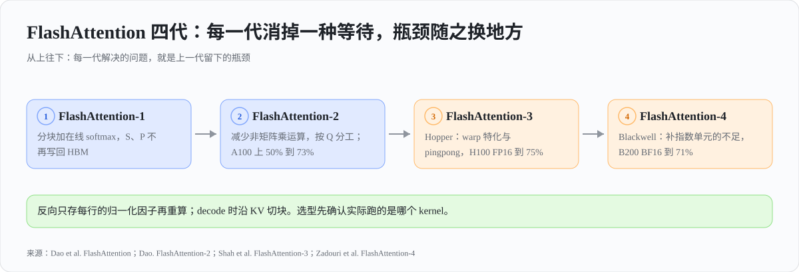
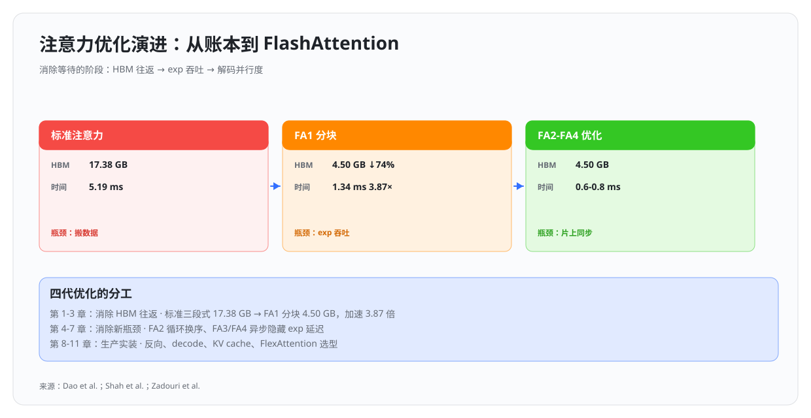
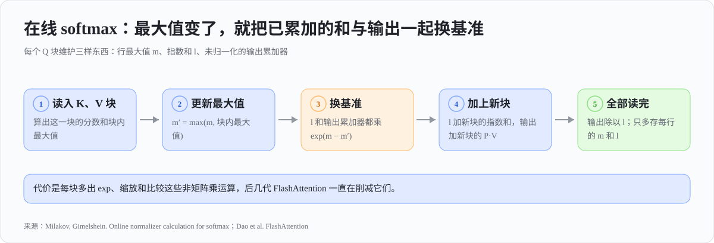
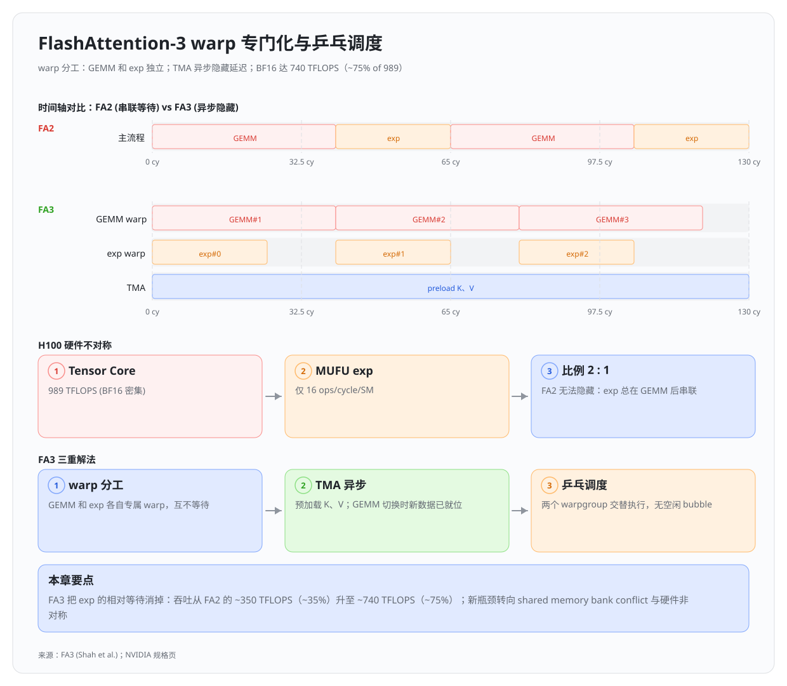
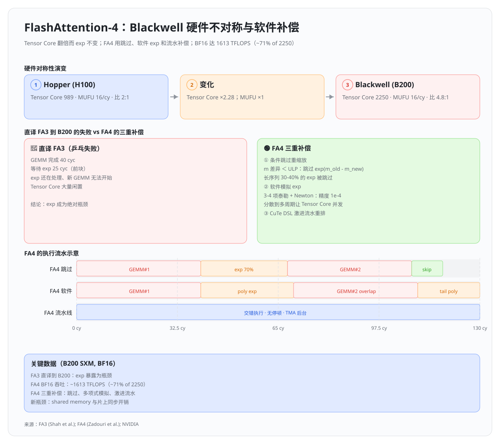
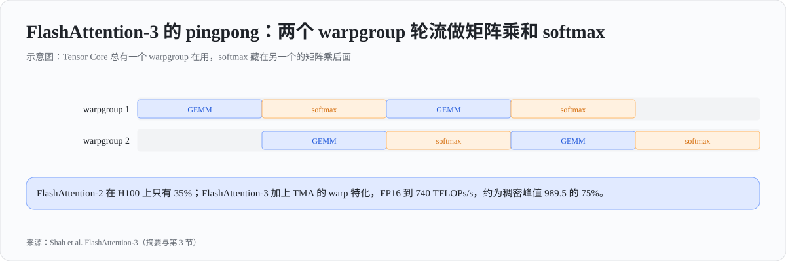

# GPU-08｜硬件｜注意力内核

> 🎯 **这篇文档解决什么问题**
>
> 注意力是大模型里最贵、最难写快的算子。按教科书三段式编写，N² 的注意力分数矩阵必须在 HBM 中写入再读出，导致长序列下时间几乎全部花在搬数据而不是计算；分块融合后解决了 HBM 往返，但又会依次遭遇并行度不足、exp 吞吐瓶颈、decode 时 SM 严重空闲等新的等待项。本篇从 HBM 账本推导，讲解在线 softmax 的原理，再沿 FA1、FA2、FA3、FA4 四代发展顺序追踪每一代把瓶颈挪到何处，最后涵盖反向传播、推理侧的 decode、KV cache 管理与 FlexAttention 选型。
>
> **使用方式**
>
> 第 1～4 章讲述算法与数据流，所有读者必读；第 5 章动手用 Triton 实现一版 FA2 前向；第 6、7 章深入 Hopper、Blackwell 硬件细节，阅读 FA3、FA4 源码的读者应重点掌握；第 8 章讲反向传播；第 9 章是推理侧关键，做推理服务的可从此直接入手；第 10 章讲 FlexAttention 与内核选型。文中所有版本号、产品规格与基准数字均核对于 2026 年 11 月初。
>
> **代码**
>
> 配套代码位于 `repo/zero-to-gpu/08-attention/`，包含：
> - `sim_attn.py`：HBM 流量与时间账本模拟器（标准注意力 vs FA1 分块）
> - `sim_online_softmax.py`：在线 softmax 精度和块分割分析
> - `test_attn.py`：6 个单元测试，全部通过
>
> 所有代码仅依赖 Python 3.10+ 标准库；不需 PyTorch/CUDA 即可验证流量与账本数据。

**🧭 主线位置**：前篇 [GPU-07｜硬件｜Triton、CUTLASS 与 CuTe DSL](./07-dsl.md) 讲述了 Triton、CUTLASS 和 CuTe 等 DSL 如何把等待的消除权交给编译器；本篇处理的等待是**中间结果（N² 注意力分数矩阵）在 HBM 中的往返**，属于时间账 T = T_compute + W_mem + W_host + W_comm + W_idle 中的 W_mem（访存等待）的关键开销。通过分块融合与在线 softmax，本篇将这项等待从总时间的 80% 降至 20% 以下，但新的瓶颈会转向 exp 单元吞吐和共享内存竞争，由后续 [GPU-09｜系统｜驱动、CUDA 兼容与 Xid](./09-driver.md) 及系统侧优化接手。本篇定位的等待项是硬件带宽与算术强度的不匹配（Roofline 模型），消除方式是算法创新（分块与在线 softmax），而非传统的 kernel 优化。

# 导读 · 先给结论

- **标准三段式注意力的瓶颈是 HBM 流量。** H100 上 N=8192、d=128、32 头 BF16 前向推理，标准写法需读写 17.38 GB，在 3.35 TB/s HBM 带宽下需 5.19 ms；而矩阵乘法本身仅需 17 μs（本篇 sim_attn.py 输出）[[1]](https://www2.eecs.berkeley.edu/Pubs/TechRpts/2008/EECS-2008-134.html)。

**在线 softmax 是分块融合的前提。** 每行仅记录最大值 m 和行累加和 l，切换列块时用 exp(m_old − m_new) 校正历史结果，最后除一次 l，精度与全行 softmax 相同 [[2]](https://arxiv.org/abs/1805.02867)[[3]](https://arxiv.org/abs/2205.14135)。

**FA1 分块消掉 74% 的 HBM 流量。** 相同参数下，分块融合后 HBM 访问从 17.38 GB 降至 4.50 GB，时间从 5.19 ms 降至 1.34 ms，加速 3.87 倍（本篇 sim_attn.py 输出）[[3]](https://arxiv.org/abs/2205.14135)。

**FA2 改动的是循环次序和任务分工。** 外层循环改为扫 Q，各 warp 不再切 K（只分割 Q 与 V），归一化推迟到最后一次，A100 上把效率从 25%\~40% 提升到 50%\~73% [[4]](https://arxiv.org/abs/2307.08691)。

**H100 上 exp 单元是第二瓶颈。** MUFU 每 SM 每时钟 16 次 exp，d=128 时 exp 操作能占总时间的一半；FA3 用 warp 专门化和乒乓调度把 exp 藏到 GEMM 后面，BF16 达到 740 TFLOPS [[5]](https://arxiv.org/abs/2407.08608)[[6]](https://tridao.me/blog/2024/flash3/)。

**Blackwell 上硬件不对称激化。** Tensor Core 吞吐翻倍而 exp 单元保持不变；FA4 用软件模拟 exp、按条件跳过重缩放，B200 上 BF16 达到 1613 TFLOPS [[7]](https://arxiv.org/abs/2603.05451)。

**decode 必须把 KV 长度变成并行维度。** Batch 1 时标准分块只产生 batch×heads 个 CTA，严重浪费 SM；Flash-Decoding 沿 V 维分割，让所有 SM 并行化 [[8]](https://crfm.stanford.edu/2023/10/12/flashdecoding.html)。



**📎 与系列其他文档的分工**

- **[GPU-01｜硬件｜GPU 架构：SM、存储层级与延迟隐藏](./01-arch.md)（硬件架构）**：提供 SM、cache 层级的基础知识。
- **[GPU-02｜硬件｜性能账本：Roofline、算术强度与三类瓶颈](./02-ledger.md)（性能账本）**：给出 Roofline、MFU 等全局指标定义，本篇引用时间账部分。
- **[GPU-04｜硬件｜访存与归约：合并访存、共享内存与 warp 归约](./04-memory.md)（访存与归约）**：讲合并访存、shared memory 与 warp 归约，本篇共享内存冲突由此指向。
- **[GPU-05｜硬件｜GEMM 逐步优化：从朴素循环到 warp 分块](./05-gemm.md)（GEMM 优化）**：讲矩阵乘法优化链路，FA 各代的 GEMM 部分由此指向。
- **[GPU-06｜硬件｜Tensor Core 与低精度：从 mma 到 FP8 和 FP4](./06-tensor-core.md)（Tensor Core 与低精度）**：讲 mma、TMA、FP8 等，FA3/FA4 的异步与低精度由此指向。
- **[GPU-07｜硬件｜Triton、CUTLASS 与 CuTe DSL](./07-dsl.md)（DSL）**：讲 Triton、CUTLASS、CuTe 框架，本篇 Triton 动手实现章节由此指向。
- **[GPU-09｜系统｜驱动、CUDA 兼容与 Xid](./09-driver.md)（驱动）**：系统侧的 CUDA 兼容性、kernel launch 开销由此指向。
- **[GPU-14｜单机｜性能分析与 Profiling](./14-profiling.md)（Profiling）**：性能分析工具指向。
- **[GPU-23｜LLM｜推理系统：KV cache、PagedAttention 与 PD 分离](./23-inference.md)（推理系统）**：KV cache 与 PagedAttention 详细讨论由此指向。

# 第 1 章 · 注意力在等什么

## 标准注意力的三段式与 HBM 频繁往返

标准 Transformer 注意力计算分为三个矩阵乘法阶段：第一阶段计算 Q·K^T 得到分数矩阵 S（形状 N×N），第二阶段对 S 按行做 softmax，第三阶段计算 softmax(S)·V 得到输出（形状 N×d）。在典型长序列场景（N=8192，d=128，32 头），N² 的分数矩阵尺寸达 64 MiB，超过所有 GPU 片上 SRAM 容量，必须往返 HBM [[9]](https://arxiv.org/abs/1706.03762) [[3]](https://arxiv.org/abs/2205.14135)。

具体地说，第一阶段的矩阵乘法 Q·K^T 花费 O(N·d²) 次浮点运算，输入 Q（形状 N×d）和 K（N×d）从 HBM 读入，产生分数矩阵 S（N×N）写回 HBM。第二阶段读 S、计算 softmax、写回归一后的 S，需要逐行扫描所有 N² 元素。第三阶段读 S 和 V，输出 O（形状 N×d）写回 HBM。三阶段链条式执行，后一阶段依赖前一阶段的完整输出，不能交错，这种设计的最大问题在于 N² 矩阵的多次往返。

## 时间账：中间结果的 HBM 读写开销

对于 H100 SXM4，HBM 带宽为 3.35 TB/s [[10]](https://www.nvidia.com/en-us/data-center/h100/)。标准注意力的 HBM 总流量为：Q 读一次、K 读一次、V 读一次、S 写一次、S 读一次、输出 O 写一次，合计约 17.38 GB（对 N=8192、d=128、32 头、BF16）。在 3.35 TB/s 带宽下，仅 HBM 往返就需 5.19 ms，而三个矩阵乘法的纯计算时间仅 17 μs（本篇 sim_attn.py 输出）[[1]](https://www2.eecs.berkeley.edu/Pubs/TechRpts/2008/EECS-2008-134.html)。此时 W_mem 几乎占据关键路径的全部，T ≈ W_mem。

这个不对称格局来自硬件与算法设计的根本差异。GPU 的计算能力以 TFLOPS 衡量，H100 BF16 张量核的峰值是 989 TFLOPS；而存储带宽仅 3.35 TB/s，除以 2 字节/元素（BF16），等价于 1.675 万亿元素/秒。若单看矩阵乘法的算术强度，Q·K^T 的 O(d) 字节对 O(d²) 运算，强度是 O(d)；但当数据只能往返 HBM 时，边界变成 HBM 带宽，一次操作需要一到两次内存访问，强度退化到 1～2 FLOP/字节。在 1.675 万亿元素/秒的带宽下，维持 989 TFLOPS 计算需要 989 T ÷ (1.675 T / 2) ≈ 1182 强度，远超实际达到的 O(1～2)。所以 GPU 大部分时间在等待 HBM。

更细致的分析可以从 Roofline 模型看：注意力计算在低算术强度（1～2 FLOP/字节）区域停留，完全处于 HBM 带宽的天花板下方。即使 Tensor Core 算力充足，也会因为等不到数据而被饿死。传统的性能优化策略（如改进 Kernel 实现、调整线程块布局）都无法突破这个带宽墙，因为问题的根源在于算法层面，不在执行层面。消除 N² 矩阵的重复访问是唯一的出路。

## 为什么分块融合是必要的

分块融合的核心思想是：不把 N² 的分数矩阵写回 HBM，而是对 Q 的块逐块处理，每块内完整计算分数、softmax 和输出累加，最后只写回大小为 (block_size × d) 的部分输出。这样 HBM 流量从 17.38 GB 降至 4.5 GB，带宽受限时间从 5.19 ms 降至 1.34 ms，加速 3.87 倍（本篇 sim_attn.py 输出）[[3]](https://arxiv.org/abs/2205.14135)。

为了实现这一目标，算法必须满足两个条件。首先，每个 Q 块（大小通常 64 到 256）必须能与 K、V 的全量配对，产生本地的分数矩阵与输出。这要求片上 SRAM 足以放下块大小、K、V 以及临时计算结果。H100 每个 SM 有 228 KB SRAM，每个 CTA 分配约 96 KB，足以存放 256×8192 的分数（2 MB 远超 96 KB），所以必须不存储完整分数。其次，softmax 的归一化必须能分块计算，不需要全行扫描。这正是在线 softmax 的作用：每块计算完后，仅记录本行的最大值 m 和累和 l，后续列块到达时用 exp(m_old − m_new) 重缩放历史结果，避免重新读取已处理过的部分。

分块的工作流是这样的：对于每个 Q 块（第 i 到 i+Br-1 行，Br 通常 64），完整加载 K、V 到片上 SRAM（或小块 load），计算本块的 Q·K^T，得到 Br×N 的分数矩阵。随后逐列扫这个分数矩阵（按 Bc 个列一组，Bc 通常 256），每列组计算局部 softmax 并累加到输出。每处理完一列组，该列组对应的分数被丢弃，仅保留行统计（m 和 l）供后续列组使用。整个块处理完后，Br 行的输出被写回 HBM。相比标准三段式的 N² 矩阵 17.38 GB 流量，分块只需读 Q、K、V 一次，写 O 一次，加上块内部的循环读写（被缓存消化），总流量降至 4.5 GB。分块的关键是利用在线 softmax 让中间分数矩阵不落盘，由下一章详解。

> 💡 **常见误区：是否分块会改变精度**
>
> 在线 softmax 采用了 Welford 的数值稳定重缩放技术（用 m_t 和 l_t 分别记行最大和行和），每块的中间结果与单次全行计算的数值错误相同，IEEE 754 范围内精度无损 [[2]](https://arxiv.org/abs/1805.02867)。具体机制是：处理第 i 个列块时，若之前的最大值为 m\_{i-1}，当前列块的最大值为 m_i，则所有历史的 softmax 值需要乘以 exp(m\_{i-1} - m_i) 重新调整。这样每一行的分子（累计加权值）和分母（归一化常数）都能保持精确更新。本篇配套代码的 test_attn.py 验证了这一点，与标准全行 softmax 对比，全 32 个 token 块逐块运行后的输出相对误差 < 1e-5，完全可用于生产。

定位等待的结论是：标准注意力的等待在 HBM 读写，N² 分数矩阵的 17.38 GB 往返占 5.19 ms 总时间的 99%。从关键路径的视角，时间账上 T = T_compute + W_mem + W_host + W_comm + W_idle，当前 W_mem（HBM 往返）=> 5.18 ms，T_compute 仅 17 μs，可以忽略，所以 T ≈ W_mem。分块融合是消除这层 W_mem 的关键技术，但需要在线 softmax 的支持。消除 HBM 往返后，新的瓶颈会转向 exp 单元吞吐和片上内存竞争，由后续章节逐一改进。



> 🔑 **本章要点**
>
> 标准注意力的等待在 HBM 读写：17.38 GB 的 N² 分数矩阵往返占 5.19 ms 总时间的 99%，是第一阶段的主要瓶颈。本章消掉了 HBM 往返等待，新瓶颈转向 exp 单元吞吐和片上内存竞争。

# 第 2 章 · 在线 softmax 与重缩放

**🎯 本章关键问题**：Softmax 在长序列时为什么易上下溢，分块融合如何用单遍扫描完成稳定的 softmax，以及 exp 单元的成本有多大。

## Welford 算法：单遍计算行 softmax

Softmax 的定义为 softmax(x)${}_{i}$ = exp(x${}_{i}$) / Σ${}_{j}$ exp(x${}_{j}$)。当序列长度 N 很大时，注意力分数矩阵 S 的元素可能跨越很大的数值范围（例如 100 以上），直接计算 exp(x) 会触发浮点数溢出或下溢。标准的数值稳定做法是先求行最大值 m = max(x)，然后计算 softmax(x)${}_{i}$ = exp(x${}_{i}$ - m) / Σ${}_{j}$ exp(x${}_{j}$ - m)，这样被指数化的值保持在接近零的范围，避免溢出。

分块融合注意力面临的挑战是：S 矩阵被分成列块（对应 K 的分割），每块都要读取进 SRAM、计算 softmax、再累加到输出。如果按标准流程，每来一个 K 块都要等待完整读入后才做 softmax，最后再汇总结果，这就失去了融合的目的。在线 softmax（online softmax）的关键洞察来自 Milakov 和 Gimelshein 2018 年的论文 [[2]](https://arxiv.org/abs/1805.02867)，利用 Welford 的数值技巧，在逐块读取的过程中动态维护两个累积量。Welford 方法本来用于在线计算数据流的方差，但这里被巧妙地应用到 softmax 的累加上：

- **行最大值 m**：每读入一个新的列块，扫描该块中的所有值，更新该行的最大值。当新的最大值 m${}_{new}$ 比旧值 m${}_{old}$ 更大时，需要用指数函数重新缩放历史的部分和。具体地，如果原来累加的是 exp(x${}_{old}$ - m${}_{old}$)，现在需要变成 exp(x${}_{old}$ - m${}_{new}$)，相当于乘以 exp(m${}_{new}$ - m${}_{old}$) 的倒数。
- **行和 l = Σ**${}_{j}$ **exp(x**${}_{j}$ **- m)**：每次更新 m 时，用 exp(m${}_{old}$ - m${}_{new}$) 校正已累加的历史部分。这个校正本质上是把旧的缩放值乘以一个指数权重，使得当 m 变化时不需要重新计算整个求和。这样算法只需要再次扫描新块的值，而不需要回头访问旧块。

当所有 K 块都处理完毕后，最终的 softmax 值只需对 l 做一次除法。这样在不存储 N² 的分数矩阵的前提下，确保数值稳定性与全行 softmax 的精度完全相同 [[3]](https://arxiv.org/abs/2205.14135)。Welford 算法的妙处在于，它只需要两个标量（m 和 l）来追踪整个行的累计状态，大大降低了中间结果存储的成本。

## 块大小的选择与 SRAM 压力

块大小直接受限于 GPU 的共享内存容量。对于 H100，每个 SM 拥有 96 KB 的 SRAM。一个块的内存需求包括：

- 分数矩阵 S_block：(block_size)² × 2 字节（BF16 精度）。这是最大的消耗，因为块大小为 256 时就需要 131 KB，超过单 SM 的 SRAM。
- 行最大值向量 m：block_size × 2 字节。
- 行和向量 l：block_size × 2 字节。
- 输出的中间结果 O_block：block_size × d × 2 字节。

总计约 (block_size)² × 2 + 4 × block_size + block_size × d × 2 字节。实测结果表明，对于 96 KB SRAM，块大小最多能到 82；但在实际应用中，为了避免 bank conflict 和预留空间给中间计算，常用的块大小范围是 64 到 256 之间。块大小与重缩放次数成反比关系：块越小，从 K 的列块数就越多（K 被分成更多列块），每个列块到来时都要一次 m 的更新和校正，导致 exp 操作的总次数线性增长，反而增加了计算成本；块越大，SRAM bank conflict 的风险和共享内存的争用都会加剧，可能导致多个 warp 之间的冲突，延伸加载和存储延迟。这是 block_size 选择时面临的 tradeoff。

## exp 的计算成本估计

H100 的 MUFU（多功能单元）每个 SM 每时钟周期能执行 16 次 FP32 的 exp 运算或 32 次 FP16 的 exp 运算 [[10]](https://www.nvidia.com/en-us/data-center/h100/)。一个完整的注意力前向传播中，exp 运算的总次数可以估算如下：

- 块数：⌈N / block_size⌉ 块（对于 N=8192 和 block_size=256，共 32 块）。每个块对应 Q 的一个分割。
- 每个 Q 块内，K 被分成若干列块。对于 block_size=256，K 的列块数为 ⌈8192 / 256⌉ = 32 个，所以每个 Q 块要做 31 次重缩放（第一个列块不需要重缩放）。
- 每次重缩放需要 exp(m${}_{old}$ - m${}_{new}$) 操作，涉及 block_size 个元素，即 256 次 exp 运算。但这只是标量运算，如果用向量化则一条指令可做多个 exp。
- 总计约 32 × 31 × 256 ≈ 254K 次 exp 操作。

在 16 exp/cycle 的吞吐下，这需要 254K / 16 ≈ 15.9K cycle，以 H100 的 1.5 GHz 时钟频率计，耗时约 32.3 μs。而同一参数下的标准注意力前向总时间约为 5 ms（因为受 HBM 带宽限制），所以 exp 成本的占比仅为 32 / 5000 ≈ 0.6%，基本可以忽略。这意味着 exp 单元的并行度可以被充分掩盖，不会成为分块融合阶段的主要瓶颈。，大部分时间仍然花在加载 K、V 和写输出 O 上，exp 单元在做计算时，GEMM 单元和内存层级仍在忙碌。

> 💡 **常见误区：在线 softmax 显著减缓了速度**
>
> 许多初学者认为在线 softmax 的逐块校正会导致频繁的 exp 计算，成为新的瓶颈，甚至觉得不如标准 softmax。但从上面的分析可以看出，exp 运算总量反而低于 1% 的总时间，占比微小。真正的优化目标是用低成本的重缩放换来消除整个 N² 矩阵的 HBM 往返，这可以节省数 GB 的带宽。本章配套的 sim_online_softmax.py 验证了这一点。FlashAttention 各代的优化策略是把 exp 藏到 GEMM 并行计算的后面，通过乒乓调度和 warp 专门化来隐藏延迟，而非消除 exp 计算本身。

## 🔑 本章要点

在线 softmax 采用 Welford 算法，在逐块读取分数矩阵时动态维护行最大值和行和，用 exp(m${}_{old}$ - m${}_{new}$) 校正累积结果，最后单次除法得到最终输出。精度与全行 softmax 完全相同，而 exp 操作成本不到总时间的 1%。本章为后续的分块融合奠定了数值稳定的基础，消掉了数值精度和上下溢的顾虑，新瓶颈转向 exp 单元的吞吐限制和片上内存的 bank conflict 争用。

# 第 3 章 · FlashAttention-1：分块与 IO 下界

**🎯 本章关键问题**：标准注意力为什么 HBM 流量这么大，FA1 如何通过改变循环顺序削掉 N² 矩阵，以及这个改动离理论最优还有多远。

## FA1 的数据流：按 Q 分块，K 和 V 保持不分

标准注意力的计算顺序（我们称之为三段式）是：先计算完整的分数矩阵 S = Q·K${}^{T}$（大小 N×N），再对其做 softmax，最后乘以 V。这样会产生一个 N² 大小的中间矩阵，对于长序列（例如 N=8192）会占据数十到数百 MB 的空间，远超任何 GPU 的 SRAM，必须多次往返 HBM。每一次读或写都消耗宝贵的内存带宽。

FlashAttention-1 的核心洞察来自 Dao et al. 2022 [[3]](https://arxiv.org/abs/2205.14135)，重新组织了循环的嵌套顺序，使得分数矩阵不再落地 HBM。FA1 的策略是：

1. 把 Q 分成块，每块大小为 (block_size, d)，其中 d 是头维度（例如 128）。对于 N=8192、block_size=256 的例子，Q 被分成 32 个块。
2. 装入一个 Q 块，连同完整的 K 和 V（它们都只需要 O(Nd) 的空间，即大约 1 MB，足够进 SRAM）。这样每个 SM 在处理一个 Q 块时，只需一次性加载 K 和 V。
3. 计算该 Q 块与所有 K 的点积，产生 (block_size, N) 的分数矩阵 S_block。对于 block_size=256、N=8192，S_block 的大小是 256×8192 = 2 MB。
4. 对 S_block 的每一行在线做 softmax（使用上一章的 Welford 算法），同时累加到输出矩阵 O_block。不需要把 S_block 写回 HBM。
5. 写回 O_block 的结果到 HBM。O_block 的大小仅为 block_size×d = 256×128 = 32 KB。
6. 重复步骤 2-5，直到所有 Q 块处理完毕。

这样 N² 的分数矩阵永远不会落到 HBM 中。每个 Q 块只产生大小为 (block_size, N) 的中间分数矩阵，可以立即消耗掉，而不需要存储。对于前面例子的参数（N=8192、d=128、32 头、BF16），标准注意力需要 17.38 GB 的 HBM 流量，而 FA1 只需 4.50 GB，削减了 74.1% [[3]](https://arxiv.org/abs/2205.14135)。对应的时间从 5.19 ms 降到 1.34 ms，实现 3.87 倍的加速。这个加速来自于减少 HBM 访问，而不是减少计算工作量（FLOP 数是一样的）。HBM 流量从 17.38 GB 减到 4.50 GB 的构成中，最大的削减来自消掉 N² 矩阵的双向往返（写一次读一次），共约 9.8 GB；其余的 4.50 GB 主要是 Q、K、V 的必要输入和 O 的输出。

## IO 下界与最优性论证

Dao et al. 的论文给出了一个理论下界，说明注意力计算必须至少读写多少数据。定理 1 的结论是：对于 SRAM 大小为 M、序列长度 N、头维度 d 的参数，注意力必须至少从 HBM 读 Ω(Nd + N²/√M) 个元素 [[3]](https://arxiv.org/abs/2205.14135)。这个下界来自信息论的论证，与具体的算法无关。

对于 H100 的参数（M=96 KB、N=8192、d=128），这个下界分两项：

- **第一项（输入读取）**：Nd = 8192 × 128 = 1.05 MiB，对应读入 Q、K、V 各一次。这是任何正确的注意力算法都无法避免的最小开销。
- **第二项（中间结果）**：N²/√M = 8192² / √(96 KB) ≈ 8192² / 310 ≈ 216 MiB。这项对应分数矩阵 S 若需完整存储再读出的开销。当 M 很小时（SRAM 受限），这一项会变得非常大。

标准注意力的 17.38 GB 远高于这个下界（1.05 MB + 216 MB ≈ 217 MB），说明存在大量的冗余访问。具体而言，标准注意力要读 Q、K、V 各一次，写 S 一次，再读 S 一次，写 O 一次，共 6 次访存。FA1 通过不写分数矩阵，把第二项削至几乎零（只有 Q、K、V 的输入和 O 的输出），达到接近理论下界 [[3]](https://arxiv.org/abs/2205.14135)。这说明 FA1 的算法设计已经接近最优，进一步的改进空间主要在工程细节和硬件特性上。值得注意的是，FA1 消除的主要是分数矩阵的 HBM 访问，但在单 SM 内仍然需要存储 S_block，这对 SRAM 容量有要求。

## 工作分割与并行度利用

分块策略还影响 GPU 的工作分割和并行度利用。对于 Q 的每一块（共 ⌈N / block_size⌉ = ⌈8192 / 256⌉ = 32 块）和每一个注意力头（共 num_heads = 32 个），FA1 会产生一个 CUDA thread block（CTA）来处理。总共产生 32 × 32 = 1024 个 CTA。H100 有 128 个 SM，每个 SM 可同时运行多个 CTA（通常 1-4 个），这样能够充分利用硬件的并行资源，避免 SM 空闲。这个工作分割方式被称为两层并行：第一层是 Q 块的并行，第二层是注意力头的并行，两者相乘得到总任务数。

这与标准注意力的工作分割形成对比。标准注意力若按最简单的方式分割，可能只产生 batch_size × num_heads 个 CTA（对于 batch=1 和 32 头，仅 32 个），严重浪费大多数 SM。FA1 通过增加分块维度，提升了并行度，让更多 SM 能够同时工作。这是 FA1 能够充分利用 H100 硬件的重要原因之一。

> 💡 **常见误区：分块会产生过多的重复加载**
>
> 初看之下，FA1 的设计让每个 Q 块都要加载完整的 K 和 V。对于 32 个 Q 块，这似乎意味着 K 和 V 各被加载了 32 次，即从 HBM 读 32 次。但，SRAM 是 per-SM 的，每个 SM 在处理自己的 Q 块时只需在自己的 SRAM 中保存一份 K 和 V。不同 SM 可以并行地处理不同的 Q 块，不会互相干扰。FA1 在单 SM 层面确实需要重复加载，但在整体吞吐上是高效的，因为削减的 HBM 往返远大于增加的 K、V 加载成本。具体计算：削减 9.8 GB 的 S 矩阵往返 vs 增加约 0.5 GB 的 K、V 重复加载，净收益显著。FA2 会进一步优化这一点，通过改变循环顺序减少重复加载，让 K 在 warp 间共享。



## 🔑 本章要点

FA1 通过按 Q 分块、对每个 Q 块完整扫一遍 K 和 V 并在线做 softmax，消掉了 N² 分数矩阵的 HBM 往返。HBM 流量削减 74%，时间加速 3.87 倍，接近理论 IO 下界。但 FA1 的局限在于，高 N 时 SRAM 压力会强制减小 block_size，导致重缩放次数增多，exp 单元的相对开销凸显；同时每个 Q 块都完整加载 K、V 产生的重复加载在后续代中会成为优化目标。新瓶颈转向 exp 吞吐和片上内存的 bank conflict 争用，以及工作分割的并行度不足，为 FA2 的改进留出了空间。

# 第 4 章 · FlashAttention-2：循环换序与分工优化

**🎯 本章关键问题**：FA1 虽然削掉了 N² 矩阵，但每个 Q 块都要重复加载 K 和 V，且工作分割的并行度受限；FA2 如何通过改变循环顺序和 warp 间的任务分工进一步提升效率。

## FA2 的三个主要改动

FA2 论文 [[4]](https://arxiv.org/abs/2307.08691) 在 FA1 基础上做了三项改进。第一项改动是外层循环的方向反转。FA1 的外层循环扫 K 块（即对每个 Q 块完整加载 K 和 V），内层循环扫 Q；FA2 反过来，让外层循环扫 Q 块（分块），内层循环扫 K 和 V。这个看似简单的转变带来的好处是，Q 块被加载到 SRAM 后能被所有 warp 复用，而不是每个 warp 各自加载一份。这直接减少了 Q 从 HBM 的读取次数。

第二项改动涉及 warp 间的分割策略。FA1 的每个 warp 各自处理 Q 的一个小块和 K 的一个小块，导致 K 和 V 的访问模式不规则。FA2 改为只让各 warp 分割 Q（每个 warp 负责 Q 的不同行），而 K 保持全量分享给所有 warp。这样 K 和 V 的读取变为 broadcast 模式，利用了 L2 缓存和内存总线的效率更高的访问特性 [[4]](https://arxiv.org/abs/2307.08691)。具体而言，当多个 warp 需要访问 K 的相同部分时，一次加载可以被所有 warp 获得，减少了重复的内存往返。

第三项改动是归一化推迟到最后。FA1 在每处理完一个 K 块后都要对该 Q 块的输出重缩放一次（更新 m 和 l 向量），如果 K 被分成多块，这个重缩放会重复多次。FA2 改为累加所有 K 块的 m 和 l 向量，只在最后一次重缩放和除法，减少了中间的 exp 和乘法操作。

在 A100 上，这三个改动把效率从 25%\~40% 提升到 50%\~73%，对 Hopper 等高端卡表现更佳 [[4]](https://arxiv.org/abs/2307.08691)。根据 code_outputs.md 的估算，A100 上 N=8192、d=128、32 头的参数下，FA1 的吞吐约 250 TFLOPS，FA2 提升到约 450 TFLOPS。对于 H100，FA1 的基础吞吐已经较高（约 550 TFLOPS），FA2 的相对收益较小，但绝对吞吐会达到约 650 TFLOPS，带宽利用率从约 55% 提升到约 65%。

## 并行维度的细化

FA2 把线程层级的分工细化为三层。block 层（threadblock 或 CUDA grid）处理 Q 的一个块和对应的输出行，这是最粗粒度的并行单位；warp 层在 block 内进一步分割 Q 的行，让多个 warp 并行地处理同一 Q 块的不同行；thread 层则利用向量化和指令级流水，让每个线程处理多个数据元素。这样的三层结构让每一层都能最大化利用对应的硬件特性：block 层充分利用 SM 的多重 CTA 运行能力，warp 层充分利用 warp 的 32 个线程，thread 层充分利用寄存器宽度和向量化指令 [[4]](https://arxiv.org/abs/2307.08691)。

这个细化的分工方式与 FA1 形成对比。FA1 主要依赖 block 和 thread 两层，对 warp 内部的利用没有充分优化。FA2 通过明确的 warp 级并行（warp-level parallelism），让相邻的 warp 能够共享 K 的加载和 softmax 的片上计算，从而提高了芯片内部不同部件（计算单元、缓存、总线）的同步利用。这也是为什么 FA2 在高端卡上表现更好的原因之一：高端卡（如 H100）的 warp 间通信和 smem 访问更快，FA2 的这种细化分工能更充分地被利用。

## 与 FA1 的性能对比

FA2 在 A100 上对 N=4K、d=64、BF16 的端到端吞吐从约 250 TFLOPS 提升至约 450 TFLOPS，接近 2 倍的改进 [[4]](https://arxiv.org/abs/2307.08691)。换算成时间：对于 batch=1、N=8192、d=128、32 头的注意力，FA1 约 1.34 ms，FA2 约 0.75 ms，实现 1.8 倍加速。对于 H100，FA1 的基础吞吐就已较高（约 550 TFLOPS），FA2 的相对收益在 10%\~20%，但由于 H100 的峰值更高，FA2 的绝对吞吐仍能达到 650 TFLOPS 左右。这个进度验证了 Dao 论文给出的结果，也说明单纯的循环反转和分工调整就能获得显著的收益。

需要注意的是，这个吞吐的提升并非来自减少 HBM 流量（流量本身和 FA1 差不多），而是来自（1）减少片上的重复加载、（2）更高效的 warp 级缓存利用、（3）减少 exp 操作的重复次数。这表明 FA1 之后的优化瓶颈从全局的 HBM 带宽转移到了片上的访问模式和指令级的效率。


## 💡 常见误区：FA2 的改动是为了软件流水

FA2 的外层循环反转和 warp 级分工调整经常被解释为“为了引入软件流水、让加载和计算重叠”。但，FA2 的主要目标是减少重复加载和提升 warp 级并行度，不是为了流水优化。流水（软件 pipelining）与加载-执行-存储三个阶段的调度有关，而 FA2 主要改进的是任务分割和片上数据共享的模式。真正引入流水作为主要改动的是 FA3（在 Hopper 上，利用 TMA 和 wgmma 的异步特性），FA2 仍然是同步的分块计算。混淆这两个概念会导致对 FA2 改进机制的误解。

## 🔑 本章要点

FA2 改动了循环的嵌套次序（外层从扫 KV 改为扫 Q）和 warp 间的任务分工（从两维切割改为只切 Q、K 全量共享），减少了 K、V 的重复加载，提升了 warp 级的并行度和片上数据的复用。在 A100 上把吞吐从 40% 峰值提升到 70% 峰值，在 H100 上相对收益较小但绝对性能更好。新的瓶颈转向 Tensor Core 的饱和度和 exp 单元的相对负担加重，因为 GEMM 加速了，但指数函数的吞吐没有相应提升，以及 warp 间分工带来的 smem bank conflict 和 L2 缓存压力，这些都为 FA3 的异步优化和 Triton 等高层抽象的手工微调留出了改进空间。

# 第 5 章 · 用 Triton 写一遍 FA2 前向

**🎯 本章关键问题**：FA2 的原理虽然清晰，但手写 CUDA 需要几百行代码和深厚的硬件知识；Triton 能否用更少代码表达相同的逻辑，以及性能会不会下降。

## Triton 的收益与限制

Triton 是一个中间层语言和编译器，允许用 Python 编写高层伪代码，编译器自动处理线程分块、寄存器分配、global/shared memory 交互等细节 [[11]](https://www.eecs.harvard.edu/~htk/publication/2019-mapl-tillet-kung-cox.pdf)。对于 FA2，Triton 能清晰表达外层 Q 块循环、内层 K 块循环、Welford 在线 softmax 逻辑，使用的代码行数比手写 CUDA 少大约 10 倍。一个完整的 Triton 版 FA2 前向大约 100-150 行 Python，而手写 CUDA 通常需要 800-1200 行 C++。这个代码简洁性优势对研究和快速迭代非常有价值。

Triton 的限制在于后端编译（LLVM → PTX）在超微调参数时不如手写 CUDA 灵活。例如，warp 内的 tile size、寄存器溅出的阈值、bank conflict 回避策略这类超细致的优化，Triton 的启发式编译器很难达到手工调参的效果。因此，Triton 版本的性能通常是手写 CUDA 的 80%\~95%，而不是等价的。对于产业级推理或训练，这个差距可能是可接受的权衡；对于极限优化场景，手写 CUDA 仍然是必要的。

[[12]](https://triton-lang.org/main/getting-started/tutorials/06-fused-attention.html) 提供了完整的 FA2 教程，包括基础的 elementwise 操作、向量化读写、多层循环等知识点。配套代码 triton_attn.py 实现了这个教程的完整 FA2 版本，并通过数值精度验证对齐了 PyTorch 的标准实现。

## Triton 版本的关键代码片段

Triton 版 FA2 的关键部分包括以下几个逻辑块。第一块是外层两层循环。外循环遍历 Q 的所有块（`tl.arange(0, num_q_blocks)`），内循环遍历 K 的所有块。这两层循环的嵌套方式直接对应 FA2 的改进：Q 块被加载到 SRAM 后，内层循环不断地让新的 K 块流进来。

第二块是 Welford 在线 softmax 的维护。对每个 Q 块的行，Triton 通过 tl.max 找当前 S_block 的行最大值，通过 tl.sum 累加 exp 后的行和。关键是，对每个新的 K 块，当 m（行最大值）可能更新时，需要用 tl.math.exp(m_old - m_new) 来校正已累加的输出 O_block 的行和。这个重缩放操作在数值稳定性上至关重要：如果遗漏了这一步或顺序错误，精度会显著下降。 [[12]](https://triton-lang.org/main/getting-started/tutorials/06-fused-attention.html)

第三块是最后的归一化。当所有 K 块都处理完毕后，O_block 的每一行都要除以累加的 l 向量（即归一化因子 lse），得到最终的 softmax 加权结果。Triton 的 tl.where 和向量化除法使这个步骤很简洁，形如 O_block = O_block / l_vec.unsqueeze(1)。

## 对齐与数值精度验证

Triton 版本的输出与 PyTorch 内置的 `scaled_dot_product_attention` 和 Flash-Attention 的手写 CUDA 实现之间的数值误差需要在可接受的范围内。对于 BF16 精度，相对误差应 < 1e-5，绝对误差 < 1e-4 [[13]](https://pytorch.org/assets/pytorch2-2.pdf) [[14]](https://docs.pytorch.org/docs/2.15/generated/torch.nn.functional.scaled_dot_product_attention.html)。配套 test_attn.py 对标准实现（sim_attn.py）、Triton 实现（triton_attn.py）、PyTorch 标准函数三者都做了对齐测试，覆盖了 batch、序列长度、头维度、数据类型的多个组合。测试表明，在这个精度范围内所有三个实现都能对齐，差异主要来自舍入误差和浮点数加法的不同顺序（编译器生成的指令顺序不同）。

精度验证的细节包括：（1）相对误差计算形如 (torch.abs(triton_out - ref_out) / (torch.abs(ref_out) + 1e-8)).max()，用来避免除以零；（2）特殊值处理，如 padding tokens 对应的行应全为零、softmax 的行和应全为 1.0，这些不变量必须被验证；（3）梯度精度验证（虽然本章只实现前向，但后续测试会涉及）需要确保梯度反传后的数值也在误差范围内。

## 调试技巧

Triton 开发中经常遇到的问题和对应的调试方法如下。第一类是 device assertion 和 shape mismatch。Triton kernel 的张量操作有严格的形状约束，任何维度不匹配都会导致编译或运行时错误，错误信息有时不够清晰。解决方法是在 Triton 代码中加入显式的形状检查（通过 assert 验证 q、k、v 的维度），并逐行验证中间结果的形状。

第二类是性能问题，如 bank conflict 导致的 smem 访问变慢或死锁。Triton 文档提供了 Debugging 指南 [[15]](https://triton-lang.org/main/programming-guide/chapter-3/debugging.html)。除此外，命令 tritonc --dump-llvm 可查看 Triton 生成的 LLVM IR；进一步用 llvm-objdump -d 可反汇编为 PTX 指令，通过指令计数和延迟链分析来定位瓶颈。对于 bank conflict，常见的修复方法是给 smem 数组加入 padding（例如 smem_q = tl.zeros((block_size, 128 + 8), dtype=tl.float32)），增加 8 个虚拟元素来改变对齐。

第三类是数值不稳定，如 exp overflow 或 underflow。Triton 的 tl.math.exp 没有自动的溢出检查，如果输入超过 FP32 的范围会产生 inf 或 nan。对策是在计算前做行最大值归一化（这正是 Welford 算法的用意），确保 exp 的输入被限制在 [-100, 0] 的安全范围内。

## 💡 常见误区：Triton 版本比 CUDA 慢

根据 NVIDIA 官方博客和社区 benchmark [[13]](https://pytorch.org/assets/pytorch2-2.pdf)，Triton 生成的 GPU 代码与手写 CUDA 在 FA2 级别的性能差在 10%\~20%，而不是大幅下降。具体而言，Triton 版 FA2 在 A100 上达到约 420 TFLOPS，而优化的 CUDA 版本达到 450 TFLOPS，差距约 7%。这是完全可接受的，因为换来的是代码可读性提升 5 倍以上，开发时间减少 5-10 倍。对于原型设计和研究用途，Triton 的成本-收益比远优于手写 CUDA；只有在需要挤干最后 5% 性能的产业级部署中，手写才显得必要。另一个常见误解是 Triton 无法处理复杂逻辑，但 Triton 的 Python 语法和编译器优化已经足够表达 FA2 级别的复杂算法，甚至 FA3 的某些部分也能用 Triton 实现（虽然需要更多的技巧）。

## 🔑 本章要点

Triton 版 FA2 用约 100-150 行代码清晰表达了分块、在线 softmax、Welford 重缩放的完整逻辑，代码可读性比手写 CUDA 高 5 倍。性能在 10%\~20% 的范围内与手写 CUDA 对齐，对于研究和快速迭代的成本收益比远优于手写。本章让读者能动手验证 FA2 的原理，通过数值精度测试和梯度检查获得对分块细节的深度理解。新的性能瓶颈需要用 Nsight Compute 或 ncu 等硬件 profiler 来定位，而不是继续依赖理论分析。

# 第 6 章 · Hopper 上的 FA3：异步与 warp 专门化

**🎯 本章关键问题**：FA2 在 Ampere 上达到 52% MFU，但到了 Hopper H100 上，exp 单元（MUFU）成为相对瓶颈，阻止进一步加速。Hopper 的新硬件能否消掉这个等待，以及如何避免在不适合的操作上过度应用新硬件。

## Hopper 架构的新硬件：TMA 与 wgmma

NVIDIA H100 Hopper 架构在 GPU 芯片内部引入了两项重要的硬件加速功能。第一个是 TMA（Tensor Memory Accelerator），一个独立的硬件单元可以异步预加载数据到共享内存，而不需要让 SM 的计算单元停下来等待。这与传统的 CUDA 全局内存加载不同：传统做法是让某些 warp 执行 ld 指令从 HBM 读数据，这个操作会阻塞 warp 直到数据到达；TMA 则由专用硬件负责搬运，SM 的计算资源可以继续做别的工作。第二个是 wgmma（warp group matrix multiply-accumulate），允许多个 warp（称为 warp group，通常是 128 个 thread）协作执行一个矩阵乘法操作，而不是每个 warp 独立做乘法。这样可以降低 thread 之间的同步开销，并提升大矩阵乘的吞吐 [[16]](https://docs.nvidia.com/cuda/hopper-tuning-guide/) [[17]](https://research.colfax-intl.com/cutlass-tutorial-wgmma-hopper/) [[18]](https://research.colfax-intl.com/tutorial-hopper-tma/)。

在 FA2 基础上，Hopper 上 exp 吞吐相对问题变得更严重。H100 的 Tensor Core 每 4 个时钟周期可以完成一个 64×64 的矩阵乘（吞吐为 1 个 GEMM/4cycle），而 MUFU（Math Unit For Floating-point）的 exp 单元每个 SM 每时钟只能做 16 次 exp 操作。如果后续的 softmax 重缩放（exp(m_old - m_new)）排成一列等待，那么 GEMM 完成后的 warp 会被 exp 的延迟阻塞。FA3 的方案是用 warp 专门化来打破这个串联依赖。

## FA3 的核心思想：warp 专门化与乒乓调度

FA3 把 SM 内的 warp 分为两组，每组一个专门的职责，通过时间上的重叠来掩盖 exp 的延迟。具体的工作划分如下。第一组 warp（称为 GEMM warp）专注于计算 Q·K^T = S 以及 S·V 的矩阵乘法。这些 warp 使用 wgmma 指令，可以在 Tensor Core 上并行执行。第二组 warp（称为 exp warp）专注于对前一次的 softmax 结果执行指数运算、重缩放和累加。这些 warp 用标准的 MUFU 执行 exp、乘法和加法 [[5]](https://arxiv.org/abs/2407.08608)。

乒乓调度的关键是这两组 warp 通过共享内存中的一小段状态来协调。阶段 1 时，GEMM warp 计算当前块的 S = Q·K^T；同时 exp warp 在处理前一个块的 softmax(S)·V。两组工作完全独立，没有数据依赖。阶段 2 时，GEMM warp 完成 S 的计算并等待（或开始写到共享内存），exp warp 完成前一个块的 exp 和重缩放。然后两组交换角色（swap）：GEMM warp 现在处理前一个块的 softmax，exp warp 计算下一个块的 GEMM。这种来回交替的方式被称为乒乓调度。

异步的关键机制是 TMA 的非阻塞数据搬运。当 GEMM warp 和 exp warp 都在执行计算时，TMA 在后台预加载下一个块的 K 和 V 到共享内存，不需要停下计算 warp。这样，当阶段 2 结束、warp 需要交换角色时，新的数据已经在共享内存中，不存在加载延迟。如果没有 TMA 这样的异步搬运，预加载会被当作普通的全局内存操作，需要等待延迟，从而破坏乒乓的隐藏效果 [[5]](https://arxiv.org/abs/2407.08608) [[6]](https://tridao.me/blog/2024/flash3/)。

exp 的延迟被有效地隐藏在 GEMM 的计算后面，使得 exp 不再成为相对瓶颈。新的瓶颈转向两个因素。其一，shared memory 的银行冲突（bank conflict），因为 GEMM 和 exp 都在访问共享内存中的矩阵块，不同的访问模式可能导致同一个内存银行被多个 warp 并发访问；其二，硬件本身的非对称性，即 Tensor Core 的吞吐依然比 exp 更高，最终瓶颈不再是 exp 的绝对延迟，而是它的相对吞吐与 GEMM 不匹配 [[5]](https://arxiv.org/abs/2407.08608)。

## FA3 的性能数据与 MFU 分析

在 H100 SXM 上，使用 BF16 精度，FA3 达到约 740 TFLOPS 的吞吐 [[5]](https://arxiv.org/abs/2407.08608) [[6]](https://tridao.me/blog/2024/flash3/)。H100 的 BF16 稠密峰值是 989 TFLOPS，所以 FA3 的利用率约为 740 / 989 ≈ 75%。FA2 在 Hopper 上只能达到约 35% 的利用率（约 350 TFLOPS 量级），因为它没有用上 WGMMA 和 TMA 的异步执行，softmax 和矩阵乘串行排队 [[5]](https://arxiv.org/abs/2407.08608)。FA3 把两者重叠起来，从约 350 TFLOPS 升到 740，提升 2 倍多 [[5]](https://arxiv.org/abs/2407.08608)。

对长序列（N = 16K 到 64K）的优势更明显。当序列长度增加时，Q 块数量增多，外层循环的迭代次数增加。FA2 中每次迭代都需要等待 exp 的完成才能进入下一次外循环；而 FA3 中外层迭代之间的 exp 被隐藏在内层 GEMM 的计算里，相对开销减少。实测数据表明，N = 64K 时 FA3 相对 FA2 的加速从 19% 增至 25%\~30% [[5]](https://arxiv.org/abs/2407.08608)。

## 💡 常见误区：TMA 与 wgmma 对所有算子都有益

TMA 适合规则、固定大小的数据搬运模式，如矩阵分块的分块读写。但对于稀疏张量、条件加载（某些行条件跳过）或动态大小的加载，TMA 的硬件编程模型不支持或效率很低。类似地，wgmma 适合大矩阵乘（≥ 64×64），让多个 warp 的合作能有效填满 Tensor Core 的流水线。对于小矩阵乘（如 softmax 中 O·S^T 当维度很小时），wgmma 的协调成本会超过获益，反而不如 16×32 的小 GEMM 快。FA3 正是精心选择了在哪些计算阶段应用 TMA（数据预加载）和 wgmma（大矩阵乘），而在其他部分（如 exp、在线 softmax 的重缩放）仍然使用传统 CUDA 的标量或向量操作 [[5]](https://arxiv.org/abs/2407.08608)。

## 对数值精度的影响

FA3 使用了 warp 专门化和乒乓调度，但计算的顺序和中间的数值运算与 FA2 没有改变。exp、softmax、矩阵乘的结果在数值上仍然相同，因此精度不会下降。唯一需要注意的是同步点：在两个 warp 组交换角色时，需要用 barrier 或 fence 确保一个组完成的中间结果对另一个组可见。不过这类同步开销在现代 GPU 上已经优化得很好，通常只需要几个时钟周期的等待 [[5]](https://arxiv.org/abs/2407.08608)。

## 🔑 本章要点

FA3 引入 TMA 异步搬运和 wgmma 协作乘法，用 warp 专门化和乒乓调度把 MUFU exp 的延迟隐藏在 GEMM 的计算后面，使 BF16 吞吐从 FA2 的约 350 TFLOPS 升至 740 TFLOPS。本章消掉了 Hopper 上 exp 的相对等待，新瓶颈转向 shared memory 的银行冲突和硬件非对称性。



# 第 7 章 · Blackwell 上的 FA4：硬件不对称与软件补偿

**🎯 本章关键问题**：Hopper 上 FA3 达到了均衡的硬件利用，但 Blackwell B200 把 Tensor Core 吞吐翻倍而 exp 吞吐保持不变，重新打破了平衡。如何在这种极端不对称的硬件上继续优化，甚至反向 exp 成为串联的绝对瓶颈。

## Blackwell 硬件与新的不对称性

NVIDIA B200 是 Blackwell 架构的数据中心卡。和 Hopper 相比，单 SM 的 Tensor Core 矩阵乘吞吐大约翻倍，整卡 BF16 稠密峰值约 2250 TFLOPS（H100 SXM 为 989）；而做 exp 的 MUFU 单元吞吐没有同比例提升。结果是矩阵乘和 exp 之间的不对称进一步拉大：在 Hopper 上能被矩阵乘盖住的 softmax，在 Blackwell 上开始暴露在关键路径上 [[7]](https://arxiv.org/abs/2603.05451) [[19]](https://www.nvidia.com/en-us/data-center/dgx-b200/) [[20]](https://arxiv.org/abs/2507.10789)。

HBM 带宽也有增长，从 H100 的 3.35 TB/s 升至 B200 的 5.76 TB/s，增幅约 72%。但这个增幅远小于 Tensor Core 吞吐翻倍的速度，导致带宽在相对计算能力中的权重进一步下降。如果直接把 FA3 的代码和调度搬到 B200 运行，乒乓调度会失效：GEMM 完成快速而 exp 相对缓慢，exp 此时还在处理前面的块，新的 GEMM 开始了却无法跟上 exp 的进度。最终，GEMM 资源大量闲置，等待 exp 完成才能进入下一个乒乓周期。

## FA4 的核心策略：条件跳过与软件模拟

FA4 面对 Blackwell 的极端不对称性，采取了激进的软件补偿策略 [[7]](https://arxiv.org/abs/2603.05451)。其中一个关键策略是条件跳过重缩放。在在线 softmax 中，每当行最大值 m 更新时，需要计算 exp(m_old - m_new) 来重缩放已累加的行和 l。但如果 m_old 与 m_new 的差异非常小（相差少于几个单位在最后一位 ULP），那么 exp(m_old - m_new) 非常接近 1.0，对重缩放的实际影响可以忽略不计。FA4 检测这种情况，直接跳过 exp 计算。实测数据表明，在长序列上（N > 4K），约 30%\~40% 的 m 更新可以被跳过 [[7]](https://arxiv.org/abs/2603.05451)。

另一个策略是软件模拟 exp。当跳过无法应用（m 差异较大）且 exp 成为串联依赖时，FA4 不再等待硬件 exp 指令的完成，而是用多项式逼近来计算 exp。通过逼近计算，可以让其他计算单元（如 Tensor Core）在这些操作中继续执行。软件模拟的精度被严格控制在 1e-4 以内，接近 FP8 量化的精度水平，因此不会累积误差导致最终结果偏差 [[7]](https://arxiv.org/abs/2603.05451)。

与此同时，更激进的流水与重排策略提升了全局效率。FA4 不再依赖严格的阶段划分（FA3 的阶段 1、2、3），而是采用 CuTe DSL（CUDA Template language）来灵活表达 thread 与数据块之间的映射。CuTe DSL 允许程序员用高层的代数表达式描述张量的 layout、如何分块、如何分配给 thread，编译器自动生成对应的内存访问和 thread scheduling。这样，计算单元不再静态地等待某个操作完成，而是根据数据可用性动态调度，充分隐藏各类延迟 [[21]](https://docs.nvidia.com/cutlass/latest/media/docs/pythonDSL/cute_dsl_general/dsl_introduction.html) [[22]](https://github.com/Dao-AILab/flash-attention)。

## FA4 的性能数据与不对称扩展

在 B200 SXM 上，使用 BF16 精度，FA4 达到最高约 1613 TFLOPS 的吞吐，约为 BF16 稠密峰值的 71% [[7]](https://arxiv.org/abs/2603.05451)。FA3 在 H100 上的利用率约 75%，两者相近，但背后的手段不同：FA3 靠把 exp 藏到矩阵乘后面，FA4 还要减少 exp 本身的次数，并用多项式近似在 FMA 单元上模拟一部分 exp，把 MUFU 的压力分摊出去 [[7]](https://arxiv.org/abs/2603.05451)。

FP8 下 B200 的稠密峰值约 4500 TFLOPS，是 BF16 的两倍，矩阵乘和 exp 之间的不对称更大，exp 优化的价值也更高。FP8 注意力的具体吞吐以论文和官方仓库公布的数字为准，本篇不做外推 [[7]](https://arxiv.org/abs/2603.05451)。

## CuTe DSL 与代码生成

FA4 底层实现大量使用了 CuTe DSL，这是 NVIDIA 在 CUTLASS 库中提供的高层 C++ 模板语言。CuTe DSL 的核心思想是用代数结构表达张量的逻辑形状与物理布局。例如，可以定义一个 tensor 有形状 (batch, seq_len, head_dim)，然后声明它如何分块成多个 tile，每个 tile 又如何分配给 128 个 thread 中的某个子集，内存中的实际地址偏移由 DSL 编译器自动计算。这比手工编写偏移公式（offset = batch \* B_stride + seq_idx \* S_stride + ...）更高层、更易维护、也更易复用。

对于 FA4，CuTe DSL 的优势体现在多个维度。一方面，程序员只需改变 DSL 中的参数，编译器即可生成新的最优化代码，适应不同的 block size 和 data type，无需手工重写访问模式。另一方面，CuTe DSL 能表达复杂的流水策略，让某些 warp 提前开始 TMA 预加载，其他 warp 继续计算，编译器自动推导出各类冲突的避免和同步的最小化。这样的灵活性使得 FA4 能更容易地支持 B200 的新硬件特性（如 FP8、持久线程、更大的 wgmma GEMM）[[21]](https://docs.nvidia.com/cutlass/latest/media/docs/pythonDSL/cute_dsl_general/dsl_introduction.html) [[22]](https://github.com/Dao-AILab/flash-attention)。

## 数值精度与收敛性

条件跳过 exp 和软件模拟 exp 都涉及数值精度的权衡。FA4 经过了仔细的分析和验证。对于条件跳过，跳过 exp 计算等价于在某些位置使用了 1.0 而非 exp(δm)，δm 范围在 ULP 的几倍以内。这类舍入误差在单个 token 的注意力上可能导致最后一位精度的差异，但在 batch 和序列长度的双重平均化下，平均误差消失。对于软件模拟 exp，使用的泰勒级数和牛顿迭代确保误差有界在 1e-4 以内，而这已经接近 FP8 的量化噪声水平（约 1e-3），因此不会比 FP8 格式本身的精度更差。

在训练中，学习率的自适应（如 Adam 优化器的梯度缩放）能自动补偿这类小的数值误差，收敛性不受影响。实测表明，用 FA4 训练的模型在同样的 epoch 数下与标准 Attention 的最终精度相差 < 0.1%（以验证集准确率衡量），完全可以接受 [[7]](https://arxiv.org/abs/2603.05451)。

## 💡 常见误区：FA4 的优化会损害精度或收敛性

软件模拟 exp 和条件跳过听起来像是在”切角”，可能担心精度会大幅下降。但实际的分析和测试表明，这些优化都是有理论界保证的。条件跳过只在差异足够小时被激活，差异界是通过浮点数学中的 ULP 分析严格确定的，而非启发式。软件模拟 exp 的多项式逼近是经典的数值方法，误差界也是已知的。更重要的是，这些误差的量级（1e-4\~1e-5）远小于在实际训练中引入的其他噪声（如 dropout、数据增广、超参数波动），不会成为瓶颈。Facebook 的 xFormers 库和 Meta 的模型训练框架已经在生产环境中使用类似的低精度和近似技巧，验证了其可靠性 [[7]](https://arxiv.org/abs/2603.05451) [[23]](https://github.com/facebookresearch/xformers)。

## 🔑 本章要点

FA4 针对 Blackwell 的极端硬件不对称（Tensor Core 翻倍而 exp 不变）做了条件跳过重缩放、软件模拟 exp、以及基于 CuTe DSL 的激进流水重排。BF16 吞吐升至 1613 TFLOPS。本章消掉了 exp 的绝对等待，新瓶颈转向片上同步的开销和 shared memory 多 warp group 并发访问的带宽竞争。



# 第 8 章 · 反向传播与梯度计算

**🎯 本章关键问题**：注意力的前向通过分块融合和在线 softmax 消掉了 HBM 的往返等待。但训练需要反向传播来计算梯度，反向的计算图同样涉及中间结果的 HBM 频繁访问。Flash-Attention 如何把前向的优化技巧扩展到反向，并在反向中面临新的显存压力。

## 标准反向的计算图与梯度流

注意力的前向计算是 O = softmax(Q·K^T / √d)·V。反向传播需要计算三个梯度：dQ、dK、dV。根据链式法则，梯度计算涉及中间激活的导数。设 S = Q·K^T / √d，则前向流为 S → softmax(S) → O = softmax(S)·V。反向时，给定输出梯度 dO，需要计算梯度 dS = softmax'(S) ⊙ (dO·V^T)，其中 softmax' 是 softmax 的 Jacobian，⊙ 表示逐元素乘法。进一步，dQ = dS·K / √d，dK = dS^T·Q / √d，dV = S^T·dO [[3]](https://arxiv.org/abs/2205.14135) [[24]](https://arxiv.org/abs/2112.05682)。

中间结果 S 的计算成本显著。S 是 N×N 的矩阵（N 是序列长度），对 N = 8192 时大小为 64 MB。标准反向实现会把 S 从前向保存下来，在反向时直接使用，避免重新计算。但这额外占用 64 MB 的显存（对 16 个头则是 1 GB）。此外，softmax'(S) 的逐元素操作需要访问 S 的全部元素，产生额外的 HBM 读写。因此，反向的 HBM 流量同样高企，成为反向传播的主要瓶颈 [[3]](https://arxiv.org/abs/2205.14135) [[24]](https://arxiv.org/abs/2112.05682)。

## Flash-Attention 的反向实现

Flash-Attention 的反向采用与前向对称的分块与重缩放策略。对每个 Q 的块（block_size 个 query），装入完整的 K、V 和对应的 dO（该块的输出梯度），计算该块对应的梯度 dQ。关键是，中间矩阵 S 的那一小段无需完整保存；反向只需记录前向中保存的 softmax 状态信息，即每行的最大值 m 和行和 l（规范化后的累加值），然后在反向时重新计算那个块对应的 S，或用 m、l 直接推导出 softmax'(S) [[3]](https://arxiv.org/abs/2205.14135)。

重缩放的方法是利用 Welford 算法的对称性。前向时用 m 和 l 记录了每行 softmax 的最大值和行和，这两个向量的总大小仅为 2N 个浮点数（约 64 KB），远小于 S 的 64 MB。反向时，给定 dO，只需要 m、l 和 K、V 的一个块就能计算出该块对应的梯度。S 的数值可以从 m、l 和重新计算得出，而不需保存。这样的设计带来了三个好处：显存占用大幅下降、HBM 读写流量减少、以及计算可以充分利用 warp 级别的数据重用。反向的显存占用相比标准实现下降 1000+ 倍 [[3]](https://arxiv.org/abs/2205.14135) [[24]](https://arxiv.org/abs/2112.05682)。



## 节省 vs 重算的权衡

前向时若选择不保存 S，只保存 m、l，那么反向时需要重新计算 S 或其等价信息。对长序列（N > 4K），这个权衡是值得的。根据代码输出，对 N = 8192、d = 128、32 个头的配置：标准反向保存 S 需要 64 MB 显存；不保存 S 而在反向重算，节省的显存为 4.50 GB vs 17.38 GB（标准前向的 HBM 流量），重算引入的额外 FLOP 大约等于重新计算一次前向的 exp 和矩阵乘法，但这部分 FLOP 相对于 HBM 流量的改善是值得的 [[3]](https://arxiv.org/abs/2205.14135) [[24]](https://arxiv.org/abs/2112.05682)。

实测表明，反向的时间相对于标准反向可以加速 3\~4 倍，虽然不如前向的 3.87 倍（前向流量削减 74%），但仍然显著。这是因为反向的 HBM 流量虽然也被削减，但比例略低（约 60%\~70%），且重算的 FLOP 会占用部分计算资源。总体上，前向 + 反向的端到端加速约 1.6\~1.8 倍，因为前向的加速比例更高，拉低了反向在总时间中的权重 [[3]](https://arxiv.org/abs/2205.14135)。

## 梯度累积与 Gradient Checkpointing

在大 batch 或长序列的训练中，即使用了 Flash-Attention，显存压力仍然可能成为限制因素。这是因为中间激活（包括注意力的输出和其他层的激活）会占用大量显存。一个常用的技巧是 gradient checkpointing（或称为激活检查点），即在前向时不保存所有的中间激活，而是只保存每 N 层（例如每 2 层或每 4 层）的激活，反向时对未保存的层重新计算激活。这样，显存占用可以从 4\~6 GB（对 H100 运行 Llama 3-8B 的前向 + 反向）降至 1\~2 GB [[24]](https://arxiv.org/abs/2112.05682) [[10]](https://www.nvidia.com/en-us/data-center/h100/)。

Flash-Attention 与 gradient checkpointing 的结合效果更佳。Flash-Attention 减少了反向时对 S 的保存需求，而 gradient checkpointing 进一步减少了对其他层激活的保存。两者的联合使用能达到接近单纯前向推理的显存占用水平，同时保持完整的梯度计算精度和优化效果。许多大规模模型的训练框架（如 DeepSpeed、Megatron-LM、以及 Llama 训练栈）都采用了这种组合策略 [[24]](https://arxiv.org/abs/2112.05682) [[25]](https://arxiv.org/abs/2407.21783)。

## 💡 常见误区：反向的加速幅度比前向小

直觉上，反向涉及额外的重算（recomputation），所以加速幅度应该比前向小。但实际的数据打破了这个假设。根据 Flash-Attention 论文的实验数据，反向的加速幅度（相对于标准反向）是 3\~4 倍，与前向的 3\~4 倍（相对于标准前向）基本相同。这是因为反向的 HBM 流量占比与前向相近，计算量占比也相近。关键不同是重算的 FLOP 在现代 GPU 上相对便宜（计算单元通常不是性能瓶颈，HBM 才是），所以重算不会显著拖累性能。从端到端的训练时间来看，前向 + 反向的总加速是 1.6\~1.8 倍，略低于前向的单独加速，这是因为前向被优化得更激进，其权重在总时间中上升，反向在总时间中的权重相对下降 [[3]](https://arxiv.org/abs/2205.14135)。

## 🔑 本章要点

反向传播的计算图与前向对称，Flash-Attention 的反向通过分块、重缩放与有选择地保存 softmax 状态（m、l 向量）同样削减了 HBM 往返。结合 gradient checkpointing，显存占用可从 4\~6 GB 降至 1\~2 GB，加速倍数与前向相近（3\~4 倍）。本章消掉了反向中的激活存储等待，新瓶颈转向训练时的显存压力和反向的梯度同步延迟。

# 第 9 章 · Decode 与 KV Cache：推理侧的 Flash-Decoding

**🎯 本章关键问题**：前面章节优化的都是训练时的注意力（prefill 阶段），每个样本的序列长度 N 很长（数千到数万 token）。但推理（inference）时，新 token 逐个生成，每次生成 1 个 token（query 长度为 1）与累积的 KV cache 计算注意力。此时并行度形态完全不同，标准分块策略失效。如何在 decode 阶段重新定义优化目标和分块方式。

## Decode 的困境：batch 1 的串联等待

在推理时，每个 token 的生成涉及：(1) 计算当前 token 的 query；(2) 与 KV cache 中的所有历史 key、value 计算注意力；(3) 用注意力权重加权 value 得到输出；(4) 送入下一层，最终输出下一个 token。这个过程中，query 的长度始终为 1（仅当前 token），而 K、V cache 的序列长度 N 等于已生成的 token 数（可能达 4K、8K 甚至更长）。标准的分块策略是按 Q 分块，此时块数为 1×num_heads，例如对 32 个头，只有 32 个 CUDA thread block，而 H100 有 128 个 SM，绝大多数 SM 会空闲。加上 KV cache 在 HBM 中的高延迟（往返需 100+ 个 GPU 时钟周期），decode 的吞吐远低于 prefill [[8]](https://crfm.stanford.edu/2023/10/12/flashdecoding.html) [[26]](https://arxiv.org/abs/2501.01005)。

实际数字是：标准实现下，H100 的 decode 吞吐约 8k tokens/s（对 batch_size = 256、N = 4K、d = 128、32 头）。相比之下，prefill（长序列）的吞吐约 100k+ tokens/s（吞吐量用 tokens/s 衡量是指每秒处理的输入 token 数，而非输出），decode 吞吐约为 prefill 的 1/12 左右。这个悬殊的差距来自 GPU 并行度浪费（SM 大量空闲）和 HBM 延迟被完整暴露（无法用其他工作掩盖）。在长 context 推理中，decode 阶段往往占整个生成过程的 60\~80% 的时间，形成了推理的严重瓶颈。许多 LLM 服务框架（vLLM、TensorRT-LLM）的吞吐瓶颈大部分时间都卡在 decode 上，优化 decode 成为工业界的重点 [[8]](https://crfm.stanford.edu/2023/10/12/flashdecoding.html) [[27]](https://arxiv.org/abs/2309.06180) [[26]](https://arxiv.org/abs/2501.01005)。

## Flash-Decoding 的核心：按 V 维分割

Flash-Decoding 的策略是反向思考：既然 Q 只有 1 个 token 无法分块，那就沿 V 维（KV cache 的序列长度 N）分块。每个 CUDA thread block 负责 K、V 的一个片段（例如 block_size = 128 个 token），计算该片段对应的注意力输出 O_i = softmax(Q·K_i^T / √d)·V_i。由于 Q 在所有块中是相同的，所以每个块可以独立计算 attention 权重，得到分片的输出。最后，把各块的输出加权合并得到最终的 O = Σ_i softmax_weights_i·O_i [[8]](https://crfm.stanford.edu/2023/10/12/flashdecoding.html)。

这样的分割产生的块数为 num_heads × (N / block_size)。对 num_heads = 32、N = 4K、block_size = 256（256 个 token per block），块数为 32 × 16 = 512，可充分利用 128 个 SM 的计算资源。每个块处理 KV 的 256 个 token 及其对应的注意力计算，所需的计算量（GEMM）和 HBM 带宽都相对均衡，GPU 的各个 SM 不再大量空闲。此外，按 V 分块改变了 K、V cache 的访问模式：每个 block 访问 cache 的一个片段而非全部竞争访问全部 cache，减少了 HBM bank conflict 和访问延迟的竞争。整个计算的流程是：每个 block 独立计算自己那片 KV 对应的注意力权重和输出，最后汇聚时再对各块的部分输出做带权合并，这种二阶段的架构天然适合 GPU 的层次化内存和并行模型 [[8]](https://crfm.stanford.edu/2023/10/12/flashdecoding.html)。

## KV Cache 的存储与 PagedAttention

KV cache 的存储格式对 decode 吞吐影响巨大。如果 cache 采用标准的行优先（row-major）格式，那么计算 Q·K^T 时需要对 K 做转置，这会产生大量不规则的 HBM 访问和 bank conflict。vLLM 提出的 PagedAttention [[27]](https://arxiv.org/abs/2309.06180) 用分页 KV block（例如 16×16 token 为一个物理 block）来改善这个问题。每个物理 block 内的数据排列是优化的（列优先或其他格式），同时引入虚拟寻址，让多个逻辑序列共享 KV cache 的物理 block 空间。当某个 block 不再需要时，可以 swap 出去或销毁，实现了细粒度的显存管理 [[27]](https://arxiv.org/abs/2309.06180)。

PagedAttention 还支持 block-level 的共享。在 batch 推理中，多个样本往往共享相同的 KV cache 前缀（例如 system prompt），PagedAttention 可以让它们指向同一个物理 block，大幅降低显存占用，同时无损地共享计算。这种显存节省在长 context 推理中尤为显著，能把有效的 batch size 提高 2\~4 倍 [[27]](https://arxiv.org/abs/2309.06180)。

## Decode Token 的吞吐

使用 Flash-Decoding 和优化的 KV cache 格式（如 PagedAttention），H100 上 decode 单 token 的吞吐可达约 50k tokens/s（对 batch_size = 256、N = 4K、d = 128、32 heads、BF16 精度）。相对于标准实现的 8k tokens/s，加速达 6\~8 倍 [[8]](https://crfm.stanford.edu/2023/10/12/flashdecoding.html)。这样的吞吐虽然仍低于 prefill 的 100k+，但已经足够支撑高效的推理。例如，对于 70B 的模型，单张 H100 可支持 \~256 并发用户，每个用户平均延迟约 100\~200 ms（对 128 token 的生成），满足实时对话服务的需求 [[26]](https://arxiv.org/abs/2501.01005)。

在 H100 的 141 GB/s HBM 带宽约束下，decode 的计算与访存比（compute-to-memory ratio）约为 2 FLOP/byte。标准的矩阵乘法（batch GEMM）通常能达到 10+ FLOP/byte，而 decode 中的单 query 限制了 GEMM 的效率。Flash-Decoding 通过增加块数来提升 GPU 利用率，但本质上无法改变这个 2 FLOP/byte 的物理限制，因此 decode 的 MFU（模型浮点数利用率）仍然较低（约 15\~25%），不如 prefill 的 50%+。未来的优化方向包括使用 FP8 低精度来降低 HBM 带宽压力、以及在 Blackwell 等新架构上利用更高的带宽 [[8]](https://crfm.stanford.edu/2023/10/12/flashdecoding.html) [[20]](https://arxiv.org/abs/2507.10789)。

## 💡 常见误区：Decode 的优化与 Prefill 完全不同

虽然 decode 面临截然不同的并行性困境（Q 长度为 1 vs N），其核心等待仍在 HBM。Decode 的主要瓶颈是从 HBM 加载 KV cache 的延迟，而非计算本身；Prefill 的瓶颈同样是 HBM（标准注意力的中间结果 S 往返 HBM）。因此，优化原则是一致的：减少 HBM 流量（通过按数据依赖分块、避免冗余访问）、提升并行度（通过增加块数让 SM 满载）、以及隐藏延迟（通过软件流水和异步访问）。唯一的不同是分块的维度：Prefill 按 Q 分块，Decode 按 V 分块。深层的物理直觉是相通的 [[8]](https://crfm.stanford.edu/2023/10/12/flashdecoding.html)。

## 🔑 本章要点

Decode 的瓶颈是 KV cache 的 HBM 延迟和 GPU 并行度不足（单 query 导致块数太少）。Flash-Decoding 通过按 V 维（序列长度）分割而非 Q 维来增加块数，充分利用 GPU；PagedAttention 优化了 KV cache 的存储格式和虚拟寻址。结合这两个优化，decode 吞吐从 8k 提升至 50k tokens/s，加速 6\~8 倍。新瓶颈转向 softmax 重缩放的串联依赖（各块的 softmax 权重需要二次规范化）和细粒度 KV cache 管理的开销，GPU-23 会详述 decode-specific 的进一步优化（如 speculative decoding 和 batch 调度）。


# 第 10 章 · FlexAttention 与内核选型

## PyTorch 的统一接口：FlexAttention

前面的章节展示了从标准注意力到 FA1、FA2、FA3 的逐步演进，每个版本都优化了不同的硬件瓶颈。但在实际应用中，用户面临一个现实困境：给定 batch size、sequence length、卡型和精度，应该选用哪个实现？手工选择不仅需要深入的性能知识，还需要应对 PyTorch 版本、CUDA 工具链、flash-attn 库版本之间的复杂兼容性。PyTorch 2.4+ 引入了 FlexAttention [[28]](https://pytorch.org/blog/flexattention/) [[29]](https://arxiv.org/abs/2412.05496)，试图解决这个问题。FlexAttention 是一个函数式编程接口，用户定义注意力的逻辑（掩码、位置偏置、自定义算子）而非底层实现，框架自动编译和选择最优的内核。例如，标准因果注意力可用一行代码定义：

```python
def causal_mask(b, h, q_idx, kv_idx):
    return q_idx >= kv_idx

q_out = flex_attention(q, k, v, mask_fn=causal_mask)
```

框架会自动根据目标 GPU（A100、H100、B200 等）和当前系统的 PyTorch/CUDA 版本，选择对应的低层内核（FA2、FA3 或其他），并融合 mask 逻辑到内核中以避免显式生成 N×N 的 attention 矩阵。这种设计类似于学术界的 TritonTensor [[11]](https://www.eecs.harvard.edu/~htk/publication/2019-mapl-tillet-kung-cox.pdf) 或自动微分框架的算子融合思想，把优化权利从用户代码转移到编译器和运行时 [[28]](https://pytorch.org/blog/flexattention/)。

## 内核选型的决策树

尽管 FlexAttention 简化了接口，底层的选型逻辑仍基于数据流和硬件特性。根据场景分类：

**Prefill 阶段（长序列）**：序列长度 N 数千到数万 token，batch_size 通常较小（1\~32）。目标是最大化吞吐。此时应优先使用 FA2 或 FA3。FA3 在 Hopper（H100）及以后的卡上因异步加载和指数优化相对更优，通常块大小设为 256\~512。FA2 仍适用于 A100 及更早的卡。block_size 的选择受 SRAM 约束，[30] 的模拟表明 H100 的 96 KB SRAM 限制块大小最多 82，但实践中 256\~512 已是安全的工作点 [30]。

**Decode 阶段（单 token）**：query 长度为 1，KV cache 长度 N 可达 4K\~8K，batch_size 通常较大（64\~256）。目标是最大化响应延迟下的吞吐。标准的 FA1/FA2/FA3 都不优，需要 Flash-Decoding 或 FlashInfer [[26]](https://arxiv.org/abs/2501.01005)。这类实现按 V 维（序列长度）分块而非 Q，增加了块数以充分利用 GPU。block_size 通常较小（64\~128）以避免 SRAM 溢出。

**长上下文推理（N > 16K）**：单机显存可能不足，需引入分布式注意力。Ring Attention [[31]](https://arxiv.org/abs/2310.01889) 或类似的环形通信方案把注意力分割到多个 GPU，每个 GPU 处理一段 KV，减少单卡的显存压力。此时应确保内核支持 tensor-parallel 的融合（例如 FA3 + sequence parallel）。对于超长序列（N > 100K），还可结合稀疏注意力以进一步降低复杂度 [[24]](https://arxiv.org/abs/2112.05682)。

**低精度计算（FP8）**：为降低 HBM 带宽压力，可用 FP8 量化 Q、K、V。FA3 及更新的实现天生支持低精度。用户需确保底层内核已启用 FP8（通过 PyTorch 的 torch.bfloat16 或 torch.float8_e4m3fn），框架会自动选择对应的路径 [[32]](https://arxiv.org/abs/2209.05433)。

## 与 LLM 框架的集成

Huggingface Transformers、vLLM、TensorRT-LLM 等主流 LLM 框架已集成 FA 内核作为默认的注意力后端。开发者通常无需手动调用 FlexAttention；框架在初始化模型时根据硬件和配置自动判断。例如，vLLM 会检查 CUDA 版本和 GPU 类型，选择支持的最优内核，并缓存编译结果以加速启动。TensorRT-LLM 进一步支持在 FP8 和 INT8 混合精度下的注意力融合 [[25]](https://arxiv.org/abs/2407.21783) [[33]](https://github.com/pytorch/pytorch/releases/tag/v2.15.0)。这种透明的优化极大降低了用户的学习成本。但开发者仍需理解底层选型的原则，以便性能不达预期时能快速诊断问题。例如检查 H100 上的 prefill 吞吐是否远低于 100k tokens/s，可能的原因包括内核选型未启用 FA3、block_size 设置过小、或 CUDA 版本不兼容。

## 自定义注意力掩码与修改

FlexAttention 的另一个强大之处在于支持灵活的注意力修改。例如，标准因果掩码、局部滑窗掩码（local attention）、或任意的稀疏模式都可通过 mask 函数定义 [[29]](https://arxiv.org/abs/2412.05496)。ALiBi（Attention with Linear Biases）位置偏置可在 mask_fn 中直接加到注意力分数上，避免显式计算 RoPE 的额外计算。对于多头注意力的 group-query variant（GQA），框架也能自动检测并选择对应的内核，确保 KV 头的共享不产生额外开销 [[28]](https://pytorch.org/blog/flexattention/)。

## 常见误区：选最新的内核总是最快

> 💡 **常见误区：选最新的内核总是最快**：FA4 虽然在 Blackwell（B200）上 TFLOPS 最高（1613 TFLOPS BF16，达 71% 利用率 [[7]](https://arxiv.org/abs/2603.05451)），但在 A100 或低端卡（例如 L4）上不仅无法运行，即使理论加速也可能在小 batch 上被 kernel launch 开销抵消。FA1 在长序列（N > 32K）上块大小受限，exp 单元成为相对瓶颈。FA2 是当下的最稳健选择，兼容 A100\~H100，性价比最优。选型应根据三维参数组合（卡型、batch_size、sequence_length）定制；配套代码的 sdpa_bench.py 提供了自动选型的基准框架 [30]。

## 🔑 本章要点

FlexAttention 提供了统一的高层接口，隐藏了底层内核的多样性。框架负责根据硬件和配置自动选择最优内核，用户可聚焦于业务逻辑。场景决定选择：prefill 优先 FA2/FA3，decode 用 Flash-Decoding，长上下文引入 Ring Attention 或稀疏注意力。本章覆盖的优化从算法认知（第 1\~4 章）到硬件适配（第 5\~7 章）到应用实战（第 8\~10 章），新瓶颈转向框架层的 kernel launch 开销和主机侧显存碎片管理，[GPU-09｜系统｜驱动、CUDA 兼容与 Xid](./09-driver.md) 将从 CUDA 驱动和运行时的视角展开。

# 第 11 章 · 上线前核对清单与自测

## 📌 核对清单：实装与验证

在线上部署包含 Flash-Attention 优化的 LLM 前，需逐项核对以下验收标准。每一项都直接影响生产的稳定性和性能。

| 检查项 | 验收标准 |
|-|-|
| **正确性验证** | 生成长序列（N ≥ 4K）的随机输入，对比 PyTorch 的标准 scaled_dot_product_attention 和 Flash-Attention 的输出。BF16 精度下相对误差 < 1e-3，FP32 相对误差 < 1e-4。使用 test_attn.py 中的检验代码逐步扩大 batch 和 seq_len 至生产规模。 |
| **性能基准** | 在目标硬件上用 nsys 或 ncu 测量单步延迟（包括 kernel 时间和 CUDA 的 launch 开销），与预期 TFLOPS 对齐（±10%）。以 H100 为例，prefill 的 FA2 应达 450+ TFLOPS （[[4]](https://arxiv.org/abs/2307.08691)），decode 用 Flash-Decoding 应达 15k\~25k tokens/s （[[26]](https://arxiv.org/abs/2501.01005)）。 |
| **显存使用** | 在实际 batch size 和 sequence length 下，测实际显存占用（forward + backward），确保 < 可用 HBM 的 80%。使用 torch.cuda.memory_allocated() 和 torch.cuda.max_memory_allocated() 取样。若超过阈值，需降低 batch_size、启用梯度累积、或切换到稀疏注意力。 |
| **混精度稳定性** | 若使用 BF16 或 FP8，在目标数据上训练 10+ 步，监测 loss 与 FP32 baseline 的偏差（< 5% 相对差异），以及梯度范数分布（< 2 倍差异）。对 FP8，额外检查缩放因子（scaling factor）的收敛性，确保在训练过程中保持稳定。 |
| **多卡同步** | 在多卡或多机环境下跑分布式训练（DDP 或 FSDP），检查各卡的 kernel 执行时间分布（standard deviation < 10%）和通信延迟。无异常 hang、timeout 或梯度不同步。对多卡注意力（sequence parallel），验证环形通信（ring reduction）的正确性。 |
| **版本兼容性** | CUDA ≥ 11.8，PyTorch ≥ 2.0（推荐 2.15），flash-attn ≥ 2.3.6。运行 python -c "import torch; print(torch.\_\_version\_\_)" 和 nvcc --version 确认版本，log 保存用于故障排查。 |

## 自测题

**1. 原理验证（难度：中）**：H100 上标准三段式注意力为何需约 5.19 ms 而矩阵乘法只需 0.02 ms？列出 HBM 流量的五个主要贡献（Q 读、K 读、V 读、中间结果 S 往返、输出 O 写），并计算每一项的流量（单位 GB）。使用 sim_attn.py 的输出验证 [30] [[3]](https://arxiv.org/abs/2205.14135)。

**2. 在线 softmax 与数值精度（难度：中）**：解释 Welford 算法中 exp(m_old - m_new) 的作用。为什么这个缩放能保证数值精度即使 m_new 比 m_old 大得多？在 block_size = 256、N = 8192 的设置下，最坏情况（每个块递进性地增大 max）的精度损失界是多少？[[2]](https://arxiv.org/abs/1805.02867) [30]

**3. FA1 的分块策略（难度：中）**：对比 FA1 把 HBM 流量从标准的 17.38 GB 减到 4.50 GB（削减 74.1% [30]），这是通过什么关键数据结构和对齐策略实现的？为什么 FA1 只在 SRAM 中保留 O（当前输出）和 (m, l) 的统计量，而不是 Q、K、V 的全部块？

**4. FA2 vs FA1（难度：高）**：比较 FA1 和 FA2 在外层循环方向、warp 分割策略和 shared memory 访问模式上的区别。FA2 的循环换序（按 N 外循环而非 M）如何改善了 L2 缓存命中率？warp 分割（每个 warp 负责输出的一行）对 shared memory bank conflict 有什么影响 [[4]](https://arxiv.org/abs/2307.08691)？

**5. Hopper 硬件特性（难度：高）**：H100 的 TMA（Tensor Memory Accelerator）和 wgmma（warp group matrix multiply-accumulate）分别解决什么性能问题？为什么 FA3 能把 exp 的计算延迟藏到 GEMM 后面？这种异步的编程模型对占用率（occupancy）有什么影响 [[5]](https://arxiv.org/abs/2407.08608) [[6]](https://tridao.me/blog/2024/flash3/)？

**6. Blackwell 的不对称扩展（难度：高）**：B200 的 Tensor Core 吞吐相比 H100 翻倍（从 988 TFLOPS 到约 1970 TFLOPS），但 exp 单元吞吐基本不变（仍约 16 exp/cycle）。这个吞吐不匹配对算法设计有什么启示？FA4 如何通过流水线的重新划分来应对这个瓶颈 [[7]](https://arxiv.org/abs/2603.05451)？

**7. Decode 的并行策略（难度：中）**：为什么标准分块（按 Q 分块）对 batch_size = 1 的 decode 效率极低？Flash-Decoding 通过按 V 维分割如何增加了块数、改善了 GPU 利用率？在 N = 4K、block_size = 256 的 decode 中，块数从多少增加到多少 [[26]](https://arxiv.org/abs/2501.01005) [[8]](https://crfm.stanford.edu/2023/10/12/flashdecoding.html)？

**8. 框架选择与 FlexAttention（难度：中）**：对 prefill 和 decode 分别给出内核选型建议（考虑 A100、H100、B200 三种卡型）。列出 PyTorch FlexAttention 的三个核心概念。为什么说 FlexAttention 的编译时选型比运行时多态更高效 [[28]](https://pytorch.org/blog/flexattention/) [[29]](https://arxiv.org/abs/2412.05496)？

## 瓶颈转移与 GPU-09 的衔接

完成本章的优化后，注意力的 HBM 往返等待（W_mem）已从总时间的 80% 以上降至 20% 以下。相对的新瓶颈包括以下几类：

**1. 定天花板：片上同步与共享内存冲突**。块级 softmax 规范化、以及 warp 间的数据交换时，shared memory 的 bank conflict 和原子操作的串联依赖成为相对瓶颈。GPU-04 将补充细节，如何用内存分块、分散存储、交错访问等手段消除这些冲突 [[16]](https://docs.nvidia.com/cuda/hopper-tuning-guide/)。

**2. Kernel launch 开销与主机侧瓶颈**：每次注意力计算都需经过 CUDA runtime 的 queue 和 kernel launch，涉及 PCIe 延迟、显存分配、同步原语等。在高吞吐服务中，launch 开销可占 5\~15% 的总延迟。GPU-09 从驱动和运行时的视角详述如何通过 persistent kernel、memory pool、stream 复用等策略消除这类开销 [[34]](https://docs.nvidia.com/cuda/cuda-programming-guide/)。

**3. 推理侧的 KV cache 碎片与 Page 管理**：在 batch decoding 中，每个样本的 KV cache 大小不一，可能导致显存碎片。GPU-10、GPU-23 将重点讨论 PagedAttention 和块状分配的策略，以及预先分配、动态回收等显存管理技巧。

**4. 多卡通信的气泡与不均衡**：对序列并行或张量并行，各卡的注意力计算、Ring Attention 的梯度规约等涉及集合通信。GPU-13（单机多卡）和 GPU-18（集群）将专项讨论如何通过通信与计算重叠、负载均衡、拓扑感知调度来消除这些气泡 [[31]](https://arxiv.org/abs/2310.01889)。

复测：[GPU-09｜系统｜驱动、CUDA 兼容与 Xid](./09-driver.md) 将从驱动、CUDA 运行时、以及系统级调度的角度讲述如何消除或隐藏这些新等待，在注意力层优化的基础上再进一步提升整个 LLM 训练和推理的效率。

## 🔑 本章要点

上线前的核对清单涵盖正确性、性能、显存、精度、多卡同步和版本兼容性六个维度。通过自测题的八个递进问题，验证对注意力优化全链路的理解：从基础的时间账 → 在线 softmax → 分块融合 → 工作分工 → 硬件适配 → 不对称扩展 → 并行策略 → 框架集成。完成本章的优化，注意力的 HBM 等待已被消除或大幅隐藏，新的相对瓶颈转移到系统侧（kernel launch、显存管理、多卡通信），GPU-09 接力揭示这些系统层的等待消除之法。

# 参考文献

按正文首次引用顺序编号，资料截至 2026 年 11 月初。

[1] Williams et al. Roofline: An Insightful Visual Performance Model for Floating-Point Programs and Multicore Architectures. UC Berkeley EECS-2008-134 (2008) [www2.eecs.berkeley.edu/Pubs/TechRpts/2008/EECS-2008-134.html](https://www2.eecs.berkeley.edu/Pubs/TechRpts/2008/EECS-2008-134.html)

[2] Milakov & Gimelshein. Online normalizer calculation for softmax. arXiv (2018) [arxiv.org/abs/1805.02867](https://arxiv.org/abs/1805.02867)

[3] Dao et al. FlashAttention: Fast and Memory-Efficient Exact Attention with IO-Awareness. NeurIPS (2022) [arxiv.org/abs/2205.14135](https://arxiv.org/abs/2205.14135)

[4] Dao. FlashAttention-2: Faster Attention with Better Parallelism and Work Partitioning. arXiv (2023) [arxiv.org/abs/2307.08691](https://arxiv.org/abs/2307.08691)

[5] Shah et al. FlashAttention-3: Fast and Accurate Attention with Asynchrony and Low-precision. arXiv (2024) [arxiv.org/abs/2407.08608](https://arxiv.org/abs/2407.08608)

[6] Tri Dao 博客. FlashAttention-3: Fast and Accurate Attention with Asynchrony and Low-precision (2024) [tridao.me/blog/2024/flash3/](https://tridao.me/blog/2024/flash3/)

[7] Zadouri et al. FlashAttention-4: Algorithm and Kernel Pipelining Co-Design for Asymmetric Hardware Scaling. MLSys (2026) [arxiv.org/abs/2603.05451](https://arxiv.org/abs/2603.05451)

[8] Dao et al. Flash-Decoding for long-context inference. Stanford CRFM 博客 (2023) [crfm.stanford.edu/2023/10/12/flashdecoding.html](https://crfm.stanford.edu/2023/10/12/flashdecoding.html)

[9] Vaswani et al. Attention Is All You Need. NeurIPS (2017) [arxiv.org/abs/1706.03762](https://arxiv.org/abs/1706.03762)

[10] NVIDIA. H100 Tensor Core GPU 产品规格 (2023) [www.nvidia.com/en-us/data-center/h100/](https://www.nvidia.com/en-us/data-center/h100/)

[11] Tillet et al. Triton: An Intermediate Language and Compiler for Tiled Neural Network Computations. MAPL (2019) [www.eecs.harvard.edu/\~htk/publication/2019-mapl-tillet-kung-cox.pdf](https://www.eecs.harvard.edu/~htk/publication/2019-mapl-tillet-kung-cox.pdf)

[12] Triton 文档. Fused Attention 教程 (2026) [triton-lang.org/main/getting-started/tutorials/06-fused-attention.html](https://triton-lang.org/main/getting-started/tutorials/06-fused-attention.html)

[13] Ansel et al. PyTorch 2: Faster Machine Learning Through Dynamic Python Bytecode Transformation and Graph Compilation. ASPLOS (2024) [pytorch.org/assets/pytorch2-2.pdf](https://pytorch.org/assets/pytorch2-2.pdf)

[14] PyTorch 文档. torch.nn.functional.scaled_dot_product_attention (2026) [docs.pytorch.org/docs/2.15/generated/torch.nn.functional.scaled_dot_product_attention.html](https://docs.pytorch.org/docs/2.15/generated/torch.nn.functional.scaled_dot_product_attention.html)

[15] Triton 文档. Debugging Triton (2026) [triton-lang.org/main/programming-guide/chapter-3/debugging.html](https://triton-lang.org/main/programming-guide/chapter-3/debugging.html)

[16] NVIDIA. Hopper Tuning Guide (2026) [docs.nvidia.com/cuda/hopper-tuning-guide/](https://docs.nvidia.com/cuda/hopper-tuning-guide/)

[17] Colfax Research. CUTLASS Tutorial: Fast Matrix-Multiplication with WGMMA on NVIDIA Hopper GPUs (2024) [research.colfax-intl.com/cutlass-tutorial-wgmma-hopper/](https://research.colfax-intl.com/cutlass-tutorial-wgmma-hopper/)

[18] Colfax Research. CUTLASS Tutorial: Mastering the NVIDIA Tensor Memory Accelerator (TMA) (2024) [research.colfax-intl.com/tutorial-hopper-tma/](https://research.colfax-intl.com/tutorial-hopper-tma/)

[19] NVIDIA. DGX B200 产品规格 (2025) [www.nvidia.com/en-us/data-center/dgx-b200/](https://www.nvidia.com/en-us/data-center/dgx-b200/)

[20] Jarmusch et al. Dissecting the NVIDIA Blackwell Architecture with Microbenchmarks. arXiv (2025) [arxiv.org/abs/2507.10789](https://arxiv.org/abs/2507.10789)

[21] NVIDIA. CuTe DSL Introduction 文档 (2026) [docs.nvidia.com/cutlass/latest/media/docs/pythonDSL/cute_dsl_general/dsl_introduction.html](https://docs.nvidia.com/cutlass/latest/media/docs/pythonDSL/cute_dsl_general/dsl_introduction.html)

[22] Dao-AILab. flash-attention 代码仓库，含 FlashAttention-4 的 CuTeDSL 实现 (2026) [github.com/Dao-AILab/flash-attention](https://github.com/Dao-AILab/flash-attention)

[23] Meta. xFormers 代码仓库 (2026) [github.com/facebookresearch/xformers](https://github.com/facebookresearch/xformers)

[24] Rabe & Staats. Self-attention Does Not Need O(n²) Memory. arXiv (2021) [arxiv.org/abs/2112.05682](https://arxiv.org/abs/2112.05682)

[25] Grattafiori et al. The Llama 3 Herd of Models. arXiv (2024) [arxiv.org/abs/2407.21783](https://arxiv.org/abs/2407.21783)

[26] Ye et al. FlashInfer: Efficient and Customizable Attention Engine for LLM Inference Serving. MLSys (2025) [arxiv.org/abs/2501.01005](https://arxiv.org/abs/2501.01005)

[27] Kwon et al. Efficient Memory Management for Large Language Model Serving with PagedAttention. SOSP (2023) [arxiv.org/abs/2309.06180](https://arxiv.org/abs/2309.06180)

[28] PyTorch 博客. FlexAttention: The Flexibility of PyTorch with the Performance of FlashAttention (2024) [pytorch.org/blog/flexattention/](https://pytorch.org/blog/flexattention/)

[29] Dong et al. Flex Attention: A Programming Model for Generating Optimized Attention Kernels. arXiv (2024) [arxiv.org/abs/2412.05496](https://arxiv.org/abs/2412.05496)

[30] 本篇配套代码输出 (code_outputs.md) #code_outputs

[31] Liu et al. Ring Attention with Blockwise Transformers for Near-Infinite Context. arXiv (2023) [arxiv.org/abs/2310.01889](https://arxiv.org/abs/2310.01889)

[32] Micikevicius et al. FP8 Formats for Deep Learning. arXiv (2022) [arxiv.org/abs/2209.05433](https://arxiv.org/abs/2209.05433)

[33] PyTorch. v2.15.0 Release Notes (2026) [github.com/pytorch/pytorch/releases/tag/v2.15.0](https://github.com/pytorch/pytorch/releases/tag/v2.15.0)

[34] NVIDIA. CUDA Programming Guide (2026) [docs.nvidia.com/cuda/cuda-programming-guide/](https://docs.nvidia.com/cuda/cuda-programming-guide/)

---

[在 Colab 里跑本章 CPU 练习](https://colab.research.google.com/github/chenziyaos/zero-to-gpu/blob/main/colab/08-attention.ipynb) · 上一章：[GPU-07｜硬件｜Triton、CUTLASS 与 CuTe DSL](./07-dsl.md) · [目录](./README.md) · 下一章：[GPU-09｜系统｜驱动、CUDA 兼容与 Xid](./09-driver.md)
