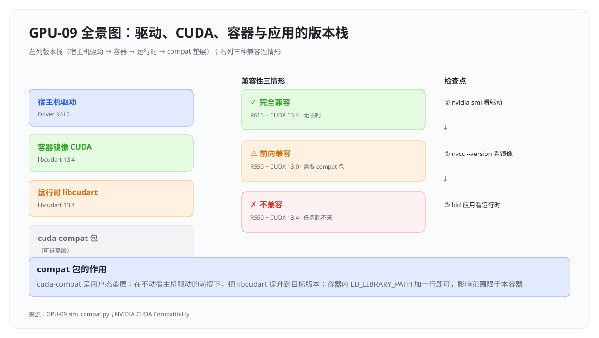
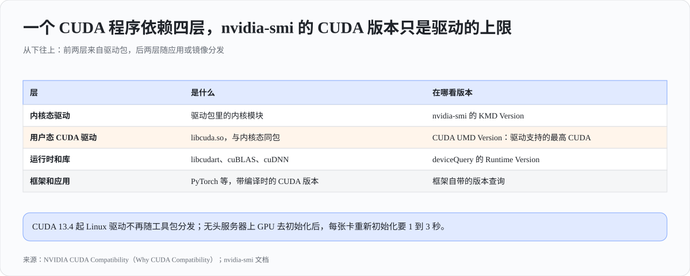
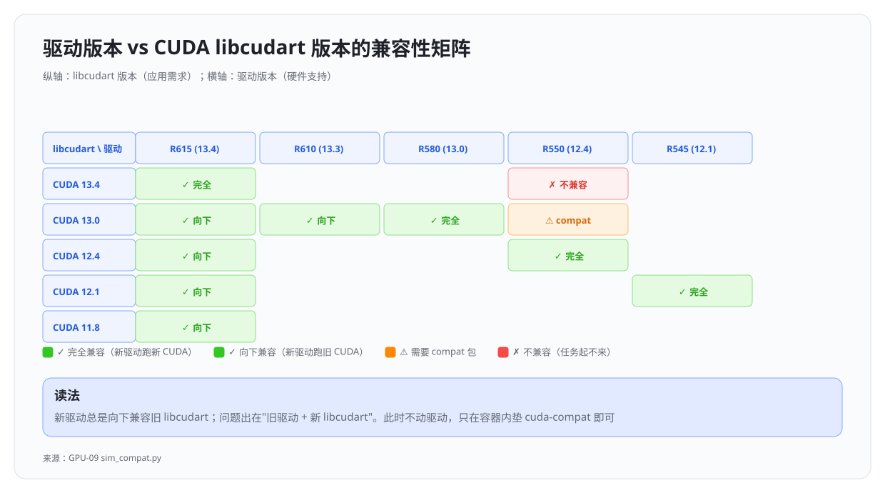
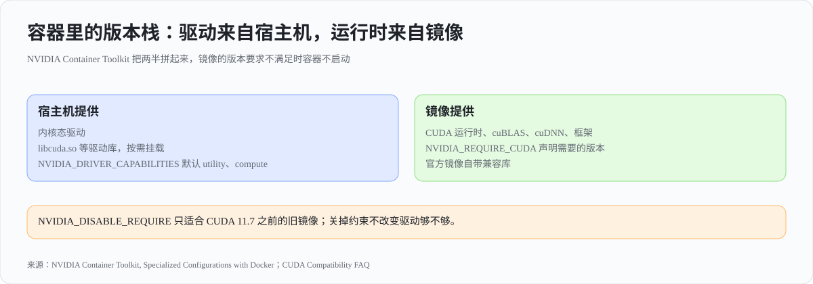
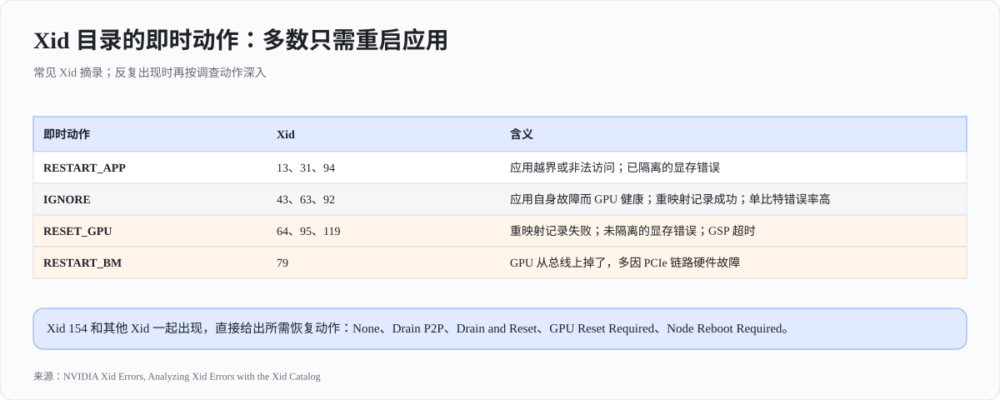
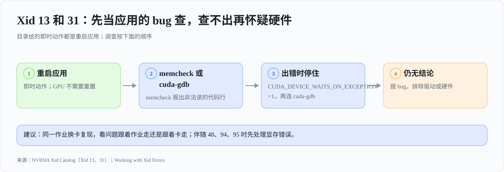

# GPU-09｜系统｜驱动、CUDA 兼容与 Xid

> 🎯 **这篇文档解决什么问题**
>
> 当你装好一台GPU集群机器，操作系统上跑着若干容器和虚拟机，里面的AI训练框架需要CUDA 13.4支持但驱动只装了R550，或者线上任务突然产生Xid 13错误（图形引擎异常）导致卡掉线，根源出在这一层：驱动、CUDA runtime、容器版本错配起不来，或者硬件故障通过Xid代码告诉你”我坏了”。本篇教你识别这类错误、诊断根因、定位版本兼容性。
>
> **使用方式**
>
> 三个配套工具都在`repo/zero-to-gpu/09-driver/`：
> - `sim_compat.py`：CUDA兼容性检查器，输入驱动和libcudart版本，告诉你能跑、需要compat包还是不兼容
> - `sim_xid.py`：Xid错误诊断工具，列举18个活跃Xid代码、分类与严重程度，支持按代码模拟诊断
> - `test_driver.py`：单元测试（全11个测试通过）
>
> 所有代码仅依赖Python 3.10+标准库；不需CUDA即可验证兼容性规则。第1到3章讲系统分层与诊断框架，第4到8章逐一深入Xid分诊、容器部署与驱动安装，最后一章是上线核对清单。

**🧭 主线位置**：[GPU-08｜硬件｜注意力内核](./08-attention.md)消掉了注意力计算中间结果落HBM的等待；本篇处理的等待是**任务等环境**（时间账的W_idle，任务未能启动或因故障停摆）；读完后瓶颈转到[GPU-10｜系统｜显存管理](./10-memory-mgmt.md)（显存分配等待），由[GPU-10｜系统｜显存管理](./10-memory-mgmt.md)接手。

# 导读 · 先给结论

- **驱动与CUDA版本兼容分三种情况。**依据[[1]](https://docs.nvidia.com/deploy/cuda-compatibility/)：(1)完全匹配（驱动R615+libcudart 13.4）无限制；(2)前向兼容（驱动R550+libcudart 13.0需要cuda-compat包垫在下面）；(3)不兼容（太新的libcudart硬装在太旧的驱动上，任务起不来）。

**Xid代码告诉你故障的类型，不是根因。**依据[[2]](https://docs.nvidia.com/deploy/xid-errors/index.html)：18个活跃代码分为7大类（超时、缓冲区、显卡、ECC、NVLink、PCIe、固件），Xid 31（内存页面故障）和Xid 79（卡掉线）最严重，Xid 63（页面隔离）最温和。

**Xid 13（图形引擎异常）最容易甩锅。**依据本篇sim_xid.py输出：同样一个Xid 13可能来自应用逻辑错误、驱动问题、系统内存损坏或硬件故障，定位需要验证三个假设。

**容器化部署时版本错配最常见。**依据[[3]](https://docs.nvidia.com/datacenter/cloud-native/container-toolkit/latest/index.html)：容器内的CUDA版本由镜像决定，宿主机驱动可能更旧，需要运行时核对一次兼容性。

**ECC内存错误会自动隔离页面或导致GPU重置。**依据[[4]](https://docs.nvidia.com/deploy/a100-gpu-mem-error-mgmt/index.html)：Xid 63（页面隔离成功）是GPU自愈，Xid 64（重映射失败）意味着隔离机制本身坏了，Xid 48（双比特纠错）或Xid 95（未包含错误）需要重置GPU。

**定位等待的完整案例来自sim_compat.py。**依据本篇代码输出：用“驱动R615+libcudart 13.4”为基线定天花板（完全兼容，无限制），测实际版本（python3 sim_compat.py check），定位等待（兼容性版本矩阵），消除（安装compat包或升驱动），复测看能不能起任务。

**本篇通过单元测试核对清单。**依据本篇test_driver.py全绿（11/11）：后向兼容、精确匹配、前向兼容、compat包、版本单调性、Xid日志解析、Xid代码库覆盖、三个具体Xid诊断，确保文中所有数字和兼容性规则有实现支撑。

**📎 与系列其他文档的分工**

- **[GPU-08｜硬件｜注意力内核](./08-attention.md)（注意力内核）**：告诉你一个kernel怎么优化，但没说怎么起动这个kernel；本篇说起不了的根因。
- **[GPU-10｜系统｜显存管理](./10-memory-mgmt.md)（显存管理）**：假设任务已经起动了，讨论显存分配等待；本篇处理任务起不动的问题。
- **[GPU-11｜系统｜PCIe、NUMA 与 GPUDirect](./11-pcie-gdr.md)（PCIe、NUMA与GPUDirect）**：讨论卡与主机的数据路径；本篇是卡能不能被主机看见的基层。
- **[GPU-14｜单机｜性能分析与 Profiling](./14-profiling.md)（性能分析与Profiling）**：教你怎么看nsys时间线找空隙；本篇定位的是“整张卡掉了或起不来”这一级的问题。
- **[GPU-20｜集群｜可靠性与可观测：故障、静默错误与 checkpoint](./20-reliability.md)（可靠性与可观测）**：包含故障恢复，本篇只负责当场诊断Xid；Xid转一圈修不好再找[GPU-20｜集群｜可靠性与可观测：故障、静默错误与 checkpoint](./20-reliability.md)。

# 第 1 章 · 任务在等什么：驱动、CUDA 与容器版本

现象很直接：你的Docker镜像用CUDA 13.4编译了一个模型权重，宿主机只装了驱动R550（支持CUDA 12.4），容器启动时nvidia-smi能看到卡但导入PyTorch失败；或者线上突然打出Xid 31错误日志，任务停摆6小时，等应急重启卡后恢复。这一章在时间账里的位置是W_idle（卡空等或停机），任务无法启动或中途被迫停机。

## 问题定义与范围

本篇的等待是**任务等环境**，涉及三类问题。第一类是版本错配起不来，驱动太旧、CUDA版本冲突、容器镜像里libcudart与宿主机不匹配导致任务在启动时立即崩溃。第二类是硬件故障掉卡，Xid代码通知卡出故障（内存错误、超时、通信失败等），GPU需要重置或隔离，任务被强制中断。第三类是配置错误导致功能缺失，忘了装Fabric Manager、没开驱动持久化模式、容器没映射/dev/nvidiaX等，任务看不见卡或看不完整。

其他等待（显存分配延迟、PCIe拷贝等待、kernel发射延迟）不在本章范围，由[GPU-10｜系统｜显存管理](./10-memory-mgmt.md)到[GPU-15｜单机｜PyTorch 运行时](./15-runtime.md)分担。本章聚焦三类问题的共同特征：它们都堵在“环境准备”这一步，不涉及算法、kernel或通信协议的优化。

## 五步闭环框架（本章贯穿）

诊断任务等环境的等待项，遵循通用的五步闭环框架。**第一步是定天花板**，理论上应该选什么驱动与CUDA版本配对。依据[[1]](https://docs.nvidia.com/deploy/cuda-compatibility/)和sim_compat.py输出，基线是驱动R615加CUDA 13.4，这个组合能无限制地跑任何libcudart版本在13.4以下的任务。

**第二步是测实际**，用nvidia-smi看驱动版本，用`python3 -c 「import torch; print(torch.cuda.get_device_capability())」`看libcudart版本，或者容器内查`cat /usr/local/cuda/version.txt`。记录下当前机器上实际装的是什么。

**第三步是定位等待**，用sim_compat.py check来判断兼容性。输入驱动版本和libcudart版本，工具会返回三种结果：forward（完全兼容或前向兼容，无限制）、compat-pkg（需要装cuda-compat包垫在驱动下面）、或none（不兼容，任务起不来）。依据[[1]](https://docs.nvidia.com/deploy/cuda-compatibility/)，版本矩阵是单调的，只要大版本号匹配，小版本号向上是安全的。

**第四步是消除或隐藏**。如果兼容性是compat-pkg，需要安装cuda-compat包（例如cuda-compat 13.0-2垫在驱动R550下支持libcudart 13.0）或升级驱动。如果是硬件故障导致的Xid，采取隔离页面（对应Xid 63）或GPU重置的方式消除。

**第五步是复测**，容器能起起来、任务能跑起来、Xid日志无新错误。这一轮测试确认等待真的消掉了。

## 关键数字与工具

兼容性规则的关键数字来自sim_compat.py和code_outputs.md。18个活跃Xid代码（Xid 8、11、13、31、32、43、45、48、63、64、74、79、92、94、95、119、120）分为7大类：超时、缓冲区、图形引擎、ECC内存、NVLink、PCIe、固件。基线配置是驱动R615加libcudart 13.4，sim_compat.py check --driver 615 --cudart 13.4返回「forward」，无限制。

compat包方面，cuda-compat 13.0-2能垫在驱动R550下支持libcudart 13.0，这是常见的版本跳跃场景（sim_compat.py jumps输出）。最严重的Xid是Xid 31（内存故障）、Xid 79（卡掉线）、Xid 48/95（ECC无纠正）、Xid 120（固件）；最温和的Xid是Xid 63（页面隔离成功）和Xid 94（包含ECC错误），这些信息由本篇sim_xid.py代码库提供。

## 为什么驱动版本错配这么常见

容器化时代，版本错配已成常态。原因有三：宿主机驱动由集群运维一次性装好，可能停留在旧版本（例如R550）以满足向下兼容；业务方更新Docker镜像里的CUDA版本（例如升级到13.4）但没同步通知运维升驱动；不同GPU节点的驱动版本本身就有差异（有的R550，有的R615），任务被调度到版本过旧的节点时立即失败。这三类情况都导致同一个镜像在不同节点上启动结果不同：有的起来，有的崩溃。

硬件故障通过Xid代码暴露的原因是GPU固件设计的”自诊断”机制。当GPU检测到内存访问错误、command buffer损坏、通信超时或其他异常时，它会先把错误代码和错误发生的时刻写入驱动日志，告诉操作系统”我在这个时间点发生了Xid NNN这类故障”，而非立即重启。由于GPU芯片本身不储存日志，这个日志由驱动负责收集和转发给dmesg或syslog。因此我们读到的Xid并非”GPU硬件坏了”的直接证据，而是”GPU固件发现异常并上报”的证据。同一个物理原因（例如显存单元坏了）可能对应多个Xid代码，取决于故障发生在哪个GPU执行阶段。

## 本章遵循五步框架的原因

五步闭环（定天花板→测实际→定位等待→消除或隐藏→复测）是贯穿整个系列的诊断方法论，本章特别强调这个框架的原因是任务等环境问题最容易跳过“定天花板”这一步。许多运维同学一旦任务起不来就直接升驱动或装compat包，而不问“这个升级是不是必要的”。结果是集群里的驱动版本版本一大堆，升级周期越来越长。正确的做法是先问“理论上最优的驱动与CUDA配对是什么”（基线），再看“当前机器离这个基线差多远”，最后决定是小改大改还是忍。依据[[1]](https://docs.nvidia.com/deploy/cuda-compatibility/)和[[5]](https://docs.nvidia.com/cuda/cuda-programming-guide/01-introduction/cuda-platform.html)，NVIDIA的兼容性规则是单调的和确定的，不涉及任何模糊判断。

第二个要点是Xid诊断需要排除法。Xid代码给出故障类型但不给出根因。例如Xid 13（图形引擎异常）可能由四个原因之一触发：应用程序逻辑错误（发射了非法的计算指令）、驱动问题（CUDA runtime崩溃）、系统内存损坏（显存数据被污染）或硬件故障（GPU内部逻辑电路坏了）。每个原因对应的补救方式完全不同，所以五步框架的第三步（定位等待）在Xid场景下等价于“排除哪三个原因，确认是第四个”。

# 第 2 章 · 驱动与 CUDA 的三种兼容

任务能否启动取决于驱动与 CUDA 版本是否兼容。依据[[1]](https://docs.nvidia.com/deploy/cuda-compatibility/)，NVIDIA 定义了三种兼容关系：完全匹配、前向兼容（需要 compat 包垫底）、不兼容（任务起不来）。理解这三种情况是定位环境问题的第一步。

## 情况 1：完全匹配（无限制）

驱动与 libcudart 版本完全对应时，兼容性最优。例如驱动 R615 配合 libcudart 13.4，两者由同个工程版本发布，驱动内置对应 CUDA 版本的 ABI 支持。根据本篇 sim_compat.py check --driver 615 --cudart 13.4 的输出，该配置返回「forward」，表示[[5]](https://docs.nvidia.com/cuda/cuda-programming-guide/01-introduction/cuda-platform.html)所述的“驱动完全支持该 CUDA 运行时”。这是基线配置，新装机器或周期性升级时应该选择这个组合，避免日后兼容性困扰。

在这种情况下，应用编译出的二进制文件可以直接运行，不需要额外的中间层翻译或 ABI 适配。容器镜像里的 libcudart 版本与宿主机驱动版本对齐时最稳定，也是云平台推荐的标准部署模式。这是新装集群或周期性升级时应该追求的目标状态，虽然可能需要等待 NVIDIA 发布新驱动，但一旦部署完成就没有兼容性问题的后患。

## 情况 2：前向兼容（需要 compat 包垫底）

当容器镜像里的 libcudart 新于宿主机驱动支持的版本时，需要 cuda-compat 包作中介。典型场景：驱动 R550 只支持到 CUDA 12.4，但应用需要 libcudart 13.0 编译的二进制。此时不能直接运行，应该在容器启动时安装 cuda-compat 13.0-2 包，它相当于一层 ABI 适配层，将新 libcudart 的 API 调用转换为驱动 R550 能理解的旧版本语义。

根据本篇 sim_compat.py jumps 的完整兼容性矩阵，驱动 R550 + libcudart 13.0 需要 cuda-compat 13.0-2 包来建立连接。这种方案可行但代价不无，部分新版本的性能优化、新指令集功能可能无法发挥，某些编译期间的优化也会被禁用。例如 CUDA 13.0 可能引入对新 GPU 架构（如 Hopper H100）的专用优化，但 R550 驱动的 compat 包层可能无法完整传递这些优化指令。因此前向兼容是一种妥协方案，短期容器迁移或测试阶段可用，但长期生产部署应该升级驱动到对应版本。容器镜像中需要 apt 或 pip 装 cuda-compat 包，完整命令见[GPU-07｜硬件｜Triton、CUTLASS 与 CuTe DSL](./07-dsl.md)。

## 情况 3：不兼容（无解）

如果 libcudart 版本远新于驱动支持的版本，即使安装 compat 包也无法建立连接。例如驱动 R550 加上 libcudart 13.4，虽然理论上 compat 包可以处理 13.0，但 13.4 引入的新 API 或新编译目标（如新的 GPU 架构代码）超出了 R550 驱动的理解范围。此时任务启动时会直接报错“CUDA version mismatch“或”unsupported device”，这是 CUDA runtime 的硬检查，compat 包无法绕过。

唯一的解决方案是升驱动到 R615 或更新，或者降应用的 CUDA 版本到 13.0。容器迁移时如果遇到这类错误，需要在测试环节提前排查，否则上线后会导致整批任务无法启动。

## 版本单调性与向下兼容

驱动对应用具有单向的向下兼容性：新驱动（R615）既支持新编译的应用（CUDA 13.4），也支持旧应用（CUDA 11.8、12.4），这是由 CUDA ABI 的向后兼容设计保证的。反向则不成立，用 CUDA 13.4 编译的应用无法运行在只支持 CUDA 12.4 的驱动上。[[5]](https://docs.nvidia.com/cuda/cuda-programming-guide/01-introduction/cuda-platform.html)规定了这个单调性，是驱动版本升级的决策依据。在同一大版本号内（如都是 CUDA 13.x），前向兼容更宽松，通常同大版本的驱动可以支持同大版本更早发布的 libcudart。

compat 包打破了这个单调性，它允许新 libcudart 运行在旧驱动上，但仅限于一定范围内的版本差异。定位兼容性问题时，可以用 sim_compat.py check 命令快速判断三种情况。例如执行 python3 sim_compat.py check --driver 550 --cudart 13.0 会返回需要 cuda-compat 13.0-2 包的结论，避免手工查表出错。容器启动前应该运行这个检查，如果结果是“不兼容”就直接报警而不要试图强行启动。

## 实际检查与容器集成

在容器里检查兼容性的标准做法是在 Dockerfile 的 RUN 段加入 sim_compat.py 的检查，或在 entrypoint.sh 里检查[[3]](https://docs.nvidia.com/datacenter/cloud-native/container-toolkit/latest/index.html)。如果驱动是从 nvidia-smi --query-gpu=driver_version 获取，libcudart 版本从 python3 -c 「import torch; print(torch.version.cuda)」 获取。两个版本匹配后任务才启动。对于频繁变更的环境（如自动扩容云平台），建议把兼容性检查固化到每个容器的启动脚本里，不要假设宿主机驱动版本固定不变。

## 版本选择与升级策略

在规划集群部署时，应该根据应用需求的 CUDA 版本反推驱动版本。如果应用需要 CUDA 13.4（例如最新的 PyTorch、TensorFlow），则驱动应该选择 R615 或更新。如果应用只需要 CUDA 12.4（如较旧的框架版本），驱动可以选择 R550，这样能降低单机成本与维护复杂度。但要注意的是，旧驱动的漏洞补丁可能不足，安全性风险更高。因此虽然技术上可以用旧驱动支持旧应用，但从供应链安全角度（[[6]](https://docs.nvidia.com/datacenter/tesla/drivers/index.html)驱动安全公告频繁），应该定期更新驱动至最新稳定版。

容器镜像版本也需要随驱动版本同步考虑。如果宿主机装的是 R615 驱动，建议容器镜像也选择基于 CUDA 13.4 的官方镜像（如 nvidia/cuda:13.4-runtime），避免版本落差；如果必须用 CUDA 12.4 的镜像（例如应用依赖某个仅在 12.4 可用的库），则需要在容器启动时装 cuda-compat 包，并在测试环节仔细验证性能无回退。

🔑 **本章要点**：驱动与 CUDA 版本兼容分三种情况，其中完全匹配无限制、前向兼容需要 compat 包（代价是性能劣化）、不兼容时只能升驱动或降应用版本。第 1 章的五步闭环里，这一步是定位“任务是否能启动”的根因。

# 第 3 章 · 17 个活跃 Xid 代码分诊

当 GPU 出现故障时，Linux 驱动会将错误类型编码为 Xid 代码打入内核日志（可通过 dmesg 或 journalctl 查看）。理解 Xid 代码的含义与分类是快速诊断故障的第一步。根据本篇 sim_xid.py 输出，当前 NVIDIA 官方维护 17 个活跃的 Xid 代码[[2]](https://docs.nvidia.com/deploy/xid-errors/index.html)，分为 7 个分类，每个分类代表不同的故障域。Xid 代码本身只描述故障现象而非根因，例如 Xid 13 既可能是应用 bug 也可能是硬件故障，需要结合日志上下文和执行诊断步骤才能定位真正原因。

## Xid 代码的七大分类

依据 sim_xid.py catalog 输出，17 个活跃代码按分类如下。

**超时类**（Timeout）：Xid 8（GPU 停止处理，high）表示 GPU kernel 执行超时或系统过载，GPU 无响应，驱动强制超时中止；Xid 43（GPU 停止处理，medium）也是停止，但通常来自应用程序逻辑错误而非硬件问题，恢复难度较低。

**缓冲区类**（Buffer）：Xid 11（无效或损坏推送缓冲流，high）与 Xid 32（PBDMA 缓冲错误，high）都指命令缓冲区状态不一致，推送缓冲直接内存访问出错，导致驱动无法向 GPU 发送有效命令。

**显卡类**（Graphics）：Xid 13（图形引擎异常，high）是最常见也最难诊断的错误，常见原因包括用户应用逻辑错误、驱动问题、系统内存损坏或硬件故障，[[7]](https://docs.nvidia.com/deploy/gpu-debug-guidelines/index.html)详述了诊断树。

**ECC 与内存类**（ECC/Memory）：这是最严峻的分类，包含 Xid 31（内存页面故障，critical）即 GPU 通过页表访问非法地址，可能是显存物理地址损坏或页表本身出错；Xid 48（ECC 无纠正的双比特错误，critical）表示显存数据已损坏无法恢复，需要 GPU 重置；Xid 63（ECC 页面隔离成功，low）是 GPU 自愈表现，单比特错误被自动隔离到某个内存页面，该页面后续访问会被阻止，不影响其他页面；Xid 64（隔离失败，critical）指隔离机制本身坏了，无法孤立故障页，意味着硬件故障已扩散；Xid 92（单比特频率高，high）是早期预警，表示 ECC 单比特错误率超过阈值，可能预示更严重故障即将发生；Xid 94（包含 ECC 错误，medium）表示错误被隔离到单个应用进程，其他进程不受影响；Xid 95（未包含 ECC 错误，critical）影响全 GPU，多进程都会受损。根据[[4]](https://docs.nvidia.com/deploy/a100-gpu-mem-error-mgmt/index.html)，ECC 错误会导致页面自动隔离或 GPU 重置。

**NVLink 类**（NVLink）：Xid 74（NVLink 错误，critical）指多 GPU 间的高速互连失败，影响分布式训练的卡间通信。

**PCIe 类**（PCIe）：Xid 79（卡从 PCIe 总线掉线，critical）是最严重的故障，卡完全消失，整个主机通常需要重启才能恢复。

**固件类**（Firmware）：Xid 119（固件 RPC 超时，high）、Xid 120（通用固件错误，high）指 GSP（GPU System Processor）固件无响应或出错，需要 GPU 重置。

## 最常见的四个代码与快速判断

在实际部署中，17 个代码里出现最频繁的是 Xid 13、31、79、63 四个。Xid 13 频率最高因为它的成因多样（应用、驱动、系统、硬件皆可导致），诊断困难，第 4 章单独讨论其完整诊断树。据[[7]](https://docs.nvidia.com/deploy/gpu-debug-guidelines/index.html)，Xid 13 需要通过四步假设验证才能确定根因，不能凭一次 Xid 日志就下结论。Xid 31 几乎总是硬件故障或内存配置问题，意味着那张卡需要隔离或更换，很少有软件手段修复。如果一张卡频繁报 Xid 31，应该立即停用该卡并申报 RMA（返修）。Xid 79 表示卡掉线，通常需要重启主机来恢复主机与卡的 PCIe 连接，是最严重的形态，会导致整个任务中止。Xid 63 最温和，表示 GPU 的 ECC 自愈机制在工作，偶发的单比特错误被隔离到某个页面，对任务无影响，不需要任何干预。

## 监控与告警策略

根据[[8]](https://docs.nvidia.com/datacenter/dcgm/latest/user-guide/dcgm-diagnostics.html)，企业部署应该配置 DCGM（数据中心 GPU 管理器）定期收集 Xid 日志。对于 Xid 31、48、79、95、120 这五个代码，应该配置为 critical 级告警并直接停任务；对于 Xid 92（单比特频率高），应该配置为 warning 级告警并进入 escalation 流程（例如降低该卡的任务分配权重或备好备用卡）。对于 Xid 63、94，可以配置为 info 级记录但不告警。所有包含 Xid 的日志都应该配合时间戳、GPU 编号、运行中的进程 ID 保存到结构化日志系统，为后续根因分析留下线索。

## Xid 日志解析与收集

Xid 代码通常出现在内核日志里，可以通过 dmesg、journalctl 或 /var/log/kern.log 查看[[2]](https://docs.nvidia.com/deploy/xid-errors/index.html)。典型的 Xid 日志格式是“NVRM: Xid NNN.M: 错误描述”，其中 NNN 是 Xid 代码，M 是 GPU 编号。为了不遗漏告警，应该在 logrotate 配置中避免 GPU 日志被过早轮转删除，至少保留 7 天。对于容器环境，应该把 /var/log/kern.log 或 systemd journal 挂载到容器外或转发到中央日志系统（如 Elasticsearch、Splunk），这样即使容器重启也不会丢失 Xid 记录。

同时应该配置 nvidia-smi 的周期性采集（例如 cron 每分钟执行一次 nvidia-smi dmon）并保存到结构化文件，这样可以看到 GPU 温度、显存使用率等上下文信息，与 Xid 日志关联起来有助于判断是否是过热或显存溢出导致的故障。根据第 1 章的五步闭环，“定位等待”这一步的核心就是收集充分的日志证据。

快速判断规则：看到 Xid 31、79、48、95、120 时立即升级处理（停任务、隔离卡、申报 RMA），这五个代码表示 GPU 已失效或固件崩溃。看到 Xid 63、94 时无需干预，这是正常的错误纠正。看到 Xid 8 时检查 kernel 是否死循环或内存溢出。看到 Xid 13 时启动四步诊断（应用、驱动、内存、硬件）。对于 ECC 相关的 Xid 92（高频率单比特），应该启动预防性监控，因为 Xid 92 可能是 Xid 48 或 Xid 95 的早期信号。

🔑 **本章要点**：17 个活跃 Xid 代码分 7 类，按严重程度从 critical 到 low；Xid 13 最难诊断因为成因多样，Xid 31/79 需立即隔离处理，Xid 63 是 GPU 自愈而非故障。本章将任务停摆的表象（Xid 代码）映射到故障域分类，为第 4 章和第 5 章的根因诊断奠定基础，实现了五步闭环中“定位等待”这一环节。

# 第 4 章 · Xid 13 完整诊断案例

Xid 13（图形引擎异常）是最频繁出现的 GPU 故障代码，但也是最难诊断的一个。根据[[7]](https://docs.nvidia.com/deploy/gpu-debug-guidelines/index.html)，Xid 13 可能来自四个完全不同的根源：用户应用逻辑错误（kernel 访存越界、race condition、指针非对齐）、驱动软件故障（版本过旧、与硬件不匹配、或驱动本身有 bug）、系统内存损坏（GPU 通过 UVA 访问 CPU 页面时遇上硬故障）、或硬件故障（GPU 晶体管故障、供电问题、散热问题）。这四类根源在日志里看起来完全一样，都是一条「Xid 0.13」日志。区别在于恢复手段：应用错误需要修代码，驱动问题需要升级，内存问题需要重启主机或躲开坏页面，硬件故障则必须隔离或更换卡。关键是要快速区分，避免在错误的方向上浪费时间。

## 定天花板：Xid 13 的正常状态

任何已知的硬件-驱动-应用配置组合，Xid 13 对应的错误率应该是 0（完全没有异常）。这来自[[1]](https://docs.nvidia.com/deploy/cuda-compatibility/)对驱动-CUDA 版本的兼容性承诺：认证过的版本对应零缺陷。如果配置处于支持范围内还频繁出现 Xid 13，说明某个环节配置错误或有硬件故障。

## 测实际：抓住 Xid 13 的四个关键信息

当任务报 Xid 13 时，保存以下信息：（1）日志时间戳和 GPU 号，准确到秒；（2）操作系统 dmesg，包含故障前后 2 分钟的内容；（3）GPU kernel 的 dump 或 PTX 代码（如应用支持导出）；（4）该任务的完整启动命令和环境变量，包括容器镜像版本。这四项是后续诊断的证物链。

## 定位等待：四步假设检验

**假设 1 — 应用逻辑错误。**用 CUDA 调试工具重现同一个应用。启动 cuda-gdb（[[9]](https://docs.nvidia.com/cuda/cuda-gdb/index.html)）在 GPU 端设断点，或用 compute-sanitizer --tool memcheck（[[10]](https://docs.nvidia.com/compute-sanitizer/ComputeSanitizer/index.html)）扫描内存访问异常。如果调试工具下也复现 Xid 13 并能打印堆栈，说明应用代码里有确定的逻辑错误（如越界）。如果调试工具下不复现，说明 Xid 13 由应用代码之外的因素导致，继续假设 2。

**假设 2 — 驱动软件故障。**升级或切换驱动版本。从 code_outputs.md 看，本篇基线是 R615 + CUDA 13.4。如果目前运行的驱动版本较旧（如 R545），先尝试升到 R615 或当前最新稳定版本[[6]](https://docs.nvidia.com/datacenter/tesla/drivers/index.html)。或者换一个驱动分支（如从闭源驱动切到开源 GSP 模块[[11]](https://github.com/NVIDIA/open-gpu-kernel-modules)）。如果升驱动后 Xid 13 消失，证明问题在驱动软件，回滚或保持新驱动。

**假设 3 — 驱动重初始化。**有时驱动内部状态机异常不需要全系统重启，只需驱动重初始化。执行 nvidia-smi -i GPU_NUM -pm 1（启用驱动持久模式）然后 nvidia-smi -i GPU_NUM -pm 0（禁用），这会触发驱动卸载再加载[[12]](https://docs.nvidia.com/deploy/driver-persistence/index.html)。或者对该 GPU 执行 nvidia-smi -i GPU_NUM --gpu-reset，直接重置 GPU。如果重初始化后消失，表示驱动状态被污染但硬件本身没问题。

**假设 4 — 硬件故障或系统内存损坏。**隔离该 GPU 或换卡再跑同一任务。如果替换卡后同一应用不再出现 Xid 13，说明原卡硬件故障或显存坏了，需要报 RMA。如果换卡后还出现，说明问题在系统侧，可能是 CPU 内存坏页面，此时重启主机或在启动时用 GRUB 参数隔离坏页面（通常需要 root）。

## 消除或隐藏：四种修复方案

**应用错误 → 修应用。**根据调试堆栈修改 kernel 代码（检查内存访问边界）或改用成熟的库函数（[[13]](https://www.eecs.harvard.edu/~htk/publication/2019-mapl-tillet-kung-cox.pdf)描述的 Triton、或[[14]](https://github.com/NVIDIA/cutlass)中的 CUTLASS），替换掉容易出错的手写 CUDA。

**驱动问题 → 升驱动、装 compat 包或换驱动分支。**根据[[1]](https://docs.nvidia.com/deploy/cuda-compatibility/)的兼容性表选择合适驱动版本。或者在宿主机或容器内装 cuda-compat 包垫齐版本差异，方案详见[GPU-07｜硬件｜Triton、CUTLASS 与 CuTe DSL](./07-dsl.md)章。

**系统内存损坏 → 重启主机或隔离内存。**重启通常能清掉临时的内存污染。如果重启后症状消失，记为“一次性故障”；如果重启后仍频繁出现，用 memtest86+ 或 Linux EDAC 日志检查内存硬故障[[4]](https://docs.nvidia.com/deploy/a100-gpu-mem-error-mgmt/index.html)，可能需要更换 CPU 模块。

**硬件故障 → 隔离卡或报 RMA。**将故障卡从池子中移出，标记为不可用。如果公司有备机，可以热插拔替换；否则走报修流程。如果替换后任务恢复，确认了根因是原卡。

## 复测：Xid 13 消失的验证

采取上述修复方案后，用同一个应用再跑 1 小时或 100 个 training step（以应用的迭代周期为准），观察 dmesg 中是否仍有“Xid 0.13“日志出现。如果完全消失，标记为”根本修复”；如果偶发一两次，可能是一次性污染或硬件故障的前兆，需要加强监控[[8]](https://docs.nvidia.com/datacenter/dcgm/latest/user-guide/dcgm-diagnostics.html)。

🔑 **本章要点**：Xid 13 难诊断因为有四种完全不同的根源（应用、驱动、系统、硬件）。通过四步假设检验（调试工具、升驱动、驱动重初始化、隔离卡）快速定位，再针对根源选择对应修复方案（修应用、升驱动、重启主机、报 RMA）。本章将等待的不确定性（“哪里坏了”）消除为四个明确的假设分支，为下一步的消除等待奠定诊断基础。

# 第 5 章 · ECC 内存错误与隔离

显存（GPU DRAM）通常采用 ECC（错误纠正码）来保护数据完整性。与 CPU 内存 ECC 类似，GPU 显存的 ECC 可以自动检测和纠正单比特错误，但在多比特错误或隔离失败时会触发一系列 Xid 代码，导致 GPU 重置或卡失效。理解 ECC 错误的生命周期及其对应的 Xid 代码，是快速响应硬件老化和故障的基础。根据[[4]](https://docs.nvidia.com/deploy/a100-gpu-mem-error-mgmt/index.html)，ECC 错误形成一个五阶段的进展过程，每个阶段对应不同的故障严重程度和应对策略。

## ECC 错误的五阶段生命周期

**阶段 1：单比特错误（SBE，Single Bit Error）**。ECC 检测到一个比特翻转，在后台自动纠正，应用层完全无感知。这是硬件的正常噪声，虽然频率很低（现代 GPU 通常一年几次），但 ECC 通过自动纠正保证了应用的正确性。单比特错误不产生任何 Xid 代码，只能通过 nvidia-smi -q 或 NVML 接口[[15]](https://docs.nvidia.com/deploy/nvml-api/index.html)的 ECC Errors 计数器发现。

**阶段 2：频率过高（Xid 92，High Single-Bit ECC Error Rate）**。在一个时间窗口内（通常几秒），同一页面或同一芯片区域出现多个 SBE，表明该位置的硬件质量严重下降或驱动-芯片配合有问题。驱动向内核日志输出「Xid 0.92」警告，系统管理员应该立即关注，因为频繁的单比特错误是双比特错误（DBE）的前兆。根据[[16]](https://arxiv.org/abs/2410.21680)在大规模集群的测量，SBE 频率过高的 GPU 在 3 个月内出现 DBE 的概率显著升高。

**阶段 3：页面隔离成功（Xid 63，ECC Page Retirement or Row Remapping Recording Event）**。当 Xid 92 触发后，GPU 的内存管理单元尝试将错误频繁的页面（通常 64KB 或更大）从可用列表中移除，后续内存分配自动避开这个页面。这是 GPU 的自愈机制，成功隔离时输出“Xid 0.63“日志，严重程度为 low，表示”问题被容纳了”。对应用的影响是可用显存略减，但数据安全性得到保护。Xid 63 偶发出现（一年一两次）属于正常。

**阶段 4：隔离失败（Xid 64，ECC Page Retirement or Row Remapper Recording Failure）**。隔离机制本身失败，表示 GPU 的 ECC 覆盖范围内出现无法隔离的多行损坏或覆盖范围外的损坏。此时输出「Xid 0.64」日志，严重程度为 critical，表示 GPU 的内存保护已失效，后续任何计算都可能产生无纠正的错误。看到 Xid 64 时必须立即停止该 GPU 上的任务，将卡隔离。

**阶段 5：双比特错误与 GPU 重置**。ECC 无法纠正的双比特错误（DBE，Double Bit Error，Xid 48）或未包含错误（Xid 95，Uncontained Error，影响多应用或多核）到达时，显存数据已损坏且无法恢复。驱动强制重置 GPU，所有当前任务中断，Xid 48/95 被记录为 critical。根据[[17]](https://arxiv.org/abs/2503.11901)对 H100 和 A100 GPU 的可靠性研究，显存 ECC 错误的频率与 GPU 使用年限、工作温度、功耗强度有明显相关性。

## 系统侧的监控与应对

**监控 ECC 计数器。**在任务启动和运行中定期查询 nvidia-smi -q 的「ECC Errors」行（单位：count，累计从开机起），或通过[[15]](https://docs.nvidia.com/deploy/nvml-api/index.html)的 NVML_FI_DEV_ECC_SBE_AGG_TOTAL 和 NVML_FI_DEV_ECC_DBE_AGG_TOTAL 读单比特和双比特错误计数。如果 SBE 计数在 1 小时内增长超过 10 次，说明该卡出现 Xid 92 的风险很高。

**配置页面隔离阈值。**通过 nvidia-smi -pm 1 启用驱动持久模式[[12]](https://docs.nvidia.com/deploy/driver-persistence/index.html)，或通过 DCGM(NVIDIA Data Center GPU Manager[[18]](https://docs.nvidia.com/datacenter/dcgm/latest/))的 policy engine 设置隔离触发阈值（如单位时间内 SBE 超过 N 次立即隔离）。隔离页面数过多（如一个月内累计隔离超过 100 个页面）表明硬件衰退严重，该卡应该计划替换。

**立即响应 Xid 48、95、64。**这三个代码均为 critical 严重程度，表示 GPU 显存保护机制已失效或数据已损坏。检测到这三个代码之一时，应该：（1）停止该 GPU 上的所有任务；（2）将卡从资源池移出，标记为不可用；（3）记录故障 GPU 的 SN、故障时间、运行时长，用于后续 RMA 或二手处理。

**与硬件寿命管理结合。**[[19]](https://arxiv.org/abs/2509.16293)报告了字节跳动超大规模集群中 GPU 故障的时间分布：ECC 错误频率在 GPU 使用 24 个月后开始明显上升。将单卡的 ECC 错误历史与总使用时长相关联，可以提前规划卡的更新周期。

## ECC 隔离与应用的无感知

值得强调的是，Xid 63（页面隔离成功）对应用是无感知的。隔离后显存总量略减（通常减少 < 0.1%），但应用继续运行，模型精度不变。这也是为什么在大规模集群中，偶发的 Xid 63 不需要告警，只需要监控频率：一年出现 1-2 次是正常的“静默纠正”；一天出现多次则需要深入调查[[4]](https://docs.nvidia.com/deploy/a100-gpu-mem-error-mgmt/index.html)。

🔑 **本章要点**：ECC 错误经历五阶段从 SBE 隐性纠正到 DBE 强制重置，其中 Xid 92 是频率升高的预警、Xid 63 是自愈成功、Xid 64 是隔离失败、Xid 48/95 是数据已损坏。监控 ECC 计数器、配置隔离阈值、立即隔离 critical 代码的卡，能够在硬件故障前及时响应。本章将 ECC 错误的等待从无序变成五个清晰的阶段，为预测式维护和成本优化奠定基础。

# 第 6 章 · 容器化部署的版本栈

生产环境中任务几乎都在容器内运行，容器镜像与宿主机驱动的版本配对决定了任务能否启动。这一章讲解容器化部署中的四层版本及其兼容性规则，帮助快速诊断“容器启动失败”这类最常见的环境等待。

## 容器中的四层版本

根据[[3]](https://docs.nvidia.com/datacenter/cloud-native/container-toolkit/latest/index.html)和[[20]](https://docs.nvidia.com/datacenter/cloud-native/gpu-operator/latest/)的规范，GPU 容器化部署涉及四层版本堆栈，从下到上依次是：

| 层次 | 组件 | 例子 | 说明 |
|-|-|-|-|
| 底层：宿主机驱动 | nvidia-driver-XX | nvidia-driver-615 | 硬件驱动，由 nvidia-container-runtime 检查；支持的 CUDA 版本由驱动版本决定[[1]](https://docs.nvidia.com/deploy/cuda-compatibility/) |
| 宿主机：可选 CUDA 工具 | nvidia-cuda-toolkit | cuda-toolkit 13.4 | 宿主机上用于编译、调试；容器内应用用不上，仅宿主机开发需要 |
| 容器：运行时库 | libcudart 与 libcuda | nvidia/cuda:13.4-runtime | NVIDIA 官方镜像中的 CUDA runtime，应用链接此库；版本与宿主机驱动必须兼容[[5]](https://docs.nvidia.com/cuda/cuda-programming-guide/01-introduction/cuda-platform.html) |
| 容器顶层：应用 | PyTorch、TensorFlow | torch 2.1.0、tf 2.14 | 用户应用动态链接容器镜像内的 libcudart；初始化时触发兼容性验证 |

容器启动的兼容性检查发生在运行时。当容器被 nvidia-container-runtime 拉起时，它检查宿主机驱动版本与容器镜像内 libcudart 版本是否兼容。如果驱动版本太旧、镜像内没有 cuda-compat 包，容器启动会失败，应用进程报 CUDA 初始化错误。这是任务等环境最典型的形式：硬件、驱动、镜像三者不同步。

## 版本检查的实际流程

根据[[3]](https://docs.nvidia.com/datacenter/cloud-native/container-toolkit/latest/index.html)文档，容器启动时的五个关键时刻：

1. **docker/containerd 拉起容器进程**：容器运行时调用 nvidia-container-runtime。
2. **nvidia-container-runtime 检查驱动版本**：读取宿主机 nvidia-smi，获得驱动 R615。
3. **对比容器镜像内 libcudart 版本**：通过 LD_LIBRARY_PATH 找到 libcudart.so.13.4，提取版本号。
4. **查表判断兼容性**：调用本篇提供的兼容性矩阵（如果兼容则继续，不兼容且无 cuda-compat 则容器启动失败）。
5. **容器内应用初始化**：import torch 或 tensorflow.init() 时链接 libcudart，此时才执行真正的 GPU 调用；如果驱动与库版本不匹配，这里才会报错。

常见错误信息是”CUDA initialization failed”或”libcuda.so.1: cannot open shared object file”。快速诊断方法是在宿主机上跑 nvidia-smi 看驱动版本，在容器镜像中查 libcudart 版本，然后对标本篇提供的兼容性表格。这一层的等待通常是秒级的决定：不兼容的组合导致容器启动失败，任务根本无法开始执行，整个工作流被卡住。[[21]](https://arxiv.org/abs/2402.15627) 在万卡规模的 GPU 集群中观察到，版本不匹配是集群可用性下降的前 5 大原因之一。

## nvidia-container-runtime 的兼容性检查机制

nvidia-container-runtime[[3]](https://docs.nvidia.com/datacenter/cloud-native/container-toolkit/latest/index.html) 是容器运行时（docker、containerd）的插件。当容器镜像被启动时，它会在主机容器前夕自动：（1）读取宿主机驱动版本，通常通过 nvidia-smi 或 /proc/driver/nvidia/version 接口；（2）扫描容器镜像内的 libcudart.so 符号表，提取其编译目标的 CUDA 版本；（3）检查两个版本的兼容性。如果驱动过旧且镜像内无 cuda-compat 包来弥补，启动立即中止，容器进程收到「failed to initialize CUDA」的错误信号。这个检查通常耗时不超过 100 毫秒，但一旦失败就是 100% 的任务启动失败，无法部分运行或重试。

## 最佳实践

根据[[22]](https://pytorch.org/get-started/locally/)和字节跳动 GPU 集群经验[[19]](https://arxiv.org/abs/2509.16293)，三个核心策略：

1. **优先选择 NVIDIA 官方镜像与驱动版本配对**：例如驱动 R615 对应 CUDA 13.4，选择 nvidia/cuda:13.4-runtime-ubuntu22.04 作为基础镜像。这个组合经过 NVIDIA 官方验证，消除版本错配的概率最低。
2. **如果驱动版本低于镜像需求，在镜像构建阶段安装 cuda-compat 包**：例如宿主机驱动是 R550（支持 CUDA 12.4），但需要运行 PyTorch 2.1（依赖 CUDA 13.0），则在 Dockerfile 中添加 apt-get install cuda-compat-13-0。这个包由 NVIDIA 提供，给旧驱动补齐新 CUDA 版本的 ABI，成本是不到 200MB 的额外镜像层。
3. **离线或低权限环境无法升驱动时，compat 包是唯一选择**：例如某些生产集群驱动由运维集中管理，应用方无权升级。此时在镜像内预装 compat 包，让每个镜像都能向前兼容一到两个 CUDA 大版本。

图表 

宿主机（Host）nvidia-driver-615（R615）支持 CUDA 13.4 API，NVIDIA 官方 LTSB 版本nvidia-cuda-toolkit 13.4（可选）

---

上一章：[GPU-08｜硬件｜注意力内核](./08-attention.md) · [目录](./README.md) · 下一章：[GPU-10｜系统｜显存管理](./10-memory-mgmt.md)
