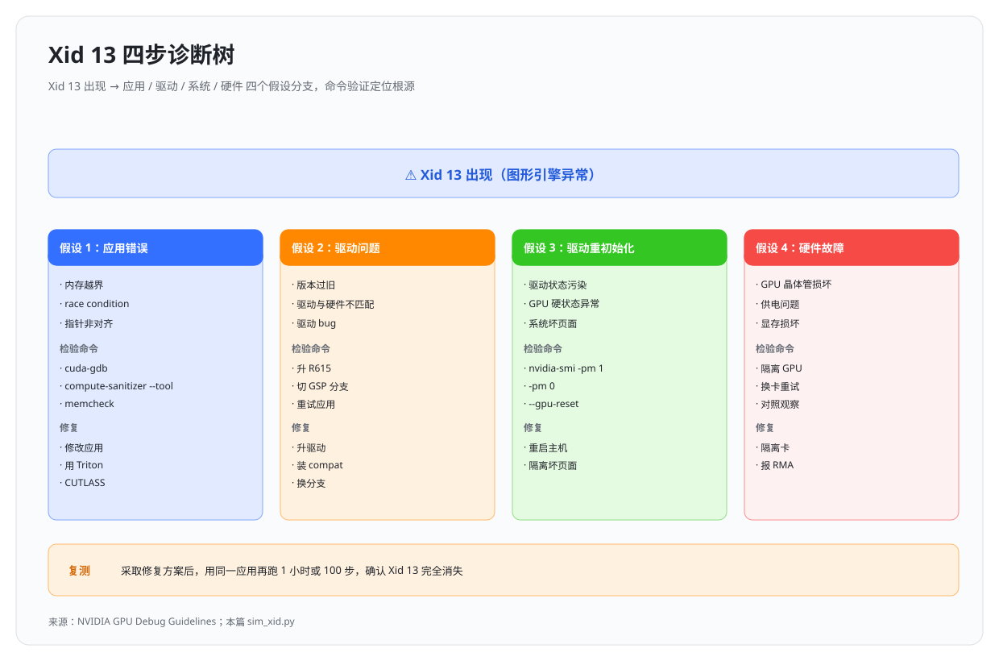
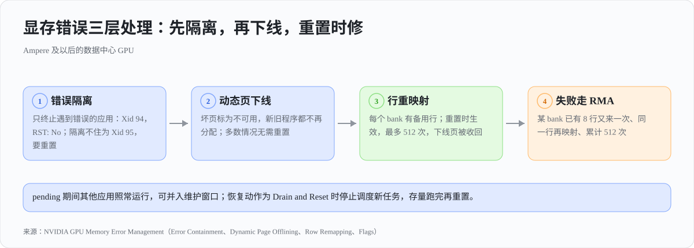
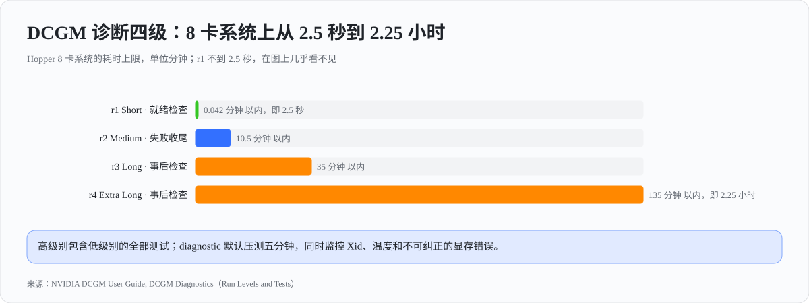

# GPU-09｜系统｜驱动、CUDA 兼容与 Xid

> 🎯 **这篇文档解决什么问题**：作业提交后起不来，或者跑到一半 GPU 报错退出，这两类问题不涉及性能调优，却最容易让整张卡、整个作业空转。前者多是驱动、CUDA 运行时和容器镜像的版本没对上；后者由驱动以 Xid 的形式写进内核日志，可能是应用的 bug，也可能是显存或链路的硬件问题。本篇按 NVIDIA 的兼容性文档、Xid 目录和显存错误管理文档，讲清怎样判断版本能不能配、Xid 该重启应用还是重置 GPU、显存出错的卡什么时候能继续用，以及恢复之后怎样验证再放回调度。

**使用方式**：第 1 章讲 CUDA 程序依赖的几层和启动时的初始化开销。第 2 到 4 章讲版本栈：三种兼容、前向兼容包、容器。第 5 到 7 章讲 Xid：怎么读、应用类的 13 和 31、显存类错误。第 8 章讲 DCGM 诊断，第 9 章给清单和自测。

**代码**：zero-to-gpu/09-driver/ 下的 sim_compat.py、sim_xid.py、test_driver.py 只需 Python，check_node.sh 需要 GPU 节点。兼容类型命名、两组版本组合和 Xid 日志格式与 NVIDIA 文档不符，第 9 章逐条说明。

<b>🧭 主线位置</b>：GPU-00（[GPU-00｜索引｜从 0 开始 GPU 优化：路线、章节与练习](./README.md)）建立了时间账 T = T_compute + W_mem + W_host + W_comm + W_idle。GPU-01 到 GPU-08 处理的都是 kernel 跑起来以后的等待，GPU-08（[GPU-08｜硬件｜注意力内核](./08-attention.md)）讲完了注意力内核。本篇进入系统层，处理 W_idle 里最贵的一类：环境不配套导致作业起不来，GPU 故障导致作业中断、节点下线。环境稳定之后，下一个问题是作业内部的显存分配，交给 GPU-10（[GPU-10｜系统｜显存管理](./10-memory-mgmt.md)）。

## 导读 · 先给结论

- <b>nvidia-smi 的 CUDA 版本是驱动支持的上限。</b>它已改名为 CUDA UMD Version，不是应用实际用的运行时版本；CUDA 13.4 起 Linux 驱动不再随工具包分发（第 1 章）。[[1]](https://docs.nvidia.com/deploy/nvidia-smi/index.html)[[2]](https://docs.nvidia.com/deploy/cuda-compatibility/why-cuda-compatibility.html)
- <b>新驱动跑旧程序没有条件，旧驱动跑新程序有条件。</b>同一主版本内是次版本兼容，CUDA 13.x 要 580 及以上的驱动，不能用 PTX、要指定目标架构（第 2 章）。[[3]](https://docs.nvidia.com/deploy/cuda-compatibility/minor-version-compatibility.html)[[4]](https://docs.nvidia.com/cuda/cuda-toolkit-release-notes/index.html)
- <b>跨主版本要查前向兼容矩阵。</b>只适用于数据中心 GPU 等平台；矩阵不单调，cuda-compat-13-5 在 535 上兼容、在 570 上不兼容（第 3 章）。[[5]](https://docs.nvidia.com/deploy/cuda-compatibility/forward-compatibility.html)
- <b>容器里驱动来自宿主机，运行时来自镜像。</b>官方镜像用 NVIDIA_REQUIRE_CUDA 声明要求，驱动不够时容器不启动（第 4 章）。[[6]](https://docs.nvidia.com/datacenter/cloud-native/container-toolkit/latest/docker-specialized.html)
- <b>Xid 先看目录给的即时动作。</b>13、31 重启应用，79 重启机器，95 重置 GPU；Xid 154 直接汇总所需的恢复动作（第 5、6 章）。[[7]](https://docs.nvidia.com/deploy/xid-errors/analyzing-xid-catalog.html)
- <b>Ampere 起显存错误能隔离、能下线、能在重置时修。</b>已隔离的错误只杀遇到它的应用；行重映射最多 512 次，pending 期间其他应用照常运行（第 7 章）。[[8]](https://docs.nvidia.com/deploy/a100-gpu-mem-error-mgmt/error-containment.html)[[9]](https://docs.nvidia.com/deploy/a100-gpu-mem-error-mgmt/row-remapping.html)[[10]](https://docs.nvidia.com/deploy/a100-gpu-mem-error-mgmt/error-recovery-and-response-flags.html)
- <b>恢复之后先过诊断。</b>DCGM 诊断分四级，Hopper 8 卡系统上 r1 不到 2.5 秒、r3 不到 35 分钟（第 8 章）。[[11]](https://docs.nvidia.com/datacenter/dcgm/latest/user-guide/dcgm-diagnostics.html)

<b>📎 与系列其他文档的分工</b>：GPU-11（[GPU-11｜系统｜PCIe、NUMA 与 GPUDirect](./11-pcie-gdr.md)）讲 PCIe 链路，Xid 79 和 32 的硬件侧排查会用到。GPU-12（[GPU-12｜系统｜MIG、MPS 与容器](./12-sharing.md)）讲 MIG 和容器切分。GPU-13（[GPU-13｜单机｜NVLink 与 NVSwitch](./13-nvlink.md)）讲 NVLink，Xid 74 属于那里。GPU-16（[GPU-16｜单机｜单机验收与调优](./16-node-burnin.md)）讲单机验收，DCGM 基线在那里展开。GPU-19（[GPU-19｜集群｜Kubernetes 上的 GPU：设备插件与拓扑感知调度](./19-k8s.md)）讲 Kubernetes 上的 GPU Operator，GPU-20（[GPU-20｜集群｜可靠性与可观测：故障、静默错误与 checkpoint](./20-reliability.md)）讲集群级的故障、静默错误和 checkpoint。

## 第 1 章 · 任务在等什么：起不来和掉卡

前面八篇处理的等待都发生在 kernel 跑起来以后。本篇处理更早、也更贵的一类：任务根本跑不起来，或者跑到一半 GPU 报错退出。前者多是驱动、CUDA 和容器的版本没对上，后者由驱动以 Xid 的形式写进内核日志。两者都让整张卡、甚至整个作业空转，记在时间账的 W_idle 上，而且一停就是分钟到小时级。

### 一个 CUDA 程序依赖的几层

CUDA 兼容性文档的说法是，运行一个 CUDA 应用需要支持 CUDA 的 GPU，以及一个与构建该应用所用工具包兼容的驱动[[2]](https://docs.nvidia.com/deploy/cuda-compatibility/why-cuda-compatibility.html)。从下往上数：

- **内核态驱动**：驱动包里的内核模块。nvidia-smi 里以前叫 Driver Version，现在已弃用，改叫 KMD Version[[1]](https://docs.nvidia.com/deploy/nvidia-smi/index.html)。
- **用户态 CUDA 驱动**：libcuda.so，和内核态组件同在驱动包里[[2]](https://docs.nvidia.com/deploy/cuda-compatibility/why-cuda-compatibility.html)。nvidia-smi 的 CUDA Version 也已弃用，改叫 CUDA UMD Version，含义是这个驱动支持的最高 CUDA 版本，通常但不总是系统上装的工具包版本[[1]](https://docs.nvidia.com/deploy/nvidia-smi/index.html)。
- **CUDA 运行时和库**：libcudart、cuBLAS、cuDNN 等，随应用或镜像一起分发。库之间也有依赖，例如每个 cuDNN 版本要求特定版本的 cuBLAS[[3]](https://docs.nvidia.com/deploy/cuda-compatibility/minor-version-compatibility.html)。
- **框架和应用**：PyTorch 这类框架带着自己编译时用的 CUDA 版本。

一个容易混淆的地方：nvidia-smi 里的 CUDA 版本是驱动能支持的上限，不是应用实际用的运行时版本。deviceQuery 会把两者并排打出来，例如 “CUDA Driver Version / Runtime Version 13.4 / 13.4”[[2]](https://docs.nvidia.com/deploy/cuda-compatibility/why-cuda-compatibility.html)。另外，从 CUDA 13.4 起，Linux 驱动不再随工具包一起分发，要单独获取[[2]](https://docs.nvidia.com/deploy/cuda-compatibility/why-cuda-compatibility.html)，装工具包时顺手升驱动的习惯要改。

### 启动也要等：驱动初始化

还有一种不报错、只是慢的等待。在没有图形界面常驻的服务器上，所有 GPU 客户端退出后，驱动会把 GPU 去初始化[[12]](https://docs.nvidia.com/deploy/driver-persistence/overview.html)。下一个程序再碰这张卡时要重新初始化，因为要擦除 ECC，每张卡有 1 到 3 秒的启动开销；去初始化还会丢掉一部分非持久状态，下次初始化时回到默认值[[12]](https://docs.nvidia.com/deploy/driver-persistence/overview.html)。NVIDIA 提供了持久化守护进程 nvidia-persistenced 让 GPU 保持初始化，并表示今后的开发和修复都集中在这个守护进程上[[13]](https://docs.nvidia.com/deploy/driver-persistence/persistence-daemon.html)。批量起短任务、频繁做健康检查的集群，要确认它在运行。

按五步闭环看本篇：

- **定天花板**：理想状态是作业提交后立即开跑，GPU 故障被自动隔离并按目录给出的动作恢复。
- **测实际**：统计作业因环境问题起不来的次数，以及每次 Xid 后节点不可用的时长。
- **定位等待**：起不来时看是哪一层版本没对上（第 2 到 4 章）；掉卡时读 Xid（第 5 到 7 章）。
- **消除或隐藏**：按兼容规则选版本，按 Xid 目录的即时动作自动恢复，有隐患的卡先排空再修。
- **复测**：用 DCGM 诊断确认节点恢复后再放回调度（第 8 章）。

一个常见的误区是看 nvidia-smi 右上角的 CUDA 版本，就以为机器上装的就是这个版本的 CUDA。现象是按这个数字装了框架，运行时却报版本不匹配或缺库。原因是那个数字是驱动支持的上限，运行时版本由应用或镜像自带的 libcudart 决定。改法是分别记录 KMD 版本、CUDA UMD 版本和应用实际加载的运行时版本，用 deviceQuery 或框架自带的版本查询核对。

> 🔑 **本章要点**：CUDA 程序依赖内核态驱动、用户态 libcuda、运行时和库、框架四层。nvidia-smi 的 CUDA 版本是驱动支持的上限，不是运行时版本；CUDA 13.4 起 Linux 驱动单独分发。无头服务器上 GPU 去初始化后，每张卡重新初始化要 1 到 3 秒，用持久化守护进程避免。这一章是五步闭环的“定天花板”：先把起不来和掉卡记进 W_idle。

## 第 2 章 · 三种兼容：新驱动跑旧程序容易，旧驱动跑新程序有条件

升级驱动要停机、要验证，数据中心通常比工具包和框架升级得慢。所以最常遇到的问题是：驱动没动，镜像里的 CUDA 变新了，能不能跑。本章按 NVIDIA 的定义把兼容分成三种，讲清每种的条件和失败时的报错。

### 按驱动和运行时的新旧分三种

兼容性文档用 libcuda.so 和 CUDA 运行时的相对版本来划分[[2]](https://docs.nvidia.com/deploy/cuda-compatibility/why-cuda-compatibility.html)：

| CUDA 驱动相对运行时 | 兼容类型 | 要求 |
|---|---|---|
| 更新 | 向后兼容 | 无 |
| 更旧，但主版本相同 | 次版本兼容 | 不能用 PTX，要有 SASS；nvcc 要指定目标架构 |
| 主版本更旧 | 前向兼容 | 额外的 CUDA 兼容包（第 3 章） |

向后兼容是一直成立的：驱动对 CUDA 一直向后兼容[[14]](https://docs.nvidia.com/deploy/cuda-compatibility/frequently-asked-questions.html)，新驱动跑旧工具包构建的程序，不需要任何额外条件[[2]](https://docs.nvidia.com/deploy/cuda-compatibility/why-cuda-compatibility.html)。所以只要能升驱动，升到最新的生产分支是最省事的办法。

### 次版本兼容：同一个主版本内，有最低驱动

从 CUDA 11 开始，用同一主版本内任一工具包构建的应用，可以在不低于最低驱动版本的系统上运行，功能集有限制[[3]](https://docs.nvidia.com/deploy/cuda-compatibility/minor-version-compatibility.html)。最低版本按主版本给出：CUDA 13.x 要 580 及以上[[4]](https://docs.nvidia.com/cuda/cuda-toolkit-release-notes/index.html)；CUDA 12.x 是 525 到 580 之间[[3]](https://docs.nvidia.com/deploy/cuda-compatibility/minor-version-compatibility.html)，最低确切版本是 525.60.13[[5]](https://docs.nvidia.com/deploy/cuda-compatibility/forward-compatibility.html)；CUDA 11.x 是 450 到 525 之间[[3]](https://docs.nvidia.com/deploy/cuda-compatibility/minor-version-compatibility.html)。文档里的例子是随 CUDA 13.0 发布的 580.65.06 驱动跑 13.4 的运行时，deviceQuery 打出 “13.0 / 13.4”，结果 PASS[[3]](https://docs.nvidia.com/deploy/cuda-compatibility/minor-version-compatibility.html)。

在这之前，CUDA 10.x 每个次版本都要求新的最低驱动，管理员每次都得升驱动[[3]](https://docs.nvidia.com/deploy/cuda-compatibility/minor-version-compatibility.html)。对照用的驱动分支表：CUDA 13.0 对应 R580，13.1 对应 R590，13.2 对应 R595，13.3 对应 R610，13.4 对应 R615，13.5 对应 R620[[4]](https://docs.nvidia.com/cuda/cuda-toolkit-release-notes/index.html)。旧分支上只能用到旧的功能，13.5 的新功能和新平台要 R620 或更新的驱动[[4]](https://docs.nvidia.com/cuda/cuda-toolkit-release-notes/index.html)。

### 次版本兼容的三个限制

- **功能受限**：依赖新驱动的新功能，在旧驱动上会返回 cudaErrorCallRequiresNewerDriver[[3]](https://docs.nvidia.com/deploy/cuda-compatibility/minor-version-compatibility.html)。应用应该显式检查功能是否可用，管理员则要升驱动。
- **PTX 不能用**：把设备代码编成 PTX 的应用在旧驱动上不能工作[[3]](https://docs.nvidia.com/deploy/cuda-compatibility/minor-version-compatibility.html)，因为 PTX 要由驱动 JIT 编译。
- **必须指定目标架构**：nvcc 要带 -arch=sm_xx 这类参数[[3]](https://docs.nvidia.com/deploy/cuda-compatibility/minor-version-compatibility.html)，保证二进制里有目标卡的 SASS。

驱动低于最低版本时，应用会在初始化时失败，文档示例是 deviceQuery 打出 cudaGetDeviceCount returned 3 和 initialization error[[3]](https://docs.nvidia.com/deploy/cuda-compatibility/minor-version-compatibility.html)。

按五步闭环处理“驱动没动、镜像变新”：

- **定天花板**：查驱动分支表，确定当前驱动原生支持到哪个 CUDA 版本。
- **测实际**：在节点上跑 deviceQuery，看驱动版本和运行时版本。
- **定位等待**：主版本相同看最低驱动和三个限制，主版本不同走第 3 章。
- **消除或隐藏**：能升驱动就升；不能升就确保编出 SASS、不依赖 PTX JIT，或用兼容包。
- **复测**：跑一遍应用自己的冒烟测试，不只看 deviceQuery。

一个常见的误区是以为同一主版本内随便混用都没问题。现象是在旧驱动上，有的模型能跑，有的自定义算子加载时报错。原因是那些算子只带了 PTX，或用到了需要新驱动的 API，次版本兼容不覆盖这两种情况。改法是编译时为目标卡生成 SASS，并在代码里检查 cudaErrorCallRequiresNewerDriver 这类返回值。

> 🔑 **本章要点**：驱动比运行时新是向后兼容，没有条件；同一主版本内驱动更旧是次版本兼容，CUDA 13.x 要 580 及以上、12.x 要 525.60.13 及以上，且不能用 PTX、要指定目标架构，新功能会报 cudaErrorCallRequiresNewerDriver；跨主版本要前向兼容包。这一章是五步闭环的“定位等待”：先判断是哪一种兼容。

## 第 3 章 · 前向兼容包：跨主版本时，查矩阵而不是猜

驱动停在旧的主版本、应用要新的主版本，就要用前向兼容。前向兼容从 CUDA 10.0 开始提供[[5]](https://docs.nvidia.com/deploy/cuda-compatibility/forward-compatibility.html)，做法是在系统里多装一份新版本的用户态驱动库。本章讲这个包是什么、怎么装、什么时候不能用。

### 包里是什么，装到哪

前向兼容只适用于 NVIDIA 数据中心 GPU、部分 NGC Server Ready 的 RTX 卡和 Jetson[[5]](https://docs.nvidia.com/deploy/cuda-compatibility/forward-compatibility.html)，普通消费级卡不在其列。兼容包名为 cuda-compat-主版本-次版本，从与该 CUDA 版本配套的驱动生成，例如 cuda-compat-13-5 用 620 版驱动库构建，装到 /usr/local/cuda-13.5/compat/ 下[[5]](https://docs.nvidia.com/deploy/cuda-compatibility/forward-compatibility.html)。包里是 libcuda.so、PTX JIT 编译器等用户态库。

这个包只提供库，不会配置系统去找它们[[5]](https://docs.nvidia.com/deploy/cuda-compatibility/forward-compatibility.html)。文档的例子是用 `export LD_LIBRARY_PATH=/usr/local/cuda-13.5/compat` 让应用加载新的 libcuda[[5]](https://docs.nvidia.com/deploy/cuda-compatibility/forward-compatibility.html)。装了包却没设路径，应用加载的仍是系统里旧的 libcuda，前向兼容等于没开。

前向兼容定义在内核态驱动和用户态 CUDA 驱动之间，所以次版本兼容的 PTX JIT 限制在这里不适用[[5]](https://docs.nvidia.com/deploy/cuda-compatibility/forward-compatibility.html)。需要 PTX JIT 的应用，即使主版本相同，也可以借兼容包绕过第 2 章的限制。

### 支持矩阵：不是越新越好

兼容包和驱动分支的组合由一张矩阵规定。列是驱动分支：535 及以上（CUDA 12.2）、570 及以上（CUDA 12.8）、580 及以上（CUDA 13.0）、590、595、610、615、620[[5]](https://docs.nvidia.com/deploy/cuda-compatibility/forward-compatibility.html)。读表时注意三点：

- <b>不是单调的。</b>cuda-compat-13-5 这一行在 535、580、595、610、615 上是兼容，在 570 和 590 上是不兼容[[5]](https://docs.nvidia.com/deploy/cuda-compatibility/forward-compatibility.html)。不能因为 13-5 能在 535 上用，就推断它在更新的 570 上也能用。
- <b>没列出的分支不支持。</b>表里没有的分支已经停止支持，不是兼容目标；新功能分支也不是前向兼容的目标[[5]](https://docs.nvidia.com/deploy/cuda-compatibility/forward-compatibility.html)。
- <b>X 只说明没有兼容包。</b>文档举例：12.4 的包与 535 兼容，对 550 不适用，因为 12.4 本来就和 550 配对，不需要额外的包；12.3 的包与 550 不兼容，因为它比这个驱动发布得早，但 12.3 构建的程序仍受向后兼容保护[[5]](https://docs.nvidia.com/deploy/cuda-compatibility/forward-compatibility.html)。

包按它能支持的最高工具包命名：驱动是 535、应用要 12.5，就装 12.5 的包[[5]](https://docs.nvidia.com/deploy/cuda-compatibility/forward-compatibility.html)。

### 报错码和部署方式

前向兼容只覆盖 CUDA，OpenGL、Vulkan 互操作这类功能需要内核态支持，不在其列[[5]](https://docs.nvidia.com/deploy/cuda-compatibility/forward-compatibility.html)。部署出错时有两个专门的错误码：803（CUDA_ERROR_SYSTEM_DRIVER_MISMATCH），表示显示驱动和 CUDA 驱动版本不匹配；804（CUDA_ERROR_COMPAT_NOT_SUPPORTED_ON_DEVICE），表示系统按前向兼容配置了，但这张卡不支持[[5]](https://docs.nvidia.com/deploy/cuda-compatibility/forward-compatibility.html)。

NVIDIA 推荐共享部署：系统里放一份版本最高的兼容包，所有工具包共用[[5]](https://docs.nvidia.com/deploy/cuda-compatibility/forward-compatibility.html)。按应用各自加载不同的包也可以，但旧的兼容包不支持新驱动[[5]](https://docs.nvidia.com/deploy/cuda-compatibility/forward-compatibility.html)，整机升级驱动后，各应用的加载脚本要先检查兼容包还能不能用。整机升级时，也应移除系统里的前向兼容包[[5]](https://docs.nvidia.com/deploy/cuda-compatibility/forward-compatibility.html)。

按五步闭环用前向兼容：

- **定天花板**：确认卡是数据中心 GPU，驱动分支在矩阵里。
- **测实际**：查矩阵里“兼容包 × 驱动分支”这一格。
- **定位等待**：报 803、804 时分别查驱动与 libcuda 是否配套、卡是否支持。
- **消除或隐藏**：装对应的 cuda-compat 包并设置库路径。
- **复测**：deviceQuery 的驱动版本应显示为兼容包的版本。

一个常见的误区是把兼容包当成万能补丁，装最新的那个了事。现象是在某些驱动分支上应用起不来，报 803 或初始化失败。原因是矩阵不单调，最新的包在部分分支上是不兼容的，而停止支持的分支根本不在表里。改法是每次按“驱动分支 × 兼容包”查表，把结果写进镜像的构建说明。

> 🔑 **本章要点**：前向兼容只适用于数据中心 GPU 等少数平台，靠 cuda-compat 包提供新版用户态驱动库，装好后要自己设置 LD_LIBRARY_PATH。支持矩阵不单调，cuda-compat-13-5 在 570 和 590 上不兼容；没列出的分支不支持。出错时看 803 和 804。这一章是五步闭环的“消除或隐藏”：驱动不能升时，用兼容包补上用户态这一层。

## 第 4 章 · 容器里的版本栈：驱动来自宿主机，运行时来自镜像

训练和推理大多跑在容器里。容器把第 1 章的四层拆成两半：内核态驱动和 libcuda 来自宿主机，运行时、库和框架来自镜像。本章看 NVIDIA Container Toolkit 怎么把这两半拼起来，以及版本不配套时容器为什么起不来。

### 驱动库是挂进来的

容器里的驱动库由 NVIDIA Container Toolkit 从宿主机挂载进去，挂哪些由 NVIDIA_DRIVER_CAPABILITIES 控制[[6]](https://docs.nvidia.com/datacenter/cloud-native/container-toolkit/latest/docker-specialized.html)。不设时默认是 utility 和 compute[[6]](https://docs.nvidia.com/datacenter/cloud-native/container-toolkit/latest/docker-specialized.html)：前者用于 nvidia-smi 和 NVML，后者用于 CUDA 和 OpenCL 应用[[6]](https://docs.nvidia.com/datacenter/cloud-native/container-toolkit/latest/docker-specialized.html)。所以镜像只需要带运行时、库和框架，驱动版本由宿主机决定。

### 镜像自带版本要求，驱动不够就不启动

官方 CUDA 镜像会设置 NVIDIA_REQUIRE_CUDA，声明它要的 CUDA 版本；宿主机驱动不足以运行这个版本时，容器不会启动[[6]](https://docs.nvidia.com/datacenter/cloud-native/container-toolkit/latest/docker-specialized.html)。约束可以组合，空格分隔表示“或”，逗号分隔表示“且”，例如 `cuda>=11.0 driver>=450`[[6]](https://docs.nvidia.com/datacenter/cloud-native/container-toolkit/latest/docker-specialized.html)。

NVIDIA_DISABLE_REQUIRE 可以一次关掉所有这类约束[[6]](https://docs.nvidia.com/datacenter/cloud-native/container-toolkit/latest/docker-specialized.html)。文档给它的使用场景很窄：用的是 CUDA 11.7 之前的旧基础镜像、又不能换新镜像时[[6]](https://docs.nvidia.com/datacenter/cloud-native/container-toolkit/latest/docker-specialized.html)。关掉约束只是让容器能启动，驱动不够的问题还在，会推迟到第一次调用 CUDA 时暴露。

### 兼容在容器里照样成立

第 2、3 章的次版本兼容和前向兼容，在 NGC 框架容器和基于官方 CUDA 基础镜像的容器里都能用：这些镜像自带兼容库，容器工具包负责加载正确的库[[14]](https://docs.nvidia.com/deploy/cuda-compatibility/frequently-asked-questions.html)。

NGC 容器起不来时，常见报错类似 “This container was built for NVIDIA driver Release 450.51 or later, but version 418.126.02 was detected and compatibility mode is UNAVAILABLE”[[14]](https://docs.nvidia.com/deploy/cuda-compatibility/frequently-asked-questions.html)。文档给的原因只有两个：宿主机驱动版本不对，或者这台机器没有数据中心 GPU[[14]](https://docs.nvidia.com/deploy/cuda-compatibility/frequently-asked-questions.html)，后者对应第 3 章“前向兼容只适用于数据中心 GPU”。

按五步闭环处理容器起不来：

- **定天花板**：读镜像的 NVIDIA_REQUIRE_CUDA，知道它要多新的驱动。
- **测实际**：在宿主机上查 KMD 版本和 CUDA UMD 版本。
- **定位等待**：对照第 2 章的最低驱动和第 3 章的矩阵，判断差在哪一层。
- **消除或隐藏**：升宿主机驱动，或换与驱动配套的镜像，或在数据中心卡上用兼容包。
- **复测**：在容器里跑 deviceQuery 和应用的冒烟测试。

一个常见的误区是看到容器因版本约束起不来，就设 NVIDIA_DISABLE_REQUIRE=true 了事。现象是容器起来了，训练脚本一调 CUDA 就报初始化错误，或者只有部分算子失败。原因是约束只是把不兼容提前暴露，关掉它不改变驱动和运行时的关系。改法是按第 2、3 章的规则选驱动或镜像，只在文档说的旧镜像场景下关约束。

> 🔑 **本章要点**：容器里的驱动库从宿主机挂载，默认能力是 utility 和 compute，镜像里不要再装驱动。官方镜像用 NVIDIA_REQUIRE_CUDA 声明版本要求，驱动不够时容器不启动；NVIDIA_DISABLE_REQUIRE 只适合 11.7 之前的旧镜像。次版本兼容和前向兼容在官方镜像里照样可用。这一章是五步闭环的“定位等待”：先分清问题在宿主机这一半还是镜像那一半。

## 第 5 章 · 读 Xid：先看目录给的动作，再决定查谁

GPU 在运行中出错，驱动会往内核日志写一条 Xid。本章讲 Xid 是什么、在哪看、怎么读，以及 NVIDIA 的 Xid 目录怎样把上百个编号归成几类处置动作。第 6、7 章再分别展开应用类和显存类 Xid。

### Xid 是一条线索，不是诊断结论

Xid 是 NVIDIA 驱动写到操作系统内核日志或事件日志里的错误报告[[15]](https://docs.nvidia.com/deploy/xid-errors/introduction.html)。它可能指向硬件问题、NVIDIA 软件问题，也可能是用户程序的问题[[15]](https://docs.nvidia.com/deploy/xid-errors/introduction.html)；同一个编号的含义在各驱动版本间保持一致[[15]](https://docs.nvidia.com/deploy/xid-errors/introduction.html)。文档特意提醒，很多问题有多种可能的根因，单看 Xid 编号不一定能判断，应把 Xid 分类当作进一步排查的起点[[15]](https://docs.nvidia.com/deploy/xid-errors/introduction.html)。NVSwitch 的错误另有一套 SXid，只适用于 Hopper 及更早的 GPU[[15]](https://docs.nvidia.com/deploy/xid-errors/introduction.html)。

在 Linux 上，Xid 进内核日志，按发行版不同会落到 journal、/var/log/messages 或 /var/log/syslog；用 “NVRM: Xid” 去 grep 就能找全[[16]](https://docs.nvidia.com/deploy/xid-errors/working-with-xid-errors.html)。一条典型的记录是 `NVRM: Xid (0000:03:00): 14, Channel 00000001`：括号里是 PCI 的总线、设备、功能号，14 是 Xid 编号，后面是这个 Xid 特有的数据[[16]](https://docs.nvidia.com/deploy/xid-errors/working-with-xid-errors.html)。日志里第一条 Xid 前面还有一行带 GPU 的 GUID[[16]](https://docs.nvidia.com/deploy/xid-errors/working-with-xid-errors.html)，用它把 PCI 地址对应到具体的卡。

### 目录给两种动作：即时和调查

Ampere 及更新的 GPU 有一份 Xid 目录[[7]](https://docs.nvidia.com/deploy/xid-errors/analyzing-xid-catalog.html)，每个 Xid 给出两列动作。即时动作是可以自动化执行的恢复动作，目的是让系统尽快能接新任务[[7]](https://docs.nvidia.com/deploy/xid-errors/analyzing-xid-catalog.html)；如果问题反复出现或不在预期内，再按调查动作那一列深入排查[[7]](https://docs.nvidia.com/deploy/xid-errors/analyzing-xid-catalog.html)。常见的即时动作有：RESTART_APP，重启应用即可，不需要重置 GPU 或重启机器；RESET_GPU，重置这张卡；RESTART_BM，重启整台裸机[[7]](https://docs.nvidia.com/deploy/xid-errors/analyzing-xid-catalog.html)；IGNORE，无需处理；以及指向专门流程的 WORKFLOW_XID_\*。

| Xid | 含义 | 即时动作 | 调查动作 |
|---|---|---|---|
| 13 | 图形引擎异常 | RESTART_APP | 专门流程（第 6 章） |
| 31 | GPU 显存页错误 | RESTART_APP | 专门流程（第 6 章） |
| 43 | 应用触发软件故障，GPU 仍健康 | IGNORE | CONTACT_SUPPORT |
| 45 | 应用被终止后的清理 | 专门流程：单独出现时为 RESTART_FM，否则按同时出现的 Xid 处理 | 无 |
| 48 | 双比特 ECC 错误 | 专门流程（第 7 章） | 专门流程 |
| 63 / 64 | 行重映射记录成功 / 失败 | IGNORE / RESET_GPU | IGNORE / CONTACT_SUPPORT |
| 74 | NVLink 错误 | NVLink 专门流程 | CONTACT_SUPPORT |
| 79 | GPU 从总线上掉了 | RESTART_BM | CONTACT_SUPPORT |
| 92 | 单比特 ECC 错误率过高 | IGNORE | CONTACT_SUPPORT |
| 94 / 95 | 已隔离 / 未隔离的显存错误 | RESTART_APP / RESET_GPU | IGNORE（作为连带错误） |
| 119 | GSP RPC 超时 | RESET_GPU | INVESTIGATE_SW |

表中各行取自 Xid 目录[[7]](https://docs.nvidia.com/deploy/xid-errors/analyzing-xid-catalog.html)。几个值得记住的细节：Xid 43 表示应用自己触发了故障，GPU 仍然健康[[7]](https://docs.nvidia.com/deploy/xid-errors/analyzing-xid-catalog.html)；Xid 45 在 Ctrl-C、GPU 重置、sigkill 时都会出现，多数情况下只是用户或系统的正常动作[[7]](https://docs.nvidia.com/deploy/xid-errors/analyzing-xid-catalog.html)；Xid 79 常由 PCIe 链路的硬件故障引起，要结合系统事件日志和内核 PCI 日志看[[7]](https://docs.nvidia.com/deploy/xid-errors/analyzing-xid-catalog.html)；Xid 32 主要和 PCI 的信号质量有关，一般不是用户程序造成的[[7]](https://docs.nvidia.com/deploy/xid-errors/analyzing-xid-catalog.html)。

### Xid 154：驱动直接告诉你该做什么

Xid 154 不单独出现，它和别的 Xid 一起记录，汇总这些 Xid 需要的恢复动作[[7]](https://docs.nvidia.com/deploy/xid-errors/analyzing-xid-catalog.html)。取值有 None、Drain P2P、Drain and Reset、GPU Reset Required、Node Reboot Required 五种[[7]](https://docs.nvidia.com/deploy/xid-errors/analyzing-xid-catalog.html)。nvidia-smi 能显示这个恢复动作，也能列出 ECC 计数（对应 Xid 48）和电源线是否接好（对应 Xid 54）[[16]](https://docs.nvidia.com/deploy/xid-errors/working-with-xid-errors.html)。自动化处置时，优先读 Xid 154 给的动作，比按编号查表更直接。

需要找 NVIDIA 时，用 root 跑 nvidia-bug-report.sh 收集日志；它一般很快，但最长可能要一小时，卡住时加 --safe-mode 换一种收集方式[[16]](https://docs.nvidia.com/deploy/xid-errors/working-with-xid-errors.html)。疑似硬件问题，文档的建议是联系硬件厂商走诊断流程[[16]](https://docs.nvidia.com/deploy/xid-errors/working-with-xid-errors.html)。

按五步闭环处理一条 Xid：

- **定天花板**：每个 Xid 都有目录给的即时动作，理想情况是自动执行、几分钟内恢复。
- **测实际**：grep “NVRM: Xid”，按 GUID 和 PCI 地址确认是哪张卡、第几次出现。
- **定位等待**：查目录，看是应用类、显存类、总线类还是固件类；同时出现多个时先看 Xid 154。
- **消除或隐藏**：执行即时动作；反复出现就按调查动作深入。
- **复测**：恢复后跑 DCGM 诊断再放回调度（第 8 章）。

一个常见的误区是看到 Xid 就把卡下线送修。现象是送修的卡返厂检测无故障，集群里可用卡却越来越少。原因是 Xid 13、31、43 这类大多是应用自己的 bug，目录给的即时动作只是重启应用。改法是按目录的即时动作处置，只有调查动作指向硬件、或同一张卡反复出现时，才走硬件流程。

> 🔑 **本章要点**：Xid 是驱动写进内核日志的错误报告，可能来自硬件、驱动或应用，编号只是排查起点；grep “NVRM: Xid”，用 GUID 和 PCI 地址定位到卡。Xid 目录对每个编号给出可自动化的即时动作和调查动作；Xid 154 直接汇总所需的恢复动作。这一章是五步闭环的“定位等待”：先按目录把 Xid 归类。

## 第 6 章 · Xid 13 和 31：先当应用的 bug 查

训练作业里最常见的 Xid 是 13 和 31。两者的即时动作都是重启应用，调查动作都指向专门流程[[7]](https://docs.nvidia.com/deploy/xid-errors/analyzing-xid-catalog.html)。本章把这个流程讲完整：怎样先排除应用自身的问题，什么时候才怀疑驱动和硬件。

### 两种 Xid 的含义

Xid 13 是图形引擎异常，用于记录一般的用户程序故障。典型情况是越界访问，也可能是非法指令、非法寄存器等[[7]](https://docs.nvidia.com/deploy/xid-errors/analyzing-xid-catalog.html)。罕见情况下，硬件故障或系统软件 bug 也会表现为 Xid 13[[7]](https://docs.nvidia.com/deploy/xid-errors/analyzing-xid-catalog.html)。Xid 31 是 GPU 显存页错误，由 MMU 报出，例如芯片上的某个单元访问了非法地址；通常是应用层的 bug，也可能是驱动或硬件 bug[[7]](https://docs.nvidia.com/deploy/xid-errors/analyzing-xid-catalog.html)。

这和 Xid 43 不同：43 表示应用触发了软件故障，必须终止，但 GPU 仍处于健康状态[[7]](https://docs.nvidia.com/deploy/xid-errors/analyzing-xid-catalog.html)。13 和 31 后面常跟着一条 45，那是驱动在清理被终止的应用[[7]](https://docs.nvidia.com/deploy/xid-errors/analyzing-xid-catalog.html)，不需要单独处理。

### 目录建议的三步

对 13 和 31，目录给出的建议相同[[7]](https://docs.nvidia.com/deploy/xid-errors/analyzing-xid-catalog.html)：

- <b>用工具复现。</b>在 cuda-gdb 或 Compute Sanitizer 的 memcheck 下运行应用。memcheck 会对程序插桩，报告是哪一行代码做了非法读[[7]](https://docs.nvidia.com/deploy/xid-errors/analyzing-xid-catalog.html)。
- <b>出错时停住。</b>设置 `CUDA_DEVICE_WAITS_ON_EXCEPTION=1` 运行应用，出错后再用 cuda-gdb 连上去[[7]](https://docs.nvidia.com/deploy/xid-errors/analyzing-xid-catalog.html)，适合插桩后跑得太慢、或只在大规模时出现的问题。
- <b>前两步没有结论，再报 bug。</b>这时才需要排除驱动或硬件的问题[[7]](https://docs.nvidia.com/deploy/xid-errors/analyzing-xid-catalog.html)。

文档对“疑似用户程序问题”的总体建议也是先用调试工具，即 memcheck 和 cuda-gdb[[16]](https://docs.nvidia.com/deploy/xid-errors/working-with-xid-errors.html)。

### 怎样判断不是应用的问题

文档没有给出量化的判据，下面是按目录逻辑整理的操作顺序，属于建议：

- 同一个作业换到别的卡、别的节点上跑。在别处同样出错，问题跟着作业走，基本是应用或框架的问题。
- 同一张卡上换别的作业。只有这张卡出错，问题跟着卡走，再看这张卡有没有显存类 Xid（第 7 章），并跑 DCGM 诊断（第 8 章）。
- Xid 13 和 31 同时伴随 48、94、95 这类显存错误时，先按第 7 章处理显存错误，13 和 31 可能只是连带结果。

按五步闭环处理 Xid 13 和 31：

- **定天花板**：即时动作是重启应用，GPU 不需要重置。
- **测实际**：记下出错的卡、作业和时间，统计是否集中在某张卡。
- **定位等待**：memcheck 或 cuda-gdb 找到出错的代码行。
- **消除或隐藏**：修应用的越界或非法访问；问题跟着卡走时转硬件流程。
- **复测**：修复后同样规模、同样输入再跑一遍。

一个常见的误区是在 Xid 13 出现后重启节点或重置 GPU。现象是节点重启了，作业换个时间又在同一步挂掉。原因是 Xid 13 多数是应用的越界访问，GPU 本身没有问题，目录的即时动作也只是重启应用。改法是保留出错现场，用 memcheck 或 CUDA_DEVICE_WAITS_ON_EXCEPTION 定位到代码行。

> 🔑 **本章要点**：Xid 13 是图形引擎异常，典型是越界访问；Xid 31 是 MMU 报出的显存页错误，通常是应用 bug。两者的即时动作都是重启应用。目录建议先用 cuda-gdb 或 memcheck 复现，或设 CUDA_DEVICE_WAITS_ON_EXCEPTION=1 后再连调试器，都没结论再报 bug。这一章是五步闭环的“定位等待”：先分清问题跟着作业走还是跟着卡走。

## 第 7 章 · 显存错误：先隔离、再下线、等重置时修

HBM 出现不可纠正的 ECC 错误时，老一代 GPU 只能整卡重置。从 Ampere 开始，NVIDIA 加了三层机制：错误隔离、动态页下线、行重映射。本章讲这三层分别做什么、对应哪些 Xid，以及运维上什么时候可以让卡继续跑、什么时候必须排空重置。

### 第一、二层：错误隔离只杀遇到错误的应用，坏页不再分配

在 Volta 这类旧架构上，不可纠正的 ECC 错误会影响当时在跑的所有 GPU 负载[[8]](https://docs.nvidia.com/deploy/a100-gpu-mem-error-mgmt/error-containment.html)。从 Ampere 架构的数据中心 GPU 开始，影响限定在遇到错误的应用上，其余负载在精度和性能上都不受影响，也可以继续启动新的负载[[8]](https://docs.nvidia.com/deploy/a100-gpu-mem-error-mgmt/error-containment.html)。但仍有少数不可纠正的错误隔离不住，可能影响卡上所有负载[[8]](https://docs.nvidia.com/deploy/a100-gpu-mem-error-mgmt/error-containment.html)。

两种结果对应两个 Xid：Xid 94 是已隔离的错误，即时动作是重启遇到错误的应用；Xid 95 是未隔离的错误，影响多个应用，必须重置 GPU 后才能重启应用[[7]](https://docs.nvidia.com/deploy/xid-errors/analyzing-xid-catalog.html)。日志末尾的 RST 字段直接给出答案，已隔离时是 `RST: No`，未隔离时是 `RST: Yes`[[17]](https://docs.nvidia.com/deploy/a100-gpu-mem-error-mgmt/user-visible-statistics.html)。

第二层是动态页下线。驱动定位到出错的显存页后，把这一页标为不可用[[18]](https://docs.nvidia.com/deploy/a100-gpu-mem-error-mgmt/dynamic-page-offlining.html)，正在运行和新启动的程序都不会再分配到它。支持动态页下线的 GPU，大多数不可纠正的 ECC 错误不需要重置就能恢复[[18]](https://docs.nvidia.com/deploy/a100-gpu-mem-error-mgmt/dynamic-page-offlining.html)。

### 第三层：行重映射，重置时用备用行修好

DRAM 的每个 bank 都有硬件备用行[[9]](https://docs.nvidia.com/deploy/a100-gpu-mem-error-mgmt/row-remapping.html)。行重映射用备用行替换退化的存储单元，需要一次 GPU 重置才生效，生效后在卡的整个寿命内保持[[9]](https://docs.nvidia.com/deploy/a100-gpu-mem-error-mgmt/row-remapping.html)。旧 GPU 的页退休最多 64 次，行重映射最多支持 512 次[[9]](https://docs.nvidia.com/deploy/a100-gpu-mem-error-mgmt/row-remapping.html)。在常规维护窗口重置时，行重映射在硬件层面修好显存，地址空间里不留空洞，之前下线的页也被收回[[19]](https://docs.nvidia.com/deploy/a100-gpu-mem-error-mgmt/response-to-uncorrectable-contained-ecc-errors.html)。Xid 63 表示一条重映射记录成功写入 InfoROM，Xid 64 表示写入失败[[17]](https://docs.nvidia.com/deploy/a100-gpu-mem-error-mgmt/user-visible-statistics.html)；目录给 63 的即时动作是 IGNORE，给 64 的是 RESET_GPU[[7]](https://docs.nvidia.com/deploy/xid-errors/analyzing-xid-catalog.html)。

### 什么时候能继续跑，什么时候要排空

行重映射挂起时会设置 pending 标志，表示下次重置时执行；即使标志已设，不受影响的应用照常运行，新负载也能启动[[10]](https://docs.nvidia.com/deploy/a100-gpu-mem-error-mgmt/error-recovery-and-response-flags.html)。所以 pending 本身不是下线的理由，可以等维护窗口。恢复动作标志则给出明确的处置[[10]](https://docs.nvidia.com/deploy/a100-gpu-mem-error-mgmt/error-recovery-and-response-flags.html)：

- **Reset**：终止该卡上所有 GPU 进程，用 `nvidia-smi -r` 重置，再启动新进程。
- **Reboot**：故障可能让操作系统处于不一致状态，要重启操作系统。
- **Drain and Reset**：卡暂时以降低的容量运行，例如部分显存被下线；不要再调度新任务，存量任务跑完或到检查点后再重置。

Xid 48 是不可纠正的 ECC 错误，要重置 GPU 或重启节点才能清除[[7]](https://docs.nvidia.com/deploy/xid-errors/analyzing-xid-catalog.html)；它单独出现时即时动作是重置 GPU，和 63 或 64 一起出现时是排空再重置[[7]](https://docs.nvidia.com/deploy/xid-errors/analyzing-xid-catalog.html)。Xid 171、172 是对 48 的补充，分别表示错误在 DRAM 还是 SRAM[[17]](https://docs.nvidia.com/deploy/a100-gpu-mem-error-mgmt/user-visible-statistics.html)。

### 什么时候该换卡

行重映射失败标志被设置、并经 Field Diagnostic 确认时，满足 RMA 条件[[20]](https://docs.nvidia.com/deploy/a100-gpu-mem-error-mgmt/rma-policy-thresholds-for-row-remapping.html)。触发失败标志的情况有三种[[20]](https://docs.nvidia.com/deploy/a100-gpu-mem-error-mgmt/rma-policy-thresholds-for-row-remapping.html)：某个 bank 已有 8 行因不可纠正错误被重映射，又来一次；对已经重映射过的行再次重映射；不可纠正错误的重映射累计达到 512 次。Blackwell 上，同一 bank 第三次因不可纠正错误重映射时，如果有备用通道，会触发 HBM 通道修复[[20]](https://docs.nvidia.com/deploy/a100-gpu-mem-error-mgmt/rma-policy-thresholds-for-row-remapping.html)。SRAM 另有阈值：奇偶校验保护的 SRAM 在同一地址 bank 内超过 4 次，SECDED 保护的超过 2 次[[20]](https://docs.nvidia.com/deploy/a100-gpu-mem-error-mgmt/rma-policy-thresholds-for-row-remapping.html)。

查看这些状态用 `nvidia-smi -q -d ROW_REMAPPER` 或 `--query-remapped-rows`[[1]](https://docs.nvidia.com/deploy/nvidia-smi/index.html)。注意计数是 InfoROM 里的记录数，不是硬件里已经生效的重映射数[[17]](https://docs.nvidia.com/deploy/a100-gpu-mem-error-mgmt/user-visible-statistics.html)。分桶计数显示每个 bank 还剩多少备用行，文档的例子里 640 个 bank 都在 Max 档，另一个例子是 635 个 bank 剩 8 行、3 个剩 7 行、2 个只剩 1 行[[17]](https://docs.nvidia.com/deploy/a100-gpu-mem-error-mgmt/user-visible-statistics.html)。

按五步闭环处理显存错误：

- **定天花板**：Ampere 及以后，多数不可纠正错误只需重启受影响的应用。
- **测实际**：看 Xid 是 94 还是 95，RST 字段是 No 还是 Yes。
- **定位等待**：查恢复动作标志和 pending、failure 标志。
- **消除或隐藏**：94 重启应用；95 和 Reset 立即重置；Drain and Reset 先排空；failure 走 RMA。
- **复测**：重置后确认 pending 清除，再跑 DCGM 的显存测试。

一个常见的误区是看到 pending 或 Xid 63 就立刻下线整台节点。现象是大量节点因为单个可修复的显存错误空转，维护队列越排越长。原因是 Ampere 起错误已被隔离、坏页已下线，pending 期间其他应用照常运行，修复只需等下一次重置。改法是按恢复动作标志分级处置：Reset 和 Reboot 立即做，Drain and Reset 停止调度新任务，pending 并入维护窗口。

> 🔑 **本章要点**：Ampere 起显存错误有三层处理：隔离只杀遇到错误的应用（Xid 94，RST: No），隔离不住要重置（Xid 95）；动态页下线让坏页不再分配；行重映射在重置时用备用行修复，最多 512 次。pending 不影响其他应用，按恢复动作标志分级处置；行重映射失败标志经 Field Diagnostic 确认后走 RMA。这一章是五步闭环的“消除或隐藏”：能隔离的不停卡，必须修的排空再修。

## 第 8 章 · 放回调度之前：DCGM 诊断分四级

前三章的处置都以“恢复”结束：重启应用、重置 GPU、重启节点。恢复之后这张卡能不能接新任务，要有一个统一的检查。NVIDIA 的 DCGM 诊断就是为此设计的，它要做的事情包括在负载部署之前评估集群的就绪程度[[11]](https://docs.nvidia.com/datacenter/dcgm/latest/user-guide/dcgm-diagnostics.html)。本章讲它的四个级别、各自的耗时和适用时机。

### 四个级别，耗时差三个数量级

dcgmi diag 用 -r 指定级别，高级别包含低级别的全部测试[[11]](https://docs.nvidia.com/datacenter/dcgm/latest/user-guide/dcgm-diagnostics.html)。文档在 Hopper 系统上测得的耗时上限[[11]](https://docs.nvidia.com/datacenter/dcgm/latest/user-guide/dcgm-diagnostics.html)：

| 级别 | 4 卡系统 | 8 卡系统 | 文档建议的用途 |
|---|---|---|---|
| r1 Short | 2.5 秒以内 | 2.5 秒以内 | 就绪检查 |
| r2 Medium | 2.5 分钟以内 | 10.5 分钟以内 | 失败后的收尾检查 |
| r3 Long | 10 分钟以内 | 35 分钟以内 | 管理员事后检查 |
| r4 Extra Long | 45 分钟以内 | 2.25 小时以内 | 管理员事后检查 |

用途一列来自文档：一级用作就绪指标，二级用作失败后的收尾，三、四级由管理员做事后检查[[11]](https://docs.nvidia.com/datacenter/dcgm/latest/user-guide/dcgm-diagnostics.html)。按文档的插件表，software 在四个级别都跑，pcie、memory、memory_bandwidth 在三个级别跑，diagnostic 在两个级别跑[[11]](https://docs.nvidia.com/datacenter/dcgm/latest/user-guide/dcgm-diagnostics.html)；结合“高级别包含低级别”，可以推断一级只做软件检查，诊断压测只在三、四级。diagnostic 默认以高功耗、高吞吐压五分钟，同时监控 Xid、温度越限、不可纠正的显存错误，并校验读写数据是否正确[[11]](https://docs.nvidia.com/datacenter/dcgm/latest/user-guide/dcgm-diagnostics.html)，时长可以用参数调整，例如 `dcgmi diag -r 3 -p diagnostic.test_duration=300.0`[[11]](https://docs.nvidia.com/datacenter/dcgm/latest/user-guide/dcgm-diagnostics.html)。

### 按时机选级别

下面是按文档的级别用途整理的一套做法，属于建议：

- **每个作业开始前**：跑 r1。两秒多的代价可以接受，能挡住驱动没加载、卡不可见这类问题。
- **作业因 GPU 错误失败后**：跑 r2 作为收尾，决定节点是放回调度还是转人工。
- **Xid 指向硬件、或重置之后**：跑 r3，包括压测和显存带宽。8 卡机要预留半小时以上。
- **新节点上线、返修回来**：跑 r3 或 r4，结果作为这台机器的基线。显存类的 RMA 判定另由 Field Diagnostic 完成（第 7 章）[[20]](https://docs.nvidia.com/deploy/a100-gpu-mem-error-mgmt/rma-policy-thresholds-for-row-remapping.html)。

按五步闭环用 DCGM 诊断：

- **定天花板**：同型号机器上 r3 全部通过，作为基线。
- **测实际**：按时机跑对应级别，保存输出。
- **定位等待**：失败项指向软件、PCIe、显存还是压测。
- **消除或隐藏**：软件项回到第 2 到 4 章，硬件项按第 5 到 7 章处置。
- **复测**：处置后同级别重跑，通过才放回调度。

一个常见的误区是只在节点上线时跑一次诊断，之后全靠作业自己发现问题。现象是一张有问题的卡被反复分配给不同作业，每个作业都在启动几分钟后失败。原因是 Xid 和恢复之后没有检查就放回了调度。改法是把 r1 放进作业的前置检查，把 r2 放进失败后的收尾，失败的节点自动摘除。

> 🔑 **本章要点**：DCGM 诊断分四级，高级别包含低级别；Hopper 8 卡系统上 r1 不到 2.5 秒，r3 不到 35 分钟，r4 不到 2.25 小时。文档建议一级做就绪检查，二级做失败收尾，三、四级做事后检查。diagnostic 默认压测五分钟并监控 Xid 和显存错误。这一章是五步闭环的“复测”：恢复之后先过诊断，再接任务。

## 第 9 章 · 上线前核对清单与自测

前八章沿五步闭环处理了“起不来”和“掉卡”两类等待：第 1 章定天花板，第 2 到 4 章处理版本栈，第 5 到 7 章读 Xid 并分级处置，第 8 章用 DCGM 诊断把关。本章把它们压成一张核对清单，再配上代码练习和自测题。

### 📌 核对清单

| 检查项 | 怎样查 | 通过的标志 |
|---|---|---|
| 驱动版本记录在案 | nvidia-smi -q 记 KMD Version 和 CUDA UMD Version；deviceQuery 看驱动和运行时版本（第 1 章） | 每类机型的驱动分支统一，有记录 |
| 持久化守护进程在运行 | 确认 nvidia-persistenced 随系统启动（第 1 章） | 短任务启动不再有每卡 1 到 3 秒的初始化 |
| 镜像与驱动的兼容类型已判定 | 对照驱动分支表和最低驱动（第 2 章） | 向后兼容或次版本兼容；后者确认编出 SASS、不依赖 PTX JIT |
| 前向兼容按矩阵配置 | 查“兼容包 × 驱动分支”一格，设置 LD_LIBRARY_PATH（第 3 章） | 格子是兼容；deviceQuery 显示兼容包的版本 |
| 容器版本约束生效 | 读镜像的 NVIDIA_REQUIRE_CUDA，不随意设 NVIDIA_DISABLE_REQUIRE（第 4 章） | 驱动不够时容器起不来，而不是跑到一半报错 |
| Xid 采集和自动处置 | grep “NVRM: Xid”，按目录的即时动作和 Xid 154 处置（第 5 章） | 每条 Xid 有卡、作业、动作的记录 |
| 应用类 Xid 有调试路径 | memcheck、cuda-gdb、CUDA_DEVICE_WAITS_ON_EXCEPTION（第 6 章） | 13、31 能定位到代码行 |
| 显存错误分级处置 | nvidia-smi -q -d ROW_REMAPPER；读恢复动作标志（第 7 章） | pending 并入维护窗口，failure 走 RMA |
| 恢复后过诊断 | 作业前 r1，失败后 r2，硬件问题后 r3（第 8 章） | 通过才放回调度 |

### 代码练习

zero-to-gpu/09-driver/ 下有 sim_compat.py、sim_xid.py、test_driver.py 和 check_node.sh。README 写的是 Python 3.10 及以上，在系统自带的 Python 3.9.6 上也能跑，11 条测试全部通过。模拟器的规则有几处和正文核实过的文档不符：

- `python3 sim_compat.py jumps`：把驱动不低于运行时的组合都标成 forward（前向兼容）。按 NVIDIA 的定义，驱动更新是向后兼容；前向兼容专指跨主版本、需要兼容包的情况[[2]](https://docs.nvidia.com/deploy/cuda-compatibility/why-cuda-compatibility.html)。
- 同一命令里 “R515 + libcudart 11.8” 被标成“同大版本前向兼容”。这是次版本兼容（CUDA 11.x 要求 450 到 525 之间的驱动）[[3]](https://docs.nvidia.com/deploy/cuda-compatibility/minor-version-compatibility.html)，而且不能用 PTX JIT，模拟器没有提示这个限制。
- “R550 + libcudart 13.0（cuda-compat 13.0-2）”是不受支持的组合：前向兼容矩阵里没有 550 这一列，没列出的分支不是兼容目标；包名也应是 cuda-compat-13-0[[5]](https://docs.nvidia.com/deploy/cuda-compatibility/forward-compatibility.html)。
- `python3 sim_xid.py simulate --code 13`：示例日志写成 “NVRM: Xid 0.13”，真实格式是 “NVRM: Xid （PCI 地址）: 13, ...”[[16]](https://docs.nvidia.com/deploy/xid-errors/working-with-xid-errors.html)。输出里的“严重程度”分级是脚本自拟的，Xid 目录用的是即时动作和调查动作；它对 Xid 13 的建议“重启应用或系统、升级驱动”也和目录不同，目录建议先用 memcheck 或 cuda-gdb 定位[[7]](https://docs.nvidia.com/deploy/xid-errors/analyzing-xid-catalog.html)。
- check_node.sh 需要装了驱动的 GPU 节点，脚本注释写明未在真卡上复测，本篇没有运行它。

test_driver.py 全部通过，只说明代码和它自己的规则一致。

### 自测题

<b>1. nvidia-smi 显示 CUDA 13.4，为什么镜像里的 CUDA 13.5 程序可能起不来？</b>

答：那个数字是驱动支持的最高 CUDA 版本（CUDA UMD Version），不是运行时版本[[1]](https://docs.nvidia.com/deploy/nvidia-smi/index.html)。13.4 对应 R615 分支，13.5 对应 R620[[4]](https://docs.nvidia.com/cuda/cuda-toolkit-release-notes/index.html)。同属 13.x，次版本兼容让程序有机会在 R615 上运行，但用到需要新驱动的功能会报 cudaErrorCallRequiresNewerDriver，依赖 PTX JIT 的部分也不能用[[3]](https://docs.nvidia.com/deploy/cuda-compatibility/minor-version-compatibility.html)。

<b>2. 驱动是 535，要跑 CUDA 13.5 的程序，怎么办？</b>

答：跨主版本，需要前向兼容。前提是数据中心 GPU；查矩阵，cuda-compat-13-5 在 535 上是兼容的，装包后把 /usr/local/cuda-13.5/compat 加进 LD_LIBRARY_PATH[[5]](https://docs.nvidia.com/deploy/cuda-compatibility/forward-compatibility.html)。

<b>3. 同一个 cuda-compat-13-5，换到 570 驱动上为什么不行？</b>

答：矩阵不单调，13-5 这一行在 570 和 590 上标的是不兼容[[5]](https://docs.nvidia.com/deploy/cuda-compatibility/forward-compatibility.html)。每次换驱动分支都要重新查表。

<b>4. 容器报“compatibility mode is UNAVAILABLE”，先查什么？</b>

答：文档给的原因是宿主机驱动版本不对，或机器上没有数据中心 GPU[[14]](https://docs.nvidia.com/deploy/cuda-compatibility/frequently-asked-questions.html)。先查宿主机驱动是否满足镜像的 NVIDIA_REQUIRE_CUDA[[6]](https://docs.nvidia.com/datacenter/cloud-native/container-toolkit/latest/docker-specialized.html)，再查卡型。

<b>5. 训练作业报 Xid 13，要不要重置 GPU？</b>

答：不用。目录给的即时动作是重启应用[[7]](https://docs.nvidia.com/deploy/xid-errors/analyzing-xid-catalog.html)。Xid 13 典型是越界访问，先用 memcheck 或 cuda-gdb 定位，必要时设 CUDA_DEVICE_WAITS_ON_EXCEPTION=1 后连调试器。

<b>6. 一张 A100 报 Xid 94，同时 row remapping pending，要不要立刻下线？</b>

答：不用立刻下线。94 是已隔离的错误，重启受影响的应用即可[[7]](https://docs.nvidia.com/deploy/xid-errors/analyzing-xid-catalog.html)；pending 期间其他应用照常运行，修复在下次重置时完成[[10]](https://docs.nvidia.com/deploy/a100-gpu-mem-error-mgmt/error-recovery-and-response-flags.html)，可以并入维护窗口。如果恢复动作标志是 Drain and Reset，就停止调度新任务，等存量跑完再重置。

### 下一步

环境对上、故障能处置之后，作业才算真正在 GPU 上稳定运行。接下来的等待发生在作业内部：显存怎么分配、碎片怎么来、OOM 之后怎么办。GPU-10（[GPU-10｜系统｜显存管理](./10-memory-mgmt.md)）讲显存管理。

> 🔑 **本章要点**：上线前核对九项：版本记录、持久化、兼容类型、前向兼容矩阵、容器约束、Xid 采集与处置、应用类 Xid 调试、显存错误分级、恢复后诊断。代码练习里的兼容类型命名、R515 与 R550 两个组合、Xid 日志格式和文档不符，以正文为准。这一章是五步闭环的“复测”：每次升级驱动、换镜像或处置 Xid 后，按清单重跑。

## 参考文献

按正文首次引用顺序编号，资料截至 2026 年 11 月中。

[1] NVIDIA. nvidia-smi documentation [docs.nvidia.com/deploy/nvidia-smi/index.html](https://docs.nvidia.com/deploy/nvidia-smi/index.html)

[2] NVIDIA. CUDA Compatibility: Why CUDA Compatibility [docs.nvidia.com/deploy/cuda-compatibility/why-cuda-compatibility.html](https://docs.nvidia.com/deploy/cuda-compatibility/why-cuda-compatibility.html)

[3] NVIDIA. CUDA Compatibility: Minor Version Compatibility [docs.nvidia.com/deploy/cuda-compatibility/minor-version-compatibility.html](https://docs.nvidia.com/deploy/cuda-compatibility/minor-version-compatibility.html)

[4] NVIDIA. CUDA Toolkit Release Notes [docs.nvidia.com/cuda/cuda-toolkit-release-notes/index.html](https://docs.nvidia.com/cuda/cuda-toolkit-release-notes/index.html)

[5] NVIDIA. CUDA Compatibility: Forward Compatibility [docs.nvidia.com/deploy/cuda-compatibility/forward-compatibility.html](https://docs.nvidia.com/deploy/cuda-compatibility/forward-compatibility.html)

[6] NVIDIA Container Toolkit. Specialized Configurations with Docker [docs.nvidia.com/datacenter/cloud-native/container-toolkit/latest/docker-specialized.html](https://docs.nvidia.com/datacenter/cloud-native/container-toolkit/latest/docker-specialized.html)

[7] NVIDIA. Xid Errors: Analyzing Xid Errors with the Xid Catalog [docs.nvidia.com/deploy/xid-errors/analyzing-xid-catalog.html](https://docs.nvidia.com/deploy/xid-errors/analyzing-xid-catalog.html)

[8] NVIDIA. GPU Memory Error Management: Error Containment [docs.nvidia.com/deploy/a100-gpu-mem-error-mgmt/error-containment.html](https://docs.nvidia.com/deploy/a100-gpu-mem-error-mgmt/error-containment.html)

[9] NVIDIA. GPU Memory Error Management: Row Remapping [docs.nvidia.com/deploy/a100-gpu-mem-error-mgmt/row-remapping.html](https://docs.nvidia.com/deploy/a100-gpu-mem-error-mgmt/row-remapping.html)

[10] NVIDIA. GPU Memory Error Management: Error Recovery and Response Flags [docs.nvidia.com/deploy/a100-gpu-mem-error-mgmt/error-recovery-and-response-flags.html](https://docs.nvidia.com/deploy/a100-gpu-mem-error-mgmt/error-recovery-and-response-flags.html)

[11] NVIDIA. DCGM User Guide: DCGM Diagnostics [docs.nvidia.com/datacenter/dcgm/latest/user-guide/dcgm-diagnostics.html](https://docs.nvidia.com/datacenter/dcgm/latest/user-guide/dcgm-diagnostics.html)

[12] NVIDIA. Driver Persistence: Overview [docs.nvidia.com/deploy/driver-persistence/overview.html](https://docs.nvidia.com/deploy/driver-persistence/overview.html)

[13] NVIDIA. Driver Persistence: Persistence Daemon [docs.nvidia.com/deploy/driver-persistence/persistence-daemon.html](https://docs.nvidia.com/deploy/driver-persistence/persistence-daemon.html)

[14] NVIDIA. CUDA Compatibility: Frequently Asked Questions [docs.nvidia.com/deploy/cuda-compatibility/frequently-asked-questions.html](https://docs.nvidia.com/deploy/cuda-compatibility/frequently-asked-questions.html)

[15] NVIDIA. Xid Errors: Introduction [docs.nvidia.com/deploy/xid-errors/introduction.html](https://docs.nvidia.com/deploy/xid-errors/introduction.html)

[16] NVIDIA. Xid Errors: Working with Xid Errors [docs.nvidia.com/deploy/xid-errors/working-with-xid-errors.html](https://docs.nvidia.com/deploy/xid-errors/working-with-xid-errors.html)

[17] NVIDIA. GPU Memory Error Management: User Visible Statistics [docs.nvidia.com/deploy/a100-gpu-mem-error-mgmt/user-visible-statistics.html](https://docs.nvidia.com/deploy/a100-gpu-mem-error-mgmt/user-visible-statistics.html)

[18] NVIDIA. GPU Memory Error Management: Dynamic Page Offlining [docs.nvidia.com/deploy/a100-gpu-mem-error-mgmt/dynamic-page-offlining.html](https://docs.nvidia.com/deploy/a100-gpu-mem-error-mgmt/dynamic-page-offlining.html)

[19] NVIDIA. GPU Memory Error Management: Response to Uncorrectable Contained ECC Errors [docs.nvidia.com/deploy/a100-gpu-mem-error-mgmt/response-to-uncorrectable-contained-ecc-errors.html](https://docs.nvidia.com/deploy/a100-gpu-mem-error-mgmt/response-to-uncorrectable-contained-ecc-errors.html)

[20] NVIDIA. GPU Memory Error Management: RMA Policy Thresholds for Row Remapping [docs.nvidia.com/deploy/a100-gpu-mem-error-mgmt/rma-policy-thresholds-for-row-remapping.html](https://docs.nvidia.com/deploy/a100-gpu-mem-error-mgmt/rma-policy-thresholds-for-row-remapping.html)

---

[在 Colab 里跑本章 CPU 练习](https://colab.research.google.com/github/zyaochen/zero-to-gpu/blob/main/colab/09-driver.ipynb) · 上一章：[GPU-08｜硬件｜注意力内核](./08-attention.md) · [目录](./README.md) · 下一章：[GPU-10｜系统｜显存管理](./10-memory-mgmt.md)
