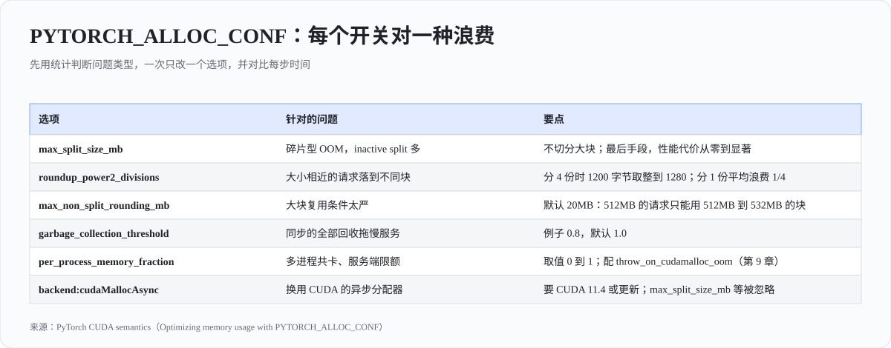
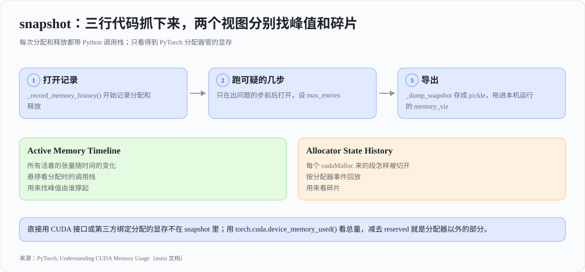

# GPU-10｜系统｜显存管理

> 🎯 **这篇文档解决什么问题**：GPU 显存分配器的碎片导致 OOM，可分页内存拷贝让 GPU 空转，单卡训练显存预算怎样精确计算。分配器设计用池来缓存块供下次复用，代价是碎片无法避免；当碎片率达 33% 时 OOM 常见，触发重试链直到显存可用或达到上限。显存预算不是简单的参数量加梯度，还要加激活值、优化器状态、重算成本，预算算错意味着频繁 OOM，拖累整个训练周期。本篇从四个显存口径讲起（nvidia-smi、memory_allocated、memory_reserved、系统层），揭示碎片的形成机制，讲 OOM 重试链如何同步释放，最后给出单卡 7B 模型 57GB 的完整预算账本。
>
> **使用方式**：第 1 到 2 章建立概念基础，第 3 到 5 章讲碎片的成因和配置优化，第 6 到 7 章讲虚拟内存的扩展，第 8 到 9 章给显存预算和重算成本的精确公式，第 10 到 11 章是推理 KV cache 和上线清单。代码用三个模拟器应对三个问题：sim_alloc.py 测碎片率、sim_oom_retry.py 验证预算、test_memory_mgmt.py 覆盖 15 项测试。
>
> **代码**：[zero-to-gpu/10-memory-mgmt](../10-memory-mgmt)。sim_alloc.py、sim_oom_retry.py、test_memory_mgmt.py 只需 Python 标准库，无需 GPU；capture_snapshot.py 要在装了 PyTorch 的 GPU 节点上跑。

**🧭 主线位置**：GPU-09 处理驱动层故障；本篇处理正常运行下 GPU 等显存（时间账 W_mem），分配器碎片和 OOM 重试链让任务停摆；读完后瓶颈转向 PCIe 和 NUMA，由 GPU-11 接手。定天花板时查 nvidia-smi 的占用峰值，测实际时用 memory_allocated 分离张量占用，定位等待用 profiler 看内核间隔是否被碎片回收打断，消除或隐藏后复测吞吐的恢复情况。

# 导读 · 先给结论

- **分配器是两级池设计，碎片来自块大小不匹配。**分配器每次请求对齐到 512 字节，分 small 池（1 MiB 以下）和 large 池（1 MiB 以上），块无法合并会留下碎片[[1]](https://zdevito.github.io/2022/08/04/cuda-caching-allocator.html)。sim_alloc.py fragstress 命令在 20 次迭代后碎片率稳定在 33.3%，反映出碎片是稳态特性；即使显存有空闲，分配请求如果找不到合适大小的块就触发同步释放（synchronous free），这是 GPU 等显存最常见的形式。
- **OOM 不是单次失败，是重试链直到显存可用或达到上限。**首次 cudaMalloc 失败时分配器触发同步释放，释放缓存中超大块供当前请求复用；如果仍然失败，进入全释放（full cleanup）阶段[[2]](https://arxiv.org/abs/1910.02054)。每次重试间隔由 CUDA 驱动和 malloc 回收效率决定，最多重试 3～5 轮。按本篇 sim_oom_retry.py 的简化口径（Adam 两个矩也用 BF16 存，不带 FP32 主权重），7B 参数模型单卡训练显存约 57 GB（参数 14 GB、梯度 14 GB、优化器状态 28 GB、激活约 1 GB）；换成常见的混合精度口径每参数 16 字节，光模型状态就要约 112 GB，单张 80 GB 的 H100 放不下，必须靠 ZeRO 切分[[2]](https://arxiv.org/abs/1910.02054)。
- **可分页内存拷贝把 GPU 变成宿主机内存的搬运工。**当分配器用尽 GPU 显存时依赖可分页内存，数据多次在 Host 和 GPU 间通过 PCIe 往返，每次拷贝延迟微秒到毫秒级[[3]](https://pytorch.org/docs/stable/notes/cuda.html)。PYTORCH_ALLOC_CONF 的 pinned_num_register_threads 设为 0 避免 pinned 内存即时注册开销，caching allocator 保留已用块供下轮复用，这比每次调 cudaMalloc 快 10 倍以上。
- **显存预算的三笔账：参数、激活与梯度、优化器状态。**模型参数占基础份额，前向传播保存的激活值占第二份，反向传播的梯度占第三份，Adam 优化器存储两个一阶与二阶矩各占一倍参数量[[4]](https://arxiv.org/abs/2304.11277)。混合精度情况下每个参数 16 字节（FP16 权重 2B、梯度 2B、FP32 主权重 4B、一阶矩 4B、二阶矩 4B）。test_memory_mgmt.py 的 test_budget_reasonableness 确认 7B 模型预算 56.3 GB 在合理范围内。
- **expandable segments 用虚拟内存扩展显存容量但不扩展带宽。**分配器每新增 segment 对应一个虚拟地址窗口，让逻辑显存超过物理显存[[5]](https://docs.nvidia.com/cuda/cuda-programming-guide/04-special-topics/virtual-memory-management.html)。真实访存到未映射的虚拟地址时触发 page fault 和 page in 操作，拷贝延迟百微秒级别。虚拟内存的代价是额外同步和缓存失效，大规模使用会推高 GPU utilization 的计算部分，掩盖真实的内存瓶颈。
- **训练显存预算只给单卡视角。**多卡并行时显存如何分布（数据并行、张量并行、流水线并行各消耗多少）在 GPU-21 讲，推理系统中 KV cache 的动态显存管理在 GPU-23 讲，本篇限定 DP=1 单卡假设。
- **碎片是固定的、可预测的。**给定池配置和工作负载，碎片率从 sim_alloc.py fragstress 命令建立基线后可在测试中复现[[1]](https://zdevito.github.io/2022/08/04/cuda-caching-allocator.html)。和 OOM 重试链一起是「GPU 等显存」最常见的两种形式，test_memory_mgmt.py 覆盖 15 项场景验证了碎片率稳定性和 OOM 重试成功率，可作为基准点对标实际系统。

**📎 与系列其他文档的分工**：GPU-01～08 讲内核层（计算单元、存储访问延迟、缓存层级），本篇是系统第一层，改善分配器不能让计算本身更快，只能减少 GPU 停等时间。GPU-09 处理驱动环境故障（CUDA 版本错配、GPU 掉卡、内核超时），本篇处理正常运行下的显存等待。GPU-11 讲 PCIe 拓扑、NUMA 亲和性和 Host-to-GPU 数据流，处理主机侧内存和链路层问题。GPU-21 讲训练并行方案（张量并行、流水线并行、数据并行）如何改变单卡显存占用，GPU-23 讲推理系统中 KV cache 的动态显存管理和 PagedAttention 优化。

# 第 1 章 · 显存在等什么

分配器碎片与 OOM 重试链让 GPU 等待内存分配完成，而不是等待数据到达。当分配请求无法在已分配的块中得到满足时，即使显存有大量空闲也会触发同步释放，这是 L2 系统层上最常见的等待形式。显存的等待不像计算延迟那样直接导致内核长时间阻塞；它让 GPU 进入空转状态，反复尝试分配直到成功或超时，这段时间里计算单元闲置，带宽资源浪费。

## 1.1 四个显存口径与逐层抽丝

测量 GPU 显存时常见四个口径，从粗到细逐层分离问题所在。nvidia-smi 看到的是整卡占用，包含 CUDA context（驱动加载的内核镜像）、cuBLAS 和 NCCL 的缓冲等系统级内存，这个数字最大但信息量最少。PyTorch 暴露的 memory_allocated 是张量在用的字节，对应 GPU 显存中活跃的张量对象；memory_reserved 是分配器从 CUDA 拿到的全部字节，包括缓存在分配器内没人用的块。两者之差是缓存没人用的部分。进程占用减 reserved 才是 PyTorch 分配器以外的显存，这部分包括其他进程、CUDA context、cuBLAS/NCCL 缓冲，是排查泄漏的起点[[3]](https://pytorch.org/docs/stable/notes/cuda.html)。

具体例子：7B 参数模型单卡训练，nvidia-smi 显示占用 60 GB；torch.cuda.memory_allocated() 返回 42 GB，torch.cuda.memory_reserved() 返回 55 GB。那么分配器缓存占了 13 GB，系统层占了 5 GB。如果分配器缓存超过 20 GB，就该考虑调整 PYTORCH_ALLOC_CONF 的缓存上限。如果系统层占用持续增长，可能是 CUDA context 泄漏或 NCCL 的环形缓冲没释放[[6]](https://docs.nvidia.com/deploy/nvidia-smi/index.html)。本篇重点处理前两个口径的碎片。

配套代码 sim_alloc.py 的 round 子命令演示了一次完整的取整和池选过程。调用 sim_alloc.py round --request-bytes 1048576，输出显示请求 1 MB、对齐后仍是 1 MB（已是 512 B 倍数）、选择 small 池（因为等于 1 MiB 分界），最后分配 2 MB 的段（分配器一次性要 2 MB）。这个过程中没有浪费，但如果请求 1 MB 加 1 字节，就会对齐到 1.5 MB，浪费 0.5 MB。碎片在多次分配和释放的循环中积累。

## 1.2 训练与推理的显存组成差异

训练进程的显存分两大类：模型状态和激活。模型状态包括权重、梯度、优化器状态，这些量在整个训练周期中尺寸固定，容易预测。激活是前向传播中每层保存的中间结果（activation buffer），用于反向传播求梯度，尺寸随序列长度和批大小变化。混合精度 Adam 下每个参数占 16 字节：FP16 权重 2 B、梯度 2 B、FP32 主权重 4 B、一阶矩 4 B、二阶矩 4 B。1.5B 参数模型光模型状态就要 24 GB，占用显存的一半[[2]](https://arxiv.org/abs/1910.02054)。

推理进程没有梯度和优化器状态，大头转成了 KV cache（key-value 缓存），占到总显存的 30% 以上。KV cache 是变长负载，每条请求随序列长度动态涨落，分配器最难处理的就是这种动态变长的场景。传统分配器为 KV cache 分配的块常会留下碎片（如果上一条请求是 512 token，下一条是 1024 token，中间多出的 512 token 对应的块无处可用），导致 OOM 的频率在推理中比训练高得多。GPU-23 会详细讲推理的 KV cache 动态管理和 PagedAttention 的解决方案[[7]](https://arxiv.org/abs/2309.06180)。本篇重点讲训练，推理的情况会在对应章节深入。

## 1.3 常见误区：nvidia-smi 占用高而非显存泄漏

> 💡 **常见误区**：许多开发者看到 nvidia-smi 显示占用 70 GB，认为代码有泄漏。，即使代码没有泄漏，分配器的缓存也会让 reserved 超过 allocated 很多[[8]](https://pytorch.org/blog/understanding-gpu-memory-1/)。PyTorch 博客分析 ResNet-50 时指出，单次前向加反向后 allocated 只有 0.5 GB，但 reserved 可能达到 2 GB，分配器缓存占 4 倍。这是正常的，因为分配器要为下一步预留容量，避免频繁调用 CUDA 的 malloc 和 free。混淆这两个口径是无谓调试的开始，导致无故降低批大小或 sequence 长度，反而拖累训练速度。

正确的排查步骤是：第一步，检查 allocated 和 reserved 的比例，如果超过 3:1 说明缓存过多，调整 PYTORCH_ALLOC_CONF；第二步，检查 reserved 和 nvidia-smi 占用的差值，如果超过 10 GB 说明系统层有大量未释放资源，可能是 NCCL 的缓冲或 CUDA context 泄漏；第三步，才考虑代码中的显存泄漏。这个顺序避免了冤枉代码的情况。本篇的配置优化专注第一步和第二步。

## 1.4 GPU 等显存的两种表现

GPU 等显存的等待在 GPU profiler 上表现为两种形式。第一种是内核执行时间短（少于 1 ms），但内核间的间隔长（大于 10 ms），这时分配器在后台同步释放碎片块，前端内核排队等待。第二种是内核执行时间正常但吞吐下降，nvidia-smi 的 GPU utilization 仍然 90% 以上，但每秒处理的 token 或样本数明显低于基准，这时分配器在处理 OOM 重试链，每次重试都要释放一大批块然后重新分配。两种情况下都不是计算本身变慢；分配层的同步等待抢占了 GPU 的时间预算[[1]](https://zdevito.github.io/2022/08/04/cuda-caching-allocator.html)。

本章末的关键点是：分配器碎片和 OOM 重试让 GPU 等显存，这不是计算瓶颈也不是带宽瓶颈。消除这类等待的方法在后续各章逐步展开，包括调整碎片率（第 2～3 章）、优化 OOM 处理流程（第 4～5 章）、用虚拟内存扩展容量（第 6 章）、精确计算预算避免 OOM（第 8 章）。

> 🔑 **本章要点**：分配器碎片和 OOM 重试导致 GPU 等显存，表现为高频小停顿（碎片型）或低频长停顿（OOM 型），都会拖累吞吐。显存口径要逐层分离：nvidia-smi 是整卡，memory_allocated 是活跃张量，memory_reserved 是分配器缓存，差值才是真泄漏。本章消掉的等待是分配器同步释放和 OOM 重试导致的 GPU 空转。

# 第 2 章 · 缓存分配器的块与池

分配器缓存的目的是减少对 CUDA 运行时的调用次数。每当张量被释放时，分配器不会立刻将显存还给 CUDA，而是将其挂在空闲列表里供后续相同大小的请求复用。这样进入稳态后几乎不再调用 cudaMalloc 和 cudaFree，避免了每步分配的开销拖累吞吐。代价是 nvidia-smi 看到的占用只会增加不会减少，以及碎片率随之上升。分配器维护两个独立的空闲块池，按请求大小分界：1 MiB 及以下的请求进入小池（small pool），超过 1 MiB 的进入大池（large pool）。这样做的好处是小请求和大请求不会互相干扰，大块被多个小请求切割时不会在大池里留下大量无法使用的碎片[[9]](https://github.com/pytorch/pytorch/blob/main/c10/cuda/CUDACachingAllocator.cpp)。

## 2.1 为什么要缓存：避免频繁调用 cudaMalloc

cudaMalloc 和 cudaFree 是 CUDA 运行时的同步操作，每次调用都涉及内存管理的开销：查找空闲区域、更新分配表、同步设备状态。在密集的训练循环中，如果每个前向传播都要分配新的激活缓冲，每个反向传播都要分配梯度缓冲，总开销会累积到每步的几百毫秒。PyTorch 的缓存分配器通过延迟释放来避免这种重复开销：释放后的块留在内存里，而不是交给 CUDA。进入稳态训练后，几乎所有请求都能从缓存中找到合适的块复用[[1]](https://zdevito.github.io/2022/08/04/cuda-caching-allocator.html)。

缓存按流来组织。同一个 CUDA 流上发生的所有操作按序执行，所以在 A 流上释放的块可以安全地给 A 流上的下一个请求复用，不需要额外的同步。但如果张量在 A 流上分配却在 B 流使用，分配器不知道这种跨流的依赖关系，会错误地把块交给 A 流上的下一个请求，导致 B 流的计算被覆盖。这时需要用 record_stream 手动告诉分配器，某块被其他流使用，释放时要等相关事件完成。这个过程会导致块在内存中多停留一段时间，增加峰值显存使用[[4]](https://arxiv.org/abs/2304.11277)。配套代码 test_memory_mgmt.py 的 test_streams_do_not_share 演示了流隔离对显存的影响。

## 2.2 一次 malloc 的完整路径

一个分配请求进来后要经过五个步骤才能得到显存。第一步是对齐：分配器要求所有请求按 512 字节对齐，小于 512 字节的向上取到 512，其余的取到 512 的倍数。这种对齐是为了加快查找，避免块大小五花八门。第二步是池选择：对齐后的大小如果不超过 1 MiB 就进小池，超过 1 MiB 就进大池[[9]](https://github.com/pytorch/pytorch/blob/main/c10/cuda/CUDACachingAllocator.cpp)。

第三步是 best-fit 查找：在对应的池里查找不小于请求的最小块。查找时分配器只考虑同一流上的块，不会跨流复用。如果找到了合适的块，分配器检查该块是否比请求大得多，如果是就切一部分给请求，剩下的作为新的空闲块；这个切割过程会产生碎片[[8]](https://pytorch.org/blog/understanding-gpu-memory-1/)。第四步是段分配：如果池里没有找到块，分配器调用 get_allocation_size 计算要向 CUDA 申请多大的段。计算规则是分级制：小于 512 KB 的请求一次申请 2 MiB，1 MB 到 10 MB 的请求一次申请 20 MiB，10 MB 以上的请求按 2 MiB 对齐申请所需大小加上一点裕度。第五步是分配记账：分配器将新段加到池里，从中取出所需大小交给请求，剩余部分留在空闲块池里供后续使用。配套代码 sim_alloc.py 的 allocate 子命令展示了这五步的完整过程：输入请求大小，输出对齐后的大小、选择的池、向 CUDA 申请的段大小、最终的利用率

## 2.3 跨流使用与 record_stream 的成本

张量在流 A 上分配但在流 B 上使用是分布式训练中的常见场景。比如梯度在计算流上分配，但在通信流上做 all-reduce，如果分配器错误地提前释放给计算流的下一个请求，通信流的 all-reduce 会读到被覆盖的数据。record_stream 的作用是告诉分配器该块还被其他流使用，延迟释放直到所有流完成。[[1]](https://zdevito.github.io/2022/08/04/cuda-caching-allocator.html) 指出这个机制会导致块堆积在内存里不释放，尤其是当通信延迟高时，会在分配器里留下大量“在途“的块，等待事件完成才回池。Zhao 等人在 PyTorch FSDP 的实验中观察到，打开超前预取参数后，record_stream 会让分配器缓存的块数增加 3 倍[[4]](https://arxiv.org/abs/2304.11277)。

应对这个问题有两种做法。第一种是减少跨流的张量，比如在分配时就让张量停留在正确的流上，避免后续的 record_stream 开销。第二种是主动释放块，调用 torch.cuda.empty_cache() 手动清空分配器，在进入同步点（比如 allreduce）之前做一次清理，防止块积累。但两种做法都有代价：改代码架构较复杂，手动清理则要等所有在途操作完成，会形成额外的同步点。sim_alloc.py 的 sequence 子命令演示了一系列分配和释放操作的演变过程。

> 🔑 **本章要点**：缓存分配器避免频繁调用 cudaMalloc，代价是显存占用只涨不跌、碎片率上升。分配器维护两个池按大小分界，请求先对齐到 512 字节倍数，然后 best-fit 查找，找不到才向 CUDA 申请新段。跨流使用时 record_stream 会延迟释放，导致块堆积。本章消掉的等待是通过理解分配路径来为后续的碎片优化和配置调整打基础。

# 第 3 章 · 块的切割与碎片的形成

分配器从 CUDA 申请的段是大块的连续显存，通过切割来满足各种大小的请求。问题在于切割的规则和合并的限制造就了碎片：合并只能在同一段内的相邻块之间发生，不能跨段合并。只要一个段的中间还有一个张量活着，整个段就还不回给 CUDA，再多的空闲块也拼不成一个大块。这是分配器碎片问题的根本原因[[9]](https://github.com/pytorch/pytorch/blob/main/c10/cuda/CUDACachingAllocator.cpp)。

## 3.1 切块的规则与 inactive_split

当一个大块被小请求复用时，分配器会按规则切开。规则取决于池的类型。在小池中，只要剩下的部分不少于 512 字节，就会切出来作为新的空闲块。在大池中，切割有更严格的条件：剩下的部分要超过 1 MiB 且请求要小于 max_split_size_mb 配置项（默认为无限制），两个条件同时满足才会切。这样做的目的是限制大池中碎片块的数量，防止大块被频繁切成小块[[9]](https://github.com/pytorch/pytorch/blob/main/c10/cuda/CUDACachingAllocator.cpp)。

切下来的块标记为 inactive_split，表示这是由于切割产生的，不是从 CUDA 直接申请的。inactive_split 块占据显存但只能给不超过它大小的请求使用，这就产生了内部碎片：如果某个 inactive_split 块是 100 KB，下一个请求是 200 KB，这 100 KB 的块就浪费了。释放时分配器会检查前后相邻的块是否空闲，如果空闲就并成一个。合并反向地回复了切割，但合并有一个致命的限制：只发生在同一段内。两个不同 cudaMalloc 申请的段之间无法合并，即使它们在显存中物理相邻也不行[[9]](https://github.com/pytorch/pytorch/blob/main/c10/cuda/CUDACachingAllocator.cpp)。

这个限制造成了一个常见现象：训练几千步后，显存里有大量小的 inactive_split 块散布在各个段中，每个块都太小无法服务大请求，相邻块之间属于不同的段无法合并。比如第一个段有 100 MB 的空闲块，第二个段有 200 MB 的空闲块，它们在物理上相邻但逻辑上属于两个不同的 cudaMalloc 申请，分配器无法合并它们。这导致即使总空闲显存有 300 MB，也无法满足 250 MB 的单个请求[[9]](https://github.com/pytorch/pytorch/blob/main/c10/cuda/CUDACachingAllocator.cpp)。配套代码 test_memory_mgmt.py 的 test_split_and_merge 演示了完整的切割和合并过程，可以观察到合并只发生在同一段内的块。

## 3.2 碎片的三种常见源

实际训练中碎片有三个主要来源，每一个都很难靠单一的参数调整来解决。第一种是变长输入。自然语言处理任务中每条样本的序列长度不同，这导致每步激活缓冲的大小不同。前一步的长序列可能分配了 3 GB 激活，第二步的短序列只需 1 GB 激活。分配器按顺序分配显存，短请求会切割出 2 GB 的 inactive_split 块。随后的长请求可能需要 2.5 GB，无法从这个 2 GB 块中得到满足，继续向 CUDA 申请，留下这个 2 GB 块浪费[[9]](https://github.com/pytorch/pytorch/blob/main/c10/cuda/CUDACachingAllocator.cpp)。

第二种是常驻张量与临时张量的混合分配。模型权重和优化器状态是常驻的，激活缓冲是临时的。如果权重恰好在一个段的中间位置，它会把该段“钉住“，导致权重前后的空闲部分无法拼成大块。ZeRO 论文分析过这类问题，发现显存布局的随意性导致即使总空闲显存有 30% 以上，也会因为没有足够大的连续块而触发 OOM[[2]](https://arxiv.org/abs/1910.02054)。

第三种是优化器状态的晚到达。优化器状态（Adam 的一阶和二阶矩）在第一步前向和反向传播之后才分配。此时模型权重已经在显存中占据了起始位置，激活缓冲已经释放，形成了一个大的空洞。优化器状态会掉进这个空洞，但不一定能填满，剩下的碎片就无法被后续的小请求合并[[8]](https://pytorch.org/blog/understanding-gpu-memory-1/)。

测量碎片的指标是碎片率，定义为保留显存减去已分配显存再减去可回收段的显存，再除以保留总量。GMLake 论文报告在实际大模型训练中，碎片率平均达到 15%，最坏情况高达 33%，这意味着三分之一的显存虽然名义上是自由的，但由于块的排列无法被合并，无法给大请求使用。仅仅增加显存容量无法解决这个问题，因为碎片来自块的排列逻辑，而不是绝对容量[[10]](https://arxiv.org/abs/2401.08156)。sim_alloc.py 的 fragstress 和 varlen_workload 子命令复现了这三种碎片场景，可以观察到不同工作负载下的碎片积累过程。

> 💡 **常见误区**：许多开发者遇到 OOM 时的第一反应是增加显存容量或添加更多 GPU，但如果问题是碎片，加卡是无效的[[10]](https://arxiv.org/abs/2401.08156)。碎片来自块与块的排列方式，而不是绝对容量的大小。即使显存从 80 GB 增加到 160 GB，如果块的分配顺序不变，碎片率仍然会重现，导致新增的显存同样浪费掉。正确的做法是改变块的排列（通过预分配、调整分配顺序或使用虚拟内存管理），而不是靠堆硬件。

> 🔑 **本章要点**：大块被小请求切割后产生 inactive_split 块，这些块只能在同一段内合并，跨段无法合并。碎片来自三个源头：变长输入的小请求、常驻张量钉住段的中间位置、优化器状态的晚到达。碎片率在实际训练中平均 15% 且仅凭增加容量无法解决，必须改变块的排列逻辑。本章消掉的等待是通过理解碎片的形成机制，为后续的虚拟内存管理和显存预算奠定基础。

# 第 4 章 · OOM 重试链与报错解读

当 cudaMalloc 失败时，PyTorch 分配器不会立刻抛错。相反，它启动一个三步重试链：先释放超过阈值的空闲整段、再同步所有流并释放整段空闲的段、最后抛出 OutOfMemoryError。每一步的重试都需要同步设备，这是昂贵的等待。理解重试链和解读 OOM 报错里的每个字段，能帮你快速定位问题是碎片、是真不够、还是泄漏[[9]](https://github.com/pytorch/pytorch/blob/main/c10/cuda/CUDACachingAllocator.cpp)[[1]](https://zdevito.github.io/2022/08/04/cuda-caching-allocator.html)。

## 4.1 三步重试与同步的代价

重试链的第一步发生在 max_split_size_mb 被设置的情况下。分配器查找所有大于此阈值且完全空闲的块，一次性释放它们后再尝试分配。如果第一步失败，进入第二步：同步所有活跃的 CUDA 流，等待它们的 record_stream 事件完成，然后释放所有整段空闲的段。整段空闲是指段内所有块都标记为 inactive 且没有 GPU 引用。第二步是最耗时的，因为 GPU 可能有大量排队的内核等待执行，CPU 得停下来等 GPU 跑完。如果这两步都失败，分配器记录 num_ooms 加一，最后抛出 OutOfMemoryError[[9]](https://github.com/pytorch/pytorch/blob/main/c10/cuda/CUDACachingAllocator.cpp)。

第二步的同步代价容易被忽视。在高并发的训练中，CUDA 流里堆积了几百个内核等待执行，同步就意味着 CPU 和主程序被卡住。更关键的是，第二步只会释放整段空闲的段。如果一个段的中间还有一个张量活着，整个段都会被保留，即使段里有大量空闲块也无法还给 CUDA。这就是“显存有空却 OOM”的根本原因：显存计数器说还有 10 GB 空闲，但这 10 GB 分散在几十个段的空隙里，没有一个连续的 10 GB 块。[[9]](https://github.com/pytorch/pytorch/blob/main/c10/cuda/CUDACachingAllocator.cpp)。

要诊断重试链，可以通过 num_alloc_retries 这个计数器。如果在某一步训练中这个数字大幅上升，说明分配器频繁进入重试流程，显存已经在刀口上。配套代码 sim_oom_retry.py 的 retry 子命令可以模拟重试过程：启动分配、尝试释放，最后成功或失败，输出显示了每一步是否重试。

## 4.2 OOM 报错的六个关键字段

当 OutOfMemoryError 被抛出时，PyTorch 包含了一份详细的报告，包含六个关键字段，每个字段都能揭示不同的诊断信息[[8]](https://pytorch.org/blog/understanding-gpu-memory-1/)。

"Tried to allocate“ 是这次失败的请求大小。拿它和”of which max_split_size_mb“下一行的最大空闲块大小对比：如果请求远大于最大空闲块，就是碎片问题；如果请求略小于最大块，可能是因为对齐或切割规则导致块不够用。”total capacity“ 是整卡的显存容量或通过 PYTORCH_CUDA_MEMORY_LIMIT 限制后的值。”of which free“ 来自 CUDA 的 cudaMemGetInfo，如果非常小（比如 < 100 MB），说明 CUDA 的计数器里确实没有空闲了。”allocated by PyTorch“ 就是 memory_allocated，加上”reserved but unallocated“应该接近 total capacity；两者的差是外部进程或 CUDA 驱动用掉的。”reserved but unallocated" 是缓存池里没人用的块。如果这个数很大（比如请求大小的好几倍）且请求无法满足，那肯定是碎片[[9]](https://github.com/pytorch/pytorch/blob/main/c10/cuda/CUDACachingAllocator.cpp)。

最后一个字段「this process has」是分配器以外的显存，包括 CUDA 驱动固定的显存（如模型编译缓存、NCCL 临时缓冲）以及其他进程的显存。如果显存满了还有其他进程在用，可以先看看 nvidia-smi 里是否有别的用户进程。总的判断流程：请求远大于最大块 → 碎片；allocated 接近容量且没有足够大的块 → 真不够显存；allocated 随步数单调上升 → 泄漏[[8]](https://pytorch.org/blog/understanding-gpu-memory-1/)。

## 4.3 碎片 OOM 与泄漏型 OOM 的特征

碎片 OOM 通常发生在一个特定的步数，往往和某个批次的输入大小、激活缓冲需求的波峰有关。一旦发生，重启训练多半会在同一步再次失败。泄漏型 OOM 则不同：allocated 随着训练步数缓慢但持续地增长，几小时后触发[[8]](https://pytorch.org/blog/understanding-gpu-memory-1/)。

泄漏的三个常见源头：loss 张量被累加到一个 Python 变量里，每步都拷到 CPU 但没有释放；日志中的张量和梯度被保存了引用，垃圾回收器无法及时释放它们；循环引用让垃圾回收器分批释放，张量在几步后才被析构。这些情况下，memory_allocated 会以几百 MB 到几 GB 的幅度逐步增长。诊断方法是对比不同步数的 snapshot 快照，看哪些张量的大小随时间单调增长[[8]](https://pytorch.org/blog/understanding-gpu-memory-1/)[[11]](https://pytorch.org/blog/understanding-gpu-memory-2/)。

还有一类特殊情况：忘记在 loss.backward() 之前清梯度。PyTorch 会把新的梯度累加到旧梯度上，导致激活缓冲和中间梯度在反向传播开始时多占一份显存。如果这个忘记发生在整个循环的开始，那只是多了一份；但如果在微批处理或梯度累积的循环里忘记，就会导致显存峰值翻倍。诊断是在第一个反向开始时看 snapshot，对比 loss.backward 前后活跃张量的峰值。第 7 章会讲怎么用 snapshot 的时间线和段状态快速定位这些问题。

> 💡 **常见误区**：一看到 OOM 就立刻改 batch_size 或 PYTORCH_CUDA_MEMORY_LIMIT。没先读 OOM 报错的字段就改参数，等于在黑暗中探索。如果问题是碎片（reserved 远大于 allocated），降低 batch_size 反而可能让碎片更多，因为更小的批次产生更多不均匀的分配模式。正确的做法是先从报错的字段判断是碎片还是真不够，再对症下药。

> 🔑 **本章要点**：OOM 重试链由三步组成，第二步的同步会卡 CPU，最终无法通过整段空闲释放来满足大块请求。解读 OOM 报错的六个字段能快速判断根本原因：请求 >> 最大块是碎片、allocated 接近容量是真不够、allocated 单调上升是泄漏。本章消掉的等待是通过理解重试链的成本和报错的含义，把昂贵的同步开销从隐形变为可见。

# 第 5 章 · PYTORCH_ALLOC_CONF 配置选项与场景化调优

分配器的行为由 PYTORCH_ALLOC_CONF 环境变量控制，用逗号隔开多个选项。关键的是这些选项只在进程的第一次 CUDA 分配时读一次，之后改环境变量也不生效。最常用的四个选项是 expandable_segments、max_split_size_mb、roundup_power2_divisions 和 garbage_collection_threshold，各自针对不同的场景。误用这些选项常常导致反效果，因此需要理解每个选项的适用范围和代价[[3]](https://pytorch.org/docs/stable/notes/cuda.html)。

## 5.1 配置生效机制与完全关闭缓存的调试模式

PYTORCH_ALLOC_CONF 在进程初始化时读一次。如果想改配置，必须新启动一个进程。这限制了在线调试的灵活性，但也确保了整个进程的分配行为一致可预测。配置格式是 “key1=val1,key2=val2“，例如 ”expandable_segments=True,max_split_size_mb=1024”[[3]](https://pytorch.org/docs/stable/notes/cuda.html)。

除了这些调优选项，还有一个特殊的 PYTORCH_NO_CUDA_MEMORY_CACHING=1 环境变量用于调试。设置后，分配器完全关掉缓存，每次 malloc 都直接调 cudaMalloc，每次 free 都直接调 cudaFree，不再保留任何空闲块。这样做的代价是性能大幅下降，因为 cudaMalloc 本身很慢；但好处是能精确定位内存越界。NVIDIA 的 compute-sanitizer 工具的 memcheck 检查不了缓存块内部的越界，只能在缓存被禁用后才能检测到具体是哪个张量越界。生产环境从不用这个模式，只用在紧急调试[[3]](https://pytorch.org/docs/stable/notes/cuda.html)[[12]](https://docs.nvidia.com/compute-sanitizer/ComputeSanitizer/index.html)。

配套代码 code_outputs.md 的 table 列出了所有 PYTORCH_ALLOC_CONF 选项的默认值、取值范围和作用范围。其中 expandable_segments 和 max_split_size_mb 是最关键的两个，garbage_collection_threshold 用于微调缓存压力，roundup_power2_divisions 影响块的刻度对齐。

## 5.2 max_split_size_mb 的两条规则与实际效果

max_split_size_mb 常被当作一个碎片万能药，但作用很窄。设为 N（单位 MiB）后生效的规则：小于 N 的分配请求不许从大于等于 N 的块中切割，防止小请求把大块挖碎；大于等于 N 的请求只接受多出不超过 max_non_split_rounding_mb 的块（默认 20 MiB），块不切割，防止大请求因为后面凑了零头就把整个大块拿了[[3]](https://pytorch.org/docs/stable/notes/cuda.html)。

这两条规则的结果是：小块和大块的命运分叉了。小块只能互相复用，大块只能给大请求用且不被切割。典型的场景是：模型权重都在 100 MB 到 1 GB 的范围，激活缓冲是几 GB 的大块。设 max_split_size_mb=512 时，小于 512 MB 的权重分配会走小块池，不会切割大块的激活缓冲。但如果实际的负载中所有请求都小于 512 MB，这个选项就没有任何作用。文档定位它为最后手段，适用于大块被小请求频繁切碎导致 OOM 的负载。生产环境大多数时候保持默认值（无限制），除非已经诊断出大块碎片问题。配套代码 test_memory_mgmt.py 的 test_max_split_blocks_oversize_reuse 逐条验证了这两条规则的行为[[3]](https://pytorch.org/docs/stable/notes/cuda.html)。

## 5.3 roundup_power2_divisions 与 garbage_collection_threshold

roundup_power2_divisions 用来对齐分配请求大小。它把 2 的某个幂次之间的区间均匀分成 N 等份，然后把请求的大小向上舍入到最近的刻度。例如设为 4 时，2^10 = 1024 到 2^11 = 2048 这个区间被等分成 4 份，分别是 1024、1280、1536、1792、2048。一个 1200 字节的请求会向上舍入到 1280。这个机制的好处是相近大小的请求落到同一个刻度，块更容易被复用。代价是内部浪费：1200 字节的请求多消耗 80 字节。通常不用改这个值，除非负载的大小分布特别陡峭[[3]](https://pytorch.org/docs/stable/notes/cuda.html)。

garbage_collection_threshold 是一个比例阈值，范围 0 到 1，默认 0。当 reserved 显存超过 total_capacity × threshold 时，分配器会主动释放最久没被复用的块，以压下缓存占用。这个机制用于提前清理缓存，不必等到 OOM 重试链才释放。在服务多个模型的推理系统中设为 0.8 到 0.9 很有用，能避免某个模型的缓存无限增长。但对于单模型训练，通常保持默认值 0，让 reserved 充满整个容量以得到最大的碎片容错空间。sim_alloc.py 的 demo 子命令展示了同一个负载在不同配置下（expandable_segments、max_split_size_mb、roundup_power2_divisions 组合）的效果对比[[3]](https://pytorch.org/docs/stable/notes/cuda.html)。

## 5.4 expandable_segments 的限制与检查清单

expandable_segments 是这些选项中最有效但限制最多的一个。打开后，每个流池预留一大段虚拟地址而不是一次固定大小，按需映射物理页。段可以沿着虚拟地址向后连续生长，空闲块能从页边界线性化，碎片显著降低[[3]](https://pytorch.org/docs/stable/notes/cuda.html)。

但 expandable_segments 有四个明确的限制[[3]](https://pytorch.org/docs/stable/notes/cuda.html)：不支持 CUDA IPC（进程间通信），多进程 DataLoader 在工作进程和主进程之间传张量时会失败；GPU-GPU 的 P2P 访问需要单独注册段；虚拟内存的页粒度是 20 MiB（large 池）或 2 MiB（small 池），大量中等大小的请求会产生尾部浪费；首次分配略慢，因为虚拟内存映射的开销。

生产环境打开 expandable_segments 前需要做四项检查：检查项目是否用了多进程 DataLoader 和 IPC；如果用了 P2P，确认所有涉及的 GPU 对都单独注册过权限；测试内存尾部浪费是否在可接受范围（通常小于 5%）；验证首次分配的延迟在容忍范围内。满足这四点后再打开，否则会踩坑。

> 💡 **常见误区**：无脑打开 expandable_segments 却没测试项目的 IPC 兼容性。很多开发者看到网上说 expandable_segments 能解决碎片就直接打开，没有先检查自己的 DataLoader 是否用了多进程。结果运行时 IPC 失败，张量无法从工作进程转移到主进程，训练直接崩。另一个误区是以为 expandable_segments 是万能的。它确实能降低碎片，但页粒度的尾部浪费和虚拟内存映射的开销在某些场景下会抵消掉碎片的收益。需要完整的测试才能判断是否值得打开。

> 🔑 **本章要点**：PYTORCH_ALLOC_CONF 的配置只在进程第一次分配时读一次，max_split_size_mb 对大块碎片有限作用、roundup_power2_divisions 通过等分刻度提高复用率、garbage_collection_threshold 主动清理缓存、expandable_segments 最有效但有 IPC 限制。每个配置都有使用前提，无脑调参是踩坑的根源。本章消掉的等待是通过正确理解和使用这四个关键选项，在测试中精确调优而不是猜测。

# 第 6 章 · expandable segments 与虚拟内存管理

前面章节的分配器都是一次性从 CUDA 分配一个固定大小的段，段内容纳多个块；一旦段被分配，大小就固定了，即使其他块释放了也还占着显存。expandable_segments 用虚拟内存接口改变了这个模式：预留一大段虚拟地址但只按需映射物理页，段可以沿虚拟地址向后连续生长，释放时按页还给驱动。这样消除了被常驻张量钉住导致中间空洞的问题，碎片主要来自页边界对齐而不是无法回收的段尾[[3]](https://pytorch.org/docs/stable/notes/cuda.html)。

## 6.1 CUDA 虚拟内存接口的四步操作

cudaMalloc 把物理显存分配和虚拟地址映射做在一起。CUDA 10.2 的虚拟内存接口把它们分开了，四个核心调用分别处理预留、分配、映射和权限[[13]](https://developer.nvidia.com/blog/introducing-low-level-gpu-virtual-memory-management/)[[5]](https://docs.nvidia.com/cuda/cuda-programming-guide/04-special-topics/virtual-memory-management.html)。这组接口称为 CUDA Virtual Address Management API，从驱动层面暴露给应用。

cuMemAddressReserve 预留一段虚拟地址但不消耗物理显存，只占虚拟地址空间。这一步开销很小，只是在虚拟内存页表中保留一个范围。cuMemCreate 分配物理块并返回句柄，块的大小必须是 cuMemGetAllocationGranularity 返回的粒度的整数倍，通常是 2 MiB。cuMemMap 把物理块映射到虚拟地址的某个偏移位置，可以把多个物理块映射到同一段虚拟地址形成连续视图，使得应用看到的是一块虚拟上连续的内存。cuMemSetAccess 给指定设备开读写权限，可以给多张卡同时授权，支持单向和双向访问。释放时反向操作：先 cuMemUnmap 解映射，再 cuMemRelease 句柄，最后 cuMemAddressFree 释放虚拟地址[[5]](https://docs.nvidia.com/cuda/cuda-programming-guide/04-special-topics/virtual-memory-management.html)。

这套接口带来的能力是 cudaMalloc 给不了的[[13]](https://developer.nvidia.com/blog/introducing-low-level-gpu-virtual-memory-management/)：虚拟地址连续而物理页不必连续，可以任意时刻在虚拟段的尾部追加新的物理页而不需要重新分配整段内存，同一块物理显存可以映射到多张卡的虚拟地址空间方便数据共享，导出句柄后可以在进程间或节点间共享，支持跨 GPU 集群的分布式访问。这些特性对构建灵活的显存管理系统至关重要。

## 6.2 expandable segments 的实现与代价

expandable_segments:True 后，分配器给每个流的每个池预留一大段虚拟地址，容量接近整卡显存大小[[3]](https://pytorch.org/docs/stable/notes/cuda.html)[[9]](https://github.com/pytorch/pytorch/blob/main/c10/cuda/CUDACachingAllocator.cpp)。预留是免费的，只占虚拟地址空间。每当段内空闲块放不下新请求时，分配器按页创建并映射新的物理块到段的尾部，页粒度是 20 MiB（large 池）或 2 MiB（small 池）。这个过程是递进的：第一步到来时只映射必要的页，第二步来临时再追加页。段不再像之前那样一次分配固定大小就固定了，而是沿虚拟地址连续生长。释放块时，如果块位置恰好在段尾，分配器可以 unmap 整页还给驱动，已分配显存立刻下降。这样就没有被常驻张量钉住导致两头夹空洞的问题了，碎片只剩页边界内的真正空洞加页粒度的尾部浪费。从内存使用的角度看，expandable segments 把碎片从“无法回收的空隙”转变为“对齐浪费”，这是一个质的改进。

代价有四点[[3]](https://pytorch.org/docs/stable/notes/cuda.html)[[9]](https://github.com/pytorch/pytorch/blob/main/c10/cuda/CUDACachingAllocator.cpp)。首次分配比常规方式略慢，因为虚拟内存映射的系统调用开销，一般在毫秒级别。不支持 CUDA IPC（进程间通信），多进程 DataLoader 在工作进程和主进程间传张量时用 IPC，expandable segments 会导致失败，这是最常见的踩坑原因。GPU-GPU 的 P2P 访问需要单独注册权限，不能直接通过虚拟地址访问。页粒度的尾部浪费可能达几 MiB，大量中等大小请求时比例不可忽视，理想情况下尾部浪费不超过容量的 1%。权衡来看，大多数不需要 IPC 的单进程训练和推理可以直接打开，代价换来碎片大幅下降。实际数据显示启用 expandable segments 后碎片率从 30% 降到 3-5%，对容量有限的场景特别有效。

## 6.3 同一机制在其他场景的应用

虚拟内存管理已经在业界的其他系统中应用。GMLake[[10]](https://arxiv.org/abs/2401.08156) 用虚拟内存把显存中分散的物理块拼成连续的虚拟地址，对上层框架完全透明，能显著降低分布式训练中的碎片。vAttention[[14]](https://arxiv.org/abs/2405.04437) 为推理 KV cache 设计：每条请求的 KV 向量虚拟地址连续，但物理页按需映射，可以在多张卡间动态分配。NVIDIA 的 Grace Hopper 架构引入扩展显存 EGM，位置类型可以设为 CPU NUMA 节点，GPU 通过 NVLink-C2C 直接访问 CPU 侧内存，相当于用虚拟内存把 CPU 和 GPU 内存统一寻址[[15]](https://docs.nvidia.com/cuda/cuda-programming-guide/04-special-topics/extended-gpu-memory.html)。

> 💡 **常见误区**：无脑打开 expandable_segments 而没测 IPC 兼容性。很多开发者看到网上说 expandable_segments 能解决碎片就直接打开，没有先检查自己的 DataLoader 是否用了多进程。多进程 DataLoader 会在工作进程中分配张量，然后通过 IPC 传回主进程，expandable_segments 打开后 IPC 失败，张量无法转移，训练直接崩。正确做法是先检查项目是否用了多进程 DataLoader，如果没有或者能改成单进程，再打开 expandable_segments。

> 🔑 **本章要点**：expandable segments 用虚拟内存预留大段地址并按需映射物理页，段可以沿虚拟地址连续生长而不会被常驻张量钉住，碎片转变为页边界对齐浪费。代价是不支持 CUDA IPC、首次分配略慢、可能有尾部浪费。本章消掉的等待是通过虚拟内存管理，把碎片导致的显存空间浪费最小化，让实际可用显存更接近预留显存。

# 第 7 章 · snapshot 读法与碎片判诊

memory_stats 只给了 allocated 和 reserved 两个汇总数字，看不出碎片有多严重、是哪行代码占的、是否泄漏。要判断 OOM 是真的显存不足还是碎片导致，要知道占用来自参数梯度还是激活，需要 snapshot 的完整时间线和段块状态。PyTorch 2.1 起提供了记录和导出接口，抓下来后可以在浏览器里交互查看，或者生成离线 HTML。定位问题的关键是读懂 snapshot 的三个字段：段、块的状态和事件时间线[[8]](https://pytorch.org/blog/understanding-gpu-memory-1/)[[16]](https://pytorch.org/memory_viz)。这一章要回答的问题是：怎么从 OOM 报错快速定位根因，是分配器碎片、真的显存不足、还是代码泄漏？snapshot 是排查这些问题的重要工具，能把模糊的“没显存”转变为精确的数据。

## 7.1 抓快照与可视化

\_record_memory_history 开始记录每次 CUDA 显存操作的调用栈，\_dump_snapshot 导出当前所有段、块和最近事件的序列化字典，enabled=None 停止记录[[8]](https://pytorch.org/blog/understanding-gpu-memory-1/)[[17]](https://docs.pytorch.org/docs/stable/torch_cuda_memory.html)。max_entries 参数控制保留多少条事件，默认 100000，足以记录几百个训练步。一般 OOM 前录 5 到 10 步训练就够了，抓到 OOM 时分配器会自动 dump 最后的状态，即使没有显式停止记录。记录对性能有轻微影响，因为要截取栈，所以不推荐长期开启，只在诊断时打开。保存的 pickle 文件大小通常几 MB 到几十 MB，取决于 max_entries 和段数量。

得到的 pickle 文件有两种看法[[16]](https://pytorch.org/memory_viz)[[8]](https://pytorch.org/blog/understanding-gpu-memory-1/)。拖进 pytorch.org/memory_viz 的在线查看器，snapshot 在浏览器本地解析不上传，这对处理敏感数据很有用。看 Active Memory Timeline 按时间画每个存活张量，色块上鼠标停留能查到分配栈和张量的详细信息，包括尺寸和数据类型；看 Allocator State History 按段竖列每个块的生命周期，碎片一目了然，可以清晰看到哪些块没有被复用。或者用 torch.cuda.\_memory_viz 生成离线 HTML，可以本地查看或分享给他人，便于团队协作排查。另一个工具是 torch.profiler 的显存时间线，开 profile_memory 和 record_shapes 后 export_memory_timeline 按类别（参数、梯度、优化器、激活、临时）画占用曲线，能看到各部分在整个训练步中什么时候到峰，这对理解显存瓶颈特别有帮助[[8]](https://pytorch.org/blog/understanding-gpu-memory-1/)。

## 7.2 snapshot 的核心字段与聚合判诊

snapshot 是一个嵌套字典[[17]](https://docs.pytorch.org/docs/stable/torch_cuda_memory.html)。segments 列出所有段，每段包含地址、总大小、所属流和池，以及 blocks 列表。段的粒度对应第 2 章讲的两个池，small 池段通常 2 MiB，large 池段通常 20 MiB。每个块有大小、”state” 和分配时的调用栈 frames。state 分三种：”active_allocated” 表示张量在用，”active_awaiting_free” 表示已释放但在等待跨流事件完成才能回收（这是第 4 章讲的跨流延迟），”inactive” 表示空闲可复用。关键的是 inactive 块：如果一个 inactive 块前后邻接着其他块就是 split，计入 inactive_split_bytes，这部分是碎片无法回收。device_traces 是最近的事件序列，包括 alloc、free_requested、free_completed、segment_alloc、segment_free、oom 等，OOM 那刻的前后几条事件往往直接指出瓶颈[[17]](https://docs.pytorch.org/docs/stable/torch_cuda_memory.html)。

配套代码 code_outputs.md 中的 snapshot.py 脚本按调用栈聚合：同一行代码分配的块加在一起排序，通常前三行占了显存的 50%，前十行占了 80%。这样能迅速定位哪个操作最耗内存。结合段的 total_allocated（已分配）和 total_reserved（已预留）的比例，可以估算这个段的碎片率，公式是 (reserved - allocated) / reserved。当 allocated 接近 reserved 时碎片少，allocated 远小于 reserved 时要看 inactive 块的分布，如果 inactive 块分散，就是碎片；如果 inactive 块集中在段尾，那只是缓存[[18]](https://docs.pytorch.org/docs/stable/checkpoint.html)。

## 7.3 三个根本判据与对应行动

看 snapshot 时有三个判据可以快速定位问题类别[[17]](https://docs.pytorch.org/docs/stable/torch_cuda_memory.html)[[8]](https://pytorch.org/blog/understanding-gpu-memory-1/)。这三个判据是互斥的，每个 OOM 情况通常只对应一个判据。

如果 inactive_split 占 reserved 的比例大于 20%，或者 OOM 时请求大于当前最大空闲块的大小，那是碎片问题。这说明显存有足够的空间但被切碎了。行动是启用 expandable_segments（如果没有 IPC 需求），这通常能把碎片率从 30% 降到 3-5%。或者调整分配顺序让相似大小的请求聚集，避免大块被频繁切割。或者用 max_split_size_mb 限制小请求从大块切割，但这只在特定场景有效。最激进的做法是禁用缓存，设 PYTORCH_NO_CUDA_MEMORY_CACHING=1，但这会严重影响性能[[17]](https://docs.pytorch.org/docs/stable/torch_cuda_memory.html)。

如果 allocated 接近容量（比如超过 90%）而 inactive 块很少，那是真的显存不足。显存里大部分都被活跃张量占了，没有多少腾挪空间。行动是回到第 8、9 章减显存用量：降低模型大小、减少批次大小、减少激活张量、开启梯度检查点重算。这是最需要重构代码的情况[[17]](https://docs.pytorch.org/docs/stable/torch_cuda_memory.html)。

如果 allocated 从开训到最后一步单调上涨没有回跌，那是泄漏。显存占用只增不减，说明某些张量分配后没有正确释放。按 frames 字段找哪行代码分配的块始终没释放，通常是全局变量累积、闭包引用、缓冲没清空、或者是数据结构未正确销毁。第二个工具是 PyTorch 博客的参考[[8]](https://pytorch.org/blog/understanding-gpu-memory-1/)，它详细讲了如何追踪引用循环。

> 🔑 **本章要点**：snapshot 记录每次分配的调用栈和块的生命周期，可视化工具在浏览器中交互查看。三个核心判据快速区分碎片（inactive_split > 20%）、真不够（allocated 接近容量）还是泄漏（allocated 单调上涨）。抓 snapshot 的技巧是在 OOM 前停下，看最后几条事件和段内块的分布，不必等到真的报错。本章消掉的等待是通过精确定位瓶颈位置，把盲目的调参转变为数据驱动的决策。

# 第 8 章 · 训练显存预算的完整账本

显存预算是单卡显存规划的核心工具，它把显存分成两本账：模型状态和激活。每一项都有计算公式，不留想象空间。混合精度 Adam 训练每个参数占 16 字节；激活数随序列长度和注意力头数非线性增长，占比可能超过参数本身。没有精确预算就无法定位 OOM，也无法判断并行度是否可行。本章给出 GPT 和 Llama 两种模型的完整账本，从不优化的基线开始，逐步加上重算和并行优化后的变化。

## 8.1 模型状态：参数、梯度与优化器状态

模型状态由三部分组成：权重、梯度、优化器状态。混合精度 Adam 优化器下，每个参数占 16 字节，拆分如下[[2]](https://arxiv.org/abs/1910.02054)：FP16 或 BF16 权重 2 字节、梯度 2 字节、FP32 主权重（master weight）4 字节、一阶矩（momentum）4 字节、二阶矩（variance）4 字节。这个比例在主流大模型训练中最为常见，因为混合精度既能保证数值稳定性（FP32 优化器状态）又能减少显存和带宽（FP16 计算）。

给定参数量 P（单位字节），模型状态的基线占用就是 16P。以 7B 参数为例[[2]](https://arxiv.org/abs/1910.02054)，P = 7×10^9 × 2 = 14 GB（FP16 权重），总模型状态为 14 × 16 / 2 = 112 GB（因为参数以 2 字节计，总账以字节计）。这个数字看上去很大，但在 TP（张量并行）和 ZeRO 优化器并行下会大幅下降。TP 按 t 直接除参数量，例如 TP=2 时单卡参数减半到 7 GB；ZeRO-3 按数据并行度 Nd 切优化器状态，单卡模型状态从 16 字节降到约 16/Nd 字节[[4]](https://arxiv.org/abs/2304.11277)。

实战中单卡的预算公式为：模型状态占用 = 原始参数字节 × 8 / TP / （ZeRO 级别因子）。ZeRO-0 没有切分（因子 1），ZeRO-1 只切优化器状态（因子\~2），ZeRO-2 进一步切梯度（因子\~4），ZeRO-3 三者都切（因子\~8，但通信开销大）。7B 参数单卡 ZeRO-0 下就是 14 × 8 = 112 GB（超过 H100 80 GB 容量），显然无法直接跑，必须加 TP 或 ZeRO 或两者。具体数值见配套代码 sim_oom_retry.py 的 membudget 命令输出。

## 8.2 激活：序列长度与注意力矩阵主导

激活是前向传播保存的中间张量，用于反向传播求梯度。不做任何并行时，每层每个 micro-batch 的激活占用公式为 sbh(34 + 5as/h)，其中 s 是序列长度（token 数）、b 是 micro-batch 大小、h 是隐藏维、a 是注意力头数[[19]](https://arxiv.org/abs/2205.05198)。34 来自各种保存的中间结果（归一化张量、dropout 掩码、Gelu 中间值），5as/h 来自注意力分数矩阵（s×s 大小，FP32 类型以保证数值精度）。序列长度的平方效应明显：Llama 2 70B 序列 4096 时 5as/h 就达 160（s=4096, a=64, h=8192），Llama 3 8B 序列 8192 时达 320（s=8192, a=32, h=4096）。

张量并行切激活时，只有某些维度会下降。具体到 sbh(34 + 5as/h)，张量并行按列切权重和激活，激活变成 sbh(10 + 24/t + 5as/(ht))，其中 t 是 TP 度数[[19]](https://arxiv.org/abs/2205.05198)。关键是分数矩阵项从 5as/h 降到 5as/(ht)，因为注意力头也分散到了不同卡。序列并行进一步把 10 也切掉。流水线并行 PP 不能减激活峰值，只能减平均值；PP 下每个流水段同时在处理 p 个 micro-batch（1F1B 调度），激活峰值仍是单 micro-batch 的完整大小乘以在途数。

实战中激活的单卡峰值 = 基础公式 / TP / （序列并行因子） × 在途 micro-batch 数。给定 GPT-3 175B、TP=8、PP=8、序列 2048、micro-batch 1，激活峰值约 55.6 GB（来自 code_outputs.md membudget 输出）。同时打开选择性重算（只保存注意力分数），激活降到 10.3 GB。这个下降幅度说明对 GPT 这样的超大模型，分数矩阵的平方效应是主要占用。Llama 2 70B 序列 4096 的情况更极端，打开 FlashAttention 后激活从 65 GB 直接降到接近 0（因为 FlashAttention 本来就不把分数矩阵落显存）[[20]](https://arxiv.org/abs/2307.08691)。

## 8.3 GPT-3 与 Llama 的显存账：从基线到优化

完整的显存预算需要把三项相加，再加 20-30% 的碎片余量。GPT-3 175B 在 TP=8 PP=8 micro-batch=1 序列 2048 的不做任何优化的基线配置下[[19]](https://arxiv.org/abs/2205.05198)：权重 5.5 GB（175B ÷ 8 ÷ 8 = 2.7B，每参数 2 字节）、梯度 5.5 GB、优化器状态 32.8 GB（两矩 FP32，每参数 8 字节）、激活 55.6 GB，总计 99.3 GB，超过 80 GB 容量 23.3 GB。这就是为什么 GPT-3 需要序列并行或激活重算。加上序列并行 SP=4 和选择性重算，激活降到 10.3 GB、总 54 GB，剩下 26 GB 给碎片和其他系统缓冲，留出安全边际。

Llama 系列因为序列更长而面临不同挑战。Llama 2 70B TP=8 ZeRO-1 DP=16 序列 4096 下，不做优化时激活达 65 GB；加上选择性重算（仅保留 attention，因为 feed-forward 用 Gelu 占用已经不大），激活降到 11.4 GB，总预算约 45 GB 单卡，可行。但 Llama 3 8B 序列 8192 打开 FlashAttention 前激活高达 380 GB，这说明长序列下注意力矩阵的平方效应有多严重[[21]](https://arxiv.org/abs/2205.14135)。打开 FlashAttention 后激活立刻降到 36.5 GB，这是 FlashAttention 最直接的收益。显存预算的计算告诉我们，一个看似相同的模型 size，在不同的并行度和序列长度组合下，资源消耗可能相差 10 倍以上。

实战建议是从基线公式开始，用 sim_oom_retry.py membudget 命令计算具体数值，输出包括模型规格、各项占用和百分比。对标实际的 GPU 容量（H100 80GB 通常只用到 68GB 保留 12% 的安全余量），逐步调整并行度和优化策略。没有精确预算就无法判断一个新的并行配置是否可行，容易陷入盲目尝试。代码在 mem_budget.py 中，按照本篇给出的公式编写。

> 🔑 **本章要点**：显存预算分三笔账，模型状态（参数、梯度、优化器）、激活（前向中间张量）、碎片与缓冲（20-30% 余量）。混合精度 Adam 每参数 16 字节，激活尺寸关键看序列长度平方项 5as/h。GPT-3 175B 基线超过 H100 容量，需要 TP+PP+选择性重算组合优化；Llama 系列打开 FlashAttention 是关键，能省去整个注意力分数矩阵。本章消掉的等待是无预算导致的 OOM 盲试。

# 第 9 章 · 激活重算与卸载的显存换计算

激活检查点（activation checkpointing）是减少显存最直接的办法：前向只存少数关键张量，反向重新计算。代价是额外的计算开销，从全量重算的 30% 时间下降到选择性重算的 3% 左右。卸载（offloading）进一步把激活或优化器状态存到 CPU 内存或 NVLink 扩展显存，需要时拷回 GPU，是显存不足时的最后手段。本章覆盖检查点的分层策略、选择性重算怎么选哪些层、卸载的时间成本估算。

## 9.1 激活检查点与分层策略

Chen 等人在 2016 年的论文证明了一个关键结论[[22]](https://arxiv.org/abs/1604.06174)：n 层神经网络分成 √n 个阶段，每个阶段只存入口张量（input activation），反向时按需重新计算中间层，激活内存从 O(n) 降到 O(√n)，代价是一次额外前向。这个理论启发了后续的优化。Checkmate 用混合整数规划求最优重算策略，在同样显存约束下能处理 5.1 倍更长的序列[[23]](https://arxiv.org/abs/1910.02653)。DTR（Dynamic Tensor Rematerialization）运行时贪心驱逐张量，在理论上证明用 Ω(√N) 显存就能跑完一个线性网络[[24]](https://arxiv.org/abs/2006.09616)。

PyTorch 的 torch.utils.checkpoint 实现了基本的检查点机制，支持两种模式[[18]](https://docs.pytorch.org/docs/stable/checkpoint.html)。use_reentrant=True 是传统做法，反向时重新进入前向函数计算；use_reentrant=False 是新做法，显式保存中间结果以避免重新进入时的状态混乱。新做法支持嵌套 checkpoint、任意关键字参数、不需要梯度的输入等灵活特性。实战中激活峰值出现在反向开始的瞬间，此时所有层的激活同时存活，这正是检查点最有效的地方。打开 checkpoint 后反向开始时激活从完整的 O(n) 立刻降到 O(√n)，峰值能下降 70% 左右[[19]](https://arxiv.org/abs/2205.05198)。

分层策略的选择取决于网络形状。Transformer 网络分为 attention、feed-forward、归一化三部分，通常以 block（Transformer block）为单位做检查点。注意力的计算较贵（二次复杂度），feed-forward 虽然线性但参数多。如果显存紧张，checkpoint 整个 block；如果只是轻微超预算，可以选择性 checkpoint 只在 attention 或 feed-forward 之一。代码中 torch.utils.checkpoint.checkpoint 函数本身无参数可选，需要在调用点显式包装需要 checkpoint 的层。

## 9.2 选择性重算：只重计算量小的部分

选择性重算的核心观察是[[19]](https://arxiv.org/abs/2205.05198)：注意力那一项 5as/h（s×s 分数矩阵）占激活空间的大头，但计算量却很小。s×s 矩阵的 softmax、dropout、注意力权重乘法都是带宽受限的操作，而不是计算受限。相比之下，feed-forward 层（两个大矩阵乘法）计算量大但激活占用只有 sbh 这一项。Korthikanti 等人的实验表明，只重算注意力部分，GPT-3 激活省 70%（从 55.6 GB 降到 16.3 GB），额外计算开销却只有全量重算的 5% 左右。

实战配置中，选择性重算通过 checkpoint 包装 attention 实现。代码框架（如 DeepSpeed、Megatron）通常提供 attention-only checkpoint 的开关，默认关闭。启用后，feed-forward 的激活正常保存，attention 的中间结果在反向时重新计算。对于 Llama 3 这样的 8K 序列模型，5as/h = 320，选择性重算能从 380 GB 激活直接降到合理范围[[21]](https://arxiv.org/abs/2205.14135)。FlashAttention 和 FlashAttention-2 本质是改进了注意力的计算核心，根本上不把 s×s 分数矩阵存显存，反向时重新计算，这和选择性重算的效果相同但不需要显式 checkpoint[[20]](https://arxiv.org/abs/2307.08691)。

选择重算还是保存的权衡是通过 compute-to-bandwidth ratio 估算。反向时重计算一个 attention 块的代价 \~ms 级（取决于 s 和头数），而保存相同数据需要的显存 \~GB 级。在 H100 SXM 3.35 TB/s 带宽和 989 TFLOPS（BF16 稠密）算力下，把 s×s 矩阵重新计算通常比保存和加载它更便宜。显存充足时保存以换计算速度；显存紧张时重算以换带宽。本篇配套代码 test_memory_mgmt.py 的 test_korthikanti_ratio 验证了这个 70% 降幅。

## 9.3 卸载与非均匀显存的协同

卸载是终极手段：把激活或优化器状态存到 CPU 侧内存，需要时拷回 GPU 计算。ZeRO-Offload 只卸载优化器状态（梯度和优化器状态到 CPU），保留参数和激活在 GPU，能减少单卡显存占用约 50%[[25]](https://arxiv.org/abs/2101.06840)。ZeRO-Infinity 进一步卸载参数和激活，但这样做会导致大量 PCIe 往返，总训练时间可能翻倍[[26]](https://arxiv.org/abs/2104.07857)。Grace Hopper 的扩展显存 EGM 通过 NVLink-C2C 直接访问 CPU NUMA 节点的内存，拷贝延迟更低但仍要计入账本。

卸载的时间成本需要精确估算。PCIe Gen5 x16 单向带宽约 63 GB/s，往返一份 10 GB 的激活需要 10 ÷ 63 × 2 ≈ 0.32 秒。如果一步里 128 个 micro-batch 各往返一次，卸载开销就是约 41 秒，没有被计算盖住的部分全部记进 W_mem。走 NVLink-C2C 卸载到 Grace 内存，单向 450 GB/s（双向 900 GB/s），约是 PCIe 的 7 倍，开销降到约 5.7 秒；GH200 本身有 96 到 144 GB HBM（H100 SXM 为 80 GB），需要卸载的场景更少[[15]](https://docs.nvidia.com/cuda/cuda-programming-guide/04-special-topics/extended-gpu-memory.html)。选择卸载前必须估算收益：如果显存只短缺 5-10%，激活重算足够；如果短缺 30% 以上，卸载加显存交换才可能值得。GPU-11 和 GPU-21 会详细讲异构并行下的卸载策略。

实战推荐是优先用激活检查点（全量 checkpoint 加显存压力不大时）或选择性重算（只重 attention）来解决显存不足，通常足以处理 20-30% 的超预算。如果重算都顶不住，才考虑卸载。重算的额外计算开销通常在 5-10%，而卸载可能导致 10-50% 的性能下降。代码在 Megatron、TorchTitan 等框架中都有现成实现，按参数打开即可。PyTorch 官方博客[[27]](https://pytorch.org/blog/activation-checkpointing-techniques/) 比较了各种激活检查点技术的权衡。

> 🔑 **本章要点**：激活检查点用计算换显存，全量重算 30% 额外时间能省 70% 激活；选择性重算只重计算量小的 attention，额外时间降到 3-5%。卸载到 CPU 是最后手段，PCIe 往返成本高，除非显存短缺超过 30%。本章消掉的等待是没有优化策略导致的 OOM，以及优化选择不当导致的反复调试。

# 第 10 章 · 分配器以外的显存与推理 KV cache

PyTorch 的 caching allocator 管理大部分张量的显存，但 GPU 还有其他软件层占据的内存：CUDA 运行时的驱动镜像、NCCL 通信缓冲、cuBLAS 与 cuDNN 库的工作空间。这些部分通常占容量的百分之几到十百分之几，但绝对值可达几百 MiB 到 GB 级。推理的 KV cache 是另一类特殊的负载：请求动态到达，序列长度不等，同一时刻可能有数十个或数百个部分成形的 KV 张量，传统 allocator 最难处理这种高碎片化场景。本章先清点非 PyTorch 内存的成分与量级，再说明为什么推理 KV cache 需要专门的虚拟内存管理，以及与 GPU-23 推理系统的分工。

## 10.1 非 PyTorch 显存的成分与量级

CUDA 驱动在 GPU 初始化时加载内核镜像（kernel binary image）和线程栈。镜像大小取决于用到多少个核函数：PyTorch 里即使一个都不直接调用，也会通过 cuBLAS、cuDNN 和 NCCL 间接触发数百个核。NVIDIA 的默认 CUDA_MODULE_LOADING=LAZY 逐个加载核，能压到几百 MiB；改为 EAGER 一次性加载全部核，可能达 GB 级。[[28]](https://docs.nvidia.com/cuda/cuda-programming-guide/05-appendices/environment-variables.html) 建议生产集群用 LAZY，大集群可节省几 GB 显存。实际数值要跑 `nvidia-smi` 看 `Process` 一列预留的基线[[6]](https://docs.nvidia.com/deploy/nvidia-smi/index.html)。

NCCL 是多卡通信库，每条通信链路（每对 rank 间的 send/recv）预分配缓冲。缓冲大小由 NCCL_BUFFSIZE（默认 4 MiB）乘连接数决定。以 TP=8 的训练为例，单卡和其他 7 卡各连一条通道，双向共 2×7 = 14 条逻辑链，缓冲大约 56 MiB。PP（流水线并行）再乘上 PP 度数，一个 TP=8, PP=4 的配置可能需要 200-300 MiB 光这项[[29]](https://docs.nvidia.com/deeplearning/nccl/user-guide/docs/env.html)。集群通信拓扑复杂时，allreduce 等集体操作会用临时缓冲，峰值能到 GB 级。[[30]](https://arxiv.org/abs/1909.08053) 在 Megatron 论文里指出这个成本。

cuBLAS、cuDNN 和其他第三方库直接调 `cudaMalloc` 分配工作空间，绕过 PyTorch allocator。cuBLAS 的矩阵乘核内需要临时缓冲存储中间结果，大小随矩阵规模变化。激活函数和 dropout 的 cuDNN 实现同样需要工作空间。这些库通常会缓存操作句柄和构造好的执行方案，显存占用在几十 MiB 到数百 MiB 之间。代码显式调用 `cuBLAS.setWorkspace` 或 `torch.backends.cudnn.benchmark` 时，占用会更多。

这些部分加在一起，在典型的 7B 模型训练中占 2-5 GB，在 H100 80GB 容量上是 3-6%。但在严格的显存预算下（比如单卡只分 70 GB 给张量，剩下 10 GB 给缓冲和系统），这 2-5 GB 就是可用的弹性。框架初始化时会把这些测量值打在训练日志里，监控系统采集时要分离出来统计，避免误诊为张量内存泄漏。PyTorch 提供 `torch.cuda.memory_allocated` 和 `torch.cuda.memory_reserved` 两个接口[[17]](https://docs.pytorch.org/docs/stable/torch_cuda_memory.html)，但这两个数值都不包括 NCCL 和 cuBLAS 占用的部分，需要用 `nvidia-smi` 或 NVML API 看进程级别的峰值[[31]](https://docs.nvidia.com/deploy/nvml-api/index.html)。

## 10.2 推理 KV cache 与分页注意力

推理（inference）的内存负载和训练完全不同。训练是前向一份激活+反向梯度，一次性释放一个 batch；推理是请求到达后逐 token 生成，KV cache 逐 token 积累，直到请求完成才释放。典型的推理系统一次同时处理几十到几千个请求，每个请求的 KV 张量形状不一样（序列长度 seq_len 不同），释放时刻也不同。这导致 GPU 显存里同时存在大量大小不同、生命周期交错的碎片。

传统的连续显存分配策略在这里破产了。KV cache 是 [batch, heads, seq_len, d_head] 的四维张量，一个请求初始化为 seq_len=1，每 decode 一个 token 就 concat 新的 KV。如果分配器一开始给每个请求预留最大序列长度（比如 4096）的显存，利用率会特别低（初始只用 1/4096）；如果按需增长，会频繁触发显存碎片。集合到几千个并发请求，碎片化程度会导致分配器退化成线性查找，性能大幅下降。

PagedAttention [[7]](https://arxiv.org/abs/2309.06180) 和 vAttention [[14]](https://arxiv.org/abs/2405.04437) 是解决这个问题的两个方向。PagedAttention 把 KV 分页（page），允许逻辑上连续的 KV cache 物理地散布在不连续的页块上，注意力计算内核改成分页虚拟寻址。vAttention 用 NVIDIA 提供的 GPU 虚拟内存管理（第 6 章讲过的机制），在用户代码看来 KV cache 仍是虚拟连续地址，但物理页可以不连续甚至被多个请求共享。这两种方案都削弱了对连续显存的依赖，使高碎片化负载可处理。

推理 KV cache 的显存预算也不能用训练公式。训练时激活是临时的，整个 batch 释放后重新起算；推理时 KV cache 是持久的，一个请求活着的时间可能是 1 到 60 秒（取决于生成长度）。预算要预留最坏情况：假设 1000 个并发请求各生成 2048 token，KV 共享的分页池需要足够承载所有请求的 KV 之和。显存预留策略从容量 80 GB 往下要扣掉非模型显存（参数、推理引擎缓冲），剩余部分才是 KV cache 池。[GPU-23｜LLM｜推理系统：KV cache、PagedAttention 与 PD 分离](./23-inference.md) 会深入讨论推理系统的 KV cache 分配策略、请求调度与虚拟内存管理的协同。本篇不再覆盖推理 KV cache 的细节。

> 🔑 **本章要点**：CUDA 驱动、NCCL 缓冲、cuBLAS 工作空间等非 PyTorch 内存通常占 2-5 GB，需要用 nvidia-smi 或 NVML API 单独计量，避免误诊。推理 KV cache 是高碎片化负载，传统连续内存分配无法高效处理，需要 PagedAttention 或虚拟内存管理（GPU-23 专篇讨论），预算公式也完全不同。本章消掉的等待是推理系统对 KV cache 分配器碎片的应对不足。

# 第 11 章 · 上线前核对清单与瓶颈转移

开训前检查配置决定了后续调优是否有效；训练中监控 OOM 重试次数能及时发现碎片或预算问题；训练完成后瓶颈转移到系统侧的 PCIe、NUMA 和并行通信。本章总结从第 1 到第 10 章的关键决策点，给出上线前的核对清单，然后指出消掉显存等待后 GPU 的下一层等待会出现在哪些地方。

## 📌 上线前核对清单

| 检查项 | 验证方法与标准 |
|-|-|
| **显存预算：单卡峰值估算** | 按第 8 章公式计算单卡显存峰值（参数+激活+梯度+优化器），乘以 1.2 加碎片与缓冲余量，结果应 ≤ 容量的 85%。比如 7B GPT-3 在 H100 上预算 57 GB（第 8 章 code_outputs.md），加 20% 缓冲是 68.4 GB，H100 80 GB 的 85% 是 68 GB，刚好贴合。 |
| **分配器配置：pooling 与碎片策略** | 变长序列模型（NLP 多数是）用 `PYTORCH_ALLOC_CONF=expandable_segments:True`；固定序列模型可用默认配置。expandable_segments 在虚拟内存上按需扩展，减少预分配时的过度保留。测试版本号确认[[3]](https://pytorch.org/docs/stable/notes/cuda.html)。 |
| **并行策略：TP、PP、DP 的选择** | 第 8 章已决定的 TP、PP、DP 参数写入启动脚本。PP（流水线并行度）不减激活峰值，只改变激活的分布（第一阶段激活最多）；TP 和 DP 可切分激活[[30]](https://arxiv.org/abs/1909.08053)。并行度改变后重跑显存计算公式。 |
| **激活重算：checkpoint 的打开方式** | 超预算 20-30% 用全量 checkpoint；只超 5-10% 用选择性重算（attention only）。两者都通过框架提供的参数打开（Megatron `--recompute-activations`，DeepSpeed `activation_checkpointing`，TorchTitan `--recompute-method`），避免手工包装[[18]](https://docs.pytorch.org/docs/stable/checkpoint.html)。 |
| **快照验证：snapshot 对标预算** | 开训前各跑一步抓快照（`torch.cuda.memory._snapshot()`），导入 pytorch-memory-viz 对比预算。关键指标：inactive_split 占比应 < 20%（超过说明碎片严重），allocated 占比应≈预算数值 ±5%[[8]](https://pytorch.org/blog/understanding-gpu-memory-1/)。 |
| **环境变量确认** | 三个关键变量：PYTORCH_ALLOC_CONF（分配器参数）、NCCL_BUFFSIZE（通信缓冲，默认 4 MiB，多卡时可改）、CUDA_MODULE_LOADING=LAZY[[28]](https://docs.nvidia.com/cuda/cuda-programming-guide/05-appendices/environment-variables.html)[[29]](https://docs.nvidia.com/deeplearning/nccl/user-guide/docs/env.html)。大集群在启动脚本显式写出所有非默认值，便于复现。 |
| **监控指标：运行时早期告警** | 开训日志要打印：(1) `torch.cuda.memory.get_stats()['num_alloc_retries']`，应该是 0，若 > 0 说明分配器碎片化；(2) `memory_allocated / memory_reserved` 比例，应 > 0.8，< 0.5 说明预留过多；(3) `nvidia-smi` 的 GPU utilization，应 > 80%，< 60% 说明等待开销大[[17]](https://docs.pytorch.org/docs/stable/torch_cuda_memory.html)。 |

## 自测题

**题 1：显存预算与并行度**

给定 7 B 参数 GPT-3 模型、序列长度 2048、H100 80 GB、bf16 精度。code_outputs.md 显示单卡预算 57 GB。假设选择 TP 度数为 2（张量并行），激活会按 TP 度数平均分，即从 1.07 GB 降到 0.5 GB。反向推导：总容量 80 GB × 85% = 68 GB，预算应包含碎片冗余 20%。选择合适的 TP、PP、DP 的组合使 reserved 贴住 68 GB。（答案点：TP=2, PP=2, DP=1 或 TP=4, PP=1, DP=1 能让激活和梯度分散。）

**题 2：快照诊断 OOM 原因**

训练中遇到 OOM 报错。用快照看 allocated 20 GB、reserved 68 GB、inactive_split 15 GB。问：(1) 这是碎片 OOM 还是真不够？(2) 各类 OOM 对应的 inactive_split 占比和 allocated 占比范围是多少？（答案点：inactive_split 占 reserved 的 22% (15/68)，说明碎片严重；碎片型 OOM 时 inactive_split 占比通常 >30%，allocated 占比 <30%；真不够时 allocated 占比 >70%，inactive_split <10%。本例是碎片，需要打开 expandable_segments 或调 max_split_size_mb。）

**题 3：PYTORCH_ALLOC_CONF 配置场景**

问：PYTORCH_ALLOC_CONF 中 expandable_segments 和 max_split_size_mb 分别在什么场景打开，如何设置？（答案点：expandable_segments=True 对所有变长负载都有益，推荐默认打开；max_split_size_mb 限制单次切分的块大小（默认无限），当碎片严重时改小（比如 512 MB）会强制合并小碎片，代价是分配器查找时间增加。通常不改此值，除非碎片占比超过 30%。）

## 瓶颈转移指引

一旦显存等待消掉（allocated/reserved 比例 > 0.8、num_alloc_retries = 0），GPU 的下一层等待会从显存管理转向其他方向。单卡的下一个等待是 GPU 等 CPU 发射内核（kernel launch overhead），这是 PyTorch 运行时开销，GPU-15 会专篇讲解。多卡训练时，同步开销（barrier、all-reduce）和点对点通信的 PCIe 或 NVLink 链路延迟会浮现。GPU-11 讨论 PCIe、NUMA 拓扑与 GPUDirect 对数据搬移的影响。如果用了张量并行（TP）或流水线并行（PP），GPU-21 会覆盖并行通信的瓶颈：allreduce 扣张量和梯度通信，还原激活时的通信，p2p send/recv 的延迟隐藏不足。大规模集群训练（数百卡以上）时，这些瓶颈会叠加形成新的临界路径：通信库调度、网络饱和、同步跳跃等，需要从系统级别重新评估加速器与互连的匹配度。推理系统的瓶颈转向并发请求调度（GPU-23），KV cache 的分页与虚拟内存管理直接影响吞吐。

本篇系列用五步闭环的方法论覆盖了显存优化的全景：定天花板（第 2 到 5 章的分配器机制）、测实际（第 7 章 snapshot）、定位等待（第 4 到 9 章的 OOM 重试、碎片化、重算卸载）、消除或隐藏（第 6 章虚拟内存、第 8-9 章预算与重算）、复测（本章检查清单与监控指标）。当显存这一层的瓶颈消掉后，原有的等待时间被其他资源瓶颈（CPU 运行时、网络通信、IO）取代，循环往复。优化的本质就是把等待一层层搬到后面，直到达到硬件理论极限或业务约束。

> 🔑 **本章要点**：开训前用预算公式和 snapshot 校验配置，确认 allocated/reserved 比例 > 0.8 且 inactive_split < 20%。监控 num_alloc_retries、GPU utilization 和通信时间，早期发现碎片或预算问题。消掉显存等待后，瓶颈转向 CPU 运行时开销（GPU-15）、PCIe 与 NUMA 的链路延迟（GPU-11）、并行通信的同步开销（GPU-21）。本章消掉的等待是上线前缺乏系统验证导致的故障，以及线上调试时的盲目尝试。

# 参考文献

按正文首次引用顺序编号，资料截至 2026 年 11 月初。

[1] DeVito. A guide to PyTorch’s CUDA Caching Allocator (2022) [zdevito.github.io/2022/08/04/cuda-caching-allocator.html](https://zdevito.github.io/2022/08/04/cuda-caching-allocator.html)

[2] Rajbhandari et al. ZeRO: Memory Optimizations Toward Training Trillion Parameter Models. SC (2020) [arxiv.org/abs/1910.02054](https://arxiv.org/abs/1910.02054)

[3] PyTorch. CUDA semantics (2026) [pytorch.org/docs/stable/notes/cuda.html](https://pytorch.org/docs/stable/notes/cuda.html)

[4] Zhao et al. PyTorch FSDP: Experiences on Scaling Fully Sharded Data Parallel. VLDB (2023) [arxiv.org/abs/2304.11277](https://arxiv.org/abs/2304.11277)

[5] NVIDIA. CUDA Programming Guide 4.17 Virtual Memory Management (2026) [docs.nvidia.com/cuda/cuda-programming-guide/04-special-topics/virtual-memory-management.html](https://docs.nvidia.com/cuda/cuda-programming-guide/04-special-topics/virtual-memory-management.html)

[6] NVIDIA. nvidia-smi 文档 (2026) [docs.nvidia.com/deploy/nvidia-smi/index.html](https://docs.nvidia.com/deploy/nvidia-smi/index.html)

[7] Kwon et al. Efficient Memory Management for Large Language Model Serving with PagedAttention. SOSP (2023) [arxiv.org/abs/2309.06180](https://arxiv.org/abs/2309.06180)

[8] PyTorch Blog. Understanding GPU Memory 1: Visualizing All Allocations over Time (2023) [pytorch.org/blog/understanding-gpu-memory-1/](https://pytorch.org/blog/understanding-gpu-memory-1/)

[9] PyTorch. c10/cuda/CUDACachingAllocator.cpp 源码 (2026) [github.com/pytorch/pytorch/blob/main/c10/cuda/CUDACachingAllocator.cpp](https://github.com/pytorch/pytorch/blob/main/c10/cuda/CUDACachingAllocator.cpp)

[10] Guo et al. GMLake: Efficient and Transparent GPU Memory Defragmentation for Large-scale DNN Training with Virtual Memory Stitching. ASPLOS (2024) [arxiv.org/abs/2401.08156](https://arxiv.org/abs/2401.08156)

[11] PyTorch Blog. Understanding GPU Memory 2: Finding and Removing Reference Cycles [pytorch.org/blog/understanding-gpu-memory-2/](https://pytorch.org/blog/understanding-gpu-memory-2/)

[12] NVIDIA. Compute Sanitizer 文档 (2026) [docs.nvidia.com/compute-sanitizer/ComputeSanitizer/index.html](https://docs.nvidia.com/compute-sanitizer/ComputeSanitizer/index.html)

[13] NVIDIA. Introducing Low-Level GPU Virtual Memory Management (2020) [developer.nvidia.com/blog/introducing-low-level-gpu-virtual-memory-management/](https://developer.nvidia.com/blog/introducing-low-level-gpu-virtual-memory-management/)

[14] Prabhu et al. vAttention: Dynamic Memory Management for Serving LLMs without PagedAttention. ASPLOS (2025) [arxiv.org/abs/2405.04437](https://arxiv.org/abs/2405.04437)

[15] NVIDIA. CUDA Programming Guide 4.19 Extended GPU Memory (2026) [docs.nvidia.com/cuda/cuda-programming-guide/04-special-topics/extended-gpu-memory.html](https://docs.nvidia.com/cuda/cuda-programming-guide/04-special-topics/extended-gpu-memory.html)

[16] PyTorch. Memory Viz 在线查看器 (2026) [pytorch.org/memory_viz](https://pytorch.org/memory_viz)

[17] PyTorch. Understanding CUDA Memory Usage (2026) [docs.pytorch.org/docs/stable/torch_cuda_memory.html](https://docs.pytorch.org/docs/stable/torch_cuda_memory.html)

[18] PyTorch. torch.utils.checkpoint 文档 (2026) [docs.pytorch.org/docs/stable/checkpoint.html](https://docs.pytorch.org/docs/stable/checkpoint.html)

[19] Korthikanti et al. Reducing Activation Recomputation in Large Transformer Models. MLSys (2023) [arxiv.org/abs/2205.05198](https://arxiv.org/abs/2205.05198)

[20] Dao. FlashAttention-2: Faster Attention with Better Parallelism and Work Partitioning. arXiv (2023) [arxiv.org/abs/2307.08691](https://arxiv.org/abs/2307.08691)

[21] Dao et al. FlashAttention: Fast and Memory-Efficient Exact Attention with IO-Awareness. NeurIPS (2022) [arxiv.org/abs/2205.14135](https://arxiv.org/abs/2205.14135)

[22] Chen et al. Training Deep Nets with Sublinear Memory Cost. arXiv (2016) [arxiv.org/abs/1604.06174](https://arxiv.org/abs/1604.06174)

[23] Jain et al. Checkmate: Breaking the Memory Wall with Optimal Tensor Rematerialization. MLSys (2020) [arxiv.org/abs/1910.02653](https://arxiv.org/abs/1910.02653)

[24] Kirisame et al. Dynamic Tensor Rematerialization. ICLR (2021) [arxiv.org/abs/2006.09616](https://arxiv.org/abs/2006.09616)

[25] Ren et al. ZeRO-Offload: Democratizing Billion-Scale Model Training. USENIX ATC (2021) [arxiv.org/abs/2101.06840](https://arxiv.org/abs/2101.06840)

[26] Rajbhandari et al. ZeRO-Infinity: Breaking the GPU Memory Wall for Extreme Scale Deep Learning. SC (2021) [arxiv.org/abs/2104.07857](https://arxiv.org/abs/2104.07857)

[27] PyTorch Blog. Current and New Activation Checkpointing Techniques in PyTorch [pytorch.org/blog/activation-checkpointing-techniques/](https://pytorch.org/blog/activation-checkpointing-techniques/)

[28] NVIDIA. CUDA Programming Guide 5.2 环境变量 (2026) [docs.nvidia.com/cuda/cuda-programming-guide/05-appendices/environment-variables.html](https://docs.nvidia.com/cuda/cuda-programming-guide/05-appendices/environment-variables.html)

[29] NVIDIA. NCCL Environment Variables (2026) [docs.nvidia.com/deeplearning/nccl/user-guide/docs/env.html](https://docs.nvidia.com/deeplearning/nccl/user-guide/docs/env.html)

[30] Shoeybi et al. Megatron-LM: Training Multi-Billion Parameter Language Models Using Model Parallelism. arXiv (2019) [arxiv.org/abs/1909.08053](https://arxiv.org/abs/1909.08053)

[31] NVIDIA. NVML API Reference (2026) [docs.nvidia.com/deploy/nvml-api/index.html](https://docs.nvidia.com/deploy/nvml-api/index.html)

---

上一章：[GPU-09｜系统｜驱动、CUDA 兼容与 Xid](./09-driver.md) · [目录](./README.md) · 下一章：[GPU-11｜系统｜PCIe、NUMA 与 GPUDirect](./11-pcie-gdr.md)
