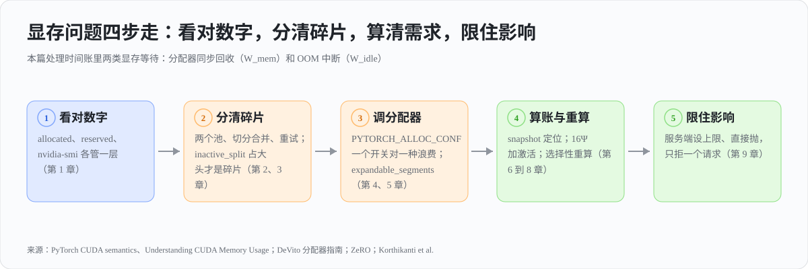
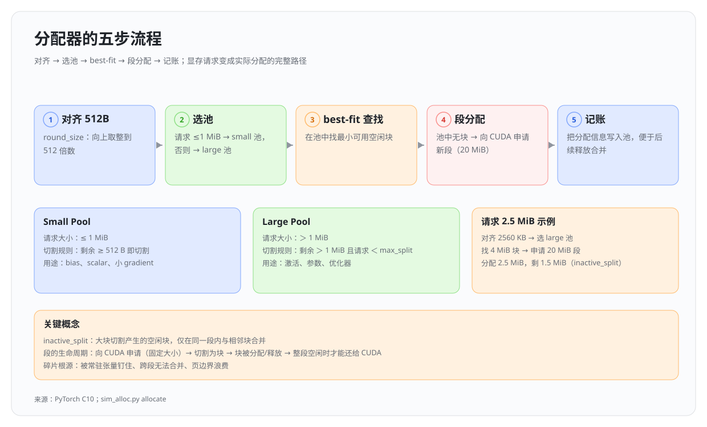
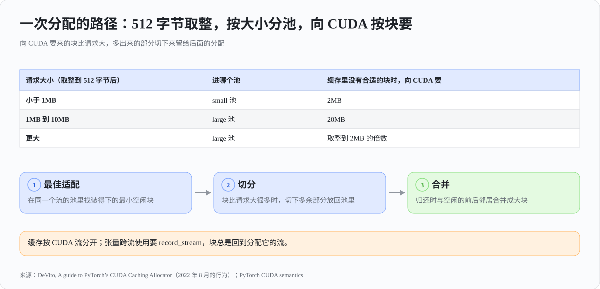
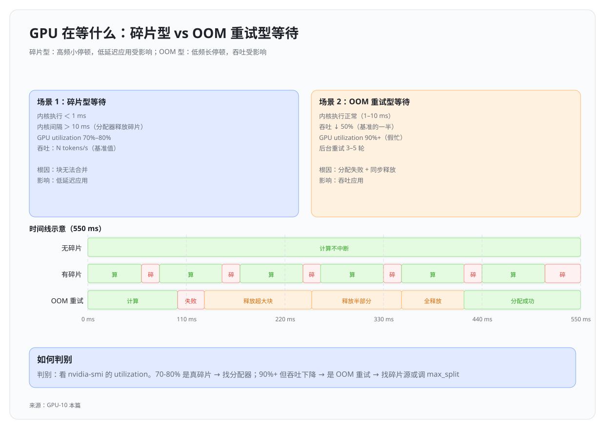
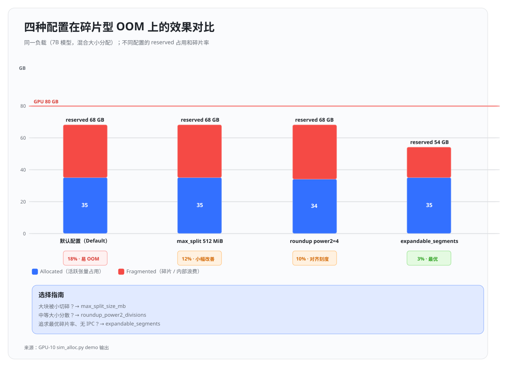
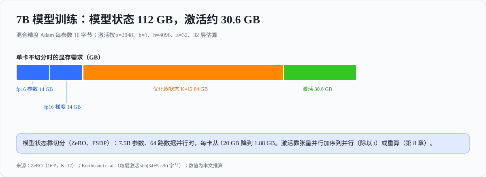
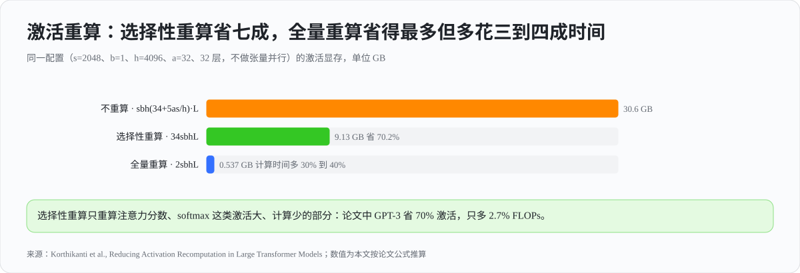
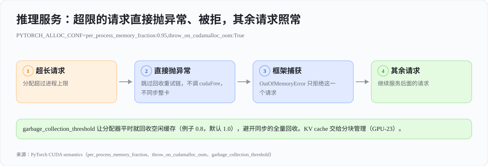

# GPU-10｜系统｜显存管理

> 🎯 **这篇文档解决什么问题**：作业跑起来之后，最常见的中断是显存不够。OOM 时手边常有三个对不上的数字：nvidia-smi、memory_allocated、memory_reserved；分配器为了凑出大块会同步回收缓存，让 GPU 停下来等；训练要多少显存、推理一个长请求会不会拖垮整个进程，也常常靠猜。本篇按 PyTorch 文档、分配器作者的说明、ZeRO 和 Korthikanti 等人的论文，讲清分配器怎样分块、碎片和 OOM 重试从哪来、几个分配器选项各管什么、怎样用 snapshot 定位，以及训练和推理的显存账怎么算、怎么省。

**使用方式**：第 1 章分清三个显存数字。第 2 到 5 章讲分配器：分块、碎片与重试、PYTORCH_ALLOC_CONF、expandable_segments。第 6 章讲 snapshot。第 7、8 章算训练显存并用重算降激活，第 9 章讲推理服务，第 10 章给清单和自测。

**代码**：zero-to-gpu/10-memory-mgmt/ 下的 sim_alloc.py、sim_oom_retry.py、test_memory_mgmt.py 只需 Python 标准库，不需要 GPU。池阈值的边界、显存预算里的激活和优化器状态与资料不符，第 10 章逐条说明。

<b>🧭 主线位置</b>：GPU-00（[GPU-00｜索引｜从 0 开始 GPU 优化：路线、章节与练习](./README.md)）建立了时间账 T = T_compute + W_mem + W_host + W_comm + W_idle。GPU-09（[GPU-09｜系统｜驱动、CUDA 兼容与 Xid](./09-driver.md)）处理了作业起不来、中途掉卡。本篇处理作业内部的显存：分配器频繁向 CUDA 要显存、同步回收缓存时 GPU 在等，记在 W_mem；OOM 让作业中断，记在 W_idle。显存够用之后，下一个问题是数据怎样在主机和 GPU 之间搬运，交给 GPU-11（[GPU-11｜系统｜PCIe、NUMA 与 GPUDirect](./11-pcie-gdr.md)）。

## 导读 · 先给结论

- <b>三个数字各管一层。</b>allocated 是张量占用，reserved 是分配器手里的缓存，nvidia-smi 还算上缓存的空闲块和其他库的分配；empty_cache 只还未用的缓存（第 1 章）。[[1]](https://docs.pytorch.org/docs/main/notes/cuda.html)[[2]](https://zdevito.github.io/2022/08/04/cuda-caching-allocator.html)
- <b>分配器的目标是稳态下不再调 cudaMalloc。</b>请求按 512 字节取整，小于 1MB 进 small 池，向 CUDA 一次要 2MB 或 20MB，再切分、合并、按流缓存（第 2 章）。[[2]](https://zdevito.github.io/2022/08/04/cuda-caching-allocator.html)
- <b>碎片让空闲够了也分配失败。</b>分配器不能挪块，只能 cudaFree 缓存后重试，cudaFree 会同步整张卡；retries 频繁说明没到稳态（第 3 章）。[[2]](https://zdevito.github.io/2022/08/04/cuda-caching-allocator.html)[[3]](https://arxiv.org/pdf/1910.02054)
- <b>每个分配器选项对应一种问题。</b>max_split_size_mb 是最后手段，roundup_power2_divisions 对付形状变化，garbage_collection_threshold 提前回收（第 4 章）。[[1]](https://docs.pytorch.org/docs/main/notes/cuda.html)
- <b>expandable_segments 让段能增长。</b>它依赖 CUDA 10.2 的虚拟内存接口，针对 batch 变化留下的段尾空隙，仍是实验性选项（第 5 章）。[[1]](https://docs.pytorch.org/docs/main/notes/cuda.html)[[4]](https://developer.nvidia.com/blog/introducing-low-level-gpu-virtual-memory-management/)
- <b>先算账再调分配器。</b>混合精度 Adam 每参数 16 字节，7B 模型状态 112 GB；每层激活 sbh(34 + 5as/h) 字节，选择性重算只多 2.7% FLOPs 就省下 70% 激活（第 6 到 8 章）。[[3]](https://arxiv.org/pdf/1910.02054)[[5]](https://arxiv.org/pdf/2205.05198)
- <b>推理服务把 OOM 限制在一个请求。</b>设进程上限并让超限分配直接抛异常，框架拒掉这个请求；KV cache 交给分块管理（第 9 章）。[[1]](https://docs.pytorch.org/docs/main/notes/cuda.html)[[6]](https://arxiv.org/abs/2309.06180)

<b>📎 与系列其他文档的分工</b>：GPU-08（[GPU-08｜硬件｜注意力内核](./08-attention.md)）讲 FlashAttention：它在反向时于片上重算注意力，不保存完整的注意力矩阵，作用上接近对第 7 章激活里的 5as/h 一项做选择性重算。GPU-14（[GPU-14｜单机｜性能分析与 Profiling](./14-profiling.md)）讲 profiling，显存时间线之外的 kernel 间隙在那里看。GPU-15（[GPU-15｜单机｜PyTorch 运行时](./15-runtime.md)）讲 PyTorch 运行时。GPU-21（[GPU-21｜LLM｜训练并行：TP、PP、DP、ZeRO 与 FP8](./21-train-parallel.md)）讲 ZeRO、FSDP 和张量并行的通信代价。GPU-23（[GPU-23｜LLM｜推理系统：KV cache、PagedAttention 与 PD 分离](./23-inference.md)）讲 KV cache 和 PagedAttention 的分块细节。

## 第 1 章 · 显存在等什么：三个数字说的不是一回事

GPU-09 讲的是作业起不来、中途掉卡。作业跑起来之后，最常见的中断是显存不够：OOM 直接让作业退出，而接近 OOM 时分配器的回收动作又会让 GPU 停下来等。本章先分清三个常被混用的显存数字，再看分配器为什么会让 GPU 等。

### allocated、reserved 和 nvidia-smi

PyTorch 用缓存分配器管理显存，好处是释放显存时不需要设备同步[[1]](https://docs.pytorch.org/docs/main/notes/cuda.html)。代价是看数字时要分三层：

- **allocated**：`memory_allocated()` 返回张量实际占用的显存[[1]](https://docs.pytorch.org/docs/main/notes/cuda.html)。它含取整，例如 1 字节的分配按 512 字节计[[2]](https://zdevito.github.io/2022/08/04/cuda-caching-allocator.html)。
- **reserved**：`memory_reserved()` 返回分配器管理的全部显存[[1]](https://docs.pytorch.org/docs/main/notes/cuda.html)，包括已经空出来、但留着复用的块。
- **nvidia-smi**：分配器缓存着的空闲显存，在 nvidia-smi 里照样显示为已用[[1]](https://docs.pytorch.org/docs/main/notes/cuda.html)。cuBLAS、cuDNN、NCCL 自己也会分配显存[[2]](https://zdevito.github.io/2022/08/04/cuda-caching-allocator.html)，这部分不在 reserved 里。

所以 nvidia-smi 显示快满了，不代表张量快把卡占满了；reserved 远大于 allocated，说明缓存里有大量空闲块。`empty_cache()` 只释放未使用的缓存，交给别的程序用，张量占的显存不会变少，也不会让 PyTorch 自己多出可用显存[[1]](https://docs.pytorch.org/docs/main/notes/cuda.html)。

### 分配器为什么会让 GPU 等

缓存分配器的目标是进入稳态：程序运行时不再需要调用 cudaMalloc 和 cudaFree 向 CUDA 要显存[[2]](https://zdevito.github.io/2022/08/04/cuda-caching-allocator.html)。原因是 PyTorch 依赖 CPU 跑在 GPU 前面来隐藏 Python 解释器的延迟，而这些显存接口、尤其是 cudaFree 会引入同步，打断这种超前[[2]](https://zdevito.github.io/2022/08/04/cuda-caching-allocator.html)。为此，PyTorch 用过 N 字节，就会一直缓存这 N 字节，直到用户显式释放[[2]](https://zdevito.github.io/2022/08/04/cuda-caching-allocator.html)。

到了稳态，显存管理几乎不花时间。偏离稳态有两种代价：频繁调用 cudaMalloc；显存紧张时分配器把缓存还给 CUDA 再重试，这一步会同步整张卡（第 3 章）。两者都记在时间账的 W_mem 上；真正 OOM 时作业退出，记在 W_idle 上。

按五步闭环看本篇：

- **定天花板**：按模型状态和激活算出显存需求（第 7 章）。
- **测实际**：读 allocated、reserved 的峰值和分配器统计（第 3、6 章）。
- **定位等待**：区分容量真的不够和碎片导致的 OOM，看有没有 cudaMalloc 重试。
- **消除或隐藏**：调分配器配置（第 4、5 章），减少模型状态和激活（第 7、8 章）。
- **复测**：同一步数下比较峰值和重试次数。

一个常见的误区是看到 nvidia-smi 显存占满，就认定模型太大。现象是减小 batch 后 nvidia-smi 依然显示占满，模型其实还有余量。原因是缓存分配器保留着空闲块，nvidia-smi 把它们也算作已用。改法是在训练脚本里打印 max_memory_allocated 和 max_memory_reserved，用它们而不是 nvidia-smi 判断余量。

> 🔑 **本章要点**：allocated 是张量实际占用，reserved 是分配器管理的全部显存，nvidia-smi 还会把缓存的空闲块和其他库的分配算进去。分配器的目标是进入不再调用 cudaMalloc、cudaFree 的稳态，因为 cudaFree 会同步。这一章是五步闭环的“定天花板”：先用对数字。

## 第 2 章 · 分配器怎么分块：取整、两个池、切分与合并

要读懂碎片和 OOM 报错，先要知道分配器手里的显存是怎么组织的。本章按 PyTorch 核心开发者写的分配器指南，讲一次分配从请求到拿到块的过程。指南描述的是 2022 年 8 月时的行为[[2]](https://zdevito.github.io/2022/08/04/cuda-caching-allocator.html)，细节以所用版本为准。

### 两次取整

第一次取整在请求进来时：默认向上取到 512 字节的倍数[[1]](https://docs.pytorch.org/docs/main/notes/cuda.html)。第二次在分配器需要向 CUDA 要新显存时：至少要 2MB 的倍数，打算之后切开给更小的分配用[[2]](https://zdevito.github.io/2022/08/04/cuda-caching-allocator.html)。具体是：

- 小于 1MB 的请求，向 CUDA 要 2MB；
- 1MB 到 10MB 的请求，要 20MB；
- 更大的请求，要取整到 2MB 倍数的大小[[2]](https://zdevito.github.io/2022/08/04/cuda-caching-allocator.html)。

小于 1MB 的张量放在单独的 small 池里，避免把 large 池切碎[[2]](https://zdevito.github.io/2022/08/04/cuda-caching-allocator.html)。也就是说，small 池按 2MB、large 池按 20MB 向 CUDA 申请，目的是减少 cudaMalloc 的次数[[2]](https://zdevito.github.io/2022/08/04/cuda-caching-allocator.html)。

### 最佳适配、切分与合并

找块用最佳适配：在池里找能装下请求的最小空闲块[[2]](https://zdevito.github.io/2022/08/04/cuda-caching-allocator.html)。找到的块可能比请求大很多，这时分配器把多出来的部分切下来放回池里，留给后面的分配。空闲块归还时，如果前后相邻的块也空闲，就合并成更大的块[[2]](https://zdevito.github.io/2022/08/04/cuda-caching-allocator.html)。

缓存是按 CUDA 流分开的，每个流有自己的一份，只有在显存紧张时才通过清空所有缓存来重新平衡[[2]](https://zdevito.github.io/2022/08/04/cuda-caching-allocator.html)。张量在一个流上分配、在另一个流上使用时，要调用 `record_stream` 告诉分配器[[2]](https://zdevito.github.io/2022/08/04/cuda-caching-allocator.html)，否则分配器可能在另一个流还没用完时就把块交给别人；块释放后也总是回到分配它的那个流[[2]](https://zdevito.github.io/2022/08/04/cuda-caching-allocator.html)。

按五步闭环检查分配模式：

- **定天花板**：理想情况下，一步之后的每一步都在复用同样大小的块。
- **测实际**：看 reserved 是否在前几步后停止增长。
- **定位等待**：reserved 持续上涨，说明每步的分配大小在变，或有跨流使用没有正确回收。
- **消除或隐藏**：固定形状，或用第 4、5 章的配置。
- **复测**：reserved 曲线变平。

一个常见的误区是在多流代码里不调用 record_stream。现象是偶发的数值错误，或显存比预期多。原因是分配器只按分配它的流判断块何时可以复用，不知道另一个流还在用。改法是跨流使用张量时调用 record_stream，或在流之间显式同步。

> 🔑 **本章要点**：请求先取整到 512 字节；向 CUDA 申请时小于 1MB 要 2MB，1MB 到 10MB 要 20MB，更大的取整到 2MB 倍数。小于 1MB 的张量走 small 池。找块用最佳适配，多余部分切下来，归还时与空闲邻居合并；缓存按流分开，跨流使用要 record_stream。这一章是五步闭环的“测实际”：读懂分配器手里的块。

## 第 3 章 · 碎片与 OOM 重试：空闲显存够，也会分配失败

OOM 不一定是显存真不够。ZeRO 论文观察到，训练中不同张量的生命周期不同，显存会碎片化；缺少连续的显存会导致分配失败，即使总的空闲显存足够[[3]](https://arxiv.org/pdf/1910.02054)。本章讲 PyTorch 分配器遇到这种情况时做什么，以及从统计里怎样看出来。

### 碎片从哪来

缓存块多了以后，可能大量块是空闲的，但每块都太小，装不下一个大的分配[[2]](https://zdevito.github.io/2022/08/04/cuda-caching-allocator.html)。新的一步如果用了更大的 batch 或更长的序列，分配的就是上一步的放大版，这种情况尤其明显[[2]](https://zdevito.github.io/2022/08/04/cuda-caching-allocator.html)。分配器不能移动这些零散的块拼出一大块；CUDA 可以，它能改 GPU 上的页表[[2]](https://zdevito.github.io/2022/08/04/cuda-caching-allocator.html)。

另一种碎片更顽固：一个大块里只要还有一个小张量活着，整个块就释放不掉，其余部分白白浪费[[2]](https://zdevito.github.io/2022/08/04/cuda-caching-allocator.html)。统计里的 inactive_split_bytes 记的就是这类从大段里切出来、当前空闲的块，它们之所以是碎片来源，是因为同一块的另一部分还被占着，重试时无法还给 CUDA[[2]](https://zdevito.github.io/2022/08/04/cuda-caching-allocator.html)。

### OOM 前的重试

向 CUDA 要新块失败时，分配器不会马上报错：它先等所有跨流事件完成，把缓存里所有空闲块 cudaFree 掉，再试一次 cudaMalloc；还是失败才抛 OutOfMemoryError[[2]](https://zdevito.github.io/2022/08/04/cuda-caching-allocator.html)。cudaFree 会同步整个设备，这个过程很慢[[2]](https://zdevito.github.io/2022/08/04/cuda-caching-allocator.html)。统计里的 cudaMalloc retries 就是这一步执行的次数；如果它频繁发生，说明分配器没能进入稳态，还在反复调用同步的 cudaFree[[2]](https://zdevito.github.io/2022/08/04/cuda-caching-allocator.html)。

### 读统计：容量不够还是碎片

用 `torch.cuda.memory_stats()` 或 `memory_summary()` 读这些指标[[2]](https://zdevito.github.io/2022/08/04/cuda-caching-allocator.html)。allocated_bytes 是所有活跃块的大小之和，reserved_bytes 是所有块之和[[2]](https://zdevito.github.io/2022/08/04/cuda-caching-allocator.html)。下面的判读顺序是按这几项的定义整理的建议：

- OOM 时 allocated 已接近卡的容量：容量不够，去第 7、8 章减模型状态和激活。
- reserved 明显大于 allocated，且 inactive_split 占了大头：碎片，去第 4、5 章调分配器。
- 没有 OOM，但 cudaMalloc retries 在持续增长：每次重试都在同步整卡，是 W_mem 里看不见的等待。

OOM 通常发生在一步的中间，前向快结束、反向还没开始，这时为反向保留的临时张量最多[[2]](https://zdevito.github.io/2022/08/04/cuda-caching-allocator.html)。指南给的一个补救写法是在异常处理器之外清空缓存再重跑这一步，因为异常处理器持有栈帧，临时张量在退出处理器前都还活着[[2]](https://zdevito.github.io/2022/08/04/cuda-caching-allocator.html)。这只能救急，不能代替找原因。

按五步闭环处理 OOM：

- **定天花板**：第 7 章算出的显存需求。
- **测实际**：OOM 时的 allocated、reserved、inactive_split 和 retries。
- **定位等待**：容量不够还是碎片。
- **消除或隐藏**：容量不够减需求，碎片调分配器。
- **复测**：retries 不再增长，峰值留有余量。

一个常见的误区是 OOM 后只看报错里“还剩多少空闲”，就断定是碎片。现象是调了分配器参数，OOM 依旧。原因是报错时刻的空闲显存可能本来就装不下下一步的激活峰值，这是容量问题。改法是同时看 allocated 和 inactive_split：前者逼近容量是容量问题，后者占大头才是碎片。

> 🔑 **本章要点**：碎片来自张量生命周期不同：空闲块很多但每块太小，或大块里有小张量占着。分配失败时分配器先 cudaFree 所有空闲缓存再重试，这一步同步整卡；retries 频繁说明没进入稳态。allocated 逼近容量是容量问题，inactive_split 占大头是碎片。这一章是五步闭环的“定位等待”：先分清是哪种 OOM。

## 第 4 章 · PYTORCH_ALLOC_CONF：几个开关各管一种浪费

分配器的行为由环境变量 PYTORCH_ALLOC_CONF 控制，旧名 PYTORCH_CUDA_ALLOC_CONF 只为兼容保留[[1]](https://docs.pytorch.org/docs/main/notes/cuda.html)。格式是逗号分隔的“选项：值”。本章按要解决的问题介绍几个常用选项，所有描述以 PyTorch CUDA semantics 文档为准[[1]](https://docs.pytorch.org/docs/main/notes/cuda.html)。

### 碎片：max_split_size_mb

它让分配器不再切分大于这个大小的块，可以减少碎片，让一些勉强够用的作业不再 OOM；性能代价视分配模式从零到显著不等[[1]](https://docs.pytorch.org/docs/main/notes/cuda.html)。文档的定位很明确：作为最后手段，用于因 OOM 中止、而且 inactive split 块很多的作业[[1]](https://docs.pytorch.org/docs/main/notes/cuda.html)。所以先按第 3 章确认是碎片，再用它。

### 大小不一：roundup_power2_divisions 和 max_non_split_rounding_mb

默认按 512 字节取整，对小分配没问题；但大小相近的大分配会落到不同大小的块上，块的复用变少[[1]](https://docs.pytorch.org/docs/main/notes/cuda.html)。roundup_power2_divisions 把请求取整到 2 的幂区间的等分点：例如分 4 份时，1024 到 2048 之间的点是 1024、1280、1536、1792，1200 字节的请求取整到 1280[[1]](https://docs.pytorch.org/docs/main/notes/cuda.html)。也可以按区间分别设置，例如 256MB 以下分 1 份、256MB 到 512MB 分 2 份、512MB 到 1GB 分 4 份、更大的分 8 份[[1]](https://docs.pytorch.org/docs/main/notes/cuda.html)。代价是取整浪费：分 1 份平均浪费每次分配的 1/4，分 2 份浪费 1/8[[2]](https://zdevito.github.io/2022/08/04/cuda-caching-allocator.html)。

max_non_split_rounding_mb 放宽不切分的块的复用条件。默认只允许 20MB 的取整，所以 512MB 的请求只能用 512MB 到 532MB 的块[[1]](https://docs.pytorch.org/docs/main/notes/cuda.html)；调大以后，更大的缓存块也能拿来用，减少昂贵的 cudaMalloc。

### 多进程与服务：garbage_collection_threshold 和 per_process_memory_fraction

garbage_collection_threshold 让分配器在显存使用超过阈值时主动回收旧的空闲块，避免触发同步的全部回收，后者对服务这类延迟敏感的应用不利[[1]](https://docs.pytorch.org/docs/main/notes/cuda.html)。文档的例子是 0.8，即超过分配给应用的显存的 80% 就开始回收，默认值 1.0[[1]](https://docs.pytorch.org/docs/main/notes/cuda.html)。per_process_memory_fraction 把进程能用的显存限制为可用显存的一个比例[[1]](https://docs.pytorch.org/docs/main/notes/cuda.html)，多进程共卡时用它划界（第 9 章）。

另外两个开关：backend 可以选 native 或 cudaMallocAsync，后者要 CUDA 11.4 或更新，默认是 native[[1]](https://docs.pytorch.org/docs/main/notes/cuda.html)；换成 cudaMallocAsync 后，max_split_size_mb 等几个选项会被忽略[[1]](https://docs.pytorch.org/docs/main/notes/cuda.html)。用 cuda-memcheck 类工具查显存错误时，设 PYTORCH_NO_CUDA_MEMORY_CACHING=1 关掉缓存[[1]](https://docs.pytorch.org/docs/main/notes/cuda.html)。

按五步闭环调配置：

- **定天花板**：不改配置时的峰值 reserved。
- **测实际**：每次只改一个选项，记 reserved 峰值、retries 和每步时间。
- **定位等待**：碎片看 inactive_split，大小不一看 reserved 是否持续上涨。
- **消除或隐藏**：按问题选对应的开关。
- **复测**：确认显存省下的同时每步时间没变差。

一个常见的误区是把一组网上流传的配置整体抄进环境变量。现象是显存没省多少，每步反而变慢。原因是这些开关各管一种浪费，max_split_size_mb 还可能带来显著的性能代价，换成 cudaMallocAsync 后部分选项直接被忽略。改法是先用统计判断问题类型，一次只改一个选项，并对比每步时间。

> 🔑 **本章要点**：max_split_size_mb 防止切分大块，是碎片型 OOM 的最后手段；roundup_power2_divisions 把大小相近的请求取整到同一档，分 4 份时 1200 字节取整到 1280，代价是取整浪费；garbage_collection_threshold 提前回收，避免同步的全部回收；backend 为 cudaMallocAsync 时部分选项无效。这一章是五步闭环的“消除或隐藏”：一个开关对一种浪费。

## 第 5 章 · expandable_segments：让段能长大，而不是再开一段

第 4 章的开关都在“块怎么切、怎么取整”上做文章。expandable_segments 换了一个思路：让分配器向 CUDA 要的段本身可以变大。它目前仍是实验性选项，默认关闭[[1]](https://docs.pytorch.org/docs/main/notes/cuda.html)。本章讲它解决的是哪种碎片，以及它依赖的 CUDA 虚拟内存接口。

### batch 一变，每层都留一条缝

默认情况下，大于 2MB 的分配，分配器按用户请求的大小调用 cudaMalloc[[1]](https://docs.pytorch.org/docs/main/notes/cuda.html)。之后这块空出来，可以给别的请求复用。如果每次请求的大小都一样，或者是同一大小的整数倍，这种做法很好，多数深度学习模型也是这样[[1]](https://docs.pytorch.org/docs/main/notes/cuda.html)。

例外是 batch 大小每步略有变化，例如批量推理[[1]](https://docs.pytorch.org/docs/main/notes/cuda.html)。文档的推演是：先按 batch N 分配；之后跑 N − 1，原有的段够用；跑 N + 1 时，有些张量能塞进原来的段但塞不满，段的末尾留下一条用不上的空隙；到某个时候分配器只能 cudaMalloc 一个新段，显存不够时，这些段尾的空隙也无法收回[[1]](https://docs.pytorch.org/docs/main/notes/cuda.html)。模型有 50 层以上时，这个模式会重复 50 次以上，产生大量空隙[[1]](https://docs.pytorch.org/docs/main/notes/cuda.html)。

### 一个流一个段，按需往后接

打开 expandable_segments 后，分配器不再一次分配一个段，而是尽量每个流只建一个段，按需增长[[1]](https://docs.pytorch.org/docs/main/notes/cuda.html)。N + 1 的情况下，分配一个接一个铺进这个大段，铺满了再申请显存接到段尾[[1]](https://docs.pytorch.org/docs/main/notes/cuda.html)。不会再产生那么多段尾空隙，所以更容易找到需要的显存。

段能增长，靠的是 CUDA 10.2 引入的虚拟内存管理接口[[4]](https://developer.nvidia.com/blog/introducing-low-level-gpu-virtual-memory-management/)。它把 cudaMalloc 拆成四步：cuMemCreate 创建物理显存句柄，cuMemAddressReserve 预留虚拟地址范围，cuMemMap 把物理显存映射到虚拟地址，cuMemSetAccess 设置各设备的访问权限[[4]](https://developer.nvidia.com/blog/introducing-low-level-gpu-virtual-memory-management/)。预留一大段虚拟地址，再按需映射物理显存，段在地址上就是连续增长的。cuMemCreate 只接受按粒度对齐的大小[[4]](https://developer.nvidia.com/blog/introducing-low-level-gpu-virtual-memory-management/)，所以段是一块一块增长的。

按五步闭环用 expandable_segments：

- **定天花板**：形状固定时的 reserved 峰值。
- **测实际**：形状变化时 reserved 峰值和 inactive_split。
- **定位等待**：碎片是否来自 batch 或序列长度的变化。
- **消除或隐藏**：打开 expandable_segments；也可以把输入补齐到几档固定长度。
- **复测**：在同样的输入分布下比较峰值和吞吐。

一个常见的误区是在形状固定的训练里也打开它，期待省显存。现象是峰值几乎不变。原因是这个选项针对的是请求大小逐步变化留下的段尾空隙，形状固定时默认分配器已经能稳定复用。改法是先确认碎片来自形状变化，再打开它，并记录这个实验性选项在所用版本上的表现。

> 🔑 **本章要点**：默认分配器为大于 2MB 的请求按需 cudaMalloc，batch 略有变化时每层都会在段尾留下用不上的空隙。expandable_segments 让每个流尽量只有一个可增长的段，依赖 CUDA 10.2 引入的四个虚拟内存接口：创建物理句柄、预留地址、映射、设置权限。它仍是实验性选项，默认关闭。这一章是五步闭环的“消除或隐藏”：对付形状变化带来的碎片。

## 第 6 章 · snapshot：看清每一块显存是谁分配的

统计数字能告诉你“有多少”，告诉不了你“是谁”。PyTorch 的显存 snapshot 记录每一次分配和释放，附带分配时的 Python 调用栈。本章讲怎么抓、怎么看，以及它看不到什么。

### 三行代码抓一份

常用写法是打开记录、跑要观察的代码、把 snapshot 存成 pickle 文件[[7]](https://docs.pytorch.org/docs/main/torch_cuda_memory.html)：

- `torch.cuda.memory._record_memory_history()`
- `run_your_code()`
- `torch.cuda.memory._dump_snapshot("my_snapshot.pickle")`

然后打开 pytorch.org/memory_viz，把文件拖进去。这个可视化工具是在本机运行的 JavaScript 程序，不会上传 snapshot 数据[[7]](https://docs.pytorch.org/docs/main/torch_cuda_memory.html)。

记录的条数由 max_entries 控制。Python 调用栈的收集默认上限是 sys.maxsize，长时间运行的作业要设一个合理的上限，避免占用过多内存[[7]](https://docs.pytorch.org/docs/main/torch_cuda_memory.html)；每条记录有几 KB，max_entries 大的长作业，文件很容易到 GB 级[[7]](https://docs.pytorch.org/docs/main/torch_cuda_memory.html)。实际做法是只在出问题的那几步前后打开记录。

### 两个视图

- **Active Memory Timeline**：显示一张卡上所有活着的张量随时间的变化[[7]](https://docs.pytorch.org/docs/main/torch_cuda_memory.html)。鼠标移到某个块上，能看到它分配时的调用栈和地址[[7]](https://docs.pytorch.org/docs/main/torch_cuda_memory.html)。找峰值时刻是哪些张量撑起来的，用这个视图。
- **Allocator State History**：左边是分配器事件的时间线，选中一个事件，右边显示当时每个 cudaMalloc 来的段是怎样被切成块的[[7]](https://docs.pytorch.org/docs/main/torch_cuda_memory.html)。查碎片用这个视图，能直接看到段里夹着的小块。

### 它看不到什么

默认情况下，snapshot 只看得到经 PyTorch 分配器管理的显存；直接用 CUDA 接口（例如 cudaMalloc、cuMemCreate）或第三方 Python 绑定分配的显存不在其中[[7]](https://docs.pytorch.org/docs/main/torch_cuda_memory.html)。NCCL、cuBLAS 的工作区、其他库自己的分配，都属于这一类。要看 PyTorch 之外的原始显存用量，用 `torch.cuda.device_memory_used()`[[7]](https://docs.pytorch.org/docs/main/torch_cuda_memory.html)，和 reserved 相减，就是分配器以外的部分。

按五步闭环用 snapshot：

- **定天花板**：第 7 章算出的峰值。
- **测实际**：Active Memory Timeline 上的实际峰值。
- **定位等待**：峰值时刻占比最大的几处调用栈；Allocator State History 里的碎片。
- **消除或隐藏**：提前释放、改写法、重算（第 8 章）或调分配器。
- **复测**：再抓一份对比峰值。

一个常见的误区是一直开着记录跑完整个训练。现象是主机内存不断上涨，snapshot 文件大到打不开。原因是默认上限是 sys.maxsize，每条几 KB，长作业会累积海量记录。改法是设置 max_entries，或只在可疑的几步前后打开、抓完就关。

> 🔑 **本章要点**：用 _record_memory_history 打开记录，_dump_snapshot 导出，拖进本机运行的 memory_viz。Active Memory Timeline 找峰值由谁撑起，Allocator State History 看段怎么被切碎。snapshot 只看得到 PyTorch 分配器管理的显存，其余用 device_memory_used 看；长作业要设 max_entries。这一章是五步闭环的“测实际”：从数字落到代码行。

## 第 7 章 · 训练显存账：模型状态和激活各占多少

前六章讲分配器怎样管显存。本章换个角度：一个训练任务到底需要多少显存。先算出这个数，才知道 OOM 是需求本来就超了，还是分配器没管好。账分两块：模型状态和激活。

### 模型状态：每个参数 16 字节

ZeRO 论文按混合精度 Adam 记账：fp16 参数 2Ψ 字节，fp16 梯度 2Ψ 字节，优化器状态 KΨ 字节，其中 fp32 的参数副本、动量、方差各 4 字节，所以 K = 12，合计 16Ψ 字节[[3]](https://arxiv.org/pdf/1910.02054)。论文举的例子是 15 亿参数的 GPT-2，至少需要 24 GB[[3]](https://arxiv.org/pdf/1910.02054)。

同样算法用到 70 亿参数的模型上，模型状态是 16 × 7 = 112 GB，一张 80 GB 的卡装不下，这还没算激活。所以大模型训练一定要把模型状态切到多张卡上。ZeRO 给出的数字（7.5B 参数、64 路数据并行）[[3]](https://arxiv.org/pdf/1910.02054)：

| 数据并行 64 路，7.5B 参数 | 每卡模型状态 | 切分了什么 |
|---|---|---|
| 标准数据并行 | 120 GB | 不切 |
| ZeRO 优化器状态切分（Pos） | 31.4 GB | 优化器状态 |
| 再切梯度（Pos+g） | 16.6 GB | 优化器状态、梯度 |
| 再切参数（Pos+g+p） | 1.88 GB | 优化器状态、梯度、参数 |

表里只算模型状态。切到参数之后每卡只剩 1.88 GB，激活就成了大头。

### 激活：sbh(34 + 5as/h) 字节每层

Korthikanti 等人给出 Transformer 每层激活的估算：sbh(34 + 5as/h) 字节[[5]](https://arxiv.org/pdf/2205.05198)。s 是序列长度，b 是微批大小，h 是隐藏维，a 是注意力头数；激活按 16 位存储，每个元素 2 字节，系数里已经算进去了[[5]](https://arxiv.org/pdf/2205.05198)。34 那一项来自线性层、LayerNorm、dropout 等，5as/h 那一项来自注意力分数和 softmax，随序列长度增长。

拿一个常见配置算：s = 2048，b = 1，h = 4096，a = 32，共 32 层。5as/h = 5 × 32 × 2048 / 4096 = 80。每层激活 2048 × 4096 × (34 + 80) 字节，约 0.956 GB；32 层合计 0.956 × 32 ≈ 30.6 GB。也就是说，单条 2048 长度的样本，激活就需要三十多 GB。

用了张量并行加序列并行，激活可以在张量并行组内分摊，再除以张量并行度 t[[5]](https://arxiv.org/pdf/2205.05198)。另一条路是不保存激活、反向时再算一遍，这是第 8 章的内容。

按五步闭环用这本账：

- **定天花板**：卡的显存减去 CUDA 上下文和库工作区。
- **测实际**：max_memory_allocated 和 snapshot 峰值。
- **定位等待**：峰值超出的部分在模型状态还是激活。
- **消除或隐藏**：模型状态切分（ZeRO、FSDP），激活靠并行切分或重算。
- **复测**：峰值和账对得上，差额能用库的工作区和碎片解释。

一个常见的误区是只算参数，按“7B 模型 bf16 只占 14 GB”来选卡。现象是一跑训练就 OOM。原因是梯度和优化器状态另需 14Ψ 字节，激活还要几十 GB。改法是按 16Ψ 加激活估算，再决定切分方式。

> 🔑 **本章要点**：混合精度 Adam 的模型状态是每参数 16 字节，70 亿参数就要 112 GB。ZeRO 把它切到数据并行组上，64 路时每卡从 120 GB 降到 1.88 GB。每层激活约 sbh(34 + 5as/h) 字节，2048 长度、4096 隐藏维的 32 层模型约 30.6 GB。这一章是五步闭环的“定天花板”：先算需求，再判断是不是分配器的问题。

## 第 8 章 · 激活重算：拿计算换显存

第 7 章算出激活要三十多 GB。少存激活的直接办法是重算：前向时只保留一部分，反向用到时再算一次。重算要付计算时间，所以问题变成：重算哪些、省多少、花多少。

### 全量重算：显存最少，时间多三到四成

全量重算只在每个 Transformer 层的边界保存输入，激活总量降到 2sbhL 字节[[5]](https://arxiv.org/pdf/2205.05198)。按第 7 章的配置，2 × 2048 × 4096 × 32 字节，约 0.537 GB，比 30.6 GB 少了一个量级以上。代价是反向时整层前向重跑一次，论文给出的开销可达 30% 到 40% 的计算时间[[5]](https://arxiv.org/pdf/2205.05198)。

### 选择性重算：只重算注意力那一块

Korthikanti 等人观察到，5as/h 那一项（注意力分数、softmax、dropout）激活很大，但每个输入元素的浮点运算很少[[5]](https://arxiv.org/pdf/2205.05198)。只重算这部分，激活降到 34sbhL/t 字节，几乎不多花计算。GPT-3 的 5as/h = 80，选择性重算对 GPT-3 和 MT-NLG 分别省下 70% 和 65% 的激活，只多 2.7% 和 1.6% 的 FLOPs[[5]](https://arxiv.org/pdf/2205.05198)。

第 7 章的配置 5as/h 也是 80，不做张量并行时 34 × 2048 × 4096 × 32 字节，约 9.13 GB，省下 80 / (34 + 80) ≈ 70.2%。论文摘要的结论是：和序列并行合用，激活降为五分之一，重算带来的执行时间开销降了 90% 以上[[8]](https://arxiv.org/abs/2205.05198)；530B 参数的模型的 MFU 从全量重算的 42.1% 提到 54.2%[[8]](https://arxiv.org/abs/2205.05198)。

### PyTorch 里怎么用

- **torch.utils.checkpoint**：用计算换显存，被包住的函数不保存中间张量，反向时重新调用这个函数来重算[[9]](https://docs.pytorch.org/docs/2.15/checkpoint.html)。文档推荐显式传 use_reentrant=False[[9]](https://docs.pytorch.org/docs/2.15/checkpoint.html)。
- <b>选择性激活检查点（SAC）</b>：在 checkpoint 之上，按算子决定保存还是重算[[10]](https://pytorch.org/blog/activation-checkpointing-techniques/)，典型做法是保存 matmul 这类昂贵算子的输出，重算 pointwise 这类便宜算子[[10]](https://pytorch.org/blog/activation-checkpointing-techniques/)。
- **显存预算**：torch.compile 下可以设 `torch._dynamo.config.activation_memory_budget = 0.5` 这样的预算，由编译器挑选重算哪些算子[[10]](https://pytorch.org/blog/activation-checkpointing-techniques/)。

按五步闭环用重算：

- **定天花板**：第 7 章的激活账。
- **测实际**：打开重算前后的峰值和每步时间。
- **定位等待**：激活大户是注意力那一项还是线性层。
- **消除或隐藏**：先选择性重算，仍不够再整层重算，或只对部分层整层重算。
- **复测**：峰值下降，每步时间的增量符合预期。

一个常见的误区是一遇到 OOM 就对所有层打开整层重算。现象是显存够了，每步时间却多了三成以上。原因是整层重算把线性层这些计算密集的部分也重跑了一次。改法是先只重算注意力里 FLOPs 低、激活大的部分，不够再逐层加整层重算。

> 🔑 **本章要点**：全量重算把激活压到 2sbhL 字节，代价是 30% 到 40% 的计算时间。选择性重算只重算注意力分数一类激活大、计算少的部分：GPT-3 省 70% 激活、多 2.7% FLOPs，本章例子从 30.6 GB 降到 9.13 GB。PyTorch 用 checkpoint（推荐 use_reentrant=False）、SAC 或显存预算来做。这一章是五步闭环的“消除或隐藏”：用最少的重算换回显存。

## 第 9 章 · 推理服务：一个请求 OOM，不该拖垮整个进程

训练作业 OOM 了可以从检查点重启。推理服务不一样：一个超长请求导致 OOM，如果整个进程退出，同一张卡上所有在途请求都会失败。服务端要的是把显存上限管住，单个请求超了就拒掉它，其余照常。

### 给进程设上限，超了直接抛

PYTORCH_ALLOC_CONF 里有两项配合使用[[1]](https://docs.pytorch.org/docs/main/notes/cuda.html)：

- **per_process_memory_fraction**：把所有 CUDA 设备上可分配的显存限制在可用显存的某个比例，取值 0 到 1[[1]](https://docs.pytorch.org/docs/main/notes/cuda.html)。
- **throw_on_cudamalloc_oom**：超过上限的分配跳过第 3 章那条回收重试链，直接抛出异常，调用方可以捕获后自行处理[[1]](https://docs.pytorch.org/docs/main/notes/cuda.html)。

文档给的写法是 `per_process_memory_fraction:0.95,throw_on_cudamalloc_oom:True`[[1]](https://docs.pytorch.org/docs/main/notes/cuda.html)。这样服务框架可以捕获 OutOfMemoryError，只拒绝这一个请求，继续服务后面的请求[[1]](https://docs.pytorch.org/docs/main/notes/cuda.html)。跳过重试链还有一个好处：重试里的 cudaFree 会同步整张卡，对延迟敏感的服务正好要避开。

### 提前回收，避开同步的全量回收

garbage_collection_threshold 让分配器在显存使用超过阈值时主动回收没在用的缓存块；以 0.8 为例，用量超过 80% 就开始回收[[1]](https://docs.pytorch.org/docs/main/notes/cuda.html)。目的是避免触发代价很高的同步全量回收（release_cached_blocks），这种回收对服务这类延迟敏感的应用不利[[1]](https://docs.pytorch.org/docs/main/notes/cuda.html)。默认值是 1.0，即不提前回收[[1]](https://docs.pytorch.org/docs/main/notes/cuda.html)。

### KV cache：推理显存的主角

大模型推理的显存大头是 KV cache。每个请求的 KV cache 很大，而且随着生成动态增减[[6]](https://arxiv.org/abs/2309.06180)；按最长长度连续预留，碎片和重复存储会浪费大量显存，限制批大小[[6]](https://arxiv.org/abs/2309.06180)。PagedAttention 把 KV cache 分成固定大小的块，按需分配，vLLM 因此做到 KV cache 几乎零浪费[[6]](https://arxiv.org/abs/2309.06180)，吞吐提升到原来的 2 到 4 倍[[6]](https://arxiv.org/abs/2309.06180)。块怎么分配、怎么共享，留给 GPU-23（[GPU-23｜LLM｜推理系统：KV cache、PagedAttention 与 PD 分离](./23-inference.md)）。

按五步闭环管推理显存：

- **定天花板**：卡显存减去权重、CUDA 上下文和库工作区，剩下的给 KV cache 和临时张量。
- **测实际**：按请求长度分桶看峰值。
- **定位等待**：OOM 时是谁在等：重试链的同步，还是请求排队。
- **消除或隐藏**：设进程上限加直接抛异常，阈值回收，KV cache 分块管理。
- **复测**：注入超长请求，确认只有它被拒，其余请求的延迟不受影响。

一个常见的误区是在服务进程里捕获 OOM 后调用 empty_cache 再重试同一个请求。现象是偶发的长尾延迟和整卡卡顿。原因是 empty_cache 和重试链都要 cudaFree，会同步整张卡，所有在途请求一起等。改法是设 throw_on_cudamalloc_oom，直接拒绝这个请求，用阈值回收在平时腾空间。

> 🔑 **本章要点**：服务端用 per_process_memory_fraction 给进程设显存上限，用 throw_on_cudamalloc_oom 让超限分配跳过重试直接抛，框架捕获后只拒这一个请求。garbage_collection_threshold 让分配器在平时回收缓存，避开同步的全量回收。KV cache 是推理显存的主角，PagedAttention 让浪费接近零。这一章是五步闭环的“消除或隐藏”：把 OOM 的影响限制在一个请求。

## 第 10 章 · 上线前核对清单与自测

前九章沿五步闭环处理显存：第 1 章分清三个数字，第 2 到 5 章讲分配器的分块、碎片、重试和配置，第 6 章用 snapshot 定位，第 7 章算需求，第 8 章用重算降激活，第 9 章管住推理服务的 OOM。本章把它们压成一张核对清单，再配上代码练习和自测题。

### 📌 核对清单

| 检查项 | 怎样查 | 通过的标志 |
|---|---|---|
| 三个数字分开记 | 同时记 max_memory_allocated、max_memory_reserved 和 nvidia-smi（第 1 章） | 三者的差额都能解释 |
| 没有频繁的重试 | memory_stats 里的 cudaMalloc retries（第 3 章） | 稳态下不再增长 |
| 碎片有据可查 | inactive_split_bytes；snapshot 的 Allocator State History（第 3、6 章） | 大块没有被小张量钉住 |
| 分配器设置有理由 | 每个 PYTORCH_ALLOC_CONF 选项对应一个观测到的问题（第 4、5 章） | max_split_size_mb 只在大量 inactive split 时使用 |
| 峰值能对上账 | 16Ψ 模型状态加 sbh(34 + 5as/h) 激活（第 7 章） | 实测峰值与估算差额可解释 |
| 重算策略有取舍 | 先选择性重算，再整层重算（第 8 章） | 峰值下降，每步时间增量可接受 |
| 服务端 OOM 只影响一个请求 | per_process_memory_fraction、throw_on_cudamalloc_oom（第 9 章） | 注入超长请求，只有它被拒 |

### 代码练习

zero-to-gpu/10-memory-mgmt/ 下有 sim_alloc.py、sim_oom_retry.py 和 test_memory_mgmt.py，只需 Python 标准库，README 要求的 Python 版本比系统自带的 3.9.6 高，主编在 3.9.6 上也能跑通，15 条测试全部通过。目录里没有在真实 GPU 上采集 snapshot 的脚本，第 6 章的三行代码可以补上。模拟器有几处和正文核实过的资料不符：

- `python3 sim_alloc.py sequence --pattern 1M,2M,1M`：正好 1 MB（1,048,576 字节）的请求被放进 small 池。模拟器的判断是“小于等于 1 MiB 进 small 池”，DeVito 的伪代码是严格小于 1MB 才进 small 池[[2]](https://zdevito.github.io/2022/08/04/cuda-caching-allocator.html)，所以正好 1 MB 应进 large 池。
- `python3 sim_alloc.py allocate --request-bytes 1`：1 字节记作 512 字节、从 2 MB 的段里切出来，和第 2 章一致。
- `python3 sim_oom_retry.py membudget --params-billion 7 --layers 32 --seq 2048 --dmodel 4096`：输出参数 14 GB、激活 1.07 GB、梯度 14 GB、优化器状态 28 GB，合计 57.07 GB。激活按每层 2 × s × h × 2 字节估，只算了层的输入输出；按第 7 章的公式，同样配置约 30.6 GB。优化器状态按参数的 2 倍、以 bf16 计，ZeRO 的口径是 K = 12，即 84 GB，模型状态合计 112 GB。
- `python3 test_memory_mgmt.py`：test_budget_reasonableness 打印“7B 模型预算：56.3 GB（合理范围内）”，它只检查结果落在一个很宽的区间里，同一个过低的估算因此通过了测试。
- `python3 sim_oom_retry.py retry --total-reserved-gb 40 --request-gb 5`：0 次重试即成功。它演示的是重试的流程，没有模拟 inactive split 导致的失败；可以改参数让请求超过最大空闲块，观察重试路径。

### 自测题

1. nvidia-smi 的读数比 max_memory_reserved 高，max_memory_reserved 又比 max_memory_allocated 高很多。这两个差额分别可能来自哪里？
2. 一个 1 字节的张量，allocated_bytes 记多少？如果它是 small 池里第一次分配，reserved 会增加多少？
3. 训练时 cudaMalloc retries 持续增长，说明什么？先看哪个指标，再用哪个工具？
4. 什么情况下才用 max_split_size_mb？为什么文档说它是最后手段？
5. 70 亿参数模型用混合精度 Adam，模型状态多少？s = 2048、h = 4096、a = 32、32 层、微批 1，激活约多少？选择性重算后呢？
6. 推理服务要求一个超长请求 OOM 时不影响其他请求，PYTORCH_ALLOC_CONF 怎么设？为什么不在捕获异常后调 empty_cache 重试？

### 下一步

显存够用之后，数据还要从主机搬到显存，多卡之间也要交换数据。主机和 GPU 之间的 PCIe 链路、CPU 的 NUMA 布局，以及绕过主机内存的 GPUDirect，交给 GPU-11（[GPU-11｜系统｜PCIe、NUMA 与 GPUDirect](./11-pcie-gdr.md)）。

## 参考文献

按正文首次引用顺序编号，资料截至 2026 年 11 月中。

[1] PyTorch. CUDA semantics（main 文档） [docs.pytorch.org/docs/main/notes/cuda.html](https://docs.pytorch.org/docs/main/notes/cuda.html)

[2] DeVito. A guide to PyTorch’s CUDA Caching Allocator (2022) [zdevito.github.io/2022/08/04/cuda-caching-allocator.html](https://zdevito.github.io/2022/08/04/cuda-caching-allocator.html)

[3] Rajbhandari et al. ZeRO: Memory Optimizations Toward Training Trillion Parameter Models. SC (2020) [arxiv.org/pdf/1910.02054](https://arxiv.org/pdf/1910.02054)

[4] NVIDIA Technical Blog. Introducing Low-Level GPU Virtual Memory Management (2020) [developer.nvidia.com/blog/introducing-low-level-gpu-virtual-memory-management/](https://developer.nvidia.com/blog/introducing-low-level-gpu-virtual-memory-management/)

[5] Korthikanti et al. Reducing Activation Recomputation in Large Transformer Models. arXiv 2205.05198 (2022) [arxiv.org/pdf/2205.05198](https://arxiv.org/pdf/2205.05198)

[6] Kwon et al. Efficient Memory Management for Large Language Model Serving with PagedAttention. SOSP (2023) [arxiv.org/abs/2309.06180](https://arxiv.org/abs/2309.06180)

[7] PyTorch. Understanding CUDA Memory Usage（main 文档） [docs.pytorch.org/docs/main/torch_cuda_memory.html](https://docs.pytorch.org/docs/main/torch_cuda_memory.html)

[8] Korthikanti et al. Reducing Activation Recomputation in Large Transformer Models（摘要页） [arxiv.org/abs/2205.05198](https://arxiv.org/abs/2205.05198)

[9] PyTorch. torch.utils.checkpoint（2.15 文档） [docs.pytorch.org/docs/2.15/checkpoint.html](https://docs.pytorch.org/docs/2.15/checkpoint.html)

[10] PyTorch Blog. Current and New Activation Checkpointing Techniques in PyTorch [pytorch.org/blog/activation-checkpointing-techniques/](https://pytorch.org/blog/activation-checkpointing-techniques/)

---

[在 Colab 里跑本章 CPU 练习](https://colab.research.google.com/github/chenziyaos/zero-to-gpu/blob/main/colab/10-memory-mgmt.ipynb) · 上一章：[GPU-09｜系统｜驱动、CUDA 兼容与 Xid](./09-driver.md) · [目录](./README.md) · 下一章：[GPU-11｜系统｜PCIe、NUMA 与 GPUDirect](./11-pcie-gdr.md)
