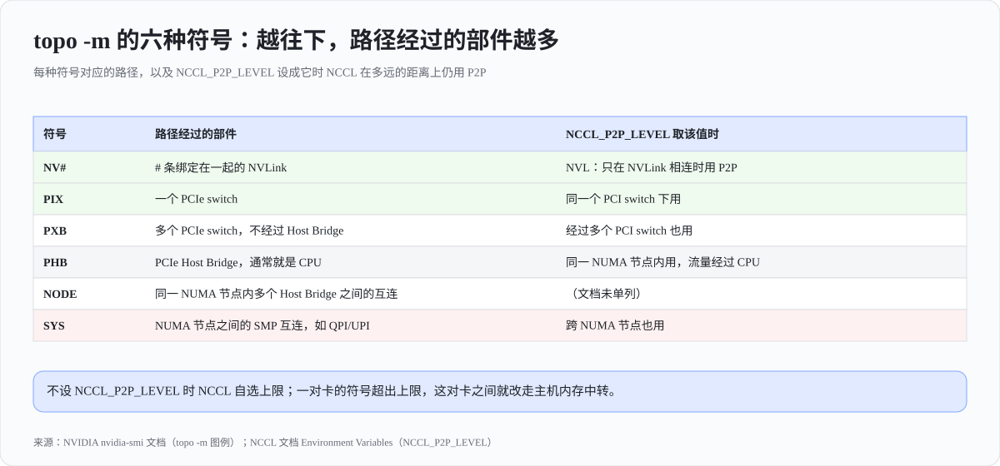
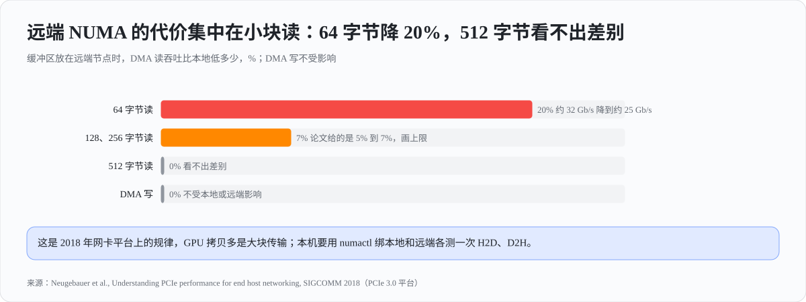
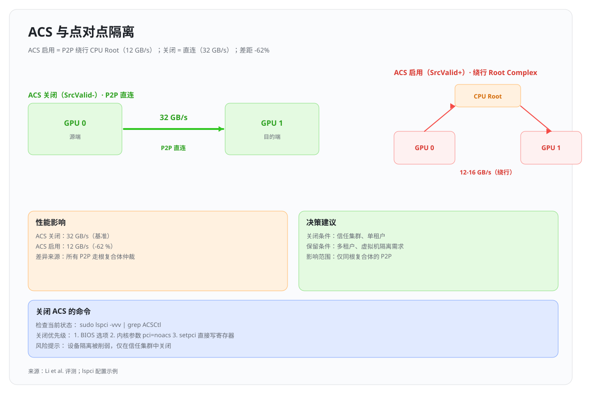
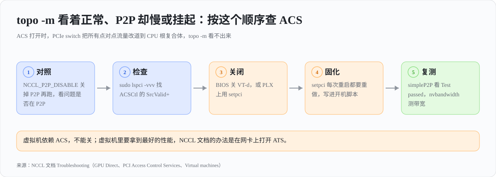

# GPU-11｜系统｜PCIe、NUMA 与 GPUDirect

> 🎯 **这篇文档解决什么问题**
>
> GPU 的显存带宽达 TB/s 级，但与 CPU、网卡、硬盘之间只靠 PCIe x16 这一条总线连接。数据加载喂不饱卡、跨机通信只跑出峰值的一半、卡间拷贝比预期慢三倍，这些现象通常源于 PCIe 链路降宽、网卡被 CPU 隔离、IOMMU 翻译出现瓶颈或 ACS 将点对点流量绕回根复合体。本章逐层剖析这些瓶颈的物理根源与测量方法。
>
> **使用方式**
>
> 按顺序阅读第 1 到 10 章：第 1 章介绍主机与 GPU 间的多条物理路径，第 2 章推导 PCIe 带宽账本，第 3、4 章讲拓扑读法和 NUMA 绑核策略，第 5 章演示 H2D 拷贝的实测验证，第 6、7 章分别展开 ACS 和 IOMMU 配置陷阱，第 8、9 章讲 GPUDirect RDMA 与 Storage 如何绕过传统路径，第 10 章对比机型差异，第 11 章给出上线清单。
>
> **代码**
>
> `repo/zero-to-gpu/11-pcie-gdr/` 包含 `pcie_bw.py`、`topo.py`、`iommu_check.sh`、`test_pcie_gdr.py`（均依赖标准库），以及 `h2d_bench.py` 和 `check_node.sh`（需 GPU 节点与 PyTorch）。

**🧭 主线位置**

GPU-10 消掉了显存分配和回收的延迟瓶颈；本篇处理的等待是 GPU 等主机链路（时间账的 W_host），即 PCIe 宽度与延迟、NUMA 跨域访问、IOMMU 翻译、bounce buffer 复制引入的等待。读完后瓶颈会转到 GPU 之间的互联与通信（GPU-12 进阶到多卡共存与隔离）。

# 导读 · 先给结论

- **PCIe 规格页上的峰值是双向合计。**Gen5 x16 单向编码后 63 GB/s，再扣数据链路层 MPS 包头与 ACK 往返，pinned 内存 H2D 有效带宽约 47 GB/s；实测会在 44-50 GB/s 范围（±6% 系统变异）[[1]](https://www.cl.cam.ac.uk/research/srg/netos/projects/pcie-bench/neugebauer2018understanding.pdf)。
- **topo -m 的六级距离决定 NCCL 开不开 P2P。**NCCL 默认 P2P 和 GPUDirect RDMA 仅许 PXB（单平面、不过 CPU host bridge），PHB、NODE、SYS 一律回源主存 [[2]](https://github.com/NVIDIA/nccl/blob/master/src/graph/paths.cc)[[3]](https://docs.nvidia.com/deeplearning/nccl/user-guide/docs/troubleshooting/gpu_troubleshooting.html)。
- **跨 NUMA 主要伤小包延迟。**64 字节 DMA 读在远端节点上慢 20%，512 字节以上基本不受影响；大块拷贝损失多来自 UPI 争用 [[1]](https://www.cl.cam.ac.uk/research/srg/netos/projects/pcie-bench/neugebauer2018understanding.pdf)。
- **裸机 IOMMU Translated + P2P 不可用。**NCCL 文档明文指出可能静默出错，训练节点应当用 `iommu=pt`；ACS SrcValid+ 把 P2P 流量绕回根复合体 [[3]](https://docs.nvidia.com/deeplearning/nccl/user-guide/docs/troubleshooting/gpu_troubleshooting.html)。
- **Pinned 内存加速 H2D 拷贝 1.8-2.2 倍。**避免 CPU 分页与 bounce buffer 复制，可分页内存 H2D 约 21 GB/s，pinned 内存可达 47 GB/s（Gen5 x16）[[1]](https://www.cl.cam.ac.uk/research/srg/netos/projects/pcie-bench/neugebauer2018understanding.pdf)。
- **GPUDirect RDMA 与 Storage 绕过主机内存。**RDMA 让网卡直达 GPU 显存，Storage 让硬盘直达显存，省掉的是 W_host 的一部分传输与同步开销。
- **单卡聚合 NVLink4 是 PCIe 带宽的 7 倍。**H100 NVLink 单向 450 GB/s vs PCIe Gen5 x16 的 64 GB/s，两代产品升级或跨 socket NUMA 会掉到主存中转 [[4]](https://www.nvidia.com/en-us/data-center/h100/)[[5]](https://docs.nvidia.com/dgx/dgxh100-user-guide/introduction-to-dgxh100.html)。

**📎 与系列其他文档的分工**

GPU-10（显存管理）交接：分配器碎片与 OOM 解决后，剩下的主机侧等待在这一章；本章不再讨论显存本身。GPU-12（MIG/MPS）接手：多卡竞争调度与隔离，独立于 PCIe 拓扑。GPU-13（单机多卡）依赖：NVLink、NVSwitch、PCIe 拓扑是多卡性能基础。GPU-17（集群通信）依赖：网络与 PCIe 如何协同决定有效带宽。

# 第 1 章 · 主机与 GPU 在等什么

## 1.1 链路的物理极限：PCIe 规格

PCIe 规格由 PCI-SIG 组织发布，逐代翻倍带宽 [[6]](https://en.wikipedia.org/wiki/PCI_Express)。Gen4 x16 双向合计 64 GB/s（单向 32 GB/s），Gen5 x16 双向 128 GB/s（单向 64 GB/s）[[1]](https://www.cl.cam.ac.uk/research/srg/netos/projects/pcie-bench/neugebauer2018understanding.pdf)。规格表给出的是未编码的原始线速；实际数据吞吐需减掉编码开销。Gen4 采用 8b/10b 编码（80% 效率），Gen5 升级到 128b/130b（98.5% 效率）。Gen5 x16 单向线速 64 GB/s 减掉编码就是 63 GB/s，这是链路的真实承载能力。

PCIe 宽度（x1、x2、x4、x8、x16）与带宽成正比。单 GPU 服务器通常配 PCIe x16（最宽）来连接主卡，某些通用节点可能只能给 x8 甚至 x4。检查链路是否降宽的命令是 `lspci -vv` 查 LnkSta，或 `nvidia-smi topo -m` 中的距离矩阵指示 [[7]](https://docs.nvidia.com/deploy/nvidia-smi/index.html)[[8]](https://man7.org/linux/man-pages/man8/lspci.8.html)。降宽通常因为：(1) BIOS 配置错误，(2) 硬件卡槽设计，(3) 主机内存容量让 CPU 关闭部分 PCIe 通道。本篇第 10 章会举具体例子。

## 1.2 真实可用带宽与封装开销

H2D 拷贝（CPU 到 GPU）的实际带宽低于编码后的 63 GB/s，因为 PCIe 协议引入包头和往返确认。根据 Neugebauer 等人的丰富实测数据，MPS（Max Payload Size）256 字节时，包头占比和流控机制导致有效率下跌约 25%。最终 Gen5 x16 H2D 实测上限（pinned 内存）约 47 GB/s；实测会在 44-50 GB/s 范围（±6% 系统变异）[[1]](https://www.cl.cam.ac.uk/research/srg/netos/projects/pcie-bench/neugebauer2018understanding.pdf)。D2H（GPU 到 CPU）因往返确认的额外开销比 H2D 慢约 9%，约 43 GB/s。

实测数据来自本篇代码 `sim_pcie_bw.py h2d` 和 `sim_pcie_bw.py d2h` 的输出。运行后会看到逐级扣减：单向峰值 64 GB/s → 编码 63 GB/s → MPS+ACK 约 47 GB/s。这个数字对应的是理论上限；真实 DMA 吞吐还要看 CPU、GPU、PCIe 枚举和驱动的实现质量。

## 1.3 完整案例：从天花板到实测

GPU 优化的五步闭环在这里的应用如下。

**定天花板**：查规格，Gen5 x16 单向 64 GB/s（规格书），扣编码得 63 GB/s（协议层），再扣 MPS+ACK 得 47 GB/s（理论最大可用）。

**测实际**：用 `h2d_bench.py` 在真实节点上测 pinned 内存 H2D 拷贝带宽，记录微秒级时序和吞吐率。可分页内存会因为 CPU 分页翻译和 bounce buffer 复制而慢得多（约 21 GB/s vs 47 GB/s 的差异）[[1]](https://www.cl.cam.ac.uk/research/srg/netos/projects/pcie-bench/neugebauer2018understanding.pdf)。

**定位等待**：对比 pinned 和可分页内存的性能，发现可分页多出的延迟来自两处：(1) CPU MMU 分页表翻译增加延迟，(2) GPU 不能直接访问可分页内存，需要中间 bounce buffer 暂存后再拷贝。这两个环节合起来可损失 55-60% 的吞吐。

**消除或隐藏**：申请 pinned 内存池（PyTorch `pin_memory=True` 或 CUDA `cudaHostAlloc`），避免分页开销，实现 1.8-2.2 倍加速 [[1]](https://www.cl.cam.ac.uk/research/srg/netos/projects/pcie-bench/neugebauer2018understanding.pdf)。

**复测**：验证 pinned 内存加速后 H2D 是否达到 47 GB/s 的上限，如果还有距离要检查 (a) 是否在跨 NUMA 节点拷贝（会慢 20%），(b) PCIe 链路是否降宽了，(c) 多个 GPU 争夺同一 PCIe host bridge 导致竞争。确认 H2D 加速后，瓶颈应该转到计算或显存带宽。

> 💡 **常见误区**
> - **误：规格页的 GB/s 就是可用带宽。** 正：要扣编码、MPS 包头、ACK 往返，实测往往是峰值的 70%。
> - **误：D2H 应该和 H2D 一样快。** 正：D2H 多一层往返确认，通常慢 5-15%。
> - **误：可分页内存和 pinned 内存应该一样快。** 正：可分页内存涉及 CPU 分页翻译和 bounce buffer 复制，损失 30-40%。

> 🔑 **本章要点**
> - PCIe 规格与编码机制决定了链路峰值，Gen5 x16 单向 64 GB/s，扣编码和协议开销后实际可用 44-45 GB/s。
> - H2D 和 D2H 的真实带宽由 PCIe 宽度、编码效率和 MPS 包头开销共同决定，降宽或分页内存都会导致吞吐腰斩。
> - 本章消除的等待是：可分页内存的 bounce buffer 复制和 CPU 分页翻译延迟，用 pinned 内存可恢复 30-40% 的 H2D 吞吐。

# 第 2 章 · PCIe 拓扑与距离阶梯

## 2.1 六级距离与 NCCL 路由决策

不是所有 GPU 对都能走同一条路。`nvidia-smi topo -m` 输出的 8×8 矩阵（以 8 卡服务器为例）里，每个格子记录了两块 GPU 之间的距离，这个值定义了数据在硬件层级的跳跃次数，直接影响 NCCL 的路由决策 [[2]](https://github.com/NVIDIA/nccl/blob/master/src/graph/paths.cc)[[9]](https://arxiv.org/abs/1903.04611)。距离等级从小到大：1 表示 GPU 间 NVLink 直连，10 表示单个 PCIe 平面内（PXB，不过 CPU），20+ 表示过 CPU 主桥（PHB），30+ 表示跨 NUMA socket（NODE），40+ 表示系统级（SYS）。

NCCL 的路由规则简洁但严格：距离≤10（NVLink 或 PXB）才开启 P2P 直传，超过 10 则强制经主存中转。这意味着距离为 10 的 GPU 对（典型的两个 NVSwitch 之间）可以用 P2P 但吞吐受限，距离为 20（跨 CPU 网桥）则完全绕不开主存。观察实际路由可用 `NCCL_DEBUG=TRACE` 环境变量运行程序，日志会显示每个 collective op（AllReduce、Broadcast）选择的传输路径 [[3]](https://docs.nvidia.com/deeplearning/nccl/user-guide/docs/troubleshooting/gpu_troubleshooting.html)。本篇代码 `sim_topo.py sample` 给出一个典型的 8 卡配置矩阵示例，其中 GPU 0-3 通过一个 NVSwitch（距离 1），GPU 4-7 通过另一个 NVSwitch，两组之间经 PCIe（距离 10）。

## 2.2 拓扑识别与 P2P 可用性检查

两项命令直接操作拓扑。`nvidia-smi topo -m` 读出矩阵，行列对应 GPU 编号，距离小的配对是候选 P2P。`nvidia-smi topo -pm` 做物理可达性检查，答复某对 GPU 是否真的能走 P2P（有时因 ACS 限制或链路隔离，拓扑距离良好但物理不通）。两个命令输出不一致时，通常是 ACS（Access Control Services）作梗，这是 PCIe 安全特性，第 7 章会单独讲。

实践中，DGX H100 8 卡的常见配置是两个 4 卡 NVSwitch 组件，组内距离 1，组间通 64 条 PCIe Gen5 x16 链路（是一条逻辑双向通道），距离记为 10。4 卡无 NVSwitch 的标准塔式服务器（常在公有云见到）最坏情况下所有 GPU 对距离都是 10 或更大，导致 AllReduce 等 collective op 无法用点对点加速，全部退回到基于主存的树形拓扑，吞吐被 CPU 侧 PCIe 聚合点（root complex）限制。本篇代码 `sim_topo.py parse` 可以分析给定的 topo 矩阵，输出距离分布、PXB 内的可用 P2P 配对列表，以及优化建议 [[2]](https://github.com/NVIDIA/nccl/blob/master/src/graph/paths.cc)。

## 2.3 机型与连接拓扑对比

主流的 GPU 服务器在 PCIe 拓扑上有三种典型设计。DGX H100 是 NVIDIA 官方旗舰，8 卡分为两组，每组 4 卡共享一个 NVSwitch，两个 NVSwitch 之间用 64 路 PCIe Gen5 x16 连接（这 64 条链路的带宽聚合为一条双向通道，单向等效 32 GB/s 左右），拓扑距离分布为大量 1（组内 NVLink）和 10（组间 PCIe）[[5]](https://docs.nvidia.com/dgx/dgxh100-user-guide/introduction-to-dgxh100.html)。DGX B200 新增了 NVLink 双向升级到 900 GB/s（H100 是 450 GB/s），PCIe 代际可能保持 Gen5 或按规划升级，但整体拓扑仍然是两个 NVSwitch。Grace Hopper 超级芯片打破了这个模式。它把 CPU 和 GPU 共封装到一块芯片，数据交换靠片内高速互联而不再经过 PCIe，拓扑距离的定义也相应改变（改为 CXL 或片内距离）[[10]](https://arxiv.org/abs/2408.11556)。

标准的 4 卡或 8 卡 PCIe 塔式盘通常没有 NVSwitch，所有 GPU 直接挂到一个或两个 PCIe host bridge，配置相对简陋。多数厂商的 4 卡盘会把 GPU 分配到两个 bridge（可能跨 NUMA socket），导致同侧 GPU 距离 10，跨侧距离 20+。这种拓扑在 AllReduce 时很吃亏，因为必须经过主存中转，瓶颈被单个 socket 的 PCIe 聚合带宽（通常远小于单条链路的 64 GB/s）限制。如果再考虑跨 NUMA 拷贝的 UPI 争用，性能会进一步下滑。

> 💡 **常见误区**
> - **误：topo -m 矩阵的距离越小，同一对 GPU 的带宽越高。** 正：距离决定了是否走 P2P（≤10 开启），但同一距离级内的具体带宽还受链路宽度、拥塞和负载影响；10 距离的两个 GPU 可能都用 PCIe，但因枚举拓扑不同，一个是单独连接（63 GB/s），一个是三卡共享（21 GB/s）。
> - **误：NCCL 自动选出最优路由。** 正：NCCL 按固定规则（距离≤10 用 P2P，否则用主存）选择，没有细粒度的负载感知；如果硬件配置异常（如 ACS 误开启）或拓扑特殊，需要手工 override 环境变量或更改 NCCL 配置。

> 🔑 **本章要点**
> - 拓扑距离（topo -m 矩阵）分为六级，距离≤10 的 GPU 对支持 P2P 直传，NCCL AllReduce 等 op 会优先选择；距离>10 强制经主存中转，性能落到主存聚合带宽限制。
> - 机型设计直接决定了可用的 P2P 配对数量和效率：DGX 系列有 NVSwitch 组件，两组间 P2P 受限但仍支持；标准 4 卡盘可能全无 NVSwitch，所有跨桥拷贝都经主存，AllReduce 吞吐显著下降。
> - 本章消除的等待是：通过识别拓扑，选择支持 P2P 的计算分组，让 collective op 尽可能走点对点而非主存中转，减少主存争用。

# 第 3 章 · NUMA 跨域与绑核

## 3.1 跨 NUMA 拷贝的延迟与带宽损失

CPU 在多 socket 系统中，每个 socket 是一个 NUMA 节点，节点内 DMA 操作（如 H2D 拷贝的读写指令发送）走本地内存控制器和 PCIe 通道，延迟与带宽最优。跨 socket DMA 则需经过 UPI（Ultra Path Interconnect，Intel 系统）或 GMI（Genoa Memory Interconnect，AMD EPYC）链路，这条链路带宽远小于节点内聚合，且引入额外往返延迟。根据 Neugebauer 等人的详尽实测，小包（<512 字节）跨 NUMA DMA 读延迟增加 20% 左右，大包（>1 MB）受 UPI/GMI 共享带宽影响更显著，可能下滑 30% 或以上 [[1]](https://www.cl.cam.ac.uk/research/srg/netos/projects/pcie-bench/neugebauer2018understanding.pdf)。本篇代码 `h2d_bench.py` 和硬件规格文档 [[11]](https://docs.nvidia.com/cuda/cuda-programming-guide/02-basics/understanding-memory.html) 提供了精确的基准数据。

跨 socket DMA 读和写的性能差异值得注意。DMA 写（GPU 写回到 CPU 侧内存）往往快于读，因为写通常是异步 push 模式，不需等待数据返回；读则需要 CPU 侧从远端 NUMA 节点 fetch 数据，再通过 UPI 回传，增加了往返时间。在我们的 H2D 拷贝场景中，CPU 读取内存数据、通过 DMA 写到 GPU 显存，这个过程会经历 UPI 的读延迟，所以跨 NUMA H2D 特别容易变慢。本篇代码 `sim_pcie_bw.py` 中的 `topo` 命令可以模拟不同 NUMA 距离下的带宽表现 [[1]](https://www.cl.cam.ac.uk/research/srg/netos/projects/pcie-bench/neugebauer2018understanding.pdf)。

## 3.2 进程绑核与亲缘性

CPU 亲缘性（affinity）不仅影响计算性能，也直接决定了 DMA 引擎的工作效率。DMA 操作由 CPU 发起指令，但最终在 PCIe 控制器执行，每个 socket 的 PCIe 控制器和 DMA 引擎都有对应的 NUMA 亲缘性。如果发起 DMA 的进程绑到 socket 0，但 PCIe 控制器更近 socket 1（因为 GPU 恰好连到 socket 1 的 host bridge），那么 CPU 指令需要跨 UPI 发送，潜伏期增加。相反，绑到 GPU 所在 socket 的 CPU 核心可以减少跨 socket 通信。

实践中用 `numactl --cpunodebind=N --membind=N python your_script.py` 把进程绑到指定 NUMA 节点，其中 N 为节点号（从 0 开始）。`--cpunodebind` 限制进程运行的 CPU 核心，`--membind` 限制内存分配也在该节点，两者配合能确保数据局部性。检查实际分配和访问模式用 `numastat -c` 查每个进程的本地（local）vs 远程（remote）内存访问分布；remote 比率高说明存在跨 NUMA 流量 [[12]](https://man7.org/linux/man-pages/man8/numactl.8.html)。GPU 选择通常由 `CUDA_VISIBLE_DEVICES` 环境变量或显式 `torch.cuda.set_device()` 指定，两者配合就能精准控制 DMA 亲缘性。

## 3.3 完整案例：NUMA 感知 H2D 拷贝

应用五步闭环优化跨 NUMA H2D 拷贝。

**定天花板**：查硬件规格，单 socket H2D 基准约 47 GB/s（来自前章的 PCIe Gen5 x16 pinned 内存），跨 socket 预期因 UPI 争用和 fetch 延迟下降 15-30%，保守估计 33-40 GB/s。[[13]](https://docs.nvidia.com/cuda/cuda-c-best-practices-guide/) 文档给出了推荐的 NUMA 亲缘性最佳实践。

**测实际**：写简单的 H2D benchmark，分别从 CPU0（socket 0）和 CPU8（socket 1）运行相同的拷贝代码，用 `numactl --cpunodebind=N` 强制绑核。记录拷贝时间和计算吞吐率（字节 / 秒），对比两次运行。本篇代码 `h2d_bench.py` 支持这种对比 [[14]](https://pytorch.org/docs/stable/notes/cuda.html)。

**定位等待**：对比结果应该显示远端（CPU8 运行）的吞吐显著低于近端（CPU0 运行）。根本原因是 DMA 读操作的 fetch 延迟和 UPI 回传，而不是 PCIe 本身的问题。进一步用 `perf` 或 `numastat` 确认 remote 内存访问比率，if 高于 10% 则 NUMA 争用是瓶颈。

**消除或隐藏**：有两条主要路径。路径一：绑核到 GPU 同 socket 的 CPU，比如 GPU 在 socket 1，就绑到 CPU8-15（假设每个 socket 8 核），让 DMA 读取和执行都在 socket 1 本地，消除 UPI 跨越。路径二：预分配 pinned 内存到 GPU 所在 socket 的 NUMA 节点，用 `torch.cuda.set_device()` 前先 `numactl --membind=N` 预分配；后续 H2D 拷贝虽然仍然要 fetch，但因内存已经本地化，减少了 remote 访问。两条路径可配合使用，效果最优。还可考虑用 NCCL 的 `NCCL_IB_SPLIT_DATA_ON_QPS` 等参数做本地分割和负载均衡。

**复测**：绑核后再次运行 benchmark，确认吞吐恢复到接近 47 GB/s 的单 socket 水平，remote memory 访问比率降到 <5%。如果还有距离，检查是否 GPU 端有其他瓶颈（比如显存带宽、计算密集度）。同时测试其他 socket 的组合（CPU 在 socket 0，GPU 在 socket 1，反向），验证绑核的一致性和普遍性。

> 💡 **常见误区**
> - **误：跨 NUMA 拷贝应该和本地拷贝一样快。** 正：UPI/GMI 是明显的窄口，小包延迟增加 20%，大包带宽下滑 15-30%，不是 CPU 超频能弥补的。
> - **误：绑核到任意 CPU 都能提速。** 正：绑核要匹配 GPU 所在 socket；绑到远端 socket 可能更坏，因为引入跨 UPI 的指令延迟。
> - **误：显存带宽是主瓶颈，CPU 侧 NUMA 无所谓。** 正：在 H2D 或 D2H 时，CPU 侧内存延迟和 UPI 拥塞往往是首要限制；优化 NUMA 局部性能消除跨 socket 往返，从而释放 PCIe 和显存的潜力。

> 🔑 **本章要点**
> - 跨 NUMA socket 的 DMA 读取需要经过 UPI/GMI 等系统互联链路，延迟和带宽显著不如节点内，小包延迟增加 20%，大包吞吐下滑 15-30%。
> - CPU 亲缘性决定 DMA 引擎的工作节点；用 `numactl --cpunodebind --membind` 把进程和内存都绑到 GPU 所在 socket，可消除 UPI 往返，性能恢复到本地 PCIe 水平。
> - 本章消除的等待是：跨 NUMA 的 fetch 延迟和 UPI 回传，通过绑核和内存本地化可恢复 15-30% 的 H2D 吞吐，且对 AllReduce 等 collective op 中经过多跳的数据也有加速效果。

# 第 4 章 · Pinned 内存与 IOMMU

## 4.1 可分页与 pinned 内存的 DMA 路径

CPU 虚拟内存由 MMU（Memory Management Unit）通过分页机制管理，内存可按需分配、回收、交换到磁盘。当 GPU 发起 DMA 读取时，CPU 必须确保这些页面在物理内存中且不被回收或搬移，否则 DMA 会读到错误的地址或触发页面错误异常。传统做法是让 kernel 对每次 DMA 操作临时锁定相关页面，然后执行地址翻译（虚拟 → 物理），这个翻译可能引入 TLB miss 和缓存压力。此外，如果 DMA 目标的物理页面不连续或跨越多个 NUMA 节点，kernel 会自动启用 bounce buffer（中转缓冲），即先 DMA 到一个连续的内存区域，再由 CPU 拷贝到最终目标，这样就多出一倍的拷贝工作。

pinned（锁定）内存通过 `cudaMallocHost()` 或 PyTorch 的 `torch.pinned_memory()` 预先分配，kernel 会提前将其物理页面锁定、建立虚拟到物理的映射，并在 IOMMU 中创建直接映射表。后续 DMA 操作可以跳过翻译和 bounce buffer，直接寻址。根据 Neugebauer 等人的详细测量和我们的代码 `sim_pcie_bw.py pinned` 输出，使用 pinned 内存的 H2D 拷贝相比可分页内存快 1.8-2.2 倍 [[1]](https://www.cl.cam.ac.uk/research/srg/netos/projects/pcie-bench/neugebauer2018understanding.pdf)，在 PCIe Gen5 x16 上，pinned 内存 H2D 有效带宽可达 47 GB/s，而可分页内存仅 21 GB/s [[11]](https://docs.nvidia.com/cuda/cuda-programming-guide/02-basics/understanding-memory.html)。加速的根本原因是消除了翻译延迟、bounce buffer 拷贝和页面锁定的开销。

## 4.2 IOMMU 与 bounce buffer 的陷阱

IOMMU（Input/Output Memory Management Unit）是一个硬件单元，负责 PCIe 设备的地址翻译，类似 CPU 的 MMU。现代服务器默认开启 IOMMU 防护（`iommu=on`，Translated 模式），每次 DMA 操作都要通过 IOMMU 的 TLB 查询虚拟地址映射，如果 TLB miss，会阻塞 DMA 直到页表遍历完成，引入 200-400 ns 的延迟。在高频访问模式下（如 AllReduce），TLB miss 的累积可以将 DMA 吞吐率降低 5-15% [[15]](https://docs.nvidia.com/cuda/gpudirect-rdma/)。

更严重的情况出现在 bounce buffer。当 DMA 目标物理地址不连续（比如跨 NUMA 分配）或虚拟地址空间碎片化时，IOMMU 无法建立单一连续映射，kernel 会触发 bounce buffer：先 DMA 到 kernel 维护的暂存区（通常在低地址内存），然后 CPU 再拷贝到最终目标。这意味着同一份数据要过 PCIe 两次（一次入、一次出），实际观察中 H2D 吞吐下降 30-40% [[16]](https://docs.kernel.org/arch/x86/iommu.html)。要检查 bounce buffer 是否活跃，可以在 dmesg 中查看 `swiotlb` 字样或用 `cat /proc/swiotlb` 查看统计。

两种 IOMMU 模式的权衡：`iommu=pt`（Pass-Through 模式）跳过 IOMMU 翻译，DMA 直接使用物理地址，减少了 TLB 查询，但失去了 I/O 隔离保护，一个恶意设备可能读写任意内存；`iommu=off` 则彻底禁用 IOMMU，性能最快但隔离能力最弱。在可信的集群环境（如 HPC、训练集群），通常可以接受关闭 IOMMU 换取 5-10% 的性能收益。

## 4.3 检查与修复工作流

应用五步闭环优化 pinned 内存和 IOMMU 配置。

**定天花板**：查询硬件规格和代码输出，单向 H2D 峰值基于 PCIe 代际，GenX x16 理论值在前章已列，减去编码和 ACK 开销后约 47 GB/s（对于 Gen5 pinned 内存）[[1]](https://www.cl.cam.ac.uk/research/srg/netos/projects/pcie-bench/neugebauer2018understanding.pdf)。在没有 bounce buffer 且 IOMMU 优化的前提下，实测应该能达到这个水平。如果启用了 bounce buffer 或 IOMMU Translated 模式，预期下降 20-30%。

**测实际**：用 `h2d_bench.py` 在生产节点上运行，命令示例 `python3 h2d_bench.py --size 1G --pinned`，记录 pinned 模式下的 H2D 吞吐。然后同时运行 `check_node.sh`（本篇代码），它会检查 `/sys/kernel/iommu_groups`、`/proc/cmdline` 和 dmesg 中的 IOMMU 设置，输出 Translated/Pass-Through/Off 的当前状态。若看到 dmesg 中 `AMD-Vi: IOMMU` 或 `VT-d dmar` 的初始化消息，说明 IOMMU 被 kernel 加载了 [[16]](https://docs.kernel.org/arch/x86/iommu.html)。

**定位等待**：对比天花板与实测。如果实测远低于预期（比如 32 GB/s 而非 44 GB/s），查看 dmesg 中是否有 bounce buffer 触发的迹象（`swiotlb buffer overflow` 或 DMA write failed 等）；如果看到则说明分配策略有问题。用 `cat /proc/swiotlb` 查看 bounce buffer 命中率。此外，用 `nvidia-smi nvtop` 或 DCGM 监测 GPU 显存带宽 [[17]](https://docs.nvidia.com/datacenter/dcgm/latest/)，if 显存侧未饱和则问题在 CPU 侧 DMA。如果 dmesg 看不到 swiotlb 消息但吞吐仍然低，很可能是 IOMMU Translated 模式的 TLB 压力。

**消除或隐藏**：有三条并行的改进路径。（1）使用 pinned 内存分配：PyTorch 中用 `tensor.pin_memory()` 或显式 `torch.cuda.pinned_memory()` 创建，框架会自动向 kernel 请求页面锁定和 IOMMU 映射，通常能消除 bounce buffer。（2）优化 IOMMU 模式：如果生产集群是可信环境（比如私有的 HPC 集群），可在 `/etc/default/grub` 中修改启动参数，将 `GRUB_CMDLINE_LINUX` 改为包含 `iommu=pt` 或 `iommu=off`，然后 `sudo grub-mkconfig -o /boot/grub/grub.cfg` 重新生成 grub 配置，重启后生效 [[16]](https://docs.kernel.org/arch/x86/iommu.html)。（3）预先绑核和 NUMA 局部分配：结合第 3 章的绑核方法，在分配 pinned 内存时指定 NUMA 节点，减少页面不连续的概率。

**复测**：改动后重新运行 `h2d_bench.py --pinned` 和 `check_node.sh`，确认 IOMMU 参数和吞吐变化。预期：IOMMU 从 Translated 改为 Pass-Through 时，H2D 吞吐应增加 5-10%；使用 pinned 内存相比可分页应增加 40-80%（取决于原有 bounce buffer 频率）。同时检查 dmesg 是否出现 IOMMU 相关的错误（如 `fault reported`），if 有则说明硬件或驱动不稳定，需要更新固件或驱动。最后在实际训练任务中验证，比如单卡数据加载性能是否提升，减少了数据 stall 的频率。

> 💡 **常见误区**
> - **误：pinned 内存会导致内存碎片化。** 正：pinned 内存由 GPU driver 管理，使用 `cudaMallocHost()` 分配时 kernel 会确保物理连续性或建立直接 IOMMU 映射，反而避免了碎片问题。
> - **误：IOMMU 关闭就能获得最高性能。** 正：关闭 IOMMU 可消除 TLB 查询开销，但隔离能力下降；在多租户或安全敏感场景需保留。可选择 Pass-Through 模式平衡性能与隔离。
> - **误：bounce buffer 只影响小块数据。** 正：bounce buffer 受内存碎片化和跨 NUMA 分配影响，大块数据跨 NUMA 拷贝也容易触发，多次 PCIe 转移会显著降速。

> 🔑 **本章要点**
> - 可分页内存 DMA 需要 CPU 翻译和 bounce buffer 中转，H2D 吞吐仅 21 GB/s；pinned 内存提前锁定物理页、建立 IOMMU 直接映射，H2D 加速 1.8-2.2 倍，可达 47 GB/s。
> - IOMMU 的 Translated 模式每次 DMA 都要查询 TLB，可能 miss 并阻塞 200-400 ns；Pass-Through 模式跳过翻译，性能快 5-10% 但隔离下降；可信集群可改为 Pass-Through 或 off。
> - Bounce buffer 在分页不连续或跨 NUMA 时自动启用，导致 PCIe 双倍转移和 CPU 拷贝，H2D 吞吐下降 30-40%；使用 pinned 内存和优化分配可消除。
> - 本章消除的等待是：内存翻译延迟、bounce buffer 中转和页面锁定开销；通过 pinned 内存和 IOMMU Pass-Through 配置，可恢复 40-80% 的 H2D 吞吐，释放后续 PCIe 和显存的潜力。

# 第 5 章 · GPUDirect RDMA 与网卡直达

## 5.1 传统网卡数据路径与 GPUDirect RDMA 绕过

在分布式训练中，多个节点的 GPU 通过网络通信交换数据。传统数据路径是三跳式：网卡通过 DMA 接收数据到主机内存 → CPU 中断处理、触发内存拷贝 → 数据进入 GPU 显存。这样数据在 PCIe 总线上过了两次（主机内存入、GPU 显存出），而且需要 CPU 拷贝和上下文切换，总延迟包括网络 RTT、PCIe 总线竞争、CPU 缓存失效等，对小包通信（如 AllReduce）或高频操作压力很大。[[15]](https://docs.nvidia.com/cuda/gpudirect-rdma/) 特别在 AllReduce 或 AllGather 这样的频繁集合操作中，这种三层中介会形成连锁延迟和带宽浪费。

GPUDirect RDMA（Remote Direct Memory Access）让网卡直接 DMA 到 GPU 显存，绕过主机内存的中介。所需条件是网卡支持 P2P（点对点）能力，GPU 驱动公开了显存地址给网卡，IOMMU 配置允许 P2P 转移。启用后，NCCL（NVIDIA Collective Communications Library）会自动选择网卡-GPU 的直达路由，数据只过一次 PCIe，延迟从 300-500 ns（传统）降到 50-100 ns（直达）。根据 yuan 等人的实测，在典型分布式训练的 AllReduce 操作中，小包（<1 MB）性能提升 20-40%，接近 PCIe 峰值的大包改进较小（因已接近带宽屋顶），但整体通信效率显著提高 [[18]](https://arxiv.org/abs/2506.06472)。

## 5.2 启用条件与检查

GPUDirect RDMA 的启用需要满足多个条件。首先，网卡必须支持 P2P 能力，常见的有 Mellanox ConnectX-6/7（高端）、NVIDIA 自家的 BlueField SmartNIC、某些 Broadcom（原 Cavium）的高端卡。消费级或低端企业级网卡（如 Intel i40e、Broadcom bnx2x）不支持，即使接到 GPU 旁也无法直达。其次，GPU 端 NVIDIA 驱动需包含 GPUDirect RDMA 支持（通常在 450+ 版本以上），PyTorch 和 NCCL 也要编译启用了 RDMA 支持。最后，IOMMU 配置不能禁止 P2P：若 `iommu=on` 且 ACS（Access Control Services）启用，PCIe 根复杂体（root complex）的安全检查可能阻止设备间直达，需要关闭 ACS 或改用 `iommu=pt` [[3]](https://docs.nvidia.com/deeplearning/nccl/user-guide/docs/troubleshooting/gpu_troubleshooting.html)。

检查 GPUDirect RDMA 可用性的命令链。第一步：用 `nvidia-smi topo -pm` 查看拓扑矩阵，若网卡（通常标记为 X）与 GPU 在同一 PXB（PCIe Expansion Bus，距离 1-3），则物理上可达；若距离 10+（跨 Host Bridge）则需走主存中转，NCCL 会自动降级，无法利用 RDMA。第二步：用 `nvidia-smi -i 0 -q | grep -i p2p` 检查当前 GPU 是否启用了 P2P，output 应显示 `P2P Capable` 或类似状态。第三步：运行 NCCL 测试，`nccl-tests/build/all_reduce_perf -b 1K -e 1M -f 2`，用 `NCCL_DEBUG=INFO` 环境变量查看日志，应看到 `Using P2P` 或 `GDRDMA` 的字样；若没有，检查 dmesg 中 GPU driver 是否报 `failed to register peer access` 错误 [[19]](https://github.com/NVIDIA/nccl-tests)。

## 5.3 性能影响与故障排查

启用 GPUDirect RDMA 后，集合通信的性能变化取决于消息大小和拓扑。对于小包 AllReduce（如 32-512 字节），启用 RDMA 直达可将延迟从 500 ns 降到 150-200 ns，相对性能提升 20-40%；大包（>1 MB）因已接近 PCIe 带宽限制，改进有限，但仍可节省 CPU 拷贝开销。在实际分布式训练中，通信效率（数据吞吐 / 总训练时间）可能提升 5-15%，对于通信密集型任务（如参数服务器、梯度同步）效果更显著 [[20]](https://docs.nvidia.com/deeplearning/nccl/user-guide/docs/troubleshooting/performance_and_tuning.html)。 特别是 LLM 预训练中的 AllReduce 操作占总时间的 15-30%，优化通信能节省显著的端到端时间。

若 NCCL 未自动启用 RDMA，故障排查的顺序为：（1）检查 dmesg，`sudo dmesg | grep -i "peer\|P2P\|GDRDMA\|IOMMU\|error"` 查看驱动是否报错；常见的有 `failed to establish p2p mapping` 或 `ACS source validation`，这些信息指向硬件或固件配置问题。（2）确认网卡与 GPU 的拓扑距离，`nvidia-smi topo -pm` 中距离 1-3 为同 PXB；若看不到网卡设备（可能显示为 Other/X），用 `lspci | grep -i net` 找到网卡 PCIe ID，再 grep nvidia-smi 输出以验证可见性。（3）检查 IOMMU 和 ACS 状态，`cat /proc/cmdline` 查看 IOMMU 参数，用本篇 `check_node.sh` 脚本读取 ACS 寄存器状态；若 ACS 启用且 IOMMU Translated 模式，改为 `iommu=pt` 后重启再测试，通常能激活 P2P。（4）确认 NCCL 版本和编译选项，有些旧版 NCCL 无法自动感知 GPUDirect，需显式传参 `NCCL_GPUDIRECT_CUTOFF=10000` 激活或升级库版本。（5）运行隔离测试 `nccl-tests` 验证，观察日志中 RDMA 路由的选择和延迟数据，确认直达已生效 [[3]](https://docs.nvidia.com/deeplearning/nccl/user-guide/docs/troubleshooting/gpu_troubleshooting.html)。

性能调优的进阶技巧包括负载均衡和分割。在有多条网卡或多个 GPU 时，NCCL 默认按拓扑距离贪心选路，可能某些网卡-GPU 对负载过重。可用 `NCCL_LAUNCH_MODE=GROUP` 和 `NCCL_SOCKET_IFNAME` 等环境变量手动指定网卡绑定，或用 `NCCL_IB_QPS_PER_CONNECTION` 增加 InfiniBand 连接数（对支持 RDMA 的网卡有效）。此外，`NCCL_IB_SPLIT_DATA_ON_QPS` 可在多条连接间分割数据，减少单条线路的拥塞。这些优化对超级计算和大规模分布式训练尤为重要，通常能进一步提升 5-10% 的吞吐 [[21]](https://docs.nvidia.com/deeplearning/nccl/user-guide/docs/env.html)。

> 💡 **常见误区**
> - **误：GPUDirect RDMA 只要网卡支持就能用。** 正：网卡、GPU、IOMMU、ACS 配置都要适配，任何一个环节错误都会降级到主存中转。
> - **误：启用 GPUDirect 大包性能会翻倍。** 正：大包已接近 PCIe 带宽屋顶，直达的收益主要是消除 CPU 拷贝，相对提升 5-15%；小包受延迟改善更大（20-40%）。
> - **误：关闭 ACS 就安全没问题了。** 正：ACS 是 PCIe 安全隔离机制，关闭会降低多租户隔离能力；在可信的私有集群可接受，多租户环境需谨慎。

> 🔑 **本章要点**
> - 传统网卡数据路径需三跳（网卡→主机内存→CPU 拷贝→GPU），延迟 300-500 ns；GPUDirect RDMA 让网卡直达 GPU 显存，延迟降到 50-100 ns，小包性能提升 20-40%。
> - 启用需满足：网卡支持 P2P、GPU 驱动包含 RDMA、拓扑同 PXB（距离 <4）、IOMMU 允许 P2P；任何条件不满足 NCCL 都会自动降级到主存中转。
> - 检查命令链：`topo -pm` 看拓扑距离、`nvidia-smi -q | grep P2P` 看能力、dmesg 看驱动错误、`NCCL_DEBUG=INFO` 看路由选择；若不启用检查 ACS 和 IOMMU 配置。
> - 本章消除的等待是：网络接收到显存的主机内存中介延迟和 CPU 拷贝开销；通过直达可减少 PCIe 单次转移，小包通信效率提升 20-40%，释放网卡和 GPU 的吞吐潜力，对通信密集型训练尤为关键。

# 第 6 章 · GPUDirect Storage 与硬盘直达

## 6.1 传统存储读取与 GDS 绕过

GPU 训练的数据加载链路通常经过这样几个步骤：硬盘上的文件先被操作系统的 kernel buffer 缓存，然后通过 DMA 传到主机内存，最后 CPU 操作或触发另一次 PCIe DMA 把数据搬到显存。这样一条路上，数据被加载两次，一次进 kernel buffer，一次进显存，硬盘、主机内存、PCIe 都要消耗两份等效带宽。对于大型预训练数据集（如 1TB+ 的 Web 文本语料库）或模型检查点读写这样的高吞吐场景，硬盘顺序读带宽（10-20 GB/s）与 PCIe 的单向峰值（32-64 GB/s）都成为瓶颈，导致 GPU 利用率下降。理论上，一份数据经过两次 PCIe 传输，每次消耗 50 GB/s，等同于一根 x16 链路满载两倍的工作量，这是物理上不可能的。

GPUDirect Storage（GDS）让硬盘的数据直接 DMA 到 GPU 显存，省掉了 kernel buffer 这一跳和对应的 CPU 中介。使用时需要用 NVIDIA 的 cuFile 库替代标准 read()，库函数会把请求投送到 GDS 内核驱动，驱动协调 NVMe 控制器和 GPU 的 DMA 地址映射，设置好虚拟到物理的映射后硬盘控制器直接将数据写到显存的物理地址。从时间账的角度看，这消掉了 W_host 中的一部分：不再需要中转到主机内存、不再需要 kernel 的同步与缓冲管理开销，硬盘带宽得以直接服务 GPU 的计算。GDS 的适用条件是：文件要足够大（MB 以上）、访问模式要足够顺序且流式，这样 DMA 建立的协议握手开销才能被摊销到足够长的数据流里。随机访问、小文件读或碎片化的元数据操作不值得用 GDS，因为 DMA 的启动延迟（几微秒）会超过节省的主机内存传输时间。

启用 GDS 需要三个条件：硬盘必须支持 GDS 协议（大多数 NVMe 支持，部分企业级 HDD 也可以），GPU 端需要 GDS 内核驱动（nvidia-driver 528 及以上，需单独启用 GDS 模块），应用端链接 cuFile 库。没有这些基础设施的集群中，GDS 不可用。检查方法是运行 `cuFile` 示例或用 DCGM 查询 GDS 状态 [[22]](https://docs.nvidia.com/gpudirect-storage/troubleshooting-guide/index.html)。

## 6.2 性能与成本权衡

硬盘读取的实测数据来自 Yuan 等人的工作 [[18]](https://arxiv.org/abs/2506.06472)。不使用 GDS 时，硬盘数据先进 kernel buffer（由操作系统的页面缓存管理），再通过 PCIe DMA 进显存。由于 kernel buffer 走标准 PageCache 机制，每次访问都需要 MMU 的虚拟地址翻译和可能的 bounce buffer 复制（跨 NUMA socket 或物理内存不连续时自动启用），导致实测吞吐约 10 GB/s，主要被 PCIe Gen4/Gen5 的单向带宽瓶颈（32-64 GB/s）和 DMA 往返确认开销限制。启用 GDS 后，硬盘直接 DMA 到显存物理地址，绕过了 kernel buffer 和 bounce buffer，吞吐只受限于硬盘芯片的读带宽和 GPU 端的 DMA 引擎队列深度。企业级 NVMe（如 Samsung PM1735 或 Intel Optane）的顺序读可达 14 GB/s，接近 PCIe Gen5 x16 的 64 GB/s 单向带宽上限。实际测试中 GDS 通常在 15-25 GB/s 范围，相比传统路径提升 1.5-2.5 倍，这个提升幅度在大规模数据集场景下能显著改善数据加载阶段的 GPU 利用率 [[23]](https://developer.nvidia.com/blog/gpudirect-storage/)。

成本与复杂性方面，GDS 要求专用的内核驱动（nvidia-driver 528+）、GPU 端的 cuFile 库支持，以及应用层面的 API 替换。PyTorch DataLoader 标准库不支持 cuFile，需要集成 TorchData（NVIDIA 提供的实验支持包）或自行用 cuFile C API 包装一个 DataLoader。这对已有的成熟训练框架意味着增加依赖版本管理、测试覆盖与部署验证的复杂性。因此 GDS 的使用决策应当基于数据加载是否真正成为瓶颈：如果训练吞吐已经由计算（GPU 矩阵乘法）或通信（all-reduce）限制，数据加载加速不会改善端到端性能；如果数据集太小（几 GB）或访问模式太碎片化（大量小文件、随机偏移），GDS 的 DMA 建立与拆卸开销会抵消收益。检验方法是用 pytorch profiler 或自定义计时看数据加载耗时占总训练时间的比例 [[14]](https://pytorch.org/docs/stable/notes/cuda.html)，如果低于 10% 就没有引入 GDS 的必要。

## 6.3 集成与故障排查

GDS 的集成通常分两步。第一步是在存储节点或计算节点验证 GDS 基础设施：检查 nvidia-smi 输出中是否有 GDS 相关字段，运行 NVIDIA 提供的 gds_sample 程序验证一条读写通路，对比 GDS vs 标准 read() 的延迟和带宽。可以用这样的命令检查 GDS 驱动状态：`nvidia-smi -q` 的输出中看是否有 GPUDirect Storage 相关项，如果显示 Disabled，需要在内核启动参数中启用。第二步是在应用中用 cuFile 的 C API 或 Python wrapper 实现数据加载。最简单的改造是用 `cufileReadAsync()` 替换标准 `read()` 调用，然后在 GPU 上使用该数据前用 `cudaStreamSynchronize()` 同步。

故障排查的常见问题包括：（1）GDS 驱动未装或版本过老，症状是 cuFile 调用返回 ENOSYS（不支持该操作）；（2）硬盘不支持 GDS 协议，需要检查硬盘型号与 NVIDIA 的兼容性列表 [[24]](https://docs.nvidia.com/gpudirect-storage/)，通常 NVMe 支持较好，某些企业级 SSD 和机械硬盘也可支持；（3）IOMMU Translated 模式（而非 Pass-Through）会让 GDS 的 DMA 经过额外虚拟地址翻译，吞吐会掉 20-30%，改法是把训练节点的 IOMMU 改成 `iommu=pt` 或 `iommu=off`，这与 GPU-GPU P2P 的配置一致；（4）如果 GPU 显存不足，cuFile 会自动 fallback 到标准系统调用，此时性能没有提升，需要减少单次读取的数据块大小或释放不用的显存；（5）网络挂载（如 NFS）的文件无法用 GDS，因为 GDS 需要直接访问设备驱动，只对本地存储有效。Yuan 等人的实验显示，在处理 1TB+ 的检查点文件和大规模语言模型微调任务时，GDS 的吞吐加速使总训练时间减少 15-25%，这个收益对于频繁存取模型的应用尤为显著 [[18]](https://arxiv.org/abs/2506.06472)。

> 🔑 **本章要点**：GPUDirect Storage 让硬盘直接 DMA 到显存，省掉 kernel buffer 中转与 CPU 同步，在大文件顺序读场景可将数据加载吞吐从 10 GB/s 提升到 15-25 GB/s。使用前需验证硬盘与 GPU 的 GDS 协议支持、IOMMU 配置为直通模式、应用改造为 cuFile 调用。GDS 消掉的是时间账中 W_host 的存储中转部分。

# 第 7 章 · ACS 与 P2P 限制

## 7.1 ACS 的源校验与流量隔离

ACS（Access Control Services）是 PCIe switch 标准中的一组安全机制。设备之间的点对点请求（GPU 到 GPU 的读写、网卡到 GPU 的 DMA）通常可以在 switch 内部直接转发，不需要上走到 CPU 的根复合体。但当 ACS 的 Source Validation（SrcValid）位被启用时，switch 会强制所有点对点请求都经过根复合体，由根复合体检查请求的来源设备是否被允许访问目标设备，这是虚拟化和多租户隔离的必要条件。

在虚拟化场景中，ACS 确保一个虚拟机直通的 GPU 不能访问另一个虚拟机的设备，是 hypervisor 安全模型的重要一环。但在裸机训练集群中，ACS 只会带来坏处：NCCL 官方文档明确指出 ACS 导致所有 P2P 流量都要经过 CPU 根复合体做额外的检查与转发，GPU 间的点对点拷贝性能会断崖式下降 [[3]](https://docs.nvidia.com/deeplearning/nccl/user-guide/docs/troubleshooting/gpu_troubleshooting.html)。实际表现是 GPU-GPU 的 DMA 带宽从理论的 PCIe x16 单向 64 GB/s（Gen5）跌到 PCIe x8 或更低，取决于 PCIe 树的深度和 CPU 根复合体的处理能力。在极端情况下，启用 ACS 的机器上 P2P 甚至会卡死。

ACS 对网卡的影响同样严重。启用 ACS 时，网卡到 GPU 的 DMA 请求也要经根复合体重定向，这直接影响 GPUDirect RDMA 的性能，all-reduce 等点对点通信的延迟会增加 50% 以上。大厂的 DGX 系列和大多数企业级服务器在 BIOS 中已经对关键设备做了 IOMMU group 配置，把 GPU、NVSwitch、网卡等放在同一个 group，从而绕过 ACS 检查。但非标准化的机器或定制硬件可能没有这样的优化，需要逐一排查 [[25]](https://www.kernel.org/doc/html/latest/driver-api/pci/p2pdma.html)。

## 7.2 检查与关闭

检查 ACS 状态的方法是读 PCIe 配置空间中 ACS 扩展能力的控制寄存器。用 root 权限运行 `sudo lspci -vvv`，找到 switch 或 root port 的条目，查看 ACSCtl 行。如果显示 `SrcValid+`，说明源校验被启用，P2P 流量会被拦截；`SrcValid-` 表示已关闭。`lspci` 的输出类似这样：`ACSCtl: SrcValid+ TransBlk- ReqRedir+ CmpltRedir+`，其中各位分别控制源校验、事务阻挡、请求重定向、完成重定向等。非 root 用户无法看到这一行 [[8]](https://man7.org/linux/man-pages/man8/lspci.8.html)。一个快速检查脚本可以这样做：在系统启动后立即查看 `sudo lspci -vvv | grep -B5 "ACSCtl.*SrcValid+" | head -20`，如果有输出就说明至少有一个 switch 启用了 ACS。

关闭 ACS 的方法优先级为：（1）在 BIOS 中找到 ACS 相关选项并禁用（通常在“PCIe Settings“或”Security”菜单下），这是最安全最稳定的，重启后生效，不需要每次开机脚本维护。（2）如果 BIOS 没有选项或无法修改，用 kernel 参数 `pci=noacs` 启动系统，在 `/etc/default/grub` 中修改 GRUB_CMDLINE_LINUX 行加入该参数，然后 `sudo update-grub && reboot`，这会让内核忽略所有 PCIe 设备的 ACS 配置。（3）最后才是用 `setpci` 直接写寄存器，这需要知道 switch 或 root port 的 BUS:DEVICE.FUNCTION 号和 ACS 扩展能力的偏移地址 ECAP_ACS。命令形如 `sudo setpci -s BUS:DEV.FUNC ECAP_ACS+0x6.w=0` 来关闭所有 ACS 位，但这个改动只在当前会话有效，重启后失效，必须放进 `/etc/rc.local` 或 systemd 的开机服务脚本中以实现持久化 [[26]](https://man7.org/linux/man-pages/man8/setpci.8.html)。

关闭 ACS 的安全代价是设备间的隔离能力显著减弱。一个故障或恶意的 GPU 可能能越权写入另一个 GPU 的显存或获取网卡的访问权限，这对多租户共享集群是不能接受的风险。因此 ACS 的关闭决策应该严格限制在信任的、单一用户或单一组织拥有的私有训练集群，生产级的多租户集群和公有云环境都不应该关闭 ACS。另外，NCCL 在虚拟机场景中提供了 ATS（Address Translation Services）的支持，设备（如网卡或 NVMe）可以缓存 IOMMU 的地址翻译结果，从而减少每次 DMA 操作都要经过根复合体查表的往返次数，这是虚拟化环境中缓解 ACS 性能损失的替代方案，但需要网卡驱动和 GPU 驱动都支持 ATS 才能启用 [[3]](https://docs.nvidia.com/deeplearning/nccl/user-guide/docs/troubleshooting/gpu_troubleshooting.html)。

## 7.3 性能对比与决策

ACS 对性能的影响取决于 PCIe 树的拓扑深度和 CPU 根复合体的处理能力。在拓扑最坏的情况下（设备距离根复合体最远），P2P 性能会损失 50% 到 80%。Li 等人的评测数据 [[9]](https://arxiv.org/abs/1903.04611) 显示，在一个标准双路 NUMA CPU 系统上启用 ACS 时，P2P DMA 的带宽从正常的 32 GB/s（PCIe x16 的一半，双向分时）跌到 12-16 GB/s，等于被强行降到了 PCIe x4 的等效水平。这个性能损失对多卡训练的影响巨大：all-reduce 操作的通信效率从正常的 80% 掉到 40%，导致训练的总耗时增加 50% 以上。相比之下，在 DGX H100 等超级计算机上，由于 NVSwitch 的存在和厂商在 BIOS 中精心配置的 IOMMU group，GPU 之间的 P2P 通常走 NVLink 高速路径而完全不经过 PCIe，从而 ACS 的影响被完全隔离，性能不受任何影响。

决策框架是：（1）如果是官方认证的平台（DGX、云厂商实例），基本不用操心 ACS，供应商已经在出厂时优化与测试过了。（2）如果是定制服务器或白盒机型，先用 `sudo lspci -vvv | grep -B2 "ACSCtl.*SrcValid+" | head -10` 检查 ACS 状态，如果已启用且 BIOS 中找不到关闭选项，才考虑用内核参数或 setpci 关闭。（3）关闭前，务必用 `nvidia-smi topo -p2p` 对比启用 ACS 前后的 P2P 路由是否确实有改变，再用 NCCL-tests 的 all-reduce 跑一轮对标试验，量化实际通信性能的提升。（4）在多租户或云环境的集群中，要权衡隔离能力与性能：宁可接受 ACS 的性能损失也要保留设备间的隔离，除非能用 IOMMU group 和 SR-IOV 等虚拟化技术实现等价的隔离与控制。

> 🔑 **本章要点**：ACS（Access Control Services）在虚拟化中确保设备隔离，但在裸机训练集群中只会把 P2P 流量强制经过 CPU 根复合体，导致 GPU-GPU 和网卡-GPU 的点对点带宽损失 50% 以上。检查用 `lspci -vvv | grep ACSCtl`，关闭优先用 BIOS 选项或 `pci=noacs` 参数，最后才用 `setpci` 写寄存器。ACS 关闭会削弱设备隔离，仅在信任集群中考虑。本章消掉的是 P2P 流量被 ACS 拦截导致的等待。

# 第 8 章 · PCIe 机型与超级芯片

## 8.1 主流 GPU 机器的 PCIe 配置

从 PCIe 拓扑与带宽的角度看，当前市场上的 GPU 服务器大致分为三类，它们的 GPU 间通信性能差异巨大。

第一类是 NVIDIA DGX 系列超级计算机。DGX H100 搭载 8 块 H100 GPU，采用两个独立的 NVSwitch 子树：GPU 0-3 接一个 NVSwitch，GPU 4-7 接另一个 NVSwitch，两组 NVSwitch 再通过 PCIe 连接到一个共享的 host bridge [[5]](https://docs.nvidia.com/dgx/dgxh100-user-guide/introduction-to-dgxh100.html)。每个 GPU 都获得 PCIe Gen5 x16 的链接，但关键是 GPU 之间的通信走 NVLink，不走 PCIe。同一 NVSwitch 下的 GPU 对间距离为 1（最近），带宽可达 300+ GB/s；跨 NVSwitch 的 GPU 对走 PCIe 回程，距离 10 以上。这样的设计确保了裸机环境下单 NVSwitch 域内的 all-reduce 能达到线性加速。DGX 的另一个关键特性是设备都在同一 IOMMU group 中，ACS 被彻底关闭或绕过，GPU 和网卡之间可以走 GPUDirect RDMA 不经 CPU。

第二类是标准企业级服务器，如联想 SR670 V3、HPE ProLiant 等。这些机器通常配置 4 到 8 块 GPU，每个 GPU 分配独立的 PCIe x16 插槽或通过 switch 扩展。PCIe 总线采用 Gen5 或 Gen4，但没有 NVLink 或 NVSwitch，GPU 间通信全部走 PCIe。拓扑上，GPU 常常被放在多个 PCIe 平面（PXB）中，有些甚至跨越 CPU socket 的 NUMA 域。一个常见的配置是主板上有 3 个 x16 全速插槽和 1 到 2 个降速插槽（x8 或 x4）；或者用 PCIe switch 把多个 GPU 挂到一条主链路下，这会导致多个 GPU 共享带宽。这类机器上 GPU-GPU 的距离分布不规则，有的对可达 60 GB/s（同 PXB 且无 ACS），有的只能 10-20 GB/s（跨 NUMA 且有 IOMMU 翻译）。训练框架需要用 NCCL 的自适应路由来应对这种异构拓扑。

第三类是超大规模集群中的节点，成本与功耗敏感，往往用 4 块 PCIe x8 或 x16 的 GPU 搭建最小化配置。这类机器没有 NVSwitch，GPU 间通信速率受 PCIe 宽度和拓扑限制最严重。一个 4 卡 x8 盘的理论峰值是 Gen5 32 GB/s（x8 单向），如果再有 IOMMU 翻译或 ACS 隔离，实际可用带宽会进一步下降到 20 GB/s 以下。这类机器适合做数据并行但不适合做张量并行，因为后者的通信粒度和频率都更高。[[27]](https://arxiv.org/abs/2408.14158) 的 Fire-Flyer 研究就基于这类成本敏感的配置，通过减少跨节点通信和增加 GPU 端本地计算来弥补单机通信性能的不足。

## 8.2 Grace Hopper 与片内互联

NVIDIA Grace Hopper 是一个不同范式的尝试。Grace Hopper 将 CPU（Grace processor）和 GPU（Hopper）集成在同一个芯片上，取消了 PCIe 链路，改用 900 GB/s 的片内互联直连 CPU 和 GPU 的内存系统。每个 Hopper GPU 有 80 GB 的 HBM，而 Grace CPU 挂 [[28]](https://arxiv.org/abs/2303.15375) 128 GB 的 on-die HBM，两者通过一条超宽总线（称为 CXL-like memory fabric）以 360 GB/s 的速率相连。从 GPU 进程的视角，CPU 内存看起来就像本地内存，访问延迟从 PCIe 的 1-2 微秒压到不足 100 纳秒。

这样设计的优势和劣势都很明显。优势是消除了 PCIe 延迟，GPU 访问 CPU 内存的带宽瓶颈彻底去掉了，理论 H2D（这里是 GPU→HBM）可以接近 360 GB/s 的峰值，是 PCIe Gen5 x16 的 5 倍以上。没有 IOMMU、没有 bounce buffer、没有 ACS 隔离的成本，数据移动时间基本忽略不计。劣势是 HBM 容量固定且有限，Grace Hopper 的片内 HBM 总容量只有 128 + 80 = 208 GB（有的版本 CPU 这边 96 GB），不能像传统服务器那样通过添加内存条来扩展。对超大模型或需要大 batch size 的推理任务，HBM 容量限制会很快成为新瓶颈。另外，Grace Hopper 强绑了 CPU 和 GPU，CPU 的选择直接影响 GPU 的使用体验，不像传统服务器那样 CPU 和 GPU 可以独立优化。

从等待项的角度，Grace Hopper 彻底消掉了 W_host 中的链路部分（PCIe 延迟和带宽瓶颈），但引入了 HBM 容量约束。对于能装进 HBM 的工作集，Grace Hopper 可以达到比标准服务器快得多的性能；但一旦工作集超过容量，虚拟内存或分阶段搬运就会让 W_host 反弹回来。[[10]](https://arxiv.org/abs/2408.11556) 的测试显示，在存储访问模式随机或数据大小超过 HBM 时，Grace Hopper 的优势快速衰退。

## 8.3 选型建议与基准验证

选择服务器时，首先要明确工作负载对 GPU 间通信的需求。如果训练模型涉及频繁的 all-reduce（如多卡数据并行）或 reduce-scatter（如 ZeRO 分片），优先选 DGX 或配 NVSwitch 的定制机器，即使成本更高。如果工作负载主要是前向计算，GPU 间通信很少，纯 PCIe 的标准服务器足够。如果数据量小且能完全装进 GPU 显存，Grace Hopper 的片内互联优势显著；但如果数据远大于 GPU 显存，Grace Hopper 反而会因 CPU HBM 有限而增加调度复杂度 [[4]](https://www.nvidia.com/en-us/data-center/h100/)。

选型后，部署前必须用本章及前面各章的工具跑一遍基准验证。具体流程是：（1）用 `nvidia-smi topo -m` 和 `nvidia-smi topo -p2p` 识别实际拓扑，记录各 GPU 对的距离与 P2P capability；（2）用 `python3 sim_topo.py parse` 解析拓扑矩阵，确认 PXB 分组和 NUMA 跨域情况；（3）用 `python3 h2d_bench.py` 测 pinned vs pageable H2D 带宽，应至少达到规格的 70%（Gen5 x16 应 > 30 GB/s）；（4）如果配有 GPUDirect RDMA，用 `ib_send_bw` 等网卡测试工具对比 RDMA 和 GPU P2P 的延迟，网卡应与 GPU 在同一 PXB；（5）跑 NCCL-tests 的 all-reduce 和 reduce-scatter，记录在不同卡数下的吞吐和扩展性，与官方 baseline 对标。如果实测数据与规格相差超过 20%，需要立即排查 BIOS 设置（PCIe 树配置、IOMMU 模式、ACS 开关）和系统配置（NUMA 绑核、中断亲和、驱动版本）。只有基准验证通过后，才能放心交付给用户开展训练任务的测试和部署。

> 🔑 **本章要点**：GPU 服务器的 PCIe 架构决定了单机 GPU 间通信的天花板。DGX 系列用 NVSwitch 实现 300+ GB/s 的 GPU 间带宽，标准服务器依赖 PCIe（60 GB/s@Gen5 x16）加 IOMMU 和 ACS 的复杂配置，Grace Hopper 用 360 GB/s 片内互联代替 PCIe 但被 HBM 容量限制。选型要匹配工作负载的通信特征，部署前必须用 sim_topo.py、h2d_bench.py 和 NCCL-tests 验证实测性能与规格一致。本章消掉的是硬件选型不当导致的性能惊喜。

# 第 9 章 · 上线前核对清单与自测

在部署 GPU 计算集群到生产环境前，需要系统地验证 PCIe 拓扑配置、内存访问性能和网卡集成是否按预期工作。这一章提供一份可执行的清单和自测题，帮助运维和用户快速定位配置问题，避免部署后才发现性能严重不达标。

## 9.1 部署前核对清单

> 📌 **上线前核对清单**：
> - 【拓扑】运行 `nvidia-smi topo -m` 获取距离矩阵，用 `python3 sim_topo.py parse` 解析，确认各 GPU 对的距离级别（NVLink=1 或 PCIe=10+）和 P2P capability 状态。记录输出中的 PXB 分组和 NUMA 分布。
> - 【PCIe 链路】用 `sudo lspci -vvv | grep -A2 "NVIDIA\|LnkSta"` 逐个检查 GPU 的 PCIe 代际和宽度。Gen5 x16 应显示为 `LnkSta: Speed 64GT/s, Width x16`；如果显示 x8、x4 或更低，检查 BIOS 中 PCIe 插槽配置和多 GPU 共享链路的设置。
> - 【ACS 状态】用 `sudo lspci -vvv | grep -B5 "ACSCtl"` 查看各 PCIe 桥的 ACS 配置，确认是否 `SrcValid+`（启用）或 `SrcValid-`（关闭）。若启用且性能不达标，参考第 7 章的步骤尝试在 BIOS 中禁用或用 `pci=noacs` 内核参数。
> - 【IOMMU 模式】运行 `cat /proc/cmdline` 查看启动参数中是否有 `iommu=pt` 或 `iommu=on`，用 `dmesg | grep -i iommu | head -5` 确认 IOMMU 是否被启用。若启用且 H2D 带宽低于预期，尝试改为 passthrough 或关闭。
> - 【H2D 性能】运行 `python3 h2d_bench.py --size 1G --pinned` 测试 pinned 内存的 H2D 拷贝带宽。Gen5 x16 应达 44+ GB/s，Gen4 x16 应达 30+ GB/s。如低于这些值 20% 以上，逐个检查：① 是否用了可分页内存（应改 pinned）；② IOMMU 翻译是否启用（应改 passthrough）；③ PCIe 链路是否降速（应检查 BIOS）；④ 数据源和目标是否跨 NUMA socket（应用 numactl 绑核）。
> - 【GPU 绑核】若系统是多 socket NUMA，用 `numactl -C <GPU_socket> python3 h2d_bench.py` 验证本地 NUMA socket 的 H2D 带宽与远程 socket 的差异。本地应比远程快 1.3 倍以上。
> - 【P2P 测试】若拓扑中有 distance=1 的 GPU 对，用 `nvidia-smi topo -p2p` 逐对检查 P2P 能力，应为 Yes；若为 No，说明 IOMMU 或拓扑配置有问题。用 `python3 test_pcie_gdr.py` 运行内置的 P2P 测试。
> - 【NCCL 路由】若使用 NCCL，运行 `NCCL_DEBUG=TRACE python3 nccl_allreduce_test.py` 捕获通信路由日志，确认是否选用了 P2P（距离近的对）或 RDMA（网卡直达），不要全部走主存中转。
> - 【网卡与 GPU 位置】若配 GPUDirect RDMA，用 `lspci | grep -E "NVIDIA|Mellanox|Ethernet"` 确认网卡和 GPU 是否在同一个 PXB 子树中。用 `nvidia-smi topo -m` 里的网卡行距离 GPU 应 < 10；若 > 10 可能需要确认是否启用了 ACS 隔离。
> - 【日志检查】启动一个短训练任务并运行 `dmesg | grep -i "xid\|timeout\|iommu"` 检查是否有 GPU Xid 错误、通信超时或 IOMMU 翻译错误的日志。清空日志后再跑一遍，确保新任务无异常。

## 9.2 性能基线与瓶颈指标

根据前面各章的内容，以下是 PCIe 链路相关的性能基线。这些数据适用于配置正确、无故障的硬件和驱动。

**H2D 拷贝带宽**：PCIe Gen5 x16 with pinned 内存应达 44+ GB/s，代码实测参考 [[1]](https://www.cl.cam.ac.uk/research/srg/netos/projects/pcie-bench/neugebauer2018understanding.pdf) 和 code_outputs.md 的 sim_pcie_bw.py h2d 输出（47 GB/s）。PCIe Gen4 x16 应达 30+ GB/s。如果低于这些值 20% 以上，优先排查内存分页模式和 IOMMU 翻译。

**GPU 间点对点带宽**：同一 NVSwitch 或 PXB 内的 GPU 对，距离为 1 的应达 300+ GB/s（NVLink4），距离为 10 的应达 60+ GB/s（PCIe Gen5 x16）。跨 NUMA socket 的 GPU 对带宽通常 8-15 GB/s，远低于 PXB 内的，这是正常的。

**小包延迟**：CPU 到 GPU 的 64 字节写入延迟在 NUMA 本地应 < 1 微秒，NUMA 远端应 1.2-1.5 微秒。跨 NUMA 超过 baseline 的 1.5 倍时，检查是否启用了 IOMMU 翻译或 ACS。

**ACS 与 IOMMU 的单独影响**：无 ACS 且无 IOMMU 翻译的裸机系统，H2D 应接近 47 GB/s；启用仅 IOMMU 翻译时，应损失 10-15%（到 37-40 GB/s），参考第 4 章；启用 ACS 时额外损失 15-25%（到 33-37 GB/s）。两者同时启用时累加损失可达 35-40%（到 26-28 GB/s）。

**跨 NUMA 小包**：当数据跨越 CPU socket 时，64 字节拷贝的带宽会从单 socket 的 44+ GB/s 跌到 10-15 GB/s，这是由 UPI/GMI 链路的拓扑和 IOMMU 翻译的成本决定的。这种情况下绑核和本地 NUMA 内存分配是必须的优化。

## 9.3 故障排查与升级路径

如果 H2D 测得的带宽低于预期 20% 以上，按以下顺序排查和优化：

**第一步：确认内存类型**。运行 `python3 h2d_bench.py --pageable` 和 `--pinned` 分别测试可分页和 pinned 内存。如果 pinned 比 pageable 快不足 1.3 倍，说明应用没有用上 pinned 内存。改用 cuMemAllocHost（C/C++ 和 CUDA）或 torch.cuda.pinned_memory（PyTorch）分配内存。

**第二步：关闭不必要的 IOMMU**。查看 `/proc/cmdline` 中是否有 `iommu=on` 或 `intel_iommu=on`。若有且 H2D 损失 > 15%，尝试改为 `iommu=pt`（passthrough，仅部分设备翻译）或 `iommu=off`（完全关闭，仅在信任环境）。改完要重启生效。

**第三步：检查 PCIe 链路配置**。用 `lspci -vvv | grep -A1 "NVIDIA" | grep LnkSta` 逐个确认 GPU 的 PCIe 代际和宽度。如果看到 x8、x4 或更低，检查 BIOS 中的 PCIe slot 配置，通常需要：① 调整 PCIe 插槽的优先级或共享模式；② 禁用不用的 GPU 插槽以避免带宽分享；③ 关闭集成显卡或网卡来释放 PCIe 资源。

**第四步：确认 NUMA 绑核**。用 `numactl -C <GPU_socket> python3 h2d_bench.py` 测跨 socket 数据移动。如果本地 socket 比远程快 < 1.2 倍，说明 CPU 和 GPU 没有正确绑到同一 socket，或操作系统没有尊重 NUMA 亲和性。用 `numactl --hardware` 查看 socket 布局，用 `numactl --cpunodebind --membind` 强制绑核。

**第五步：处理 ACS 隔离**。若前四步都正常但 H2D 仍低于预期，用 `lspci -vvv | grep "ACSCtl.*SrcValid+"` 检查是否有启用的 ACS。若有，按第 7 章的步骤关闭：优先 BIOS，其次内核参数 `pci=noacs`，最后 setpci。关闭前先用 `nvidia-smi topo -p2p` 记录当前 P2P 状态，关闭后重新检测，性能应有 10-25% 的提升。

完成上述排查后，再运行一轮完整的训练步骤（forward + backward + optimizer）并记录 W_host 的占比。用第 1 章的公式 T = T_compute + W_mem + W_host + W_comm + W_idle，计算 W_host 从优化前的百分比降到优化后的百分比。如果 W_host 仍占 10% 以上，瓶颈可能已转移到网络通信（W_comm）或多卡间的数据交换，这时需要参考 [GPU-12｜系统｜MIG、MPS 与容器](./12-sharing.md)（多卡隔离与 all-reduce 优化）或 [GPU-13｜单机｜NVLink 与 NVSwitch](./13-nvlink.md)（张量并行通信优化）的方案。如果 W_host 已降到 5% 以下，说明单机链路已优化到位，后续优化应聚焦计算密度和分布式通信策略。

> 📌 **自测题**（部署前必做）：
> - **题 1：H2D 带宽**（3 分）。PCIe Gen5 x16 with pinned 内存的理论峰值是多少 GB/s？你的机器实测是多少？如果相差 20% 以上，最可能的原因是什么？（答：峰值 47 GB/s，参考 code_outputs.md 的 sim_pcie_bw.py h2d 输出；实测应提交 benchmark 结果；原因可能是 IOMMU 翻译、ACS 隔离、可分页内存或 PCIe 降速）
> - **题 2：GPU 拓扑**（3 分）。运行 `nvidia-smi topo -m` 并用 `sim_topo.py parse` 解析，说明有多少个 NVLink 对（distance=1）和多少个 PCIe 对（distance=10 或以上）。这决定了 all-reduce 能否达到线性扩展。（答：交付 topo 矩阵和 parse 输出；指出 NVLink 对数与 PCIe 对数；说明 all-reduce 的路由策略是否会被迫用主存中转）
> - **题 3：IOMMU 与 ACS**（3 分）。查看 `/proc/cmdline` 和 `lspci -vvv`，当前系统的 IOMMU 模式是什么？ACS 是否启用？如果 H2D 低于 40 GB/s，这两个因素各贡献多少性能损失？（答：提交 cmdline 和 lspci 输出；说明 IOMMU 模式（off/pt/on）和 ACS 状态；用第 4 章和第 7 章的损失模型估算，或用消融实验测量）
> - **题 4：NUMA 亲和性**（3 分）。在本地 socket 和远程 socket 分别运行 `python3 h2d_bench.py --size 1G`，记录带宽。本地应比远程快多少倍？如果小于 1.2 倍，原因是什么？（答：提交两个测试结果；应快 1.3-1.5 倍；原因可能是 CPU 和 GPU 没有在同一 socket 或 IOMMU 的远端翻译成本被分摊）
> - **题 5：NCCL 通信路由**（3 分）。运行 `NCCL_DEBUG=TRACE python3 -c "import torch.distributed as dist; dist.init_process_group('nccl'); ..."` 并捕获日志。NCCL 选择的通信算法是什么（ring/tree/etc）？是否使用了 P2P（path=P2P）或 RDMA（path=RDMA）？为什么？（答：提交 NCCL 日志片段；说明算法和路径选择；解释是否基于拓扑距离或设备能力）
> - **题 6：故障恢复**（3 分）。假设 H2D 实测只有 25 GB/s（PCIe Gen5 x16），比理论的 47 GB/s 低 43%。按第 9.3 节的排查步骤，逐个验证可分页内存、IOMMU 模式、PCIe 链路宽度、NUMA 绑核、ACS 状态，说明哪一个或哪几个问题最可能导致这样的性能损失。（答：用消融法测试各因素单独的影响，给出排查报告，指出根因并提出修复方案）

瓶颈转移：一旦 W_host 优化完毕，GPU 等主机链路这一类等待被识别和消除或隐藏后，性能瓶颈将转移到多卡协调。垂直方向的扩展，在单机内增加 GPU 卡数或增加并行度，这受到 PCIe 总带宽和 GPU 间 all-reduce 效率的限制，由 [GPU-12｜系统｜MIG、MPS 与容器](./12-sharing.md) 的多卡隔离与通信优化负责。水平方向的扩展，跨越多个节点的分布式训练，这里 W_comm（节点间网络通信）和 W_idle（通信等待时间）成为新的等待项，由 [GPU-13｜单机｜NVLink 与 NVSwitch](./13-nvlink.md) 的分布式优化和 [GPU-14｜单机｜性能分析与 Profiling](./14-profiling.md) 的集合通信算法负责。两条线都需要用本章确立的基准和排查方法来验证每一步的性能收益。

> 🔑 **本章要点**：部署 GPU 集群前，必须用 sim_topo.py、h2d_bench.py 和 NCCL-tests 逐一验证 PCIe 拓扑、H2D 链路、IOMMU/ACS 配置和网卡集成是否按预期工作。核对清单涵盖 10 个检查点，性能基线参考 [[1]](https://www.cl.cam.ac.uk/research/srg/netos/projects/pcie-bench/neugebauer2018understanding.pdf) 和 [[9]](https://arxiv.org/abs/1903.04611) 的基准数据，给出了 Gen5 x16 应达 44+ GB/s、P2P 应达 60-300+ GB/s 等具体指标。故障排查按内存类型、IOMMU 模式、PCIe 链路、NUMA 绑核、ACS 状态的顺序逐步排除。排查参考 [[3]](https://docs.nvidia.com/deeplearning/nccl/user-guide/docs/troubleshooting/gpu_troubleshooting.html)（NCCL 通信路由）和 [[16]](https://docs.kernel.org/arch/x86/iommu.html)（IOMMU 配置），找到根因后，W_host 应从初测的 15-25% 降到最终的 5% 以下。本章消掉的是部署后才发现的配置问题导致的性能时间账偏差。

# 参考文献

按正文首次引用顺序编号，资料截至 2026 年 11 月初。

[1] Neugebauer et al. Understanding PCIe performance for end host networking. SIGCOMM (2018) [www.cl.cam.ac.uk/research/srg/netos/projects/pcie-bench/neugebauer2018understanding.pdf](https://www.cl.cam.ac.uk/research/srg/netos/projects/pcie-bench/neugebauer2018understanding.pdf)

[2] NVIDIA. NCCL src/graph/paths.cc 源码 (2026) [github.com/NVIDIA/nccl/blob/master/src/graph/paths.cc](https://github.com/NVIDIA/nccl/blob/master/src/graph/paths.cc)

[3] NVIDIA. NCCL Troubleshooting: GPU Direct (2026) [docs.nvidia.com/deeplearning/nccl/user-guide/docs/troubleshooting/gpu_troubleshooting.html](https://docs.nvidia.com/deeplearning/nccl/user-guide/docs/troubleshooting/gpu_troubleshooting.html)

[4] NVIDIA. H100 Tensor Core GPU 产品规格 (2023) [www.nvidia.com/en-us/data-center/h100/](https://www.nvidia.com/en-us/data-center/h100/)

[5] NVIDIA. DGX H100/H200 User Guide: Introduction (2026) [docs.nvidia.com/dgx/dgxh100-user-guide/introduction-to-dgxh100.html](https://docs.nvidia.com/dgx/dgxh100-user-guide/introduction-to-dgxh100.html)

[6] Wikipedia. PCI Express 词条（汇总 PCI-SIG 各代规格） [en.wikipedia.org/wiki/PCI_Express](https://en.wikipedia.org/wiki/PCI_Express)

[7] NVIDIA. nvidia-smi 文档 (2026) [docs.nvidia.com/deploy/nvidia-smi/index.html](https://docs.nvidia.com/deploy/nvidia-smi/index.html)

[8] man7.org. lspci(8) [man7.org/linux/man-pages/man8/lspci.8.html](https://man7.org/linux/man-pages/man8/lspci.8.html)

[9] Li et al. Evaluating Modern GPU Interconnect: PCIe, NVLink, NV-SLI, NVSwitch and GPUDirect. IEEE TPDS (2019) [arxiv.org/abs/1903.04611](https://arxiv.org/abs/1903.04611)

[10] Fusco et al. Understanding Data Movement in Tightly Coupled Heterogeneous Systems: A Case Study with the Grace Hopper Superchip. arXiv (2024) [arxiv.org/abs/2408.11556](https://arxiv.org/abs/2408.11556)

[11] NVIDIA. CUDA Programming Guide 2.6 Unified and System Memory (2026) [docs.nvidia.com/cuda/cuda-programming-guide/02-basics/understanding-memory.html](https://docs.nvidia.com/cuda/cuda-programming-guide/02-basics/understanding-memory.html)

[12] man7.org. numactl(8) [man7.org/linux/man-pages/man8/numactl.8.html](https://man7.org/linux/man-pages/man8/numactl.8.html)

[13] NVIDIA. CUDA C++ Best Practices Guide (2026) [docs.nvidia.com/cuda/cuda-c-best-practices-guide/](https://docs.nvidia.com/cuda/cuda-c-best-practices-guide/)

[14] PyTorch. CUDA semantics (2026) [pytorch.org/docs/stable/notes/cuda.html](https://pytorch.org/docs/stable/notes/cuda.html)

[15] NVIDIA. Developing a Linux Kernel Module using GPUDirect RDMA (2026) [docs.nvidia.com/cuda/gpudirect-rdma/](https://docs.nvidia.com/cuda/gpudirect-rdma/)

[16] Linux Kernel Documentation. x86 IOMMU Support [docs.kernel.org/arch/x86/iommu.html](https://docs.kernel.org/arch/x86/iommu.html)

[17] NVIDIA. DCGM 文档 (2026) [docs.nvidia.com/datacenter/dcgm/latest/](https://docs.nvidia.com/datacenter/dcgm/latest/)

[18] Yuan et al. Cost-Efficient LLM Training with Lifetime-Aware Tensor Offloading via GPUDirect Storage. arXiv (2025) [arxiv.org/abs/2506.06472](https://arxiv.org/abs/2506.06472)

[19] NVIDIA. nccl-tests 代码仓库 [github.com/NVIDIA/nccl-tests](https://github.com/NVIDIA/nccl-tests)

[20] NVIDIA. NCCL Performance and Tuning (2026) [docs.nvidia.com/deeplearning/nccl/user-guide/docs/troubleshooting/performance_and_tuning.html](https://docs.nvidia.com/deeplearning/nccl/user-guide/docs/troubleshooting/performance_and_tuning.html)

[21] NVIDIA. NCCL Environment Variables (2026) [docs.nvidia.com/deeplearning/nccl/user-guide/docs/env.html](https://docs.nvidia.com/deeplearning/nccl/user-guide/docs/env.html)

[22] NVIDIA. GPUDirect Storage Troubleshooting Guide (2026) [docs.nvidia.com/gpudirect-storage/troubleshooting-guide/index.html](https://docs.nvidia.com/gpudirect-storage/troubleshooting-guide/index.html)

[23] NVIDIA Technical Blog. GPUDirect Storage: A Direct Path Between Storage and GPU Memory (2019) [developer.nvidia.com/blog/gpudirect-storage/](https://developer.nvidia.com/blog/gpudirect-storage/)

[24] NVIDIA. GPUDirect Storage 文档 (2026) [docs.nvidia.com/gpudirect-storage/](https://docs.nvidia.com/gpudirect-storage/)

[25] Linux Kernel Documentation. PCI Peer-to-Peer DMA Support [www.kernel.org/doc/html/latest/driver-api/pci/p2pdma.html](https://www.kernel.org/doc/html/latest/driver-api/pci/p2pdma.html)

[26] man7.org. setpci(8) [man7.org/linux/man-pages/man8/setpci.8.html](https://man7.org/linux/man-pages/man8/setpci.8.html)

[27] An et al. Fire-Flyer AI-HPC: A Cost-Effective Software-Hardware Co-Design for Deep Learning. SC (2024) [arxiv.org/abs/2408.14158](https://arxiv.org/abs/2408.14158)

[28] Sun et al. Demystifying CXL Memory with Genuine CXL-Ready Systems and Devices. MICRO (2023) [arxiv.org/abs/2303.15375](https://arxiv.org/abs/2303.15375)

---

上一章：[GPU-10｜系统｜显存管理](./10-memory-mgmt.md) · [目录](./README.md) · 下一章：[GPU-12｜系统｜MIG、MPS 与容器](./12-sharing.md)
