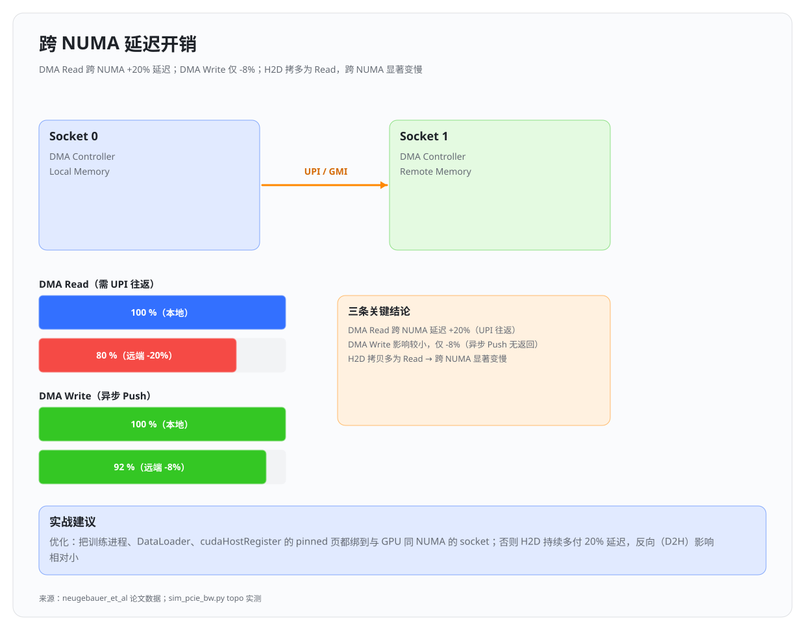
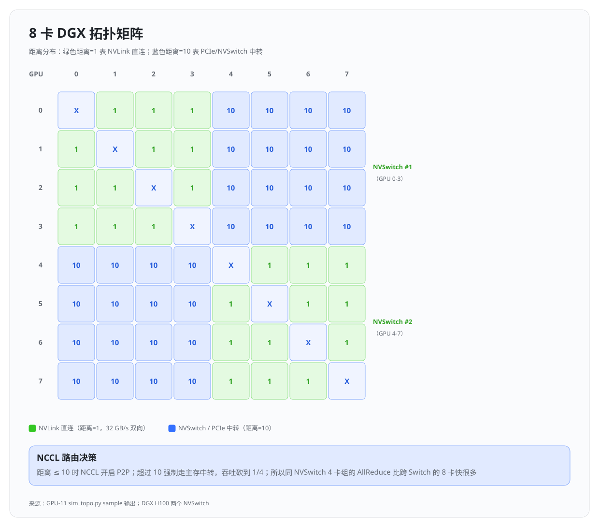
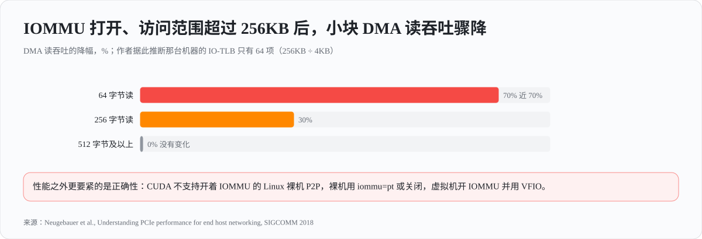
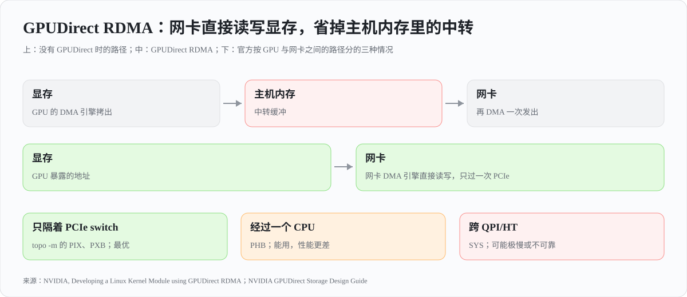
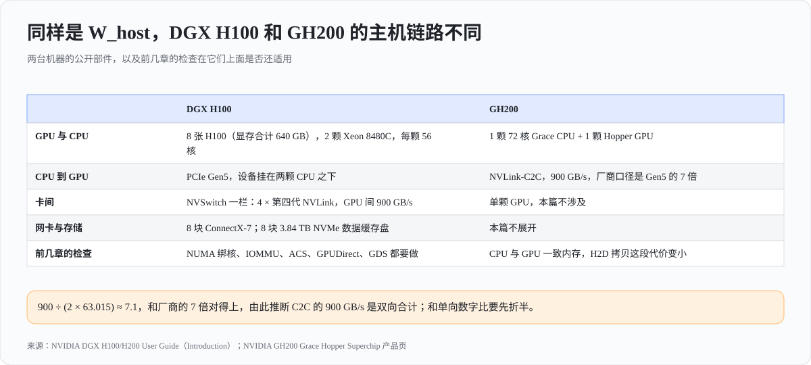

# GPU-11｜系统｜PCIe、NUMA 与 GPUDirect

> 🎯 **这篇文档解决什么问题**：H100 的显存带宽是 TB/s 级，GPU 和 CPU 内存、网卡、NVMe 之间却大多只靠一条 PCIe x16。数据喂不饱卡、卡间拷贝比同型号机器慢、NCCL 在 P2P 阶段卡住，原因常常出在这条链路上，GPU 本身没有问题：降速降宽、跨 NUMA、IOMMU 翻译、ACS 改道、经主机内存中转。本篇讲怎么定这条链路的天花板，怎么查出数据实际走了哪条路，以及怎么把路上多余的等待去掉。

**使用方式**：第 1 章定 PCIe 的天花板。第 2 章读 topo -m，看 NCCL 怎么据此决定走不走 P2P。第 3 到 6 章逐项处理主机链路上的等待：NUMA 绑核，pinned 内存和 IOMMU，网卡直达显存的 GPUDirect RDMA，存储直达显存的 GPUDirect Storage。第 7 章讲 ACS 这个看不见的改道开关。第 8 章拿 DGX H100 和 GH200 练习，第 9 章给上线前清单和自测。

**代码**：zero-to-gpu/11-pcie-gdr/ 下的 sim_pcie_bw.py、sim_topo.py、test_pcie_gdr.py 只需 Python。其中 H2D 的扣减比例、拓扑距离数值和“Gen4 用 8b/10b”的断言与公开资料不符，第 9 章逐条说明，正文以核实过的资料为准。

<b>🧭 主线位置</b>：GPU-00（[GPU-00｜索引｜从 0 开始 GPU 优化：路线、章节与练习](./README.md)）建立了时间账 T = T_compute + W_mem + W_host + W_comm + W_idle。GPU-10（[GPU-10｜系统｜显存管理](./10-memory-mgmt.md)）处理了显存的分配和碎片。本篇处理 W_host 里链路这一段：GPU 和主机内存、网卡、存储之间搬数据时的等待；跨机通信经主机中转时，这段等待还会叠到 W_comm 上。链路理顺后，下一个问题是多个作业怎么共享 GPU，交给 GPU-12（[GPU-12｜系统｜MIG、MPS 与容器](./12-sharing.md)）。

## 导读 · 先给结论

- <b>PCIe 的天花板按单向、编码后算。</b>Gen5 x16 每个方向 63.015 GB/s，H100 的显存带宽约是它的 47.6 倍；再扣数据链路层约 8% 到 10% 的开销，所以实际目标取规格、负载下实际协商的代际宽度和同型号实测三者中最小的（第 1 章）。[[1]](https://en.wikipedia.org/wiki/PCI_Express)[[2]](https://www.cl.cam.ac.uk/research/srg/netos/projects/pcie-bench/neugebauer2018understanding.pdf)
- <b>topo -m 填的是符号，不是距离。</b>NV#、PIX、PXB、PHB、NODE、SYS 按路径经过的部件区分；NCCL_P2P_LEVEL 用同一套符号定义 P2P 的最大距离，超出就经主机内存中转（第 2 章）。[[3]](https://docs.nvidia.com/deploy/nvidia-smi/index.html)[[4]](https://docs.nvidia.com/deeplearning/nccl/user-guide/docs/env.html)
- <b>跨 NUMA 的代价集中在小块读上。</b>公开测量里，64 字节 DMA 读远端比本地低 20%，512 字节看不出差别，写不受影响；绑核要 CPU 和内存一起绑（第 3 章）。[[2]](https://www.cl.cam.ac.uk/research/srg/netos/projects/pcie-bench/neugebauer2018understanding.pdf)
- <b>裸机 IOMMU 首先是正确性问题。</b>CUDA 不支持开着 IOMMU 的裸机 P2P，可能静默破坏显存；裸机用 iommu=pt 或关闭，虚拟机开 IOMMU 并用 VFIO（第 4 章）。[[5]](https://docs.nvidia.com/cuda/cuda-programming-guide/03-advanced/multi-gpu-systems.html)
- <b>GPUDirect 省掉主机内存里的中转缓冲。</b>RDMA 让网卡直接读写显存，路径上只有 PCIe switch 时最好；GDS 让存储直接写显存，条件不满足时会悄悄退回 POSIX 兼容模式（第 5、6 章）。[[6]](https://docs.nvidia.com/cuda/gpudirect-rdma/index.html)[[7]](https://docs.nvidia.com/gpudirect-storage/pdf/troubleshooting-guide.pdf)
- <b>ACS 会把 switch 内的 P2P 改道到根复合体。</b>结果是显著降速甚至挂起，topo -m 上看不出来；用 lspci 找 SrcValid+，虚拟机里不能关（第 7 章）。[[8]](https://docs.nvidia.com/deeplearning/nccl/user-guide/docs/troubleshooting/gpu_troubleshooting.html)
- <b>DGX H100 的卡间走 NVSwitch，主机侧仍是 PCIe。</b>8 张卡、两颗 CPU、8 块 ConnectX-7；GH200 用 900 GB/s 的 NVLink-C2C 代替 PCIe，厂商口径是 Gen5 的 7 倍（第 8 章）。[[9]](https://docs.nvidia.com/dgx/dgxh100-user-guide/introduction-to-dgxh100.html)[[10]](https://www.nvidia.com/en-us/data-center/grace-hopper-superchip/)

<b>📎 与系列其他文档的分工</b>：GPU-03（[GPU-03｜硬件｜CUDA 编程模型：线程层级、stream 与编译链](./03-cuda.md)）讲 pinned 内存和异步拷贝在编程模型里的用法，本篇讲拷贝走的那条物理链路。GPU-10（[GPU-10｜系统｜显存管理](./10-memory-mgmt.md)）讲显存本身的管理。GPU-12（[GPU-12｜系统｜MIG、MPS 与容器](./12-sharing.md)）讲多个作业共享 GPU。GPU-13（[GPU-13｜单机｜NVLink 与 NVSwitch](./13-nvlink.md)）讲卡间的 NVLink 和 NVSwitch，GPU-17（[GPU-17｜集群｜RDMA 网络：InfiniBand、RoCE 与拥塞控制](./17-rdma.md)）讲跨机的 RDMA 网络，两篇都会用到本篇的拓扑读法和 GPUDirect RDMA。

## 第 1 章 · 主机链路的天花板：PCIe 每代带宽怎么读

GPU-10 把显存内部的等待理清了。本章往外走一层：数据从 CPU 内存、网卡、硬盘进到显存，都要过 PCIe。先把这条链路的天花板算清，后面七章讲的拓扑、NUMA、IOMMU、GPUDirect 和 ACS，都在解释实测为什么到不了天花板。

### 规格表里的数字是每方向、已扣编码

PCIe 每代把单条通道（lane）的传输速率翻倍：3.0 是 8.0 GT/s，4.0 是 16.0 GT/s，5.0 是 32.0 GT/s。按 x16 算，每方向的吞吐分别是 15.754、31.508、63.015 GB/s[[1]](https://en.wikipedia.org/wiki/PCI_Express)。

读这张表要注意两个口径。其一，表里的吞吐是每个方向的：每条 lane 是一对单工通道，上行和下行可以同时满速[[1]](https://en.wikipedia.org/wiki/PCI_Express)。宣传材料里常见的“128 GB/s”，是把两个方向加在一起。其二，表里的数字已经扣掉了线路编码。3.0 起改用 128b/130b 编码，开销从 2.0 时代的 20% 降到约 1.54%（= 2/130）[[1]](https://en.wikipedia.org/wiki/PCI_Express)。所以 Gen5 x16 的 63.015 GB/s 已经是编码之后的值，不要再乘一次编码效率。

和显存比，这条链路窄得多。H100 的 HBM3 最高 3 TB/s[[11]](https://docs.nvidia.com/cuda/hopper-tuning-guide/index.html)，是 Gen5 x16 单方向的 3000 ÷ 63.015 ≈ 47.6 倍。凡是每一步都要从主机取数据的负载，例如数据加载、CPU offload、先落主机内存再发出去的跨机通信，W_host 都很容易成为时间账里最大的一项。

### 编码之后还有协议开销

编码之后的吞吐也不是应用能拿到的。PCIe 把数据切成事务层包（TLP）传输：每个事务在物理层加 2 字节帧，数据链路层再加 6 字节头；数据链路层自己的流控和确认消息还要占掉约 8–10%[[2]](https://www.cl.cam.ac.uk/research/srg/netos/projects/pcie-bench/neugebauer2018understanding.pdf)。再往上，事务层包头的大小和最大载荷（MPS）决定了每个包里有效数据的比例，包越小，头的占比越高。Neugebauer 等人据此建了一个 PCIe 吞吐模型，并用 pcie-bench 在多台服务器上做了测量[[2]](https://www.cl.cam.ac.uk/research/srg/netos/projects/pcie-bench/neugebauer2018understanding.pdf)。

这些开销和平台有关。论文测的是 2018 年的 PCIe 3.0 网卡和服务器，结论可以用来理解开销从哪来，不能直接套到今天的 GPU 服务器上。一台机器到底能拿到多少，要测。CUDA 的 bandwidthTest 示例就是为测主机与设备之间的拷贝带宽写的[[12]](https://docs.nvidia.com/cuda/cuda-c-best-practices-guide/index.html)。测出来的数先和同型号机器比，再和规格表比。

### 定天花板的做法

本篇的五步闭环从这里开始。定天花板时看三个数：

- 规格表上本机 PCIe 代数和宽度对应的每方向吞吐[[1]](https://en.wikipedia.org/wiki/PCI_Express)。
- 用 `nvidia-smi -q` 看 GPU Link information 里的 Max 和 Current。Max 是这张卡在这套系统上能达到的代际和宽度，卡支持的代际比系统高时，报的是系统的代际[[3]](https://docs.nvidia.com/deploy/nvidia-smi/index.html)；Current 是当前的代际和宽度，GPU 空闲时可能降下来[[3]](https://docs.nvidia.com/deploy/nvidia-smi/index.html)，所以要在跑负载时看。`sudo lspci -vv` 里 GPU 那一项的 LnkCap 和 LnkSta 是同一组信息。负载下 Current 仍低于 Max，说明链路降速或降宽，这是硬件、插槽或 BIOS 的问题，改代码救不回来。
- 同型号健康机器上，用 pinned 内存跑 bandwidthTest 得到的 H2D 和 D2H。

三个数里最小的那个，就是这台机器主机链路的天花板。后面每一章的“测实际”，都拿实测和它比。

一个常见的误区是拿宣传里的“双向 128 GB/s”和单方向拷贝的实测比，得出“只跑到三分之一”的结论。现象是怎么调都追不上。原因是口径错了，一次 H2D 拷贝只用一个方向。改法是先统一口径：Gen5 x16 每方向 63.015 GB/s 已是编码后的上限，再和同型号机器的实测比。

> 🔑 **本章要点**：PCIe 规格表的吞吐是每方向、已扣编码的值，Gen5 x16 为 63.015 GB/s，H100 的 HBM3 是它的 47.6 倍。协议层还要扣帧头、链路层头和约 8–10% 的流控确认。天花板取规格、LnkSta 和同型号实测三者中最小的那个。这一章是五步闭环的“定天花板”。

## 第 2 章 · 拓扑：topo -m 的六种连接与 NCCL 的 P2P 判定

第 1 章算的是一条链路的天花板。一台 8 卡机器里，两张卡之间、卡和网卡之间走的路各不相同：有的只过一个 PCIe switch，有的要绕到 CPU，有的还要跨 socket。本章讲怎么读出每一对设备之间走哪条路，以及 NCCL 据此决定要不要用点对点（P2P）传输。

### topo -m 的图例：六种连接，按经过的部件分

`nvidia-smi topo -m` 打印所有 GPU 和网卡之间的连接矩阵，以及每张 GPU 的 CPU 和内存亲和性[[3]](https://docs.nvidia.com/deploy/nvidia-smi/index.html)。矩阵里填的不是距离数值，是一组符号，按路径上经过的部件区分[[3]](https://docs.nvidia.com/deploy/nvidia-smi/index.html)：

- <b>NV#</b>：经过 # 条绑定在一起的 NVLink。
- **PIX**：只经过一个 PCIe switch。
- **PXB**：经过多个 PCIe switch，但不经过 PCIe Host Bridge。
- **PHB**：经过 PCIe Host Bridge（通常就是 CPU）。
- **NODE**：经过同一 NUMA 节点内多个 Host Bridge 之间的互连。
- **SYS**：经过 NUMA 节点之间的 SMP 互连（如 QPI/UPI）。

从 PIX 到 SYS，路径上的部件越来越多。PIX 和 PXB 的流量留在 PCIe switch 里；从 PHB 开始，流量要进 CPU 的根复合体；到了 SYS，还要过 socket 之间的互连。后两种情况下，P2P 流量和 CPU 的内存访问争用同一批资源。

### NCCL 用同一套符号决定要不要走 P2P

NCCL 的 P2P 传输直接用 CUDA 访问另一张卡的显存，走 NVLink 或 PCIe[[4]](https://docs.nvidia.com/deeplearning/nccl/user-guide/docs/env.html)。环境变量 `NCCL_P2P_LEVEL` 定义了 NCCL 愿意用 P2P 的最大距离，取值就是上面的符号[[4]](https://docs.nvidia.com/deeplearning/nccl/user-guide/docs/env.html)：NVL 表示只在 NVLink 相连时用；PIX 表示在同一个 PCI switch 下用；PXB 表示经过多个 PCI switch 也用；PHB 表示在同一 NUMA 节点内用，流量会经过 CPU；SYS 表示跨 NUMA 节点也用。不设置时，NCCL 按架构和运行环境自己选一个值[[4]](https://docs.nvidia.com/deeplearning/nccl/user-guide/docs/env.html)。

所以 NCCL 的选择是由拓扑决定的。一对卡在 topo -m 里是 SYS，而 NCCL 自选的上限没到 SYS，这对卡之间的数据就不走 P2P，改走经主机内存中转的传输。这时候“卡间拷贝慢”和链路带宽无关，是路径变了。

网卡和 GPU 之间也有同样的判定，变量是 `NCCL_NET_GDR_LEVEL`，决定在什么距离下用 GPUDirect RDMA，第 5 章展开[[4]](https://docs.nvidia.com/deeplearning/nccl/user-guide/docs/env.html)。

### 三条命令核对实际路径

- **看连接类型**：`nvidia-smi topo -m`，记下每对 GPU、每个 GPU 与最近网卡之间的符号[[3]](https://docs.nvidia.com/deploy/nvidia-smi/index.html)。
- **看 P2P 能不能用**：`nvidia-smi topo -p2p p` 打印 PCIe 上的 P2P 状态矩阵，`-p2p n` 看 NVLink；健康的 8 卡 PCIe 机器上，非对角线全是 OK[[8]](https://docs.nvidia.com/deeplearning/nccl/user-guide/docs/troubleshooting/gpu_troubleshooting.html)。
- **看 NCCL 认出来的拓扑**：设置 `NCCL_TOPO_DUMP_FILE`，NCCL 会把探测到的拓扑写成 XML 文件[[4]](https://docs.nvidia.com/deeplearning/nccl/user-guide/docs/env.html)，和 topo -m 对照。

NCCL 通过 /sys 发现 GPU 和网卡的 PCI 拓扑。在容器或虚拟机里，/sys 没挂好或者暴露的是虚拟拓扑，NCCL 就会选出次优的路径[[8]](https://docs.nvidia.com/deeplearning/nccl/user-guide/docs/troubleshooting/gpu_troubleshooting.html)。所以裸机上测得好、容器里变慢时，先比较两边 dump 出来的拓扑文件。

一个常见的误区是看到 topo -p2p 全是 OK，就认为 NCCL 一定在用 P2P。现象是 nccl-tests 的卡间带宽远低于预期。原因是 topo -p2p 只说明驱动认为可以访问，NCCL 还要按 NCCL_P2P_LEVEL 判断距离；另外 IOMMU 和 ACS 也会让 P2P 名义可用、实际变慢或出错（第 4、7 章）。改法是把 topo -m 的符号、NCCL dump 的拓扑和 nccl-tests 的结果放在一起看。

> 🔑 **本章要点**：topo -m 用 NV#、PIX、PXB、PHB、NODE、SYS 六种符号描述路径经过的部件，不是距离数值。NCCL_P2P_LEVEL 用同一套符号定义 P2P 的最大距离，超出就改走主机内存中转。核对路径用 topo -m、topo -p2p 和 NCCL_TOPO_DUMP_FILE 三件套。这一章是五步闭环的“定位等待”：先确认数据实际走哪条路。

## 第 3 章 · NUMA：设备读远端内存时的折损与绑核

第 2 章的 NODE 和 SYS 两种连接都和 NUMA 有关。双路服务器上，每颗 CPU 带着自己的内存控制器和 PCIe 根复合体。GPU 或网卡挂在哪颗 CPU 下，它访问那颗 CPU 的内存就是本地，访问另一颗的就要过 socket 之间的互连[[2]](https://www.cl.cam.ac.uk/research/srg/netos/projects/pcie-bench/neugebauer2018understanding.pdf)。本章讲这种不对称有多大，以及怎么用绑核把它消掉。

### 公开测量：小块 DMA 读受影响，写基本不受影响

Neugebauer 等人在双路系统上做过对照：主机缓冲区分别放在设备所在节点（本地）和另一个节点（远端），测 DMA 读写吞吐[[2]](https://www.cl.cam.ac.uk/research/srg/netos/projects/pcie-bench/neugebauer2018understanding.pdf)。结果是：

- 64 字节的 DMA 读，远端比本地吞吐低 20%，从约 32 Gb/s 降到约 25 Gb/s[[2]](https://www.cl.cam.ac.uk/research/srg/netos/projects/pcie-bench/neugebauer2018understanding.pdf)。
- 128 和 256 字节的读，差距降到 5-7%[[2]](https://www.cl.cam.ac.uk/research/srg/netos/projects/pcie-bench/neugebauer2018understanding.pdf)。
- 512 字节的读，看不出差别[[2]](https://www.cl.cam.ac.uk/research/srg/netos/projects/pcie-bench/neugebauer2018understanding.pdf)。
- DMA 写的吞吐不受缓冲区在本地还是远端的影响[[2]](https://www.cl.cam.ac.uk/research/srg/netos/projects/pcie-bench/neugebauer2018understanding.pdf)。

这组数字来自 2018 年的 PCIe 3.0 网卡平台，能说明的是规律：远端访问的代价集中在小块读上。H2D 拷贝里，是 GPU 的拷贝引擎从主机内存读数据，属于 DMA 读；D2H 是往主机内存写。GPU 拷贝通常是大块传输，单靠这组数字推不出今天平台上的折损，需要在本机测。

### 找到 GPU 所在的 NUMA 节点

`nvidia-smi topo -cpu` 打印每张 GPU 的 CPU 亲和、内存亲和和 NUMA 节点号[[3]](https://docs.nvidia.com/deploy/nvidia-smi/index.html)；`topo -m` 的最后几列也有同样的信息。8 卡双路机器上，通常一半 GPU 挂在一颗 CPU 下，另一半挂在另一颗下，网卡也一样。两者都要记下来，因为数据加载进程、pinned 缓冲区、网卡和 GPU 最好都在同一个节点上。

### 绑核：让进程和内存都留在 GPU 那一侧

`numactl` 的两个参数分工不同。`--cpunodebind` 让命令只在指定节点的 CPU 上执行[[13]](https://man7.org/linux/man-pages/man8/numactl.8.html)；`--membind` 让内存只从指定节点分配，那个节点内存不够时分配直接失败[[13]](https://man7.org/linux/man-pages/man8/numactl.8.html)。每张卡一个进程的训练里，按 topo -cpu 的结果给每个 rank 绑到它那张卡所在的节点，数据加载的 worker 也跟着绑。pinned 缓冲区在哪个节点，取决于分配它的进程受什么内存策略约束，所以先绑再分配。

按五步闭环走一遍：

- **定天花板**：第 1 章得到的同型号 H2D 实测。
- **测实际**：同一张卡，分别用 `numactl --cpunodebind=N --membind=N` 绑到本地节点和远端节点，跑 bandwidthTest 或本篇的拷贝基准，记录 H2D 和 D2H。
- **定位等待**：远端明显低于本地，说明这台机器上 NUMA 折损显著；两者相同，说明瓶颈不在这里，回到第 1 章看链路。
- **消除或隐藏**：在启动脚本里按卡绑核，并检查 DataLoader worker 是否继承了绑定。
- **复测**：用 `numastat` 看进程的内存是否落在预期节点，再跑一遍拷贝基准。

一个常见的误区是只绑 CPU、不管内存。现象是用了 `taskset` 或 `--cpunodebind`，拷贝带宽却没变化。原因是内存还按默认策略分配，pinned 缓冲区可能落在另一个节点。改法是同时加 `--membind`，或在分配 pinned 内存之前就把进程绑好，再用 numastat 确认。

> 🔑 **本章要点**：远端 NUMA 的代价集中在小块 DMA 读上：公开测量里 64 字节读降 20%，512 字节读看不出差别，写不受影响。用 topo -cpu 找到每张卡的节点，用 numactl 同时绑 CPU 和内存，并在本机测本地和远端的拷贝带宽。这一章是五步闭环的“消除或隐藏”：用绑核消掉跨 socket 的折损。

## 第 4 章 · pinned 内存与 IOMMU：DMA 地址这一关

第 3 章解决了内存放在哪个节点。本章看另一件事：设备做 DMA 时用的是什么地址，这个地址要不要翻译。pinned 内存决定主机页能不能被设备直接访问；IOMMU 决定设备发出的地址要不要再查一次表。两者都影响 H2D 的速度，IOMMU 还关系到 P2P 的正确性。

### pinned 内存：拷贝最快，但别滥用

CUDA Best Practices Guide 的说法很直接：页锁定（pinned）内存的主机与设备传输带宽最高，以 PCIe Gen3 x16 为例约 12 GB/s[[12]](https://docs.nvidia.com/cuda/cuda-c-best-practices-guide/index.html)。pinned 内存用 `cudaHostAlloc()` 分配；已经分配好的内存可以用 `cudaHostRegister()` 就地锁页，不必另开缓冲区再拷一次[[12]](https://docs.nvidia.com/cuda/cuda-c-best-practices-guide/index.html)。可分页内存的拷贝要先经驱动的中转缓冲，GPU-03（[GPU-03｜硬件｜CUDA 编程模型：线程层级、stream 与编译链](./03-cuda.md)）第 7 章讲过这条路径和公开测量。

同一份文档也提醒了代价：pinned 内存是稀缺资源，用得过多会拖累整机性能，而且锁页本身比普通分配重得多[[12]](https://docs.nvidia.com/cuda/cuda-c-best-practices-guide/index.html)。实践上的做法是预先分配一个固定大小的 pinned 池反复使用，例如 DataLoader 的 `pin_memory=True` 每个 batch 都从池里拿，而不是每步现分配、现释放。

### IOMMU：设备地址也要翻译

大多数现代服务器在 PCIe 设备和主机之间放了一个 IOMMU。它翻译 PCIe 事务里的地址，用内部的 IO-TLB 缓存翻译结果；TLB 未命中时要走完整的页表遍历，事务就被拖慢[[2]](https://www.cl.cam.ac.uk/research/srg/netos/projects/pcie-bench/neugebauer2018understanding.pdf)。Neugebauer 等人在打开 IOMMU 的系统上测过：DMA 访问的范围超过 256KB 后，吞吐骤降，64 字节读降了近 70%，256 字节读降 30%，512 字节及以上没有变化[[2]](https://www.cl.cam.ac.uk/research/srg/netos/projects/pcie-bench/neugebauer2018understanding.pdf)。他们据此推断那台机器的 IO-TLB 只有 64 项（256KB ÷ 4KB）[[2]](https://www.cl.cam.ac.uk/research/srg/netos/projects/pcie-bench/neugebauer2018understanding.pdf)。和第 3 章一样，这组数说明的是规律，具体平台要实测。

对 GPU 服务器，IOMMU 还有一个比性能更要紧的问题。CUDA 编程指南写明：在 Linux 上，CUDA 和驱动不支持开着 IOMMU 的裸机 PCIe P2P；裸机运行 Linux 时必须关闭 IOMMU，以免设备显存被静默破坏[[5]](https://docs.nvidia.com/cuda/cuda-programming-guide/03-advanced/multi-gpu-systems.html)。虚拟机的情况相反，要开 IOMMU 并用 VFIO 驱动做 PCIe 直通[[5]](https://docs.nvidia.com/cuda/cuda-programming-guide/03-advanced/multi-gpu-systems.html)。NCCL 的排障文档也说，这类问题的症状常常像框架或应用的 bug，不会报一个干净的 NCCL 错误[[8]](https://docs.nvidia.com/deeplearning/nccl/user-guide/docs/troubleshooting/gpu_troubleshooting.html)。

### 检查和修改 IOMMU 模式

看当前模式：`cat /proc/cmdline` 看启动参数，`dmesg | grep -i -E "iommu|dmar|default domain"` 看内核日志。出现 `iommu: Default domain type: Translated` 和 `DMAR: IOMMU enabled`，说明是翻译模式，对裸机 P2P 是危险信号[[8]](https://docs.nvidia.com/deeplearning/nccl/user-guide/docs/troubleshooting/gpu_troubleshooting.html)。NCCL 文档给的处理是：在受影响的裸机上避免翻译模式，关掉 GPU 路径上的 IOMMU 翻译[[8]](https://docs.nvidia.com/deeplearning/nccl/user-guide/docs/troubleshooting/gpu_troubleshooting.html)。

内核参数里，`iommu=pt` 让 DMA 默认走直通模式，等价于 `iommu.passthrough=1`，即 DMA 默认绕过 IOMMU[[14]](https://docs.kernel.org/admin-guide/kernel-parameters.html)。改完重启，再用上面两条命令确认，然后跑一遍第 7 章的 P2P 校验。

一个常见的误区是在裸机训练集群上照搬虚拟化环境的安全基线，默认打开 IOMMU 翻译模式。现象是 P2P 偶发数据错误或挂起，排查时像是框架 bug。原因是 CUDA 不支持裸机 IOMMU 下的 P2P。改法是裸机训练节点用直通模式或在 BIOS 里关闭 IOMMU，虚拟机节点保留 IOMMU 并用 VFIO 直通，两类节点分开管理。

> 🔑 **本章要点**：pinned 内存传输带宽最高，但它是稀缺资源，锁页开销也重，应预分配后复用。IOMMU 的 IO-TLB 未命中会拖慢小块 DMA，公开测量里 64 字节读降近 70%。更关键的是正确性：Linux 裸机上 CUDA 不支持开 IOMMU 的 P2P，应改用 iommu=pt 或关闭 IOMMU。这一章是五步闭环的“消除或隐藏”：去掉 DMA 路径上多余的翻译。

## 第 5 章 · GPUDirect RDMA：网卡直接读写显存

前四章讲的都是 GPU 和主机内存之间的路。跨机通信时，数据要从网卡进显存，或从显存发给网卡。如果中间先落一次主机内存，W_host 就会叠到 W_comm 上。本章讲 GPUDirect RDMA 怎么省掉这一跳，以及它对拓扑的要求。

### 省掉的是哪一跳

没有 GPUDirect 时，GPU 的 DMA 引擎只能和 CPU 内存互相拷贝，网卡也只能把数据 DMA 到主机内存，两者之间必须在主机内存里放一个中转缓冲（bounce buffer）[[15]](https://docs.nvidia.com/gpudirect-storage/pdf/design-guide.pdf)。一条消息因此要过两次 PCIe，还要占一份主机内存带宽。

GPUDirect RDMA 是 Kepler 架构和 CUDA 5.0 引入的技术，它用 PCI Express 的标准特性，在 GPU 和第三方设备之间开一条直接的数据通路，第三方设备可以是网卡、视频采集卡或存储适配器[[6]](https://docs.nvidia.com/cuda/gpudirect-rdma/index.html)。网卡的 DMA 引擎直接访问 GPU 暴露出来的显存地址，数据只过一次 PCIe。

### 拓扑要求：最好只隔着 PCIe switch

GPUDirect RDMA 有多条限制，最重要的一条是两个设备必须在同一个上游 PCIe 根复合体下[[6]](https://docs.nvidia.com/cuda/gpudirect-rdma/index.html)。即使满足这一条，芯片组的缺陷也可能让它性能很差甚至不能工作[[6]](https://docs.nvidia.com/cuda/gpudirect-rdma/index.html)。官方文档按 GPU 和网卡之间的路径分了三种情况[[6]](https://docs.nvidia.com/cuda/gpudirect-rdma/index.html)：

- 路径上只有 PCIe switch：最优，性能最好。
- 经过一个 CPU：能工作，性能更差，某些处理器上 P2P 读带宽受到严重限制。
- 跨过 QPI/HT 这类 socket 间互连：可能性能极差，甚至不能可靠工作。

这三种情况正好对应第 2 章 topo -m 里的 PIX/PXB、PHB 和 SYS。NCCL 用 `NCCL_NET_GDR_LEVEL` 决定在多远的距离上启用 GPUDirect RDMA，例如设为 PXB 表示 GPU 和网卡经过多级 PCI switch 时也用[[4]](https://docs.nvidia.com/deeplearning/nccl/user-guide/docs/env.html)。选机型时要看每张 GPU 是否有一块和它同在一个 PCIe switch 下的网卡；GPU-13（[GPU-13｜单机｜NVLink 与 NVSwitch](./13-nvlink.md)）和 GPU-17（[GPU-17｜集群｜RDMA 网络：InfiniBand、RoCE 与拥塞控制](./17-rdma.md)）会从多卡和集群的角度再看这件事。

### 软件条件与核对

硬件拓扑之外，还要满足软件条件。GPUDirect RDMA 需要兼容的网卡和驱动，并加载 `nvidia-peermem` 内核模块；这个模块随 CUDA 驱动发布，但每次开机都要用 `sudo modprobe nvidia-peermem` 加载，可以用 `lsmod | grep nvidia-peermem` 确认[[8]](https://docs.nvidia.com/deeplearning/nccl/user-guide/docs/troubleshooting/gpu_troubleshooting.html)。较新的 Linux 内核配合开源版 NVIDIA 驱动时，也可以走 DMA-BUF，NCCL 会自动检测并启用，这时不需要 nvidia-peermem[[8]](https://docs.nvidia.com/deeplearning/nccl/user-guide/docs/troubleshooting/gpu_troubleshooting.html)。

按五步闭环核对：

- **定天花板**：网卡的线速和第 1 章的 PCIe 天花板，取小的那个。
- **测实际**：跨两台机器跑 nccl-tests，记录大消息的 busbw。
- **定位等待**：在 topo -m 里看每张 GPU 到它所用网卡的符号；确认 nvidia-peermem 已加载，或 DMA-BUF 路径可用。
- **消除或隐藏**：调整 rank 与网卡的对应关系，让每张 GPU 用和它在同一 PCIe switch 下的网卡；补上内核模块。
- **复测**：同一组 nccl-tests 再跑一遍，和改动前对比。

一个常见的误区是只确认网卡支持 RDMA，就认为 GPUDirect 已经生效。现象是跨机带宽比同类机器低一截，CPU 内存带宽占用也偏高。原因是 nvidia-peermem 没加载，或者 GPU 和网卡隔着 CPU 甚至 socket 互连，NCCL 按 NCCL_NET_GDR_LEVEL 退回了经主机内存中转的路径。改法是先查内核模块，再查 topo -m 里 GPU 到网卡的那一格。

> 🔑 **本章要点**：GPUDirect RDMA 让网卡直接读写显存，省掉主机内存里的中转缓冲。它要求 GPU 和网卡在同一个根复合体下，路径上只有 PCIe switch 时最好，跨 socket 时可能极慢或不可靠。软件上要加载 nvidia-peermem 或走 DMA-BUF。这一章是五步闭环的“消除或隐藏”：把跨机通信路径上的 W_host 消掉。

## 第 6 章 · GPUDirect Storage：存储直接写进显存

第 5 章把网卡和显存之间的中转省掉了。存储是另一条进显存的路：训练数据、checkpoint、推理时换入的权重，都要从 NVMe 或网络文件系统读进来。本章讲 GPUDirect Storage（GDS）省掉的是什么、什么情况下会悄悄退回老路，以及怎么核对。

### 老路要绕一次 CPU 内存

GPU 的 DMA 引擎只能和 CPU 内存互相拷贝，存储控制器通常也不会把自己的内存暴露给别的 DMA 引擎，所以传统路径必须在 CPU 内存里放一个中转缓冲[[15]](https://docs.nvidia.com/gpudirect-storage/pdf/design-guide.pdf)。读一份 checkpoint，数据先从盘进页缓存或应用缓冲区，再由 GPU 拷贝进显存，主机内存带宽和 CPU 都被占用。

GDS 在显存和存储之间开一条直接的 DMA 通路，避开了经过 CPU 的中转缓冲；这条路能缓解系统带宽瓶颈，降低延迟和 CPU 负载[[16]](https://docs.nvidia.com/gpudirect-storage/overview-guide/index.html)。做法是让存储侧（NVMe 盘、网卡或 RAID 卡）的 DMA 引擎直接写 GPU 暴露出来的地址[[15]](https://docs.nvidia.com/gpudirect-storage/pdf/design-guide.pdf)。应用侧改用 cuFile API 读写，例如 `cuFileRead`、`cuFileWrite`，显存缓冲区可以先用 `cuFileBufRegister` 注册。

### 拓扑同样重要

设计指南特别提到，挂在同一个 PCIe switch 下的 GPU、网卡和存储设备之间，PCIe 带宽通常更高；GPU 和存储在同一个 switch 下时，GDS 最能缓解 CPU 一侧的带宽压力[[15]](https://docs.nvidia.com/gpudirect-storage/pdf/design-guide.pdf)。这和第 5 章 GPUDirect RDMA 的结论一致：路径上只有 PCIe switch 时最好。看机器时，把每张 GPU 和本地 NVMe 在 topo 树里的位置也记下来，`lspci -t` 可以打印 PCI 树。

### 兼容模式：能跑，但没直达

GDS 有一个兼容模式：条件不满足时，cuFile 调用退回普通的 POSIX 读写，经主机内存中转，程序照常运行，只是没有走直达。读托管内存或系统分配的内存时，GDS 也会走带内部 GPU/CPU 中转缓冲的兼容路径[[16]](https://docs.nvidia.com/gpudirect-storage/overview-guide/index.html)。所以“用了 cuFile”不等于“走了 GDS”，要核对：

- **装没装好**：运行 `gdscheck.py -p`，它也会显示 `allow_compat_mode` 是否为 true[[7]](https://docs.nvidia.com/gpudirect-storage/pdf/troubleshooting-guide.pdf)。
- **允不允许退回**：看 `/etc/cufile.json` 里的 `allow_compat_mode`[[7]](https://docs.nvidia.com/gpudirect-storage/pdf/troubleshooting-guide.pdf)。环境变量 `CUFILE_FORCE_COMPAT_MODE` 会覆盖配置文件，强制走兼容模式，排障时可以拿它做对照组[[7]](https://docs.nvidia.com/gpudirect-storage/pdf/troubleshooting-guide.pdf)。
- **实际走的哪条路**：在 cufile.log 里找 `cufile IO mode: POSIX`，有这一行说明走了兼容路径[[7]](https://docs.nvidia.com/gpudirect-storage/pdf/troubleshooting-guide.pdf)。

按五步闭环用：

- **定天花板**：存储的读带宽和第 1 章的 PCIe 天花板，取小的那个。
- **测实际**：用 GDS 自带的 gdsio 工具，或直接计时读 checkpoint。
- **定位等待**：同一份读取，分别在 GDS 模式和强制兼容模式下跑，看差多少、CPU 占用差多少。
- **消除或隐藏**：修好退回的原因，例如文件系统不支持或缓冲区类型不对。
- **复测**：确认日志里不再出现 POSIX 模式。

一个常见的误区是把数据加载慢一律归到存储上，直接上 GDS。现象是改造完成后，训练吞吐没有变化。原因是数据加载本来就和计算重叠得很好，或者瓶颈在解码、增强这些 CPU 处理上，GDS 只省掉了搬运。改法是先用 profiler 看 GPU 是否真的在等数据，等的是 I/O 还是 CPU 处理，再决定要不要改造。

> 🔑 **本章要点**：GDS 让存储侧的 DMA 引擎直接写显存，省掉 CPU 内存里的中转缓冲，GPU 和存储在同一 PCIe switch 下时收益最大。cuFile 在条件不满足时会退回 POSIX 兼容模式，要用 gdscheck、cufile.json 和 cufile.log 核对。这一章是五步闭环的“消除或隐藏”：消掉存储路径上的 W_host，并确认它真的被消掉了。

## 第 7 章 · ACS：P2P 被绕到根复合体

第 4 章讲了 IOMMU 让裸机 P2P 出错的情况。NCCL 排障文档把 P2P 的常见问题归到两个原因上：裸机的 IOMMU 设置，和 PCI 的访问控制服务 ACS[[8]](https://docs.nvidia.com/deeplearning/nccl/user-guide/docs/troubleshooting/gpu_troubleshooting.html)。本章讲 ACS 做了什么、怎么查、怎么关，以及虚拟机里为什么不能关。

### ACS 把 switch 内的 P2P 流量改道

没有 ACS 时，同一个 PCIe switch 下两张卡之间的读写可以在 switch 内部直接转发，这正是第 2 章 PIX、PXB 两种连接的好处。ACS 打开后，switch 会把所有 PCI 点对点流量重定向到 CPU 的根复合体，NCCL 文档的描述是这会造成显著的性能下降，甚至挂起[[8]](https://docs.nvidia.com/deeplearning/nccl/user-guide/docs/troubleshooting/gpu_troubleshooting.html)。

换句话说，topo -m 上写着 PIX 的一对卡，实际走的是 PHB 那条路。topo -m 看的是物理连接，看不出 ACS 的改道；所以拓扑表看着正常、卡间带宽却低，或者 NCCL 在 P2P 阶段卡住，都要查 ACS。

### 查和关：BIOS、setpci 两条路

检查方法是 `sudo lspci -vvv`，在每个 PCI bridge 的输出里找 ACSCtl 这一行；出现 `SrcValid+`，说明 ACS 可能开着[[8]](https://docs.nvidia.com/deeplearning/nccl/user-guide/docs/troubleshooting/gpu_troubleshooting.html)。

关闭有两条路[[8]](https://docs.nvidia.com/deeplearning/nccl/user-guide/docs/troubleshooting/gpu_troubleshooting.html)：

- **BIOS**：有些系统可以在 BIOS 里关掉 IO 虚拟化或 VT-d，ACS 随之关闭。
- **操作系统**：Broadcom PLX 的 switch 可以在系统里用 setpci 关，例如 `sudo setpci -s 03:00.0 ECAP_ACS+0x6.w=0000`，把 03:00.0 换成每个 PCI bridge 的总线号。这种改法每次重启后都要重做，所以要放进开机脚本。

在 BIOS 里关 VT-d，IOMMU 也一起关了，对裸机 P2P 来说这正是第 4 章要的结果。

### 虚拟机里不能关

虚拟机依赖 ACS 才能工作，关闭 ACS 不是可选项[[8]](https://docs.nvidia.com/deeplearning/nccl/user-guide/docs/troubleshooting/gpu_troubleshooting.html)。虚拟机里要拿到最好的性能，NCCL 文档给的办法是在网卡上打开 ATS[[8]](https://docs.nvidia.com/deeplearning/nccl/user-guide/docs/troubleshooting/gpu_troubleshooting.html)。所以集群里裸机节点和虚拟机节点要分两套基线：裸机关 ACS、关 IOMMU 翻译；虚拟机保留 ACS 和 IOMMU，开 ATS，并接受卡间 P2P 走根复合体的代价。

按五步闭环走一遍：

- **定天花板**：第 1 章的 PCIe 天花板，或同型号机器上的卡间带宽实测。
- **测实际**：NCCL 推荐用 nvbandwidth 测卡间带宽[[8]](https://docs.nvidia.com/deeplearning/nccl/user-guide/docs/troubleshooting/gpu_troubleshooting.html)；用 cuda-samples 里的 simpleP2P 查正确性，它每次传输后都校验数据，最后一行应是 Test passed[[8]](https://docs.nvidia.com/deeplearning/nccl/user-guide/docs/troubleshooting/gpu_troubleshooting.html)。
- **定位等待**：用 `NCCL_P2P_DISABLE` 或 `NCCL_P2P_LEVEL` 关掉或限制 P2P 再跑一次，对照结果，判断问题是否出在 P2P 传输上[[8]](https://docs.nvidia.com/deeplearning/nccl/user-guide/docs/troubleshooting/gpu_troubleshooting.html)；再用 lspci 查 ACSCtl。
- **消除或隐藏**：裸机在 BIOS 或开机脚本里关 ACS；虚拟机开 ATS。
- **复测**：重启后再查一遍 ACSCtl，确认开机脚本生效，再跑 nvbandwidth 和 simpleP2P。

一个常见的误区是手动 setpci 关掉 ACS、测完带宽就算修好。现象是过几天机器重启后，同一台机器的 NCCL 作业又变慢或卡住。原因是 PLX switch 上的 setpci 改动不跨重启。改法是把关 ACS 写进开机脚本或改 BIOS，并把 ACSCtl 检查加到节点上线的巡检里。

> 🔑 **本章要点**：ACS 打开时，PCIe switch 把所有点对点流量改道到根复合体，造成显著降速甚至挂起，topo -m 上看不出来。用 lspci -vvv 找 SrcValid+，裸机在 BIOS 关 VT-d 或用 setpci 关，后者每次重启都要重做。虚拟机必须保留 ACS，改为开网卡 ATS。这一章是五步闭环的“定位等待”：找出拓扑表之外改变路径的那个开关。

## 第 8 章 · 两类机器：DGX H100 与 GH200 的主机链路

前七章的方法对任何机器都适用。本章拿两台公开资料比较全的机器来练习：DGX H100 是 8 卡、双路 CPU 的典型训练服务器，GH200 把 CPU 和 GPU 放进同一个超级芯片。两者的主机链路差别很大，同一个 W_host 要用不同的眼光去看。

### DGX H100：卡间走 NVSwitch，主机侧仍是 PCIe

DGX H100 用户指南列出的主要部件[[9]](https://docs.nvidia.com/dgx/dgxh100-user-guide/introduction-to-dgxh100.html)：

- GPU：8 张 H100，显存合计 640 GB。
- CPU：2 颗 Intel Xeon 8480C，PCIe Gen5，每颗 56 核。
- NVSwitch：表格里这一栏写的是 4 个第四代 NVLink，提供 900 GB/s 的 GPU 间带宽。
- 集群网络：4 个 OSFP 口，对应 8 块单口 ConnectX-7 InfiniBand 网卡。
- 数据缓存盘：8 块 3.84 TB 的 NVMe U.2，组 RAID 0。

网卡做成了网络模块，每个模块把 4 块 ConnectX-7 合成一个设备；模块装在一块 interposer 板上，这块板一端连 CPU，另一端连 GPU 托盘[[9]](https://docs.nvidia.com/dgx/dgxh100-user-guide/introduction-to-dgxh100.html)。

从 W_host 的角度读这张表：GPU 之间的流量走 NVSwitch，不占 PCIe；GPU 和 CPU 内存、网卡、NVMe 之间仍然走 PCIe，而且这些设备挂在两颗 CPU 之下。所以第 1 章的链路检查、第 3 章的 NUMA 绑核、第 5 章的 GPU 与网卡配对、第 6 章的 GDS 在这台机器上都要做。8 张卡、8 块网卡，数量上正好一一对应；每张卡实际用哪块网卡、中间隔着几级 switch，要用 topo -m 看，不要凭编号猜。

### GH200：CPU 和 GPU 之间换成了 NVLink-C2C

GH200 把 72 核的 Grace CPU 和 Hopper GPU 用 NVLink-C2C 连在一起[[10]](https://www.nvidia.com/en-us/data-center/grace-hopper-superchip/)。厂商页面给出的数字是：一致性接口带宽 900 GB/s，比 PCIe Gen5 快 7 倍[[10]](https://www.nvidia.com/en-us/data-center/grace-hopper-superchip/)。用第 1 章的表核对一下：Gen5 x16 编码后单向 63.015 GB/s，双向合计约 126 GB/s，900 ÷ 126 ≈ 7.1，和厂商的 7 倍对得上。由此推断 900 GB/s 是双向合计的口径，页面没有写明，和单向数字比要先折半。

差别不只在带宽。GH200 提供 CPU 和 GPU 之间一致的内存模型[[10]](https://www.nvidia.com/en-us/data-center/grace-hopper-superchip/)，CPU 和 GPU 合计最多 624 GB 的快速内存[[10]](https://www.nvidia.com/en-us/data-center/grace-hopper-superchip/)。在这种机器上，前几章讲的 pinned 缓冲、H2D 拷贝这一段的代价变小了，W_host 的大头会转到别处：网卡和存储怎么接、数据在 CPU 内存和显存之间怎么放。这些属于 GH200 自己的调优话题，本篇不展开。

### 拿到一台新机器先做什么

不管哪类机器，先把主机链路的账记清楚，再谈调优：

- **定天花板**：每张卡负载下的 PCIe 代际和宽度（nvidia-smi -q 的 Current），或 C2C 这类专用互连的厂商带宽，写清是单向还是双向。
- **测实际**：bandwidthTest 测 H2D 和 D2H，nvbandwidth 测卡间，nccl-tests 测跨机。
- **定位等待**：topo -m 记下每对卡、每张卡到最近网卡的符号；topo -cpu 记下每张卡的 NUMA 节点；查 IOMMU 模式和 ACSCtl。
- **消除或隐藏**：按第 3 到 7 章逐项改：绑核、iommu=pt、关 ACS、加载 nvidia-peermem、确认 GDS 没有退回兼容模式。
- **复测**：同一组基准再跑一遍，结果存档，作为这类机型的基线。

一个常见的误区是把整机厂商的出厂配置当成已经调好。现象是同一型号的两批机器，跨机带宽差了一截。原因是 BIOS 版本、内核参数或系统镜像不同，IOMMU、ACS 这类开关的状态跟着变了，topo -m 却完全一样。改法是把第 9 章的清单做成上线巡检，每台机器都跑，结果和同型号基线比。

> 🔑 **本章要点**：DGX H100 的卡间流量走 NVSwitch，但 GPU 到 CPU 内存、网卡和 NVMe 仍走 PCIe，挂在两颗 CPU 之下，前七章的检查都要做。GH200 用 NVLink-C2C 代替 PCIe 连接 CPU 和 GPU，厂商口径 900 GB/s、7 倍于 Gen5，按双向合计算对得上。这一章是五步闭环的“定天花板”：先认清一台机器的主机链路由哪几段组成。

## 第 9 章 · 上线前核对清单与自测

前八章沿五步闭环处理了主机链路上的等待：第 1 章定天花板，第 2、7 章定位数据实际走的路，第 3 到 6 章把 NUMA、IOMMU、主机中转缓冲这几类等待消除或隐藏，第 8 章拿两类机器练习。本章把这些压成一张上线前的核对清单，再配上代码练习和自测题。

### 📌 核对清单

| 检查项 | 怎样查 | 通过的标志 |
|---|---|---|
| 链路没有降速降宽 | 负载下用 nvidia-smi -q 对比 GPU Link 的 Max 和 Current，或 lspci 的 LnkCap 和 LnkSta；bandwidthTest 测 H2D、D2H（第 1 章） | 负载下 Current 等于 Max，实测和同型号机器一致 |
| 拓扑记录在案 | nvidia-smi topo -m、topo -p2p p；NCCL_TOPO_DUMP_FILE 导出 NCCL 看到的拓扑（第 2 章） | 符号和机型手册一致，P2P 矩阵非对角线全是 OK |
| 进程和内存绑在 GPU 那一侧 | topo -cpu 找节点，numactl 同时绑 CPU 和内存，numastat 核对（第 3 章） | 每个 rank 的内存落在它那张卡所在的节点 |
| pinned 内存复用 | 查 DataLoader 的 pin_memory 和自定义缓冲的分配位置（第 4 章） | 缓冲预分配后反复使用，训练循环里没有现分配 |
| 裸机 IOMMU 不在翻译模式 | cat /proc/cmdline；dmesg 里找 Default domain type（第 4 章） | 裸机是直通或关闭；虚拟机开 IOMMU 并用 VFIO |
| ACS 状态符合节点类型 | sudo lspci -vvv 看 ACSCtl；重启后再查一次（第 7 章） | 裸机没有 SrcValid+；虚拟机保留 ACS、网卡开 ATS |
| P2P 正确且够快 | simpleP2P 查正确性，nvbandwidth 测卡间带宽（第 7 章） | 最后一行 Test passed，带宽和同型号一致 |
| GPUDirect RDMA 生效 | lsmod 查 nvidia-peermem 或确认 DMA-BUF；topo -m 看 GPU 到网卡的符号（第 5 章） | 模块已加载，每张卡用同一 PCIe switch 下的网卡 |
| GDS 没有退回兼容模式 | gdscheck.py -p；cufile.json 的 allow_compat_mode；cufile.log（第 6 章） | 日志里没有 cufile IO mode: POSIX |

### 代码练习

zero-to-gpu/11-pcie-gdr/ 下有 sim_pcie_bw.py、sim_topo.py 和 test_pcie_gdr.py，只需 Python。这几个脚本是按简化模型写的，有几处和正文核实过的资料不符，跑的时候对照着看：

- `python3 sim_pcie_bw.py peak`：Gen5 x16 单向 64.0 GB/s 是编码前的数，编码后是第 1 章表里的 63.015 GB/s[[1]](https://en.wikipedia.org/wiki/PCI_Express)。
- `python3 sim_pcie_bw.py h2d`：先扣编码得 63.0，这一步对；之后的 MPS 包头扣 17%、ACK 往返再扣 10%、得出 47.1 GB/s，是脚本自设的假设，没有出处。d2h 的“比 H2D 慢 9%”和 pinned 命令的 2.22 倍也一样。把它们当成练习“逐项扣减”的思路，实际数字用 bandwidthTest 测。
- `python3 sim_pcie_bw.py topo` 和 `python3 sim_topo.py sample`：用 1、10、20 这样的距离数值表示拓扑，真实的 topo -m 填的是 NV#、PIX、PXB、PHB、NODE、SYS 这些符号（第 2 章）[[3]](https://docs.nvidia.com/deploy/nvidia-smi/index.html)。sample 里的“两个 NVSwitch 组之间走 PCIe”也和 DGX H100 不符，那台机器的卡间走 NVSwitch，900 GB/s（第 8 章）[[9]](https://docs.nvidia.com/dgx/dgxh100-user-guide/introduction-to-dgxh100.html)。
- `python3 test_pcie_gdr.py`：断言了“Gen4 用 8b/10b、编码效率 80%”，这是错的，PCIe 从 3.0 起就用 128b/130b[[1]](https://en.wikipedia.org/wiki/PCI_Express)。测试全过只说明代码和它自己的假设一致。

### 自测题

<b>1. 一张 Gen5 x16 的卡，H2D 的天花板怎么定？</b>

答：取三者中最小的：规格表的单向编码后带宽 63.015 GB/s[[1]](https://en.wikipedia.org/wiki/PCI_Express)，负载下 nvidia-smi -q 显示的 Current 代际和宽度对应的值（空闲时它可能降下来）[[3]](https://docs.nvidia.com/deploy/nvidia-smi/index.html)，同型号机器上 bandwidthTest 的实测。规格还要再扣数据链路层的开销，公开测量里约 8% 到 10%[[2]](https://www.cl.cam.ac.uk/research/srg/netos/projects/pcie-bench/neugebauer2018understanding.pdf)，所以不要拿 63 当目标。

<b>2. topo -m 上两张卡是 SYS，NCCL 会怎么传？</b>

答：看 NCCL_P2P_LEVEL。它定义 NCCL 愿意用 P2P 的最大距离，没设时由 NCCL 按架构和环境自选[[4]](https://docs.nvidia.com/deeplearning/nccl/user-guide/docs/env.html)。上限没到 SYS，这对卡之间就不走 P2P，改经主机内存中转。

<b>3. 只用 taskset 绑了 CPU，拷贝带宽没变，为什么？</b>

答：内存还按默认策略分配，pinned 缓冲可能在另一个节点。要同时用 --membind 把内存绑到 GPU 所在节点[[13]](https://man7.org/linux/man-pages/man8/numactl.8.html)，并在分配缓冲之前绑好。公开测量里，远端节点的代价集中在小块 DMA 读：64 字节读降 20%，512 字节读看不出差别[[2]](https://www.cl.cam.ac.uk/research/srg/netos/projects/pcie-bench/neugebauer2018understanding.pdf)。

<b>4. 裸机训练节点为什么不能开 IOMMU 翻译模式？</b>

答：CUDA 和驱动不支持开着 IOMMU 的裸机 PCIe P2P，可能静默破坏显存[[5]](https://docs.nvidia.com/cuda/cuda-programming-guide/03-advanced/multi-gpu-systems.html)。症状常常像框架 bug[[8]](https://docs.nvidia.com/deeplearning/nccl/user-guide/docs/troubleshooting/gpu_troubleshooting.html)。裸机用 iommu=pt 或关闭 IOMMU；虚拟机相反，开 IOMMU 并用 VFIO 直通。

<b>5. topo -m 是 PIX，卡间带宽却很低，甚至 NCCL 挂起，先查什么？</b>

答：查 ACS。ACS 打开时，switch 把所有点对点流量改道到根复合体，会显著降速甚至挂起[[8]](https://docs.nvidia.com/deeplearning/nccl/user-guide/docs/troubleshooting/gpu_troubleshooting.html)，而 topo -m 看不出这种改道。用 lspci -vvv 找 SrcValid+；用 NCCL_P2P_DISABLE 关掉 P2P 再跑一次做对照。

<b>6. 应用改用了 cuFile，怎么确认真的走了 GDS？</b>

答：GDS 条件不满足时会退回 POSIX 兼容模式，程序照常运行。要查 gdscheck.py -p 的输出和 cufile.json 的 allow_compat_mode，并在 cufile.log 里确认没有 cufile IO mode: POSIX[[7]](https://docs.nvidia.com/gpudirect-storage/pdf/troubleshooting-guide.pdf)。

### 下一步

本篇处理的是一台机器里 GPU 和主机、网卡、存储之间的链路。这些路径理顺之后，下一个问题是同一台机器上的多个作业怎么分 GPU：MIG 把一张卡切成彼此隔离的实例，MPS 让多个进程共享一张卡。GPU-12（[GPU-12｜系统｜MIG、MPS 与容器](./12-sharing.md)）讲这两种共享方式和它们的隔离边界。

> 🔑 **本章要点**：上线前核对九项：链路速率、拓扑记录、NUMA 绑定、pinned 复用、IOMMU 模式、ACS 状态、P2P 正确性、GPUDirect RDMA、GDS 模式。代码练习里的 H2D 扣减比例、拓扑距离数值和 8b/10b 断言与资料不符，以正文为准。这一章是五步闭环的“复测”：每台机器按清单跑一遍，结果和同型号基线比。

## 参考文献

按正文首次引用顺序编号，资料截至 2026 年 11 月中。

[1] Wikipedia. PCI Express [en.wikipedia.org/wiki/PCI_Express](https://en.wikipedia.org/wiki/PCI_Express)

[2] Neugebauer et al. Understanding PCIe performance for end host networking. SIGCOMM 2018 [www.cl.cam.ac.uk/research/srg/netos/projects/pcie-bench/neugebauer2018understanding.pdf](https://www.cl.cam.ac.uk/research/srg/netos/projects/pcie-bench/neugebauer2018understanding.pdf)

[3] NVIDIA. nvidia-smi documentation [docs.nvidia.com/deploy/nvidia-smi/index.html](https://docs.nvidia.com/deploy/nvidia-smi/index.html)

[4] NVIDIA. NCCL User Guide: Environment Variables [docs.nvidia.com/deeplearning/nccl/user-guide/docs/env.html](https://docs.nvidia.com/deeplearning/nccl/user-guide/docs/env.html)

[5] NVIDIA. CUDA Programming Guide: Multi-GPU Systems [docs.nvidia.com/cuda/cuda-programming-guide/03-advanced/multi-gpu-systems.html](https://docs.nvidia.com/cuda/cuda-programming-guide/03-advanced/multi-gpu-systems.html)

[6] NVIDIA. Developing a Linux Kernel Module using GPUDirect RDMA [docs.nvidia.com/cuda/gpudirect-rdma/index.html](https://docs.nvidia.com/cuda/gpudirect-rdma/index.html)

[7] NVIDIA. GPUDirect Storage Troubleshooting Guide [docs.nvidia.com/gpudirect-storage/pdf/troubleshooting-guide.pdf](https://docs.nvidia.com/gpudirect-storage/pdf/troubleshooting-guide.pdf)

[8] NVIDIA. NCCL User Guide: Troubleshooting (GPU Direct) [docs.nvidia.com/deeplearning/nccl/user-guide/docs/troubleshooting/gpu_troubleshooting.html](https://docs.nvidia.com/deeplearning/nccl/user-guide/docs/troubleshooting/gpu_troubleshooting.html)

[9] NVIDIA. DGX H100/H200 User Guide: Introduction [docs.nvidia.com/dgx/dgxh100-user-guide/introduction-to-dgxh100.html](https://docs.nvidia.com/dgx/dgxh100-user-guide/introduction-to-dgxh100.html)

[10] NVIDIA. GH200 Grace Hopper Superchip [www.nvidia.com/en-us/data-center/grace-hopper-superchip/](https://www.nvidia.com/en-us/data-center/grace-hopper-superchip/)

[11] NVIDIA. Hopper Tuning Guide [docs.nvidia.com/cuda/hopper-tuning-guide/index.html](https://docs.nvidia.com/cuda/hopper-tuning-guide/index.html)

[12] NVIDIA. CUDA C++ Best Practices Guide [docs.nvidia.com/cuda/cuda-c-best-practices-guide/index.html](https://docs.nvidia.com/cuda/cuda-c-best-practices-guide/index.html)

[13] man7.org. numactl(8) [man7.org/linux/man-pages/man8/numactl.8.html](https://man7.org/linux/man-pages/man8/numactl.8.html)

[14] The Linux Kernel documentation. Kernel parameters [docs.kernel.org/admin-guide/kernel-parameters.html](https://docs.kernel.org/admin-guide/kernel-parameters.html)

[15] NVIDIA. GPUDirect Storage Design Guide [docs.nvidia.com/gpudirect-storage/pdf/design-guide.pdf](https://docs.nvidia.com/gpudirect-storage/pdf/design-guide.pdf)

[16] NVIDIA. GPUDirect Storage Overview Guide [docs.nvidia.com/gpudirect-storage/overview-guide/index.html](https://docs.nvidia.com/gpudirect-storage/overview-guide/index.html)

---

[在 Colab 里跑本章 CPU 练习](https://colab.research.google.com/github/zyaochen/zero-to-gpu/blob/main/colab/11-pcie-gdr.ipynb) · 上一章：[GPU-10｜系统｜显存管理](./10-memory-mgmt.md) · [目录](./README.md) · 下一章：[GPU-12｜系统｜MIG、MPS 与容器](./12-sharing.md)
