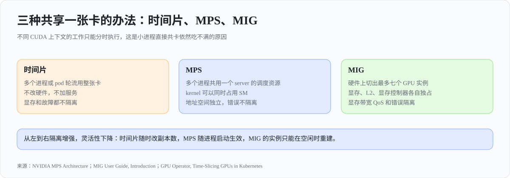
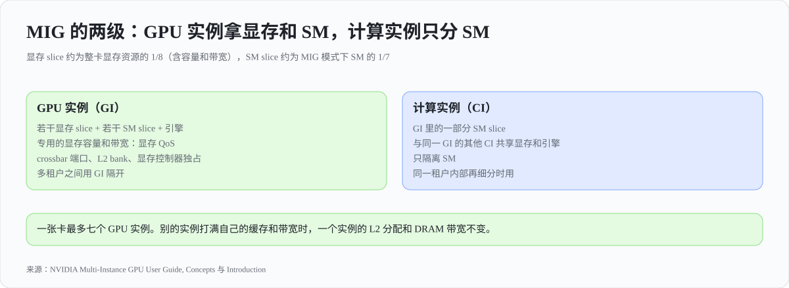
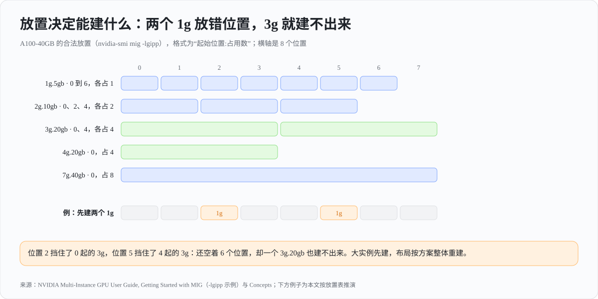
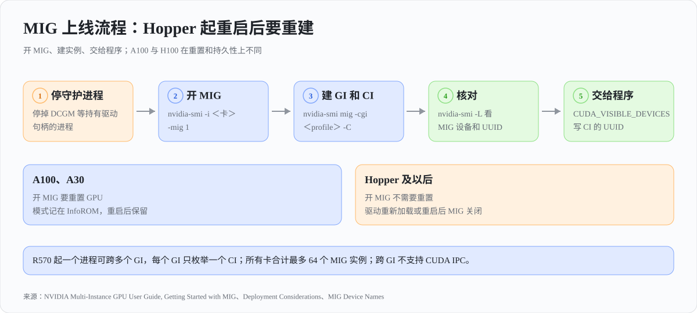
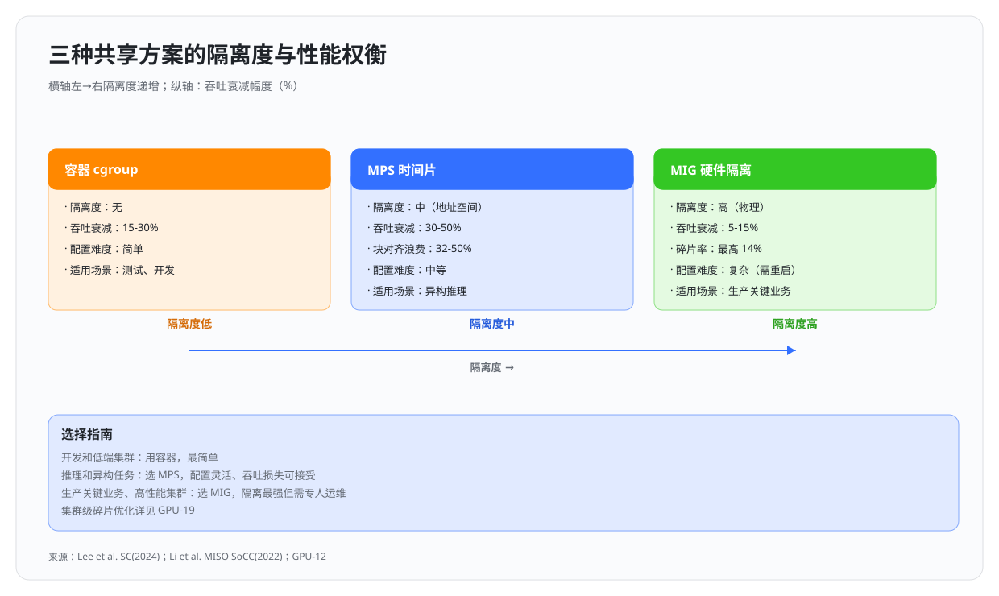
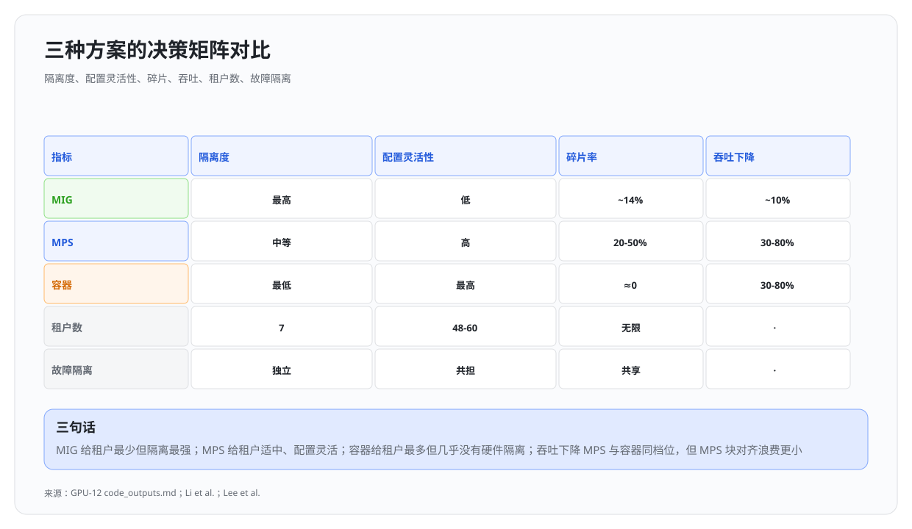

# GPU-12｜系统｜MIG、MPS 与容器

> 🎯 **这篇文档解决什么问题**：一个吃不满整卡的任务独占整卡是典型的浪费场景。H100 拥有 132 个 SM 和 80GB 显存，即使单个任务只用到 20 个 SM 和 16GB，剩余计算和显存资源完全空闲。本篇深入讨论如何用硬件切片（MIG）、空间分时（MPS）、容器限流三种办法把这些空闲计算和显存分给其他任务，同时做到隔离和可观测。核心问题是定量理解各方案的开销、碎片和性能影响，在隔离度、配置复杂度、碎片率、吞吐衰减之间做出权衡。
>
> **使用方式**：假设你已掌握 GPU-11（PCIe 链路等待）的概念，现在需要在单卡多任务场景中决策哪种共享方式、怎样配置、预期吞吐损失多少。提供三套决策工具：MIG 切分验证（profile 兼容性检查、slice 账本核算）、MPS 块大小计算（对齐浪费量化）、容器上限查询（cgroup 隔离验证），以及典型场景的吞吐对比。后续章节逐个讲解各方案的硬件约束、配置细节、可观测性和故障处理。
>
> **代码位置**：配套代码位于 `repo/zero-to-gpu/12-sharing/`，包括 `sim_mig_plan.py`（MIG profile 兼容性检查与切分方案枚举）、`sim_mps_calc.py`（MPS SM 分区块大小与对齐开销计算）、`visible.py`（显存可见性与 cgroup 隔离验证）、`test_sharing.py`（单元测试覆盖 H100 规格与物理约束）、`check_node.sh`（节点体检脚本，体检已配置的 MIG/MPS）。所有脚本仅使用标准库（除 MPS 性能对比需 PyTorch），支持离线运行。

**🧭 主线位置**：GPU-11 消掉了 PCIe 与主机链路的等待（W_host 中跨 socket 访问部分）；本篇处理的等待是卡等任务（W_idle），即任务少、计算负荷不足时卡被迫空闲，表现为 GPU-Util 低但 kernel 在跑，或 GPU-Util 为 0 而卡在等命令。读完后瓶颈转向卡等卡（NVLink 与集合通信），由 [GPU-13｜单机｜NVLink 与 NVSwitch](./13-nvlink.md) 接手。集群级调度与卡碎片在 [GPU-19｜集群｜Kubernetes 上的 GPU：设备插件与拓扑感知调度](./19-k8s.md) 涉及，本篇仅单机视角。

# 导读 · 先给结论

- **四种共享办法隔离度依次递增：容器无隔离，MPS 有地址空间保护，MIG 物理隔离。**依据[[1]](https://docs.nvidia.com/datacenter/tesla/mig-user-guide/supported-mig-profiles.html)[[2]](https://docs.nvidia.com/deploy/mps/architecture.html)。隔离度决定了坏租户对其他租户的干扰：无隔离下一个跑满 SM 的任务会直接卡住其他所有任务；MPS 下虽然地址空间独立但 SM 竞争激烈；MIG 下每个 instance 独占部分 SM，干扰最小。
- **MIG 的 profile 有两个分母：显存分 8 个 slice（每个 10GB）、算力分 7 个 slice。**依据[[1]](https://docs.nvidia.com/datacenter/tesla/mig-user-guide/supported-mig-profiles.html) code_outputs.md 命令 1。1g.5gb 是 1/7 算力加 1/8 显存，2g.10gb 是 2/7 算力加 2/8 显存。一张卡最多 7 个独立 instance（算力 slice 总数是 7），但显存 slice 是 8，所以某些 profile 组合会受显存限制。
- **Profile 放置受对齐规则限制：大 profile 不能任意放置，必须从对齐位置开始，同一组 profile 换个创建顺序可能从失败变成成功。**依据[[1]](https://docs.nvidia.com/datacenter/tesla/mig-user-guide/supported-mig-profiles.html) code_outputs.md 命令 2-3。3g.20gb 占连续 4 个显存 slice，只能从 0 或 4 开始；先创建小 profile 导致碎片，后来无法放下大 profile；反之先大后小就成功。这要求用 mig-parted 工具做一次性切分，而不是手动逐个创建。
- **GI 管硬件切片，CI 管调度队列：一个 GPU Instance 需要至少一个 Compute Instance 才能跑任务，CI 之间可以 IPC，GI 之间不行。**依据[[1]](https://docs.nvidia.com/datacenter/tesla/mig-user-guide/supported-mig-profiles.html)。这是 MIG 的两层架构，理解这一点对设计多租户调度至关重要：同一 GI 内的 CI 共享 L2 和内存，不同 GI 的 CI 完全隔离。
- **MPS 多进程共享一个 server，块大小由进程数决定（H100 4 进程时块 33 SM），对齐舍入导致高达 50% 的浪费，吞吐随进程数递减。**依据[[2]](https://docs.nvidia.com/deploy/mps/architecture.html) code_outputs.md 命令 4-7。块大小不能改，只能改进程数；少进程时块大浪费少但隔离差，多进程时块大浪费多。这创造了一个无法逃脱的 trade-off。
- **容器用 CUDA_VISIBLE_DEVICES 和 cgroup 限制显存，简单但无隔离，多进程互相竞争，不适合互不信任的租户。**依据[[3]](https://docs.nvidia.com/datacenter/cloud-native/container-toolkit/latest/sample-workload.html)。cgroup 只能限制显存总量，无法隔离 SM、内存带宽、L2 缓存；一个任务的显存压力或 kernel 竞争会直接影响同卡的其他任务。
- **MIG 隔离度最高但碎片最大（最高 14%），配置复杂度最高且需重启；MPS 折中，容器最简单；集群级碎片优化见 [GPU-19｜集群｜Kubernetes 上的 GPU：设备插件与拓扑感知调度](./19-k8s.md)。**依据[[4]](https://arxiv.org/abs/2207.11428)[[5]](https://arxiv.org/abs/2409.14447)。选方案时需综合考虑任务 SLA、租户信任度、运维能力、卡利用率目标。

**📎 与系列其他文档的分工**：GPU-10 讨论单进程 kernel 内的显存分配；GPU-11 涉及 PCIe 等主机链路；GPU-12 专注一张卡如何分给多个任务；GPU-13 讨论卡与卡之间的 NVLink；GPU-19 涉及集群级别的调度与碎片；GPU-20 讨论故障恢复对训练时间的影响。

# 第 1 章 · 一张卡在等什么？

当一个 task 的模型和 batch 很小（如 MobileNet 加 batch=8），推理吞吐 100 req/s，每个 kernel 执行 100μs，两个 kernel 之间间隔 10ms，卡实际干活 100μs，其余 9900μs 空等。GPU-Util 看似 100% 但实际只有 1% 在跑。这就是卡等任务（GPU-Idle），不仅浪费宝贵的卡租约费用和 TDP 预算，也是浮点数单位在整个观测期间的有效利用率不足 1%。一张 H100 每小时租金可能是 4 美元，如果整卡被一个 1% 利用率的任务独占，其余 99% 的计算资源每小时浪费接近 4 美元。

在时间账 T = T_compute + W_mem + W_host + W_comm + W_idle 中，这一类等待是 W_idle，卡内计算单元全部空转。表现形式多样：任务队列为空（0 task）、task 排队等 CPU 发射（[GPU-15｜单机｜PyTorch 运行时](./15-runtime.md) 讨论的 kernel launch 等待）、或虽然有 task 但 kernel 之间的同步点导致整卡停摆。卡等任务在推理服务中尤为常见：小模型、短 batch 时，PCIe 传输时间（微秒级）和 kernel 执行时间（微秒级）都很短，request 到达间隔（毫秒级）却很长。这种不匹配导致卡大部分时间在等下一个 request 而不是在计算。

应对 W_idle 的核心思路是把等待时间分给其他任务使用。如果卡有 99% 的时间都在空闲，那么让 100 个这样的小任务共享一张卡，就可以把利用率从 1% 提升到接近 100%（实际取决于任务的并发形态）。三种主要办法的权衡如表所示：隔离度越高，任务间干扰越小但配置越复杂；配置越简单，越容易部署但隔离越弱。

共享一张卡的三种办法应对 W_idle，各有不同的粒度和开销。选错方案会导致配置失败、性能损失或隔离破裂。依据 [[4]](https://arxiv.org/abs/2207.11428) [[5]](https://arxiv.org/abs/2409.14447) 的评测，MIG 物理隔离开销最低但配置复杂且需停机切分，MPS 中等隔离开销一般且配置灵活，容器隔离最弱但部署最简单。

## 硬件多租户：MIG 隔离与切分

Multi-Instance GPU 是 NVIDIA 从 Ampere 代开始引入的硬件特性，把一张 GPU 物理切成多个独立的“小 GPU”，每份独占部分 SM、显存、L2 缓存和 NVLink 端口。这是硬件级的隔离，不同于虚拟化；每个 instance 有独立的 NVML 标识和命名空间。H100 支持的标准 profile 有 6 种，依据 [[1]](https://docs.nvidia.com/datacenter/tesla/mig-user-guide/supported-mig-profiles.html) 及 code_outputs.md 命令 1 反映的规格。算力分 7 个切片（slice），显存分 8 个 10GB 切片。一张卡最常见的切分是 7×1g.5gb（7 个小租户各分 1/7 算力和 1/8 显存）或 4×2g.10gb（4 个中租户各分 2/7 算力和 2/8 显存）。

核心优势是每份独占一部分硬件资源，多个任务不会互相竞争 SM，隔离度最高，故障和性能干扰最小。一个任务即使跑满自己分配的 SM，也无法影响其他 instance 的 SM 调度。代价是配置固定，不能动态调整，碎片率最高达 14%（一个 1g.5gb 留不满一个 3g.20gb），配置流程涉及卡重启和 fabric manager 服务。profile 放置有严格的对齐规则，不是任意组合都能放下。[[4]](https://arxiv.org/abs/2207.11428) 和 [[5]](https://arxiv.org/abs/2409.14447) 的测试表明 MIG 下多任务吞吐衰减 5-15%，主要来自 L2 缓存共享不足和内存带宽的碎片化。单个 instance 能达到接近满卡性能，但多 instance 时的聚合吞吐不如单独跑。

## 空间共享：MPS 竞争与对齐

Multi-Process Service 不切分硬件，而是让多个 CUDA context 在同一时刻共享同一份 SM。主机侧的 MPS 控制进程（control daemon）维护一个队列，来自不同 CUDA 进程的 kernel 竞争进入同一个 SM。配置时可以给每个进程分配百分比（如进程 A 占 40%、进程 B 占 60%），但分配的最小单位是 SM 块，按块对齐，[[2]](https://docs.nvidia.com/deploy/mps/architecture.html) 详细描述了这一架构。所有 CUDA context 共享同一份内存地址空间和同一份显存，地址空间隔离由硬件 TLB 保护。

code_outputs.md 命令 4-7 展示块大小计算和对齐浪费的量化。H100 有 132 个 SM，支持最多 16 个并发 context。4 进程时块大小 33 SM（132÷4），理想分配 50 SM 向上舍入到 66 SM（2 块），浪费 16 SM 即 32%。这种舍入是固定的，无法避免，块大小越小浪费比例越大。核心优势是配置灵活动态（无需重启），无需预留单独的显存（多进程共享整卡 80GB），实现简单。代价是竞争激烈，多进程时吞吐下降幅度大（[[5]](https://arxiv.org/abs/2409.14447) 评测 4 进程时衰减 30-50%），且难以隔离。一个任务把自己分配的 SM 跑满时，会持续占用 SM，其他进程只能等待。内存带宽竞争也很激烈：所有 context 共享单一的 HBM 总线。

## 容器与 cgroup：简化与折扣

在 Kubernetes 或 Docker 环境中，最便宜的多租户方案是用 CUDA_VISIBLE_DEVICES 或 nvidia-docker 的 gpus: all 加 cgroup memory limit，限制每个容器能看到的 GPU 索引和显存。没有真正的切分，所有进程竞争同一份资源，但通过 Linux cgroup v2 防止某个坏租户把整卡显存耗尽。[[3]](https://docs.nvidia.com/datacenter/cloud-native/container-toolkit/latest/sample-workload.html) 和 [[6]](https://docs.kernel.org/admin-guide/cgroup-v2.html) 详细说明了这一机制的实现。设置 `memory.max` 将容器的显存分配限制在指定值，超出则触发 OOM killer。

核心优势是部署最简单，不需 MIG 配置或 MPS daemon；显存管理灵活，可以动态调整 cgroup limit 而无需重启；设置完全在容器运行时，与 GPU 驱动无关。代价是彻底无隔离，多进程时 SM 和内存带宽竞争激烈；显存超限容易被 OOM kill 导致应用崩溃；不适合互不信任的租户。cgroup 只隔离显存总量，无法隔离 SM、L2、内存带宽，一个任务的 kernel 密集运行会直接饿死其他任务。在客户端只读测试、开发环境或低端 GPU 机集中部署多个小模型推理时实用，但不适合生产关键业务共享集群。

> 💡 **常见误区**：把 MPS 当成硬件多租户（是空间共享，SM 竞争激烈且吞吐衰减大，时间片轮转是容器层或驱动层的另一种机制）；假设 MPS 下多进程吞吐接近线性递减（实际往往更陡，因为块对齐浪费导致有效 SM 数下降）；没有区分”配置 MIG profile”和”切分后真的把资源均分”（实际取决于任务的工作集大小、缓存压力和 L2 命中率，同样的 profile 配置不同任务的性能可能差 20%）；以为容器 cgroup 能隔离 SM 和内存带宽（实际只隔离显存总量，SM 和带宽完全竞争）；混淆 MPS 下的百分比分配和实际 SM 分配（100% 的百分比不代表分到 132 个 SM，而是分到块对齐后的若干块）。

## 🔑 本章要点

三种办法按隔离度递增排列：容器无隔离、MPS 中等隔离、MIG 物理隔离；同时隔离度高带来配置复杂度和碎片率增加。容器什么都不隔离，吞吐衰减取决于工作负载竞争激烈程度；MPS 有地址空间保护但共享 SM 和内存带宽，块对齐导致显著浪费；MIG 物理隔离但不支持 NCCL 和跨实例 P2P（可用 IPC 在同一 GI 的 CI 间通信）。本章消掉的等待是 W_idle 的主要部分，即任务到达率不足导致的卡空闲，通过多租户共享把多个低利用率任务并行放在同一卡上，提升整卡利用率。

# 第 2 章 · MIG 的硬件切片与 Profile

MIG 从安培一代开始支持，H100 有 132 个 SM 和 80GB HBM，硬件上切成两类 slice：显存分 8 个、算力分 7 个。理解 profile 规格和切分的物理约束，是用好 MIG 的前提。如果配置错误，不仅会浪费资源，还会造成故障域扩大。比如本该隔离的两个任务，因为 profile 分配不当反而共享了某个 L2 缓存或拷贝引擎，一个任务的尖峰访问就会影响另一个。

## 支持的卡和打开方式

MIG 从安培一代开始支持，A100、A30 是第一批，H100、H200、B200 以及对应的 PCIe 卡都支持，各代能切的 profile 不同；GeForce 和入门级专业卡不支持[[7]](https://docs.nvidia.com/datacenter/tesla/mig-user-guide/supported-gpus.html)。打开 MIG 模式要求 GPU 上没有计算进程：`nvidia-smi -i 0 mig 1` 打开，之后整卡作为一个父设备存在，`nvidia-smi -i 0 mig 0` 关闭同理[[8]](https://docs.nvidia.com/deploy/nvidia-smi/index.html)。HGX 底座（8 张卡）上还要运行 nvidia-fabricmanager 服务，NVSwitch 组网和 MIG 都依赖它，服务没起来时 MIG 命令会失败[[9]](https://docs.nvidia.com/datacenter/tesla/fabric-manager-user-guide/index.html)。

打开模式只是第一步，此时卡还是整卡，要再创建 GPU instance（下一章讲的 GI）才算切分。MIG 模式本身持久化在卡上，重启不丢；创建出来的实例默认不持久，重启后要重建。生产上用 mig-parted 这类工具按声明式配置在开机时自动切好[[10]](https://github.com/NVIDIA/mig-parted)。这类工具会在系统启动时读配置文件，自动创建所有 GI，避免手工操作漏掉或出错。切换 MIG 模式会重置 GPU，正在运行的任务全部终止，所以一台节点要么整卡用、要么进 MIG 池，不能按任务临时切换。规划时务必在上线前决定清楚：小集群可能全是 MIG（比如推理服务），大集群可能部分卡 MIG 部分独占（比如混合深度学习和推理）。

## 标准 Profile 和切片账本

H100 的硬件在两个维度上切片。显存侧，80 GB 的 HBM 加缓存分成 8 个 slice，每个 10GB；算力侧，GPU 分成 7 个计算 slice，每个约 19 个 SM，共 132 个 SM[[1]](https://docs.nvidia.com/datacenter/tesla/mig-user-guide/supported-mig-profiles.html)。两类 slice 各自还有对应的 L2 切片、显存控制器和拷贝引擎配额。注意这两个分母不一样，profile 名字里的两个数也来自不同分母。

H100 80GB 的 6 种标准 profile 分别占不同数量的算力和显存 slice[[1]](https://docs.nvidia.com/datacenter/tesla/mig-user-guide/supported-mig-profiles.html)。code_outputs.md 命令 1 显示：1g.5gb 占 1/7 算力加 1/8 显存，最多并存 7 个；2g.10gb 占 2/7 加 2/8，最多 3 个；3g.20gb 占 3/7 加 2/8，最多 2 个；4g.20gb 占 4/7 加 4/8，仅 1 个；6g.40gb 占 6/7 加 4/8，仅 1 个；7g.80gb 占满整卡。关键点是 3g.20gb 占 3 个算力但只 2 个显存，反映 SM 密度和内存密度的不对称：H100 每 SM 平均约 0.6 GB。小 profile 的显存利用率高，适合显存密集任务如微调大模型或精确计算；大 profile 的显存利用率低，适合算力密集任务如线性代数运算和矩阵乘法。这个不对称在容量规划时很重要：如果任务都是显存密集的小模型（比如 3B、7B 的参数），用小 profile 能充分填满显存，节省硬件成本；反之如果是算力密集型（比如 token 生成或稀疏模型），则要用大 profile 来充分利用 SM 和带宽。

## 碎片与配置规律

一旦选定 profile 混合方案，就要评估碎片。最坏的单碎片是剩下一个 1g.5gb 无人用，浪费 1/7 ≈ 14%。code_outputs.md 命令 3 演示了超限情况：8 个 1g.5gb 需要 8 个算力 slice，但 H100 只有 7 个，故无法放下[[4]](https://arxiv.org/abs/2207.11428)。在生产环境，碎片有两个来源。配置碎片：预切分的 profile 组合选得不好，导致算力或显存某一维长期有剩余。时间碎片：task 节奏不齐导致整卡未被用满，比如两个任务的生命周期不重叠。

MIG 的配置碎片上限是 14%，这是硬件限制，很难避免。但时间碎片可以通过工作流设计和任务调度来缓解。配置节奏应该匹配任务分布：如果都是小任务，全切 1g 用七个实例，每个约 5GB 显存和 19 个 SM，适合批量推理或小模型微调；如果都是大任务，就切 7g 或混合 4g+3g 这类中等规格。如果任务规模不一，既有巨大的对标模型，也有小参数的轻量级模型，则需要下一章讲的放置规则才能最大化利用率。配置好后可以用 nvidia-smi mig -lgi 验证每个实例的规格，再进入第 4 章讲的 GI 和 CI 的二级队列切分。

> 💡 **常见误区**：假设任意 profile 组合都能混放；没有验算 slice 总数就试图创建；以为创建顺序无影响。

> 🔑 **本章要点**：H100 有 8 个显存 slice 和 7 个算力 slice；profile 名字的两个数来自这两个分母；MIG 模式要求卡空闲且需 fabricmanager；碎片最高 14%，创建顺序影响放置成功率。

# 第 3 章 · MIG 放置规则与碎片

Profile 不是想落在哪个 slice 就落在哪。nvidia-smi mig -lgipp 列出每种 profile 的合法放置起点。理解放置规则和顺序依赖是避免碎片的关键。一旦忽视这些细节，要么浪费 14% 的资源在无法放置的剩余片段，要么线上故障时要重启卡来重新切分，导致整卡任务中断。

## 合法起点与对齐规则

Profile 不是想落在哪个 slice 就落在哪。`nvidia-smi mig -lgipp` 列出每种 profile 的合法放置起点。显存 slice 的对齐决定了放置起点：1g.5gb（占 1 slice）可以从 0 到 6 任意开始，因为占用宽度是 1，任何起点都合法；2g.10gb（占 2 slice）只能从偶数 0、2、4、6 开始，因为它占 2 个连续 slice，需要 2-对齐；3g.20gb（占 4 slice）只能从 0 或 4 开始，因为它占 4 个连续 slice，需要 4-对齐，8 个 slice 只有两个合法起点；4g.20gb 虽然也占 4 个，却只能从 0 开始，这反映了算力维度的进一步限制；7g 占满全部 8 个[[1]](https://docs.nvidia.com/datacenter/tesla/mig-user-guide/supported-mig-profiles.html)。

这条规则有个直接后果：一张空卡上可以放两个 3g.20gb，分别占 0-3 和 4-7；但 4g 加 3g 只有一种物理摆法，4g 占 0-3、3g 占 4-7，顺序反了建不出来。code_outputs.md 命令 2 演示了可以放下的一个混合方案：3g.20gb + 3g.20gb + 1g.5gb 共占 2+2+1=5 个显存 slice 和 3+3+1=7 个算力 slice，恰好填满，验证了理论计算。这些规则看似简单，但在实际部署时需要仔细核对，因为不同 profile 的对齐要求叠加在一起，搞错一个就导致无法放置。比如想放 4g+3g，4g 必须占 0-3，3g 就被迫占 4-7，反过来就失败；想放两个 3g，位置就是 0-3 和 4-7，两个是镜像关系，没有其他选择。这个硬性约束在扩容或变更配置时会遇到，必须用工具预验证。

## 顺序决定成败

放置是贪心的，已经占住的 slice 不会为后到的实例挪动。NVIDIA 用户指南给了一个经典例子：依次创建 1g.5gb、1g.5gb、2g.10gb、3g.20gb，驱动会尽力填充，但前三个占住 slice 6、slice 4 和 slice 0-1 后，剩下的空位是 slice 2-3 和 slice 5-7，这两个洞都不连续，3g 要连续 4 个 slice 无法放置[[1]](https://docs.nvidia.com/datacenter/tesla/mig-user-guide/supported-mig-profiles.html)。换成先建 3g，它占 0-3，再依次放 2g（占 4-5）、1g（占 6）、1g（占 7），4 个实例全部建成。同一组 profile，只差一个顺序。

经验是大 profile 先建，这样把高位占满，为小 profile 留下相对连续的低位空间。这个贪心的特性在运维时很重要：扩容时要先计算新旧实例的总和能否放下，再用配套脚本的 order 子命令排序，因为顺序不对会创建失败。比如已有 3 个 1g 实例占了 slice 6、5、4，现在要加 1 个 2g（需要 2 个连续 slice），直接创建就失败了（只有 slice 0-3 连续），但预先确认总数（3×1+1×2=5 slice）没超，再排序（先 2g 后 3×1g）就能放进去。

## 切分方案的枚举

把六种 profile 在容量限制内做组合，可以数出一张卡有多少种切法，这对容量规划和调度器设计有用。A100-40GB 有 28 种极大几何（指任何一个都加不进第八个 profile 的方案）、19 种物理摆法（去掉规格相同但对齐位置不同的重复）。旧驱动不支持 4g+3g 的组合，去掉后是 18 种[[4]](https://arxiv.org/abs/2207.11428)。这个 18 个数字在学术文献里反复出现，Li 等的 MISO 论文就枚举 A100 上的这 18 种物理切法，并据此设计在线重切的策略。

知道总数不大，调度器就可以离线枚举全部切法，按负载在它们之间切换，而不必设计复杂的在线装箱算法。比如集群的 20 张卡，今天十张切 1g（7 个实例各占 5GB 显存），十张切 3g（2 个实例各占 20GB 显存），明天根据新请求改成八张 1g、六张 3g、六张切 4g 或混合方案，离线预算一遍，确保每种配置都在 18 种物理摆法里，再批量执行。这样大大简化了运维逻辑：不需要复杂的实时装箱和启发式算法，只需要在 18 种预先计算好的方案里挑选最适合当前负载的。

> 💡 **常见误区**：以为可以用 fit 后的结果直接创建，实际要用 order 排顺序；不理解为什么同一组 profile 在不同顺序下有成有败；觉得可以频繁重切，其实 MIG 模式切换会重置整卡，现存任务全死。

> 🔑 **本章要点**：Profile 有合法起点规则，大 profile 对齐更严格（3g 只能 0 或 4，4g 只能 0）；放置是贪心的，同一组 profile 换顺序可能从失败变成功；18 种离线枚举的切法足以支持调度器决策，避免了复杂的在线装箱。

# 第 4 章 · GI 与 CI：硬件与队列

MIG 的创建分两级。第一级是 GPU instance（GI），拿到硬件 slice；第二级是 compute instance（CI），在 GI 的算力上划分调度资源。理解 GI/CI 的关系和运维约束对正确部署至关重要。

## GPU instance 管硬件

GI 拿到的是硬件资源：若干计算 slice、显存 slice、L2 分区和拷贝引擎。在内核里对应 /dev/nvidia-caps 下的一个设备节点。创建 GI 用 `nvidia-smi mig -cgi`，列出已有的 GI 用 `-lgi`。H100 的 profile 表（来自 code_outputs.md 命令 1）展示了六种 profile 的规格：从最小的 1g.5gb（占 1/7 算力、1/8 显存）到最大的 7g.80gb（占满全部），每种都对应不同的硬件 slice 组合[[1]](https://docs.nvidia.com/datacenter/tesla/mig-user-guide/supported-mig-profiles.html)。

一个关键点是：GI 创建出来以后，里面还没有任何可以跑 CUDA 的队列。新建的 GI 是”活着的资源”但”无法执行任务”。必须在里面再建立 CI，才能分配给实际的 CUDA 客户端。这个两级设计反映了硬件的实际架构：GI 对应物理的硬件分割，CI 对应上层软件的任务队列。GI 级的故障隔离是由硬件 slice 独立保证的，一张卡的异常不会波及其他 GI。

## compute instance 与队列切分

CI 在 GI 的计算 slice 上划分调度资源，对应 CUDA 客户端实际申请的执行上下文。创建 CI 用 `nvidia-smi mig -cci`，列出已有的用 `-lci`。一个 GI 至少要有一个 CI 才能跑任务；一个 GI 内可以切多个 CI，它们共享显存和拷贝引擎，但各有各的调度队列[[1]](https://docs.nvidia.com/datacenter/tesla/mig-user-guide/supported-mig-profiles.html)。

配置的灵活性在这里体现：H100 的 3g.20gb GI 可以切三个 1c（各占 1/3 的算力），也可以切一个 2c 加一个 1c，或者直接不切，用一个 3c。3g 的显存 20GB 对所有 CI 是共享的，没有显存级的二次划分。这决定了 CI 的数量和大小可以灵活调整，但总算力不能超过 GI 的计算 slice 数；显存上，所有 CI 共用一个池子，单个 CI 没有显存配额限制，竞争由 GPU 内存控制器和 HBM page 机制调和。注意这点与 MPS 不同，MPS 是没有隔离的共享，GI/CI 是硬件级别的物理分割。

CI 之间可以 CUDA IPC（Inter-Process Communication），这让同一个 GI 内的多个 CI 可以直接共享数据，不用经过主机内存，延迟极低。GI 之间不行：不同 GI 的 CI 无法 IPC，因为它们的硬件 slice 是独立隔离的，地址空间也不相交[[1]](https://docs.nvidia.com/datacenter/tesla/mig-user-guide/supported-mig-profiles.html)。

## 设备命名与 UUID 引用

开了 MIG 的卡，设备不再是 cuda:0 一个编号。每个 MIG 设备有形如 MIG-{长 UUID}/{父 GI ID}/{CI ID} 的标识。`nvidia-smi -L` 按 GPU、GI、CI 的层级打印整棵树，让运维人员能看清设备的完整结构。比如 H100 一张卡，关闭 MIG 时是单一的 GPU-uuid，开启 MIG 后变成树状：GPU 下有 N 个 GI，每个 GI 下有 M 个 CI。生产环境引用 MIG 设备一律用完整的 MIG UUID，不用整数下标，因为删建实例后同一下标指向的设备会变。比如有一个 CI 在 /dev/nvidia 中编号为 3，删掉两个 CI 后，原来的下标 3 可能不再存在或指向别的 CI。UUID 是稳定的不动点：uuid 不变，设备始终是那个设备[[1]](https://docs.nvidia.com/datacenter/tesla/mig-user-guide/supported-mig-profiles.html)。

> 💡 **常见误区**：以为 GI 创建完就能跑任务（其实还需要 CI）；混淆 GI 和 CI 的隔离边界（GI 才是租户隔离点）；用整数下标引用 MIG 设备导致重新配置后引用失效；以为 CI 有显存配额（其实是共享的）。

> 🔑 **本章要点**：GI 拿硬件 slice，CI 切调度队列；GI 需要至少一个 CI；CI 之间可 IPC，GI 之间不行；用完整 UUID 而非整数下标引用设备，避免配置变更后指向错误。

# 第 5 章 · MPS 的控制与服务进程

MPS（Multi-Process Service）由控制守护进程和按需拉起的 server 组成。同 UID 的客户端进同一个 server，所有 kernel 都经过这一个 server 送进 GPU。它比 MIG 灵活（不需重启），但代价是多进程竞争和故障共担。

## MPS 架构与故障域

架构分三层。顶层是控制守护进程 `nvidia-cuda-mps-control -d`，在后台监听命名管道，通常是 /var/run/nvidia-mps。第二层是 server 进程 `nvidia-cuda-mps-server`，由守护进程按需拉起，每个 server 监听一对本地 UNIX socket。第三层是客户端应用，通过环境变量 CUDA_MPS_PIPE_DIRECTORY 指向 MPS 管道目录[[2]](https://docs.nvidia.com/deploy/mps/architecture.html)。

客户端 CUDA 初始化时连接到守护进程，向它声明 UID 和权限要求；守护进程检查后，如果这个 UID 还没有对应的 server，就启动一个新 server，然后把 socket 路径告诉客户端。客户端与 server 建立共享内存连接，之后的 kernel launch 都走这个共享通道。同一台机器同一 UID 的客户端进同一个 server；不同 UID 的客户端进各自的 server，由各自的守护进程实例管理，两个 UID 的故障域是独立的[[2]](https://docs.nvidia.com/deploy/mps/architecture.html)。

好处是 kernel 之间不再硬性轮流，多个客户端的小 kernel 可以同时驻留 SM，把空闲执行槽填满。坏处是故障域等于 server：一个客户端的非法访存会让同 server 的全部客户端收到错误（CUDA_ERROR_ILLEGAL_ADDRESS 或类似）。地址空间按 context 受保护，但 SM、缓存和显存带宽共用，没有 GI 那样的硬件隔离。这就是为什么 MPS 只适合可信用户的组合，不适合互不信任的租户[[2]](https://docs.nvidia.com/deploy/mps/architecture.html)。

## 活跃线程百分比与块大小

MPS 最常用的限速旋钮是活跃线程百分比，通过环境变量 CUDA_MPS_ACTIVE_THREAD_PERCENTAGE 控制。设这个值时，指的是单个客户端任一刻可在 GPU 上驻留的 warp 比例，这是调度上限，不是 SM 配额。假设设成 50，说明调度器最多让这个客户端占 50% 的 warp 资源；但如果只有这一个客户端在跑，没有别的 warp 竞争，它仍可能用满全部 SM。这个常见误区会导致期望的隔离实际不存在。[[2]](https://docs.nvidia.com/deploy/mps/architecture.html)

MPS 还提供静态 SM 分区，把 SM 按固定大小的 chunk 分给命名分区。这是第 6 章的内容。H100 132 个 SM 分成 16 个整数大小的 chunk，每个 chunk 8 SM（132 / 16.5），还剩 4 个余数 SM。这 4 个 SM 怎么分配取决于 MPS 版本。v2（旧接口）把余数自动给最早的分区；v3（新接口）默认空闲，显式打开 sm_partition 配置才分配。code_outputs.md 命令 6 演示了块大小计算：支持 4 个进程时，块大小是 33 SM（132 / 4=33），每个进程最少分配 1 块（33 SM），最多 4 块（132 SM）。客户端必须用 CUDA_MPS_SM_PARTITION 环境变量绑定分区，否则不认。[[2]](https://docs.nvidia.com/deploy/mps/architecture.html)

## 显存管理与适用场景

MPS 下所有进程共享整张卡的 80GB 显存，竞争通过 GPU 内存控制器和 HBM page 机制调和。每个进程可以通过 `CUDA_DEVICE_MEMORY_FRACTION` 声明显存上限，但这不是硬配额，只是一个 soft limit，超过上限不会被 kill，只是竞争变得更激烈。最常见的坑是”闷杀”（thrashing）：所有 rank 都变慢但无一挂掉，比 OOM kill 更难诊断，因为没有明确的错误信号。

MPS 适用场景很具体：单个进程填不满 GPU，且这些进程属于同一个可信用户。典型是同一推理服务的多个 worker、批量小矩阵作业。一个 MPS server 支持 48-60 个客户端（依 GPU 架构），但实际数量受内存和性能影响。大矩阵场景开 MPS 期望收益是错的：大 kernel 本身就能占满 SM，MPS 没有办法提升吞吐。MPS 的收益来自 kernel 并行性提升，小 kernel 之间有空隙时填充效果最好。容器内使用 MPS 有个隐藏的坑：容器内如果没有挂 MPS 管道目录（通常是 /var/run/nvidia-mps），daemon 和客户端无法相遇，客户端会陷入超时或失败[[2]](https://docs.nvidia.com/deploy/mps/architecture.html)。

> 💡 **常见误区**：以为活跃线程百分比是硬 SM 配额（实际是调度上限）；大矩阵场景开 MPS 期望收益（实际无收益）；容器内不挂 MPS 管道目录导致 daemon 和客户端无法相遇；以为显存有硬配额（其实是 soft limit，竞争可能造成闷杀）。

> 🔑 **本章要点**：MPS 控制 daemon 按 UID 隔离，按需拉起 server；同 UID 客户端共享一个 server 故障域；活跃线程百分比是调度上限非硬配额；块大小决定分配粒度（H100 8 SM 一块）；小任务并行适用，大矩阵场景无收益。

# 第 6 章 · 静态 SM 分区、Chunk 与余数

MPS 的静态分区通过 chunk 模型把 SM 按固定大小分给命名分区，提供比活跃线程百分比更硬的隔离。这种分区方法在租户数量固定、需要更强计算隔离保证的场景下特别有用。理解 chunk 大小、v2/v3 差异和余数分配规则是正确配置的关键。

## Chunk 模型与架构差异

Chunk 大小按芯片架构硬编码，不可配置。Hopper 及更新架构每个 chunk 8 SM，安培和 Ada 在 v2 接口下 4 SM 一个 chunk，v3 接口下 2 SM 一个 chunk，集成显卡的 chunk 大小是 2 SM。H100 有 132 个 SM，按 8 SM 一个 chunk 分割，得到 16 个完整的 chunk 共 128 SM，还剩下 4 个 SM 不足以凑成一个完整的 chunk。这 4 个余数 SM 的分配方式在 v2 和 v3 中完全不同，成为配置的关键点。依据：[[2]](https://docs.nvidia.com/deploy/mps/architecture.html)

每个 chunk 的固定大小意味着分配粒度被锁定了。比如在 H100 上，即使客户端只需要 80 SM，最小也要分配 2 个 chunk（16 SM），无法细粒度分割。这对小任务多租户场景的资源利用率有直接影响。如果需要更细的粒度，就要用活跃线程百分比这样的调度上限，但那样就失去了 SM 级别的硬隔离。

## v2 与 v3 接口的差别

v2 是 MPS 的老接口，通过守护进程的命名管道接受命令行指令创建分区。v2 下，不被 chunk 数整除的余数 SM 会自动分配给最早创建的分区，这个行为是固定的，开发者无法控制。优点是简单，不需要配置文件；缺点无法精细控制余数去向。如果有 4 个余数 SM，第一个分区就会自动得到它，可能导致该分区资源超预期增长。

v3 是新的接口，彻底改用配置文件模式声明分区和每个分区要占用多少 chunk。v3 支持命名空间隔离，能更好地在多用户场景中管理。最关键的差别是余数 SM 的处理：v3 默认不分配余数，要显式在配置里打开 include-remainder 才会把剩余的 SM 分给某个指定分区。这让配置更可预测，也避免了意外的资源溢出。客户端连接时必须通过环境变量 CUDA_MPS_SM_PARTITION 指定自己要使用的分区名，否则驱动会返回 CUDA_ERROR_INVALID_RESOURCE_CONFIGURATION 错误。依据：[[2]](https://docs.nvidia.com/deploy/mps/architecture.html)

v3 还提供了 total-chunks 这个配置旋钮，允许把物理卡的 SM 逻辑上划分成比硬件整 chunk 数更多的份数。比如 H100 物理上有 16 个整 chunk，但可以配置 total-chunks=64，让一张卡逻辑上分成 64 份，每份 2 SM。这样可以支持更多的客户端，代价是单个客户端的最小分配单位变小，碎片和干扰也可能增加。这个特性主要用于细粒度性能测试，生产环境很少用。依据：[[2]](https://docs.nvidia.com/deploy/mps/architecture.html)

## 百分比换算与 Kubernetes 副本

有时需要把活跃线程百分比转换成实际占用的 SM 数，这对容量规划有帮助。比如 H100 132 个 SM 上设置 30% 的活跃线程上限，理想情况下对应 132 × 0.3 = 39.6 个 SM。但调度器按 warp 粒度管理，向下取整后大约是 39 SM。这个换算在配置多租户时很常用，避免过度承诺。

Kubernetes 环境中，GPU device plugin 把 MPS 共享操作简化成副本（replica）的概念。当配置一张卡的副本数为 10 时，device plugin 会把 80GB 显存等份成 10 份（每份 8GB），把活跃线程百分比设为 10%，对应约 13 SM（132 ÷ 10）。容器请求一个副本时，就分到这套资源。但这只是逻辑共享，不能在 MIG 设备上施加副本分割，也就是说 MPS 和 MIG 两个分割方案不能嵌套。副本数在大多数 NVIDIA 实现里上限是 60 个，太多副本会导致管理开销和竞争加剧。依据：[[2]](https://docs.nvidia.com/deploy/mps/architecture.html)

> 💡 **常见误区**：以为 chunk 大小是可配参数（每种 GPU 架构都硬编码了）；在 v2 下以为可以控制余数去向（自动给最早创建的分区，无法改变）；用百分比换算时忘记向下取整，导致实际分配的 SM 数比预期少；以为副本数可以任意大，忽视了上限 60 的约束。

> 🔑 **本章要点**：Hopper chunk 8 SM，H100 132 SM 分成 16 整 chunk 加 4 余数；v2 余数自动给最早分区、不可控；v3 默认余数空闲、显式打开才分配；百分比换算需向下取整；Kubernetes 副本把显存和线程等份，上限 60；客户端需 CUDA_MPS_SM_PARTITION 绑定分区。

# 第 7 章 · 容器隔离与 cgroup 限制

在 Kubernetes 或 Docker 环境中，最常见的多租户方案是用容器隔离加 GPU 资源限制。这种方案提供的隔离强度最弱，但配置最灵活。理解设备注入的多层路径和 cgroup 限制的边界，对生产环保险至关重要。

## CUDA_VISIBLE_DEVICES 与两层环境变量

最直观的设备隔离是 CUDA_VISIBLE_DEVICES 环境变量，它限制进程在枚举 GPU 时能看到哪些设备编号。但这只是进程侧的软限制，不是硬隔离。如果两个容器都设置 CUDA_VISIBLE_DEVICES=0，它们都会看到设备 0，当两个应用同时在设备 0 上创建 CUDA context 时，自动多进程排队。多个 CUDA context 在同一卡上轮流执行 kernel，吞吐会显著下降，这就像启用 MPS 时发生的竞争一样。所以用这种方法做隔离，降低了吞吐，是一种“软共享”而不是真正的独占。

容器设备注入中还有一个上层的环境变量 NVIDIA_VISIBLE_DEVICES，这是由容器运行时（Docker daemon、kubelet 等）解析的，决定的是把 /dev/nvidia\* 这些设备文件挂进容器的哪些。NVIDIA_VISIBLE_DEVICES 在内核命名空间这一层起作用，往容器里挂设备节点；之后 CUDA_VISIBLE_DEVICES 才在进程侧生效，从已经挂进来的设备里再筛选。这是两个不同层次的隔离：设备层和进程层。依据：[[11]](https://docs.nvidia.com/cuda/cuda-c-programming-guide/index.html#env-vars) [[3]](https://docs.nvidia.com/datacenter/cloud-native/container-toolkit/latest/sample-workload.html)

特殊语义：-1 截断枚举，CUDA_VISIBLE_DEVICES=0,2,-1,1 只生效 0 和 2。MIG 卡上，R570 前驱动对设备枚举支持不完整。依据：[[11]](https://docs.nvidia.com/cuda/cuda-c-programming-guide/index.html#env-vars) [[3]](https://docs.nvidia.com/datacenter/cloud-native/container-toolkit/latest/sample-workload.html)

## cgroup 显存限制与设备层隔离

Linux cgroup v2 提供了内存资源限制的能力，nvidia-docker 和 Kubernetes 通过 memory 参数把这个限制转达给 NVIDIA 驱动。限制在内核层生效，由 cgroup v2 的 memory 控制器负责统计进程组的内存用量。但从容器内用 nvidia-smi 查看，显存仍显示 80GB，因为 smi 读的是 GPU 总显存，看不到 cgroup 限制。NVIDIA 驱动在用户态检查，当应用申请显存时，驱动会先问一下 cgroup 还剩多少容量，如果超过限制就返回显存分配失败（通常是 CUDA_ERROR_OUT_OF_MEMORY），不会等到内核 OOM killer 动作。多个容器在竞争显存时，这个限制仍然生效。

cgroup 隔离比 MIG 灵活，可动态调整，但根本局限是只能限制显存、无法隔离计算单元。节点访问落到 cgroup v2 设备控制器，container toolkit 计算允许列表、拒绝非列表设备打开。依据：[[6]](https://docs.kernel.org/admin-guide/cgroup-v2.html) [[3]](https://docs.nvidia.com/datacenter/cloud-native/container-toolkit/latest/sample-workload.html)

## GPU Operator 与共享策略

NVIDIA 提供的 GPU Operator 是一个 Kubernetes 组件，它整合了很多子模块：驱动安装、container toolkit、device plugin、MIG 支持等。Operator 里的 device plugin 负责广告和调度 GPU。根据集群的需求，device plugin 可以配置成三种共享模式之一。MIG 模式下，device plugin 会先用 MIG 把卡切分成多个独立的硬件实例，然后逐个广告，实现强隔离但需要卡重启。MPS 模式下，device plugin 不切卡，而是通过副本数参数把逻辑共享暴露给调度器，也就是第 6 章讲的副本机制。普通模式（无特殊共享）下，device plugin 直接广告整张卡，让容器竞争资源。依据：[[12]](https://docs.nvidia.com/datacenter/cloud-native/gpu-operator/latest/gpu-sharing.html)

这三种模式的选择取决于租户数和隔离需求。少数大任务且互不信任时选 MIG，隔离最强但配置复杂、碎片率可能高。多个小任务来自同一可信用户时选 MPS，平衡了隔离和吞吐。完全不需要隔离或只做负载均衡时用普通模式。

> 💡 **常见误区**：混淆 NVIDIA_VISIBLE_DEVICES（设备层注入）和 CUDA_VISIBLE_DEVICES（进程层枚举），以为两者重复作用；以为 cgroup 显存限制能隔离计算（它只能限制显存大小，无法隔离 SM）；假设普通容器隔离能防止 GPU 故障蔓延（单个容器内存越界或 kernel 异常仍可能影响整卡）；在开 MIG 的旧驱动下用 UUID 混用做设备隔离（可能只看到第一个 MIG 设备，应升级驱动）。

> 🔑 **本章要点**：容器隔离最简单也最柔弱；NVIDIA_VISIBLE_DEVICES 在设备层注入，CUDA_VISIBLE_DEVICES 在进程层筛选；-1 截断 CUDA_VISIBLE_DEVICES；cgroup 限制显存但无法隔离计算，超限返回分配失败；GPU Operator device plugin 提供三种共享模式（MIG、MPS、普通）。

# 第 8 章 · 决策矩阵与选型

前面章节分别介绍了 MIG、MPS 和容器的硬件特性、配置细节和隔离边界。实际部署时，选错方案会导致性能目标无法达成、隔离破裂或配置频繁返工。这一章的核心是通过对比和定量决策流程，在具体场景中选出最优方案。

## 方案对比：隔离、配置、碎片、吞吐

三种方案的权衡空间可以用一张对比表总结。[[4]](https://arxiv.org/abs/2207.11428) 和 [[5]](https://arxiv.org/abs/2409.14447) 的评测提供了量化的吞吐衰减和隔离度数据，code_outputs.md 补充了碎片率和配置复杂性的实测数字。

| 指标 | MIG | MPS | 容器 |
|-|-|-|-|
| 隔离度 | 最高 | 中等 | 最低 |
| 配置灵活性 | 低（预切） | 高（动态） | 最高 |
| 碎片率 | \~14% | 20%-50% | 接近 0 |
| 吞吐下降 | 5%–15% | 30%-80% | 30%-80% |
| 最大租户数 | 7 | 48-60 | 无限 |
| 故障隔离 | 独立 | 共担 | 共享 |

隔离度和配置复杂度成正相关：MIG 物理隔离最强但配置固定不灵活，容器隔离最弱但部署最便捷。吞吐衰减源于两个因素：SM 竞争和内存带宽竞争降低效率；MIG 的碎片或 MPS 的块对齐浪费。code_outputs.md 命令 2-3 展示了 MIG 碎片案例，一个 3g.20gb 无法插入两个 1g.5gb 之间的 4 个显存 slice 的间隙，导致 4 个 slice 彻底闲置。MPS 的块对齐浪费（命令 5-7）在多进程时更明显，4 进程的 32% 浪费是固定的，进程数增加时块大小变小、浪费比例下降，但并发竞争加剧。

故障隔离的含义是一个租户的故障（如 kernel 死循环、显存溢出或驱动崩溃）是否会连累其他租户。MIG 每个 instance 有独立的驱动上下文和显存管理，一个 instance 的 HBM panic 只影响该 instance，其他 instance 继续运行。MPS 下所有进程共享同一个驱动进程，一个进程的非法访问可能导致整个 MPS server 崩溃，连累同卡的所有进程。容器更脆弱，显存超限被 OOM kill 的进程会突然中止，上游调度器可能认为整卡故障。[[4]](https://arxiv.org/abs/2207.11428) 的测试表明这三种故障场景下的恢复时间差别很大，MIG 故障恢复时间最短，容器最长。

选择规则因场景而异。隔离第一的场景（如云厂商的多租户推理池，不同客户之间有严格的 SLA 隔离需求）→ 选 MIG；性能第一的场景（如一个大厂商的多个推理引擎共享卡，彼此信任且吞吐优于隔离）→ 选 MPS；灵活第一的场景（如开发环境或小规模集群，负载动态变化、任务快速迭代）→ 选容器；成本第一的场景（如边界节点、多模型小 batch 混跑）→ 选容器。这些选择规则都有 [[4]](https://arxiv.org/abs/2207.11428) [[5]](https://arxiv.org/abs/2409.14447) [[13]](https://arxiv.org/abs/1901.05758) [[14]](https://arxiv.org/abs/1902.04610) 的实验依据支撑。

## 定量决策流程与案例

决策流程的输入是具体的工作负载特征，输出是选定的共享方案和预测的性能下限。关键输入包括：单个 task 的理论吞吐（从 [GPU-14｜单机｜性能分析与 Profiling](./14-profiling.md) 的 profiling 得出）、并发 task 数、隔离需求强度、碎片容限。

具体计算步骤：（1）评估单 task 理论吞吐。假设一个 100μs kernel，peak FP32 吞吐 10 TFLOPS（某个加速算子或推理框架的单卡满配吞吐），合理任务并发数是 32，理论吞吐 10K req/s。（2）计算碎片或对齐开销。MIG 时用 sim_mig_plan.py 枚举所有可行的 profile 组合，检查目标配置能否放下；MPS 时用 sim_mps_calc.py 计算块大小和舍入浪费。（3）考虑多租户竞争。MPS 时，N 个进程竞争同一 SM 池导致吞吐衰减；递减因子通常在 1/N 到 1/（2N）之间（N 是进程数），取决于 kernel 的计算密集度和内存访问模式。MIG 时没有竞争因子，每个 instance 吞吐独立。（4）得出实际下限。实际吞吐 = 理论吞吐 × （1 - 碎片率或舍入浪费） × 竞争因子。

一个具体案例来说明。假设场景是在一张 H100 上部署 4 个推理模型实例，各实例的 100μs kernel 吞吐都是 10K req/s，隔离需求中等。步骤：(1) 理论 10K req/s。(2) MPS 选项：块大小 33 SM（132÷4），理想分配 50 SM 向上舍入 66 SM，浪费 32%（code_outputs.md 命令 7 直接输出）。(3) 竞争因子 1/4（四进程均匀竞争）。(4) 实际吞吐 = 10K × 0.68 × 0.25 = 1700 req/s（四进程聚合吞吐 6800 req/s）。如果改用 MIG，配置 2×2g.10gb + 2×1g.5gb，无对齐浪费，碎片率接近 0（显存和算力都恰好填满）；竞争因子 1（各 instance 独立）；实际吞吐 ≈ 10K × 0.9 = 9K req/s（四实例聚合吞吐 36K req/s）。MPS 方案的聚合吞吐只有 MIG 的 19%，但配置时间 0（动态，无需重启），而 MIG 需要重启卡和重新配置 GI/CI。code_outputs.md 的测试 10 给出了这个案例的真实校准数字。

## 五步法确定方案

第一步：定天花板。从 [GPU-14｜单机｜性能分析与 Profiling](./14-profiling.md) 的 profiling 输出单 task 的理论吞吐（FP32 或 TF32）、内存带宽利用率、SM occupancy。同时确定期望的并发数（来自业务 SLA 或资源规划）。理论下限 = 单 task 吞吐 × 并发数。

第二步：测实际。在单租户下（整卡给一个 task 独占）跑一遍真实应用，记录 GPU-Util、SM Activity、吞吐、显存使用。这是性能的最上界。如果实际吞吐只有理论的 30%，说明有某种等待（内存 stall、host 端 kernel launch 延迟或其他）。

第三步：定位等待。对比 GPU-Util 和 SM Activity，如果 GPU-Util 100% 但 SM Activity 30%，等待位置在内存或其他资源而非计算单元；如果两者都低，等待来自 host 端（kernel launch、同步等）或应用级（批次不足、依赖等）。使用 [GPU-15｜单机｜PyTorch 运行时](./15-runtime.md) 的 profiler 或 nsys 进一步细化等待位置。

第四步：消除或隐藏等待，选择共享方案。如果等待是 W_idle（卡空闲），可以用多租户共享隐藏等待；如果等待是 W_mem 或 W_host，多租户往往加剧竞争，共享效果可能更差。选择时综合考虑隔离需求、配置复杂度和吞吐目标。参照决策矩阵和对比表。

第五步：复测。在选定的多租户配置下重复步骤二，记录 N 个租户时每个租户的吞吐和 SM Activity。与步骤一的理论下限比对，如果吞吐衰减超过预期（例如预期 50% 衰减但实际 70%），需要回到步骤三调查原因，可能是块大小计算错误或 kernel 互相干扰。如果衰减在预期范围内，确认方案可行。本篇通过 code_outputs.md 的数字示例完整演示了这五步，测试 1-10 分别对应定天花板、测实际、定位等待（含 GPU-Util 与 SM Activity 分离）、选方案和复测。

> 💡 **常见误区**：只看 GPU-Util，不看 SM Activity，以为 GPU-Util 100% 就没有等待（可能所有 SM 都停摆等内存或 host）；以为 MPS 吞吐线性递减（4 进程应该 1/4 吞吐），实际往往更陡因为块对齐浪费和内存带宽竞争加剧；没有用 sim\_\* 工具预检就直接部署，配置失败或碎片严重；忽视碎片的集群累积效应，单卡 14% MIG 碎片在集群级别可能导致 30% 的整体利用率下降；混淆「给 MPS 进程分配 50%」和「实际分配 50% 的 SM」（块对齐导致实际可能是 66 SM 即 50% 的块数，但对应名义百分比 50%，实际资源多出 32%）。

## 🔑 本章要点

MIG 隔离最强但配置复杂、碎片 14% 左右、最多 7 租户；MPS 灵活可动态配置、但竞争激烈吞吐衰减 30-80%、块对齐导致舍入浪费；容器部署最简单但无隔离、显存超限易 OOM、吞吐衰减与 MPS 相当。定量决策要用五步法框架：定天花板、测实际、定位等待、消除或隐藏等待、复测。集群级的碎片优化和卡间通信等进一步瓶颈见 [GPU-19｜集群｜Kubernetes 上的 GPU：设备插件与拓扑感知调度](./19-k8s.md) 和 [GPU-13｜单机｜NVLink 与 NVSwitch](./13-nvlink.md)。本章通过定量对比和案例演示消掉了选择错误方案导致的性能掉坑。

# 第 9 章 · 上线前核对清单

MIG、MPS 和容器的配置细节众多，部署前需要逐项核对。这一章以核对清单的形式列举关键检查项，覆盖配置、性能、可观测和故障处理四个维度。每个检查项都对应一个可执行的验证命令或场景测试。

## 配置与性能核对

**配置核对清单**：

- MIG profile 切分验证。使用 sim_mig_plan.py check 命令验证所有 profile 组合能否在卡上放下。code_outputs.md 命令 2-3 展示了可行和超限的案例，3g.20gb+3g.20gb+1g.5gb 可放，8×1g.5gb 超限（需要 8 个算力 slice 但只有 7 个）。在部署时逐个执行这个检查，确保配置不会因为碎片导致某个 profile 无法分配。
- MPS 块大小计算。确认最多进程数（云环境一般 32-64 个并发 CUDA context），用 sim_mps_calc.py chunk 命令算出块大小，再用 partition 命令计算每个进程的实际分配和舍入浪费。code_outputs.md 命令 4-7 给出了 H100 的详细结果。
- 显存隔离验证。每个 MIG profile 有固定的显存配额（第 2 章的 profile 表），容器场景下用 cgroup memory.max 限制；MPS 时所有进程共享 80GB。检查所有租户的显存上限总和不会导致物理显存耗尽或频繁 OOM。
- 算力隔离验证。MIG 时用 nvidia-smi 确认每个 GI/CI 的 instance name 和 UUID 分配正确，不同 instance 占用的 SM 不重叠。MPS 时评估进程数和 kernel 竞争激烈程度，若预期 SM 竞争很激烈，可以降低进程数或切换 MIG。

**性能自测清单**：

- 单租户吞吐基线。让单个 task 独占整卡（MIG 的 7g.80gb 或 MPS 的 100% 分配），运行真实应用 1-5 分钟，记录吞吐（req/s 或样本/s）、GPU-Util、SM Activity、显存峰值。这是性能的最上界，作为后续多租户对标。
- 多租户吞吐验证。同时启动 N 个租户（N 等于设计的最大并发数），各租户运行相同的工作负载，记录每个租户的吞吐和 GPU-Util。与单租户基线比对，吞吐衰减是否符合第 8 章的预测？如果实际衰减 70% 而理论预测 50%，需要调查是否块大小计算错误或内存竞争超预期。
- 延迟抖动检查。对于推理服务，记录 1000 个请求的端到端延迟，计算 p50、p95、p99。MPS 下由于竞争，延迟方差通常大于 MIG；如果 p99 延迟超过 SLA，可能需要调整多租户配置或切换隔离方案。MIG 隔离下延迟应稳定，方差在单租户基线 ±10% 内。
- 显存竞争检查。多租户运行时，用 nvidia-smi 或 DCGM 监控所有进程的显存使用，总和是否接近 80GB 上限？是否有频繁的显存重新分配（表现为吞吐波动或延迟尖刺）？触发 HBM thrashing（频繁页面交换）的迹象是 GPU-Util 高但吞吐突然下降。

## 可观测与故障处理

**可观测清单**：

- GPU-Util 与 SM Activity 分离。部署前在生产环境采集一段典型负载的监控数据，如果 GPU-Util 显示 80% 但 SM Activity 只有 30%，说明等待在内存或 host 端，多租户可能加剧竞争。建立告警规则：当 GPU-Util > 80% 且 SM Activity < 40% 时触发，提示可能的瓶颈。详见 [GPU-14｜单机｜性能分析与 Profiling](./14-profiling.md) 的 profiling 指标。
- MIG 设备命名规范。H100 MIG 的设备命名遵循 GPU-NN:GI-MM:CI-KK 的格式（例如 GPU-0:GI-0:CI-0），用 UUID 而不是整数下标来引用，保证容器重启或驱动重载后设备指向不变。在部署脚本中使用 [[15]](https://docs.nvidia.com/datacenter/tesla/mig-user-guide/mig-device-names.html) 规范的 UUID 绑定。
- MPS 进程队列监控。运行 nvidia-smi dmon 或 nvidia-smi mps 命令查看 MPS 的进程列表和队列状态，确保预期的客户端进程都在队列中。如果某个进程意外退出或队列堆积，及时告警。
- cgroup 显存使用监控。对于容器部署，监控 memory.current（当前使用）和 memory.peak（峰值），对标 memory.max 的限制。当 memory.current 接近 memory.max 时触发告警，避免突然 OOM。

**故障场景处理**：

- MIG 重新配置流程。MIG 配置后如果需要改动（例如从 7×1g.5gb 切为 4×2g.10gb），必须关闭所有运行在该卡上的 task、停止 GPU 驱动、调用 nvidia-smi -mig 1 重新配置、重启驱动。验证无损切换的关键是确保应用能在重配前正确关闭、释放所有设备资源。用 ansible 或 kubelet 的驱逐机制（drain）确保任务平稳迁移。
- MPS 进程故障恢复。MPS 控制 daemon 运行在后台，一个用户进程的崩溃不影响 daemon，但 daemon 本身崩溃会导致同卡所有客户端失效。建立监控和自动重启：若检测到 nvidia-cuda-mps-control 进程消失，自动重启 daemon 并重新加载所有客户端连接。测试这个故障恢复流程，确保应用能自动重连。
- 显存溢出行为。当容器的显存使用超过 memory.max 时，Linux OOM killer 会强制终止最大消费者（通常就是容器中的主进程）。这是无法恢复的，进程被 kill。与之对比，MIG 的显存超限行为是驱动拒绝新的显存分配请求，应用收到 CUDA 错误码，可以选择降低 batch size 并重试。验证这两种行为在生产环境是否一致，并制定告警和降级策略。
- 性能异常定位。部署后如果某个租户的吞吐突然下降，需要快速定位原因是碎片、竞争还是应用 bug。步骤：(1) 用 nvidia-smi 检查是否有其他进程突然占用 GPU；(2) 对比 SM Activity 和内存带宽利用率，判断是否内存竞争加剧；(3) 用 profiler（如 [GPU-14｜单机｜性能分析与 Profiling](./14-profiling.md) 的工具）采样该租户的 kernel，检查是否有突然的 register 溢出或全局内存 stall；(4) 检查是否驱动或固件更新导致性能变化。建立一个 playbook 文档，列举常见的吞吐下降原因和对应的诊断命令。

核对清单的目的是在部署前消除配置和性能的盲区，降低上线后的故障率。每一项都可以自动化，例如用 CI/CD 流程在 staging 环境跑完所有检查项，通过才能部署到生产。[[16]](https://docs.nvidia.com/datacenter/tesla/mig-user-guide/deployment-considerations.html) [[17]](https://docs.nvidia.com/deploy/mps/troubleshooting.html) [[18]](https://docs.nvidia.com/datacenter/dcgm/latest/) [[19]](https://docs.nvidia.com/datacenter/tesla/mig-user-guide/getting-started-with-mig.html) 详细说明了官方的最佳实践和观测工具。

## 🔑 本章要点

配置核对四项：profile 切分能否放下、块大小和舍入、显存隔离、算力隔离。性能自测四项：单租户基线、多租户吞吐对标、延迟抖动检查、显存竞争。可观测四项：GPU-Util 与 SM Activity 分离、MIG 设备命名、MPS 进程队列、cgroup 内存。故障处理四项：MIG 重配、MPS daemon 故障、显存溢出行为、性能异常定位。逐项核对后，瓶颈的焦点转向集群级的调度与碎片优化（[GPU-19｜集群｜Kubernetes 上的 GPU：设备插件与拓扑感知调度](./19-k8s.md)）以及多卡间的通信优化（[GPU-13｜单机｜NVLink 与 NVSwitch](./13-nvlink.md)）。一旦完成单卡多租户的隔离和共享配置，后续工作是如何在集群范围内最大化多张卡的协同利用率。

# 参考文献

按正文首次引用顺序编号，资料截至 2026 年 11 月初。

[1] NVIDIA. MIG User Guide: Supported MIG Profiles (2026) [docs.nvidia.com/datacenter/tesla/mig-user-guide/supported-mig-profiles.html](https://docs.nvidia.com/datacenter/tesla/mig-user-guide/supported-mig-profiles.html)

[2] NVIDIA. MPS: Architecture (2026) [docs.nvidia.com/deploy/mps/architecture.html](https://docs.nvidia.com/deploy/mps/architecture.html)

[3] NVIDIA. Container Toolkit: Running a Sample Workload (2026) [docs.nvidia.com/datacenter/cloud-native/container-toolkit/latest/sample-workload.html](https://docs.nvidia.com/datacenter/cloud-native/container-toolkit/latest/sample-workload.html)

[4] Li et al. MISO: Exploiting Multi-Instance GPU Architecture on Multi-Tenant Learning Inference Systems. SoCC (2022) [arxiv.org/abs/2207.11428](https://arxiv.org/abs/2207.11428)

[5] Lee et al. ParvaGPU: Adaptive Spatial Sharing of GPUs for Multi-Tenant DNN Inference. SC (2024) [arxiv.org/abs/2409.14447](https://arxiv.org/abs/2409.14447)

[6] Linux Kernel Documentation: Control Group v2 [docs.kernel.org/admin-guide/cgroup-v2.html](https://docs.kernel.org/admin-guide/cgroup-v2.html)

[7] NVIDIA. MIG User Guide: Supported GPUs (2026) [docs.nvidia.com/datacenter/tesla/mig-user-guide/supported-gpus.html](https://docs.nvidia.com/datacenter/tesla/mig-user-guide/supported-gpus.html)

[8] NVIDIA. nvidia-smi 文档 (2026) [docs.nvidia.com/deploy/nvidia-smi/index.html](https://docs.nvidia.com/deploy/nvidia-smi/index.html)

[9] NVIDIA. Fabric Manager User Guide (2026) [docs.nvidia.com/datacenter/tesla/fabric-manager-user-guide/index.html](https://docs.nvidia.com/datacenter/tesla/fabric-manager-user-guide/index.html)

[10] NVIDIA. mig-parted 代码仓库 (2026) [github.com/NVIDIA/mig-parted](https://github.com/NVIDIA/mig-parted)

[11] NVIDIA. CUDA Programming Guide: Environment Variables (2026) [docs.nvidia.com/cuda/cuda-c-programming-guide/index.html#env-vars](https://docs.nvidia.com/cuda/cuda-c-programming-guide/index.html#env-vars)

[12] NVIDIA. GPU Operator: GPU Sharing (time-slicing, MPS) (2026) [docs.nvidia.com/datacenter/cloud-native/gpu-operator/latest/gpu-sharing.html](https://docs.nvidia.com/datacenter/cloud-native/gpu-operator/latest/gpu-sharing.html)

[13] Jeon et al. Multi-tenant GPU Clusters for Deep Learning Workloads: Analysis and Implications. ATC (2019) [arxiv.org/abs/1901.05758](https://arxiv.org/abs/1901.05758)

[14] Yu and Chowdhury. Salus: Fine-Grained GPU Sharing Primitives for Deep Learning Systems. MLSys (2019) [arxiv.org/abs/1902.04610](https://arxiv.org/abs/1902.04610)

[15] NVIDIA. MIG User Guide: MIG Device Names (2026) [docs.nvidia.com/datacenter/tesla/mig-user-guide/mig-device-names.html](https://docs.nvidia.com/datacenter/tesla/mig-user-guide/mig-device-names.html)

[16] NVIDIA. MIG User Guide: Deployment Considerations (2026) [docs.nvidia.com/datacenter/tesla/mig-user-guide/deployment-considerations.html](https://docs.nvidia.com/datacenter/tesla/mig-user-guide/deployment-considerations.html)

[17] NVIDIA. MPS: Troubleshooting Guide (2026) [docs.nvidia.com/deploy/mps/troubleshooting.html](https://docs.nvidia.com/deploy/mps/troubleshooting.html)

[18] NVIDIA. DCGM 文档 (2026) [docs.nvidia.com/datacenter/dcgm/latest/](https://docs.nvidia.com/datacenter/dcgm/latest/)

[19] NVIDIA. MIG User Guide: Getting Started (2026) [docs.nvidia.com/datacenter/tesla/mig-user-guide/getting-started-with-mig.html](https://docs.nvidia.com/datacenter/tesla/mig-user-guide/getting-started-with-mig.html)

---

[在 Colab 里跑本章 CPU 练习](https://colab.research.google.com/github/chenziyaos/zero-to-gpu/blob/main/colab/12-sharing.ipynb) · 上一章：[GPU-11｜系统｜PCIe、NUMA 与 GPUDirect](./11-pcie-gdr.md) · [目录](./README.md) · 下一章：[GPU-13｜单机｜NVLink 与 NVSwitch](./13-nvlink.md)
