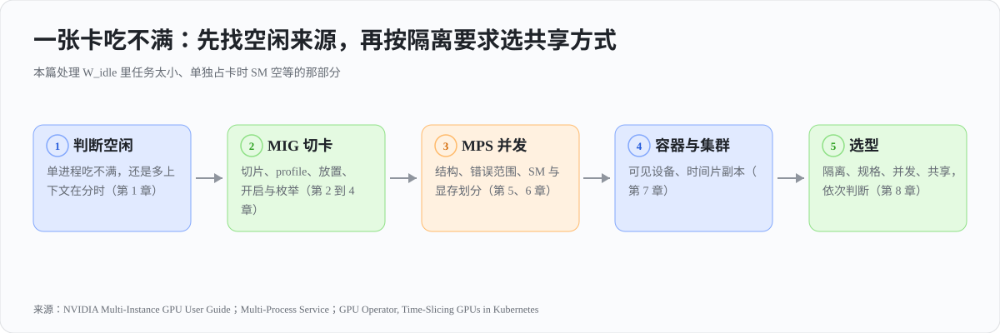
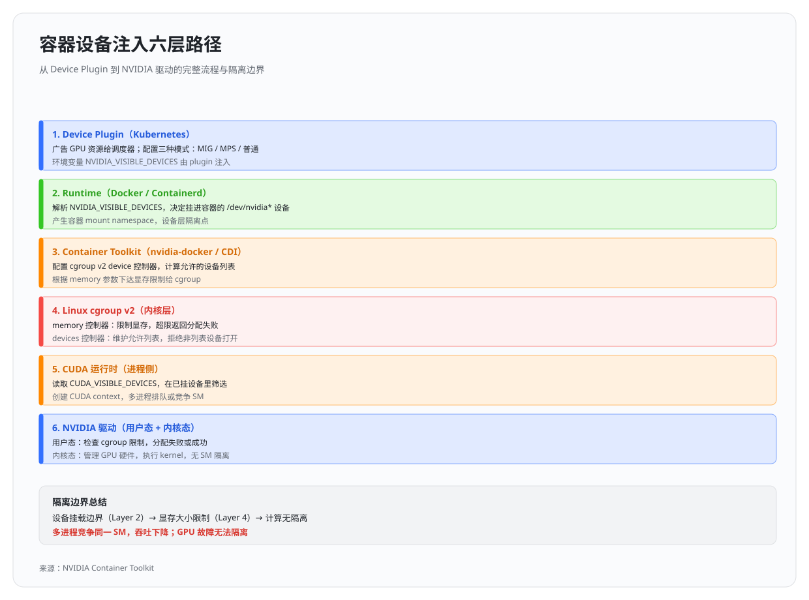
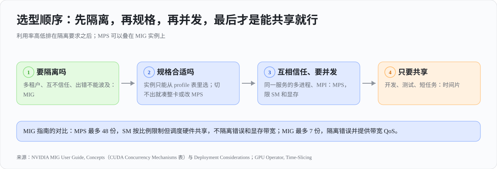

# GPU-12｜系统｜MIG、MPS 与容器

> 🎯 **这篇文档解决什么问题**：小模型推理、开发调试、强扩展下的小进程，单独占一张卡时大部分 SM 在空等。让多个任务共用一张卡有三种办法：Kubernetes 的时间片、MPS 和 MIG，它们的隔离程度差别很大，选错了要么利用率上不去，要么一个任务出错拖垮一张卡。本篇按 NVIDIA 的 MIG 用户指南、MPS 文档和 GPU Operator 文档，讲清 MIG 怎样在硬件上切卡、profile 和放置怎样限制布局、MPS 怎样让进程并发并划分资源、容器和 Kubernetes 里共享的边界，以及按隔离要求选型的顺序。

**使用方式**：第 1 章判断一张卡为什么吃不满。第 2 到 4 章讲 MIG：切片、profile 与放置、开启与枚举。第 5、6 章讲 MPS：结构与错误范围、资源划分。第 7 章讲容器和 Kubernetes，第 8 章选型，第 9 章给清单和自测。

**代码**：zero-to-gpu/12-sharing/ 下的 sim_mig_plan.py、sim_mps_calc.py、test_sharing.py 只需 Python 标准库。模拟器的 profile 名字、放置判定、chunk 定义和吞吐模型与 NVIDIA 文档不符，第 9 章逐条说明。

<b>🧭 主线位置</b>：GPU-00（[GPU-00｜索引｜从 0 开始 GPU 优化：路线、章节与练习](./README.md)）建立了时间账 T = T_compute + W_mem + W_host + W_comm + W_idle。GPU-11（[GPU-11｜系统｜PCIe、NUMA 与 GPUDirect](./11-pcie-gdr.md)）处理了主机和 GPU 之间的数据搬运。本篇处理 W_idle 里最常见的一类：任务太小，单独占卡时 SM 在空等。卡内的共享解决之后，下一个问题是同一台机器上的多张卡怎样高速互连，交给 GPU-13（[GPU-13｜单机｜NVLink 与 NVSwitch](./13-nvlink.md)）。

## 导读 · 先给结论

- <b>多个进程直接共卡只是轮流用。</b>不同 CUDA 上下文的工作不能同时在计算引擎上执行，所以小进程直接共卡依然吃不满（第 1 章）。[[1]](https://docs.nvidia.com/deploy/mps/architecture.html)
- <b>MIG 是硬件切片。</b>显存 slice 约 1/8、SM slice 约 1/7，一张卡最多七个 GPU 实例，从 crossbar 端口到显存控制器都独占（第 2 章）。[[2]](https://docs.nvidia.com/datacenter/tesla/mig-user-guide/concepts.html)[[3]](https://docs.nvidia.com/datacenter/tesla/mig-user-guide/introduction.html)
- <b>能切成什么样由 profile 和放置决定。</b>H100 80GB 是 1g.10gb 到 7g.80gb，名字随型号变；profile 只能从固定位置开始，增删会产生碎片（第 3 章）。[[4]](https://docs.nvidia.com/datacenter/tesla/mig-user-guide/supported-mig-profiles.html)[[5]](https://docs.nvidia.com/datacenter/tesla/mig-user-guide/getting-started-with-mig.html)
- <b>Hopper 起开 MIG 不用重置，但重启后会关。</b>R570 起一个进程可跨多个 GI，每个 GI 只看到一个 CI（第 4 章）。[[5]](https://docs.nvidia.com/datacenter/tesla/mig-user-guide/getting-started-with-mig.html)[[6]](https://docs.nvidia.com/datacenter/tesla/mig-user-guide/mig-device-names.html)
- <b>MPS 让进程并发，但错误不隔离。</b>一个客户端的致命错误会通知同组 GPU 上的所有客户端；客户端上限两份文档分别写 60 和 48（第 5 章）。[[7]](https://docs.nvidia.com/deploy/mps/when-to-use-mps.html)[[2]](https://docs.nvidia.com/datacenter/tesla/mig-user-guide/concepts.html)
- <b>MPS 的静态分区按 chunk 分。</b>Hopper 起每个 chunk 8 个 SM，H100 SXM5 可分 16 个 chunk、余 4 个 SM；显存另设上限（第 6 章）。[[7]](https://docs.nvidia.com/deploy/mps/when-to-use-mps.html)[[8]](https://developer.nvidia.com/blog/nvidia-hopper-architecture-in-depth/)
- <b>时间片副本之间不隔离显存和故障。</b>选型先看隔离要求，再看规格，再看并发（第 7、8 章）。[[9]](https://docs.nvidia.com/datacenter/cloud-native/gpu-operator/latest/gpu-sharing.html)

<b>📎 与系列其他文档的分工</b>：GPU-09（[GPU-09｜系统｜驱动、CUDA 兼容与 Xid](./09-driver.md)）讲驱动、容器里的版本栈和 Xid，MIG 实例里的 Xid 照那里的流程处理。GPU-10（[GPU-10｜系统｜显存管理](./10-memory-mgmt.md)）讲进程内的显存分配，本篇讲进程之间怎样分一张卡。GPU-16（[GPU-16｜单机｜单机验收与调优](./16-node-burnin.md)）讲单机验收。GPU-19（[GPU-19｜集群｜Kubernetes 上的 GPU：设备插件与拓扑感知调度](./19-k8s.md)）讲 Kubernetes 的设备插件和拓扑感知调度。GPU-23（[GPU-23｜LLM｜推理系统：KV cache、PagedAttention 与 PD 分离](./23-inference.md)）讲推理系统，多模型共卡的取舍会再出现。

## 第 1 章 · 一张卡在等什么：吃不满整卡的任务

GPU-11 讲的是数据在主机和 GPU 之间怎么搬。本篇换一个问题：一张卡上只有一个小任务时，大部分 SM 在空等，这部分时间记在时间账的 W_idle 上。小模型推理、交互式开发、强扩展下每个进程分到的工作变少，都会出现这种情况。本章先看清为什么多个进程直接共用一张卡也填不满它，再给出三种共享办法的位置。

### 多个进程直接共卡，为什么还是填不满

每个 CUDA 程序都有自己的上下文。同一个上下文里，不同 stream 的工作可以由 Hyper-Q 的并发调度器同时调度；不同上下文的工作则交给时间片调度器，不能同时在计算引擎上执行[[1]](https://docs.nvidia.com/deploy/mps/architecture.html)。所以两个进程直接共用一张卡，得到的是轮流用整张卡，而不是各用一半。如果单个上下文提交的工作本来就不够占满它分到的资源，GPU 的计算资源就会欠用[[1]](https://docs.nvidia.com/deploy/mps/architecture.html)。

MPS 文档描述的典型对象正是这种程序：每个进程产生的工作不足以填满 GPU，表现为每个 grid 的 block 数很少、占用率低[[7]](https://docs.nvidia.com/deploy/mps/when-to-use-mps.html)。强扩展时问题规模不变、进程数增加，每个进程分到的工作更少，也属于这一类[[7]](https://docs.nvidia.com/deploy/mps/when-to-use-mps.html)。

### 三种办法：时间片、MPS、MIG

- **时间片**：不改硬件也不加服务，多个进程或 Kubernetes 里的多个 pod 轮流用整张卡。实现最简单，但显存和故障都不隔离（第 7 章）。
- **MPS**：把多个进程的工作合进一个共享的调度资源，让它们的 kernel 真正同时跑，可以按比例或按 SM 限制每个客户端（第 5、6 章）。
- **MIG**：从 Ampere 架构开始，把一张卡在硬件上切成最多七个 GPU 实例，各自有独立的显存、缓存和计算资源（第 2 到 4 章）[[3]](https://docs.nvidia.com/datacenter/tesla/mig-user-guide/introduction.html)。

按五步闭环看本篇：

- **定天花板**：整卡的 SM 和显存，以及一个任务实际需要多少。
- **测实际**：单任务独占时的 SM 占用和显存峰值。
- **定位等待**：空闲是因为单进程工作不够，还是因为多个上下文在轮流。
- **消除或隐藏**：按隔离需求选时间片、MPS 或 MIG（第 8 章）。
- **复测**：共享后各任务的吞吐和延迟，以及整卡利用率。

一个常见的误区是看到 nvidia-smi 的利用率不高，就让几个进程直接共用这张卡。现象是总吞吐几乎没有提升，单个任务的延迟反而变长。原因是不同上下文的工作只能分时执行，每个进程在自己的时间片里照样填不满 SM。改法是用 MPS 让它们的 kernel 同时运行，或者用 MIG 把卡切小，让每个任务独占一块合适大小的资源。

> 🔑 **本章要点**：不同 CUDA 上下文的工作只能分时使用计算引擎，所以多个小进程直接共卡依然填不满它。共享一张卡有三种办法：时间片最简单但不隔离，MPS 让多个进程的 kernel 同时运行，MIG 在硬件上切出最多七个独立实例。这一章是五步闭环的“定位等待”：先判断空闲来自哪里。

## 第 2 章 · MIG 的硬件切片：显存按八分之一，SM 按七分之一

MIG 的隔离来自硬件分区，而不是软件限额。本章讲 MIG 切的是什么、切出来的实例由哪几部分组成，以及它给出了哪些隔离保证。

### 两种 slice 和 GPU 实例

MIG 用两种最小单位描述一张卡：

- **显存 slice**：大约是整卡显存资源的八分之一，包括容量和带宽，也包括对应的显存控制器和缓存[[2]](https://docs.nvidia.com/datacenter/tesla/mig-user-guide/concepts.html)。
- **SM slice**：大约是 MIG 模式下可用 SM 总数的七分之一[[2]](https://docs.nvidia.com/datacenter/tesla/mig-user-guide/concepts.html)。

一个显存 slice 加一个 SM slice 构成一个 GPU slice。GPU 实例（GI）由若干 GPU slice 和若干引擎（拷贝引擎、视频解码器等）组成[[2]](https://docs.nvidia.com/datacenter/tesla/mig-user-guide/concepts.html)。每个 GPU slice 带着专用的显存资源，限制了容量和带宽，所以 GI 提供显存 QoS[[2]](https://docs.nvidia.com/datacenter/tesla/mig-user-guide/concepts.html)。GI 内部还可以再把 SM slice 分给多个计算实例（CI）：CI 有各自的 SM，但共享所在 GI 的显存和引擎[[2]](https://docs.nvidia.com/datacenter/tesla/mig-user-guide/concepts.html)。

### 隔离到什么程度

MIG 下每个实例的处理器在整个存储系统里走独立的路径：片上 crossbar 端口、L2 缓存 bank、显存控制器和 DRAM 地址总线都唯一地分配给一个实例[[3]](https://docs.nvidia.com/datacenter/tesla/mig-user-guide/introduction.html)。所以即使别的实例在打满自己的缓存或显存带宽，一个实例的吞吐和延迟仍然可以预期，L2 分配和 DRAM 带宽不变[[3]](https://docs.nvidia.com/datacenter/tesla/mig-user-guide/introduction.html)。对多租户的云服务商来说，一个客户的工作不会影响另一个客户的执行和调度[[3]](https://docs.nvidia.com/datacenter/tesla/mig-user-guide/introduction.html)。

CI 这一层的隔离要弱一些：同一个 GI 里的多个 CI 共享显存和引擎[[2]](https://docs.nvidia.com/datacenter/tesla/mig-user-guide/concepts.html)，只有 SM 是各自的。需要显存和带宽隔离时，要切到 GI 这一级。

按五步闭环用 MIG 的切片：

- **定天花板**：一个实例的上限就是它的 slice 数：显存按 1/8 计，SM 按 1/7 计。
- **测实际**：任务在独占整卡时用了多少显存和 SM。
- **定位等待**：任务对显存容量、带宽和 SM 哪一样最敏感。
- **消除或隐藏**：按最紧的那一项选实例大小。
- **复测**：在实例里跑同样的负载，比较吞吐和延迟。

一个常见的误区是把 CI 当成和 GI 一样的隔离单元，把两个租户放进同一个 GI 的两个 CI。现象是其中一个租户的显存带宽或容量被另一个挤占。原因是同一 GI 内的 CI 共享显存和引擎，只隔离 SM。改法是给不同租户分不同的 GI，CI 只用于同一租户内部的进一步划分。

> 🔑 **本章要点**：MIG 的最小单位是约 1/8 整卡显存资源的显存 slice 和约 1/7 SM 的 SM slice。GI 拥有专用的显存容量和带宽，从 crossbar 端口、L2 bank 到显存控制器都独占；GI 内的 CI 只分 SM，共享显存和引擎。这一章是五步闭环的“定天花板”：一个实例能用多少，由它的 slice 决定。

## 第 3 章 · Profile 与放置：能切成什么样，由放置表决定

GI 不能按任意 slice 数创建，只能从驱动提供的 GPU 实例 profile 里选；同一张卡上可以混用多种 profile，只要剩下的 slice 够[[2]](https://docs.nvidia.com/datacenter/tesla/mig-user-guide/concepts.html)。本章读 H100 的 profile 表，再看放置规则怎样造成碎片。

### H100 80GB 的 profile

profile 名字的格式是“Ng.XXgb”：N 是 SM slice 数，XX 是显存容量。H100 80GB（PCIe 和 SXM5）支持的 profile 如下[[4]](https://docs.nvidia.com/datacenter/tesla/mig-user-guide/supported-mig-profiles.html)：

| Profile | 显存比例 | SM 比例 | L2 比例 | 一张卡最多几个 |
|---|---|---|---|---|
| 1g.10gb | 1/8 | 1/7 | 1/8 | 7 |
| 1g.20gb | 1/4 | 1/7 | 1/8 | 4 |
| 2g.20gb | 2/8 | 2/7 | 2/8 | 3 |
| 3g.40gb | 4/8 | 3/7 | 4/8 | 2 |
| 4g.40gb | 4/8 | 4/7 | 4/8 | 1 |
| 7g.80gb | 整卡 | 7/7 | 整卡 | 1 |

表里有两处容易看错：3g.40gb 的 SM 是 3/7，显存却是 4/8，和 4g.40gb 一样；1g.20gb 只有 1/7 的 SM，但有 1/4 的显存，适合显存需求大、算力需求小的任务。另外还有一个带媒体引擎的 1g.10gb+me，一张卡只能有一个[[4]](https://docs.nvidia.com/datacenter/tesla/mig-user-guide/supported-mig-profiles.html)。profile 名字里的容量随型号变：同样的 1/8 显存，A100-40GB 上是 1g.5gb，H100 80GB 上是 1g.10gb，B200 上是 1g.23gb[[4]](https://docs.nvidia.com/datacenter/tesla/mig-user-guide/supported-mig-profiles.html)。照抄别的型号的 profile 名字，nvidia-smi 会直接报错。

### 放置规则和碎片

每种 profile 只能从固定的几个位置开始。`nvidia-smi mig -lgipp` 列出合法放置，格式是 `{index}:slice数`，冒号前是起始位置，后面是占用的 slice 数[[5]](https://docs.nvidia.com/datacenter/tesla/mig-user-guide/getting-started-with-mig.html)。指南以 A100-40GB 为例：1g.5gb 可以放在 0 到 6 任一位置，各占 1 个；3g.20gb 只能放在 0 或 4，各占 4 个[[5]](https://docs.nvidia.com/datacenter/tesla/mig-user-guide/getting-started-with-mig.html)。

按这份放置表推演一个例子：先在位置 2 放一个 1g，再在位置 5 放一个 1g，此时虽然还有大半张卡空着，但 0 起和 4 起的两个 3g 位置都被占了一角，一个 3g 也放不下。指南的说法是：GI 在不同位置反复创建和销毁会产生碎片，一个 GI 的物理位置会影响旁边还能建什么[[2]](https://docs.nvidia.com/datacenter/tesla/mig-user-guide/concepts.html)。组合也受驱动版本影响：R510 之前，4 显存 4 计算和 4 显存 3 计算的两个 profile 不能同时存在，新驱动已取消这个限制[[2]](https://docs.nvidia.com/datacenter/tesla/mig-user-guide/concepts.html)。

按五步闭环规划切分：

- **定天花板**：查本型号的 profile 表，确认每种 profile 最多几个。
- **测实际**：`nvidia-smi mig -lgipp` 看当前还剩哪些合法位置。
- **定位等待**：建不出想要的 profile 时，看是 slice 不够，还是位置被占。
- **消除或隐藏**：大 profile 先建，小 profile 后建；一张卡上的布局按固定方案整体重建，而不是零散增删。
- **复测**：重建后再列一次放置，确认布局和方案一致。

一个常见的误区是按“剩余 slice 数够不够”来判断还能不能建一个实例。现象是 nvidia-smi 报空间不足，可卡上明明还有一半空着。原因是 profile 只能从固定位置开始，零散的小实例把大实例的起始位置占了。改法是先用 -lgipp 看合法放置，按固定方案整体重建布局。

> 🔑 **本章要点**：GI 只能从驱动给定的 profile 里选，H100 80GB 有 1g.10gb、1g.20gb、2g.20gb、3g.40gb、4g.40gb、7g.80gb 等几种，名字里的容量随型号变化。每种 profile 只能从固定位置开始，反复增删会产生碎片，剩余 slice 够也可能建不出来。这一章是五步闭环的“定位等待”：建不出实例时，先看放置。

## 第 4 章 · 打开 MIG、建实例，以及 CUDA 看到什么

规划好布局之后，要在节点上打开 MIG、建出实例，再让程序和容器用上它们。这一步的坑多在运维细节：开 MIG 要不要重置、重启后还在不在、一个进程能看到几个 MIG 设备。

### 打开 MIG：Ampere 和 Hopper 不一样

MIG 按卡打开：`nvidia-smi -i <GPU IDs> -mig 1`，不指定卡号就作用于所有卡[[5]](https://docs.nvidia.com/datacenter/tesla/mig-user-guide/getting-started-with-mig.html)。开之前要停掉所有持有驱动句柄的守护进程，包括 DCGM 这类监控进程[[10]](https://docs.nvidia.com/datacenter/tesla/mig-user-guide/deployment-considerations.html)。两代卡的差别：

- **A100、A30**：开 MIG 需要重置 GPU，因此需要超级用户权限[[10]](https://docs.nvidia.com/datacenter/tesla/mig-user-guide/deployment-considerations.html)；模式记在 InfoROM 里，重启后保留，直到手动关闭[[5]](https://docs.nvidia.com/datacenter/tesla/mig-user-guide/getting-started-with-mig.html)。
- **Hopper 及以后**：开 MIG 不再需要重置 GPU[[5]](https://docs.nvidia.com/datacenter/tesla/mig-user-guide/getting-started-with-mig.html)；但 MIG 模式只在驱动加载期间有效，重启或重新加载内核模块后就会关闭[[5]](https://docs.nvidia.com/datacenter/tesla/mig-user-guide/getting-started-with-mig.html)。

所以 Hopper 节点要在开机流程里重新打开 MIG、重建实例，否则重启后卡回到整卡模式，调度器上报的资源和实际不符。

### 建 GI 和 CI

建 GI 用 `-cgi`，可以写 profile ID、短名或全名；加 `-C` 同时为每个 GI 建一个占满它的 CI。指南的例子是 `sudo nvidia-smi mig -cgi 9,3g.20gb -C`，在 A100-40GB 上建两个 3g.20gb[[5]](https://docs.nvidia.com/datacenter/tesla/mig-user-guide/getting-started-with-mig.html)。删除时先删 CI 再删 GI：`sudo nvidia-smi mig -dci && sudo nvidia-smi mig -dgi`[[5]](https://docs.nvidia.com/datacenter/tesla/mig-user-guide/getting-started-with-mig.html)。

### CUDA 和容器看到什么

CUDA 把一个 CI 和它的 GI 当作一个设备。枚举规则随驱动变化：R570 之前，一个 CUDA 进程只能枚举一个 MIG 设备[[6]](https://docs.nvidia.com/datacenter/tesla/mig-user-guide/mig-device-names.html)；从 CUDA 12 配 R570 起，一个进程可以跨多个 GI，但每个 GI 只枚举一个 CI[[6]](https://docs.nvidia.com/datacenter/tesla/mig-user-guide/mig-device-names.html)。所有卡加起来，CUDA 最多支持 64 个 MIG 实例[[6]](https://docs.nvidia.com/datacenter/tesla/mig-user-guide/mig-device-names.html)。CUDA_VISIBLE_DEVICES 可以写 CI 的 UUID，每个 GI 最多一个[[6]](https://docs.nvidia.com/datacenter/tesla/mig-user-guide/mig-device-names.html)。

几项应用层面的限制[[10]](https://docs.nvidia.com/datacenter/tesla/mig-user-guide/deployment-considerations.html)：跨 GI 不支持 CUDA IPC，同一 GI 内跨 CI 支持；可以在 MIG 实例上跑 MPS，但客户端上限按 CI 的大小等比例缩小；NCCL 2.31 起对 MIG 是实验性支持；共享资源的 profiling 不支持。R570 起同一张卡上的 MIG 实例之间支持 P2P[[4]](https://docs.nvidia.com/datacenter/tesla/mig-user-guide/supported-mig-profiles.html)。

按五步闭环上线 MIG：

- **定天花板**：第 3 章选定的布局。
- **测实际**：`nvidia-smi -L` 列出的 MIG 设备和 UUID 与布局一致。
- **定位等待**：作业起不来时，看是 MIG 没开、实例没建，还是可见设备写错了。
- **消除或隐藏**：开机流程里固化开 MIG 和建实例的步骤，可见设备一律用 UUID。
- **复测**：重启节点后再核对一次设备列表。

一个常见的误区是把 A100 上的运维习惯直接搬到 H100：以为 MIG 开过一次就一直在。现象是节点重启后，调度器还按 MIG 实例派活，作业却看到整卡，或者找不到指定的 UUID。原因是 Hopper 起 MIG 模式不再写进 InfoROM，驱动重新加载后就关闭了。改法是把开 MIG 和建实例写进开机流程，并在节点上报资源前做一次核对。

> 🔑 **本章要点**：开 MIG 前要停掉 DCGM 等持有驱动句柄的进程。A100、A30 开 MIG 要重置且重启后保留，Hopper 起不必重置但重启后会关闭。建 GI 用 -cgi，加 -C 同时建 CI，删除先 -dci 再 -dgi。R570 起一个进程可跨多个 GI 但每个 GI 只看到一个 CI，跨 GI 不支持 CUDA IPC。这一章是五步闭环的“消除或隐藏”：把布局可靠地落到节点上。

## 第 5 章 · MPS：让多个进程的 kernel 同时跑

第 1 章说过，不同上下文的工作只能分时执行。MPS 绕开这一点：多个进程作为客户端，共用一个 server 持有的调度资源，它们的 kernel 可以同时占用 SM。代价是隔离变弱。本章讲 MPS 的结构、能接多少客户端，以及出错时会发生什么。

### 三个组件

- **nvidia-cuda-mps-control**：控制守护进程，负责启停 server，协调客户端和 server 的连接[[11]](https://docs.nvidia.com/deploy/mps/index.html)。
- **nvidia-cuda-mps-server**：客户端共用的 GPU 连接，持有 GPU 的调度资源[[11]](https://docs.nvidia.com/deploy/mps/index.html)。
- **libcuda.so 里的客户端运行时**：内置在 CUDA 驱动库中，对程序透明[[11]](https://docs.nvidia.com/deploy/mps/index.html)。

从 Volta 起，客户端自己管理大部分硬件资源，直接向 GPU 提交工作，不经过 server[[1]](https://docs.nvidia.com/deploy/mps/architecture.html)；每个客户端有自己独立的 GPU 地址空间[[1]](https://docs.nvidia.com/deploy/mps/architecture.html)。server 只协调剩下的共享资源，不在关键执行路径上。

### 一个用户一个 server

控制守护进程同一时间最多只让一个 server 处于活动状态[[1]](https://docs.nvidia.com/deploy/mps/architecture.html)，server 用和客户端相同的用户 ID 启动[[1]](https://docs.nvidia.com/deploy/mps/architecture.html)。另一个用户的客户端来了，要等当前 server 的客户端全部退出、server 关掉之后才能轮到。也可以用 -multiuser-server 让不同用户的客户端连到 root 启动的同一个 server 上，代价是放弃用户之间的隔离[[7]](https://docs.nvidia.com/deploy/mps/when-to-use-mps.html)。文档建议把卡设为 EXCLUSIVE_PROCESS 模式，保证只有一个 MPS server 在用这张卡[[7]](https://docs.nvidia.com/deploy/mps/when-to-use-mps.html)。另外，nvidia-smi、NVML 这类监控和计费工具会把所有客户端的行为记到 server 进程名下[[7]](https://docs.nvidia.com/deploy/mps/when-to-use-mps.html)，按进程统计用量的系统需要另想办法。

### 能接多少客户端

当前 MPS 文档的说法是：在 CUDA_DEVICE_MAX_CONNECTIONS 取默认值 2 时，每个 server 在每张卡上最多支持 60 个客户端上下文；调大这个变量，客户端上限会下降[[7]](https://docs.nvidia.com/deploy/mps/when-to-use-mps.html)。MIG 指南的对比表和部署说明里写的上限是 48[[2]](https://docs.nvidia.com/datacenter/tesla/mig-user-guide/concepts.html)[[10]](https://docs.nvidia.com/datacenter/tesla/mig-user-guide/deployment-considerations.html)。两份文档的数字不一致，规划时按较小的 48 留余量，以所用驱动的实测为准。

### 出错时谁受影响

MPS 只提供有限的错误隔离。一个客户端引发致命的 GPU 错误后，同一组 GPU 上的所有客户端都会收到通知，而且不会告诉它们是哪个客户端引起的[[7]](https://docs.nvidia.com/deploy/mps/when-to-use-mps.html)。server 的状态从 ACTIVE 变成 FAULT，等这些客户端全部退出后才重建上下文、接受新连接[[7]](https://docs.nvidia.com/deploy/mps/when-to-use-mps.html)。另外，用 Ctrl-C 或信号终止客户端是未定义行为，要先同步完所有 stream 再退出[[7]](https://docs.nvidia.com/deploy/mps/when-to-use-mps.html)。

按五步闭环部署 MPS：

- **定天花板**：每卡客户端上限，按 48 规划。
- **测实际**：各客户端单独跑和一起跑时的吞吐与延迟。
- **定位等待**：客户端之间是否在抢 SM，是否有客户端反复出错拖累别人。
- **消除或隐藏**：按第 6 章限制每个客户端的 SM 和显存；不可信或不稳定的任务不进 MPS。
- **复测**：注入一个会出错的客户端，确认其他客户端的恢复流程可用。

一个常见的误区是把不同团队、不同可靠性的推理服务放进同一个 MPS server 以提高利用率。现象是某个服务一次越界访问之后，同一张卡上所有服务一起报错退出。原因是 MPS 的致命错误会通知同一组 GPU 上的所有客户端，server 进入 FAULT 状态直到它们全部退出。改法是只把互相信任、一起发布的进程放进同一个 MPS；需要故障隔离时用 MIG。

> 🔑 **本章要点**：MPS 由控制守护进程、server 和内置在驱动库里的客户端运行时组成，Volta 起客户端直接向 GPU 提交工作且地址空间独立。同一时间只有一个用户的 server，跨用户共享要放弃隔离。客户端上限在 MPS 文档里是 60、在 MIG 指南里是 48。一个客户端的致命错误会波及同一组 GPU 上的全部客户端。这一章是五步闭环的“消除或隐藏”：用 MPS 把分时变成并发。

## 第 6 章 · MPS 的资源划分：按比例、按 SM、按显存

MPS 默认不限制客户端，一个大客户端可以占满所有 SM，挤占别人。本章讲三种限制办法：活跃线程比例、静态 SM 分区和显存上限。

### 活跃线程比例

CUDA_MPS_ACTIVE_THREAD_PERCENTAGE 限制客户端能用的线程比例，可以在控制守护进程或客户端进程上设置；客户端里 cudaDevAttrMultiProcessorCount 返回的 SM 数会随之变小[[7]](https://docs.nvidia.com/deploy/mps/when-to-use-mps.html)。文档给了几档策略[[7]](https://docs.nvidia.com/deploy/mps/when-to-use-mps.html)：

- 按客户端数 n 均分：每个设 100% / n。占用的执行资源最少，但客户端没法借用别人空闲的资源。
- 按一半客户端数均分：每个设 100% / 0.5n，给负载均衡更多余地，在有空闲资源时让客户端之间重叠执行。
- 按负载不均匀分：两个客户端负载比是 30% 比 70%，就分别设 30% 和 70%，把它们的工作集中到不相交的 SM 上，减少互相干扰。
- 精确限制 SM 数：知道每个客户端需要多少资源时，直接限定 SM，例如在一张 84 个 SM 的卡上给两个客户端分别 24 个和 60 个。

### 静态 SM 分区

比例限制只限上限，不保证客户端用的是哪几个 SM。从 Ampere 起，MPS 可以建静态 SM 分区，明确每个客户端能访问哪些 SM，得到确定的资源分配和空间隔离[[7]](https://docs.nvidia.com/deploy/mps/when-to-use-mps.html)。分区的单位是 chunk：Hopper 及以后每个 chunk 8 个 SM；Hopper 之前在旧版 v2 接口下是 4 个 SM、在 v3 接口下是 2 个 SM[[7]](https://docs.nvidia.com/deploy/mps/when-to-use-mps.html)。

chunk 之外剩下的 SM 怎么办，两个接口不同：v2 在所有 chunk 分完后，把余数自动分给最早创建的分区[[7]](https://docs.nvidia.com/deploy/mps/when-to-use-mps.html)；v3 不自动分配，要在创建分区时加 --include-remainder=true，而且每张卡只有一个分区能领余数[[7]](https://docs.nvidia.com/deploy/mps/when-to-use-mps.html)。文档的例子里，一张卡建了一个 7 个 chunk、56 个 SM 的分区，还剩 8 个 chunk、74 个 SM[[7]](https://docs.nvidia.com/deploy/mps/when-to-use-mps.html)，也就是这张卡共 15 个 chunk、130 个 SM，有 10 个 SM 不在任何 chunk 里。按同样的规则算 H100 SXM5：132 个 SM[[8]](https://developer.nvidia.com/blog/nvidia-hopper-architecture-in-depth/)，8 个一组可以分成 16 个 chunk，余下 4 个 SM。

静态分区模式下，每个客户端都必须在建上下文前设好 CUDA_MPS_SM_PARTITION，否则上下文创建失败；申请超过可用 SM 的分区会报错，并给出申请数和可用数[[7]](https://docs.nvidia.com/deploy/mps/when-to-use-mps.html)。

### 显存上限

SM 分开了，显存还是共享的。CUDA_MPS_PINNED_DEVICE_MEM_LIMIT 限制客户端能通过 CUDA 接口分配的显存[[12]](https://docs.nvidia.com/deploy/mps/appendix-environment-variables.html)，超过上限的分配返回显存不足的错误[[7]](https://docs.nvidia.com/deploy/mps/when-to-use-mps.html)。CUDA 13.4 起，MPS v3 还提供基于 cgroup 的显存分区，要求 Linux 挂载了 cgroup v2，且不能用在 MIG 设备上[[13]](https://docs.nvidia.com/deploy/mps/mpsv3-memory-partitioning.html)。它有软限和硬限两档：硬限对应 dmem.max，分配超过就失败；软限是目标值，超过后成为被驱逐的候选，只在真正的显存压力下才会被驱逐[[13]](https://docs.nvidia.com/deploy/mps/mpsv3-memory-partitioning.html)。

按五步闭环划分 MPS 资源：

- **定天花板**：整卡 SM 数和 chunk 数，以及余数。
- **测实际**：每个客户端单独运行时需要多少 SM 和显存。
- **定位等待**：延迟抖动是否来自别的客户端占了 SM。
- **消除或隐藏**：一般负载用比例限制，延迟敏感的用静态分区，再加显存上限。
- **复测**：所有客户端一起满载时，各自的延迟是否稳定。

一个常见的误区是按“132 个 SM 除以客户端数”去规划静态分区。现象是创建分区时报 SM 不够，或者有 SM 一直空着。原因是静态分区按 chunk 分配，H100 上一个 chunk 是 8 个 SM，132 个 SM 只能整分出 16 个 chunk，余下 4 个要按接口规则单独处理。改法是先用 device list 或 lspart 看 chunk 数和余数，再按 chunk 规划。

> 🔑 **本章要点**：活跃线程比例只限上限，可均分、按一半客户端数均分、按负载分或精确限 SM。静态 SM 分区从 Ampere 起可用，Hopper 起每个 chunk 8 个 SM，余数 v2 自动分给最早的分区、v3 要显式认领；H100 SXM5 是 16 个 chunk 余 4 个 SM。显存另用 CUDA_MPS_PINNED_DEVICE_MEM_LIMIT 或 v3 的 cgroup 分区限制。这一章是五步闭环的“消除或隐藏”：给每个客户端划清边界。

## 第 7 章 · 容器与 Kubernetes：可见设备不等于隔离

生产环境里，共享一张卡通常通过容器和 Kubernetes 完成，很少在节点上手敲命令。本章讲容器怎样选卡、MIG 设备怎样进容器，以及 Kubernetes 的时间片共享给了什么、没给什么。

### 容器怎样选卡

Docker 里可以用 --gpus（Docker 19.03 起）或环境变量 NVIDIA_VISIBLE_DEVICES 指定容器能访问哪些 GPU[[14]](https://docs.nvidia.com/datacenter/cloud-native/container-toolkit/latest/docker-specialized.html)。取值可以是逗号分隔的序号或 UUID，也可以是 all；all 是 NVIDIA 基础 CUDA 镜像里的默认值[[14]](https://docs.nvidia.com/datacenter/cloud-native/container-toolkit/latest/docker-specialized.html)。所以从基础镜像构建、又没有显式指定的容器，看到的是整台机器的卡。

可见设备只决定容器里能枚举到哪些设备。两个容器都拿到同一张整卡时，它们之间就是第 1 章说的分时共享，显存和故障都不隔离。要隔离，得把不同的 MIG 设备交给不同的容器。需要在容器里管理 MIG（建删实例、监控）时，用 NVIDIA_MIG_CONFIG_DEVICES 和 NVIDIA_MIG_MONITOR_DEVICES 把对应的设备节点注入容器[[14]](https://docs.nvidia.com/datacenter/cloud-native/container-toolkit/latest/docker-specialized.html)。

### Kubernetes 的时间片共享

MIG 在 2020 年加入 Kubernetes 支持[[9]](https://docs.nvidia.com/datacenter/cloud-native/gpu-operator/latest/gpu-sharing.html)。对不支持 MIG 或不想切卡的场景，GPU Operator 提供时间片共享：管理员给一张 GPU 定义若干副本，每个副本可以单独分给一个 pod[[9]](https://docs.nvidia.com/datacenter/cloud-native/gpu-operator/latest/gpu-sharing.html)。文档的示例配置是 replicas: 4，即一张卡上报为 4 个可分配资源[[9]](https://docs.nvidia.com/datacenter/cloud-native/gpu-operator/latest/gpu-sharing.html)。

时间片共享的边界写得很清楚：和 MIG 不同，副本之间没有显存隔离，也没有故障隔离[[9]](https://docs.nvidia.com/datacenter/cloud-native/gpu-operator/latest/gpu-sharing.html)；GPU 只是把时间平均分给所有 pod 的所有 GPU 进程[[9]](https://docs.nvidia.com/datacenter/cloud-native/gpu-operator/latest/gpu-sharing.html)。另外两个配置项值得注意：

- **renameByDefault**：设为 true 后，共享的资源以 nvidia.com/gpu.shared 上报[[9]](https://docs.nvidia.com/datacenter/cloud-native/gpu-operator/latest/gpu-sharing.html)，pod 要显式申请共享卡，不会被误调度。
- **failRequestsGreaterThanOne**：用来提醒使用者，申请多个副本并不会得到成比例更多的 GPU 访问[[9]](https://docs.nvidia.com/datacenter/cloud-native/gpu-operator/latest/gpu-sharing.html)。

按五步闭环在集群里共享 GPU：

- **定天花板**：每类节点的卡数、MIG 布局或副本数。
- **测实际**：每个 pod 实际分到的设备 UUID 和显存。
- **定位等待**：pod 之间是否在分时争抢同一张卡。
- **消除或隐藏**：要隔离的用 MIG 设备；只要共享的用时间片，并加 .shared 资源名区分。
- **复测**：在一个 pod 里制造显存不足，确认是否影响同卡的其他 pod。

一个常见的误区是在 Kubernetes 里给一张卡配了 4 个时间片副本，就当作四个 pod 各有四分之一张卡。现象是某个 pod 显存占得多，同卡的其他 pod 随机 OOM；一个 pod 触发 GPU 错误，其他 pod 也受影响。原因是时间片副本之间没有显存隔离和故障隔离，只是轮流使用整卡。改法是需要配额和隔离的负载用 MIG 设备，时间片只用于能容忍互相影响的开发和测试负载。

> 🔑 **本章要点**：容器用 --gpus 或 NVIDIA_VISIBLE_DEVICES 选卡，基础 CUDA 镜像默认 all；可见设备不提供隔离，隔离要靠把不同 MIG 设备分给不同容器。Kubernetes 的时间片共享把一张卡上报为多个副本，副本之间没有显存和故障隔离，GPU 只是平均分配时间。这一章是五步闭环的“消除或隐藏”：在集群层面把共享方式落到 pod 上。

## 第 8 章 · 选型：先定隔离要求，再定利用率

前七章分别讲了 MIG、MPS 和时间片。本章把它们放在一张表里，给出按隔离要求选型的顺序。

### 一张对比表

MIG 指南把同进程多 stream、MPS 和 MIG 做了对比[[2]](https://docs.nvidia.com/datacenter/tesla/mig-user-guide/concepts.html)，下表在此基础上加了 Kubernetes 时间片一列[[9]](https://docs.nvidia.com/datacenter/cloud-native/gpu-operator/latest/gpu-sharing.html)，MPS 的客户端上限同时列出两份文档的数字（第 5 章）[[7]](https://docs.nvidia.com/deploy/mps/when-to-use-mps.html)：

|  | 时间片 | MPS | MIG | 同进程多 stream |
|---|---|---|---|---|
| 划分方式 | 分时 | 逻辑划分 | 物理划分 | 单进程 |
| 最多几份 | 按副本数 | 48（MIG 指南）；60（MPS 文档） | 7 | 不限 |
| SM 性能隔离 | 无 | 按比例或静态分区 | 有 | 无 |
| 显存保护 | 进程地址空间独立，容量不隔离 | 有，地址空间独立 | 有 | 无 |
| 显存带宽 QoS | 无 | 无 | 有 | 无 |
| 错误隔离 | 无 | 无，致命错误波及同卡客户端 | 有 | 无 |
| 调整方式 | 改副本配置 | 随进程启动 | 实例空闲时重建 | 程序内 |

表里最关键的是最后几行。MIG 指南特别指出，MPS 不提供客户端之间的错误隔离；SM 可以按百分比限制，但调度硬件仍是共享的；显存带宽、缓存和容量也都共享[[2]](https://docs.nvidia.com/datacenter/tesla/mig-user-guide/concepts.html)。MIG 是三者里唯一提供显存带宽 QoS 和错误隔离的。

### 选型顺序

1. **先问隔离**：多租户、互不信任，或者一个任务出错不能影响别人，选 MIG。
2. **再问规格是否合适**：MIG 的实例大小只能从 profile 表里选（第 3 章），切不出合适大小时，看能否把任务凑成整卡或改用 MPS。
3. **互相信任、要并发**：同一服务的多个进程、MPI 作业，用 MPS，按第 6 章限制 SM 和显存。
4. **只要能共享**：开发、测试、短任务，能容忍互相影响，用时间片。

两种机制也可以叠加：MPS 可以跑在 MIG 实例上，客户端上限按 CI 大小等比例缩小[[10]](https://docs.nvidia.com/datacenter/tesla/mig-user-guide/deployment-considerations.html)。这样既用 MIG 隔开租户，又在一个租户的实例里用 MPS 提高并发。

按五步闭环做选型：

- **定天花板**：列出每个任务需要的 SM、显存和隔离等级。
- **测实际**：独占整卡时每个任务的实际用量。
- **定位等待**：空闲来自单任务吃不满，还是来自分时。
- **消除或隐藏**：按隔离、规格、并发、共享的顺序选机制。
- **复测**：共享后每个任务的吞吐和延迟，与独占时对比。

一个常见的误区是先比利用率再看隔离，认为 MPS 能并发、利用率最高，所以全部用 MPS。现象是平时利用率很好，一旦某个任务出错，同卡任务一起失败，故障范围从一个任务扩大到一张卡。原因是 MPS 没有错误隔离，调度硬件、带宽、缓存都共享。改法是先按隔离要求划出必须用 MIG 的任务，剩下的再按并发需求选 MPS 或时间片。

> 🔑 **本章要点**：时间片、MPS、MIG 的隔离依次增强：时间片什么都不隔离，MPS 隔离地址空间但不隔离错误和带宽，MIG 提供显存带宽 QoS 和错误隔离，但最多 7 份、规格固定。选型先看隔离，再看规格，再看并发；MPS 可以叠在 MIG 实例上。这一章是五步闭环的“消除或隐藏”：选对共享机制。

## 第 9 章 · 上线前核对清单与自测

前八章沿五步闭环处理一张卡吃不满的问题：第 1 章判断空闲的来源，第 2 到 4 章用 MIG 在硬件上切卡，第 5、6 章用 MPS 让进程并发并划分资源，第 7 章把共享落到容器和 Kubernetes，第 8 章按隔离要求选型。本章把它们压成一张核对清单，再配上代码练习和自测题。

### 📌 核对清单

| 检查项 | 怎样查 | 通过的标志 |
|---|---|---|
| 空闲的来源已判定 | 单任务独占时的占用；多进程直接共卡时是否只是分时（第 1 章） | 知道要解决的是吃不满还是分时 |
| MIG 布局用本型号的 profile | 对照本型号的 profile 表；nvidia-smi mig -lgipp（第 3 章） | profile 名字与型号一致，布局一次建成 |
| MIG 开机可重建 | 重启后 nvidia-smi -L 核对 MIG 设备（第 4 章） | Hopper 节点重启后实例和 UUID 与方案一致 |
| 可见设备用 UUID | CUDA_VISIBLE_DEVICES、NVIDIA_VISIBLE_DEVICES 写 UUID（第 4、7 章） | 容器里只看到分配给它的设备 |
| MPS 客户端数有余量 | 按每卡 48 规划；CUDA_DEVICE_MAX_CONNECTIONS 未调大（第 5 章） | 新客户端能建上下文 |
| MPS 资源有边界 | 活跃线程比例或静态分区；显存上限（第 6 章） | 满载时各客户端延迟稳定 |
| MPS 故障演练 | 注入出错的客户端，看 server 从 FAULT 恢复（第 5 章） | 恢复流程可用，影响范围在预期内 |
| 时间片只给能容忍干扰的负载 | 检查 .shared 资源名和使用方（第 7 章） | 生产推理不落在时间片副本上 |

### 代码练习

zero-to-gpu/12-sharing/ 下有 sim_mig_plan.py、sim_mps_calc.py 和 test_sharing.py，只需 Python 标准库。README 要求的 Python 版本比系统自带的 3.9.6 高，主编在 3.9.6 上也能跑通，12 条测试全部通过。但两个模拟器的模型和本篇核实过的 NVIDIA 文档有多处不符，适合当作找错练习：

- `python3 sim_mig_plan.py avail`：标题写的是 H100 80GB，列出的却是 A100-40GB 的名字（1g.5gb、2g.10gb、3g.20gb、4g.20gb），还有一个文档里没有的 6g.40gb；3g.20gb 的显存写成 2/8，文档是 4/8[[4]](https://docs.nvidia.com/datacenter/tesla/mig-user-guide/supported-mig-profiles.html)。H100 80GB 的实际 profile 见第 3 章的表。
- `python3 sim_mig_plan.py check --demand 3g.20gb 3g.20gb 1g.5gb`：模拟器把两个 3g.20gb 各放进 2 个显存 slice，再把 1g.5gb 放进第 5 个，判定能放下。按指南的放置表，3g.20gb 只能从 0 或 4 开始、各占 4 个位置[[5]](https://docs.nvidia.com/datacenter/tesla/mig-user-guide/getting-started-with-mig.html)，两个 3g.20gb 已占满全部位置，1g.5gb 放不下。
- `python3 sim_mig_plan.py check` 放 8 个 1g.5gb 被判为放不下，和文档一致：1g.5gb 一张卡最多 7 个[[4]](https://docs.nvidia.com/datacenter/tesla/mig-user-guide/supported-mig-profiles.html)。order 子命令只打印需求，没有输出比较结果。
- `python3 sim_mps_calc.py chunk --max-processes 4`：模拟器把 chunk 定义为“SM 数除以进程数”，4 个进程时一个 chunk 33 个 SM。文档里 chunk 大小由架构决定，Hopper 起固定为 8 个 SM[[7]](https://docs.nvidia.com/deploy/mps/when-to-use-mps.html)。
- `python3 sim_mps_calc.py partition --processes 4 --percentage 40 30 20 10`：按上面的 chunk 定义向上取整，四个进程合计分到 198 个 SM、150%，超过了整卡的 132 个。真实的静态分区在超额时直接报错[[7]](https://docs.nvidia.com/deploy/mps/when-to-use-mps.html)。
- `python3 sim_mps_calc.py utilization --processes 2`：输出“切换开销 5.7%”“卡级效率 94.3%”，这是程序里的假设模型，没有出处，不能当作 MPS 的实测开销。

### 自测题

1. 两个推理进程直接共用一张 H100，为什么总吞吐几乎不涨？MPS 改变了哪一点？
2. H100 80GB 上，3g.40gb 和 4g.40gb 的显存一样大，SM 差多少？一张卡最多几个 1g.20gb？
3. 先在 A100-40GB 的位置 2 和位置 5 各建一个 1g.5gb，为什么再也建不出 3g.20gb？应该怎样规划？
4. 同样执行 nvidia-smi -i 0 -mig 1，A100 和 H100 在重置和重启后的表现有什么不同？对开机流程意味着什么？
5. 一个 MPS 客户端触发了致命的 GPU 错误，同卡其他客户端会怎样？server 什么时候恢复接单？
6. H100 SXM5 上用 MPS 静态分区，一共能分出几个 chunk？余下的 SM 在 v2 和 v3 接口下分别怎样处理？

### 下一步

一张卡已经切好、分好。下一个问题是多张卡之间怎样交换数据：单机内的 NVLink 和 NVSwitch 给 GPU 之间提供了比 PCIe 宽得多的通道，交给 GPU-13（[GPU-13｜单机｜NVLink 与 NVSwitch](./13-nvlink.md)）。

## 参考文献

按正文首次引用顺序编号，资料截至 2026 年 11 月中。

[1] NVIDIA. Multi-Process Service: Architecture [docs.nvidia.com/deploy/mps/architecture.html](https://docs.nvidia.com/deploy/mps/architecture.html)

[2] NVIDIA. Multi-Instance GPU User Guide: Concepts [docs.nvidia.com/datacenter/tesla/mig-user-guide/concepts.html](https://docs.nvidia.com/datacenter/tesla/mig-user-guide/concepts.html)

[3] NVIDIA. Multi-Instance GPU User Guide: Introduction [docs.nvidia.com/datacenter/tesla/mig-user-guide/introduction.html](https://docs.nvidia.com/datacenter/tesla/mig-user-guide/introduction.html)

[4] NVIDIA. Multi-Instance GPU User Guide: Supported MIG Profiles [docs.nvidia.com/datacenter/tesla/mig-user-guide/supported-mig-profiles.html](https://docs.nvidia.com/datacenter/tesla/mig-user-guide/supported-mig-profiles.html)

[5] NVIDIA. Multi-Instance GPU User Guide: Getting Started with MIG [docs.nvidia.com/datacenter/tesla/mig-user-guide/getting-started-with-mig.html](https://docs.nvidia.com/datacenter/tesla/mig-user-guide/getting-started-with-mig.html)

[6] NVIDIA. Multi-Instance GPU User Guide: MIG Device Names [docs.nvidia.com/datacenter/tesla/mig-user-guide/mig-device-names.html](https://docs.nvidia.com/datacenter/tesla/mig-user-guide/mig-device-names.html)

[7] NVIDIA. Multi-Process Service: When to Use MPS [docs.nvidia.com/deploy/mps/when-to-use-mps.html](https://docs.nvidia.com/deploy/mps/when-to-use-mps.html)

[8] NVIDIA Technical Blog. NVIDIA Hopper Architecture In-Depth (2022) [developer.nvidia.com/blog/nvidia-hopper-architecture-in-depth/](https://developer.nvidia.com/blog/nvidia-hopper-architecture-in-depth/)

[9] NVIDIA GPU Operator. Time-Slicing GPUs in Kubernetes [docs.nvidia.com/datacenter/cloud-native/gpu-operator/latest/gpu-sharing.html](https://docs.nvidia.com/datacenter/cloud-native/gpu-operator/latest/gpu-sharing.html)

[10] NVIDIA. Multi-Instance GPU User Guide: Deployment Considerations [docs.nvidia.com/datacenter/tesla/mig-user-guide/deployment-considerations.html](https://docs.nvidia.com/datacenter/tesla/mig-user-guide/deployment-considerations.html)

[11] NVIDIA. Multi-Process Service [docs.nvidia.com/deploy/mps/index.html](https://docs.nvidia.com/deploy/mps/index.html)

[12] NVIDIA. Multi-Process Service: Appendix: Environment Variables [docs.nvidia.com/deploy/mps/appendix-environment-variables.html](https://docs.nvidia.com/deploy/mps/appendix-environment-variables.html)

[13] NVIDIA. Multi-Process Service: MPS v3 Memory Partitioning [docs.nvidia.com/deploy/mps/mpsv3-memory-partitioning.html](https://docs.nvidia.com/deploy/mps/mpsv3-memory-partitioning.html)

[14] NVIDIA Container Toolkit. Specialized Configurations with Docker [docs.nvidia.com/datacenter/cloud-native/container-toolkit/latest/docker-specialized.html](https://docs.nvidia.com/datacenter/cloud-native/container-toolkit/latest/docker-specialized.html)

---

[在 Colab 里跑本章 CPU 练习](https://colab.research.google.com/github/chenziyaos/zero-to-gpu/blob/main/colab/12-sharing.ipynb) · 上一章：[GPU-11｜系统｜PCIe、NUMA 与 GPUDirect](./11-pcie-gdr.md) · [目录](./README.md) · 下一章：[GPU-13｜单机｜NVLink 与 NVSwitch](./13-nvlink.md)
