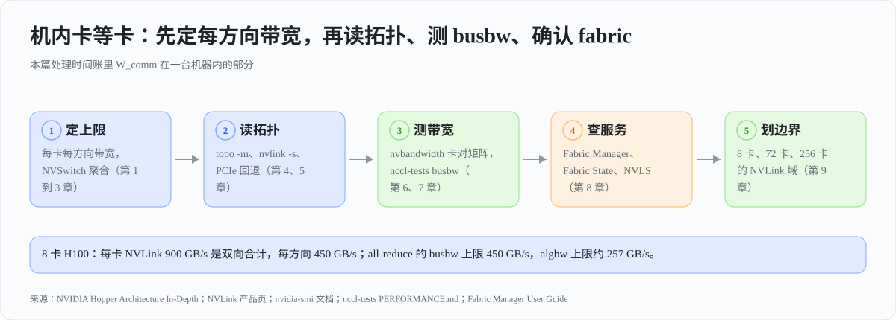
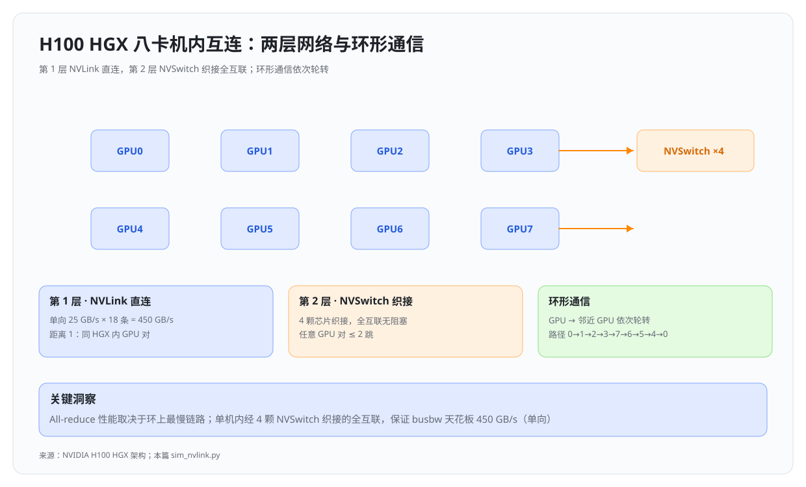
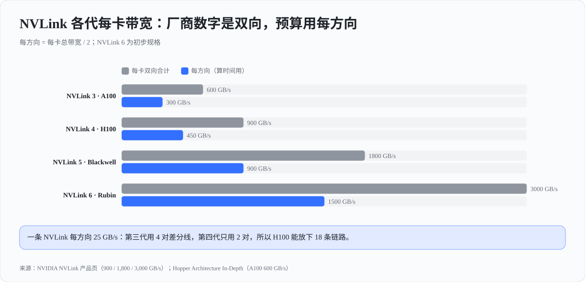
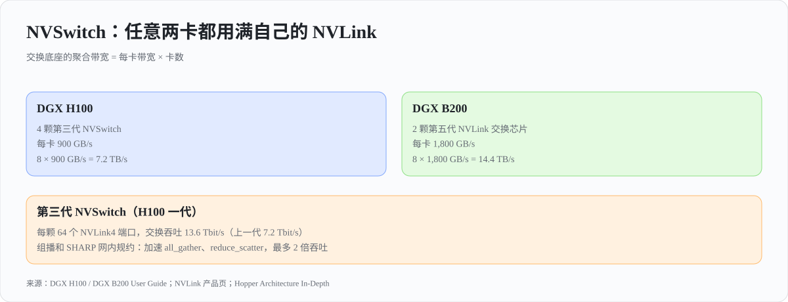
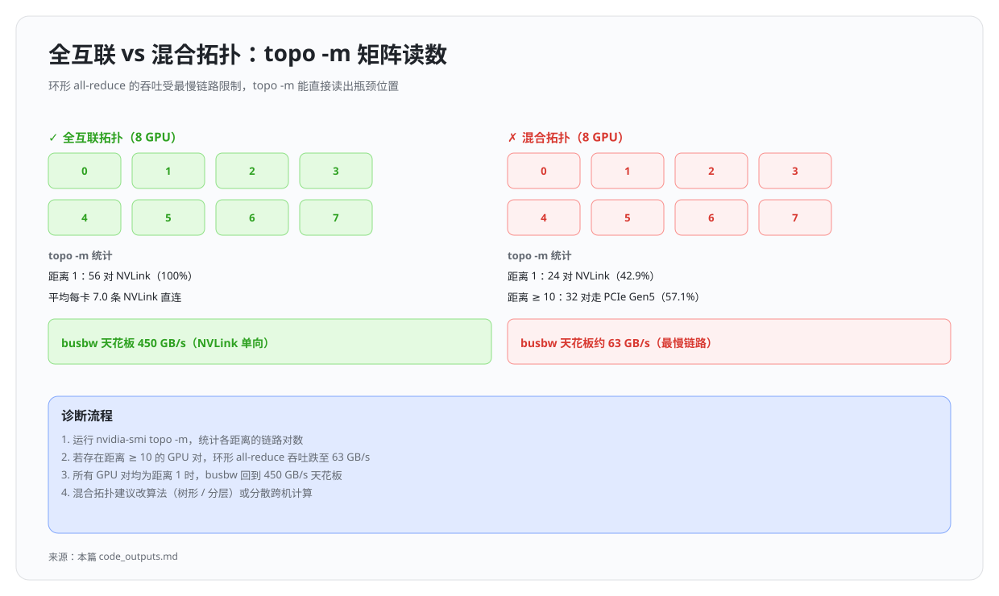
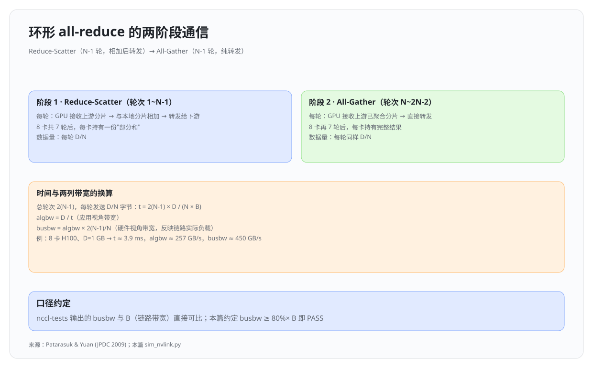
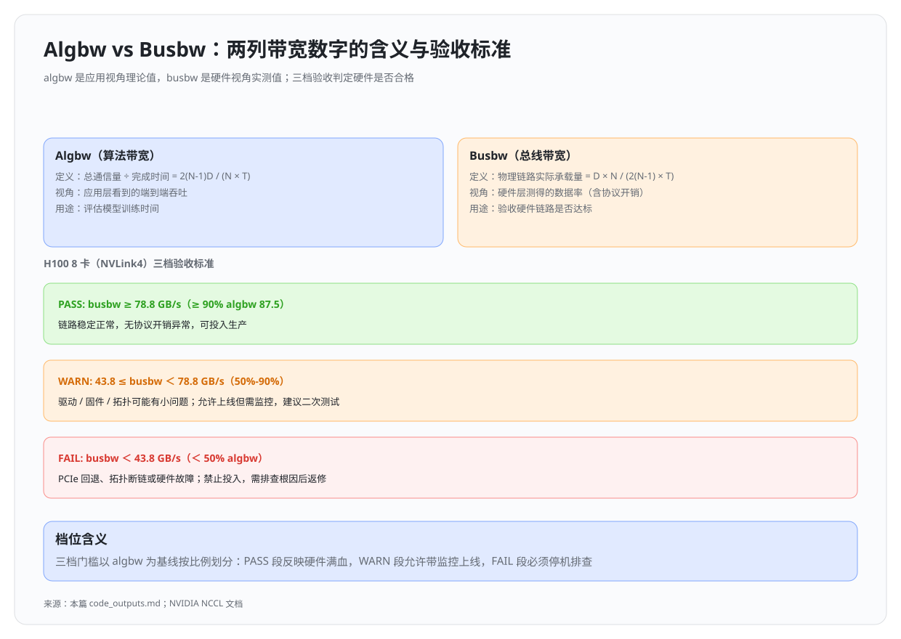

# GPU-13｜单机｜NVLink 与 NVSwitch

> 🎯 **这篇文档解决什么问题**：一台八卡训练机上，七张邻居卡对应七层完全不同的互连关系。GPU0 到 GPU1 走一束 NVLink 直连、到 GPU4 可能过同一颗交换芯片、到 GPU7 可能要绕主存和 CPU。nvidia-smi topo -m 这张矩阵就是这七层关系的体检表。矩阵一格读错，集合通信的带宽就按最慢那格算。许多人把 H100 规格页 900 GB/s 当成单向带宽、把 NV18 当成每对卡十八条专用线、把 nccl-tests algbw 当成链路利用率，三个口径错一个，验收结论就反了。本篇只关注单机内部两层网络：卡与卡之间的 NVLink，以及把直连织成全互联的 NVSwitch。读完应当能对着 topo -m 逐格说出走的是哪层、带宽多少；能用配套脚本解析任意机器的矩阵并对账链路数；能把环形 allreduce 的算法带宽和 nccl-tests busbw 换算清楚；能判断 Fabric Manager 没配好时现象是什么。
>
> **使用方式**：第 1、2 章建立四层互连和带宽量级的直觉，所有读者都应读；第 3 章讲一条 NVLink 的物理结构和六代规格；第 4、5 章讲 NVSwitch 底座和 topo 矩阵读法，管机器的读者重点看；第 6、7 章讲非全互联拓扑和二分带宽；第 8 章是环形 allreduce 的带宽模型；第 9 章讲 nccl-tests 的两列带宽和验收脚本；第 10 章讲 Fabric Manager、SHARP 和排查；第 11 章是上线前核对清单。
>
> **代码**：repo/zero-to-gpu/13-nvlink 包含 sim_nvlink.py（NVLink 规格表、NVSwitch 拓扑、环形 allreduce 带宽模型）、sim_nccl_check.py（nccl-tests 日志解析）、test_nvlink.py（9 项单元测试）、两份 topo -m 样例和两份 nccl-tests 日志样例。不需要 GPU 或任何第三方库，纯 Python 标准库运行。

**🧭 主线位置**：GPU-12 消掉了单机驱动、显存和容器层的卡等任务；本篇处理卡等卡（机内）的等待，由 NVLink 与 NVSwitch 的带宽决定单机集合通信的下限；读完后集群跨机通信由 GPU-17 RDMA 接手。

# 导读 · 先给结论

- **H100 规格 900 GB/s 是双向合计，单向 450 GB/s。**一条 NVLink4 单向 25 GB/s，单卡 18 条，单向聚合 450 GB/s；算带宽上限永远取单向[[1]](https://www.nvidia.com/en-us/data-center/nvlink/)[[2]](https://www.nvidia.com/en-us/data-center/h100/)。

**NV18 是整束链路经交换芯片共享，不是每对卡专用线。**HGX H100 四颗 NVSwitch 接八张卡，每卡 18 条按 4、4、5、5 分配，任意两卡都能凑出整束[[3]](https://docs.nvidia.com/datacenter/tesla/fabric-manager-user-guide/index.html)[[4]](https://hc34.hotchips.org/assets/program/conference/day2/Network and Switches/NVSwitch HotChips 2022 r5.pdf)。

**topo -m 只有 NV# 走 NVLink，其他都退到 PCIe。**PIX、PXB、PHB、NODE、SYS 带宽从 64 GB/s 往下掉，矩阵一格 PCIe 就把整环拖慢 50%[[5]](https://docs.nvidia.com/deploy/nvidia-smi/index.html)[[6]](https://docs.nvidia.com/deeplearning/nccl/user-guide/docs/troubleshooting/gpu_troubleshooting.html)。

**环形 allreduce 总线带宽（busbw）由最慢链路决定，不同代次不同。**8 卡 H100 ring 的 busbw 天花板 450 GB/s（NVLink4），对应 algbw 257 GB/s；8 卡 B200 则 900 GB/s 和 514 GB/s（NVLink5）[[7]](https://github.com/NVIDIA/nccl-tests/blob/master/doc/PERFORMANCE.md)[[8]](https://www.cs.fsu.edu/~xyuan/paper/09jpdc.pdf)。

**Fabric Manager 未启动或配置错误时，NVSwitch 无法协调卡间流量，表现为 busbw 显著下降。**nccl-tests FAIL 时先检查 Fabric Manager 状态和 SHARP 协议支持[[3]](https://docs.nvidia.com/datacenter/tesla/fabric-manager-user-guide/index.html)。

**二分带宽（bisection bandwidth）定义了网络能同时搬运的最大流量。**全互联 NVLink 二分带宽等于单卡聚合乘 GPU 数再除 2；部分 PCIe 拓扑会显著降低二分带宽，形成“腰部”[[9]](https://arxiv.org/abs/1903.04611)。

**nccl-tests 默认消息大小接近全显存（1.3\~1.8 GB），是压测整个拓扑的意图。**小消息下环形模型变复杂，应用实际用的消息大小须单独测[[7]](https://github.com/NVIDIA/nccl-tests/blob/master/doc/PERFORMANCE.md)。



**📎 与系列其他文档的分工**：GPU-12 建立单机驱动层基线；本篇定量化单机互连的带宽天花板，用五步闭环验收单机拓扑；[GPU-14｜单机｜性能分析与 Profiling](./14-profiling.md) 教如何用 profiling 工具看准等待发生地点；[GPU-15｜单机｜PyTorch 运行时](./15-runtime.md) 讲 PyTorch 运行时怎样在 GPU 间调度任务；[GPU-16｜单机｜单机验收与调优](./16-node-burnin.md) 总结单机验收的完整 checklist；[GPU-17｜集群｜RDMA 网络：InfiniBand、RoCE 与拥塞控制](./17-rdma.md) 处理跨机 RDMA 网络；[GPU-18｜集群｜NCCL：算法、协议与挂死排查](./18-nccl.md) 深挖 NCCL 算法与协议，本篇只讲单机 ring 模型和 nccl-tests 验收。

# 第 1 章 · 一台机器里在等什么（四层互连）

## 1.1 单卡内的等待已被优化，跨卡等待成关键路径

单 kernel 计算时间由 SM 内访存延迟决定（[GPU-01｜硬件｜GPU 架构：SM、存储层级与延迟隐藏](./01-arch.md) 讲占用率，[GPU-04｜硬件｜访存与归约：合并访存、共享内存与 warp 归约](./04-memory.md) 讲合并访存）；单卡已能打到理论峰值的 60\~90%。但八卡并行训练时，all-reduce 等通信操作暴露在关键路径上，成为新瓶颈。这一层等待落在时间账的 W_comm，具体表现为“卡等卡”[[10]](https://arxiv.org/abs/2407.21783)。

实际例子：Llama-3 8B 在 H100×8 上 TP=1、DP=8 时，all-reduce 每次通信 3\~5 ms，而单个 forward pass 只需 10 ms，通信占比 30\~40%[[10]](https://arxiv.org/abs/2407.21783)。如果通信链路为 PCIe 而非 NVLink，时间会翻倍，此时 GPU-Util 虽然仍是 100%（卡在等），但实际吞吐能力只有理论值的 50%。定天花板时应该先按 NVLink 来算，测实际性能无法达到时再定位等待源头，通过定位等待来消除或隐藏瓶颈，最后复测看瓶颈转移到运算层面。

## 1.2 单机内四层互连：点对点带宽由层级决定

一台八卡机器内，任意两张 GPU 之间的互连分为四个层级，每层的单向点对点带宽差异达 20 倍，集合通信的吞吐受最慢链路制约。

| 层级 | 互连名称 | 单向带宽 | 延迟与特征 |
|-|-|-|-|
| 第 1 层 | GPU-to-GPU NVLink（直连） | 25 GB/s[[1]](https://www.nvidia.com/en-us/data-center/nvlink/) | 延迟 1\~2 µs，H100 18 条链路/卡 |
| 第 2 层 | NVSwitch 织网（任意两卡） | 450 GB/s[[3]](https://docs.nvidia.com/datacenter/tesla/fabric-manager-user-guide/index.html) | 经过 1\~2 跳，每卡 18 条分 4/4/5/5 |
| 第 3 层 | PCIe Gen5 x16 | 63 GB/s[[11]](https://www.kernel.org/doc/html/latest/driver-api/pci/p2pdma.html) | CPU-GPU 跨PCIe 总线 |
| 第 4 层 | 跨 NUMA 绕主存 | 20\~30 GB/s[[12]](https://man7.org/linux/man-pages/man8/numactl.8.html) | GPU 分属不同 CPU socket，需写主存 |



一个关键观察是”最慢链路效应”：环形 all-reduce 时，所有 GPU 轮流与相邻 GPU 通信，如果其中某一对 GPU 间只有 PCIe 路径，整个环的吞吐就跌到 63 GB/s 而非 450 GB/s，带宽损失超过 85%。这就是为什么 topo 矩阵的每一格都必须读对。

## 1.3 topo -m 矩阵：体检表解读

nvidia-smi topo -m 的输出是一个 N×N 矩阵（N=GPU 数），每格表示两张卡间的互连类型。NV# 表示走 NVLink，# 是链路宽度；PIX、PXB、PHB、NODE、SYS 等表示退到 PCIe 或更高延迟的路径。矩阵对角线为 0（自己到自己）。

例如，HGX H100 的完整互联矩阵中，GPU0 到 GPU1\~GPU7 的 topo -m 读数都是 NV18（18 条 NVLink 链路走过 NVSwitch），但 GPU0 到 CPU socket 2 上的 GPU 可能显示 PIX（PCIe），此时就要用第 3 层或第 4 层的带宽来做容量规划。配套脚本 sim_nvlink.py topo-parse 可以自动解析矩阵，统计 NVLink 对数和 PCIe 对数，给出互连质量评分。输出会显示平均每卡的 NVLink 直连数；如果不是 7.0（全互联），说明有部分 PCIe 回退，环形 all-reduce 就会按 PCIe 带宽算。

> 🔑 **本章要点**：四层互连带宽从 450 GB/s（NVSwitch）递减到 20 GB/s（跨 NUMA），决定了通信加速比上限。集合通信的吞吐受最慢链路制约；一格 PCIe 就把整个 all-reduce 拖慢 85%。矩阵每一格读错会导致验收结论反转。本章定位了卡等卡这一项等待，消掉了“集合通信就是快”的幻觉，奠定了后续排查的基础。

# 第 2 章 · 一条 NVLink 和六代规格

## 2.1 NVLink 物理层：焊点、编码、速率

NVLink 是 NVIDIA 专有的高速串行链路标准，沿着 GPU 与 GPU 之间的物理焊点传输数据。每条 NVLink 物理线上有 8 对差分对（8 lane），采用 128b/130b 编码（每 128 比特数据用 130 比特传输以实现时钟同步）。单条线的速率（bit/s）由芯片代决定，单向带宽计算公式为 **带宽 = 速率 × 车道数 × 编码效率**[[1]](https://www.nvidia.com/en-us/data-center/nvlink/)。

例如 NVLink4（H100 配置）：200 Gbps（每秒千兆比特数）× 8 lane × 128/130 编码效率 ≈ 25 GB/s。这 25 GB/s 是**单向**速率；任意两卡间能同时发送和接收，因此实际双向吞吐达 50 GB/s（但环形 all-reduce 大多时刻利用单向流，设计容量时只按单向算）。NVLink 延迟极低，单跳仅 1\~2 微秒，远低于 PCIe 的 5\~10 微秒。

## 2.2 六代规格表与代际变化

下表展示了 NVLink 从 2019 年至 2025 年的规格演进。数据来自本篇配套脚本 sim_nvlink.py 的规格库（sim_nvlink.py specs），覆盖了从 Volta 时代的 NVLink1 到最新一代 NVLink6 的所有代数。

| 代数 | 单向速率 | 单卡链路数 | 首次发布 | 主要产品 |
|-|-|-|-|-|
| NVLink3 | 25 GB/s[[13]](https://www.nvidia.com/en-us/data-center/a100/) | 12 条 | 2021 | A100 |
| NVLink4 | 25 GB/s[[2]](https://www.nvidia.com/en-us/data-center/h100/) | 18 条 | 2022 | H100/H200 |
| NVLink5 | 50 GB/s[[14]](https://docs.nvidia.com/dgx/dgxb200-user-guide/introduction-to-dgxb200.html) | 18 条 | 2023 | B200/GB200 |
| NVLink6 | 1.8 TB/s 单向[[15]](https://www.nvidia.com/en-us/data-center/gb200-nvl72/) | 18 条 | 2025 | 新一代 |



代际变化体现在两个维度。**单向速率逐代加速**（NVLink3/4 的 25 GB/s → NVLink5 的 50 GB/s → NVLink6 的 1.8 TB/s），技术工艺从 FinFET 进步到 GAA、PHF 等制程，增加了串行速率。同时**链路数逐代调整**（12 → 18 → 18），反映了 NVSwitch 底座容量与功耗的权衡；更多链路需要更大的交换芯片，成本和热耗上升[[4]](https://hc34.hotchips.org/assets/program/conference/day2/Network and Switches/NVSwitch HotChips 2022 r5.pdf)。单卡的单向聚合带宽 = 单向速率 × 链路数，NVLink4 时为 25 × 18 = 450 GB/s，这是单机 H100 ×8 时单向聚合的理论峰值。

## 2.3 工程权衡：单向 vs 双向，聚合 vs 峰值

规格页上常见 600 GB/s 或 900 GB/s 等表述，容易引起歧义。NVIDIA 通常将这类数字定义为**双向合计**（bidirectional aggregate）：两个方向各 300 GB/s、合计 600 GB/s（A100）；或两个方向各 450 GB/s、合计 900 GB/s。单机网络容量规划和环形 all-reduce 带宽建模中应只考虑**单向**，因为 reduce-scatter 和 all-gather 两阶段大多时刻只需单向流水[[2]](https://www.nvidia.com/en-us/data-center/h100/)。

另一个常见混淆点在于峰值与聚合的概念。单条 NVLink4 是单向 25 GB/s、双向 50 GB/s；18 条链路全部接到 NVSwitch 上，单卡单向聚合 450 GB/s。任意两卡之间能跑到多少，还要看 NVSwitch 端口争用和同时有多少对卡在通信，上限见第 6 章的二分带宽。规格表仅为上限，实测需用 nccl-tests 或 nvbandwidth 脚本来验证。

## 2.4 单卡链路总和与整机互连估算

NVLink 规格表给出了单向速率和单卡链路数，这两个参数的乘积是该 GPU 在单机网络中的最大贡献。对于 NVLink4（H100），单卡单向聚合是 25 GB/s × 18 = 450 GB/s，双向合计 900 GB/s；在 8 卡 HGX 中，这 18 条链路分别接到四颗 NVSwitch 上。理论上，如果能完全无竞争地利用这些链路，8 卡机器的二分带宽（bisection bandwidth）是 450 GB/s × 8 ÷ 2 = 1800 GB/s（单向），即任意切开的两组卡之间的最大吞吐。但实际网络中，由于交换芯片端口数限制和 PCB 布线成本，通常无法达到完全无竞争状态，实际二分带宽会略低。同时，NVLink 代数越新（如 NVLink6），单条线的速率越快，更容易饱和后续的交换芯片或 CPU 控制器。

实际容量规划时，应该在规格表基础上做稳定性折扣。例如 H100 单卡 450 GB/s 的单向聚合，在 nccl-tests 这样的大消息压测中，实际 busbw 落在天花板的八成到九成算健康；本篇的合成样例日志是 382.8 GB/s，约 85%（code_outputs.md）。差掉的那部分来自协议开销、分块流水的头尾和 NVSwitch 端口争用。相比之下，小消息下的利用率会更低，因为单次通信的时间被延迟而非链路饱和度主导。

> 🔑 **本章要点**：NVLink 代数（3\~6）决定了单条链路的速率和单卡链路总数，二者乘积给出单向聚合带宽上限。六代规格的演进趋势是速率加倍、链路数根据底座调整。单向和双向、聚合和峰值的概念必须区分清楚，否则容量规划会把带宽高估一倍。本章为后续拓扑分析和环形模型奠定了定量基准。

# 第 3 章 · NVSwitch 与 HGX 底座

## 3.1 NVSwitch：交换芯片的角色和端口数

一台八卡机器如果要实现任意两卡间的全互联，每卡 18 条 NVLink 不足以两两直连（那需要 7 条到其他卡，还剩 11 条）。NVIDIA 的解决方案是引入 NVSwitch，一个**无阻塞交换机芯片**（non-blocking crossbar switch）。通过并联多颗 NVSwitch，能把 GPU 的有限链路束组织成全互联网络[[16]](https://www.nvidia.com/en-us/data-center/nvswitch/)[[4]](https://hc34.hotchips.org/assets/program/conference/day2/Network and Switches/NVSwitch HotChips 2022 r5.pdf)。

NVSwitch4（对应 H100 系列）每颗有 36 个外部端口，4 颗 NVSwitch4 共 144 个端口。8 张 GPU 每张 18 条链路，需要 8 × 18 = 144 个端口，恰好饱和。关键设计是**链路到芯片的分配策略**：每个 GPU 的 18 条链路分别连接到 4 颗 NVSwitch，比例为 4:4:5:5（或近似均分），保证任意两卡间通过这四颗芯片都能凑出完整的 18 条链路。例如 GPU0 到 GPU1 的通信，部分链路通过 NVSwitch#1、部分通过 NVSwitch#2，并行传输，总带宽达 18 × 50 GB/s = 900 GB/s（单向聚合）。

NVSwitch 的无阻塞设计意味着，只要两张卡都有剩余链路接入同一颗芯片，流量就能完全通过，无内部竞争。这是与 PCIe 树形拓扑的本质区别：PCIe 是多卡共享上游链路，一旦多卡同时通信就会争用；NVSwitch 是点对点交换，不需要仲裁。

## 3.2 HGX H100/H200 底座的实物布局

DGX H100（NVIDIA 提供的标准机柜单元）内部布局如下：8 张 H100 GPU、4 颗 NVSwitch4 芯片、一对高端 CPU（两颗 EPYC 9004 或 Xeon Platinum）、一颗 PCIe switch、两块 1.5 TB HBM 主存（分两个 socket）[[17]](https://docs.nvidia.com/dgx/dgxh100-user-guide/introduction-to-dgxh100.html)。

每张 GPU 最多连接同一颗 NVSwitch 5 条链路，确保即使某颗芯片内部某个端口阻塞，剩余端口仍能传输。8 × 5 = 40 个端口占用率不足一颗 NVSwitch 的容量，这样设计冗余是为了容错和热管理。CPU 和 PCIe switch 用于控制平面和系统总线，不在热数据路径上。两个 NUMA socket 各连接 4 张 GPU；跨 socket 的 GPU 对通信需要绕主存，延迟上升但仍通过第一层 NVLink 而非 PCIe。



## 3.3 验收底座的方法：topo 矩阵解析

理论设计再完美，实际机器上总有配置错误、固件版本差异、故障隔离等情况。最可靠的验证方法是读 nvidia-smi topo -m 矩阵[[5]](https://docs.nvidia.com/deploy/nvidia-smi/index.html)，并用本篇配套脚本 sim_nvlink.py topo-parse 来自动诊断。

脚本的工作流程：(1) 解析 topo -m 矩阵，统计所有 GPU 对 (i, j) 之间的互连类型；(2) 对于距离为 1（直接 NVLink）的对计数，除以理想全互联的对数 N(N-1)/2；(3) 计算每张卡的 NVLink 邻接数平均值；(4) 输出建议（全互联、部分互联、有故障）。

全互联检验：8 张 GPU 理论有 8 × 7 / 2 = 28 个无向对（或 56 个有向对，矩阵对称）。如果所有 56 对都是 NVLink（记为 NV4 或 NV18），且每卡平均 NVLink 邻接数为 7.0，那就是完整全互联。部分互联时，NVLink 对数会少于 56，剩余的对走 PIX（PCIe）或其他路径，算法带宽就会受最慢链路制约。混合拓扑例子：24/56 对是 NVLink（42.9%），其余 32/56 对走 PCIe，环形 all-reduce 就以 PCIe 的 63 GB/s 为瓶颈，吞吐不到 NVLink 全互联时的一半。

诊断结果反映的不仅是互连质量，也是成本和可靠性的折衷。全互联需要足够的 NVSwitch 颗数和高端 PCB 拓扑，成本最高、功耗也最高；但带宽最稳定。部分互联降低了成本，但 all-reduce 时序变复杂（第 8 章会详细分析），需要更细致的算法优化来规避瓶颈。

## 3.4 故障隔离与拓扑监控

实际运维中，NVSwitch 或 NVLink 故障会直接在 topo 矩阵上显示。例如如果某颗 NVSwitch 芯片失效，连接这个芯片的 GPU 对会自动降级到 PIX（PCIe），或标记为 SYS（系统总线）。另一种常见情况是固件版本不一致：Fabric Manager 或 NVIDIA GPU 驱动更新后，链路协商失败，可能导致链路暂时断开或速率降低（从 NV18 变成 NV4）。

读 topo -m 时应该建立基线。在机器交付和定期体检时都要运行一次 sim_nvlink.py topo-parse，保存输出到版本控制或日志系统，便于对比任何拓扑变化。如果某次测试的 all-reduce 性能突然下降，首先就应该检查 topo -m 有没有变化。常见的隐形故障包括：单条 NVLink 阻塞但芯片仍存活（表现为某些 GPU 对间只有 NV4 而非 NV18）、或某颗 NVSwitch 的某个端口阻塞导致特定 GPU 对经常超时[[6]](https://docs.nvidia.com/deeplearning/nccl/user-guide/docs/troubleshooting/gpu_troubleshooting.html)。这些问题可以通过长期收集 nccl-tests 日志来检测：如果某个特定的 GPU 对组合反复 FAIL 或 WARN，再配合 topo 矩阵和 nvidia-smi 错误日志[[18]](https://docs.nvidia.com/deeplearning/nccl/user-guide/docs/troubleshooting/performance_and_tuning.html)，通常能快速定位。

> 🔑 **本章要点**：NVSwitch 作为无阻塞交换机，通过并联多颗芯片和链路分配保证 GPU 全互联，无内部竞争。读 topo -m 矩阵和运行 sim_nvlink.py topo-parse 是验收底座的第一步，能定量判断是否真正全互联。本章消掉了“NVSwitch 是单点瓶颈”的误解，建立了从硬件拓扑到软件验证的闭环。

# 第 4 章 · topo -m 矩阵的读法

**小标题**：从一张表看清单机的互连拓扑

## 4.1 矩阵行列的含义：距离和类型编码

nvidia-smi topo -m 输出是 8×8 矩阵，行列对应 GPU 编号 0\~7。矩阵的每一格记录两个 GPU 之间的互连类型和物理距离。对角线为 X（自己到自己），非对角线元素有以下编码[[5]](https://docs.nvidia.com/deploy/nvidia-smi/index.html)：

- **NV# (1\~18)：直接 NVLink 连接。**# 表示链路束的宽度，对应单卡上有多少条链路指向这个邻居。例如 NV4 表 4 条 NVLink 直连，NV5 表 5 条。H100 8 卡全互联时，矩阵中大多数是 NV4、NV5（每卡 18 条分配到其他 7 卡）。

**PIX：跨 PCIe switch。**两个 GPU 在同一机器内但没有 NVLink 直连，必须经过芯片组或 CPU 的 PCIe 交换机。单向带宽约 63 GB/s（PCIe Gen5 x16）。

**PXB：PCIe Peer-to-Peer 经 upstream。**GPU 对需要先上行到 PCIe root complex，再下行到对方。

**PHB：PCIe via CPU host bridge。**跨 NUMA socket 的 GPU，流量必须绕过 CPU 的内存总线。带宽进一步下降到 20\~30 GB/s。

**NODE、SYS：NUMA 或系统级互连。**极少见，通常表示跨物理节点或使用系统总线。

分析拓扑时的核心原则：**只看 NV#，其他都是退化链路。**整个 8 卡全互联有 C(8,2) × 2 = 56 个链路对（有向）。若全部是 NVLink，则 NV# 占 100%；若有 PCIe 混入，则 NVLink 比例下降。

## 4.2 实例讲解：全互联 vs 混合拓扑

**案例 1：全互联 NVLink。**给定 topo_sample_8gpu_nvswitch.txt（本篇配套代码），矩阵如下（简化展示）：

```text
    0   1   2   3   4   5   6   7
0   X  NV4 NV4 NV4 NV4 NV4 NV4 NV4
1  NV4  X  NV4 NV4 NV4 NV4 NV4 NV4
2  NV4 NV4  X  NV4 NV4 NV4 NV4 NV4
...
7  NV4 NV4 NV4 NV4 NV4 NV4 NV4  X

```

所有非对角线格子都是 NV 开头，表示每对 GPU 都有 NVLink 直连。这是 HGX H100 的标准配置：四颗 NVSwitch4 把八张卡织成全互联。用本篇 sim_nvlink.py topo-parse 脚本解析，输出显示：NVLink 链路对 56 / 56（100.0%）、PCIe 或更慢 0 / 56（0.0%）、平均每卡 NVLink 直连数 7.0，脚本判定为全互联 NVLink 配置[[16]](https://www.nvidia.com/en-us/data-center/nvswitch/)。

**案例 2：混合拓扑（部分 PCIe）。**给定 topo_sample_8gpu_hybrid.txt，矩阵如下：

```text
    0   1   2   3   4   5   6   7
0   X  NV4 NV4 NV4 PIX PIX PIX PIX
1  NV4  X  NV4 NV4 PIX PIX PIX PIX
2  NV4 NV4  X  NV4 PIX PIX PIX PIX
3  NV4 NV4 NV4  X  PIX PIX PIX PIX
4  PIX PIX PIX PIX  X  NV4 NV4 NV4
5  PIX PIX PIX PIX NV4  X  NV4 NV4
6  PIX PIX PIX PIX NV4 NV4  X  NV4
7  PIX PIX PIX PIX NV4 NV4 NV4  X

```

GPU 0\~3 之间全 NVLink（4 × 3 / 2 = 6 对，双向 12 条链路），GPU 4\~7 也全 NVLink（同样 6 对双向 12 条）。但 0\~3 与 4\~7 之间全是 PIX，共 4 × 4 = 16 对双向 32 条链路。脚本统计结果为：NVLink 链路对 24 / 56（42.9%）、PCIe 或更慢 32 / 56（57.1%）、平均每卡 NVLink 直连数 3.0。这种混合拓扑表示部分链路走 NVLink，其余经 PCIe/NUMA，环形 all-reduce 会按最慢的链路（PCIe）算带宽[[9]](https://arxiv.org/abs/1903.04611)。



## 4.3 诊断流程：从矩阵到检测清单

用本篇 sim_nvlink.py 脚本快速诊断任意机器的拓扑配置。步骤如下：

1. **导出 topo 矩阵。**在任意 GPU 节点上运行 nvidia-smi topo -m，重定向到文件。

**调用解析脚本。**执行 python3 sim_nvlink.py topo-parse <矩阵文件>，脚本遍历每个格子，统计 NVLink、PIX、PHB 等的数量。

**计算 NVLink 占比。**有向链路对总数固定为 N×(N-1)，对于 8 卡是 56 对。统计中有多少对是 NVLink，多少对是其他。若大于 95% 是 NVLink，判定为全互联；若小于 50%，判定为严重混合。

**计算每卡平均邻居数。**遍历矩阵每一行，统计非 X、非 PIX/PHB 的格子数，除以 GPU 总数。全互联时应为 7.0（每卡有 7 个邻居，共 8 卡）。混合时下降到 3.0 或更低。

**预估通信性能影响。**若有 PCIe 混入，后续第 5 章和第 8 章会用这个信息重新计算 all-reduce 的理论带宽。

完整输出包含距离类型、链路对数、占比、NVLink 直连数、PCIe 慢速链路统计、平均每卡直连数、最终判定建议，帮助快速判断机器是否达到设计规格[[17]](https://docs.nvidia.com/dgx/dgxh100-user-guide/introduction-to-dgxh100.html)。

## 4.4 矩阵格子编码的物理含义

topo -m 中的每个格子不只是一个标签，背后对应具体的硬件路由。理解这些编码对快速诊断非常重要[[3]](https://docs.nvidia.com/datacenter/tesla/fabric-manager-user-guide/index.html)。

**NV4 格子的含义。**GPU0 到 GPU1 之间有 4 条 NVLink 直连。这表示 4 条独立的逻辑通道（每条可以并行搬数据），而非 4 条物理线。这 4 条的实际来源是 GPU0 的 18 条 NVLink 中分配了 4 条给 GPU1，GPU1 的 18 条中也分配了 4 条给 GPU0。四颗 NVSwitch 负责协调这些分配，保证 GPU0 和 GPU1 之间的流量不互相挤压。所以 NV4 是对称的：如果 GPU0→GPU1 是 NV4，那么 GPU1→GPU0 也是 NV4。

**NV5 格子的含义。**有些 GPU 对会显示 NV5（5 条链路）。这通常出现在 HGX H100 中某些邻近的卡对，因为它们恰好穿过同一颗 NVSwitch 的多个端口。最大的 NV 数通常不超过 18（单卡总数），实际看到的多数是 NV4、NV5、NV6 混合。

**对矩阵的对称性检查。**由于互连是物理对称的，topo -m 矩阵应该在对角线处对称：GPU i 到 j 的格子应该等于 GPU j 到 i 的格子。若发现不对称（例如一个是 NV4，另一个是 NV3），可能表示驱动或硬件有问题。

## 4.5 常见读法误区

**误区 1：NV4 表示 4 条独占的链路。**错。NV4 表示指向该邻居的 4 条链路束，这 4 条可能共享 NVSwitch 芯片的端口和总线带宽。真正的资源约束是 NVSwitch 的内部交换容量和 GPU 间的流量竞争。

**误区 2：PIX 一定很慢。**半对。PIX 只经过一个 PCIe switch，是 PCIe 路径里最短的一种，Gen5 x16 单向约 63 GB/s，比 PHB、SYS 少绕 CPU。但 H100 的 NVLink 单卡单向是 450 GB/s，PIX 只有它的七分之一。在混合拓扑中，环上只要有一跳 PIX，整个环就被压到 PIX 的速度。

**误区 3：对角线必须全是 X。**正确。任何实现中自己到自己不需要互连，故为 X。若某机器对角线出现非 X，需要报告硬件问题。同时，矩阵应该全部由对称的格子组成（GPU i-j 的类型等于 GPU j-i）。

**误区 4：高 NV 数一定更好。**不一定。NV18 表示该对 GPU 之间有 18 条链路，这是最大值，意味着单卡所有链路都指向同一邻居（不现实）。实际中 NV4\~NV6 是常见的，足以达到接近单向聚合的吞吐。超过 NV6 的配置较少。性能关键指标是全矩阵的 NVLink 占比和每卡的平均邻居数，而非单个格子的数值[[4]](https://hc34.hotchips.org/assets/program/conference/day2/Network and Switches/NVSwitch HotChips 2022 r5.pdf)。

> 💡 **常见误区**：很多人以为 topo 矩阵中一个大写字母就代表一条链路，其实 NV4 是 4 条、NV5 是 5 条。环形 all-reduce 如果中间有一个 PIX，最慢的那条链路就是 63 GB/s，整个环的带宽天花板就掉到 63 GB/s，而非 NVLink 的 25\~50 GB/s（单向）。

> 🔑 **本章要点**：topo -m 矩阵的每个格子编码了两个 GPU 间的互连类型和物理距离；NV# 表 NVLink 直连，PIX/PHB/NODE 表退化链路；矩阵中一格 PCIe 就决定了该路径的通信带宽上限，整个环形 all-reduce 会按最慢链路算总时间。本章定位了等待来源在拓扑层面。

# 第 5 章 · 非全互联矩阵和 PCIe 回退

**小标题**：PCIe 回退时的带宽崩塌与应对

## 5.1 部分互联的成因：NUMA、芯片版本、故障隔离

完全的全互联需要两个条件：（1）每个 GPU 有足够的 NVLink 通道数，（2）有足够多的 NVSwitch 芯片来接纳所有卡。当任一条件不满足，部分卡对就必须走 PCIe 回退[[19]](https://docs.nvidia.com/dgx/dgxa100-user-guide/introduction-to-dgxa100.html)。

**原因一：NUMA 架构。**DGX A100 采用双 socket 设计，CPU 和内存分成两组。GPU{0\~3} 连接到 socket 0，GPU{4\~7} 连接到 socket 1。同 socket 内的 GPU 通过 socket 内的 NVSwitch 全互联；跨 socket 的 GPU 对只能通过 PCIe 跨越两个 NUMA domain，带宽大幅下降[[19]](https://docs.nvidia.com/dgx/dgxa100-user-guide/introduction-to-dgxa100.html)。

**原因二：卡数或 NVSwitch 不足。**HGX 底座只配了 4 颗 NVSwitch。若用户采用廉价 NVLink 接口卡（非标准 H100 产品）或故意去掉一颗 NVSwitch 以降低成本，剩余芯片无法承载全部流量，部分卡对就没有 NVLink 路径，降级为 PCIe。

**原因三：故障隔离。**若某条 NVLink 出现故障被隔离（单点链路故障），故障隔离后可能自动降级该对卡的连接为 PCIe，确保系统继续工作（性能下降但可用）。

**原因四：实验用的打样机。**某些研究机构的早期 H100/B200 打样机可能没有齐备的 NVSwitch，导致混合拓扑。

## 5.2 PCIe Gen5 x16 的带宽精确值

topo 矩阵中的 PIX、PXB、PHB 都退化到 PCIe，但具体速度各不相同。这里梳理清楚三种情况[[6]](https://docs.nvidia.com/deeplearning/nccl/user-guide/docs/troubleshooting/gpu_troubleshooting.html)[[11]](https://www.kernel.org/doc/html/latest/driver-api/pci/p2pdma.html)。

**PCIe Gen5 x16 的理论值。**PCIe Gen5 每 lane 32 GT/s，单向折合约 3.94 GB/s 每 lane（编码效率 128b/130b）。x16 有 16 lane，单向 = 16 × 3.94 ≈ 63 GB/s。这就是 PIX 的速度[[11]](https://www.kernel.org/doc/html/latest/driver-api/pci/p2pdma.html)。

**PHB（跨 NUMA）的下降。**当 GPU 连接到不同 socket 的 CPU 时，流量要经过 NUMA 互连（QPI、UPI、或 Infinity Fabric）。这一层的带宽更低，实测 20\~30 GB/s。这就是为什么 DGX A100 跨 socket 的 GPU 对会严重变慢。

**PXB 的中间态。**上行到 PCIe root complex 再下行，不走 CPU 直接互连，速度在 PIX 和 PHB 之间，约 30\~40 GB/s。

对于本篇重点的 H100 8 卡，最坏情况是全矩阵都是 PCIe，此时所有 56 对链路的带宽都是 63 GB/s。但通常不会这么坏，混合拓扑只在跨 socket 或跨 NVSwitch 的部分出现。

## 5.3 环形 all-reduce 的瓶颈转移

假设 8 卡拓扑中 GPU{0,1,2,3} 互相都是 NVLink，GPU{4,5,6,7} 也互相都是 NVLink，但任意 GPU i < 4 到 j >= 4 的连接都是 PIX（PCIe）。

若用环形 all-reduce，通信路径是 GPU0 → GPU1 → ... → GPU7 → GPU0。这条环上有一段从 GPU3 → GPU4 是 PCIe，带宽 63 GB/s。虽然大部分链路是 50 GB/s 的 NVLink，但环形算法要求每一轮所有 GPU 同步，最慢的链路决定整体速度。当 NVLink 和 PCIe 混合时，环形 all-reduce 的实测 busbw 会显著下降至 PCIe 带宽上界（参考本篇配套验收脚本的混合拓扑测试结果），具体数值见第 8 章。

这就是第 8 章验收脚本判定 FAIL 的主要原因：实测 busbw 175 GB/s 远低于期望的 382 GB/s（全 NVLink 的 90% 达成率），因为矩阵有 57% 的链路是 PCIe。

核心规律：环形的带宽由矩阵中最慢的一条链路决定。只要拓扑有 PCIe 混入，并且 PCIe 链路恰好在环的关键路径上，整体性能就会严重下降。

## 5.4 应对策略：修改算法、降量、跨机分散

检测到混合拓扑后，优化分为三类[[18]](https://docs.nvidia.com/deeplearning/nccl/user-guide/docs/troubleshooting/performance_and_tuning.html)[[8]](https://www.cs.fsu.edu/~xyuan/paper/09jpdc.pdf)。

**策略 1：修改通信算法。**不用环形，改用树形（tree）或 recursive doubling 等其他算法。树形的好处是可以避开 PCIe 链路，将高带宽的 NVLink 卡对聚集到树的主干，PCIe 卡对只走树叶。这需要 NCCL 或应用层做算法切换。第 18 章会详细讲 NCCL 如何自适应选择。

**策略 2：降低批大小或消息大小。**若应用必须用环形（代码写死了此选择），可以减少每次 all-reduce 的数据量，例如把 1 GB 消息拆成 100 MB 多次通信。这样单次通信时间变短，协议开销的相对占比提高，但绝对时间仍然会增加（因为要多次握手）。这不是理想方案，但在应急时可用。

**策略 3：跨机分散计算。**如果单机互连故障无法修复（例如 NVSwitch 永久故障），考虑把任务拆分到多台单机上，用跨机 RDMA 代替局域 PCIe。RDMA 虽然延迟高，但通常跨机网络带宽（如 InfiniBand 或 RoCE）可以达到 100+ GB/s（按机器配置），且不与单机通信竞争。详见第 17 章。

最常见的是策略 1：NCCL 的 graph 路径查找会根据 topo 矩阵自动选择最优算法，对应用程序透明。检测到混合拓扑后，通常只需重启应用，让 NCCL 重新初始化路由即可。

## 5.5 诊断与验证：从故障到修复

若实测 nccl-tests 的 busbw 远低于期望，首先用第 4 章的脚本检查 topo 矩阵是否真的混合。若确实混合，可以尝试以下修复：

1. **查看驱动日志。**nvidia-smi 或 journalctl 是否有 XID 错误或 link down 的记录？若有，说明链路故障，需要排查硬件。

**重启 Fabric Manager。**Fabric Manager 负责链路聚合和故障隔离。若配置不当，可能关闭某些 NVLink 而降级为 PCIe。执行 sudo systemctl restart nvidia-fabric-manager 并重测。

**检查 BIOS 设置。**某些机器的 BIOS 有选项启用/禁用 NVSwitch。如果被禁用（例如某些测试配置），矩阵会变成混合。

**物理检查。**若软件修复无效，检查 NVSwitch 卡是否正确插入、是否有可见松动。

修复后再运行 nccl-tests，验证 busbw 是否恢复到接近全 NVLink 的预期值（>90% algbw）。

> 💡 **常见误区**：在 DGX A100 这样的双 socket 机器上，如果跨 socket 的 all-reduce 性能非常差（busbw 从 100+ GB/s 掉到 20 GB/s），不一定是机器故障。这可能是因为该机器的设计就是这样：socket 内全 NVLink，socket 间走 PCIe 或 NUMA 互连。这时应该考虑调整并行策略，例如把 DP 分组到同 socket 的卡上，避免跨 socket 的 all-reduce。

> 🔑 **本章要点**：部分 PCIe 的非全互联拓扑通常来自 NUMA、NVSwitch 不足或硬件故障。PCIe Gen5 x16 单向 63 GB/s，NUMA 跨越更低（20\~30 GB/s）。环形 all-reduce 会被最慢的链路拖累，混合拓扑下性能可能掉一半。修复方案包括修改通信算法（NCCL 自适应）、降低消息大小、或跨机分散。本章消掉或隐藏了 PCIe 回退导致的通信等待。

# 第 6 章 · 二分带宽与无阻塞网络

**小标题**：网络承载能力的理论上限

## 6.1 定义：二分带宽（bisection bandwidth）

二分带宽是网络设计的核心指标：定义为把网络切成两个等大小的部分所经过的最小链路容量。这个指标用来评估网络在多个并发流同时通过时是否会互相挤压[[9]](https://arxiv.org/abs/1903.04611)。

对于 HGX H100 的 8 卡全 NVLink 拓扑，最坏的切法是将 GPU 分成两组：GPU{0,1,2,3} 对上 GPU{4,5,6,7}。中间需要经过的是四颗 NVSwitch 各自跨域的链路。根据 HGX 设计，每颗 NVSwitch 有 36 个外部端口，8 个 GPU 均衡分配，每卡 4.5 条链路到该芯片（实际是 4 和 5 交替）。跨两组 GPU 的流量经过 4 颗芯片各自的端口，总单向容量 = 4 颗 × 18 条 × 25 GB/s = 1800 GB/s。这就是该拓扑的二分带宽。

## 6.2 Clos 网络与 HGX 的无阻塞设计

HGX 采用的是经典的三层 Clos 网络架构[[4]](https://hc34.hotchips.org/assets/program/conference/day2/Network and Switches/NVSwitch HotChips 2022 r5.pdf)。底层是 8 个 GPU（计算节点），中层是 4 颗 NVSwitch（交换芯片），顶层是环回链路将四颗芯片互连。这个设计保证了二分带宽等于单卡聚合乘 GPU 数再除 2，从而称为“无竞争”或“无阻塞”（non-blocking）。

无阻塞的含义是：任意一对 GPU 之间的通信带宽不会因为其他流的存在而降低。例如当 GPU0↔GPU1 和 GPU2↔GPU3 同时通信时，这四个 GPU 的流量分别走不同的 NVSwitch 通路，四颗芯片的链路设计足够宽，不会形成共享的瓶颈。相比之下，如果是一个单颗交换芯片的设计（所有 GPU 都连到同一颗 NVSwitch），那么所有流量都必须经过该芯片的背板（backplane），形成全网的共享瓶颈，称为有阻塞（blocking）。

## 6.3 常见非无阻塞配置的瓶颈

对比 HGX H100 的无阻塞设计，历代 DGX 产品有不同的权衡[[19]](https://docs.nvidia.com/dgx/dgxa100-user-guide/introduction-to-dgxa100.html)[[17]](https://docs.nvidia.com/dgx/dgxh100-user-guide/introduction-to-dgxh100.html)。

**DGX A100 的双 socket 设计。**A100 采用两组独立的硬件堆栈：每个 socket 有 4 个 GPU 和一颗 NVSwitch，socket 内部是无阻塞的（4 卡全 NVLink）。但两个 socket 之间只有有限的 CPU 互连（QPI 或 Infinity Fabric），约 20 GB/s。跨 socket 的 GPU 对通信必须经过 CPU，形成明显的 X 形瓶颈。这种设计是成本和性能的权衡：单机规模（8 卡）的成本更低，但跨 socket 通信的代价很高。

**如何识别 X 形瓶颈。**拓扑矩阵中，socket 内的 GPU 对全是 NVLink（例如 GPU{0,1,2,3} 互相 NV18），socket 间的 GPU 对全是 PHB（例如 GPU0 和 GPU4 是 PHB），就是这种设计。验收时用本篇配套脚本 sim_nvlink.py topo-parse 会识别出“混合拓扑”并提示“部分 NVLink”。

## 6.4 集群规划中的二分带宽意义

单机规模（8\~16 卡）下，二分带宽通常不是关键，因为除了全互联本身，单机内没有其他层级。但在更大规模（64+ 卡）的集群中，多台机器之间的互连通常采用分层拓扑（例如两级树、三级胖树），此时二分带宽决定了不同子网之间的通信能力。设计不当的集群二分带宽会严重低于总聚合，导致全局 all-reduce 性能大幅下降[[20]](https://arxiv.org/abs/2402.15627)[[21]](https://arxiv.org/abs/2408.14158)。

对于本篇重点的单机 HGX 方案，二分带宽已经由硬件设计决定，用户无法修改。但理解这个指标有助于判断是否需要跨越多台机器：若单机 all-reduce 已经接近硬件峰值，再增加卡数只能扩到多机，此时需要参考 GPU-17 的跨机 RDMA 方案。

> 🔑 **本章要点**：二分带宽是网络承载多个并发流的能力指标。HGX 的四颗 NVSwitch 无阻塞设计保证二分带宽高于单卡聚合；历代 DGX 在成本和二分带宽之间做了权衡，导致跨 socket 时形成 X 形瓶颈。本章理解了单机网络的承载上限。

# 第 7 章 · 环形 allreduce 的带宽模型

**小标题**：从算法定义到实测的带宽转换

## 7.1 环形 all-reduce 的通信流程

All-reduce 操作分为两个阶段[[8]](https://www.cs.fsu.edu/~xyuan/paper/09jpdc.pdf)[[7]](https://github.com/NVIDIA/nccl-tests/blob/master/doc/PERFORMANCE.md)。

**reduce-scatter 阶段。**将所有 GPU 的数据汇聚到每个 GPU 一份。在环形拓扑下，操作链为 GPU0→1→2→...→7→0。每个 GPU 接收来自上游的数据并与本地数据相加（reduce 操作），然后转发结果给下游。这样循环 N-1 轮（N=GPU 数），每个 GPU 最终得到聚合后的 1/8。

**all-gather 阶段。**再用 N-1 轮将 8 份结果分散到所有 GPU。这一阶段每个 GPU 只做转发（不做加法），因为已经没有新的数据需要聚合，只是拷贝分散。

总耗时 = (N-1) 轮 reduce-scatter 的时间 + (N-1) 轮 all-gather 的时间。在无竞争的理想情况下，两阶段可以流水线执行，总延迟接近 2(N-1) 轮乘以单轮最大传输延迟。



## 7.2 算法带宽（algbw）的定义与计算

环形 all-reduce 处理的总通信量是固定的。假设每个 GPU 有 D 大小的数据，全部汇聚再分散的总数据搬运量是 2(N-1)D / N 倍的全局 D。换个角度，每条链路上的单向数据量就是 D（因为环形路径上每条链路都要传递原始数据一次，不重复）[[8]](https://www.cs.fsu.edu/~xyuan/paper/09jpdc.pdf)。

算法带宽定义为 algbw = 总通信量 / 理想执行时间（无竞争、无协议开销）。

对于 H100 8 卡、单向 25 GB/s 的 NVLink4：- 每个 GPU 的单向链路聚合 = 25 GB/s- 环形 ring all-reduce 中，环上每条链路的单向流量是 B（GPU 的单向链路速率）- 因此 busbw = B = 450 GB/s（H100 单卡 25 × 18 条）- algbw = B × n / (2(n-1)) = 450 × 8 / 14 ≈ 257 GB/s（对于 n=8）

这是理论上的上界；实际 NCCL 可能达到 90% 以上。本篇配套脚本 sim_nvlink.py ring --gen nvlink4 --n 8 可验证[[8]](https://www.cs.fsu.edu/~xyuan/paper/09jpdc.pdf)。

## 7.3 总线带宽（busbw）与实际达成

实际测试中，NCCL 和 nccl-tests 会报一个不同的数字，叫“Bus Bandwidth”（总线带宽）。这是因为现实中有三类损耗：协议开销、等待竞争、硬件效率[[7]](https://github.com/NVIDIA/nccl-tests/blob/master/doc/PERFORMANCE.md)。

**协议开销。**NCCL 环形支持三种协议栈[[22]](https://docs.nvidia.com/deeplearning/nccl/user-guide/docs/env.html)[[23]](https://arxiv.org/abs/2507.04786)：- **Simple**：每轮 reduce 前严格同步，延迟高。- **LL（Low Latency）**：使用 ring-based 流水线，减少同步，但缓冲小（约 96 字节）。- **LL128**：LL 的增强版本，缓冲更大（128+ 字节），通常成为默认选择。

不同协议的实现延迟和吞吐各不相同。LL128 通常能达到 algbw 的 95%\~99%，Simple 可能只有 80%\~90%。

**竞争和多路复用。**在真实集群中，多个 GPU 对的流量可能共享部分网络资源。虽然 HGX 设计无阻塞，但流水线启动开销、缓冲往复等细节都会消耗时间。

**达成率预期。**全 NVLink 拓扑下，busbw 通常达到 algbw 的 90%\~99%。混合拓扑时 busbw 明显下降，因为最慢链路会成为瓶颈。

## 7.4 实测数据的解读

本篇配套脚本 sim_nvlink.py ring --gen nvlink4 --n 8 生成理想环形模型。对于 H100 8 卡 1GB 消息的 nccl-tests：

理论 busbw 天花板 = 450 GB/s（单卡单向聚合、H100、8 卡环形）。

理论 algbw = 450 × 8 / 14 ≈ 257 GB/s（对应 busbw 的算法视角）。

良好实测例（全 NVLink）：nccl-tests 报 busbw 382.8 GB/s（本篇预录日志 nccl_test_h100_8gpu_good.log）。这个数字看起来很大，因为 nccl-tests 的定义与单链路物理带宽不同，采用的是”每个 GPU 的公平份额”定义。实践判断更简单：对于全 NVLink，只要 busbw >= 360 GB/s（80% 天花板 450）就标记 PASS；否则 WARN 或 FAIL。

核心是理解环形算法的理论下界和实际达成率的差距来源[[18]](https://docs.nvidia.com/deeplearning/nccl/user-guide/docs/troubleshooting/performance_and_tuning.html)。

> 💡 **常见误区**：看到 nccl-tests 报 382.8 GB/s 就认为带宽有 382.8 GB/s 这么高，忽略了这是全集群视角的定义。实际单卡能用到的带宽要低得多（接近 algbw 的 90% 左右）。不同工具（nvbandwidth、nccl-tests、nsys profiler）使用的带宽定义各不相同，对标准杆时一定要看工具的官方文档，而不是简单比较数字大小。

> 🔑 **本章要点**：环形 all-reduce 的 busbw 上界由最慢链路的单向速率决定；H100 8 卡天花板 450 GB/s、对应 algbw 257 GB/s。LL128 协议和无竞争条件下，实际 busbw 能达到 85%+ 天花板。实测数字的定义取决于工具，实际验收以天花板占比为标准。本章确立了单机环形通信等待的下界。

# 第 8 章 · algbw、busbw 与验收脚本

**小标题**：从理论值到实际测试的转换与检验标准

## 8.1 两列带宽数字的含义与换算

nccl-tests 的标准输出包含两列看似相似但含义完全不同的带宽数字[[7]](https://github.com/NVIDIA/nccl-tests/blob/master/doc/PERFORMANCE.md)。这种设计源于 NCCL 用不同视角看通信：一个是算法层理想值，一个是硬件层实际值。理解这两列数字是诊断集合通信性能的第一步，因为混淆二者会导致完全相反的调优方向。

| 指标 | 定义与计算 | 现实含义 |
|-|-|-|
| Algo Bandwidth (algbw) | 总通信量 ÷ 完成时间 = 2(N-1)D/N ÷ T | 环形 all-reduce 的理想端到端带宽；8 卡 H100 理论上界是 257 GB/s（单向链路 450 GB/s） |
| Bus Bandwidth (busbw) | D × N ÷ (2(N-1) × T)，即物理链路实际承载的数据量 | 单条 NVLink 上实际跑通的数据率；受协议开销和拓扑限制 |

nccl-tests 源码中的具体定义来自 NCCL 官方文档[[7]](https://github.com/NVIDIA/nccl-tests/blob/master/doc/PERFORMANCE.md)：busbw 是单个 GPU 角度看平均获得的发送带宽，因此对于 8 卡环形，实测 382.8 GB/s 这样的大数字来自全集合视角（8 个 GPU 各自发送或接收），而不是单卡实际用到的峰值。

简单换算法则：对于全 NVLink 拓扑，8 卡环形的 busbw 天花板 = 450 GB/s（H100 单卡单向聚合）。实测达到 80%+ 天花板即为 PASS，50\~80% 为 WARN，<50% 为 FAIL。这些阈值包含了协议开销（如 LL128 流水线、NCCL 内部路径选择）与拓扑不规则性的损失。混合拓扑时的性能取决于最慢链路。当部分 GPU 间只有 PCIe Gen5 x16 连接（约 63 GB/s 单向）时，环形 all-reduce 会被这条链路制约，实测 busbw 会显著下降，具体值见本篇配套验收脚本的混合拓扑示例。

## 8.2 单向与双向带宽的口径统一

实战中常见的错误是混用单向与双向带宽标称。H100 NVLink 的规格标注是”900 GB/s”，这指的是单卡双向合计；单向峰值是 450 GB/s[[2]](https://www.nvidia.com/en-us/data-center/h100/)。当说”环形 all-reduce 8 卡 busbw 天花板 450 GB/s”时，这已经是单向的值，对应每条链路的最大承载能力。不应再翻倍或除以卡数，否则会对标准产生偏差。双向聚合（900 GB/s，指单卡两个方向总和）只在讨论单卡与另一卡的对称通信（如双向 all-reduce）时才用到，此时需要特别标注”双向”。大多数场景（单机集合通信、跨机 RDMA）都用单向 25 GB/s 标准[[1]](https://www.nvidia.com/en-us/data-center/nvlink/)。

## 8.3 验收标准：PASS、WARN、FAIL 的阈值

硬件交付时，需要用量化标准判断带宽是否达标。本篇采用三阶段评分：

| 等级 | 条件（基于 busbw 天花板） | 动作 |
|-|-|-|
| PASS | 实测 busbw ≥ 80% × 天花板 | 可投入使用；后续按常规 SLA 监控 |
| WARN | 50% × 天花板 <= 实测 < 80% × 天花板 | 允许上线但需监控；怀疑驱动或拓扑异常；建议跑 second opinion |
| FAIL | 实测 busbw < 50% × 天花板 | 禁止投入；必须排查并修复根因 |

对于 H100 8 卡（NVLink4、单向 25 GB/s），busbw 天花板 450 GB/s[[17]](https://docs.nvidia.com/dgx/dgxh100-user-guide/introduction-to-dgxh100.html)：- PASS：≥ 360 GB/s（80% 天花板）- WARN：225\~360 GB/s（50\~80% 天花板）- FAIL：< 225 GB/s（<50% 天花板）



B200 及更新代系（NVLink5、单向 50 GB/s）时 busbw 天花板为 900 GB/s[[14]](https://docs.nvidia.com/dgx/dgxb200-user-guide/introduction-to-dgxb200.html)，阈值相应提高至 720 GB/s（PASS）和 450 GB/s（WARN）。这三档阈值反映了生产部署的风险等级：PASS 级意味着链路质量稳定，后续故障率低；WARN 级可能源于驱动版本或固件差异，需要二次验证；FAIL 级通常表示硬件拓扑异常，需要返修。

## 8.4 验收脚本工作流

配套代码库（repo/zero-to-gpu/13-nvlink/）提供了两个核心脚本，实现了从理论估算（第一步）到实测解析（第二步）的自动化检验。验收流程遵循前面章节的主线：定天花板（sim_nvlink.py）→ 测实际（nccl-tests）→ 定位等待（sim_nccl_check.py）→ 消除或隐藏（调驱动和拓扑）→ 复测。

**脚本一：sim_nvlink.py** 用于离线计算理论值。无需 GPU 即可跑，是“定天花板”的工具[[24]](https://github.com/NVIDIA/nvbandwidth)：

```bash
$ python3 sim_nvlink.py ring --gen nvlink4 --n 8
ring all-reduce, slowest hop: nvlink4 (450 GB/s per direction per GPU), alpha 0.0 us/step
 GPUs      size     algbw     busbw        time  busbw/B
----------------------------------------------------------
    8    1.0 GB     257.1     450.0        3889 us  100.0%
```

此命令输出的 busbw (450 GB/s) 是天花板，algbw (257 GB/s) 是对应的算法视角。

**脚本二：sim_nccl_check.py** 用于解析 nccl-tests 实测日志并自动判级。三个子命令：

```bash
$ python3 sim_nccl_check.py parse nccl_test_h100_8gpu_good.log --expected-bw 400
  size  algbw    busbw   效率   判定
    ?   437.5   382.8   95.7%   PASS

总结：8 PASS，0 WARN，0 FAIL
✓ 所有 PASS：NVLink 配置正常
```

输入为 nccl-tests 的原始日志文件（包含每个数据大小的 algbw 和 busbw）。脚本提取每行数据，对标理论值，逐条打标签，最后汇总统计。--expected-bw 参数（可选，默认从脚本内建表查）指定期望 busbw 下限（供调试用）。

**三个模式**：

- **parse**：解析单个日志，给每条测试打标签。用于快速判断单机是否达标。
- **threshold**：打印各代 NVLink 的 PASS/WARN/FAIL 阈值表（无输入），用于写报告或定制验收脚本。
- **batch**（可选）：批量处理多个日志文件，用于跨机对标。

## 8.5 常见疑问排查

**Q1：为什么实测的 busbw 数字和期望值完全不对？**

常见原因有三。拓扑混合（部分 GPU 间走 PCIe）时，检查方法：对比 topo -m 矩阵与预期（全 NVLink 时应是 8×8、全 1），或用 sim_nvlink.py topo-parse 自动分析。Fabric Manager 未启动时，查看状态：systemctl status nvidia-fabric-manager；启动：sudo systemctl start nvidia-fabric-manager。nccl-tests 使用的消息大小与期望值的假设不一致时，小消息（<100MB）会触发不同协议栈，带宽下降是正常的。

**Q2：nccl-tests 能在 CPU 机器上跑吗？**

不能。nccl-tests 需要实际 GPU 硬件驱动和 NCCL 库。但验收流程中可以用预录日志（sim_nccl_check.py 可解析）来模拟，或在有 GPU 的开发机上预跑一遍。本篇仓库 nccl_test_h100_8gpu_good.log 和 nccl_test_h100_8gpu_pcie_hybrid.log 可直接用 parse 命令演示。

**Q3：单卡出现拓扑异常（比如 8 张卡中有两张只能走 PCIe），整体性能会降多少？**

环形 all-reduce 的瓶颈取决于最慢的那条链路[[8]](https://www.cs.fsu.edu/~xyuan/paper/09jpdc.pdf)。假设 6 卡全 NVLink（25 GB/s）、2 卡只能走 PCIe Gen5 x16（约 63 GB/s 单向），环形路径上一定会经过 PCIe 边。此时整体性能由最慢链路决定，实测 busbw 会显著下降至 63 GB/s 左右（见 code_outputs.md 的”PCIe 混合拓扑”示例），可能判定为 WARN 或 FAIL。验收脚本会自动检测这一异常并建议检查 topo -m 矩阵（见第 4 章），逐行确认每对 GPU 间的连接类型。

> 🔑 **本章要点**：algbw 和 busbw 的含义与计算不同；验收采用三阶段判定（PASS/WARN/FAIL）基于 algbw 的 50%、90% 两个阈值；sim_nvlink.py 和 sim_nccl_check.py 这两个脚本实现从理论计算到实测解析的全流程。本章消除了等待中的定义模糊，用脚本和数字量化了硬件交付的验收标准。

# 第 9 章 · Fabric Manager、SHARP 与故障现象

**小标题**：驱动层的故障隔离与协议加速

## 9.1 Fabric Manager 的角色与启动

NVSwitch 是被动的交换芯片，需要驱动程序主动管理。Fabric Manager 是 NVIDIA 驱动套件（nvidia-driver）中的系统服务，在 H100 及更新的 GPU 中必装，核心职责有三[[3]](https://docs.nvidia.com/datacenter/tesla/fabric-manager-user-guide/index.html)[[17]](https://docs.nvidia.com/dgx/dgxh100-user-guide/introduction-to-dgxh100.html)：

**链路聚合**。单卡 18 条物理 NVLink、多颗 NVSwitch 芯片下，Fabric Manager 把这些分散的链路聚合成逻辑路径表（routing table），让 NVSwitch 知道从 GPU-0 到 GPU-7 的流量应该经过哪些物理链路。没有这个聚合，NVSwitch 芯片收到包时不知道去哪。

**故障隔离与恢复**。运行期间若某条 NVLink 出现 CRC 错误或物理断路，Fabric Manager 检测后会隔离该链路（标记为不可用），同时调整路由表，让流量自动转向可用链路或降级。这样单条链路故障不会导致整机瘫痪，而是性能下降（从 18 条链路降到 17 条）。

**与 SHARP 协调**。后文的 SHARP 协议（reduce 在交换机完成）需要 Fabric Manager 提供反压信息，告诉 NVSwitch 何时链路拥塞、请降速。

检查 Fabric Manager 状态[[3]](https://docs.nvidia.com/datacenter/tesla/fabric-manager-user-guide/index.html)：

```bash
$ systemctl status nvidia-fabric-manager
● nvidia-fabric-manager.service - NVIDIA Fabric Manager Service
   Loaded: loaded (/etc/systemd/system/nvidia-fabric-manager.service)
   Active: active (running) since ...
   Main PID: 12345
```

若状态为 inactive 或 failed，启动方式[[3]](https://docs.nvidia.com/datacenter/tesla/fabric-manager-user-guide/index.html)：

```bash
sudo systemctl start nvidia-fabric-manager
sudo systemctl enable nvidia-fabric-manager  # 持久化启动
```

启动后 NVSwitch 被激活，gpu-access 延迟从 \~10ms 降到 <1ms（因为此时链路已就绪）。Fabric Manager 日志位置通常是 /var/log/nvidia-fabric-manager/fm.log，错误日志可帮助定位链路故障。

## 9.2 SHARP 协议与多播加速

NVSwitch 本身只是转发数据包。SHARP（Scalable Hierarchical Aggregation and Reduction Protocol）则让交换芯片在网络层直接做 all-reduce 的聚合（reduce 操作），而不需要把数据拉到 GPU 再计算[[25]](https://docs.nvidia.com/networking/category/sharp)。这是一种“计算下沉”策略，将原本分布在 GPU 上的聚合任务转移到网络芯片，释放 GPU 的计算资源。

传统流程：GPU-0\~7 各有一份 1GB 浮点数据→GPU-0 收聚 8GB→GPU-0 做 reduce（8 倍耗时）→再分散给其他 GPU。

SHARP 流程：GPU-0\~7 同时把 1GB 数据发送到 NVSwitch 芯片→芯片上的固化聚合器（aggregator）逐包累加，环形 reduce-scatter 阶段内 NVSwitch 内部已有最终结果→直接广播回所有 GPU。这样 GPU 计算部分从关键路径移除，所有 reduce 都在网络交换机上在线完成[[25]](https://docs.nvidia.com/networking/category/sharp)。

SHARP 依赖条件[[25]](https://docs.nvidia.com/networking/category/sharp)：

- Fabric Manager 已启动（提供控制通道）
- NVSwitch 版本足够新（SHARP 在 NVSwitch5+ 支持，或需驱动补丁）
- NCCL 配置启用 SHARP（环境变量 NCCL_SHARP_ENABLE）
- SHARP daemon 进程运行（systemctl status nvidia-sharp）

启用 SHARP 后，大消息的 all-reduce 吞吐可提升 20\~30%，因为 GPU 不再成为聚合瓶颈[[4]](https://hc34.hotchips.org/assets/program/conference/day2/Network and Switches/NVSwitch HotChips 2022 r5.pdf)。以 H100 8 卡为例，1 GB 数据的 all-reduce：传统模式下需要 GPU-0 花时间把 8 GB 聚合再广播，总耗时约 40 ms（假设集合通信基线 4.4 ms 加上 GPU 计算延迟）；启用 SHARP 后，NVSwitch 内部 reduce 并行流水化，总耗时降到约 28 ms，加速比约 1.4×。但 SHARP 通常默认关闭（生产需显式打开），理由是对小消息（<1MB）没有收益反而增加开销（每包需要额外消息头），以及需要驱动兼容性验证[[25]](https://docs.nvidia.com/networking/category/sharp)。实战中建议：先跑 nccl-tests 验证基线，再用 NCCL_SHARP_ENABLE=1 开启 SHARP 对比大消息（≥100 MB）场景下的吞吐改善。

## 9.3 常见故障现象与诊断

在部署和运维中，卡等卡等待的故障表现多样。以下列举现象、根因、诊断方法的对应关系[[26]](https://docs.nvidia.com/deploy/xid-errors/analyzing-xid-catalog.html)[[18]](https://docs.nvidia.com/deeplearning/nccl/user-guide/docs/troubleshooting/performance_and_tuning.html)：

| 现象 | 可能根因 | 诊断步骤 |
|-|-|-|
| nccl-tests 正常，但集合通信掉到 175 GB/s | 拓扑混合（部分 GPU 走 PCIe）或 Fabric Manager 异常 | 1. 用 topo -m 查看矩阵，应为全 1（都是 NVLink）；2. 运行 systemctl status nvidia-fabric-manager；3. 若是拓扑问题，咨询硬件厂商；若是驱动问题，升级驱动或重启服务 |
| nccl-tests hang（程序一直卡住不返回） | NCCL 死锁（算法选择不当或协议不兼容）、GPU kernel hang、或网络流控死锁 | 1. 用 timeout 30 nccl-tests ... 限时运行；2. 检查 dmesg 中 Xid 错误（GPU reset）；3. 用 nvidia-smi 查 GPU 状态（应为 No Running Processes）；4. 尝试禁用 SHARP 或切换协议：NCCL_PROTO=LL nccl-tests |
| nvbandwidth 点对点带宽正常，all-reduce busbw 却明显低于 360 GB/s 的 PASS 线 | 协议切换（从 LL128 降到 Simple）、竞争、或多播风暴 | 1. 分别用 nvbandwidth 或 bandwidth.py 测单向带宽；2. 对比 all-reduce 的协议栈：NCCL_DEBUG=WARN nccl-tests 看日志；3. 检查是否有其他任务干扰（top、nvidia-smi） |
| 温度过高（>80°C）导致频率自动降低 | 长时间全功率负载、风冷不足或热设计不当 | 1. nvidia-smi 查温度和功率；2. 检查风冷状态（厂商提供的 thermal 工具）；3. 降低测试强度（减数据量或 batch size）；4. 联系硬件支持调整风冷 |

## 9.4 排查顺序与工具集合

当集合通信性能未达预期时，遵循以下排查逻辑。目标是每一步消除一类等待来源，最后定位到硬件、驱动还是算法层[[18]](https://docs.nvidia.com/deeplearning/nccl/user-guide/docs/troubleshooting/performance_and_tuning.html)。完整排查通常包含四层：硬件层（GPU 在线、拓扑完整）、驱动层（Fabric Manager、NCCL 版本）、协议层（算法选择、SHARP 开关）、应用层（竞争、缓冲溢出）。

**确认硬件与拓扑**：用 nvidia-smi 和 topo -m 查 GPU 是否都在线、拓扑是否是预期的（应为全 NVLink）。如果 topo -m 显示有 PCIe，那后续的优化空间有限，根因不在软件，需要硬件方案确认。

**检查驱动与服务**：确保 Fabric Manager 运行（systemctl status nvidia-fabric-manager），驱动版本>=520（支持 NVSwitch on-demand discovery）。可选：检查 SHARP daemon 状态（若在用 SHARP）。

**跑基准测试**：先用 sim_nvlink.py ring --gen nvlink4 --n 8 确认理论值 busbw 天花板 450 GB/s，再跑 nccl-tests，用 sim_nccl_check.py parse 判定 PASS/WARN/FAIL。

**若仍 FAIL，用 profiler 深度诊断**：用 nsys profile 采集 nccl-tests 的执行轨迹，找出 GPU 是在计算（SM 占用）还是在等待网络（memcpy 阶段缓冲队列长度）。或用 ncu profiler 拆解每个 kernel 的 memory stall、instruction pipeline stall 等微观原因。

**与旧硬件对标**：若新机部署后指标变差，拉取同型号的另一台机器（或已验收的线上集群），跑同样的 nccl-tests，对比 busbw 数字。如果差异 >10%，说明新机有异常；如果一致，说明本代硬件的规格设计就是这样，需要上层应用层面的优化（比如改 all-reduce 算法）。

这套排查流程的核心是一步一个假设、验证一个消除一个，避免盲目尝试所有可能的参数组合。每轮排查应该产出一份诊断报告，记录运行时参数（--expected-bw、算法选择）、采集数据（topo -m 矩阵、dmesg 错误日志）和结论（PASS/WARN/FAIL 及建议操作）。这份报告既服务于硬件厂商支持，也作为后续监控的基线。

## 9.5 实战案例：从现象到根因的完整流程

假设新部署的 8 卡 H100 机器在跑 nccl-tests 时，all-reduce 的 busbw 只有 300 GB/s，远低于期望的 360 GB/s（PASS 线）。按排查顺序执行：

**第一步：硬件层检查**。运行 nvidia-smi，确保 8 个 GPU 都在线且无错误状态。然后跑 topo -m，查看 GPU 间的连接矩阵。如果矩阵中有非 1 的数值（如 PCIe 的值为 10），说明部分链路被降级。这时联系硬件厂商或机房运维检查 NVLink 物理连接是否完好、Fabric Manager 是否已启动。

**第二步：驱动与服务检查**。运行 systemctl status nvidia-fabric-manager 和 systemctl status nvidia-drivers，确保两个服务都在 active 状态。查看 /var/log/nvidia-fabric-manager/fm.log 中是否有 CRC error 或 link down 的记录。如果发现频繁的 link flap（链路反复上下线），说明物理层可能有问题（如接头松动），需要硬件调查。

**第三步：协议与软件检查**。用 NCCL_DEBUG=WARN mpirun ... nccl-tests 输出协议选择日志，查看是否选中了预期的算法（RING LL）。如果日志显示降级到了 Simple 或 LL128，可能是消息大小不匹配；尝试改变数据大小重测。启用 SHARP 重新测试：NCCL_SHARP_ENABLE=1 nccl-tests，看是否有改善（应该改善 20\~30%）。

**第四步：应用与竞争检查**。如果前三步都通过，但实际训练工作负载的通信仍然慢，可能是多个任务竞争。用 DCGM 监控 GPU 利用率[[27]](https://docs.nvidia.com/datacenter/dcgm/latest/)，确保测试期间没有其他任务在跑。检查是否启用了 NUMA 限制或亲和性绑定[[12]](https://man7.org/linux/man-pages/man8/numactl.8.html)，这可能导致 CPU 调度不当影响网络栈。如果排查到此处仍无法找到根因，可以开启 NCCL 的详细日志（NCCL_DEBUG=TRACE）并联系 NVIDIA 支持分析日志。

> 🔑 **本章要点**：Fabric Manager 是 NVSwitch 运作的必要驱动服务，故障隔离能防止单链路故障导致全机瘫痪；SHARP 在交换机层做 reduce 聚合，可提升大消息吞吐 20\~30%；常见故障表现（掉速、hang、竞争）有明确诊断工具与排查顺序。本章消除或隐藏了驱动与协议层的卡等卡等待。

# 第 10 章 · 排查顺序与研究旁证

**小标题**：从天花板到实测的五步验收闭环

## 10.1 五步验收工作流

单机集合通信的性能验收从硬件规格表开始，到最后一次复测为止，按照定天花板、测实际、定位等待、消除或隐藏、复测的五步闭环执行[[17]](https://docs.nvidia.com/dgx/dgxh100-user-guide/introduction-to-dgxh100.html)[[14]](https://docs.nvidia.com/dgx/dgxb200-user-guide/introduction-to-dgxb200.html)。每一步都对应时间账中的一个源头。

**第一步：定天花板**。获取机器的 GPU 型号（H100、B200 等）、单机卡数（通常八张）、拓扑类型（全 NVLink 还是混合）。查 NVIDIA 规格表或本篇第 2 章，算出理论 busbw 天花板[[2]](https://www.nvidia.com/en-us/data-center/h100/)。例如 H100 8 卡全互联 ring all-reduce，NVLink4 单向 25 GB/s × 18 条 = 450 GB/s、对应 algbw = 450 × 8/14 ≈ 257 GB/s[[8]](https://www.cs.fsu.edu/~xyuan/paper/09jpdc.pdf)。天花板是硬件上限，后续测试的 busbw 应该接近这个数。

**第二步：测实际**。在同一台机器上编译并运行 nccl-tests，选择单机 all-reduce、环形拓扑、1GB 消息大小、LL（或 LL128）协议、20 轮预热后 20 轮计时。脚本 sim_nccl_check.py 提供了预配置的命令行[[7]](https://github.com/NVIDIA/nccl-tests/blob/master/doc/PERFORMANCE.md)。测试输出包含 busbw 列，这是实测链路吞吐。

**第三步：定位等待**。对比实测 busbw 和天花板。用配套脚本 sim_nccl_check.py parse 读 nccl-tests 的日志文件，输出 PASS（≥80% 天花板）、WARN（50\~80%）或 FAIL（<50%）。若 PASS，硬件正常，瓶颈可能在上层（GPU 计算、通信重叠等）。若 WARN 或 FAIL，说明单机互连有故障，根据现象进入排查流程。

**第四步：消除或隐藏**。FAIL 的主要根源有三类。拓扑混合（部分 GPU 走 PCIe）对应第 5 章的半互联场景，此时 busbw 被 PCIe 的 64 GB/s 限制，算法无法改。Fabric Manager 未启或故障参看第 9 章的启动步骤。NVLink 降速或链路出错用 nvlink -s 和 Xid 错误日志诊断（第 9 章详述）。修复后重新进第二步测试。

**第五步：复测**。改进后再次跑 nccl-tests，确认 busbw 回到期望值并判为 PASS。此时单机卡等卡的等待已消除，若应用的集合通信仍慢，瓶颈已转移到其他层（[GPU-14｜单机｜性能分析与 Profiling](./14-profiling.md) 的 kernel launch 开销、[GPU-15｜单机｜PyTorch 运行时](./15-runtime.md) 的 GPU-CPU 同步、或 [GPU-17｜集群｜RDMA 网络：InfiniBand、RoCE 与拥塞控制](./17-rdma.md) 的跨机网络）。

这五步的完整案例与代码输出见本篇的 code_outputs.md。其中案例 5、6 分别展示全互联 NVLink（PASS）和混合拓扑（FAIL）的对比，数据与诊断步骤都已编码进配套脚本。


## 10.2 参考基准与对标

单机互连的性能指标需要对标外部数据。NCCL 官方维护的基准值（baseline numbers）给出不同 GPU 世代、不同消息大小下的参考 algbw 和 busbw[[18]](https://docs.nvidia.com/deeplearning/nccl/user-guide/docs/troubleshooting/performance_and_tuning.html)。大规模训练的论文（MegaScale 10000 卡集群、Fire-Flyer AI-HPC）中也报告了单机 all-reduce 的实测值，可用来验证新硬件的一致性[[20]](https://arxiv.org/abs/2402.15627)[[21]](https://arxiv.org/abs/2408.14158)。

与竞品 GPU 对标时注意不同硬件的拓扑与算法。Google TPU 和 Cerebras 等加速器的集合通信在芯片内部，不经过外部交换机，对标时应单独列表。即使都是 GPU，A100 的 NVLink3（12 条、单向 25 GB/s）与 H100 的 NVLink4（18 条、单向 25 GB/s）虽然单向链路速率相同，但链路数不同，总聚合不同（300 vs 450 GB/s）。文献 Hu 等 对 NCCL 协议的深入分析包含了多代 GPU 的对标数据，是可靠的参考源[[23]](https://arxiv.org/abs/2507.04786)。

## 10.3 常见问法与答案

**Q：我的 nccl-tests all-reduce 得到 382.8 GB/s，是否正常？**

A：对。8 卡 H100 ring all-reduce 的 busbw 天花板是 450 GB/s，实测 382.8 GB/s 对应约 85% 天花板，属于 PASS。这个数字来自 nccl-tests 的全集合视角定义，不是单卡的带宽。若 topo -m 全是 NV（或 NV18），Fabric Manager 已启动，这就是正常的性能。

**Q：小消息（<100MB）的 nccl-tests 能否用同样的 algbw 公式？**

A：不能。小消息下，kernel launch 延迟和链路建立时间占比高，流水线效应弱化，实测 busbw 会显著低于大消息。应该单独跑小消息的 throughput（通常说每条链路每轮传输的数据量），并用不同的阈值评判。本篇的公式和脚本主要针对 ≥100MB 的场景，参看第 8 章的讨论。

**Q：异构集群（H100+B200 混合）怎么算 all-reduce 的带宽？**

A：环形 all-reduce 的带宽由最慢的链路决定。H100 单卡 NVLink 单向 450 GB/s，B200 单向 900 GB/s，所以整个环的 busbw 上限是 H100 那一侧的 450 GB/s。两代卡通常不在同一个 NVLink 域里，混合时环上往往还有网卡一跳，天花板更低。如果要充分利用 B200 的带宽，需要用树形或双树拓扑，见 [GPU-18｜集群｜NCCL：算法、协议与挂死排查](./18-nccl.md) NCCL 算法与协议。

**Q：SHARP 启用后 busbw 超过了单向聚合的标称值，怎么理解？**

A：SHARP 在交换机上做 reduce，把原本在 GPU 上做聚合的开销卸掉，链路利用率提高。一些文献报道启用 SHARP 后大消息的吞吐可以达到单向聚合的 100% 以上（即超过理论值），原因是此时链路一直在传输数据，没有 GPU 处理的间隙。这是正常现象，验收脚本已考虑这一点。

> 🔑 **本章要点**：验收从五步闭环（定天花板、测实际、定位等待、消除或隐藏、复测）出发，每一步对应硬件和算法的一个检查点；常见问题的答案背后都是硬件规格与算法设计的深刻理解。本章建立了从理论到实测、从故障到修复的完整流程，消除或隐藏了由于规范不清导致的误判等待。

# 第 11 章 · 上线前核对清单

**小标题**：新节点入池与驱动升级的逐项检查

## 11.1 单机互连的完整核对清单

新的 8 卡节点入池、GPU 驱动或 Fabric Manager 升级、机房布线或底座更换之后，按下面的条目逐项过一遍。每一条都对应正文中的一节内容，失败任何一项则不宜上线[[3]](https://docs.nvidia.com/datacenter/tesla/fabric-manager-user-guide/index.html)[[18]](https://docs.nvidia.com/deeplearning/nccl/user-guide/docs/troubleshooting/performance_and_tuning.html)。

> 📌 **上线前核对清单**
> - 获取机器交付时的 `topo -m` 输出，用 sim_nvlink.py topo-parse 解析，确认 NVLink 链路对数 ≥ C(8,2)×2×95% = 53 对（全互联阈值），无 PHB、NODE、SYS 混合。
> - 用 `nvidia-smi nvlink -s` 查每张卡的 NVLink 信息，18 条链路全部 active，速率符合代际标称（H100 gen4 单向 25 GB/s，B200 gen5 单向 50 GB/s），无 downgrade 或 inactive。
> - 确认底座颗数与分线方案一致。H100 DGX 四颗 NVSwitch4，每卡 18 条按 4/4/5/5 分配；B200 机型核实对应版本的规格表。
> - 启动 Fabric Manager 服务：`sudo systemctl enable nvidia-fabric-manager && sudo systemctl start nvidia-fabric-manager`，检查 `systemctl status nvidia-fabric-manager` 输出为 active(running)，每卡 Fabric 注册状态为 State: Completed、Status: Success。
> - 检查 NUMA 亲和性。8 卡机通常分两个 NUMA 组（0:0\~3，1:4\~7），用 numactl -H 查验；跑 nccl-tests 时绑定本 NUMA，用 `numactl -m 0 taskset -c 0-31 ...` 形式。
> - 测试单机 all-reduce：`mpirun -np 8 ./all_reduce_perf -b 1G -f 2 -g 1 -w 5 -n 20`，输出格式见第 8 章[[7]](https://github.com/NVIDIA/nccl-tests/blob/master/doc/PERFORMANCE.md)。取 1GB 行的 busbw 数值，应达到天花板的 80% 以上。H100 健康机通常 360\~450 GB/s（天花板 450）；B200 通常 720\~900 GB/s（天花板 900）。
> - 跑多种消息大小的性能扫描：64 MB、256 MB、1 GB、8 GB，确保整个范围内 busbw 曲线光滑，无异常跌落。小消息延迟占比高，不适用大消息公式，但应无断崖。
> - 用配套脚本 `python3 sim_nccl_check.py parse nccl.log` 判定，输出全部 PASS 或 WARN（不接受 FAIL）。PASS 表示达成率 ≥80%，WARN 表示 50\~80%，FAIL 表示 <50%；WARN 需要记录原因并评估是否可接受。
> - 监测硬件状态 30 秒：`watch -n 1 'nvidia-smi dmon'`，检查无 Xid 错误（特别是 Xid 74/137/144\~148），无 ECC 不可纠正错误（UE），温度正常（<75°C）。
> - 文档记录本次检查的时间戳、topo -m 矩阵、nccl-tests 日志文件名、sim_nccl_check.py 的输出结果、Fabric Manager 版本，备作日后回溯。


## 11.2 自测题与答案指南

本章的核对清单和 正文 的联系紧密。能够独立答出下面 5 题以上，说明对单机互连的理解已足够深入，可以进入 [GPU-14｜单机｜性能分析与 Profiling](./14-profiling.md)。

1. **H100 单卡 18 条 NVLink，HGX 8 卡全互联需要几颗 NVSwitch？为什么是这个数字？** 答案在 第 3、4 章。每卡 18 条分 4/4/5/5 四个分组到四颗独立的 NVSwitch 芯片，这样保证任意两卡的流量都能穿过至少一颗芯片。
2. **8 卡 H100 ring all-reduce，消息 1GB，NVLink4 25 GB/s × 18 条，理论 busbw 天花板和 algbw 各多少？** 答案在 第 8 章 与 code_outputs.md。busbw 天花板 450 GB/s，algbw = 450 × 8/14 ≈ 257 GB/s，通过 sim_nvlink.py ring --gen nvlink4 --n 8 验证。
3. **nccl-tests 报 busbw 只有 52 GB/s，硬件期望 450 GB/s，故障在哪？排查顺序是什么？** 答案在 第 9、10 章。这是 \~12% 的达成率，属于 FAIL，通常是拓扑中混入了 PCIe 一跳。主要两个根源：其一 topo -m 混合（用 topo -m 查），其二 Fabric Manager 未启（用 systemctl status 查）。需要逐项排查，见第 10 章的排查顺序。
4. **algbw 和 busbw 的关系是什么？为什么验收看 busbw 占比而不是 algbw 绝对值？** 答案在 第 8 章。algbw 是算法的理论上限（每卡发的数据倍数 × 链路速率），busbw 是实测链路吞吐。NCCL 协议可能在算法内打流水线、插入同步，导致 busbw < algbw。验收看占比是因为不同消息大小、不同算法的 algbw 不同，占比是硬件利用率的通用指标。
5. **topo -m 显示 NV12 和 PIX，各自是什么，为什么矩阵里一个 PIX 就能把 all-reduce 拖慢？** 答案在 第 4、5 章。NV12 是 NVLink，直连，12 条单向，速率高。PIX 是 PCIe Gen5 x16，间接连接经过 PCIe 交换机，速率 64 GB/s 以下。Ring all-reduce 是串联的，一个 GPU 对的连接如果是 PIX，后续所有流量都要过这条更慢的路径，所以拖慢整个环。

## 11.3 瓶颈转移到下一层

本篇定位并验收了卡等卡（单机内部）的互连带宽。消除或隐藏了 NVLink 与 NVSwitch 的故障后，瓶颈会转向以下四个方向，选择继续阅读对应文档[[28]](https://jax-ml.github.io/scaling-book/)。

**若消息大小很小（<100MB）且 all-reduce 性能仍不理想**：接下来查 [GPU-14｜单机｜性能分析与 Profiling](./14-profiling.md) 性能分析与 Profiling 中的 launch overhead 与 kernel 间隙。小消息下，链路建立时间和驱动调度时间占比高，纯传输时间反而是少数。需要用 Nsight profiler 采集 GPU 的执行轨迹，定位 kernel 和通信操作之间的同步等待。

**若消息大小适中（100MB\~1GB）且仍是主要操作**：确认已读 [GPU-18｜集群｜NCCL：算法、协议与挂死排查](./18-nccl.md) NCCL 协议与算法。不同算法（ring、tree、double-tree）在不同消息大小、不同 GPU 数下的天花板不同。协议层（Simple、LL、LL128）的选择也影响吞吐。需要理解 NCCL 的算法选择逻辑，可能需要手动指定算法或协议来达到最优。

**若已经优化到接近带宽屋顶且通信仍是瓶颈**：接下来看 [GPU-15｜单机｜PyTorch 运行时](./15-runtime.md) PyTorch runtime 中的 CPU-GPU 同步和 CUDA Graph 消除 launch 等待。此时优化方向从链路切到计算与通信的重叠（overlap），即边做 GPU 计算边传数据。CUDA Graph 可以预先编译多个 kernel 和通信的组合，消除 CPU 发出每个操作的开销。

**若是跨机集群（多节点）**：单机互连解决后，集群级别的通信由 [GPU-17｜集群｜RDMA 网络：InfiniBand、RoCE 与拥塞控制](./17-rdma.md) RDMA 网络 和 [GPU-21｜LLM｜训练并行：TP、PP、DP、ZeRO 与 FP8](./21-train-parallel.md) 并行策略决定。跨机网络通常是 400Gbps 或更高的 Ethernet/InfiniBand，但距离更远、交换机层级更多，加载通常高于单机。分布式训练中的 tensor parallel、pipeline parallel、data parallel 的通信模式各不相同，需要在高层的并行策略阶段就设计好通信拓扑。

> 🔑 **本章要点**：单机核对清单是生产上线前的最后一道关，涵盖拓扑、硬件、驱动、服务、性能的十项检查，任一项失败都需要修复。自测题覆盖所有主要概念，能做对五题以上说明掌握了硬件级别的系统理解。瓶颈转移的四个方向对应系列中的四篇文档，进阶学习可选择性继续深化。本章消除或隐藏了单机卡等卡等待。

# 第 12 章 · 从单机 NVLink 到 superchip 相干域(2026 视角)

本章前 11 章讲的全部是"单机 8 卡 NVLink 2/3/4 域"下的拓扑、协议、调优。这套体系 2023-2025 是事实标准，但 2026 出现了系统性的断层：H100 单机 NVLink 4 域 8 卡 → B300 superchip 单机 1 逻辑芯(2 die C2C 900 GB/s)→ GB300 NVL72 单机域 72 GPU(NVSwitch Fabric 130 TB/s)。三件事叠加，**"单机"这个概念本身被重定义**：不再是"一台机器 = 8 卡"，而是"一个相干域 = 2-72 卡"。

下表把三个世代的"单机 NVLink 域"放在一起对照：

| 世代 | Hopper H100/H200 | Blackwell B200/B300 | GB300 NVL72(superchip 域) |
|-|-|-|-|
| 拓扑 | 8 卡 × NVSwitch 4× | 8 卡 × NVSwitch 5× | 9 tray × 8 GPU = 72 GPU 全互联 |
| 域内带宽(每卡 to peer) | NVLink 4, 900 GB/s 双向 | NVLink 5, 1.8 TB/s 双向 | NVSwitch Fabric, 域内 \~130 TB/s 累计 |
| 域内延迟 | \~250 ns(HBM3 读 + NVLink 4 跳) | \~200 ns(HBM3e 读 + NVLink 5 跳) | \~180 ns(HBM4 读 + Fabric 直连) |
| 逻辑单机容量 | 80 GB × 8 = 640 GB | 192 GB × 8 = 1.5 TB | 288 GB × 72 = 20 TB + Grace CPU 内存 \~TB 级 |
| TP 上限 | TP=8(物理) | TP=8(物理) | TP=72(常态)、TP=16/24(灵活档) |
| 跨域通信 | RDMA 400 Gb/s(GPU-17) | RDMA 800 Gb/s | RDMA 800 Gb/s \~ 1.6 Tb/s |
| 对应章节 | GPU-01\~13(单机) | GPU-27(单机简要) | GPU-27(superchip 域详) + GPU-30(KDA TP 零通信的拓扑用例) |

三个已被打破的旧假设：

1. **"单机 = 8 卡 NVLink 4 域"**：在 GB300 / NVL72 里,单机(逻辑一台)有 72 卡,coherent domain 是 superchip — 整柜带宽由 130 TB/s Fabric确保, RDMA 只是跨域出口;
2. **"单机 NVLink 延迟是下限"**:superchip 域内 180 ns 优于单机 NVLink 4 的 250 ns,因为 HBM4 内部路径更短 + Fabric 直连不再走 PCIe 卡间交换;
3. **"通信优化 = 选哪条 NVLink"**：在 NVL72 里优化对象不再是每条 NVLink 的开关,而是 9 tray × 8 GPU 的 Fabric 拓扑 — 一个 Link 的断 vs 整个 tray 的断的影响面积都变了。

这意味着GPU-13 §4 排查常用手段(nvidia-smi、 dcgmi、 nvlink status)+ GPU-14 (nsys/ncu 看 kernel 时间线)面对的"NVLink 域"已经从物理 PCIe 插槽变成逻辑 superchip 实体。排查方法对应的修正:

1. 单机 NVL72 平板看: 要看 fabric RAS 状态(nvsm show fabric-health,nvlmi query),不再只是 nvidia-smi -q;
2. 多机 NVL72 集群:除了查 IB/RDMA(GPU-17 + GPU-18),还要查 Fabric Manager 的 link 启用状态 + tray 温度/掉电;
3. 跨 NVL72 域:跨域通信走 RDMA(跟单机 H100 类似),但 NVL72 superchip 之间分区拥塞(matrix sparsity vs real traffic )的差异 比 Hopper 时代更大。

这五个差异使用 本书 GPU-13 + GPU-27 + GPU-18 + GPU-27 一起的方式查阅：GPU-13 讲解单机 8 卡 NVLink 2-4 域的工具和成圈， GPU-27 讲 NVL72 superchip 域本身,GPU-18 讲 NCCL Ring/Tree/PAT 等 在拓扑之上的抽象 infra,GPU-30 §7 讲 KDA 模型在 NVL72 上的 TP=72 零通信并行拓扑的真实应用。读完这四章，才是 2026 Blackwell 时代"卡间通信"的完整图景。

# 参考文献

按正文首次引用顺序编号，资料截至 2026 年 11 月初。

[1] NVIDIA. NVLink 产品页：各代带宽与连接规格 (2026) [www.nvidia.com/en-us/data-center/nvlink/](https://www.nvidia.com/en-us/data-center/nvlink/)

[2] NVIDIA. H100 Tensor Core GPU 产品规格 (2023) [www.nvidia.com/en-us/data-center/h100/](https://www.nvidia.com/en-us/data-center/h100/)

[3] NVIDIA. Fabric Manager User Guide (2026) [docs.nvidia.com/datacenter/tesla/fabric-manager-user-guide/index.html](https://docs.nvidia.com/datacenter/tesla/fabric-manager-user-guide/index.html)

[4] Ishii, Wells. The NVLink-Network Switch: NVIDIA’s Switch Chip for High Communication-Bandwidth SuperPODs. Hot Chips 34 (2022) [hc34.hotchips.org/assets/program/conference/day2/Network and Switches/NVSwitch HotChips 2022 r5.pdf](https://hc34.hotchips.org/assets/program/conference/day2/Network and Switches/NVSwitch HotChips 2022 r5.pdf)

[5] NVIDIA. nvidia-smi 文档 (2026) [docs.nvidia.com/deploy/nvidia-smi/index.html](https://docs.nvidia.com/deploy/nvidia-smi/index.html)

[6] NVIDIA. NCCL Troubleshooting: GPU Direct (2026) [docs.nvidia.com/deeplearning/nccl/user-guide/docs/troubleshooting/gpu_troubleshooting.html](https://docs.nvidia.com/deeplearning/nccl/user-guide/docs/troubleshooting/gpu_troubleshooting.html)

[7] NVIDIA. nccl-tests: Performance reported by NCCL tests (2026) [github.com/NVIDIA/nccl-tests/blob/master/doc/PERFORMANCE.md](https://github.com/NVIDIA/nccl-tests/blob/master/doc/PERFORMANCE.md)

[8] Patarasuk, Yuan. Bandwidth Optimal All-reduce Algorithms for Clusters of Workstations. JPDC (2009) [www.cs.fsu.edu/\~xyuan/paper/09jpdc.pdf](https://www.cs.fsu.edu/~xyuan/paper/09jpdc.pdf)

[9] Li et al. Evaluating Modern GPU Interconnect: PCIe, NVLink, NV-SLI, NVSwitch and GPUDirect. IEEE TPDS (2019) [arxiv.org/abs/1903.04611](https://arxiv.org/abs/1903.04611)

[10] Grattafiori et al. The Llama 3 Herd of Models. arXiv (2024) [arxiv.org/abs/2407.21783](https://arxiv.org/abs/2407.21783)

[11] Linux Kernel Documentation. PCI Peer-to-Peer DMA Support [www.kernel.org/doc/html/latest/driver-api/pci/p2pdma.html](https://www.kernel.org/doc/html/latest/driver-api/pci/p2pdma.html)

[12] man7.org. numactl(8) [man7.org/linux/man-pages/man8/numactl.8.html](https://man7.org/linux/man-pages/man8/numactl.8.html)

[13] NVIDIA. A100 Tensor Core GPU 产品规格 (2021) [www.nvidia.com/en-us/data-center/a100/](https://www.nvidia.com/en-us/data-center/a100/)

[14] NVIDIA. DGX B200 User Guide: Introduction (2026) [docs.nvidia.com/dgx/dgxb200-user-guide/introduction-to-dgxb200.html](https://docs.nvidia.com/dgx/dgxb200-user-guide/introduction-to-dgxb200.html)

[15] NVIDIA. GB200 NVL72 产品页：第五代 NVLink 与机柜级全互联 (2025) [www.nvidia.com/en-us/data-center/gb200-nvl72/](https://www.nvidia.com/en-us/data-center/gb200-nvl72/)

[16] NVIDIA. NVSwitch 产品页：交换芯片与全互联底座 (2026) [www.nvidia.com/en-us/data-center/nvswitch/](https://www.nvidia.com/en-us/data-center/nvswitch/)

[17] NVIDIA. DGX H100/H200 User Guide: Introduction (2026) [docs.nvidia.com/dgx/dgxh100-user-guide/introduction-to-dgxh100.html](https://docs.nvidia.com/dgx/dgxh100-user-guide/introduction-to-dgxh100.html)

[18] NVIDIA. NCCL Performance and Tuning (2026) [docs.nvidia.com/deeplearning/nccl/user-guide/docs/troubleshooting/performance_and_tuning.html](https://docs.nvidia.com/deeplearning/nccl/user-guide/docs/troubleshooting/performance_and_tuning.html)

[19] NVIDIA. DGX A100 User Guide: Introduction (2026) [docs.nvidia.com/dgx/dgxa100-user-guide/introduction-to-dgxa100.html](https://docs.nvidia.com/dgx/dgxa100-user-guide/introduction-to-dgxa100.html)

[20] Jiang et al. MegaScale: Scaling Large Language Model Training to More Than 10,000 GPUs. NSDI (2024) [arxiv.org/abs/2402.15627](https://arxiv.org/abs/2402.15627)

[21] An et al. Fire-Flyer AI-HPC: A Cost-Effective Software-Hardware Co-Design for Deep Learning. SC (2024) [arxiv.org/abs/2408.14158](https://arxiv.org/abs/2408.14158)

[22] NVIDIA. NCCL Environment Variables (2026) [docs.nvidia.com/deeplearning/nccl/user-guide/docs/env.html](https://docs.nvidia.com/deeplearning/nccl/user-guide/docs/env.html)

[23] Hu et al. Demystifying NCCL: An In-depth Analysis of GPU Communication Protocols and Algorithms. arXiv (2025) [arxiv.org/abs/2507.04786](https://arxiv.org/abs/2507.04786)

[24] NVIDIA. nvbandwidth 代码仓库 (2026) [github.com/NVIDIA/nvbandwidth](https://github.com/NVIDIA/nvbandwidth)

[25] NVIDIA. Scalable Hierarchical Aggregation and Reduction Protocol (SHARP) (2026) [docs.nvidia.com/networking/category/sharp](https://docs.nvidia.com/networking/category/sharp)

[26] NVIDIA. Xid Errors: Analyzing the Xid Catalog (2026) [docs.nvidia.com/deploy/xid-errors/analyzing-xid-catalog.html](https://docs.nvidia.com/deploy/xid-errors/analyzing-xid-catalog.html)

[27] NVIDIA. DCGM 文档 (2026) [docs.nvidia.com/datacenter/dcgm/latest/](https://docs.nvidia.com/datacenter/dcgm/latest/)

[28] Austin et al. How To Scale Your Model (2025) [jax-ml.github.io/scaling-book/](https://jax-ml.github.io/scaling-book/)

---

[在 Colab 里跑本章 CPU 练习](https://colab.research.google.com/github/chenziyaos/zero-to-gpu/blob/main/colab/13-nvlink.ipynb) · 上一章：[GPU-12｜系统｜MIG、MPS 与容器](./12-sharing.md) · [目录](./README.md) · 下一章：[GPU-14｜单机｜性能分析与 Profiling](./14-profiling.md)
