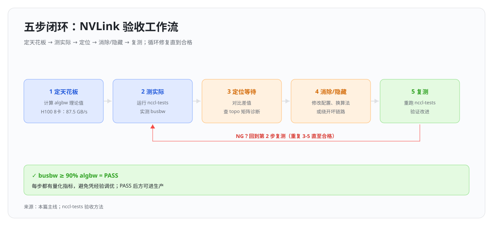
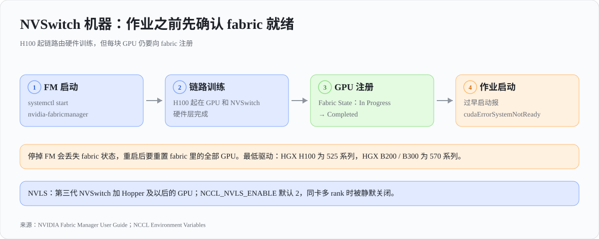
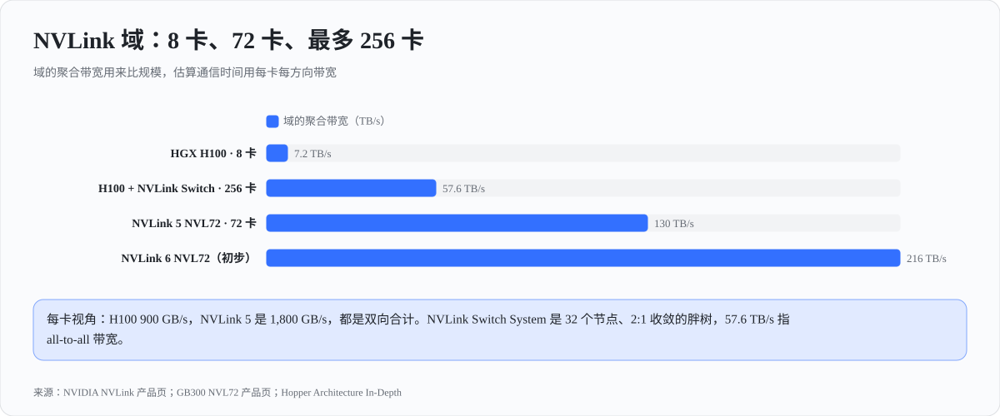

# GPU-13｜单机｜NVLink 与 NVSwitch

> 🎯 **这篇文档解决什么问题**：一台机器上的 8 块 GPU 做张量并行或数据并行时，每一步都要交换数据。这条路如果走 PCIe，GPU 会花大量时间等别的卡。NVLink 和 NVSwitch 是机内的高速通道，但它们的带宽口径、拓扑、服务和测试方法都有容易踩的坑。本篇按 NVIDIA 的 Hopper 架构博客、NVLink 产品页、Fabric Manager 用户指南、nvidia-smi 文档和 nccl-tests 的性能说明，讲清带宽上限怎样算、拓扑怎样读、怎样发现退回 PCIe、怎样测和判读带宽，以及 NVSwitch 机器上 Fabric Manager 和 NVLS 的要点。

**使用方式**：第 1 章说明卡等卡从哪里来。第 2、3 章给出 NVLink 各代和 NVSwitch 的带宽上限。第 4、5 章读拓扑、查 PCIe 回退。第 6、7 章测带宽并判读 algbw 与 busbw。第 8 章讲 Fabric Manager 与 NVLS，第 9 章讲 NVLink 域的边界，第 10 章给清单和自测。

**代码**：zero-to-gpu/13-nvlink/ 下的 sim_nvlink.py、sim_nccl_check.py、test_nvlink.py 只需 Python 标准库。NVLink 6 的规格、拓扑样例的格式和合成日志与真实情况不符，第 10 章逐条说明。

<b>🧭 主线位置</b>：GPU-00（[GPU-00｜索引｜从 0 开始 GPU 优化：路线、章节与练习](./README.md)）建立了时间账 T = T_compute + W_mem + W_host + W_comm + W_idle。GPU-12（[GPU-12｜系统｜MIG、MPS 与容器](./12-sharing.md)）处理了一张卡怎样分给多个任务。本篇处理 W_comm 在单机内的部分：卡与卡之间交换数据时的等待。机内互连看清之后，下一个问题是怎样看清时间实际花在哪里，交给 GPU-14（[GPU-14｜单机｜性能分析与 Profiling](./14-profiling.md)）。

## 导读 · 先给结论

- <b>机内通信走 PCIe 时，卡会等卡。</b>PCIe Gen5 x16 每方向约 63 GB/s，H100 的 NVLink 是 PCIe Gen5 的 7 倍（第 1 章）。[[1]](https://en.wikipedia.org/wiki/PCI_Express)[[2]](https://developer.nvidia.com/blog/nvidia-hopper-architecture-in-depth/)
- <b>厂商的 NVLink 数是双向合计。</b>H100 的 900 GB/s 折成每方向 450 GB/s，估算和验收都用每方向的数（第 2 章）。[[2]](https://developer.nvidia.com/blog/nvidia-hopper-architecture-in-depth/)[[3]](https://www.nvidia.com/en-us/data-center/nvlink/)
- <b>NVSwitch 让任意两卡都以全速互通。</b>DGX H100 用 4 颗 NVSwitch，DGX B200 用 2 颗交换芯片（第 3 章）。[[4]](https://docs.nvidia.com/dgx/dgxh100-user-guide/introduction-to-dgxh100.html)[[5]](https://docs.nvidia.com/dgx/dgxb200-user-guide/introduction-to-dgxb200.html)
- <b>先读拓扑，再查回退。</b>topo -m 里 NV# 是 NVLink，SYS、PHB 都要过 CPU；NCCL 的 P2P 变量会让它退回 PCIe 或主机内存（第 4、5 章）。[[6]](https://docs.nvidia.com/deploy/nvidia-smi/index.html)[[7]](https://docs.nvidia.com/deeplearning/nccl/user-guide/docs/env.html)
- <b>和硬件比用 busbw。</b>all-reduce 的 busbw = algbw × 2(n − 1)/n，8 卡 H100 上限 450 GB/s，algbw 上限约 257 GB/s（第 6、7 章）。[[8]](https://github.com/NVIDIA/nccl-tests/blob/master/doc/PERFORMANCE.md)
- <b>NVSwitch 机器先确认 fabric 就绪。</b>FM 没初始化完会报 cudaErrorSystemNotReady；H100 起每卡要注册到 fabric；NVLS 最多 2 倍吞吐（第 8 章）。[[9]](https://docs.nvidia.com/datacenter/tesla/fabric-manager-user-guide/index.html)[[2]](https://developer.nvidia.com/blog/nvidia-hopper-architecture-in-depth/)
- <b>NVLink 域决定高频通信能铺多宽。</b>机内 8 卡、NVLink Switch System 最多 256 卡、NVL72 是 72 卡（第 9 章）。[[2]](https://developer.nvidia.com/blog/nvidia-hopper-architecture-in-depth/)[[3]](https://www.nvidia.com/en-us/data-center/nvlink/)


<b>📎 与系列其他文档的分工</b>：GPU-11（[GPU-11｜系统｜PCIe、NUMA 与 GPUDirect](./11-pcie-gdr.md)）讲 PCIe、NUMA 和 GPUDirect，本篇第 5 章的回退路径在那里有细节。GPU-16（[GPU-16｜单机｜单机验收与调优](./16-node-burnin.md)）讲单机验收，本篇的核对清单是它的一部分。GPU-17（[GPU-17｜集群｜RDMA 网络：InfiniBand、RoCE 与拥塞控制](./17-rdma.md)）讲跨机的 RDMA 网络，GPU-18（[GPU-18｜集群｜NCCL：算法、协议与挂死排查](./18-nccl.md)）讲 NCCL 的算法、协议和挂死排查。GPU-21（[GPU-21｜LLM｜训练并行：TP、PP、DP、ZeRO 与 FP8](./21-train-parallel.md)）讲并行切分怎样贴合 NVLink 域，GPU-27（[GPU-27｜硬件｜NVL72 与 Grace-Blackwell Superchip：打穿 TP=8](./27-nvl72.md)）讲 NVL72 机柜。

## 第 1 章 · 卡等卡：八卡训练的通信在等什么

GPU-12 处理的是一张卡吃不满。本篇换到一台机器里的八张卡：数据并行要在每步结束时 all-reduce 梯度，张量并行在每层里都要交换激活。这些集合通信期间，计算要么停下来等，要么只能部分重叠，等待记在时间账的 W_comm 上。本章先说明这部分等待由什么决定。

### 通信时间由最慢的一段链路决定

一次集合通信的时间，大消息时约等于数据量除以带宽。机内 GPU 之间可以走 PCIe，也可以走 NVLink。Hopper 架构的技术博客说得很直接：PCIe 带宽有限，是瓶颈[[2]](https://developer.nvidia.com/blog/nvidia-hopper-architecture-in-depth/)；H100 的 NVLink 总带宽 900 GB/s，是 PCIe Gen5 的 7 倍[[2]](https://developer.nvidia.com/blog/nvidia-hopper-architecture-in-depth/)。PCIe Gen5 x16 每个方向约 63 GB/s[[1]](https://en.wikipedia.org/wiki/PCI_Express)。

环形 all-reduce 里每张卡都要把数据传给下一张，环上只要有一跳走了慢链路，整个环都按这一跳的速度走（第 5 章）。所以机内通信的下限，取决于八张卡之间最慢的那条路径，而不是最快的那条。

### 本篇的顺序

- 链路和规格：一条 NVLink 有多快，厂商数字是单向还是双向（第 2 章）。
- 交换：NVSwitch 怎样让八张卡两两全速互连（第 3 章）。
- 看拓扑：topo -m 怎么读，哪里会回退到 PCIe（第 4、5 章）。
- 测和比：nvbandwidth、nccl-tests，algbw 与 busbw（第 6、7 章）。
- 运维：Fabric Manager 和 NVLink SHARP（第 8 章），以及机内 NVLink 域的边界（第 9 章）。


按五步闭环看本篇：

- **定天花板**：每卡每方向的 NVLink 带宽。
- **测实际**：nccl-tests 的 busbw。
- **定位等待**：busbw 低时，看拓扑里是否有一跳走了 PCIe，或 Fabric Manager 没起来。
- **消除或隐藏**：修链路、修服务，或调整卡的分组。
- **复测**：同样的 nccl-tests 命令，busbw 回到天花板附近。

一个常见的误区是只看单卡算力来估训练速度。现象是换了更快的卡，八卡训练的每步时间几乎没变。原因是每步里梯度和激活的集合通信占了相当一部分时间，它由机内互连的最慢链路决定，与单卡算力无关。改法是先测机内 all-reduce 的 busbw，把通信时间单独算进时间账。

> 🔑 **本章要点**：八卡训练里，数据并行和张量并行的集合通信记在时间账的 W_comm 上。H100 的 NVLink 总带宽 900 GB/s，是 PCIe Gen5 的 7 倍；环形通信按最慢的一跳走，所以机内通信的下限取决于最慢的路径。这一章是五步闭环的“定位等待”：先知道卡在等什么。

## 第 2 章 · 一条 NVLink：链路、代际与双向口径

厂商给的 NVLink 带宽是每卡所有链路两个方向加起来的总数。算通信时间要用每个方向的带宽，这一点不分清，估算会差一倍。本章从一条链路讲到每张卡的总带宽。

### 一条链路

NVLink 是 GPU 之间的高带宽、低延迟、无损互连，带有链路级的检错和重传，保证数据送达[[2]](https://developer.nvidia.com/blog/nvidia-hopper-architecture-in-depth/)。A100 的第三代 NVLink，一条链路每个方向用 4 对差分线，每方向有效带宽 25 GB/s；H100 的第四代 NVLink 每方向只用 2 对差分线，每方向同样是 25 GB/s[[2]](https://developer.nvidia.com/blog/nvidia-hopper-architecture-in-depth/)。用更少的线对达到同样速率，同样的引脚就能做更多条链路。

### 每张卡的总带宽

A100 有 12 条第三代链路，总带宽 600 GB/s；H100 有 18 条第四代链路，总带宽 900 GB/s，是上一代的 1.5 倍[[2]](https://developer.nvidia.com/blog/nvidia-hopper-architecture-in-depth/)。Ampere 调优指南给的口径相同：每条链路双向 50 GB/s，A100 合计 600 GB/s 双向，V100 是 300 GB/s[[10]](https://docs.nvidia.com/cuda/ampere-tuning-guide/index.html)。NVLink 产品页列出后几代[[3]](https://www.nvidia.com/en-us/data-center/nvlink/)：

| 代际 | 代表 GPU | 每卡链路数 | 每卡总带宽（双向） | 每方向 |
|---|---|---|---|---|
| NVLink 3 | A100 | 12 | 600 GB/s | 300 GB/s |
| NVLink 4 | H100 | 18 | 900 GB/s | 450 GB/s |
| NVLink 5 | Blackwell | 18 | 1,800 GB/s | 900 GB/s |
| NVLink 6 | Vera Rubin | 36 | 3,000 GB/s | 1,500 GB/s |

表中“每方向”一列是总带宽除以 2：例如 H100 是 900 / 2 = 450 GB/s。这一列才是算 all-reduce 时间要用的带宽，nccl-tests 的 busbw 也应和它比（第 7 章）。第六代的数字产品页标注为初步规格，可能变化[[3]](https://www.nvidia.com/en-us/data-center/nvlink/)。


按五步闭环用这张表：

- **定天花板**：查型号对应的每卡每方向带宽。
- **测实际**：nvbandwidth 和 nccl-tests（第 6、7 章）。
- **定位等待**：实测和每方向带宽差多少。
- **消除或隐藏**：差距大时查链路状态和拓扑（第 4、5 章）。
- **复测**：修复后再测一次。

一个常见的误区是拿 900 GB/s 当作 H100 卡间单向传输的上限来估时间。现象是估出来的通信时间只有实测的一半，或者 nccl-tests 的结果看起来只到“一半效率”。原因是 900 GB/s 是 18 条链路两个方向的合计，每个方向只有 450 GB/s。改法是一律用每方向带宽做预算，并在文档和报表里写明口径。

> 🔑 **本章要点**：一条 NVLink 每方向 25 GB/s，第三代用 4 对差分线，第四代只用 2 对。A100 有 12 条、合计 600 GB/s，H100 有 18 条、合计 900 GB/s，Blackwell 为 1,800 GB/s。这些都是两个方向的合计，算时间要除以 2。这一章是五步闭环的“定天花板”：用对口径。

## 第 3 章 · NVSwitch：让八张卡两两全速互连

一张 H100 有 18 条链路，八张卡如果两两直连，每对卡只能分到两三条，带宽受限。NVSwitch 是一颗交换芯片，所有 GPU 的链路都接到交换芯片上，任意两张卡之间都能用满自己的全部 NVLink 带宽。本章讲 HGX 底座里的交换芯片，以及它带来的组播和规约加速。

### 交换芯片和底座

Fabric Manager 用户指南这样描述 NVSwitch：它把多条 NVLink 连接起来，以 NVLink 的总速率提供 GPU 之间的全互连通信[[9]](https://docs.nvidia.com/datacenter/tesla/fabric-manager-user-guide/index.html)。H100 一代对应第三代 NVSwitch：每颗节点内的交换芯片有 64 个第四代 NVLink 端口，总交换吞吐 13.6 Tbit/s，上一代是 7.2 Tbit/s[[2]](https://developer.nvidia.com/blog/nvidia-hopper-architecture-in-depth/)。

整机规格可以在 DGX 用户指南里查到。DGX H100 规格表的 NVSwitch 一栏写的是 4 个第四代 NVLink 交换，提供 900 GB/s 的 GPU 间带宽[[4]](https://docs.nvidia.com/dgx/dgxh100-user-guide/introduction-to-dgxh100.html)，也就是每张卡都能以自己的全部 NVLink 带宽与任意另一张卡通信。DGX B200 是 2 个第五代 NVLink 交换，聚合带宽 14.4 TB/s[[5]](https://docs.nvidia.com/dgx/dgxb200-user-guide/introduction-to-dgxb200.html)。按每卡带宽乘以卡数核对：8 × 900 GB/s = 7.2 TB/s，和 NVLink 产品页给 NVLink 4 交换的总聚合带宽一致；8 × 1,800 GB/s = 14.4 TB/s，和 DGX B200 的数字一致[[3]](https://www.nvidia.com/en-us/data-center/nvlink/)。

### 交换芯片里的组播和规约

第三代 NVSwitch 还在硬件上加速集合通信：支持组播和 NVIDIA SHARP 网内规约，加速 all_gather、reduce_scatter 和广播原子操作[[2]](https://developer.nvidia.com/blog/nvidia-hopper-architecture-in-depth/)。和不用这一功能的 NCCL 相比，片上组播和规约最多带来 2 倍吞吐，并显著降低小块集合通信的延迟[[2]](https://developer.nvidia.com/blog/nvidia-hopper-architecture-in-depth/)。NCCL 里对应的功能叫 NVLS，第 8 章讲怎样确认它打开了。


按五步闭环核对交换底座：

- **定天花板**：每卡 NVLink 带宽乘以卡数，就是交换底座的聚合带宽。
- **测实际**：任意两卡之间的点对点带宽是否一致（第 6 章）。
- **定位等待**：个别卡对偏低，说明某些链路或交换端口有问题。
- **消除或隐藏**：按 Fabric Manager 的降级策略处理（第 8 章）。
- **复测**：所有卡对的带宽回到一致。

一个常见的误区是以为八张卡里“相邻编号”的卡之间更快，把张量并行组按编号相邻来划。现象是在 HGX 底座上换了分组方式，带宽却没有变化，而在没有交换芯片的机器上，同样的分组却差别很大。原因是 NVSwitch 底座上任意两卡都经交换芯片全速互连，没有远近之分；没有交换芯片时才需要按拓扑分组。改法是先用 topo -m 判断有没有交换芯片，再决定分组是否要按拓扑排。

> 🔑 **本章要点**：NVSwitch 让每张卡以全部 NVLink 带宽与任意另一张卡通信。第三代 NVSwitch 每颗有 64 个 NVLink4 端口、13.6 Tbit/s 吞吐，并在硬件上做组播和规约，最多 2 倍吞吐。DGX H100 的 GPU 间带宽 900 GB/s，8 卡聚合 7.2 TB/s；DGX B200 聚合 14.4 TB/s。这一章是五步闭环的“定天花板”：交换底座的上限等于每卡带宽乘卡数。

## 第 4 章 · 读 topo -m：先确认每对卡走的是什么路

规格表说的是机器应该怎样连，实际怎样连要在机器上看。`nvidia-smi topo -m` 打印一张矩阵，列出所有 GPU 和网卡两两之间的连接类型，以及每张 GPU 的 CPU 和内存亲和性[[6]](https://docs.nvidia.com/deploy/nvidia-smi/index.html)。本章讲怎样读这张矩阵。

### 矩阵里的标记

矩阵对角线是 X，表示自己[[6]](https://docs.nvidia.com/deploy/nvidia-smi/index.html)。其余格子是下面几种标记之一[[6]](https://docs.nvidia.com/deploy/nvidia-smi/index.html)，从快到慢排：

| 标记 | nvidia-smi 文档的含义 | 对通信的影响 |
|---|---|---|
| NV# | 经过 # 条绑定在一起的 NVLink | 最快；# 越大带宽越高 |
| PIX | 经过一个 PCIe 交换芯片 | PCIe 带宽，不经过 CPU |
| PXB | 经过多个 PCIe 交换芯片，不经过 PCIe 主桥 | PCIe 带宽，多一跳 |
| PHB | 经过 PCIe 和一个 PCIe 主桥（通常是 CPU） | 流量过 CPU |
| NODE | 经过 PCIe 和同一 NUMA 节点内 PCIe 主桥之间的互连 | 同一颗 CPU 内跨主桥 |
| SYS | 经过 PCIe 和 NUMA 节点之间的 SMP 互连（如 QPI/UPI） | 跨 CPU，最慢 |

HGX 这类有 NVSwitch 的八卡机，GPU 之间的格子应该全是 NV 加数字；GPU 和网卡之间则是 PIX、PXB 这类 PCIe 标记，这部分在 GPU-11 讲。GPU 之间出现 PIX、PHB 或 SYS，就说明这对卡之间的数据要走 PCIe，甚至跨 CPU。

### 再看链路状态和 P2P

topo -m 只说明连接类型，链路是否都在工作要用 `nvidia-smi nvlink -s` 查每条链路的状态[[6]](https://docs.nvidia.com/deploy/nvidia-smi/index.html)。程序这一侧，NVLink 对 CUDA 是透明的：NVLink 相连的两端之间的传输会自动走 NVLink 而不是 PCIe，但仍要调用 cudaDeviceEnablePeerAccess() 打开点对点访问，可以先用 cudaDeviceCanAccessPeer() 判断两卡之间能否点对点访问[[10]](https://docs.nvidia.com/cuda/ampere-tuning-guide/index.html)。


按五步闭环检查拓扑：

- **定天花板**：按机型规格，GPU 之间应该全是哪种标记。
- **测实际**：topo -m 的实际矩阵和 nvlink -s 的链路状态。
- **定位等待**：找出标记不是 NV# 的卡对，或者 # 比其他卡对小的卡对。
- **消除或隐藏**：链路掉了就报修；机型本来就是部分互连，就按拓扑分组（第 5 章）。
- **复测**：修复后矩阵恢复一致。

一个常见的误区是只在新机器上架时看一次 topo -m。现象是运行一段时间后某对卡的 NV 数变少，或者变成 PCIe 标记，作业的通信变慢，却没人发现。原因是链路可能在运行中故障或降级，topo -m 的结果会随之变化。改法是把 topo -m 和 nvlink -s 加进节点的例行巡检，与基线矩阵比对。

> 🔑 **本章要点**：topo -m 给出每对设备之间的连接类型：NV# 表示 # 条绑定的 NVLink，PIX、PXB、PHB、NODE、SYS 依次是越来越远的 PCIe 路径。NVSwitch 八卡机的 GPU 之间应全是 NV#。链路状态用 nvlink -s 查，程序要用 cudaDeviceEnablePeerAccess 打开点对点访问。这一章是五步闭环的“测实际”：先看清每对卡走的路。

## 第 5 章 · PCIe 回退：环上一跳慢，整个环都慢

第 4 章说到，部分卡对之间可能走 PCIe。本章算一算这会让 all-reduce 慢多少，以及 NCCL 里怎样控制点对点传输走哪条路。

### 一跳 PCIe 拖慢整个环

环形 all-reduce 里，每张卡同时在给下一张卡发数据，每一步都要等最慢的那一跳完成。配套代码 sim_nvlink.py 的 ring 子命令按这个模型计算：8 卡全部走 NVLink 4 时，busbw 等于每方向的 450 GB/s；环上只要有一跳是 PCIe Gen5（按每方向约 63 GB/s 计），100 MB 消息、每步 5 µs 延迟时，8 卡的 busbw 只有 61.5 GB/s，algbw 是 35.1 GB/s。也就是说，一跳 PCIe 让整个环的带宽降到原来的七分之一左右。

这个模型只是下限估算，真实的 NCCL 会根据拓扑选择环的走法，尽量让慢链路少出现在环上。但只要机器不是全互连，就总有部分流量要经过慢链路。配套代码里还有一份合成的 nccl-tests 日志，模拟一跳退到 PCIe 的情况，busbw 是 52.4 GB/s；它不是实测数据，只用来练习判读。

### NCCL 怎样决定走不走点对点

NCCL 的点对点（P2P）传输直接在 GPU 之间用 CUDA 访问，走 NVLink 或 PCIe[[7]](https://docs.nvidia.com/deeplearning/nccl/user-guide/docs/env.html)。两个环境变量控制它：

- **NCCL_P2P_LEVEL**：规定 NCCL 在多远的距离内使用 P2P 传输[[7]](https://docs.nvidia.com/deeplearning/nccl/user-guide/docs/env.html)。取值和 topo -m 的标记对应：NVL 表示只在 NVLink 相连时用 P2P，PIX 表示在同一个 PCIe 交换芯片下也用，依次到 PXB、PHB 和 SYS；LOC 表示从不用[[7]](https://docs.nvidia.com/deeplearning/nccl/user-guide/docs/env.html)。不设时 NCCL 自己选择。
- **NCCL_P2P_DISABLE**：设为 1 时完全关闭 GPU 之间的直接通信[[7]](https://docs.nvidia.com/deeplearning/nccl/user-guide/docs/env.html)。

这两个变量是排查工具，不是调优手段。在 NVSwitch 机器上设 NCCL_P2P_DISABLE=1，所有 GPU 之间的流量都会改走主机内存，带宽会明显下降。


按五步闭环处理 PCIe 回退：

- **定天花板**：全 NVLink 时的 busbw，H100 是 450 GB/s。
- **测实际**：nccl-tests 的 busbw，以及 NCCL_DEBUG=INFO 日志里选择的传输方式。
- **定位等待**：busbw 落在 PCIe 量级时，对照 topo -m 找出慢的卡对。
- **消除或隐藏**：修复链路；无法修复时，把通信量大的并行组放在 NVLink 相连的卡上。
- **复测**：busbw 回到 NVLink 量级。

一个常见的误区是在排查时设了 NCCL_P2P_DISABLE=1 或 NCCL_P2P_LEVEL=LOC，问题解决后忘了去掉。现象是一台 NVSwitch 机器的 all-reduce 一直只有几十 GB/s。原因是这些变量关掉了 GPU 之间的直接通信，流量全部经过主机。改法是把排查用的环境变量写进单独的调试配置，生产作业启动前检查环境里没有它们。

> 🔑 **本章要点**：环形 all-reduce 按最慢的一跳走：8 卡 H100 环上只要有一跳是 PCIe Gen5，模型给出的 busbw 就从 450 GB/s 降到约 61.5 GB/s。NCCL_P2P_LEVEL 按 topo -m 的距离决定在哪些卡对间用 P2P，NCCL_P2P_DISABLE=1 会完全关闭 P2P，只用于排查。这一章是五步闭环的“定位等待”：慢的那一跳决定一切。

## 第 6 章 · 测带宽：nvbandwidth 测链路，nccl-tests 测集合通信

topo -m 说明了路怎么走，路有多宽要实测。机内带宽有两个常用工具：nvbandwidth 测点对点的拷贝带宽，nccl-tests 测集合通信。本章讲它们各测什么、怎么跑。

### nvbandwidth：点对点和主机设备之间

nvbandwidth 是 NVIDIA 的带宽测量工具，测各种 memcpy 模式在不同链路上的带宽[[11]](https://github.com/NVIDIA/nvbandwidth)。它实现了两种拷贝：CE 拷贝用 memcpy 接口，由拷贝引擎执行；SM 拷贝用 kernel，由 SM 执行[[11]](https://github.com/NVIDIA/nvbandwidth)。同一对卡，两种方式测出来的数可能不同，记录时要写明是哪一种。

常用的跑法是 `nvbandwidth -p device_to_device`，跑所有设备到设备的测试项[[11]](https://github.com/NVIDIA/nvbandwidth)，得到一张 GPU 两两之间的带宽矩阵。拿它和 topo -m 对照：NV# 相同的卡对，带宽应该接近；某一格明显偏低，就是要查的那对卡。

### nccl-tests：集合通信

训练实际用的是集合通信，验收要看 nccl-tests。all_reduce_perf 这类程序对一组消息大小跑集合通信，输出平均时间和两种带宽：algbw 和 busbw[[8]](https://github.com/NVIDIA/nccl-tests/blob/master/doc/PERFORMANCE.md)。小消息时时间主要反映固定开销，也就是延迟；大消息时时间和消息大小成正比，这时看带宽才有意义[[8]](https://github.com/NVIDIA/nccl-tests/blob/master/doc/PERFORMANCE.md)。所以验收带宽要用足够大的消息，例如 nccl-tests 扫描范围里最大的几档，小消息单独看延迟。两种带宽的含义和换算在第 7 章讲。


按五步闭环做带宽测试：

- **定天花板**：每卡每方向的 NVLink 带宽（第 2 章）。
- **测实际**：nvbandwidth 的卡对矩阵，nccl-tests 大消息的 busbw。
- **定位等待**：矩阵里偏低的格子对应哪对卡，集合通信是否被它拖慢。
- **消除或隐藏**：按第 4、5、8 章查链路、拓扑和服务。
- **复测**：在同样的消息大小和卡数下再测。

一个常见的误区是用小消息的 nccl-tests 结果判断 NVLink 带宽。现象是 busbw 只有几 GB/s 到几十 GB/s，被误判为链路有问题。原因是小消息时间主要是固定开销，带宽数字没有意义。改法是验收带宽时只看大消息那几行，小消息那几行用来看延迟。

> 🔑 **本章要点**：nvbandwidth 测点对点拷贝带宽，分 CE（memcpy、拷贝引擎）和 SM（kernel）两种，device_to_device 一组测试给出卡对矩阵，可与 topo -m 对照。nccl-tests 测集合通信，小消息看延迟，大消息看带宽。这一章是五步闭环的“测实际”：链路和集合通信分开测。

## 第 7 章 · algbw 与 busbw：哪个数该和硬件比

nccl-tests 每行输出两个带宽。algbw 能直接换算操作时间，busbw 能直接和硬件带宽比。本章按 nccl-tests 的文档推导两者的关系，再用一个 8 卡 H100 的例子看验收时怎样判读。

### 两个带宽的定义

algbw 就是数据量除以时间：algbw = S/t[[8]](https://github.com/NVIDIA/nccl-tests/blob/master/doc/PERFORMANCE.md)。它适合估算一次大操作要多长时间，但对集合通信来说，它的理论峰值和硬件峰值不相等，而且随 rank 数变化[[8]](https://github.com/NVIDIA/nccl-tests/blob/master/doc/PERFORMANCE.md)。

busbw 是在 algbw 上乘一个修正因子，用来反映 GPU 之间通信的实际速度，可以不管 rank 数多少直接和硬件峰值比较[[8]](https://github.com/NVIDIA/nccl-tests/blob/master/doc/PERFORMANCE.md)。以 all-reduce 为例：每个元素要经过 n − 1 次加法和 n 次赋值，共需要 2(n − 1) 次数据传输；每个 rank 对外的带宽是 B 时，最短时间 t = S × 2(n − 1) / (n × B)，所以 busbw = algbw × 2(n − 1)/n[[8]](https://github.com/NVIDIA/nccl-tests/blob/master/doc/PERFORMANCE.md)。其他集合通信的因子：reduce_scatter、all_gather、all-to-all 是 (n − 1)/n，broadcast 和 reduce 是 1[[8]](https://github.com/NVIDIA/nccl-tests/blob/master/doc/PERFORMANCE.md)。busbw 应该反映硬件瓶颈的速度，可能是 NVLink、PCIe、QPI 或网络[[8]](https://github.com/NVIDIA/nccl-tests/blob/master/doc/PERFORMANCE.md)。

### 8 卡 H100 的例子

8 卡 H100 经 NVSwitch 互连，瓶颈是每卡每方向 450 GB/s 的 NVLink，busbw 的上限就是 450 GB/s。8 卡 all-reduce 的修正因子是 2 × 7 / 8 = 14/8，algbw 的上限是 450 × 8 / 14 ≈ 257 GB/s。配套代码的 ring 模型在不计延迟时正好给出这两个数。

配套代码还带了一份合成日志，模拟 8 卡 H100 全 NVLink 的结果：algbw 218.8、busbw 382.8 GB/s，是上限 450 GB/s 的 85.1%。仓库按 80% 以上 PASS、50% 到 80% WARN、50% 以下 FAIL 判定，README 写明这是仓库自定的阈值，不是厂商数字，上线前要换成自己机型的实测基线。



按五步闭环判读 nccl-tests：

- **定天花板**：busbw 的上限等于瓶颈链路的每方向带宽。
- **测实际**：大消息的 busbw。
- **定位等待**：busbw 和上限的比值；比值低时看是哪一级链路。
- **消除或隐藏**：按第 4、5、8 章处理。
- **复测**：和同机型的基线比，而不只和理论值比。

一个常见的误区是拿 algbw 和 450 GB/s 比，得出“8 卡 all-reduce 只有一半多效率”的结论。现象是同样的机器，卡数越多，算出的效率越低。原因是 algbw 的上限随 rank 数变化，8 卡时只有 257 GB/s 左右。改法是用 busbw 和每方向链路带宽比，algbw 只用来估算操作时间。

> 🔑 **本章要点**：algbw = S/t，用来估时间；busbw = algbw × 2(n − 1)/n（all-reduce），反映瓶颈链路的速度，和 rank 数无关，可以直接与硬件带宽比。8 卡 H100 经 NVSwitch 时 busbw 上限 450 GB/s，algbw 上限约 257 GB/s。这一章是五步闭环的“测实际”：用对比较的数。

## 第 8 章 · Fabric Manager 与 NVLS：NVSwitch 机器多出来的两件事

PCIe 直连或 NVLink 桥接的机器，驱动装好就能用 NVLink。带 NVSwitch 的 HGX、DGX 多了一个系统服务 Fabric Manager（FM），和一个可选的集合通信加速 NVLS。前者没起来，作业起不来；后者没生效，作业能跑但少了一截性能。

### Fabric Manager：先把网织好

FM 和 NVSwitch 驱动配合，初始化并训练 NVSwitch 之间的 NVLink 互连[[9]](https://docs.nvidia.com/datacenter/tesla/fabric-manager-user-guide/index.html)。它以 UNIX 守护进程运行，安装包会注册 nvidia-fabricmanager 系统服务，用 `sudo systemctl start nvidia-fabricmanager` 启动[[9]](https://docs.nvidia.com/datacenter/tesla/fabric-manager-user-guide/index.html)。B200、B300 一代起，FM 包还需要额外的 NVLSM 依赖[[9]](https://docs.nvidia.com/datacenter/tesla/fabric-manager-user-guide/index.html)。

FM 没完成初始化就启动 CUDA 程序，CUDA 初始化会报 cudaErrorSystemNotReady[[9]](https://docs.nvidia.com/datacenter/tesla/fabric-manager-user-guide/index.html)。H100 一代起，NVLink 改在 GPU 和 NVSwitch 硬件层面训练，不再依赖 FM；但每块 GPU 还要向 fabric 注册，注册失败的 GPU 会失去 NVLink 点对点能力[[9]](https://docs.nvidia.com/datacenter/tesla/fabric-manager-user-guide/index.html)。注册状态可以这样查[[9]](https://docs.nvidia.com/datacenter/tesla/fabric-manager-user-guide/index.html)：

```bash
nvidia-smi -q -i 0 | grep -i -A 2 Fabric
# 注册中      Fabric State : In Progress   Status : N/A
# 注册成功    Fabric State : Completed     Status : Success
```

运维上有三点要记住。第一点，FM 对驱动版本有最低要求：HGX H100 要 525 系列，HGX B200、B300 要 570 系列[[9]](https://docs.nvidia.com/datacenter/tesla/fabric-manager-user-guide/index.html)。第二点，停掉 FM 会丢失 fabric 状态，重新启动后要把 NVLink fabric 里所有 GPU 重置一遍才能恢复[[9]](https://docs.nvidia.com/datacenter/tesla/fabric-manager-user-guide/index.html)，所以不要在有作业时随手重启这个服务。第三点，FM 提供几种高可用（降级）模式，GPU、NVSwitch 或 NVLink 连接出故障时按策略处理[[9]](https://docs.nvidia.com/datacenter/tesla/fabric-manager-user-guide/index.html)；其中 GPU 和 NVSwitch 之间的连接故障称为 Access NVLink 故障[[9]](https://docs.nvidia.com/datacenter/tesla/fabric-manager-user-guide/index.html)。



### NVLS：让交换芯片参与规约

第三代 NVSwitch 起，交换芯片能用组播和 SHARP 网内规约给集合通信做硬件加速[[2]](https://developer.nvidia.com/blog/nvidia-hopper-architecture-in-depth/)，加速的操作包括 all_gather、reduce_scatter 和广播原子操作[[2]](https://developer.nvidia.com/blog/nvidia-hopper-architecture-in-depth/)。NVIDIA 给出的收益是吞吐最多提升 2 倍，小数据块的集合通信延迟明显下降[[2]](https://developer.nvidia.com/blog/nvidia-hopper-architecture-in-depth/)。

NCCL 里这项功能叫 NVLS（NVLink SHARP），需要第三代 NVSwitch 系统（NVLink4）和 Hopper 及以后的 GPU[[7]](https://docs.nvidia.com/deeplearning/nccl/user-guide/docs/env.html)，由 NCCL_NVLS_ENABLE 控制，默认值 2 表示不支持时不报错[[7]](https://docs.nvidia.com/deeplearning/nccl/user-guide/docs/env.html)。有一个限制：同一个 communicator 里多个 rank 共用一块 GPU 时 NVLS 不兼容，默认值 2 下会被静默关闭[[7]](https://docs.nvidia.com/deeplearning/nccl/user-guide/docs/env.html)。所以 busbw 和同机型基线差一截时，除了查链路，也要查 NVLS 是否真的启用，例如打开 NCCL_DEBUG 看初始化日志。

按五步闭环处理 NVSwitch 机器：

- **定天花板**：每卡每方向 NVLink 带宽，以及 NVLS 能否启用。
- **测实际**：nccl-tests 的 busbw，开关 NVLS 各测一次。
- **定位等待**：Fabric State 是否 Completed，FM 服务是否正常，NVLS 是否生效。
- **消除或隐藏**：修 FM 或驱动版本，注册失败的卡按文档重置，避免同卡多 rank。
- **复测**：所有卡 Fabric State 都是 Completed 后再测。

一个常见的误区是在 H100 机器上看到 `nvidia-smi nvlink -s` 链路正常，就认为 NVLink 一定能用。现象是作业报 P2P 不可用或退回 PCIe。原因是 H100 一代起链路训练和 fabric 注册是两件事，链路训练成功不代表 GPU 已注册。改法是把 Fabric State 检查加进节点就绪检查，FM 服务异常的节点不接作业。

> 🔑 **本章要点**：NVSwitch 机器多一个 Fabric Manager：没初始化完就起作业会报 cudaErrorSystemNotReady；H100 起还要看每卡 Fabric State 是否 Completed；停 FM 后要重置全部 GPU。NVLS 让交换芯片做组播和规约，官方口径最多 2 倍吞吐，同卡多 rank 时会被静默关闭。这一章是五步闭环的“定位等待”：先确认 fabric 就绪，再谈带宽。

## 第 9 章 · NVLink 域的边界：8 卡、72 卡和 256 卡

NVLink 域是能用 NVLink 直接互访的一组 GPU。域内走 NVLink，域外走网卡和网络。域有多大，决定了张量并行这类高频通信能铺多宽。本章只讲边界在哪里，跨机网络留给后面几篇。

### 三种规模

HGX、DGX H100 是 8 卡一个域，每卡 900 GB/s，交换聚合带宽 7.2 TB/s[[3]](https://www.nvidia.com/en-us/data-center/nvlink/)。Hopper 一代还推出了 NVLink Switch System：用第二级 NVLink 交换机，把最多 32 个节点、256 块 GPU 以 2:1 收敛的胖树连起来[[2]](https://developer.nvidia.com/blog/nvidia-hopper-architecture-in-depth/)，all-to-all 带宽 57.6 TB/s[[2]](https://developer.nvidia.com/blog/nvidia-hopper-architecture-in-depth/)。Blackwell 一代的 NVL72 把 72 块 GPU 放进一个域，NVLink 5 的交换聚合带宽是 130 TB/s[[3]](https://www.nvidia.com/en-us/data-center/nvlink/)；GB300 NVL72 同样是 72 块 Blackwell Ultra GPU 和 36 块 Grace CPU，NVLink 带宽 130 TB/s[[12]](https://www.nvidia.com/en-us/data-center/gb300-nvl72/)。NVLink 6 的 NVL72 是 216 TB/s，属于初步规格[[3]](https://www.nvidia.com/en-us/data-center/nvlink/)。

| 系统 | 域内 GPU 数 | 每卡 NVLink（双向） | 域的聚合带宽 |
|---|---|---|---|
| HGX / DGX H100 | 8 | 900 GB/s | 7.2 TB/s |
| H100 + NVLink Switch System | 最多 256 | 900 GB/s | 57.6 TB/s（all-to-all） |
| NVLink 5 NVL72（如 GB300 NVL72） | 72 | 1,800 GB/s | 130 TB/s |
| NVLink 6 NVL72（初步） | 72 | 3,000 GB/s | 216 TB/s |

表中数字来自 NVIDIA 产品页和 Hopper 架构博客[[3]](https://www.nvidia.com/en-us/data-center/nvlink/)[[2]](https://developer.nvidia.com/blog/nvidia-hopper-architecture-in-depth/)，都是厂商口径的峰值。



### 边界对作业意味着什么

域内和域外的带宽差得很远。8 卡 H100 每卡每方向 450 GB/s，而一条 PCIe Gen5 x16 每方向约 63 GB/s[[1]](https://en.wikipedia.org/wiki/PCI_Express)，跨机网卡通常也挂在 PCIe 上。所以排布并行策略时，通信最频繁的维度（例如张量并行）放在一个 NVLink 域内，跨域的维度用通信量小或能和计算重叠的方式。8 卡机上张量并行通常不超过 8，NVL72 上这个上限变大，这是机柜级 NVLink 域的主要用处。具体的并行切分在 [GPU-21｜LLM｜训练并行：TP、PP、DP、ZeRO 与 FP8](./21-train-parallel.md) 讲，机柜级系统在 [GPU-27｜硬件｜NVL72 与 Grace-Blackwell Superchip：打穿 TP=8](./27-nvl72.md) 讲。

一个常见的误区是把 NVL72 的 130 TB/s 当成每块 GPU 能拿到的带宽。现象是按 130 TB/s 估算单卡通信时间，结果比实测快很多。原因是 130 TB/s 是 72 块卡的聚合数，每卡是 1,800 GB/s 双向。改法是估算时一律用每卡每方向的数，聚合数只用来比较系统规模。

> 🔑 **本章要点**：NVLink 域决定了高频通信能铺多宽：H100 机内 8 卡、NVLink Switch System 最多 256 卡、NVL72 是 72 卡。域的聚合带宽用来比规模，估算通信时间用每卡每方向带宽。这一章是五步闭环的“定天花板”：先知道域的边界在哪。

## 第 10 章 · 上线前核对清单与自测

前九章沿五步闭环处理卡等卡的问题：第 1 章说明多卡作业为什么会卡在数据交换上，第 2、3 章给出 NVLink 和 NVSwitch 的带宽上限，第 4、5 章读拓扑、查 PCIe 回退，第 6、7 章测带宽并判读 busbw，第 8 章确认 fabric 就绪，第 9 章划出 NVLink 域的边界。本章把它们压成一张核对清单，再配上代码练习和自测题。

### 📌 核对清单

| 检查项 | 怎样查 | 通过的标志 |
|---|---|---|
| 带宽口径统一 | 厂商双向数除以 2 得到每卡每方向（第 2 章） | 估算和验收都用每方向的数 |
| 拓扑符合机型 | `nvidia-smi topo -m` 对照机型说明（第 4 章） | GPU 两两之间都是 NV#，没有 SYS、PHB |
| 链路全部在线 | `nvidia-smi nvlink -s`（第 4 章） | 每卡链路数和速率与机型一致 |
| NCCL 没有退回 PCIe | NCCL_DEBUG 日志；检查 NCCL_P2P_DISABLE、NCCL_P2P_LEVEL（第 5 章） | 卡间走 P2P/NVLink，没有残留的禁用变量 |
| 卡对带宽均匀 | `nvbandwidth -p device_to_device`（第 6 章） | 矩阵里同类卡对的带宽接近 |
| 集合通信达标 | nccl-tests 大消息 busbw（第 7 章） | 接近同机型基线；8 卡 H100 上限 450 GB/s |
| fabric 就绪 | `systemctl status nvidia-fabricmanager`；Fabric State（第 8 章） | 服务正常，每卡 Completed / Success |
| NVLS 生效 | NCCL_DEBUG 日志；同卡不跑多 rank（第 8 章） | Hopper 及以后的 NVSwitch 机器上启用 |
| 并行维度不跨域 | 张量并行规模对照 NVLink 域大小（第 9 章） | 高频通信留在域内 |

### 代码练习

zero-to-gpu/13-nvlink/ 下有 sim_nvlink.py、sim_nccl_check.py 和 test_nvlink.py，只需 Python 标准库。README 要求的 Python 版本比系统自带的 3.9.6 高，主编在 3.9.6 上也能跑通，11 条测试全部通过。代码有几处和本篇核实过的资料不一致，适合当作找错练习：

- `python3 sim_nvlink.py specs`：NVLink 6 一行写成每方向 1800、双向 3600 GB/s。NVIDIA 产品页给的是每卡 3,000 GB/s[[3]](https://www.nvidia.com/en-us/data-center/nvlink/)，按双向口径每方向 1,500 GB/s，而且是初步规格。前五行的口径和第 2 章一致。
- `python3 sim_nvlink.py ring --gen nvlink4 --n 8`：不计延迟时 8 卡 algbw 257.1、busbw 450 GB/s，和第 7 章按 nccl-tests 公式推出的上限一致[[8]](https://github.com/NVIDIA/nccl-tests/blob/master/doc/PERFORMANCE.md)。加上 `--slowest pcie5 --alpha-us 5 --msg 1e8` 后，8 卡 busbw 降到 61.5 GB/s，可以用来体会一跳 PCIe 拖慢整个环。
- `python3 sim_nvlink.py topo-parse topo_sample_8gpu_hybrid.txt`：样例矩阵用数字 1 和 10 表示距离，解析出 24/56 对是 NVLink。真实的 `nvidia-smi topo -m` 输出是 NV#、PIX、SYS 这类符号[[6]](https://docs.nvidia.com/deploy/nvidia-smi/index.html)，这个解析器不能直接用于真机输出。
- `python3 sim_nccl_check.py parse nccl_test_h100_8gpu_good.log`：两份日志是合成的，格式也做了简化，和真实 nccl-tests 的列不同；85.1% PASS、11.6% FAIL 这类结论只说明判定逻辑，不是测量值。PASS、WARN 的阈值是仓库自定的。

### 自测题

1. NVIDIA 说 H100 的 NVLink 是 900 GB/s。做通信时间估算时该用多少？为什么？
2. 8 卡 H100 跑 all-reduce，nccl-tests 报 algbw 218.8 GB/s、busbw 382.8 GB/s。和硬件比该用哪个数？达到上限的多少？
3. `nvidia-smi topo -m` 里两块卡之间是 SYS，这对 NCCL 意味着什么？NCCL_P2P_LEVEL 设成什么值会让它们不走 P2P？
4. 一台 HGX H100 刚开机，作业立刻报 cudaErrorSystemNotReady。最可能是什么没就绪？怎样确认？
5. 为什么停掉 nvidia-fabricmanager 是一件代价很大的事？
6. NVL72 的 130 TB/s 和每卡 1,800 GB/s 是什么关系？估算张量并行的通信时间时该用哪个？

### 下一步

到这里，单卡、显存、多卡互连的上限都有了。下一个问题是实际跑起来时时间花在哪里：怎样用 Nsight Systems 这类工具看清一次训练或推理的时间线，交给 GPU-14（[GPU-14｜单机｜性能分析与 Profiling](./14-profiling.md)）。

## 参考文献

按正文首次引用顺序编号，资料截至 2026 年 11 月中。

[1] Wikipedia, PCI Express [en.wikipedia.org/wiki/PCI_Express](https://en.wikipedia.org/wiki/PCI_Express)

[2] NVIDIA Technical Blog, NVIDIA Hopper Architecture In-Depth (2022) [developer.nvidia.com/blog/nvidia-hopper-architecture-in-depth/](https://developer.nvidia.com/blog/nvidia-hopper-architecture-in-depth/)

[3] NVIDIA, NVLink and NVLink Switch [www.nvidia.com/en-us/data-center/nvlink/](https://www.nvidia.com/en-us/data-center/nvlink/)

[4] NVIDIA, DGX H100 User Guide: Introduction to the NVIDIA DGX H100 System [docs.nvidia.com/dgx/dgxh100-user-guide/introduction-to-dgxh100.html](https://docs.nvidia.com/dgx/dgxh100-user-guide/introduction-to-dgxh100.html)

[5] NVIDIA, DGX B200 User Guide: Introduction to the NVIDIA DGX B200 System [docs.nvidia.com/dgx/dgxb200-user-guide/introduction-to-dgxb200.html](https://docs.nvidia.com/dgx/dgxb200-user-guide/introduction-to-dgxb200.html)

[6] NVIDIA, nvidia-smi documentation [docs.nvidia.com/deploy/nvidia-smi/index.html](https://docs.nvidia.com/deploy/nvidia-smi/index.html)

[7] NVIDIA, NCCL User Guide: Environment Variables [docs.nvidia.com/deeplearning/nccl/user-guide/docs/env.html](https://docs.nvidia.com/deeplearning/nccl/user-guide/docs/env.html)

[8] NVIDIA, nccl-tests: Performance reported by NCCL tests (PERFORMANCE.md) [github.com/NVIDIA/nccl-tests/blob/master/doc/PERFORMANCE.md](https://github.com/NVIDIA/nccl-tests/blob/master/doc/PERFORMANCE.md)

[9] NVIDIA, Fabric Manager User Guide [docs.nvidia.com/datacenter/tesla/fabric-manager-user-guide/index.html](https://docs.nvidia.com/datacenter/tesla/fabric-manager-user-guide/index.html)

[10] NVIDIA, NVIDIA Ampere GPU Architecture Tuning Guide [docs.nvidia.com/cuda/ampere-tuning-guide/index.html](https://docs.nvidia.com/cuda/ampere-tuning-guide/index.html)

[11] NVIDIA, nvbandwidth (GitHub) [github.com/NVIDIA/nvbandwidth](https://github.com/NVIDIA/nvbandwidth)

[12] NVIDIA, GB300 NVL72 [www.nvidia.com/en-us/data-center/gb300-nvl72/](https://www.nvidia.com/en-us/data-center/gb300-nvl72/)

---

[在 Colab 里跑本章 CPU 练习](https://colab.research.google.com/github/chenziyaos/zero-to-gpu/blob/main/colab/13-nvlink.ipynb) · 上一章：[GPU-12｜系统｜MIG、MPS 与容器](./12-sharing.md) · [目录](./README.md) · 下一章：[GPU-14｜单机｜性能分析与 Profiling](./14-profiling.md)
