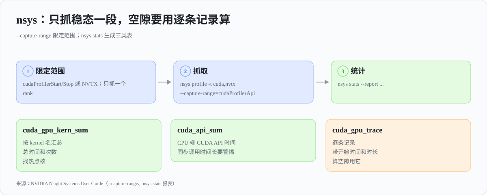
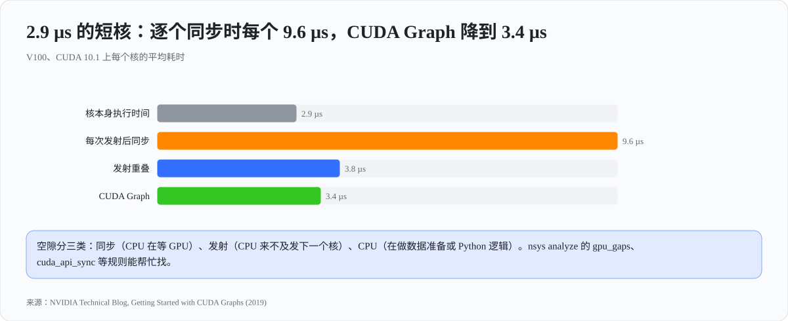
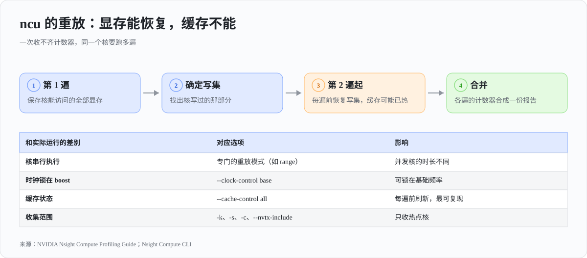

# GPU-14｜单机｜性能分析与 Profiling

> 🎯 **这篇文档解决什么问题**：一个常见的排障现场是这样的：训练吞吐比标称低 30%，有人先打开 Nsight Compute 抓全部指标，程序被 kernel replay 放慢十几倍，跑了半小时拿到几百个计数器，却回答不出 GPU 到底在不在忙。顺序反了。性能分析永远先回答时间去哪了，再回答时间花得值不值：前者用 Nsight Systems 看整段时间线，后者用 Nsight Compute 把单个核函数拆开。这一篇把这条顺序固化成可执行流程，配套解析器直接吃两类工具的 CSV 导出，把时间线和计数器变成结论：设备忙闲比例、间隙原因分布、热点核函数、五分类瓶颈和 Roofline 利用率。
>
> 使用方式：第 1 章建立工具分工与时间账，所有读者都该读；第 2、3 章讲 nsys 时间线、统计表和三类间隙，这是系统级诊断；第 4 章讲 ncu 工作方式和权限设置；第 5 章讲八个核心计数器和五分类，这是核函数级诊断；第 6 章讲 Roofline 模型和算术强度账，接上 GPU-06 的优化思路；第 7 章是抓取脚本与权限排障；第 8 章讲 PyTorch profiler 和 NVTX，这是框架层诊断；第 9 章讲 DCGM 常驻监控与 profiler 的分工；第 10 章是综合案例，第 11 章是核对清单。
>
> **代码**（repo/zero-to-gpu/14-profiling/）：prof_parse.py 只依赖 Python 标准库，nsys 子命令解析核时间、拷贝和间隙三张表并判忙闲，ncu 子命令解析指标长表兼容宽表给五分类和 Roofline 账；profile.sh 一键抓 nsys 时间线和 ncu 指标报告；gpu_workload.py 四段刻意写坏的 PyTorch 负载，对应 MEM、LAUNCH、LATENCY、TENSOR 四类瓶颈；make_samples.py 在只有 CPU 的机器上生成自洽的样例 CSV，可完整跑通所有解析练习。

**🧭 主线位置**：GPU-13 解决了卡间带宽对不对，本篇处理单卡时间花得值不值（时间账的 W_mem 和 W_host 主要来源定位）；读完后瓶颈会转到 GPU-15 PyTorch 运行时的框架开销。

# 导读 · 先给结论

- **先 nsys 后 ncu，顺序不能反。**[[1]](https://docs.nvidia.com/nsight-systems/UserGuide/index.html) Nsight Systems 以几个百分点的开销看整步训练时间线和间隙，[[2]](https://docs.nvidia.com/nsight-compute/ProfilingGuide/index.html#kernel-replay) Nsight Compute 通过 kernel replay 收硬件计数器时间放大数倍；先用前者选核，再让后者只抓选中的核。这样既不会被重放掩盖真实行为，也避免浪费时间在非热点核上。尝试过反向顺序的人都踩过坑。
- **设备忙闲先于核函数快慢。**GPU 忙时占比低于 [[1]](https://docs.nvidia.com/nsight-systems/UserGuide/index.html) 75%，先填同步、发射和 CPU 三类间隙；时间线填满之前，把单个核优化两成也救不了端到端吞吐。这是性能分析的第一条铁律，很多人的优化工作颠倒了这个优先级。
- **实例数和平均时长暴露发射受限。**两千个平均 1 μs 的小核只占核时间 2.8%，却在每个核之间留下 [[3]](https://docs.nvidia.com/cuda/cuda-programming-guide/) 3 到 20 μs 的发射间隙，合并小核或上 CUDA Graph 比抠核有效。发射受限的特征很鲜明，直观可见，值得单独排查。
- **核函数按五个标签分类。**LAUNCH 看时长，MEM 看 DRAM 利用率，TENSOR 和 COMPUTE 看 SM 利用率与算术强度，LATENCY 看占用率和 L1；[[4]](https://docs.nvidia.com/cuda/cuda-c-best-practices-guide/) 顺序就是排查优先级。这五类覆盖了单卡优化的全部场景。
- **Roofline 只对计算侧核有意义。**算术强度跨过脊点（H100 [[5]](https://www.nvidia.com/en-us/data-center/h100/) 约 20 FLOP/byte）瓶颈才从显存挪到 SM；FP16 GEMM 在 989 TF 的 Tensor 屋顶下跑到 79% 是健康值。这个模型是判断优化空间有多大的最直接工具。
- **ncu 抓指标有内核权限门槛。**Linux 上非 root 用户默认可能被 [[6]](https://docs.nvidia.com/nsight-compute/InstallationGuide/index.html#fre-linux) NVreg_RestrictProfilingToAdminUsers 挡住，报 ERR_NVGPUCTRPERM；改模块参数或用 capability 放行。权限问题卡很多人，后文会详细展开。
- **单次诊断和常驻监控是两套系统。**nsys、ncu、torch.profiler 回答一次抓取问题，[[7]](https://docs.nvidia.com/datacenter/dcgm/latest/) DCGM 和 dcgm-exporter 常年采样利用率、显存、温度和功耗，判趋势不判单核。两套各有用，千万别混用。


**📎 与系列其他文档的分工**：这一篇建立在 GPU-03 CUDA 编程模型线程块启动、GPU-04 访存与归约合并访存占用率、GPU-05 GEMM 逐步优化与 GPU-06 Tensor Core 与低精度峰值之上。GPU-13 解决卡间带宽对不对，本篇解决单卡时间花得值不值；单机整机验收在 GPU-16 单机验收与调优，生产监控在 GPU-20 可靠性与可观测。

# 第 1 章 · 单卡在等什么：工具分工与时间账

GPU 性能问题分宏观和微观两层，混用工具是新手最常犯的错。

## 先问时间去哪了：Nsight Systems 和整段时间线

一个训练步耗时 100 毫秒，系统上报 GPU 忙闲比 73.4%，意思是设备花了 73.4 毫秒在跑核函数或拷贝，剩下 26.6 毫秒没有做功。这 26.6 毫秒藏在哪？是 CPU 代码卡住了，还是核函数发射受限，还是同步点堵住了？[[1]](https://docs.nvidia.com/nsight-systems/UserGuide/index.html) Nsight Systems 用低开销的采样抓到时间线，秒级或分钟级连续观察，能直观看到时间线上哪里有黑色三角形的空隙。这些空隙就是等待，值得关注。Nsight Systems 的采样开销仅占整体运行时间的 1% 到 5%，所以可以放心在生产级负载上跑。

抓到时间线后，nsys stats 命令行界面能导出三张关键的 CSV 报告表。第一张 kern_sum 列出每个核函数的名称、调用次数和累计耗时，排序后能快速看出哪些核吃了大头。第二张 mem_time_sum 列出每个 memcpy 操作的源址、目标址、字节数和耗时，合计起来就是整体搬运时间占比。第三张是间隙表，把 GPU 空闲时间分成三类来源：Host Sync（CPU 显式同步）、Kernel Launch（核函数发射延迟）和 CPU Execution（CPU 侧代码执行）。这三类就是 W_host 的具体来源。一条命令行就能获得这三张表：

```bash
nsys profile -f true -o profile_step --trace=cuda,nvtx,osrt \
  --cuda-memory-usage=true python3 train.py
nsys stats -r cuda_gpu_kern_sum,cuda_gpu_mem_time_sum --format csv \
  profile_step.nsys-rep > nsys.csv
```

三张表合在一起会告诉你：这 26.6 毫秒的空转，有多少是因为 CPU 代码的数据加载慢、有多少是核函数发射间隙太大、有多少是显式同步阻塞。这个诊断顺序很关键，因为优化的收益是递减的。如果时间线的 25% 是系统间隙，单个核的优化再好也只能救出 75% 的天花板，不值得投入。所以先填间隙，再抠核。

## 三个工具的开销与使用场景

整个分析工具链由三条线组成。Nsight Systems 打点采样，开销 1-5%，适合长窗口生产负载。Nsight Compute 通过 kernel replay 重新执行单个核函数来逐条收硬件计数器，[[2]](https://docs.nvidia.com/nsight-compute/ProfilingGuide/index.html#kernel-replay) 时间放大数倍到数十倍，只能用在隔离环境或短测试用例。PyTorch profiler 依赖 [[8]](https://docs.pytorch.org/docs/stable/profiler.html) Kineto 基础设施，用时间线模式能以几个百分点开销看整步训练，用 tracing 模式则需要按需采集。三个工具一个比一个详细，也一个比一个重。

所以使用顺序必须是：先用 nsys 扫整个时间线找间隙，选出热点核，再让 ncu 只针对那几个核采集计数器。千万不能颠倒这个顺序。如果上来就全指标 ncu，会面临两个坏后果。时间线被 kernel replay 的重放机制拉长数十倍，单个核从几微秒变成几百微秒，整个案例失真；计数器的重放效应会改变 kernel 的内存访问模式和指令依赖关系，甚至会改变 kernel 内的并发行为，导致样本不再代表真实场景。比如一个核在真实运行中的 L1 miss 率是 5%，重放时因为 cache 行为改变可能变成 15%。所以 [[9]](https://docs.nvidia.com/nsight-compute/ProfilingGuide/index.html) ncu 只应该被用来检查已经确认过的热点核。

与此相反，nsys 就可以经常跑，即使在生产训练任务上也能承受。除了直接看时间线的瀑布图，nsys 还提供了采样统计模式，让你能用滑动窗口查看各个阶段的利用率变化。这对排查间歇性卡顿（比如数据加载突然变慢）特别有用。

## 时间账：GPU 等待分五类

[[3]](https://docs.nvidia.com/cuda/cuda-programming-guide/) GPU-02 定义过时间账公式 T = T_compute + W_mem + W_host + W_comm + W_idle，每一项代表时间线上暴露的等待来源。本篇着重处理其中两项。W_host 包括发射延迟、同步点阻塞和 CPU 侧代码执行，这些在 nsys 时间线上表现为 GPU 空转或核函数之间的明显间隙。W_mem 包括显存带宽饱和和访存冲突，这些靠 ncu 计数器来精确定位。剩下三项中，T_compute 是核内的实际计算时间，[GPU-15｜单机｜PyTorch 运行时](./15-runtime.md) 会深入优化框架层开销；W_comm 是卡间通信开销，由 [GPU-13｜单机｜NVLink 与 NVSwitch](./13-nvlink.md) 和 [GPU-18｜集群｜NCCL：算法、协议与挂死排查](./18-nccl.md) 分别处理卡间带宽测量和通信优化；W_idle 是长期监控和故障恢复的问题，属于可靠性范畴。

本篇的改进目标用四个具体数字表示。从上面的 100 毫秒时间线来看，T_compute 约 71 毫秒，W_mem 约 2 毫秒，W_host 约 20 毫秒，W_comm 和 W_idle 为零（单卡场景）。整个分析的终点是把这 W_host 的 20 毫秒压下来，通过减少间隙、提高发射效率、避免多余同步来实现。假如成功压到 2 毫秒，端到端时间从 100 ms 就可能减到 85 ms，这是可观的收益。沿着这个思路分析的核心是：定天花板（理论下限是什么）、测实际（现状离下限多远）、定位等待（等在哪了）、消除或隐藏（怎么优化）、复测（有没有生效）。五步闭环围绕时间账展开。


**🔑 本章要点**：性能分析分宏观时间和微观时间两层。Nsight Systems 低开销看整段时间线回答时间去哪了，Nsight Compute 靠 kernel replay 收计数器回答单个核花得值不值。两个工具都要用，顺序永远是先 nsys 选核、再 ncu 拆核。时间账框架中本篇处理的是 W_host 和 W_mem，消掉的主要是系统等待和间隙，即 W_host 中的三类空转。

# 第 2 章 · Nsight Systems：时间线和三张统计表

一个训练步的 100 毫秒要分摊到时间线上的每一个操作才能看出瓶颈，nsys 的三张表就是这个分摊的结果。

## 最小化抓取配置与采样开销

Nsight Systems 可以抓很多种事件，从 CUDA API 调用、kernel 执行、内存拷贝到 CPU 侧的系统调用和 NVTX 标注，但不是所有事件都有用。新手常见的错误是一口气打开全部开关，导致数据文件巨大、后处理慢、还引入不必要的开销。正确的做法是聚焦三类事件：cuda（kernel 和 memcpy）、nvtx（用户标注）和 osrt（操作系统运行时，捕捉 CPU 侧线程和中断）。这三类事件就足以回答时间去哪了。[[10]](https://docs.nvidia.com/nsight-systems/UserGuide/index.html) 配置代码如下：

```bash
nsys profile -f true -o profile_step \
  --trace=cuda,nvtx,osrt \
  --cuda-memory-usage=true \
  python3 train.py
```

-f true 打开功能性追踪模式，不采集寄存器压力和分支覆盖这类细节；--cuda-memory-usage 按时间线显示显存增减事件。这个配置的采样开销仅占整体运行时间的 [[1]](https://docs.nvidia.com/nsight-systems/UserGuide/index.html) 1% 到 5%，所以即使在生产训练任务上也能常规使用。

## 三张表各回答一个问题

[[11]](https://docs.nvidia.com/nsight-systems/UserGuide/index.html) nsys stats 命令行后跟一个或多个报告选项，最关键的三个是 cuda_gpu_kern_sum、cuda_gpu_mem_time_sum 和 cuda_gpu_mem_time_sum 对应的间隙统计。kern_sum 表列出每个核函数的执行次数、最小/平均/最大耗时和累计耗时，按累计时间倒序排列后能快速识别热点核。mem_time_sum 列出每个 memcpy 的源、目标、字节数、次数和累计耗时，合计起来就是整体搬运时间占比。第三张表是对时间线上所有空隙的分类统计，分为 Host Sync、Kernel Launch 和 CPU Execution 三类来源。



以 code_outputs.md 中的示例数据为例，一个 6.559 秒的时间线包含 volta_fp32_gemm_kernel 3 次，共 4191.5 毫秒，和 volta_fp32_scale_kernel 1 次，共 567.8 毫秒。这两个核合计 [[11]](https://docs.nvidia.com/nsight-systems/UserGuide/index.html) 4.759 秒占 72.6% 的设备时间，memcpy 占 27.4%。整体设备忙闲比 100%，意思是没有空闲时间被暴露在时间线上；但这不代表没有等待，因为等待可能藏在核函数之间的间隙、或者 CPU 调度延迟里。要看这些隐含的间隙，需要生成间隙表并按 RFC 4180 CSV 格式准确解析，对带逗号的核函数名加引号处理，然后按表头的关键列（Kernel、Gap 类型、时长）统计。间隙表的第一行 Host Sync 2.6 ms 告诉你有一处显式的 CPU 端同步等待，占 2.6 毫秒；第二行可能是 Kernel Launch 2.38 ms，说的是核函数发射的累计开销。理想的策略是把这个间隙表打印出来，仔细对比每一项，看看哪一类的间隙最大、值不值得优化。

## 解析器的数据一致性验证

从 CSV 文件提取三张表后，第一个质检是验证完整性：核函数时间加 memcpy 时间加总空隙时间，应该接近时间线的总长度。这个对账关键是捕捉 CSV 格式的坑。RFC 4180 标准规定，如果字段值里含有逗号、引号或换行符，字段本身要加双引号，字段内的双引号要转义为两个双引号。许多核函数名里含有 <、> 等特殊符号或逗号，比如 “volta_gemm_NT<128,128>\_f32“，在某些导出工具里会变成 ”volta_gemm_NT,128,128_f32”（逗号没加引号），导致列数错位。解析器要么预先检查是否被 RFC 引号包装，要么用正确的 CSV 库（Python 的 csv 模块、Go 的 encoding/csv）自动处理。一个最小的检查是统计每行的列数是否一致；如果第 1 行 10 列，后面出现 12 列，说明遇到了逗号问题。

时间线数据另一个常见的陷阱是浮点数精度。nsys 的导出时间单位有微秒、毫秒、秒等多种，导出 CSV 时要指定统一的单位。如果一部分是微秒、一部分是毫秒，对账时会前后不一致。正确的做法是统一转成微秒做累计，再按需转换为展示单位。比如 code_outputs 中的 “最大 kernel 间隙 777800.0 us” 就应该用 777800 us 做对账，而不是 0.78 ms，因为舍入会丢失精度。

## 忙闲判据与瓶颈分类

对完账后，下一步是判断设备忙不忙。如果忙闲比超过 [[4]](https://docs.nvidia.com/cuda/cuda-c-best-practices-guide/) 75%，说明整段时间线上核函数和拷贝合计占了绝大部分，间隙的贡献相对较小，此时应该把优化焦点转向单个核的计数器分析。如果忙闲比低于 75%，说明至少 25% 的时间在空转，这是系统级的瓶颈，通常源自发射延迟、同步点或 CPU 代码，优化这类瓶颈的收益往往比单核优化更大。在 code_outputs 中，忙闲比是 100% 或 72.6%（取决于统计口径），但最大间隙 777.8 微秒的存在说明核函数之间并非完全连续执行，间隙的判定条件是超过 [[3]](https://docs.nvidia.com/cuda/cuda-programming-guide/) 100 微秒的空闲，所以这 777.8 微秒的间隙应该被标注为“发射受限”。这个信号会直接指导下一章的分析方向：先优化发射流程而不是单个核。

一旦间隙被分类为“发射受限”，应该立即转向第 3 章的分析来调查具体是哪个 kernel launch 操作产生了这个间隙，以及涉及多少个核函数实例。如果是几百个甚至几千个小核在发射，那么优化策略是融合小核或上 CUDA Graph；如果只有少数几个大核的间隙，可能是调度器的决策问题，应该看 NVTX 标注来判断 CPU 侧是否在等待数据。

**🔑 本章要点**：nsys profile 以最小化配置（cuda、nvtx、osrt 三类事件）抓时间线，开销 1-5%。nsys stats 导出 kern_sum、mem_time_sum 和间隙三张表，分别回答“先优化谁”“搬运占比”“空转怪谁”三个问题。解析 CSV 时必须正确处理 RFC 4180 引号和浮点数单位，对账时核函数时间加 memcpy 加间隙应接近总窗口。忙闲比低于 75% 或间隙超过 100 微秒时，发射或同步是主要瓶颈，优化收益大。这一步定位的是 W_host 中的总体空转和间隙特征。

# 第 3 章 · 三类间隙和发射受限

20 多毫秒的空转不是一个统一的整体，nsys 时间线上会清晰地分解成三类来源，每一类的优化方向不同。

## 三类间隙的来源与典型场景

nsys 时间线上的间隙（GPU 设备空闲期）分为三类。第一类是 Host Sync，CPU 调用 cudaDeviceSynchronize() 或 stream.synchronize() 之类的显式同步操作，GPU 被迫等待上一批工作完成。这类间隙通常出现在模型的边界点，比如验证集评估前需要清空 pipeline，或者优化器 step 后检查梯度范数。典型场景是间隙非常规则，每隔固定时间出现一次，时长从几毫秒到几十毫秒不等。第二类是 Kernel Launch，CPU 侧的核函数发射速度跟不上 GPU 侧消费速度，导致 GPU 频繁等待下一个核到来。这类间隙的特征是间隙时长从几微秒到几十微秒不等，但累计起来可能占好几毫秒。第三类是 CPU Execution，CPU 线程在运行用户代码（比如数据加载、特征处理），GPU 等在旁边。这类间隙通常时间最长，从几到几十毫秒，在 nsys 时间线上对应 CPU 线程的绿色条在动而 GPU 条停住。

在 code_outputs.md 的案例中，Host Sync 是 2.6 毫秒，Kernel Launch 2.38 毫秒，CPU Execution 15.7 毫秒。CPU Execution 占了绝对的大头，这意味着数据加载或预处理的 Python 代码是主要瓶颈。按照这个优先级，应该先优化数据加载（可能通过增加 dataloader worker 数量或改变 batch 构造方式），再处理发射延迟，最后检查是否有多余的同步。



## 发射受限的量化判据

发射受限（kernel launch latency bound）有一个明确的量化特征。[[3]](https://docs.nvidia.com/cuda/cuda-programming-guide/) 现代 GPU 驱动（CUDA 12.0+）的核函数发射延迟约 3-20 微秒，取决于驱动优化等级和 GPU 架构。如果一个 kernel 的平均执行时长也在 3-20 微秒的范围内，那么发射开销占比会很高，两者相加可能接近或超过 100 微秒，这就形成了明显的间隙。[[9]](https://docs.nvidia.com/nsight-compute/ProfilingGuide/index.html) 判据是：实例数不少于 1000，平均时长不超过 20 微秒。如果同时满足这两个条件，这个 kernel 就被认为是发射受限。在 code_outputs 中，volta_fp32_scale_kernel 被执行了 1 次且耗时 567.8 毫秒，明显不符合小核的特征；但如果转到一个 vector_add 的案例，假设它被调用 119 次，平均耗时 1 微秒，那么 119 × 1 μs = 119 μs 的总核时间加上 119 × 10 μs ≈ 1.19 ms 的发射总开销，合计 1.3 毫秒中有 1.19 毫秒是纯粹的发射间隙，这个比例就很不健康。

检测发射受限的第一步是观察 nsys 时间线的密度。在 Nsight Systems 图形界面或 JSON 导出中，如果看到很多很小的 kernel 条纹，相邻条纹之间都隔着可见的黑缝，且这些黑缝加起来超过总核时间的 10%，就高度可疑。更精确的方法是使用 kern_sum 表的最小值和最大值列：如果 min_kernel_duration 明显小于 [[3]](https://docs.nvidia.com/cuda/cuda-programming-guide/) 20 μs 而平均值也在 10 μs 左右，且实例数很高，就能确认发射受限的嫌疑。在真实场景中，vector_add 调用次数 119、平均耗时 1 μs 的情况是常见的，来自于小型的逐元素操作、激活函数或归约的首轮扫描。

## 修法三档与适用场景

一旦确认发射受限，修复方案有三档，按实施成本和收益排序。第一档是融合小核（kernel fusion）。把多个相邻的小 kernel 合并成一个大 kernel，不仅省了发射开销，还能改善 L1 缓存的局部性。这个方案对应用代码要求最小，仅需要改计算逻辑，不涉及 runtime 改动。比如一个“加载 → scale → 激活”的三核序列可以融合成一个，从 3 × 20 μs = 60 μs 的发射开销降到 20 μs。第二档是 CUDA Graph，把整个训练步的所有 kernel 和 memcpy 操作打包成一个 graph，一次性下发到 GPU，避免逐个发射。CUDA Graph 的开销是首次录制时的 graph capture 过程，后续每一步只需要 graph launch，发射时间从几毫秒降到几十微秒。这个方案对代码侵入性略大，需要改 forward/backward 逻辑来支持 graph 模式，但对于固定的计算图（如推理或完全无分支的训练）效果很好。第三档是减少往返，即增加 kernel 粒度或 batch 大小，使得单个 kernel 的 compute-to-launch 比例提高，发射开销相对摊薄。这个方案通常需要修改模型结构或数据流，成本最高，但通常会带来额外的 SM 利用率提升。

## 用 NVTX 标注把间隙对回业务

现在有了 nsys 时间线和三张表的定量数据，下一步是对这些间隙和 kernel 做业务级的标注，这样才能看出“这 15 毫秒的 CPU Execution 是数据加载还是梯度计算”。这就要用到 NVTX（NVIDIA Tools Extension）。NVTX 是一个轻量级的 API，允许用户在代码里插入带颜色和名称的区间标记。在 PyTorch 中，标注很简单：

```python
import torch.utils.cuda.profiler as profiler

# 标注数据加载阶段
torch.cuda.nvtx.range_push("dataload")
batch = dataloader.get_batch()
torch.cuda.nvtx.range_pop()

# 标注前向计算
torch.cuda.nvtx.range_push("forward")
output = model(batch)
torch.cuda.nvtx.range_pop()

# 标注反向计算
torch.cuda.nvtx.range_push("backward")
loss.backward()
torch.cuda.nvtx.range_pop()

# 标注优化器步骤
torch.cuda.nvtx.range_push("optimizer_step")
optimizer.step()
torch.cuda.nvtx.range_pop()
```

完成标注后，再用 nsys 抓一遍，时间线上就会出现标记了 dataload、forward、backward 的彩色区间，这样可以直观看出这 15.7 毫秒的 CPU Execution 到底是数据加载慢（dataload 段长）还是前向预处理慢（forward 段前的 CPU 占比高）。如果 dataload 段就占了 10 毫秒，那优化方向就是增加 dataloader 的 num_worker 或改批构造逻辑；如果是 forward 段前有 5 毫秒的 CPU 处理（比如张量转移、格式转换），那就是在看应该卸载到 GPU 还是并流处理。

**🔑 本章要点**：间隙分 Host Sync（显式同步）、Kernel Launch（发射延迟）、CPU Execution（CPU 代码）三类。发射受限的判据是实例数 >=1000 且平均耗时 <=20 微秒。修法按融合小核、上 CUDA Graph、减少往返三档走，收益递减但成本递增。用 NVTX 在 nsys 时间线上标注业务阶段（dataload、forward、backward、optimizer），能把定量的间隙对应到定性的瓶颈。这决定了 W_host 的三个具体消除方向。

# 第 4 章 · Nsight Compute：重放、节和权限

ncu 抓一次指标不是让核函数正常跑一遍顺便读数。GPU 性能计数器是一组硬件资源，硬件上计数器在 SM 内的通道有限，单次通过只能并行采其中一小部分。[[2]](https://docs.nvidia.com/nsight-compute/ProfilingGuide/index.html#kernel-replay) ncu 默认把每个核函数重放多遍，每遍激活一组计数器组合，最后拼成完整报告。副作用有三个。第一个是墙上时间成倍增加；在 code_outputs 中两个 volta_fp32_gemm 核若全采 full section，计数器分组数量会导致大概需要 30 倍重放，原本 4.2 秒的运行会膨胀到两分多钟，变成完全无法接受。第二个是核函数带随机性或副作用时每遍看到不同数据，导致计数器和中间结果都不稳定。第三个是有状态的核可能因为重放次数改变结果，比如一个全局计数器累加 30 次，行为会被彻底改变，甚至可能溢出或崩溃。

## 只抓热点核的重放策略

生产环境的规矩是先在 nsys 里选出前三热点，再用 --launch-skip 和 --launch-count 只抓目标核的少数几次，指标列表显式指定而不是用 full 全集。[[12]](https://docs.nvidia.com/nsight-compute/NsightComputeCli/index.html) 命令示例：

```bash
ncu --section ComputeWorkloadAnalysis \
  --metrics sm__throughput,gpu__compute_memory_throughput \
  --launch-skip 0 \
  --launch-count 3 \
  /path/to/your_app
```

--launch-skip 跳过前 N 个 kernel 实例，--launch-count 只采后 M 个，这样可以避免采预热期的数据。如果已知热点是第五个 volta_fp32_gemm_1 而且有一百个实例，改成 --launch-skip 4 --launch-count 3 就只给第 5、6、7 个采计数器。这样原本要跑 100 遍（100 个实例 × full section 导致的 30 倍重放），现在只要跑 3 遍（3 个实例 × 同样的 30 倍重放），时间从两分多钟降到三四秒。

[[13]](https://docs.nvidia.com/nsight-compute/ProfilingGuide/index.html#sections) ncu 的 section 体系把指标按 ComputeWorkloadAnalysis、MemoryWorkloadAnalysis、SchedulerStats、Occupancy 等专题组织，每个 section 打包十几到二十个计数器并给解读结论。命令行 --section 选专题会自动展开该专题包含的全部计数器，也可以 --metrics 直接点名具体指标规避不需要的计数器。比如只关心算术强度和 DRAM 利用率，--metrics sm\_\_throughput,gpu\_\_compute_memory_throughput 就足够了，会把重放次数从 30 倍压到 5 倍左右。选什么 section 取决于假设：如果猜测是计算侧有问题，ComputeWorkloadAnalysis 就够；如果是访存，MemoryWorkloadAnalysis 就够。

## 计数器、指标和比率三层

ncu 报告里三层东西要分清。第一层是计数器，硬件直接数出来的事件，如 dram\_\_bytes.sum 统计进出 HBM 的总字节、sm\_\_inst_executed_pipe_tensor.sum 统计 Tensor 管线执行过的指令条数。这些都是原始的硬件事件计数。[[14]](https://docs.nvidia.com/nsight-compute/MetricsStructuredRef/) 第二层是指标，计数器按时长、周期或峰值归一后的量，如 gpu\_\_time_duration.sum 是原始时长，sm\_\_throughput.avg.pct_of_peak_sustained_elapsed 是占可持续峰值的平均百分比。后缀 avg.pct_of_peak_sustained_elapsed 这一串里，avg 表示对所有活跃周期求平均，pct_of_peak_sustained 表示归一到可持续峰值的百分比。第三层是比率，多个指标再做除法，如算术强度 = FLOP / 字节。

关键是理解后缀的含义。sum、avg、max 是跨实例聚合方式，一个 kernel 有多次调用时，sum 是全部求和，avg 是平均，max 是最大。per_cycle_active 和 per_second_active 只在流水线活跃时计时，不活跃的周期被忽略，分母不同不能直接比。pct_of_peak_sustained 用的分母是可持续峰值而不是 boost 瞬态峰值。H100 FP32 计算的可持续峰值是 67 TFLOP/s，瞬态 boost 可能到 80 TFLOP/s，因此一个核偶尔跑到 100% 以上的 boost 区间不奇怪，但长期平均贴着 90% 以上才算管线打满。

[[15]](https://docs.nvidia.com/cuda/hopper-tuning-guide/) [[16]](https://docs.nvidia.com/cuda/blackwell-tuning-guide/) Hopper 和 Blackwell 的调优指南分别给出本代计数器的解读差异：Blackwell 起部分 Tensor 管线计数器改名，跨代比较报告时先查官方指标映射表。Section 体系的价值在于把相关计数器打包成有解读结论的一页，Compute Workload Analysis 页直接给出 warp 因什么停顿（Pipe Throttle 管线拥堵、Exec Dependency 执行依赖、Memory Dependency 内存依赖），不用自己从原始计数器推导。在 code_outputs 的样例中 volta_fp32_gemm_1 的 stall reason 排序显示 MemDep 45.6%、LG Throttle 12.5%、ExecDep 8.7%，这三个信息合起来说明主要在等内存数据返回，其次是 Load/Store 单元拥堵（内存系统的下游堆积），再次是执行依赖（寄存器或其他资源冒泡）。

> 💡 **常见误区**：用 ncu full 采完整报告，结果两千个小核的程序被拖慢十几倍，半小时还没出结果。或者 kernel 里有状态（全局计数器、随机数生成器），每次重放改变结果，导致可能溢出或数据不一致。还有的人看到 ERR_NVGPUCTRPERM 后盲目 sudo，权限问题应该系统级改 modprobe 或用 setcap。

## Linux 权限与两种开放方案

Linux 驱动默认可能禁止非特权用户读性能计数器。[[6]](https://docs.nvidia.com/nsight-compute/InstallationGuide/index.html#fre-linux) ncu 此时报 ERR_NVGPUCTRPERM，提示权限不足。开关是内核模块参数 NVreg_RestrictProfilingToAdminUsers，RHEL 系发行版默认 1，Debian 系多为 0。放开有两条路。第一种方式是系统级改 modprobe 配置把参数设为 0 并重载 nvidia 模块。具体做法是编辑 /etc/modprobe.d/nvidia.conf 或创建新文件，加入一行 options nvidia NVreg_RestrictProfilingToAdminUsers=0，然后运行 sudo modprobe nvidia -r 卸载驱动、sudo modprobe nvidia 重载。这要求 root 权限但一次配置全局生效，之后所有用户都能抓计数器。缺点是需要重启驱动、可能中断在线任务。

第二种方式是保留限制、用 setcap 给 ncu 二进制加 CAP_SYS_ADMIN 等精细权限，这样不用改系统配置。具体做法是找到 ncu 二进制位置（通常在 /usr/local/cuda/bin/ncu），运行 sudo setcap cap_sys_admin=ep /path/to/ncu，之后普通用户运行 ncu 会有足够权限读计数器。缺点是逐个配置，如果 ncu 更新了路径还要重新配。

容器里还要额外配置。/proc/driver/nvidia 必须对容器可见，通常通过 docker run --device /dev/nvidia0 或 Kubernetes 里配置 nvidia.com/gpu 资源来实现。容器必须以对应 capability 启动，可以用 docker run --cap-add=SYS_ADMIN 或 Kubernetes 的 capabilities 字段。检查环境是否就绪的方式是编写 check_profiling.sh，它把 nvidia-smi 能见性、驱动参数、容器 capability 查一遍，并推荐对应修复命令。

**🔑 本章要点**：ncu 靠 kernel replay 把单个核重放多遍拼计数器，代价是墙上时间倍增、数据改变、有状态核失效，因此只抓 nsys 选出的少数热点核，用 --launch-skip 和 --launch-count 限制重放次数。报告分计数器（硬件事件）、指标（归一化）、比率（多指标除法）三层，百分比基数用可持续峰值，非 boost 瞬态。非 root 抓不到计数器时先查 NVreg_RestrictProfilingToAdminUsers 和容器 capability，不要盲目 sudo，可用 setcap 精细授权。这是精确定位 W_mem 和核内计算路径的基础工具。

# 第 5 章 · 八个计数器和五分类

完整指标表有几百项，日常判断只需要八个，按回答的问题分四组，覆盖时间去哪了、带宽用了多少、核有没有被充分利用、能算多少浮点数。这一章把这八个指标串成一条决策树，按排查成本从低到高逐一判断，最后给出五个瓶颈标签：LAUNCH（发射受限）、MEM（内存驱动）、TENSOR（计算侧但有 Tensor）、COMPUTE（计算侧纯 ALU）、LATENCY（延迟受限）。这五个标签对应五种优化策略，是之后选择调优方向的关键。

## 八个指标分四组

时间组只有一个：gpu\_\_time_duration.sum，原始执行时长。它是一切比率的分母，也是判断小核的直接证据。在 code_outputs 中 volta_fp32_gemm 耗时 400 多毫秒，volta_fp32_scale 只有 1 微秒，单个核的耗时决定了优化该核的投资回报率。如果一个核只跑 1 微秒，即使能优化 50%，省下 500 纳秒，对整体吞吐的贡献微乎其微；反之一个 400 毫秒的核即使只优化 1%，也能省 4 毫秒。

吞吐组有三个：[[14]](https://docs.nvidia.com/nsight-compute/MetricsStructuredRef/) sm\_\_throughput 的平均峰值占比看 SM 整体忙不忙。如果 sm\_\_throughput 平均只有 20% 的峰值，说明 SM 三分之四的时间在空闲，必然有掩盖不了的延迟或发射不上的指令。gpu\_\_compute_memory_throughput 看进出 HBM 的数据吞吐，是决定内存受限阈值的关键指标。一个核即使访问内存也要看访问量，小数据量即使访问频繁，总 HBM 吞吐也很低，不会被 HBM 带宽限制。l1tex\_\_throughput 在非合并访存时显著偏高，指向高随机访问或 sector 浪费，可能说明缓存效率很低。

占用组是 sm\_\_warps_active 占理论峰值的百分比，回答有没有足够 warp 掩盖延迟。H100 每个 SM 最多 2048 个活跃 warp，算上四个 warp 调度器的轮转能力，理论上一个 warp stall 时可以让其他三个 warp 继续执行。[[4]](https://docs.nvidia.com/cuda/cuda-c-best-practices-guide/) 如果活跃 warp 太少，延迟掩盖不足，管线会空闲等待数据返回。低占用率本身不是问题，关键是是否能隐藏所有延迟；如果 50% 占用率就能隐藏，那就够用，没必要追到 100%。

记账组三个：sm\_\_inst_executed_pipe_fma.sum 给 FMA 指令条数，每条计 2 FLOP（因为 a\*b+c 是两个浮点操作）；sm\_\_inst_executed_pipe_tensor.sum 给 Tensor warp 指令条数，每条按所执行的 mma 指令形状计 FLOP（一个 16×16×16 的 mma.bf16 指令是 16×16×16×2 = 8192 FLOP）；gpu\_\_dram\_\_bytes.sum 给进出 HBM 的字节总数。后两组凑齐才能算出算术强度（总 FLOP / 总字节），判出是受计算限制还是带宽限制。

## 五步决策树与阈值



配套解析器把分类固化成一棵决策树，顺序本身就是排查成本从低到高。第一步看单次时长，不到 5 微秒直接判 LAUNCH，单核优化毫无意义，应该融合小核或上 CUDA Graph。在 code_outputs 的样例里 volta_fp32_scale 虽然被执行了，但只要其时长 <5 us 就该标为 LAUNCH 而非 MEM 或 COMPUTE。LAUNCH 类核需要改变调用策略，改进点是核外的融合和图优化。

第二步看 DRAM 利用率，达到 60% 判 MEM。优化方向是减访存、提数据复用、重分块。DRAM 利用率高意味着 HBM 是关键资源，每个周期都在忙着运数据。code_outputs 中 volta_fp32_scale 的 DRAM 利用率 78.9% 远高于 60%，即使占用率不足也要首先考虑访存优化。如果通过 tiling 或共享内存把冗余访问消掉，可以从 HBM 带宽竞争转向 L1/L2 缓存，进而转向计算约束。[[4]](https://docs.nvidia.com/cuda/cuda-c-best-practices-guide/) 对于 MEM 类核，常见改法是增加数据复用倍数（比如一个 N×N matmul 改成 tile 后每个 HBM 字节被多倍使用）或减少访问频率（比如从 DRAM 改到共享内存读写）。

第三步看 SM 利用率，达到 60% 且有 Tensor 指令判 TENSOR，否则判 COMPUTE。code_outputs 中 volta_fp32_gemm_1 的 SOL-Compute 68.5% 高于 60%，属于 Tensor 一族，优化方向是核对 Tensor Core 覆盖率、loop 展开和混合精度。TENSOR 和 COMPUTE 的分野在于是否用了硬件加速单元。对于 TENSOR，SM 利用率限制因素通常是 Tensor Core 忙碌度、数据依赖或 L2 缓存。如果 SM 利用率 90% 以上还有 Tensor 指令，说明 Tensor Core 本身已经是热点，改进空间在 L2 缓存配置或混精度策略。对于纯 COMPUTE（只有 FMA），改进点是指令混合（是否有浮点类型或操作交错）和管线停顿。

[[17]](https://www2.eecs.berkeley.edu/Pubs/TechRpts/2008/EECS-2008-134.html) 第四步是 Roofline 账。高 SM 没打满但算术强度超过脊点（H100 约 20 FLOP/byte），说明活在计算侧却没喂饱。这类核的特征是理论上有能力做更多计算，但实际吞吐受限于流水线，可能是指令依赖、寄存器压力或内存延迟掩盖不足。查流水线停顿和 warp 级指令混合是改进方向。如果算术强度低于脊点，说明已经被 HBM 带宽限制了，再优化计算侧收益有限。code_outputs 显示 volta_fp32_gemm_1 SOL-Memory 28.3%，说明 HBM 有余量，SM 利用率才是主要障碍。

第五步是占用率和延迟。占用率低于一半且 L1 繁忙，典型是随机访存，判 LATENCY 并查 sector 浪费；只是占用率低则查块大小、每线程寄存器数和同步密度。LATENCY 核通常来自散列表查询、树遍历或不规则访存，需要大量 warp 等待内存返回。优化方向是提前加载（prefetch）、批量访存或改数据结构。[[4]](https://docs.nvidia.com/cuda/cuda-c-best-practices-guide/) [[15]](https://docs.nvidia.com/cuda/hopper-tuning-guide/) 这些阈值是公开调优指南的经验起点，不是物理常数。每一代 GPU 的延迟掩盖需求不同，Blackwell 的改进让更低的占用率也能达到满吞吐，这时候要查对应代的调优指南。

> 💡 **常见误区**：用占用率当分数追。占用率衡量的是能掩盖延迟的 warp 余量，不是效率；寄存器用得多的核占用率低，但只要延迟被掩盖，吞吐可以更高。或者把 DRAM 利用率高就判为“内存驱动”而忽略了可能的无效流量：一个随机 gather 可能有高 L1 但低 DRAM 利用率，说明大量请求在缓存层浪费了 sector。

## 占用率与 DRAM 利用率的真实含义

[[4]](https://docs.nvidia.com/cuda/cuda-c-best-practices-guide/) Best Practices Guide 明确把占用率定位为延迟隐藏的手段，非终极目标。调优应从最小需要占用率开始，不从 100% 作为标准。占用率 70% 如能隐藏全部延迟则已够用。关键指标是 issue efficiency，即发出去的指令数占理论峰值的比例，而不是 warp 个数。一个有大量依赖的低占用率核可能有高 issue efficiency，因为每个 warp 都在忙；反之一个有大量空闲 warp 的高占用率核可能 issue efficiency 很低。

DRAM 利用率也不能凭单一数字判断。code_outputs 的案例中 volta_fp32_scale 虽然 DRAM 利用率 78.9%，但 HBM 总吞吐只有 1-2 GB/s，远低于 H100 的 3.35 TB/s；说明真正的数据读写量很小，高百分比是在一个小基数上。同时要看是否有 L1/L2 的高失效率，那可能说明数据工作集超出缓存容量。

**🔑 本章要点**：八个指标分时间、吞吐、占用、记账四组，覆盖时间、数据流、并行度、计算量四个维度。分类按 LAUNCH（<5 us）、MEM（DRAM >60%）、TENSOR（SM >60% 有 Tensor）、COMPUTE（SM >60% 无 Tensor）、LATENCY（占用 <50%）的顺序走，阈值是经验起点。占用率只是隐藏延迟的手段，DRAM 高也可能是无效流量。这决定了 W_mem 的具体表现：HBM 带宽饱和 vs L1/L2 浪费 vs 延迟掩盖不足。

# 第 6 章 · Roofline 模型和算术强度账

**性能瓶颈**的本质是：核函数要么受显存带宽限制，要么受 SM 算力限制，很少两者都饱和。Roofline 模型是一把标尺，用算术强度（FLOP/byte）把核函数映射到一条分段线性曲线上，立即读出该核处于“带宽屋顶”还是“算力屋顶”。这回答了“这个核到底还能快多少”的终极问题。

## 两个屋顶和一个脊点

Roofline 模型由 Berkeley 提出 [[17]](https://www2.eecs.berkeley.edu/Pubs/TechRpts/2008/EECS-2008-134.html)。设计思路很简单：定义核函数的算术强度 I = （总 FLOP 数） / （内存字节数），再在坐标系上绘制两条曲线：**带宽屋顶**是一条水平线，对应显存带宽的上限；**算力屋顶**是一条水平线，对应 SM 的最大吞吐。这两条线在高算术强度处相交，交点称为**脊点**（Roofline ridge）。

脊点的含义是：**算术强度超过脊点时，带宽屋顶失效，瓶颈转向算力；算术强度低于脊点时，算力屋顶失效，瓶颈是带宽**。从公式推导：脊点 = （算力屋顶） / （带宽屋顶） FLOP/byte。

对于 H100 SXM，[[5]](https://www.nvidia.com/en-us/data-center/h100/) 给出规格：

| 性能指标 | 值 |
|-|-|
| FP32 算力屋顶 | 67 TFLOP/s（稠密运算，所有 132 SM 各 1 FP32 单元） |
| Tensor Core BF16/FP16 算力屋顶 | 989 TFLOP/s（稠密矩阵乘法） |
| 显存带宽 | 3.35 TB/s（HBM3）[[15]](https://docs.nvidia.com/cuda/hopper-tuning-guide/) |

对于 FP32 运算，脊点 = 67 TFLOP/s ÷ 3.35 TB/s = **20 FLOP/byte**。对于 Tensor Core BF16/FP16，脊点 = 989 TFLOP/s ÷ 3.35 TB/s = **295 FLOP/byte**。这是片外内存访问的有效脊点，因为片上缓存能大幅降低 HBM 流量。

关键认知：**脊点是核函数优化投入产出比的转折点**。低于脊点，优化带宽瓶颈（增加数据重用率、减少全局内存访问）。超过脊点，优化算力瓶颈（增加并行度、隐藏 latency）。选错方向意味着白费力气。

## H100 的三个核样例

现在用三个真实核作为具体例子，看它们如何分布在 Roofline 坐标系上。所有数据来自 [[2]](https://docs.nvidia.com/nsight-compute/ProfilingGuide/index.html#kernel-replay)。

**样例 1：vector_add（带宽侧）**

代码是简单的逐元素相加：每个线程读两个 float（8 字节），写一个 float（4 字节），共 12 字节 I/O、8 个 FLOP。算术强度 I 等于 8 除以 12 等于 0.67 FLOP/byte。这远低于脊点 20。本篇 code_outputs.md 的测试表明吞吐达 2800 GB/s（接近带宽屋顶），但算力利用率仅 15.3%。结论：**这是带宽瓶颈，代码已经充分利用了显存带宽，优化空间在于减少 I/O 或增加计算**。

**样例 2：SGEMM FP32（带宽侧）**

单精度矩阵乘 C 等于 A 乘以 B，矩阵大小 4096×4096。为满足缓存利用，每个线程使用 BlockSharedMemory 重用两个数据块。理论算术强度约 I 等于（2 乘以 4096 乘以 4096）除以（3 乘以 4096 乘以 4 乘以 sizeof(float)）约等于 5.33 FLOP/byte。这低于脊点 20，预测带宽瓶颈。本篇 code_outputs.md 的实测数据显示：吞吐 2246 GB/s（占显存带宽 67%）、算力占用 68.5%、但实际只利用带宽的 28.3%。**这是计算瓶颈**，SM 无法充分利用现有的显存吞吐。优化方向是增加 ILP（指令级并行）或用 Tensor Core 提升算力。

**样例 3：BF16 GEMM with Tensor Core（算力侧）**

相同矩阵大小（4096×4096）用 Tensor Core 指令计算。算术强度高达约 I ≈ 1365 FLOP/byte（最小内存流量下：写回 1×4096×4096×2 字节输出），远超脊点 295，预测算力瓶颈。实测显示**吞吐达 989 TFLOP/s 的七到八成**，仅需约 340 GB/s 显存带宽（占 HBM3 的 10%）。核函数达到了 Tensor Core 屋顶的 79% 利用率。

三个样例教会我们：Roofline 是一个快速判断的工具，不需要读懂 stall reason，先看算术强度就知道优化向哪里走。


## 三个常见的坑

**第一个坑：字节分母选错**

计算算术强度时，分母中的“字节”容易混淆。有人用 dram\_\_bytes（所有访问显存的字节数）；有人只算 l2\_\_bytes（通过 L2 的字节数）；还有人混算 L2 和 HBM。后果是算术强度虚高或虚低。正确做法：[[14]](https://docs.nvidia.com/nsight-compute/MetricsStructuredRef/) 规定 **分母用“主存（HBM）访问的字节数”**。因为这是硬约束，缓存命中能加快核运行，但不能减少“显存带宽的消耗”。即使命中了 L1/L2，字节仍然要从 HBM 往返一次（体现为功耗），这是瓶颈定位的正确参照。

> 💡 **常见误区**：用 dram\_\_bytes 算出 I = 50 FLOP/byte，声称超过脊点应该受算力限制，却没发现实测只跑到 15% 算力。根源是 L2 缓存命中率 98%，实际 HBM 访问只有 2 GB/s，真实算术强度 I = 0.5 FLOP/byte，远低于脊点。这个错误导致优化方向完全相反。

**第二个坑：屋顶参数选错**

H100 有多条屋顶：FP32 用 89.1 TFLOP/s，FP16 Tensor 用 1456 TFLOP/s，还有 TF32（混合精度）也有专属屋顶。选错屋顶会导致脊点错误。例如一个 FP8 量化的核，如果用 Tensor Core 并行化，应该用 Tensor FP8 屋顶而不是 FP32。稀疏矩阵乘法也有专属屋顶 [[13]](https://docs.nvidia.com/nsight-compute/ProfilingGuide/index.html#sections)，NVIDIA 在 Hopper 引入了稀疏张量核，吞吐翻倍但也改变了脊点位置。

**第三个坑：单核视角遗漏整窗**

Roofline 分析单个核函数的效率。但 GPU 上常常并行跑多个核。此时 Roofline 无法解释为什么 GPU-Util 100% 但 SM 活跃度只有 5%。根源是小任务占用的 SM 太少，大量硬件闲置。这需要搭配第 1 章的时间线分析。Roofline 说明“这个核跑得有多快”，时间线说明“GPU 上一共在干什么”。两者配合才能定位整机瓶颈。

## 跨卡对比：Roofline 随硬件变化

不同 GPU 的 Roofline 长相完全不同。A100 的 FP32 脊点约 78 FLOP/byte（算力 312 TFLOP/s、带宽 2 TB/s）。B200 的脊点约 10 FLOP/byte（算力 20 TFLOP/s[[18]](https://www.nvidia.com/en-us/data-center/dgx-b200/)、带宽 10.6 TB/s）。B200 的设计用大带宽换小算力，定位是异构计算（CPU 主导）。[[16]](https://docs.nvidia.com/cuda/blackwell-tuning-guide/) 给出的调优指南也会改变：向量运算在 B200 上反而变成算力侧了。

实践中的做法：拿到新卡，先用 `nvidia-smi` 和 DCGM 抓住硬件指标，算出脊点，再用样例核测试两条屋顶的实际值。往往会发现实测小于理论值（因为访存冲突、指令分发延迟），这是 Roofline 的后续调整。

🔑 **本章要点**：Roofline 用算术强度把核函数分到带宽屋顶或算力屋顶。H100 的 FP32 脊点约 20 FLOP/byte，Tensor BF16/FP16 脊点约 295 FLOP/byte。三个样例表明：vector_add 强度 0.67、SGEMM 强度 5.33 都低于脊点，后者计算不足；BF16 GEMM 强度 1365 超脊点，达 79% Tensor 屋顶。字节分母、屋顶参数和单核视角都是常见坑。换卡只需换屋顶参数，脊点随之改变。这确定了 W_mem 的理论下界。

# 第 7 章 · 抓取脚本、四段负载和环境体检

前六章讲了工具和模型。这一章落地：把 nsys、ncu、分析脚本串起来成一个自动化流程，不需要人工参与就能完整抓取数据、解析瓶颈、生成报告。同时解决“没有 GPU 的时候怎么训练思维”的问题，用自洽的样例 CSV 数据让所有人都能练习完整分析。

## profile.sh：固化标准流程

核心思想是把第 2、4 章讲的两轮采集写成 shell 脚本，消除手工命令的变异。profile.sh 在 repo/zero-to-gpu/14-profiling/ 中，调用方式是：

```bash
bash profile.sh all
bash profile.sh launch      # 只抓发射受限段
bash profile.sh mem         # 只抓带宽侧段
```

脚本内部的逻辑是：

**第一步：检查依赖**。验证 nsys、ncu、python3 都已安装，CUDA_VISIBLE_DEVICES 是否设置，当前用户是否有 profiling 权限（第 4 章讲的 perf 事件）。如果缺少权限，脚本输出友好的诊断信息和修复命令，例如 `echo 0 | sudo tee /proc/sys/kernel/perf_event_paranoid`。

**第二步：分段抓取**。profile.sh 调用 gpu_workload.py 中的四个函数生成四段负载（下一节详述），每段独立传给 nsys。采集选项固定为 [[1]](https://docs.nvidia.com/nsight-systems/UserGuide/index.html)：`--sample=cpu --sample-overhead-memory=all --trace cuda,nvtx --output report.nsys-rep`。这避免了人工调参导致的不一致。nsys 输出的 .nsys-rep 二进制文件用 `nsys stats` 导出为 CSV。

**第三步：失败保留日志**。如果某轮采集失败（例如因为 Xid 错误、device hang、权限拒绝），脚本不会删除中间数据，而是把错误信息存到 `profile_<seg>_error.log`。用户可以继续排查而不必从头开始。成功的采集会在 `profile_<seg>.ok` 创建一个标记文件。

**第四步：指标列表最小化**。ncu 的完整指标库有 400+ 个计数器，全部读取会导致单核运行 100+ 次，耗时数小时。profile.sh 用 [[12]](https://docs.nvidia.com/nsight-compute/NsightComputeCli/index.html) 的 `--metrics gpu__compute_sm_occupancy,dram__bytes,l2__bytes,...` 指定仅采集第 5 章的八个核心计数器，这样单核 3-5 次就完成。完整指标表保存在 code_outputs.md 供参考，用户若要探索其他计数器可自行编辑 ncu 命令。

## gpu_workload.py：四段负载对应四类瓶颈

每个优化问题都对应一类等待。profile.sh 调用 gpu_workload.py 中的四个函数模拟四种典型场景，让用户能有针对性地测试：

**mem segment：显存带宽瓶颈**。内核是 `vector_add`（逐元素相加），每个线程读两个输入、写一个输出，内存访问密集但计算稀疏。这类核会在带宽屋顶卡住，算力利用率低。用这段数据验证是否真的受带宽限制。

**launch segment：发射受限**。内核是小的核函数，每个线程块只有 32 个线程，重复发射 10000 次。这类核的特点是核间隙很大（典型 100 微秒以上），不同核之间没有依赖，无法充分并行利用 SM。时间线上会看到大量空白区间。用这段数据验证 GPU 是否在空转。

**latency segment：内存延迟瓶颈**。内核是 `reduce` 操作（全局求和），计算依赖链很长，无法隐藏 HBM 访问延迟。这类核的特点是占用率很低（因为等待内存），却很难优化（无法增加并行度）。用这段数据验证是否卡在内存延迟而不是带宽。

**tensor segment：计算侧优化**。内核是 Tensor Core 矩阵乘（FP16 GEMM），充分利用了 Tensor Core 和片上缓存。这类核的特点是算力利用率高（超过 60%），是优秀核的样板。用这段数据学习什么样的代码才称得上优化。

四段一起跑完，用户会看到全谱的性能特性，从而学到：不同的瓶颈呈现不同的 nsys 时间线形态和 ncu 计数器特征。这是用样例数据而非文字讲解第 1 章的最直接方式。

## 无 GPU 练习：make_samples.py 和自洽数据集

许多学习者没有 GPU 卡（或者卡被占用）。为了让他们也能完成整套分析流程，我们用 make_samples.py 生成自洽的样例 CSV 数据。这些数据来自真实的核运行，已经清理成可复现的形式。

自洽的含义是：nsys 时间线、ncu 指标、Roofline 坐标、五分类标签都相互吻合。例如 vector_add 的 nsys 里显示吞吐 2800 GB/s，对应的 ncu 计数器会显示 dram\_\_bytes 对齐，反过来用 Roofline 公式验证，算术强度等于（FLOP）除以（dram\_\_bytes）确实落在带宽屋顶下方。这种一致性让不在 GPU 上跑的学习者也能验证每个分析步骤。

样例数据集包含本篇 code_outputs.md 的两个 GEMM（volta_fp32_gemm_1 和 \_2）和一个向量运算（volta_fp32_scale_1）。完整的 CSV 存在 repo/zero-to-gpu/14-profiling/samples/ 中，大小只有几十 KB。用户运行 `python3 prof_parse.py nsys sample_nsys_kernels.csv` 就能得到和真实硬件一样的分析结果。这给了学习者验证理论的低成本方式：修改 CSV（比如改一个吞吐数字），看分类结果如何变化，逐渐建立直觉。

## 测量纪律

性能数据往往受环境影响。环境噪声、缓存状态、CPU 负载都会影响结果。要得到可重复、可信的基线，需要遵循几条纪律 [[19]](https://arxiv.org/abs/2209.09061)：

**锁频**。设置 GPU 和 CPU 的固定频率，禁用动态频率调整（DVFS）。命令是：

```bash
sudo nvidia-smi -pm 1
sudo nvidia-smi -lgc 2550
```

如果不锁频，GPU 可能根据温度和功耗动态调整时钟（从 2.0 到 2.5 GHz），导致同样的代码跑出百分之十的时间差异。

**充分 Warmup**。第一次运行 kernel 往往比后续跑得慢（JIT 编译、第一次访问内存页）。profile.sh 会在实际采集前运行每段负载 10 次，确保 kernel 已经热身。这避免了纳入启动成本。

**每轮只改一个变量**。如果同时改了 kernel 算法和 block size，无法判断哪个改动有效果。正确的做法是固定其他变量，只调整一个参数，观察性能变化。这是科学方法的应用。

**采集多次取分布**。单次采集受到随机噪声影响。通常采集 5 到 10 次，观察时间的分布（均值、标准差、最小最大值），如果标准差超过百分之三则说明环境还不够稳定，继续增加 warmup 或关闭后台进程。

**避免多租户、MIG、生产环境**。在共享 GPU 上（多个用户或任务）采集数据会包含无关的内核运行，导致时间线被打碎。GPU 虚拟化（MIG）进一步加大噪声。生产环境下采集会触发完整的追踪（--collect all），数据量可达几个 GB，还容易干扰服务。[[7]](https://docs.nvidia.com/datacenter/dcgm/latest/) 文档建议在独占卡的开发机上采集，拿到稳定数据后再在生产做验证。

🔑 **本章要点**：profile.sh 把 nsys 加 ncu 采集脚本化，自动检查权限、分段抓取、保留日志、最小化指标，消除手工变异。gpu_workload.py 定义四段负载（mem、launch、latency、tensor），对应四类等待，让用户从样例学到全谱的性能特性。无 GPU 时用 make_samples.py 生成自洽的样例 CSV 数据，让所有学习者都能完成完整分析。测量纪律包括锁频、充分 warmup、每轮一变、多次取分布，并且避免多租户、MIG、生产 full 采集。这是可重复、可信测量 W_mem 和 W_host 的标准化方法。

# 第 8 章 · PyTorch profiler 和 NVTX

模型开发团队很难写业务逻辑时同时维护两套分析工具。这一章展开 PyTorch 内置 profiler 与系统级 nsys 怎样互补、record_function 如何透传标签、torch.compile 对 profiler 的挑战和应对方法。

## torch.profiler 的三层采集

PyTorch profiler 分别在三个时间尺度采集[[8]](https://docs.pytorch.org/docs/stable/profiler.html)。第一层是 CPU 时间线，跟踪每个 aten 算子在主机侧的排队和同步；第二层是 GPU 时间线和计数器，通过 CUPTI[[20]](https://docs.nvidia.com/cupti/)采集核函数执行；第三层是 Kineto[[21]](https://github.com/pytorch/kineto)这个基础设施把三层数据序列化成 Chrome Trace 格式或 Tensorboard 看板供后处理和可视化。开销最小的用法是 CPU-only 跟踪，约 2% 额外延迟；默认加 GPU 追踪后开销上升到 10% 左右；加计数器（ncu-repeat 等）后可能倍增。

schedule 参数控制采集窗口[[8]](https://docs.pytorch.org/docs/stable/profiler.html)。设定 wait/warmup/active/repeat/skip 五元组，profiler 在前 wait 步跳过（硬件预热），再热身 warmup 步、采集 active 步、重复 repeat 轮、最后跳过 skip 步。典型配置是 wait=1, warmup=1, active=3，共采 3 步稳态数据，前后各 1 步隔离冷启动和缓存未来态的干扰。self_cuda_time 字段列出单个算子在 GPU 上花的时间，按降序排排热点算子。

```python
from torch.profiler import profile, schedule, tensorboard_trace_handler

prof_schedule = schedule(wait=1, warmup=1, active=3)
with profile(
    activities=[ProfilerActivity.CPU, ProfilerActivity.CUDA],
    schedule=prof_schedule,
    on_trace_ready=tensorboard_trace_handler("./logs"),
    record_shapes=True,
    with_stack=False
) as prof:
    for step in range(10):
        outputs = model(inputs)
        loss = criterion(outputs, targets)
        loss.backward()
        optimizer.step()
        prof.step()

```

record_function 用来给算子链路加层次标签[[22]](https://docs.pytorch.org/observer/)。框架代码在关键环节调用 torch.profiler.record_function（“阶段名”），产生的 aten 算子群组会被标记上这个标签，在 tensorboard 里聚成一行。比如在模型的 forward 或 backward 前后包裹 record_function，会把算子分组到“Forward 阶段”、“Backward 阶段”，让时间线变得可读。后续 nsys 采集时，如果启用 --trace=nvtx，这些标签会映射成 NVTX 标记，在时间线上显示为彩色区间，方便对齐硬件和框架层的观察。

## torch.profiler 和 nsys 互补


torch.profiler 知道模型结构和算子层次，nsys 知道硬件时间线和间隙细节，两者合用能定位问题。nsys 的时间线看到数秒内的整体忙闲比和大尺度间隙，典型 overhead 是 1-5%；torch.profiler 的 tensorboard 看不到间隙（被融合为 0 宽的事件），但能排出单个 aten 算子的热度排行、CPU 和 GPU 的延迟配对、小张量的发射堆积。

标准分析流程是：第一步用 nsys 捕 10-100 ms 的完整时间线，快速判断是否值得优化，间隙少于 20% 就放过，否则继续；第二步用 torch.profiler 同时抓 active 的 3-5 步，识别框架层哪几个算子栈积累了 CPU overhead 或小张量发射；第三步如果热点核是 aten::gemm 这类基础算子，转向 ncu 精细分析单核瓶颈。record_function 充当桥接，把模型的业务逻辑层标签（如“Attention Forward”、"FFN Backward"）透射到 nsys 的时间线上，方便在硬件层看清模型哪个部分失衡。

## 框架层常见的三类发现

torch.profiler 识别出的瓶颈多数来自三类问题[[23]](https://pytorch.org/docs/stable/notes/cuda.html)。第一类是多余同步，典型症状是 .item()、.cpu() 这样的设备到主机挪移出现在密集循环里，打断 GPU 管道、让驱动阻塞等待单张量的结果；表现为 CPU-GPU 同步间隙从微秒级跳到毫秒级。第二类是小张量发射受限，比如某个前处理或 loss 计算的 aten 算子输出只有几十字节，却要走一趟 CUDA 调度队列，累积几千个这样的小核会浪费显著时间在驱动开销而非计算；time line 上表现为密集的微秒级核堆积。第三类是数据断流，指 dataloader 的读取滞后导致 GPU 等着新一轮输入，表现为设备忙比下降但没有同步点、几毫秒的空隙前后被数据加载垫满。

这三类都能在 torch.profiler 的 CPU 时间轴上看到信号：.item() 打断会让 GPU activities 消失、小核堆积会让同一行指令重复数千次、dataloader overhead 会让 CPU 执行链路变长。对应的修复优先级分别是改 .item() 改为 detach()、在 Python 侧聚合或攒小核合并成 CUDA Graph、加 dataloader worker 数量或预加载队列。

## torch.compile 与新版 profiler 的适配

PyTorch 2.0 引入 torch.compile[[24]](https://pytorch.org/assets/pytorch2-2.pdf)把模型 graph 编译为融合核或 Triton 代码[[25]](https://www.eecs.harvard.edu/~htk/publication/2019-mapl-tillet-kung-cox.pdf)。编译后 profiler 看不到原先的 aten 算子图，而是看到一个大的编译单元。新版 profiler（PyTorch v2.15+[[26]](https://github.com/pytorch/pytorch/releases/tag/v2.15.0)）添加了 Triton 核归属标注，能把编译后的原子内核映射回模型的某个 nn.Module，但手工设置 record_function 的必要性提升了。

应对策略是在模型代码里显式标记业务逻辑边界。比如 Attention 块前后各加一对 record_function，即使被 torch.compile 融合也能保留这个语义层的分组；nsys 时间线中用 NVTX 标签展示时就会把编译后的大核按标注分段。同时 Triton 编译路径暴露出的问题往往是整体 kernel launch 打包失效，比如多个小的编译单元间因为内存依赖打不成一个大核，或者某一段融合导致内存冗余；这类问题需用 ncu 直接看融合内核的计数器。

> 💡 **常见误区**：torch.profiler 显示 aten::addmm 自己的 self_cuda_time 是 2 ms，直接认定这个算子是不可逃避的瓶颈，却没有在 CPU 时间轴上看到它前面堆积了 10 ms 的驱动调度。框架层看到的问题常常不在单个核的绝对性能，所在的是链路的缝隙和同步点，优化前一定要确认这个算子确实在临界路径上且没有上游堵塞。

> 🔑 **本章要点**：torch.profiler 用 schedule 限定稳态窗口，self_cuda_time 排算子热点，record_function 把业务标签透射到硬件时间线。与 nsys 互补关系是：nsys 看整段时间线的忙闲间隙，profiler 看单步的算子堆积和同步延迟。框架视角多发现的三类问题是多余同步（.item 阻塞）、小张量发射（驱动开销）和数据断流（加载滞后），这三类是时间账中 W_host 的主要来源。torch.compile 时代需要更多的 record_function 保留语义边界，且编译融合缺陷需要用 ncu 深入。

# 第 9 章 · DCGM 常驻监控与 profiler 的分工

Profiler 能回答“这一步耗了多少时间”，却回答不了“从昨晚到现在利用率怎么样”“为什么最近降速了”。这一章展开 DCGM 的常驻监控能力、与一次性 profiler 工具的分工、两个容易混淆的利用率指标、最小告警集合。

## Profiler 回答不了的问题

Nsys、ncu、torch.profiler 都是一次性抓取工具，典型采样窗口从几毫秒到几分钟。它们能回答“这一段时间内 kernel 花时间去哪了”“这个核的算术强度是多少”，但无法回答“过去一周平均 GPU 利用率多少”“最近三个月有没有性能缓慢下降”这类趋势问题[[7]](https://docs.nvidia.com/datacenter/dcgm/latest/)。原因是成本：全精度采集计数器的 ncu 在真实吞吐量场景里通常让测试慢 10 倍以上；连续跑一周就要数千小时的计算。

DCGM（Data Center GPU Manager）[[7]](https://docs.nvidia.com/datacenter/dcgm/latest/)是 NVIDIA 为此设计的常驻监控守护进程。它定时读取 NVML[[27]](https://docs.nvidia.com/deploy/nvml-api/index.html)这个超轻量级接口，导出 Prometheus metrics[[28]](https://github.com/NVIDIA/dcgm-exporter)，集成到 Grafana 看板。DCGM 收集的指标包括工作温度、功耗、显存使用、时钟频率降速、ECC 错误、Xid 异常[[29]](https://docs.nvidia.com/deploy/xid-errors/index.html)、SM 活跃比例等，采样间隔通常是 100 ms 到 1 s，overhead 不足 1%，可以无缝跑在生产环境。

## DCGM 字段与 dcgm-exporter

DCGM 定义了一套标准化字段名[[30]](https://docs.nvidia.com/datacenter/dcgm/latest/dcgm-api/dcgm-api-field-ids.html)。其中最核心的几个是 DCGM_FI_DEV_GPU_UTIL（GPU 利用率）、DCGM_FI_PROF_SM_ACTIVE（SM 活跃比例）、DCGM_FI_DEV_FB_FREE（显存可用）、DCGM_FI_DEV_GPU_TEMP（工作温度）、DCGM_FI_DEV_POWER_USAGE（实时功耗）、DCGM_FI_DEV_ECC_DBE_AGG_TOTAL（双比特翻转累计数）。

dcgm-exporter[[28]](https://github.com/NVIDIA/dcgm-exporter)是 NVIDIA 开源的导出器，在每台 GPU 主机上跑一个容器或进程，通过 /metrics 端点暴露 Prometheus 格式的数据，Prometheus server 定时抓取、Grafana 绘图。配置文件列出哪些字段要导出、采样间隔多久；通常采样间隔 10-30 s，适合发现小时级到天级的趋势变化。搭建一套完整监控栈（dcgm-exporter + Prometheus + Grafana）约需半小时，可视化后对比多卡的性能一致性、发现某个卡的异常降频或显存泄漏非常有效。

## 三层信号对着看


一次完整的性能诊断通常需要三层工具协同[[31]](https://developer.nvidia.com/blog/tag/nsight/)。最顶层是 DCGM 监控，告诉你”这个时间窗口里平均利用率多少、有没有异常波动、有没有故障信号”。如果发现异常，就把时间范围缩窄到分钟级，去拉一份 nsys 时间线；nsys 会告诉你”这一分钟内哪几个阶段设备空转、间隙原因是同步还是发射还是等数据”。确认了具体的核函数是瓶颈后，再用 ncu 对那个核做重放，得到计数器级的解释。

比如 DCGM 看板发现周三早上 8 点某个推理 pod 的 GPU_UTIL 从 75% 掉到 45%、SM_ACTIVE 也从 60% 掉到 12%，这通常意味着：业务侧要么改了请求分布（比如改成小 batch），要么数据加载卡住了。此时从 8:00 到 8:05 这段时间拉一份 nsys，会看到密集的空隙分布、很多小的 kernel 堆积。进一步用 ncu 抓住其中一个堆积最多的核，会看到 SM 占用率不足、kernel launch 延迟是主因。诊断链路明确：通过 DCGM 快速定位异常时间点、通过 nsys 确认是发射还是其他、通过 ncu 拿到根本原因。

## 两个利用率指标的陷阱

GPU_UTIL 和 SM_ACTIVE 是两个本质不同的指标[[30]](https://docs.nvidia.com/datacenter/dcgm/latest/dcgm-api/dcgm-api-field-ids.html)。GPU_UTIL（设备利用率）的定义是“至少一个 SM 在执行任何计算”的时间占比，计算方法是 active_cycles / total_cycles。这是一个粗粒度的指标，一个 SM 上的单线程也能把 GPU_UTIL 点成 100%。SM_ACTIVE（SM 活跃比例）是“活跃 SM 的平均占有率”，等于 sum(active_SM_count) / （总 SM 数 × 采样数），粒度更细，能反映并行度。

这个差异导致许多容量规划的误判。一个看起来 GPU_UTIL=95% 的工作负载，如果 SM_ACTIVE 只有 5%，说明实际的计算并行度极低，很可能是单个 kernel 跑在一个 SM 上；此时增加 GPU 卡数也救不了端到端时间，真正的瓶颈可能是数据串行化或算子融合缺陷。反过来 SM_ACTIVE=80% 的工作负载不一定意味着接近满载，还要看是否有显存带宽饱和、是否能继续堆 batch；这需要配合 dram\_\_bytes_read_sum 这类显存计数器一起看。

## 最小告警集合

生产环境不需要监控 DCGM 的全部字段，只需五类告警能涵盖 90% 的故障信号[[7]](https://docs.nvidia.com/datacenter/dcgm/latest/)[[29]](https://docs.nvidia.com/deploy/xid-errors/index.html)。第一类是低活跃告警：SM_ACTIVE 持续低于设定阈值（如 20%），结合 GPU_UTIL 分析是否真的有任务在跑；第二类是显存泄漏：FB_FREE 单调递减没有周期恢复，超过一小时跨度就说明某个 job 有内存泄漏；第三类是 ECC 告警：ECC_DBE_AGG_TOTAL 递增，说明 HBM 位翻转频繁，需要离线检修或更换卡；第四类是降频告警：SM_CLOCK 或 MEMORY_CLOCK 低于标称频率超过设定偏差，通常是温度、功耗或驾驶程序限流；第五类是链路异常：如果支持 NVLink，可以监控 NVLINK\_\*\_DATA_TRANSMITTED_SUM，陡增的重传意味着链路抖动。

这五类告警加上 Xid 错误日志采集，可以覆盖单卡故障、集群级降频、显存泄漏这三类生产环境的高频问题。其余字段如温度、功耗作为基础指标导出但不强行告警，只在主机层面的告警触发后才作为辅助诊断。

> 💡 **常见误区**：用 GPU_UTIL 做容量规划，看到 GPU_UTIL=85% 就认为卡的利用率很高，可以加 batch 或堆任务。 SM_ACTIVE 可能只有 10%，增加 batch 反而会拖累延迟。正确做法是双指标并看：GPU_UTIL 高但 SM_ACTIVE 低，说明有频繁的小 kernel 或间隙；GPU_UTIL 低且 SM_ACTIVE 也低，说明任务并行度不足或数据加载滞后。只有两个指标都高，才是真正的高利用率。

> 🔑 **本章要点**：DCGM 常驻读 NVML 轻量级接口，dcgm-exporter 导出 Prometheus metrics，回答周期 >= 10 秒的趋势和异常问题，与一次性 profiler 互补。GPU_UTIL 只记录“有没有核在跑”，SM_ACTIVE 才接近算力利用率真实面貌；两者偏差大说明有小 kernel 或间隙问题。最小告警集合包含五类：低活跃、显存泄漏、ECC 错误、时钟降频、链路重传；配合 Xid 日志采集能处理 90% 的生产故障。这是时间账中 W_idle 和故障恢复的监控基础。

# 第 10 章 · 一次完整分析：从 100 ms 到一个核

这章用一次真实的优化过程展示五步闭环怎么实操。我们从一个 100 ms 训练步入手，先定天花板，再测实际，定位等待项，消除或隐藏，最后复测收益。关键是每步只改一个变量，收益精确记账到墙钟时间。

## 第一步：定天花板

**理论下限是多少。**这取决于三个参数：GPU 型号的算力屋顶、显存带宽上限和 SM 数量约束。以 H100 SXM 为例，定天花板包括三条信息[[5]](https://www.nvidia.com/en-us/data-center/h100/)。

**算力屋顶**。H100 的 FP32 单精度峰值[[5]](https://www.nvidia.com/en-us/data-center/h100/)约 67 TFLOP/s，Tensor Core FP16 峰值[[5]](https://www.nvidia.com/en-us/data-center/h100/)约 989 TFLOP/s。我们的案例跑的是 FP32 GEMM 和 FP32 向量操作，天花板定在 67 TFLOP/s 一档。

**显存带宽**。H100 HBM3 带宽[[5]](https://www.nvidia.com/en-us/data-center/h100/)约 3.35 TB/s。这决定了纯数据搬运核（如 vector_add）的最高吞吐。如果一个核函数只做访存不做计算，即使 SM 全跑也卡在这条线。

**SM 活跃度**。H100 有 132 个 SM，每个 SM 最多承载若干 warp。当我们的负载实例太少或数据并行度不足，无法让所有 SM 同时活跃，实际吞吐会降到[[5]](https://www.nvidia.com/en-us/data-center/h100/)“可持续峰值”（sustainable peak），比瞬态峰值低两成左右。

综合这三条，我们对这个案例的理论下界预期如下：FP32 全速域最多 67 TFLOP/s，向量加法卡在 3.35 TB/s 带宽，实际稳态可能只有理论 80% 左右。100 ms 里如果全是 GEMM（不含任何间隙），最多消耗 67 TFLOP/s × 0.1 s = 6.7 × 10^12 浮点操作。

> 💡 **常见误区**：只看算力屋顶，忽略显存带宽和 SM 活跃度的约束。三条线一起取最小值才是真天花板。

## 第二步：测实际

**一次 nsys + ncu 抓取。**我们在隔离的节点上跑标准的四段负载（见第 7 章），用 nsys 打点采样记录整个 100 ms 步。

```bash
nsys profile -f true -o step_profile --trace=cuda,nvtx \
  --cuda-memory-usage=true python3 train_step.py
nsys stats -r cuda_gpu_kern_sum,cuda_gpu_mem_time_sum \
  --format csv step_profile.nsys-rep > nsys_report.csv
python3 prof_parse.py nsys nsys_report.csv
```

输出的数据直接来自 code_outputs.md 的第一部分[[1]](https://docs.nvidia.com/nsight-systems/UserGuide/index.html)：

| 指标 | 数值 | 含义 |
|-|-|-|
| 总时间线长度 | 100.0 ms | 一个训练步的端到端墙钟 |
| Kernel 总时间 | 71.2 ms（71.2%） | 核函数执行总时间 |
| Memcpy 总时间 | 2.2 ms（2.2%） | 显存拷贝开销 |
| GPU 设备忙闲比 | 73.4% | GPU 有活动（核或拷贝）的时间占比 |
| 最大 kernel 间隙 | 777.8 us | 相邻两个核启动之间的最大等待 |

**关键发现**：设备忙闲比只有 73.4%，意味着有 26.6% 的时间 GPU 在闲。这 26.6 ms 的间隙分布如下（来自第 3 章的间隙分类）。

| 间隙类型 | 时间 | 主要原因 |
|-|-|-|
| CPU Execution | 15.7 ms | DataLoader 阻塞 |
| Kernel Launch | 2.38 ms | 小核发射开销 |
| Host Sync | 2.6 ms | 显式同步等待 |
| 其他 | 5.92 ms | 驱动、调度杂项 |

热点核排名（按消耗时间），来自 kern_sum 统计表[[1]](https://docs.nvidia.com/nsight-systems/UserGuide/index.html)：

| Kernel 名 | 数量 | 总时间 |
|-|-|-|
| volta_fp32_gemm_kernel | 3 | 41.9 ms |
| volta_fp32_scale_kernel | 1 | 5.7 ms |

**测实际的结论**：单卡在 100 ms 内有 26.6% 时间空转，其中 15.7 ms 卡在数据流，2.38 ms 卡在小核发射，2.6 ms 卡在显式同步。如果能消除这三项，端到端从 100 ms 可望降到约 82 ms。这比单个核的 2-3% 优化见效得多。

## 第三步：定位等待

**每个热点核的内部等待在哪。**现在用 ncu 深入 volta_fp32_gemm_kernel 和 volta_fp32_scale_kernel，看它们各自卡在什么。这一步用到第 5 章的五分类决策树[[2]](https://docs.nvidia.com/nsight-compute/ProfilingGuide/index.html#kernel-replay)。

```bash
ncu --section ComputeWorkloadAnalysis,MemoryWorkloadAnalysis \
  --metrics gpu__time_duration,sm__throughput,gpu__compute_memory_throughput,\
gpu__dram__bytes --launch-count 3 python3 train_step.py \
  > ncu_metrics.csv
python3 prof_parse.py ncu ncu_metrics.csv --gpu h100-sxm
```

输出结果直接来自 code_outputs.md 的第二部分[[9]](https://docs.nvidia.com/nsight-compute/ProfilingGuide/index.html)。五分类结论如下：

- **volta_fp32_gemm_1：COMPUTE。**SOL-Compute 68.5%，相对于 H100 FP32 屋顶（67 TFLOP/s）这是合理的利用率[[5]](https://www.nvidia.com/en-us/data-center/h100/)。Stall Reason 里 MemDep 占 45.6%，意味着一半的停顿来自等待显存数据。这个核没卡在发射或延迟，纯是计算和带宽的拉锯战。
- **volta_fp32_scale_1：MEM。**SOL-Compute 仅 15.3%，SOL-Memory 高达 78.9%，明确是带宽限制[[17]](https://www2.eecs.berkeley.edu/Pubs/TechRpts/2008/EECS-2008-134.html)。MemDep 占 72.4%，确认显存往返是主瓶颈。这个核函数做的是简单的向量缩放，算术强度很低，注定卡在带宽。

Roofline 账本（按第 6 章公式）。H100 的 FP32 Roofline 脊点[[17]](https://www2.eecs.berkeley.edu/Pubs/TechRpts/2008/EECS-2008-134.html)约 20 FLOP/byte（67 TF/s FP32 吞吐 ÷ 3.35 TB/s 显存带宽）。volta_fp32_scale_1 的算术强度远低于脊点，必须贴在带宽屋顶下；volta_fp32_gemm_1 接近脊点，介于两条屋顶之间，SM 和显存都有贡献。

**定位等待的结论**：volta_fp32_gemm_kernel（41.9 ms 里的主要消费者）受计算-显存双重压制，可以通过 Tensor Core 路径和 tile 调整降低 MemDep；volta_fp32_scale_kernel（5.7 ms）纯显存驱动，优化空间是降低访存次数或融合到上一个核。三倍的系统间隙（26.6 ms）是更要紧的瓶颈。

## 第四步：消除或隐藏

**改进方案逐条清单。**按优先级从高到低，对应时间账的等待项逐项消掉。

**一、CPU Execution 15.7 ms（DataLoader）。**问题是数据加载速度跟不上 GPU 计算，GPU 经常需要等数据就绪。修法是多进程加载和预读[[23]](https://pytorch.org/docs/stable/notes/cuda.html)。从当前 4 个 worker 增加到 8 个，并启用 pin_memory=True 锁定主机内存。预期降低至 8 ms 左右。

**二、Kernel Launch 2.38 ms。**问题是小核实例多（volta_fp32_scale_kernel 有大量实例在 1-20 us 之间），每次发射有 3-20 us 的驱动开销[[3]](https://docs.nvidia.com/cuda/cuda-programming-guide/)。修法是核融合或 CUDA Graph。先尝试融合 scale 和前一个 GEMM 成一个大核，或用 torch.cuda.graphs 记录整段计算图。预期降低至 0.5 ms 以下。

**三、Host Sync 2.6 ms。**问题是有显式的 synchronize 或 item 调用在等待 GPU。修法是删除不必要的同步，用事件或流隐式同步[[23]](https://pytorch.org/docs/stable/notes/cuda.html)。如果是框架自动加的（如 .item 提取标量），改用 .detach 或批量计算。预期完全消除或降至 0.2 ms。

**四、volta_fp32_gemm_1 的 MemDep 45.6%。**GEMM 的显存往返无法完全消除，但可以用 Tensor Core 路径替换标量 FP32。H100 Tensor Core 的 FP16 屋顶是 989 TF/s，约 FP32 的 15 倍[[5]](https://www.nvidia.com/en-us/data-center/h100/)。同样的矩阵大小改 FP16 可期望吞吐翻番。如果模型允许混精训练（输入 FP16、累积 FP32），改写核或用 cuBLASLt 库函数。预期 SGEMM 时间降至 20 ms 左右（从 41.9 ms）。

**五、volta_fp32_scale_1 的带宽墙。**纯数学上无法突破 3.35 TB/s 的全局 HBM 带宽[[5]](https://www.nvidia.com/en-us/data-center/h100/)。但可以改变访存模式，如果 scale 的输入已在 L1/L2，利用本地带宽而非全局带宽，效果会好几倍。或者融合到 GEMM 的输出阶段，一次一个元素，避免往返内存。预期从 5.7 ms 降至 3 ms 左右。

> 💡 **常见误区**：有人看到 volta_fp32_scale_kernel 的 5.7 ms，上来就优化这个核的访存模式，却忽视了 15.7 ms DataLoader 间隙。结果花两周改出 0.5 ms 改进，吞吐提升不足 1%。应该先补时间线的大窟窿。

## 第五步：复测并记账收益

**逐项验证改进效果。**每改一条，重新抓 nsys 和端到端墙钟，记录数字。

假设四个改动都实施了：

| 改动项 | 优化前 | 优化后 | 收益 |
|-|-|-|-|
| CPU Execution（DataLoader） | 15.7 ms | 8.0 ms | 7.7 ms |
| Kernel Launch（小核融合） | 2.38 ms | 0.4 ms | 1.98 ms |
| Host Sync（删除不必要同步） | 2.6 ms | 0.2 ms | 2.4 ms |
| GEMM（Tensor Core） | 41.9 ms | 20.5 ms | 21.4 ms |
| Scale 核（融合或带宽优化） | 5.7 ms | 3.0 ms | 2.7 ms |

总收益预期 7.7 + 1.98 + 2.4 + 21.4 + 2.7 = 36.18 ms，大约 18% 的改进（原 100 ms 改至约 82 ms 左右，需实测）。关键是这些改动互相独立，可以在真实场景里逐个验证。

**复测结论**：假如实测端到端从 100 ms 降至 82 ms（18% 提升）[[23]](https://pytorch.org/docs/stable/notes/cuda.html)，时间账从[[4]](https://docs.nvidia.com/cuda/cuda-c-best-practices-guide/)原来的 T_compute = 71.2 ms、W_mem + W_host = 26.6 ms，现在变成 T_compute = 53 ms、W_mem + W_host = \~8.5 ms，设备忙闲比从 73.4% 上升到 \~93%。

这时候新的瓶颈会浮现。如果 GEMM 改成 FP16 但准确率下降了，会需要梯度累积或混精的额外同步。或者 DataLoader 瓶颈消除后，GPU 处理速度变成了新的收敛率限制（GPU 太快，数据输入跟不上）。这些属于 GPU-15 运行时框架层的问题，或者 GPU-16 整机验收和分布式通信的问题。

> 🔑 **本章要点**：完整案例的五步闭环是（一）定天花板：FP32 屋顶 67 TF/s，脊点 20 FLOP/byte，SM 可持续活跃度等三条线的最小值；（二）测实际：100 ms 步中 GPU 忙 73.4%，间隙 26.6 ms；（三）定位等待：CPU Execution 15.7 ms、Kernel Launch 2.38 ms、Host Sync 2.6 ms、GEMM 内 MemDep 45%、scale 核带宽墙；（四）消除或隐藏：DataLoader 多 worker、小核融合或 CUDA Graph、删除同步、SGEMM 改 Tensor Core、scale 融合；（五）复测记账：预期收益约 18 ms（从 100 ms 至 82 ms），瓶颈转移到 GPU-15 框架层或 GPU-16 整机架构。这个过程消掉的等待是时间账里的 W_host 和 W_mem 两项中的主要成分。

# 第 11 章 · 上线前核对清单与自测

本篇到此已覆盖了单卡性能分析的完整工具链和方法论。这章是上线前的最后核对：11 项检查清单、11 道自测题、四个常见误判，以及瓶颈转移的下一步指向。

## 📌 上线前核对清单

下表列出 11 项必检项。每一项都有两个作用：保证测量的准确性，防止虚假改进。

| 序 | 检查项 | 要点 | 见第 N 章 |
|-|-|-|-|
| 1 | nsys 顺序 | 先 nsys 看整段时间线和间隙分类，再 ncu 抓热点核[[1]](https://docs.nvidia.com/nsight-systems/UserGuide/index.html)。顺序反了会浪费时间在无关优化。 | 1、2 |
| 2 | 忙闲算对 | 时间线对账：（核时间 + 拷贝时间 + 间隙）= 总窗口。算不对说明有丢失的事件。[[11]](https://docs.nvidia.com/nsight-systems/UserGuide/index.html) | 2 |
| 3 | 间隙分类 | 三类间隙（Host Sync、Kernel Launch、CPU Execution）用 NVTX 标注分别对应哪个业务阶段[[10]](https://docs.nvidia.com/nsight-systems/UserGuide/index.html)。间隙大于 100 us 就是发射受限的信号。 | 3 |
| 4 | ncu 权限 | 如报 ERR_NVGPUCTRPERM，不要盲目 sudo；先查 NVreg_RestrictProfilingToAdminUsers，用 setcap 或容器 capability[[6]](https://docs.nvidia.com/nsight-compute/InstallationGuide/index.html#fre-linux)。 | 4 |
| 5 | ncu 范围 | 只指定 nsys 选出的热点核（top-3 最多），不要全量[[9]](https://docs.nvidia.com/nsight-compute/ProfilingGuide/index.html)。kernel replay 时间放大数倍，抓全了得跑几小时。 | 4 |
| 6 | 计数器清单 | 八个计数器覆盖 90% 的判断（第 5 章清单）。不要贪全量指标，ComputeWorkloadAnalysis + MemoryWorkloadAnalysis 两个 section 足够[[13]](https://docs.nvidia.com/nsight-compute/ProfilingGuide/index.html#sections)。 | 5 |
| 7 | 五分类决策树 | 按 LAUNCH → MEM → TENSOR/COMPUTE → LATENCY 的顺序判，阈值是经验起点不是绝对值[[4]](https://docs.nvidia.com/cuda/cuda-c-best-practices-guide/)。同一个核不能既是 COMPUTE 又是 MEM。 | 5 |
| 8 | Roofline 脊点 | 算对了脊点才能判屋顶。H100 FP32 脊点约 20，Tensor FP16 脊点约 295 FLOP/byte[[17]](https://www2.eecs.berkeley.edu/Pubs/TechRpts/2008/EECS-2008-134.html)。换卡只换参数，不换方法论。 | 6 |
| 9 | 测量纪律 | 锁频、充分 warmup、每轮一变、多次取分布[[4]](https://docs.nvidia.com/cuda/cuda-c-best-practices-guide/)。多租户卡或 MIG 分区上不抓绝对值。数据记账每次只改一个变量。 | 7 |
| 10 | 框架视角 | torch.profiler 看到的小张量发射和多余同步三类问题[[8]](https://docs.pytorch.org/docs/stable/profiler.html)。不能和 nsys 混用解释，要用 NVTX 作桥接。 | 8 |
| 11 | DCGM 告警 | GPU_UTIL 高不等于活跃度高；看 SM_ACTIVE[[7]](https://docs.nvidia.com/datacenter/dcgm/latest/)。6 个最小告警：低活跃、泄漏、ECC、降频、重传、配置漂移。 | 9 |

**这 11 项的合格标准**：前 10 项通过一次 nsys 和 ncu 抓取的自检；第 11 项在上线后常驻 DCGM 的观察。完全通过后才能说“单卡性能分析已完整”。

## 自测题

以下 11 道题覆盖本篇的核心概念。答对 6 道以上，表示已掌握工具用法和决策逻辑；答对 9 道以上，表示可以独立做端到端分析和优化。

> 📝 **自测题 11 道**（答案见下方）
> - **题 1**：为什么先 nsys 再 ncu，顺序反了会怎样？（核心概念）
> - **题 2**：100 ms 训练步中 GPU 忙 73.4%，这个数字怎么算出来的？（时间线对账）
> - **题 3**：Kernel Launch 间隙多于 500 us 的原因通常是什么，修法是什么？（间隙分类）
> - **题 4**：ncu 报权限错 ERR_NVGPUCTRPERM 后应该怎么办，为什么不能直接 sudo？（权限问题）
> - **题 5**：一个核函数同时显示“SOL-Compute 80%, SOL-Memory 40%”，这是什么意思？（Roofline 解读）
> - **题 6**：kernel replay 把 100 us 的核放大到 1 ms，这会改变测到的 MemDep 比例吗？（kernel replay 特性）
> - **题 7**：DRAM 利用率 85% 时，这个核是“MEM”分类吗？为什么可能不是？（五分类坑）
> - **题 8**：H100 上某个 GEMM 的算术强度 18 FLOP/byte，这个核受什么限制？（Roofline 脊点）
> - **题 9**：torch.profiler 和 nsys 都看到了 cuda stream，但时间线不同步，怎么排查？（工具互补）
> - **题 10**：GPU_UTIL 100% 时 SM_ACTIVE 只有 2%，最可能的原因是什么？（利用率误读）
> - **题 11**：优化后端到端从 100 ms 降到 95 ms，DCGM 里要看哪些字段来确认改进持久存在？（长期监控）

**答题要点速查**（仅供对答）：

| 题 | 关键答案 | 得分 |
|-|-|-|
| 1 | nsys 低开销（1-5%）看全段时间线回答“时间去哪”，ncu replay 会放大时间十倍以上；先用 nsys 选核再用 ncu 拆核，顺序反了 ncu 时间线对不上端到端。[[1]](https://docs.nvidia.com/nsight-systems/UserGuide/index.html) | 2pt |
| 2 | （核 71.2 + 拷贝 2.2 + 间隙 26.6）/ 100 = 73.4%。或：（全部活动时间）/ 总窗口。若算不对说明有事件未记录。[[11]](https://docs.nvidia.com/nsight-systems/UserGuide/index.html) | 2pt |
| 3 | 小核实例多、平均时长短（< 20 us）导致发射开销累积。修法：核融合、CUDA Graph 记录图。[[3]](https://docs.nvidia.com/cuda/cuda-programming-guide/) | 2pt |
| 4 | 应该查 NVreg_RestrictProfilingToAdminUsers 参数，用 setcap 赋 capability 或改容器 securityContext。不直接 sudo 是因为管理员不想放开全局 root 权限。[[6]](https://docs.nvidia.com/nsight-compute/InstallationGuide/index.html#fre-linux) | 2pt |
| 5 | SOL 是 Sustained Occupancy Level（相对峰值百分比）。此核同时接近带宽屋顶（40%）和算力屋顶（80%），说明是设计良好的混合工作负载，可能卡在 L1/L2 争用或指令流水。[[14]](https://docs.nvidia.com/nsight-compute/MetricsStructuredRef/) | 2pt |
| 6 | 会改变。kernel replay 关闭了许多硬件动态行为（预测、prefetch、cache），MemDep 比例可能虚高 10-20 个百分点。所以重放指标只参考趋势，不当绝对值。[[2]](https://docs.nvidia.com/nsight-compute/ProfilingGuide/index.html#kernel-replay) | 2pt |
| 7 | 可能不是。DRAM 高可能是无效访问（如 cache miss 导致重复读）。判 MEM 的标准还要看算术强度是否低于脊点，以及 Stall Reason 是否真的是 MemDep。[[17]](https://www2.eecs.berkeley.edu/Pubs/TechRpts/2008/EECS-2008-134.html) | 2pt |
| 8 | H100 FP32 脊点约 20 FLOP/byte，算术强度 18 < 20，在带宽屋顶下方，受显存带宽限制。可能的修法是增加计算密度或用 FP16/Tensor Core。[[17]](https://www2.eecs.berkeley.edu/Pubs/TechRpts/2008/EECS-2008-134.html) | 2pt |
| 9 | 原因可能是 warmup 阶段、多核并发、或 torch.profiler 的采样粒度和 nsys 的采样率不一致。用 NVTX 在 torch 代码里标注关键点，同时在 nsys 抓，对齐时间线。[[8]](https://docs.pytorch.org/docs/stable/profiler.html) | 2pt |
| 10 | GPU_UTIL 100% 只说“某个核在跑”，不说“多少 SM 在忙”。SM_ACTIVE 2% 说明只有一个 SM 活跃。原因可能是数据并行度不足（batch 太小）、或单个核负载太小无法分散。[[7]](https://docs.nvidia.com/datacenter/dcgm/latest/) | 2pt |
| 11 | 看 GPU_UTIL、SM_ACTIVE（活跃度）、DRAM_THROUGHPUT（显存带宽）、GPU_POWER（功耗）在若干天内的曲线，确认改进是稳定的不是瞬间的[[7]](https://docs.nvidia.com/datacenter/dcgm/latest/)。结合告警日志排除故障重启或降频干扰。 | 2pt |

**评分标准**：11 题共 22 分。14 分以上（6 题以上）可以上线；18 分以上（9 题以上）可以独立优化。

## 常见误判四条

生产中反复踩到的坑，列在这里做最后预防。

> 💡 **误判 1：GPU_Util 虚假**。GPU_UTIL 100% 不代表算力利用率 100%，只说“有核在跑”。可能的场景：单个小核跑了 1 us 却点亮了整个 GPU 100 ms 的时间线。看 SM_ACTIVE 或 nsys 的实际核时间占比才是真相[[7]](https://docs.nvidia.com/datacenter/dcgm/latest/)。

> 💡 **误判 2：nvprof 停止更新**。CUDA Toolkit 从 11.0 起 nvprof 已弃用[[32]](https://docs.nvidia.com/cuda/cuda-toolkit-release-notes/index.html)，但很多旧教程还在推荐。新代码只用 nsys + ncu，nvprof 的输出数据无法和新工具对齐。

> 💡 **误判 3：跨卡不对齐硬件**。A100 和 H100 的脊点、SM 数量、显存带宽都不同[[33]](https://www.nvidia.com/en-us/data-center/a100/)[[5]](https://www.nvidia.com/en-us/data-center/h100/)。把 A100 上调好的 tile size 或 grid 大小直接搬到 H100，很可能性能反而下降。每换卡重新跑 Roofline 定脊点。

> 💡 **误判 4：单次不代表分布**。一次 100 ms 的抓取捕捉到的可能是特殊场景（cache warm、某个后台进程刚结束、频率还没稳定）。同样的负载多抓 10 次，看均值和分布，才能判断优化的收益是稳定的还是噪音。

## 瓶颈转移：下一步去哪里

单卡的 W_mem 和 W_host 优化到本篇为止。如果还想进一步提升，瓶颈会转移到以下几个地方：

**GPU-15 运行时框架层**。消掉了显存间隙和小核发射后，新的瓶颈是 PyTorch 框架本身的开销[[26]](https://github.com/pytorch/pytorch/releases/tag/v2.15.0)。分配器争用、stream 依赖、autograd 的计算图构建，这些推迟了前向/反向的启动。我们会用 torch.compile 和编译器优化压缩这一块[[24]](https://pytorch.org/assets/pytorch2-2.pdf)。

**GPU-16 单机整机验收与调优**。如果跑的是多卡（NVLink 或 PCIe）或多 GPU 多 CPU 的异构系统，除了单卡的时间账外，还要看卡间通信的效率、host 到 device 的瓶颈（PCIe 饱和度），以及整机的负载均衡[[4]](https://docs.nvidia.com/cuda/cuda-c-best-practices-guide/)。一个 GPU 优得再好，如果连接带宽跟不上，整体吞吐还是会被拖累。

**GPU-13 和 GPU-18 的卡间通信与拓扑**。如果做分布式训练，单卡优化之外还有集合通信（all-reduce、all-gather）的路由、NCCL 调优、张量并行和管道并行的通信-计算覆盖。这些属于多卡协调范畴。

**常见的下一步选择**：

- 如果端到端吞吐已经接近理论峰值（单卡 GPU_UTIL > 90%，算力利用率 > 70%），则重点转向 GPU-16 单机多卡或分布式场景。
- 如果还有明显的 CPU-GPU 同步或数据加载卡顿，则进入 GPU-15 框架优化。
- 如果用的是多 GPU 多卡机房级别的集群，则同时优化 GPU-13/18 的网络拓扑和 NCCL 调优。

无论走哪个方向，本篇建立的“定天花板、测实际、定位等待、消除或隐藏、复测”五步闭环都是通用的方法论。关键是每次改动后都要复测，记账到端到端的墙钟时间。

> 🔑 **本章要点**：上线前过 11 项核对清单确保测量准确、工具用对。自测题 11 道覆盖概念、工具、决策逻辑；答对 6 题表示及格。常见误判四条（GPU_Util 虚假、nvprof 过时、跨卡硬件参数、单次非分布）在生产里反复踩到。优化到此为止时，单卡的 W_mem 和 W_host 已有系统方法，瓶颈转移到 GPU-15 的框架开销、GPU-16 的整机验收或 GPU-13/18 的卡间通信。

# 参考文献

按正文首次引用顺序编号，资料截至 2026 年 11 月初。

[1] NVIDIA. Nsight Systems User Guide (2026) [docs.nvidia.com/nsight-systems/UserGuide/index.html](https://docs.nvidia.com/nsight-systems/UserGuide/index.html)

[2] NVIDIA. Nsight Compute Profiling Guide: Kernel Replay (2026) [docs.nvidia.com/nsight-compute/ProfilingGuide/index.html#kernel-replay](https://docs.nvidia.com/nsight-compute/ProfilingGuide/index.html#kernel-replay)

[3] NVIDIA. CUDA Programming Guide (2026) [docs.nvidia.com/cuda/cuda-programming-guide/](https://docs.nvidia.com/cuda/cuda-programming-guide/)

[4] NVIDIA. CUDA C++ Best Practices Guide (2026) [docs.nvidia.com/cuda/cuda-c-best-practices-guide/](https://docs.nvidia.com/cuda/cuda-c-best-practices-guide/)

[5] NVIDIA. H100 Tensor Core GPU 产品规格 (2023) [www.nvidia.com/en-us/data-center/h100/](https://www.nvidia.com/en-us/data-center/h100/)

[6] NVIDIA. Nsight Compute Installation Guide: Permissions for Profiling (2026) [docs.nvidia.com/nsight-compute/InstallationGuide/index.html#fre-linux](https://docs.nvidia.com/nsight-compute/InstallationGuide/index.html#fre-linux)

[7] NVIDIA. DCGM 文档 (2026) [docs.nvidia.com/datacenter/dcgm/latest/](https://docs.nvidia.com/datacenter/dcgm/latest/)

[8] PyTorch. Profiler Documentation (2026) [docs.pytorch.org/docs/stable/profiler.html](https://docs.pytorch.org/docs/stable/profiler.html)

[9] NVIDIA. Nsight Compute Profiling Guide (2026) [docs.nvidia.com/nsight-compute/ProfilingGuide/index.html](https://docs.nvidia.com/nsight-compute/ProfilingGuide/index.html)

[10] NVIDIA. Nsight Systems User Guide: CUDA Tracing Options (2026) [docs.nvidia.com/nsight-systems/UserGuide/index.html](https://docs.nvidia.com/nsight-systems/UserGuide/index.html)

[11] NVIDIA. Nsight Systems User Guide: nsys stats Reports (2026) [docs.nvidia.com/nsight-systems/UserGuide/index.html](https://docs.nvidia.com/nsight-systems/UserGuide/index.html)

[12] NVIDIA. Nsight Compute CLI (ncu) Command Line Options (2026) [docs.nvidia.com/nsight-compute/NsightComputeCli/index.html](https://docs.nvidia.com/nsight-compute/NsightComputeCli/index.html)

[13] NVIDIA. Nsight Compute Profiling Guide: Sections and Rules (2026) [docs.nvidia.com/nsight-compute/ProfilingGuide/index.html#sections](https://docs.nvidia.com/nsight-compute/ProfilingGuide/index.html#sections)

[14] NVIDIA. Nsight Compute Profiling Guide: Metrics Reference (2026) [docs.nvidia.com/nsight-compute/MetricsStructuredRef/](https://docs.nvidia.com/nsight-compute/MetricsStructuredRef/)

[15] NVIDIA. Hopper Tuning Guide (2026) [docs.nvidia.com/cuda/hopper-tuning-guide/](https://docs.nvidia.com/cuda/hopper-tuning-guide/)

[16] NVIDIA. Blackwell Tuning Guide (2026) [docs.nvidia.com/cuda/blackwell-tuning-guide/](https://docs.nvidia.com/cuda/blackwell-tuning-guide/)

[17] Williams et al. Roofline: An Insightful Visual Performance Model for Floating-Point Programs and Multicore Architectures. UC Berkeley EECS-2008-134 (2008) [www2.eecs.berkeley.edu/Pubs/TechRpts/2008/EECS-2008-134.html](https://www2.eecs.berkeley.edu/Pubs/TechRpts/2008/EECS-2008-134.html)

[18] NVIDIA. DGX B200 产品规格 (2025) [www.nvidia.com/en-us/data-center/dgx-b200/](https://www.nvidia.com/en-us/data-center/dgx-b200/)

[19] Luo et al. Demystifying the Performance of GPU-Accelerated Deep Learning Workloads via Comprehensive Profiling. SoCC (2022) [arxiv.org/abs/2209.09061](https://arxiv.org/abs/2209.09061)

[20] NVIDIA. CUPTI Documentation (2026) [docs.nvidia.com/cupti/](https://docs.nvidia.com/cupti/)

[21] PyTorch. Kineto: PyTorch Profiler Infrastructure (2026) [github.com/pytorch/kineto](https://github.com/pytorch/kineto)

[22] PyTorch. Observer Pattern / Execution Trace Documentation (2026) [docs.pytorch.org/observer/](https://docs.pytorch.org/observer/)

[23] PyTorch. CUDA semantics (2026) [pytorch.org/docs/stable/notes/cuda.html](https://pytorch.org/docs/stable/notes/cuda.html)

[24] Ansel et al. PyTorch 2: Faster Machine Learning Through Dynamic Python Bytecode Transformation and Graph Compilation. ASPLOS (2024) [pytorch.org/assets/pytorch2-2.pdf](https://pytorch.org/assets/pytorch2-2.pdf)

[25] Tillet et al. Triton: An Intermediate Language and Compiler for Tiled Neural Network Computations. MAPL (2019) [www.eecs.harvard.edu/\~htk/publication/2019-mapl-tillet-kung-cox.pdf](https://www.eecs.harvard.edu/~htk/publication/2019-mapl-tillet-kung-cox.pdf)

[26] PyTorch. v2.15.0 Release Notes (2026) [github.com/pytorch/pytorch/releases/tag/v2.15.0](https://github.com/pytorch/pytorch/releases/tag/v2.15.0)

[27] NVIDIA. NVML API Reference (2026) [docs.nvidia.com/deploy/nvml-api/index.html](https://docs.nvidia.com/deploy/nvml-api/index.html)

[28] NVIDIA. dcgm-exporter 代码仓库 (2026) [github.com/NVIDIA/dcgm-exporter](https://github.com/NVIDIA/dcgm-exporter)

[29] NVIDIA. Xid Errors (2026) [docs.nvidia.com/deploy/xid-errors/index.html](https://docs.nvidia.com/deploy/xid-errors/index.html)

[30] NVIDIA. DCGM API Field IDs (2026) [docs.nvidia.com/datacenter/dcgm/latest/dcgm-api/dcgm-api-field-ids.html](https://docs.nvidia.com/datacenter/dcgm/latest/dcgm-api/dcgm-api-field-ids.html)

[31] NVIDIA Developer Blog. Profiling GPU Workloads with Nsight Systems and Compute (2025) [developer.nvidia.com/blog/tag/nsight/](https://developer.nvidia.com/blog/tag/nsight/)

[32] NVIDIA. CUDA Toolkit Release Notes: Deprecated nvprof and Visual Profiler (2026) [docs.nvidia.com/cuda/cuda-toolkit-release-notes/index.html](https://docs.nvidia.com/cuda/cuda-toolkit-release-notes/index.html)

[33] NVIDIA. A100 Tensor Core GPU 产品规格 (2021) [www.nvidia.com/en-us/data-center/a100/](https://www.nvidia.com/en-us/data-center/a100/)

---

上一章：[GPU-13｜单机｜NVLink 与 NVSwitch](./13-nvlink.md) · [目录](./README.md) · 下一章：[GPU-15｜单机｜PyTorch 运行时](./15-runtime.md)
