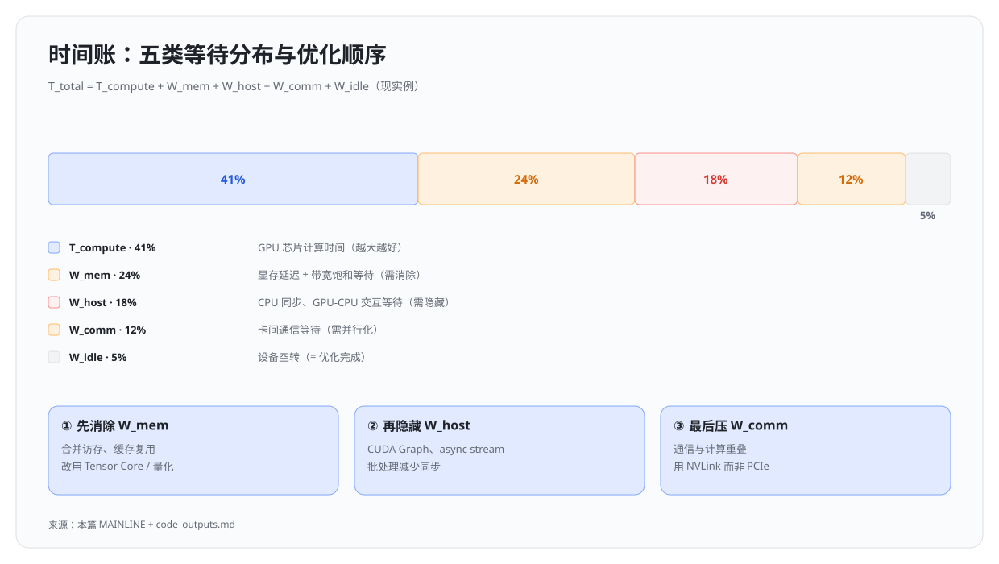
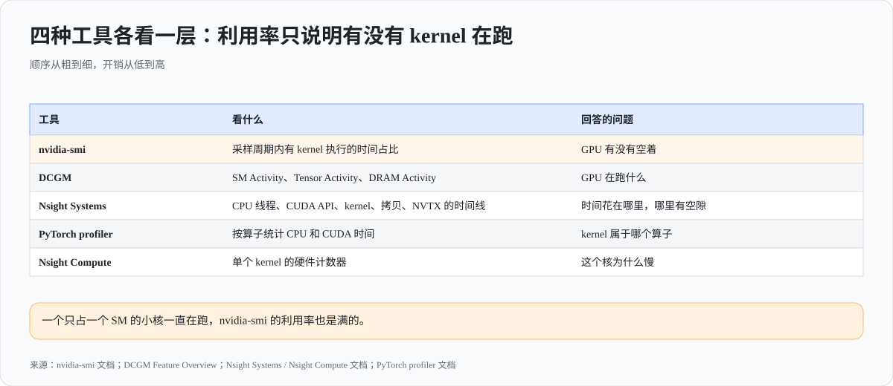
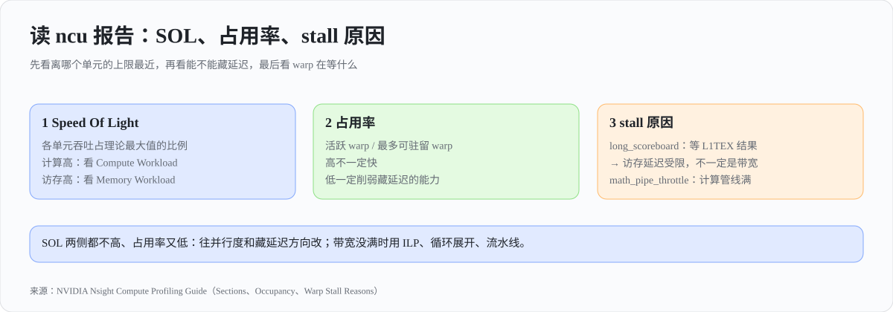
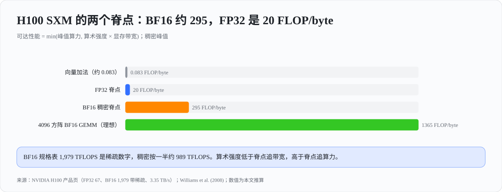
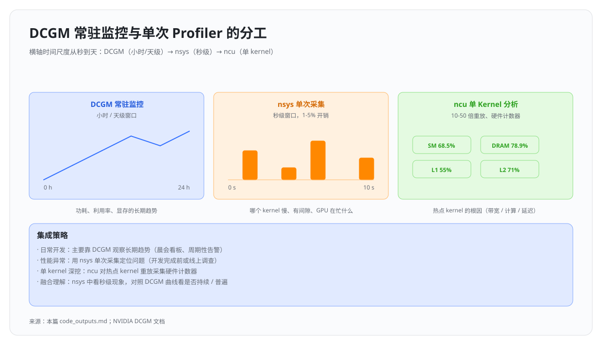
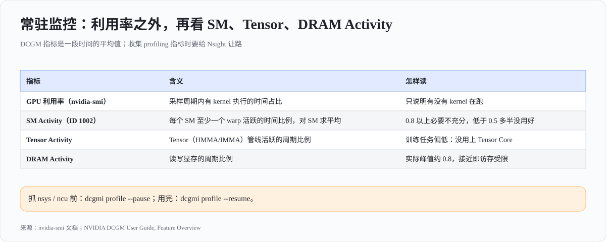
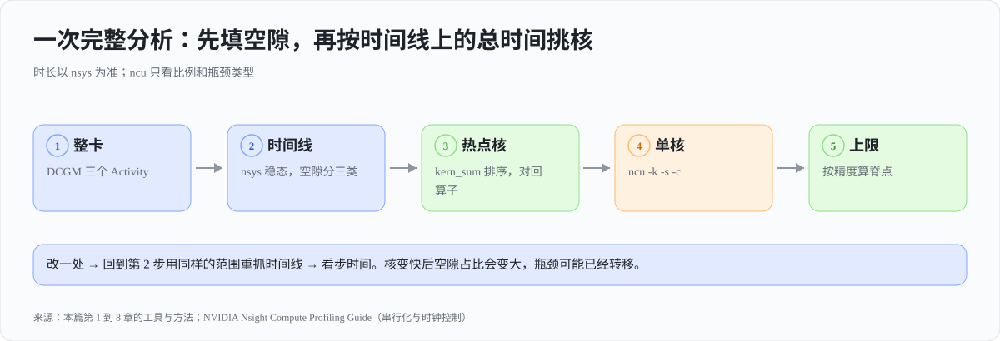

# GPU-14｜单机｜性能分析与 Profiling

> 🎯 **这篇文档解决什么问题**：训练或推理比预期慢，第一件事是知道时间花在哪里。nvidia-smi 的利用率只能说明有没有 kernel 在跑；要找到原因，得按顺序用几种工具：DCGM 看整卡，Nsight Systems 看时间线，Nsight Compute 看单个核，PyTorch profiler 和 NVTX 把 kernel 对回代码。本篇按 NVIDIA 的 Nsight Systems 用户指南、Nsight Compute 文档、DCGM 文档和 PyTorch profiler 文档，讲清每种工具看什么、怎样只抓需要的那一段、怎样读报告，以及怎样用 Roofline 算出一个核的上限。

**使用方式**：第 1 章分清四种工具。第 2、3 章讲 Nsight Systems：抓时间线、分类空隙。第 4、5 章讲 Nsight Compute：重放与开销、读报告。第 6 章讲 Roofline，第 7 章讲 PyTorch profiler 和 NVTX，第 8 章讲常驻监控，第 9 章把它们串成一次完整分析，第 10 章给清单和自测。

**代码**：zero-to-gpu/14-profiling/ 下的 sim_prof_parse.py、sim_gpu_util.py、gpu_workload.py、test_prof.py 只需 Python 标准库。样例数据的时间单位、空隙算法、五分类判定和 GPU 负载脚本都有问题，第 10 章逐条说明。

<b>🧭 主线位置</b>：GPU-00（[GPU-00｜索引｜从 0 开始 GPU 优化：路线、章节与练习](./README.md)）建立了时间账 T = T_compute + W_mem + W_host + W_comm + W_idle。GPU-13（[GPU-13｜单机｜NVLink 与 NVSwitch](./13-nvlink.md)）讲完了单机内卡与卡之间的互连。本篇给出测量这本账的工具：时间线上的空隙记在 W_host 和 W_idle，单个核的瓶颈归到 T_compute 或 W_mem。工具有了，下一个问题是 PyTorch 运行时本身怎样产生这些空隙和热点，交给 GPU-15（[GPU-15｜单机｜PyTorch 运行时](./15-runtime.md)）。

## 导读 · 先给结论

- <b>GPU 利用率只说明有没有 kernel 在跑。</b>它统计采样周期内有 kernel 执行的时间占比，不看用了多少 SM（第 1 章）。[[1]](https://docs.nvidia.com/deploy/nvidia-smi/index.html)
- <b>时间线只抓稳态的一段。</b>用 --capture-range 或 NVTX 限定范围，nsys stats 生成 kernel、API 和逐条记录三类表（第 2 章）。[[2]](https://docs.nvidia.com/nsight-systems/UserGuide/index.html)
- <b>先填空隙，再抠核。</b>空隙分同步、发射、CPU 三类；V100 上 2.9 µs 的短核逐个同步时每个 9.6 µs，用 CUDA Graph 降到 3.4 µs（第 3 章）。[[3]](https://developer.nvidia.com/blog/cuda-graphs/)
- <b>ncu 会把核重放多遍。</b>显存能恢复，缓存不能；默认串行执行并锁定时钟，所以时长以 nsys 为准（第 4 章）。[[4]](https://docs.nvidia.com/nsight-compute/ProfilingGuide/index.html)
- <b>读报告按 SOL、占用率、stall 原因的顺序。</b>long_scoreboard 主导是访存延迟受限，不一定是带宽受限（第 5 章）。[[4]](https://docs.nvidia.com/nsight-compute/ProfilingGuide/index.html)
- <b>屋顶按精度选。</b>H100 SXM 按稠密 BF16 算脊点约 295 FLOP/byte，FP32 只有 20（第 6 章）。[[5]](https://www.nvidia.com/en-us/data-center/h100/)[[6]](https://www2.eecs.berkeley.edu/Pubs/TechRpts/2008/EECS-2008-134.html)
- <b>常驻监控看 SM Activity 和 Tensor Activity。</b>0.8 以上是用好 GPU 的必要条件；DCGM 收集 profiling 指标时要给 Nsight 让路（第 8 章）。[[7]](https://docs.nvidia.com/datacenter/dcgm/latest/user-guide/feature-overview.html)



<b>📎 与系列其他文档的分工</b>：GPU-02（[GPU-02｜硬件｜性能账本：Roofline、算术强度与三类瓶颈](./02-ledger.md)）讲 Roofline 和三类瓶颈的原理，本篇讲怎样用工具测出来。GPU-04（[GPU-04｜硬件｜访存与归约：合并访存、共享内存与 warp 归约](./04-memory.md)）和 GPU-05（[GPU-05｜硬件｜GEMM 逐步优化：从朴素循环到 warp 分块](./05-gemm.md)）讲访存和 GEMM 的具体优化，ncu 报告指出的问题在那里改。GPU-15（[GPU-15｜单机｜PyTorch 运行时](./15-runtime.md)）讲 PyTorch 运行时，GPU-16（[GPU-16｜单机｜单机验收与调优](./16-node-burnin.md)）讲单机验收，GPU-20（[GPU-20｜集群｜可靠性与可观测：故障、静默错误与 checkpoint](./20-reliability.md)）讲集群的可观测性。

## 第 1 章 · 先问时间去哪了：四种工具各看一层

前面几篇讲了单卡、显存、主机和多卡互连各自的上限。实际调优时，第一步是知道一次训练或推理的时间到底花在哪里。这一步有四种常用工具：nvidia-smi 和 DCGM 看整卡，Nsight Systems 看时间线，Nsight Compute 看单个核，PyTorch profiler 看算子。本章先说明它们各看哪一层，以及为什么不能只看 nvidia-smi 的利用率。

### GPU 利用率说的是什么

nvidia-smi 的 GPU 利用率定义是：在过去一个采样周期里，有一个或多个 kernel 在 GPU 上执行的时间占比[[1]](https://docs.nvidia.com/deploy/nvidia-smi/index.html)。这个定义只问“有没有 kernel 在跑”，不问 kernel 用了多少 SM、算得多快。一个只占一个 SM 的小 kernel 一直在跑，利用率也是满的。所以它只能说明 GPU 有没有空着，不能说明 GPU 有没有被用好。

要回答“用得好不好”，需要更细的数据。DCGM 的 SM Activity 统计每个 SM 上至少有一个 warp 活跃的时间比例，再对所有 SM 求平均[[7]](https://docs.nvidia.com/datacenter/dcgm/latest/user-guide/feature-overview.html)，比 nvidia-smi 的利用率更接近真实的负载，第 8 章再讲。

### 四种工具，四个层次

- **nvidia-smi 和 DCGM**：整卡、长期、低开销，适合常驻监控和发现异常的节点（第 8 章）。
- <b>Nsight Systems（nsys）</b>：一段时间线，CPU 线程、CUDA API、kernel、拷贝和 NVTX 标注排在一起，回答“时间花在哪里、GPU 在哪里空着”（第 2、3 章）。
- <b>Nsight Compute（ncu）</b>：单个 kernel 的硬件计数器，回答“这个核为什么慢”（第 4 到 6 章）。
- **PyTorch profiler**：按算子统计 CPU 和 GPU 时间，把 kernel 对回模型代码（第 7 章）。

顺序是从粗到细：先看整卡有没有空，再看时间线上的空隙在哪，最后才挑出值得优化的核去看计数器。反过来做，先对所有核跑 ncu，会花很长时间，还可能在一个只占总时间很小一部分的核上下功夫。



按五步闭环用这四种工具：

- **定天花板**：型号的峰值算力和显存带宽（第 6 章）。
- **测实际**：一个步骤的总时间，nsys 时间线。
- **定位等待**：时间线上的空隙记在哪一项，热点核卡在哪个单元。
- **消除或隐藏**：合并小核、去掉同步、改核函数。
- **复测**：同样的抓取方式再测一次，对比时间线。

一个常见的误区是看到 nvidia-smi 显示利用率 100%，就认为 GPU 已经吃满，问题在别处。现象是利用率一直满，吞吐却比预期低很多。原因是利用率只说明有 kernel 在跑，不说明 kernel 用了多少 SM。改法是同时看 DCGM 的 SM Activity，并抓一段 nsys 时间线。

> 🔑 **本章要点**：nvidia-smi 的利用率只问有没有 kernel 在跑。整卡用 nvidia-smi 和 DCGM 看，时间线用 Nsight Systems 看，单个核用 Nsight Compute 看，算子用 PyTorch profiler 看；顺序从粗到细。这一章是五步闭环的“测实际”：先知道该用哪把尺子。

## 第 2 章 · Nsight Systems：抓一段干净的时间线

时间线是整个分析的起点。抓得太长，文件大、打开慢，热身阶段还会混进来；抓得太短，看不到稳态。本章讲怎样用 nsys 只抓想看的那一段，以及怎样把结果变成可以对账的统计表。

### 抓取命令

最常用的形式是 `nsys profile -t cuda,nvtx -o 报告名 python train.py`。-t 选择要追踪的 API，可选项包括 cuda、nvtx、osrt、cudnn、cublas 等[[2]](https://docs.nvidia.com/nsight-systems/UserGuide/index.html)。NVIDIA 的文档在 torchrun 多进程的例子里也是这样写的，并且只让 local rank 0 带上 nsys，其他 rank 正常运行[[2]](https://docs.nvidia.com/nsight-systems/UserGuide/index.html)，这样能减少数据量。

只抓一段，有两种办法。第一种是在程序里调用 cudaProfilerStart() 和 cudaProfilerStop() 标出范围[[2]](https://docs.nvidia.com/nsight-systems/UserGuide/index.html)，抓取时加 `--capture-range=cudaProfilerApi`。--capture-range 的可选值是 none、cudaProfilerApi、hotkey 和 nvtx，设了之后只有遇到对应的开始调用才开始记录[[2]](https://docs.nvidia.com/nsight-systems/UserGuide/index.html)。第二种是用 NVTX 范围控制，适合已经在代码里加了 NVTX 标注的情况。无论哪种，都应该跳过前几步热身，只抓稳态的几步。

```bash
# 只抓 cudaProfilerStart/Stop 之间的部分
nsys profile -t cuda,nvtx --capture-range=cudaProfilerApi -o step python train.py
# 生成统计表：时间线明细、kernel 汇总、CUDA API 汇总
nsys stats --report cuda_gpu_trace --report cuda_gpu_kern_sum --report cuda_api_sum \
  --format csv,column --output .,- step.nsys-rep
```

### 统计表

nsys stats 从报告文件生成统计表。不指定报表时，默认会生成 nvtx_sum、osrt_sum、cuda_api_sum、cuda_gpu_kern_sum、cuda_gpu_mem_time_sum、cuda_gpu_mem_size_sum 等[[2]](https://docs.nvidia.com/nsight-systems/UserGuide/index.html)。上面的命令把 cuda_gpu_trace 写成 CSV 文件，另外两张表打印到终端[[2]](https://docs.nvidia.com/nsight-systems/UserGuide/index.html)。三张表的用途不同：cuda_gpu_kern_sum 按 kernel 名汇总总时间和次数，找热点核；cuda_api_sum 汇总 CPU 端调用 CUDA API 的时间，同步类调用时间长就要警惕；cuda_gpu_trace 是逐条记录，带开始时间和时长，算空隙要用它。

对账的方法是：在抓取的窗口里，kernel 时间、拷贝时间和空闲时间加起来应等于窗口长度，而计算空闲时间必须用每条记录的开始时间和结束时间。只有时长、没有开始时间的汇总表算不出空隙，第 9 章的代码练习就有这个问题。


按五步闭环抓时间线：

- **定天花板**：理想情况下 GPU 在窗口内没有空隙。
- **测实际**：只抓稳态的几步，生成三张表。
- **定位等待**：用 cuda_gpu_trace 算出空隙，用 cuda_api_sum 看同步调用。
- **消除或隐藏**：按第 3 章处理空隙。
- **复测**：同样的范围和参数再抓一次。

一个常见的误区是从程序启动一直抓到结束。现象是报告文件很大，统计表里排前面的是初始化、编译和热身阶段的核。原因是没有限定抓取范围，前几步的一次性开销被算进了统计。改法是用 cudaProfilerApi 或 NVTX 只抓稳态的几步，多进程时只抓一个代表 rank。

> 🔑 **本章要点**：nsys profile 用 -t 选追踪的 API，用 --capture-range 只抓稳态的一段；nsys stats 生成 kernel、API 和逐条记录三类表，算空隙要用带开始时间的逐条记录。这一章是五步闭环的“测实际”：抓一段干净、可对账的时间线。

## 第 3 章 · 读时间线：同步、发射和 CPU 三种空隙

时间线上 GPU 空着的地方，就是第一批要处理的对象。空隙通常有三种来源：CPU 在等 GPU 完成（同步），CPU 来不及把下一个核发出去（发射），CPU 在做别的事（数据准备、Python 逻辑）。本章讲怎样分辨它们，重点是小核的发射开销。

### 三种空隙怎样分辨

在时间线上把 CPU 线程那一行和 GPU 那一行对齐看。**同步**：CPU 行上有一段长的 cudaStreamSynchronize、cudaDeviceSynchronize 或同步拷贝，GPU 行在这之后才有新的核。**发射**：GPU 行上是一串很短的核，核与核之间有缝，CPU 行上密密地排着 cudaLaunchKernel。**CPU**：GPU 空着时 CPU 行上没有 CUDA 调用，而是在跑 Python 或数据加载，这时要靠第 7 章的 NVTX 标注来定位是哪段代码。

nsys 自带一组专家规则帮助发现这些问题，`nsys analyze` 在已有的结果上运行规则并输出报告[[2]](https://docs.nvidia.com/nsight-systems/UserGuide/index.html)，规则包括 cuda_memcpy_async、cuda_memcpy_sync、cuda_memset_sync、cuda_api_sync、gpu_gaps 和 gpu_time_util[[2]](https://docs.nvidia.com/nsight-systems/UserGuide/index.html)。从名字可以看出，它们分别对应异步拷贝用法、同步拷贝、同步 memset、同步 API、GPU 空隙和 GPU 时间利用率。

### 小核的发射开销

NVIDIA 介绍 CUDA Graphs 的博客给了一组具体数字。在 V100、CUDA 10.1 上[[3]](https://developer.nvidia.com/blog/cuda-graphs/)，一个执行时间 2.9 µs 的短核：每次发射后都同步时，每个核平均花 9.6 µs；去掉逐个同步、让发射重叠后降到 3.8 µs；用 CUDA Graph 捕获后再执行，降到 3.4 µs[[3]](https://developer.nvidia.com/blog/cuda-graphs/)。逐个同步时，每个核多出约 6.7 µs，比核本身还长。

PyTorch 的博客解释了这在深度学习里为什么常见：强扩展到很多卡时，每个 GPU 操作只剩几微秒，框架提交工作的延迟就会让 GPU 利用率变低[[8]](https://pytorch.org/blog/accelerating-pytorch-with-cuda-graphs/)；CPU 的发射开销在核与核之间留下明显的空隙[[8]](https://pytorch.org/blog/accelerating-pytorch-with-cuda-graphs/)。同一篇博客报告，在 MLPerf 训练 v1.0 里，Mask R-CNN 用 272 块卡时 CUDA Graphs 带来 1.70 倍加速，BERT 用 4096 块卡时是 1.12 倍[[8]](https://pytorch.org/blog/accelerating-pytorch-with-cuda-graphs/)。PyTorch 通过 torch.cuda.CUDAGraph 类和两个封装接口使用 CUDA Graphs[[8]](https://pytorch.org/blog/accelerating-pytorch-with-cuda-graphs/)。抓带 CUDA Graph 的程序时，nsys 默认按整图记录，不展开图里的每个节点，这样开销更小[[2]](https://docs.nvidia.com/nsight-systems/UserGuide/index.html)。


按五步闭环处理空隙：

- **定天花板**：GPU 在稳态窗口内连续工作。
- **测实际**：时间线上空隙的总长度和分布。
- **定位等待**：按 CPU 行上的调用分成同步、发射和 CPU 三类。
- **消除或隐藏**：去掉不必要的同步；合并小核或用 CUDA Graph；把数据准备移到后台。
- **复测**：空隙减少，步时间下降。

一个常见的误区是看到空隙就去优化 kernel。现象是 kernel 变快了，步时间几乎不变。原因是时间花在核与核之间的空隙上，核本身变快只是让空隙占比更大。改法是先按 CPU 行上的调用判断空隙属于哪一类，发射受限时用 CUDA Graph 或合并小核。

> 🔑 **本章要点**：时间线上的空隙分同步、发射和 CPU 三类，按 CPU 行上的调用区分，nsys analyze 的规则能帮忙找。小核的发射开销可能比核本身还长：V100 上 2.9 µs 的核逐个同步时每个 9.6 µs，用 CUDA Graph 降到 3.4 µs。这一章是五步闭环的“定位等待”：先填空隙，再抠核。

## 第 4 章 · Nsight Compute：重放、开销和权限

时间线指出了热点核，下一步用 Nsight Compute 看这个核内部发生了什么。ncu 的数据来自硬件计数器，但一次运行收不齐所有计数器，所以它会把同一个核重放多次。理解重放，才能理解 ncu 为什么慢、结果为什么会和时间线上的时长对不上。

### 重放

GPU 能同时收集的硬件计数器数量有限，软件插桩的计数器又会严重影响运行时间，所以不是所有指标都能在一次运行里收齐[[4]](https://docs.nvidia.com/nsight-compute/ProfilingGuide/index.html)。默认的 kernel 重放把要收的指标分成若干遍：第一遍保存核能访问的全部显存，之后每一遍开始前把核写过的那部分恢复原样[[4]](https://docs.nvidia.com/nsight-compute/ProfilingGuide/index.html)，让每一遍看到同样的数据。显存能恢复，但 L1、L2 这些缓存的内容不能[[4]](https://docs.nvidia.com/nsight-compute/ProfilingGuide/index.html)，所以后面几遍可能因为缓存已经热了而更快。

还有两种模式。application 重放把整个程序运行多次，每次收一遍，要求程序在 kernel 的执行顺序和分配上是确定的[[4]](https://docs.nvidia.com/nsight-compute/ProfilingGuide/index.html)。range 重放捕获并重放一整段 API 调用和 kernel，不需要串行执行，适合那些必须并发运行的核[[4]](https://docs.nvidia.com/nsight-compute/ProfilingGuide/index.html)。

### 测出来的时长为什么不同

ncu 的测量环境和实际运行不一样，主要有三点。第一点，ncu 默认把 kernel 串行执行，除非用专门的重放模式；nsys 不会串行[[4]](https://docs.nvidia.com/nsight-compute/ProfilingGuide/index.html)，所以同一设备上并发的核在两个工具里时长可能不同。第二点，ncu 默认把 GPU 时钟限制在 boost 频率[[4]](https://docs.nvidia.com/nsight-compute/ProfilingGuide/index.html)，可以用 `--clock-control base` 把核心和显存时钟锁在基础频率[[9]](https://docs.nvidia.com/nsight-compute/NsightComputeCli/index.html)。第三点，`--cache-control all` 在每次重放前刷新所有缓存，结果最可复现[[9]](https://docs.nvidia.com/nsight-compute/NsightComputeCli/index.html)。软件插桩的指标开销最大[[4]](https://docs.nvidia.com/nsight-compute/ProfilingGuide/index.html)，收的指标越多，重放遍数越多。

所以 ncu 只用来看指定的少数几个核。-k 按名字的正则过滤 kernel，-s 跳过前面若干次启动，-c 限制收集的次数[[9]](https://docs.nvidia.com/nsight-compute/NsightComputeCli/index.html)；也可以用 --nvtx-include 只收某个 NVTX 范围里的核[[9]](https://docs.nvidia.com/nsight-compute/NsightComputeCli/index.html)。不带 --set、--section、--metrics 时收 basic 集合，`--set full` 收全部节[[4]](https://docs.nvidia.com/nsight-compute/ProfilingGuide/index.html)。

```bash
# 只看名字含 gemm 的核，跳过热身阶段的启动，收 1 次
ncu -k regex:gemm -s 10 -c 1 --set full -o gemm_report python train.py
```

### 权限

Linux 驱动 418.43 起，访问 GPU 性能计数器默认只允许管理员，普通用户会遇到 ERR_NVGPUCTRPERM[[10]](https://developer.nvidia.com/nvidia-development-tools-solutions-err_nvgpuctrperm-permission-issue-performance-counters)。可以用 sudo 运行，或者在 /etc/modprobe.d 下放一个 .conf 文件，写上 `options nvidia NVreg_RestrictProfilingToAdminUsers=0` 放开给普通用户[[10]](https://developer.nvidia.com/nvidia-development-tools-solutions-err_nvgpuctrperm-permission-issue-performance-counters)，改完可能要重启才生效[[10]](https://developer.nvidia.com/nvidia-development-tools-solutions-err_nvgpuctrperm-permission-issue-performance-counters)。在共享集群上放开前要评估安全要求，容器里还要看运行时是否给了相应的权限。


按五步闭环使用 ncu：

- **定天花板**：这个核所在单元的理论峰值（第 5、6 章）。
- **测实际**：用 -k、-s、-c 只收热点核的稳态启动。
- **定位等待**：看是哪个单元、哪类 stall（第 5 章）。
- **消除或隐藏**：按瓶颈改核函数或换实现。
- **复测**：同样的过滤条件和时钟设置再收一次。

一个常见的误区是拿 ncu 报告里的核时长和 nsys 时间线上的时长直接比，发现对不上就怀疑工具有问题。现象是 ncu 的时长偏长或偏短。原因是 ncu 串行执行、锁定时钟、可能刷新缓存，测量环境和实际运行不同。改法是时长以 nsys 为准，ncu 只用来看比例和瓶颈类型。

> 🔑 **本章要点**：ncu 一次收不齐计数器，会把核重放多次：显存能恢复，缓存不能；默认串行执行并把时钟锁在 boost。用 -k、-s、-c 或 NVTX 过滤只收热点核；普通用户遇到 ERR_NVGPUCTRPERM 要改驱动参数。这一章是五步闭环的“测实际”：用对方式收计数器。

## 第 5 章 · 读 ncu 报告：SOL、占用率和 stall 原因

ncu 的报告分成很多节，初看信息很多。读的顺序可以固定下来：先看 Speed Of Light 判断核离哪个单元的上限最近，再看占用率判断能不能藏住延迟，最后看 warp 在等什么。本章按这个顺序走一遍。

### 第一眼：Speed Of Light

GPU Speed Of Light Throughput 节给出计算和访存两类资源的吞吐，每个单元都表示成实际吞吐占理论最大值的百分比，并列出各个子指标，指出贡献最大的那一个[[4]](https://docs.nvidia.com/nsight-compute/ProfilingGuide/index.html)。读法很直接：计算一侧的百分比高，就去看 Compute Workload Analysis 节，它给出每条执行管线的利用率和每周期指令数[[4]](https://docs.nvidia.com/nsight-compute/ProfilingGuide/index.html)；访存一侧的百分比高，就去看 Memory Workload Analysis 节，访存可能因为硬件单元满负荷、单元之间的带宽用尽，或者访存指令的发射达到上限而成为瓶颈[[4]](https://docs.nvidia.com/nsight-compute/ProfilingGuide/index.html)。两侧都不高，说明核既没有算满也没有搬满，问题多半在延迟，要往下看占用率和 stall。

### 第二眼：占用率

占用率是每个 SM 上活跃 warp 数和最多可驻留 warp 数之比[[4]](https://docs.nvidia.com/nsight-compute/ProfilingGuide/index.html)。ncu 文档的说法很准确：占用率高不一定性能高，但占用率低一定削弱藏延迟的能力[[4]](https://docs.nvidia.com/nsight-compute/ProfilingGuide/index.html)。所以不要把占用率当成越高越好的目标，它只是一个前提：两侧吞吐都不高、占用率又低时，提高占用率（减少每线程寄存器、调整共享内存和 block 大小）才是方向。

### 第三眼：warp 在等什么

Warp State Statistics 节描述 warp 能否发射下一条指令的各种状态[[4]](https://docs.nvidia.com/nsight-compute/ProfilingGuide/index.html)，最大的几项 stall 原因就是核的主要矛盾。常见的两类：

- **long_scoreboard**：warp 在等一次 L1TEX 操作（local、global、surface、texture）的结果[[4]](https://docs.nvidia.com/nsight-compute/ProfilingGuide/index.html)。它占主导时，核是访存延迟受限，不一定是带宽受限；带宽没满时，应优先用指令级并行、循环展开或流水线来藏延迟[[4]](https://docs.nvidia.com/nsight-compute/ProfilingGuide/index.html)。
- **math_pipe_throttle**：所有活跃 warp 的下一条指令都要用同一条已经满负荷的计算管线。它占主导时，核通常是计算管线受限[[4]](https://docs.nvidia.com/nsight-compute/ProfilingGuide/index.html)。



按五步闭环读一份报告：

- **定天花板**：SOL 里各单元的理论最大值。
- **测实际**：各单元的百分比、占用率、stall 分布。
- **定位等待**：离上限最近的单元，或者排第一的 stall 原因。
- **消除或隐藏**：访存受限减少数据搬运，延迟受限增加并行度，计算受限换更合适的指令或精度。
- **复测**：同样的过滤条件再收一次，看瓶颈是否转移。

一个常见的误区是看到 long_scoreboard 排在最前，就断定核受显存带宽限制，开始压缩数据。现象是数据量减少了，核却没有变快。原因是 long_scoreboard 说明 warp 在等访存结果，这可能是延迟问题，带宽并没有用满。改法是先看 SOL 的访存百分比：带宽没满时，用循环展开、预取或增加并行度去藏延迟。

> 🔑 **本章要点**：读 ncu 报告按三步：SOL 看离哪个单元的上限最近，占用率看能不能藏延迟（高不一定好，低一定吃亏），stall 原因看 warp 在等什么。long_scoreboard 主导是访存延迟受限，不一定是带宽受限。这一章是五步闭环的“定位等待”：把一个慢核归到具体的单元。

## 第 6 章 · Roofline：先算清这个核的上限

ncu 告诉你核跑到了上限的百分之几，但上限本身取决于核的算术强度。Roofline 模型把峰值算力、显存带宽和算术强度放进一张图，用来判断一个核该算满还是该搬满。本章用 H100 SXM 的规格算出两条屋顶的交点，再看两个典型的核落在哪里。

### 模型

Roofline 是 Williams、Waterman 和 Patterson 在 2008 年提出的可视化性能模型[[6]](https://www2.eecs.berkeley.edu/Pubs/TechRpts/2008/EECS-2008-134.html)。核的可达性能等于两个值中较小的一个：峰值算力，以及算术强度乘以显存带宽。算术强度是计算量和访存量之比[[4]](https://docs.nvidia.com/nsight-compute/ProfilingGuide/index.html)。两条线的交点叫脊点，是带宽边界和峰值算力边界相交的位置[[4]](https://docs.nvidia.com/nsight-compute/ProfilingGuide/index.html)：算术强度低于脊点的核受带宽限制，高于脊点的受算力限制。ncu 的 SOL 节可以直接画出这个核的 Roofline 图[[4]](https://docs.nvidia.com/nsight-compute/ProfilingGuide/index.html)。

### H100 SXM 的脊点

H100 SXM 的规格表里，FP32 是 67 TFLOPS，BF16 Tensor Core 是 1,979 TFLOPS，显存带宽 3.35 TB/s[[5]](https://www.nvidia.com/en-us/data-center/h100/)。BF16 这一项带星号，表示是稀疏情况下的数字[[5]](https://www.nvidia.com/en-us/data-center/h100/)，稠密计算按一半即约 989 TFLOPS 算。由此得到两个脊点：

- BF16 Tensor Core：989 TFLOPS ÷ 3.35 TB/s ≈ 295 FLOP/byte。
- FP32：67 TFLOPS ÷ 3.35 TB/s = 20 FLOP/byte。

同一张卡，用不同精度和单元时脊点差了十几倍。判断一个核受什么限制，先要确定它用的是哪一档算力。

### 两个典型的核

向量加法 c = a + b，每个元素读两个 float、写一个 float，共 12 字节，做 1 次加法，算术强度约 0.083 FLOP/byte，远低于任何一档脊点，只能受带宽限制。对这种核，优化的目标是让显存带宽接近上限，而不是提高算力利用率。

BF16 的 N×N 方阵乘法，理想情况下计算量 2N³，读写三个矩阵各一次共 3N² × 2 字节，算术强度是 N/3。N = 4096 时约 1365 FLOP/byte，远高于 295，应该受算力限制。实测核的算术强度通常比理想值低，因为分块不能完全复用数据，ncu 的 Roofline 图给出的是实测值。



按五步闭环用 Roofline：

- **定天花板**：按核用的精度选峰值算力，算出脊点。
- **测实际**：ncu 给出的实测算术强度和性能。
- **定位等待**：核在脊点左侧还是右侧，离屋顶有多远。
- **消除或隐藏**：左侧的核减少访存或提高复用，右侧的核提高算力利用率。
- **复测**：看点是向屋顶靠近，还是向右移动。

一个常见的误区是用 BF16 Tensor Core 的峰值去评价一个 FP32 的核。现象是算出来的算力利用率只有个位数百分比，于是认为核写得很差。原因是 FP32 核用不到 Tensor Core 的那一档算力，H100 上它的峰值是 67 TFLOPS。改法是按核实际使用的精度和执行单元选屋顶，并且只用稠密峰值。

> 🔑 **本章要点**：Roofline 的上限是 min（峰值算力， 算术强度 × 带宽）。H100 SXM 按稠密 BF16 算脊点约 295 FLOP/byte，FP32 只有 20 FLOP/byte。向量加法约 0.083 FLOP/byte，只能追带宽；4096 方阵 BF16 GEMM 理想值约 1365，该追算力。这一章是五步闭环的“定天花板”：先算对上限，再谈利用率。

## 第 7 章 · PyTorch profiler 和 NVTX：把 kernel 对回代码

nsys 和 ncu 看到的是 kernel 名，比如一串模板展开后的 GEMM 名字，很难直接对应到模型里的哪一层。PyTorch profiler 按算子统计时间，NVTX 在时间线上标出代码段，两者都是为了把 GPU 上的事件对回代码。

### PyTorch profiler

torch.profiler 通过 CUPTI 追踪 GPU 上的 CUDA kernel[[11]](https://docs.pytorch.org/docs/main/profiler.html)。训练循环很长时，全程追踪既慢，生成的文件也很大[[12]](https://docs.pytorch.org/tutorials/recipes/recipes/profiler_recipe.html)，所以要用 schedule 只记录几步。schedule 的参数是 wait、warmup、active、repeat、skip_first 等[[11]](https://docs.pytorch.org/docs/main/profiler.html)：先跳过 skip_first 步，再等 wait 步，然后热身 warmup 步，接着正式记录 active 步，再从 wait 开始下一轮[[11]](https://docs.pytorch.org/docs/main/profiler.html)。每一步结束时调用 prof.step() 通知 profiler[[12]](https://docs.pytorch.org/tutorials/recipes/recipes/profiler_recipe.html)。

```python
from torch.profiler import profile, ProfilerActivity, record_function, schedule
with profile(activities=[ProfilerActivity.CPU, ProfilerActivity.CUDA],
             schedule=schedule(wait=1, warmup=1, active=3),
             on_trace_ready=lambda p: p.export_chrome_trace(f"trace_{p.step_num}.json")) as prof:
    for batch in loader:
        with record_function("forward"):
            loss = model(batch)
        loss.backward(); opt.step()
        prof.step()
print(prof.key_averages().table(sort_by="self_cuda_time_total", row_limit=10))
```

结果有两种用法。key_averages().table() 按算子汇总，可以按某一列排序[[12]](https://docs.pytorch.org/tutorials/recipes/recipes/profiler_recipe.html)；读表时要分清 self 和 total：self 时间不含它调用的子算子，total 时间包含[[12]](https://docs.pytorch.org/tutorials/recipes/recipes/profiler_recipe.html)。export_chrome_trace 导出的文件可以在 Chrome 的 trace 查看器里看算子和 kernel 的先后顺序[[12]](https://docs.pytorch.org/tutorials/recipes/recipes/profiler_recipe.html)，tensorboard_trace_handler 则把文件写进一个目录，直接交给 TensorBoard[[11]](https://docs.pytorch.org/docs/main/profiler.html)。record_function 给一段代码起名字[[12]](https://docs.pytorch.org/tutorials/recipes/recipes/profiler_recipe.html)，这个名字会出现在表和时间线上。打开 profile_memory 还能统计张量占用的显存[[12]](https://docs.pytorch.org/tutorials/recipes/recipes/profiler_recipe.html)。

### NVTX

NVTX 是一套给源代码加注释的跨平台 API，默认情况下 NVTX 调用什么也不做，只有在开发工具里运行时，调用才会转给工具处理[[13]](https://nvidia.github.io/NVTX/)。所以在生产代码里保留 NVTX 标注的代价很小。PyTorch 提供 torch.cuda.nvtx.range_push 和 range_pop[[11]](https://docs.pytorch.org/docs/main/profiler.html)，在数据加载、前向、反向、优化器几段前后各加一对，nsys 抓取时带上 -t nvtx，时间线上就会多出一行带名字的区间[[2]](https://docs.nvidia.com/nsight-systems/UserGuide/index.html)。这正是第 3 章区分 CPU 空隙时需要的信息：GPU 空着的那段时间，NVTX 行上显示的是哪一段代码。ncu 也可以用 --nvtx-include 只收某个区间里的核[[9]](https://docs.nvidia.com/nsight-compute/NsightComputeCli/index.html)。



按五步闭环把 kernel 对回代码：

- **定天花板**：每个算子理论上应该花多少时间（第 6 章）。
- **测实际**：用 schedule 记录稳态的几步，按 self CUDA 时间排序。
- **定位等待**：时间最长的算子，以及 NVTX 区间里 GPU 空着的段。
- **消除或隐藏**：换实现、融合算子，或把 CPU 工作挪出关键路径。
- **复测**：同样的 schedule 再记录一次。

一个常见的误区是按 total 时间排序找热点。现象是排在最前面的是 model_inference、forward 这类外层名字，看不出具体哪个算子慢。原因是 total 时间包含所有子算子，外层的区间自然最长。改法是按 self 时间排序，外层区间只用来划分阶段。

> 🔑 **本章要点**：PyTorch profiler 用 CUPTI 追踪 kernel，用 schedule 只记录稳态的几步，读表按 self 时间排序；NVTX 默认什么也不做，只在工具里生效，适合常驻在代码里给时间线分段。这一章是五步闭环的“定位等待”：把 GPU 上的时间对回代码。

## 第 8 章 · 常驻监控：GPU 利用率、SM Activity 和 DCGM

Nsight 系列是抓一段、看一段的工具，开销大，不适合常开。集群里长期看 GPU 有没有被用好，要靠 nvidia-smi 和 DCGM 这类低开销的计数。本章讲几个常用指标各自的含义，以及常驻监控和 profiler 怎样共存。

### 四个指标

**GPU 利用率**（nvidia-smi）：采样周期内有 kernel 在执行的时间占比[[1]](https://docs.nvidia.com/deploy/nvidia-smi/index.html)，采样周期视产品在 1 秒到 1/6 秒之间[[1]](https://docs.nvidia.com/deploy/nvidia-smi/index.html)。它只说明有没有 kernel 在跑。

**SM Activity**（DCGM_FI_PROF_SM_ACTIVE，ID 1002）：每个 SM 上至少有一个 warp 活跃的时间比例，对所有 SM 求平均[[7]](https://docs.nvidia.com/datacenter/dcgm/latest/user-guide/feature-overview.html)。活跃不等于在计算，等访存的 warp 也算活跃[[7]](https://docs.nvidia.com/datacenter/dcgm/latest/user-guide/feature-overview.html)。DCGM 文档给的经验是：0.8 以上是用好 GPU 的必要条件但不充分，低于 0.5 多半说明没有用好[[7]](https://docs.nvidia.com/datacenter/dcgm/latest/user-guide/feature-overview.html)。

**SM Occupancy**：SM 上驻留 warp 数相对最大值的比例。DCGM 文档同样提醒，占用率高不一定代表用得好[[7]](https://docs.nvidia.com/datacenter/dcgm/latest/user-guide/feature-overview.html)，这和第 5 章 ncu 的说法一致。

**Tensor Activity** 和 **DRAM Activity**：前者是 Tensor（HMMA/IMMA）管线活跃的周期比例[[7]](https://docs.nvidia.com/datacenter/dcgm/latest/user-guide/feature-overview.html)，后者是读写显存的周期比例，实际能达到的峰值约 0.8[[7]](https://docs.nvidia.com/datacenter/dcgm/latest/user-guide/feature-overview.html)。一个大模型训练任务 Tensor Activity 很低，说明矩阵乘没有用上 Tensor Core 或者时间花在了别处；DRAM Activity 接近 0.8，说明已经接近带宽上限。

把这几个指标放在一起看，能比单看 GPU 利用率多回答一个问题：GPU 在跑，但跑的是什么。GPU 利用率高、SM Activity 低，是核太小、并行度不够；SM Activity 高、Tensor Activity 低，是没有用上 Tensor Core；DRAM Activity 高，是访存受限。具体是哪个核，再回到 nsys 和 ncu 去查。

### 和 profiler 共存

受硬件限制，DCGM 收集 profiling 指标时会和 Nsight Systems、Nsight Compute 冲突[[7]](https://docs.nvidia.com/datacenter/dcgm/latest/user-guide/feature-overview.html)。推荐的做法是在使用这些工具前暂停 DCGM 的指标收集，用完再恢复，命令是 `dcgmi profile --pause` 和 `dcgmi profile --resume`[[7]](https://docs.nvidia.com/datacenter/dcgm/latest/user-guide/feature-overview.html)。如果节点上常驻了 dcgm-exporter，抓 ncu 前要先暂停，否则可能报资源被占用。



按五步闭环做常驻监控：

- **定天花板**：SM Activity 0.8 以上、DRAM Activity 的实际上限约 0.8。
- **测实际**：按任务和节点长期记录这几个指标。
- **定位等待**：利用率高但 SM Activity 低的任务，Tensor Activity 偏低的训练任务。
- **消除或隐藏**：对挑出来的任务抓 nsys 和 ncu（暂停 DCGM 收集）。
- **复测**：改完之后看指标是否回到正常范围。

一个常见的误区是用 nvidia-smi 的 GPU 利用率当作集群的效率指标。现象是集群报表上利用率很高，单位算力的产出却不高。原因是利用率只统计有没有 kernel 在跑，一个只用少数 SM 的小核也能让它显示为满。改法是把 SM Activity 和 Tensor Activity 一起放进报表，按任务分开看。

> 🔑 **本章要点**：GPU 利用率只说明有没有 kernel 在跑；SM Activity 0.8 以上是用好 GPU 的必要条件，低于 0.5 多半没用好；Tensor Activity 和 DRAM Activity 说明跑的是什么。DCGM 收集 profiling 指标会和 Nsight 冲突，用 dcgmi profile --pause 和 --resume 让开。这一章是五步闭环的“测实际”：长期看整卡，挑出值得细查的任务。

## 第 9 章 · 一次分析的顺序：从时间账到一个核

前八章分别讲了每种工具。实际分析时它们按固定的顺序接力，每一步的输出决定下一步看什么。本章把这个顺序写成一张可以照着做的流程，并说明每一步什么时候可以停。

### 五步接力

1. **整卡**：看 DCGM 的 SM Activity、Tensor Activity 和 DRAM Activity（第 8 章）。SM Activity 已经很高、Tensor Activity 也高，说明大头已经在 Tensor Core 上，收益要从算法或精度层面找。
2. **时间线**：用 nsys 只抓稳态的几步（第 2 章），算出 GPU 空着的时间占比，按同步、发射、CPU 三类分开（第 3 章）。空隙占比大，先处理空隙，处理完回到这一步重抓。
3. **热点核**：从 cuda_gpu_kern_sum 里按总时间排序，挑出排在前面的几个核（第 2 章）；用 PyTorch profiler 或 NVTX 把它们对回算子和代码（第 7 章）。
4. **单核**：用 ncu 的 -k、-s、-c 只收这几个核（第 4 章），按 SOL、占用率、stall 原因的顺序读（第 5 章）。
5. **上限**：按核用的精度算出脊点，判断它该追算力还是带宽，离屋顶还有多远（第 6 章）。

每改一处，回到第 2 步用同样的抓取范围重抓时间线，确认步时间真的下降了。只看 ncu 里单个核变快是不够的，核变快之后空隙占比会变大，瓶颈可能已经转移。

### 什么时候停

一个核值得优化的前提是它在时间线上占的比例足够大。一个核即使能提速一倍，如果只占步时间的一小部分，端到端的收益也很小；反过来，一个占了大部分时间的核，哪怕只提速一点也值得。所以排序的依据是时间线上的总时间，不是 ncu 里的效率百分比。当剩下的核都已接近各自的屋顶、空隙也已经很少时，单机这一层就到头了，再往下要从并行策略或模型结构上找，这是后面几篇的内容。

另一个容易忽略的点是测量本身的扰动。ncu 会串行执行核、锁定时钟（第 4 章），DCGM 的 profiling 收集会和 Nsight 冲突（第 8 章）。所以时长以 nsys 为准，ncu 只看比例和瓶颈类型；抓 ncu 前暂停 DCGM 的收集。



按五步闭环走一次完整分析：

- **定天花板**：每个热点核按精度算出的屋顶。
- **测实际**：DCGM 整卡指标和 nsys 稳态时间线。
- **定位等待**：先空隙后热点核，热点核再归到具体单元。
- **消除或隐藏**：一次只改一处。
- **复测**：同样的范围重抓时间线，看步时间。

一个常见的误区是一开始就对整个程序跑 `ncu --set full`。现象是程序被拖慢很多，跑了很久拿到几百个核的报告，却不知道先看哪个。原因是 ncu 对每个核都要重放多遍，而且它不告诉你这个核在整个步骤里占多少时间。改法是先用 nsys 排出热点，再用过滤条件只收那几个核。

> 🔑 **本章要点**：分析按整卡、时间线、热点核、单核、上限的顺序接力：先填空隙，再按时间线上的总时间挑核，最后用 ncu 和 Roofline 定位瓶颈。每改一处都回到时间线复测，时长以 nsys 为准。这一章是五步闭环的完整一圈。

## 第 10 章 · 上线前核对清单与自测

前九章沿五步闭环回答“时间去哪了”：第 1 章分清四种工具，第 2、3 章抓时间线并分类空隙，第 4、5 章用 ncu 看单个核，第 6 章算上限，第 7 章把 kernel 对回代码，第 8 章做常驻监控，第 9 章把它们串成一次完整分析。本章把它们压成一张核对清单，再配上代码练习和自测题。

### 📌 核对清单

| 检查项 | 怎样查 | 通过的标志 |
|---|---|---|
| 利用率不只看 nvidia-smi | 同时看 DCGM SM Activity、Tensor Activity（第 1、8 章） | 知道 GPU 在跑什么 |
| 时间线只抓稳态 | `--capture-range=cudaProfilerApi` 或 NVTX；多进程只抓一个 rank（第 2 章） | 统计表里没有初始化和热身 |
| 空隙已分类 | 逐条记录算空隙；CPU 行上的调用分同步、发射、CPU（第 3 章） | 每类空隙有对应的处理办法 |
| 小核发射已处理 | 大量短核时试 CUDA Graph 或合并（第 3 章） | 核间空隙明显缩短 |
| ncu 只收热点核 | `-k`、`-s`、`-c` 或 `--nvtx-include`（第 4 章） | 报告只含挑出来的核 |
| 计数器权限 | 普通用户能否运行 ncu；ERR_NVGPUCTRPERM 的处理（第 4 章） | 按安全要求开放或用 sudo |
| 瓶颈归到单元 | SOL → 占用率 → stall 原因（第 5 章） | 能说出是带宽、延迟还是计算 |
| 屋顶按精度选 | 稠密峰值 ÷ 带宽，按核实际用的精度（第 6 章） | H100 SXM BF16 约 295、FP32 为 20 FLOP/byte |
| kernel 对回代码 | PyTorch profiler 按 self 时间排序；NVTX 分段（第 7 章） | 热点核对应到算子和代码行 |
| 监控和 profiler 不冲突 | 抓 Nsight 前 `dcgmi profile --pause`（第 8 章） | 没有资源占用报错 |

### 代码练习

zero-to-gpu/14-profiling/ 下有 sim_prof_parse.py、sim_gpu_util.py、gpu_workload.py 和 test_prof.py，只需 Python 标准库。README 要求的 Python 版本比系统自带的 3.9.6 高，主编在 3.9.6 上也能跑通，9 条测试全部通过。但样例数据和解析逻辑有多处问题，适合当作找错练习：

- `python3 sim_prof_parse.py nsys --csv sample_nsys_kernels.csv`：样例 CSV 只有名字和时长，没有开始时间，而且时长的量级不对：解析器汇总出 3 个 GEMM 合计 4191500.0 us，约 4.19 秒，README 却写每个 1.3 到 1.5 ms。输出的“最大 kernel 间隙 777800.0 us”是把各条时长排序后相邻两项相减得到的，不是时间上的空隙，据此判断“发射受限”没有依据；同一份输出里总空闲时间又是 0，设备忙闲比 100%。第 2 章说过，算空隙必须用带开始时间的逐条记录。
- `python3 sim_prof_parse.py ncu --csv sample_ncu_metrics.csv --gpu h100-sxm`：volta_fp32_scale_1 的 SOL-Memory 是 78.9%，五分类因为先判占用率而把它归为 LATENCY，同一份输出的 Roofline 部分却说它是显存带宽瓶颈，两处结论矛盾。两个 volta_fp32_gemm 被归为 TENSOR，但判定条件里没有任何 Tensor 管线的指标，名字也表明是 FP32 核。脊点 295 FLOP/byte 用的是 BF16 稠密峰值，FP32 核应该用 20 FLOP/byte（第 6 章）[[5]](https://www.nvidia.com/en-us/data-center/h100/)。
- `python3 sim_gpu_util.py mislead`：现象 2 的标题写“→ 100% GPU-Util”，实际输出是 0.0%，原因是活跃 SM 数用 int() 截断成了 0。现象 4 把 8 卡的利用率取平均得到 12.5%，nvidia-smi 本身是按卡报告的[[1]](https://docs.nvidia.com/deploy/nvidia-smi/index.html)，取平均是报表的做法，不是工具的行为。
- `python3 gpu_workload.py 1`：这个脚本不启动任何 kernel，只打印预期结果，例如“2000 个 1 us 的核加 2000 × 10 us 发射间隙约 22 ms”，这些数字没有出处，也没有在真卡上测过。第 3 章用 NVIDIA 博客里在 V100 上实测的数字说明发射开销。

### 自测题

1. nvidia-smi 显示 GPU 利用率 100%，能说明 GPU 已经用满吗？还应该看哪个指标？
2. 怎样让 nsys 只抓训练稳态的几步？多进程训练时怎样减少数据量？
3. 时间线上 GPU 有一串很短的核，核与核之间有缝，CPU 行上密密地排着 cudaLaunchKernel。这是哪一类空隙？有哪两种处理办法？
4. ncu 报告的核时长比 nsys 时间线上的长，可能是哪些原因？
5. 一个核的 long_scoreboard 排在最前，SOL 的访存百分比却不高。它是带宽受限还是延迟受限？该怎么改？
6. H100 SXM 上一个 FP32 核的算术强度高于 20、低于 295 FLOP/byte，它受算力还是带宽限制？换成 BF16 Tensor Core 的核呢？

### 下一步

到这里，已经能从时间线一路查到单个核。很多空隙和热点来自 PyTorch 自身：算子怎样分派、显存怎样分配、什么时候同步、torch.compile 怎样融合算子。这些交给 GPU-15（[GPU-15｜单机｜PyTorch 运行时](./15-runtime.md)）。

## 参考文献

按正文首次引用顺序编号，资料截至 2026 年 11 月中。

[1] NVIDIA, nvidia-smi documentation [docs.nvidia.com/deploy/nvidia-smi/index.html](https://docs.nvidia.com/deploy/nvidia-smi/index.html)

[2] NVIDIA, Nsight Systems User Guide [docs.nvidia.com/nsight-systems/UserGuide/index.html](https://docs.nvidia.com/nsight-systems/UserGuide/index.html)

[3] NVIDIA Technical Blog, Getting Started with CUDA Graphs (2019) [developer.nvidia.com/blog/cuda-graphs/](https://developer.nvidia.com/blog/cuda-graphs/)

[4] NVIDIA, Nsight Compute Profiling Guide [docs.nvidia.com/nsight-compute/ProfilingGuide/index.html](https://docs.nvidia.com/nsight-compute/ProfilingGuide/index.html)

[5] NVIDIA, H100 Tensor Core GPU [www.nvidia.com/en-us/data-center/h100/](https://www.nvidia.com/en-us/data-center/h100/)

[6] Williams, Waterman, Patterson. Roofline: An Insightful Visual Performance Model for Floating-Point Programs and Multicore Architectures, UCB/EECS-2008-134 (2008) [www2.eecs.berkeley.edu/Pubs/TechRpts/2008/EECS-2008-134.html](https://www2.eecs.berkeley.edu/Pubs/TechRpts/2008/EECS-2008-134.html)

[7] NVIDIA, DCGM User Guide: Feature Overview [docs.nvidia.com/datacenter/dcgm/latest/user-guide/feature-overview.html](https://docs.nvidia.com/datacenter/dcgm/latest/user-guide/feature-overview.html)

[8] PyTorch Blog, Accelerating PyTorch with CUDA Graphs (2021) [pytorch.org/blog/accelerating-pytorch-with-cuda-graphs/](https://pytorch.org/blog/accelerating-pytorch-with-cuda-graphs/)

[9] NVIDIA, Nsight Compute CLI [docs.nvidia.com/nsight-compute/NsightComputeCli/index.html](https://docs.nvidia.com/nsight-compute/NsightComputeCli/index.html)

[10] NVIDIA Developer, ERR_NVGPUCTRPERM: Permission issue with Performance Counters [developer.nvidia.com/nvidia-development-tools-solutions-err_nvgpuctrperm-permission-issue-performance-counters](https://developer.nvidia.com/nvidia-development-tools-solutions-err_nvgpuctrperm-permission-issue-performance-counters)

[11] PyTorch, torch.profiler documentation [docs.pytorch.org/docs/main/profiler.html](https://docs.pytorch.org/docs/main/profiler.html)

[12] PyTorch Tutorials, PyTorch Profiler recipe [docs.pytorch.org/tutorials/recipes/recipes/profiler_recipe.html](https://docs.pytorch.org/tutorials/recipes/recipes/profiler_recipe.html)

[13] NVIDIA, NVTX (NVIDIA Tools Extension Library) [nvidia.github.io/NVTX/](https://nvidia.github.io/NVTX/)

---

[在 Colab 里跑本章 CPU 练习](https://colab.research.google.com/github/chenziyaos/zero-to-gpu/blob/main/colab/14-profiling.ipynb) · 上一章：[GPU-13｜单机｜NVLink 与 NVSwitch](./13-nvlink.md) · [目录](./README.md) · 下一章：[GPU-15｜单机｜PyTorch 运行时](./15-runtime.md)
