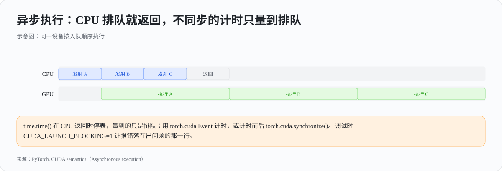
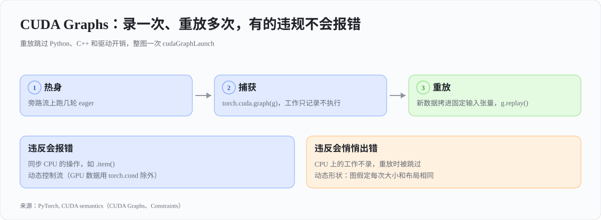
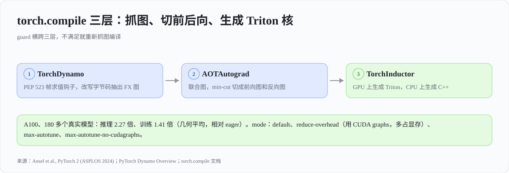
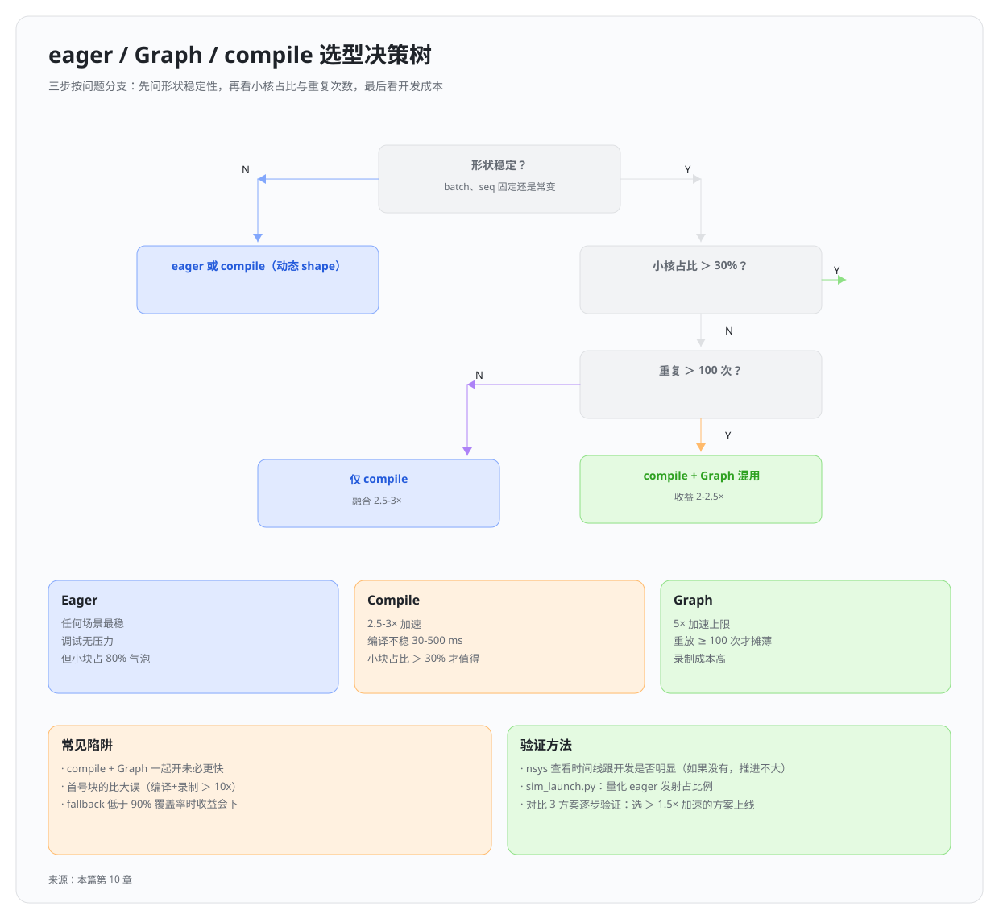
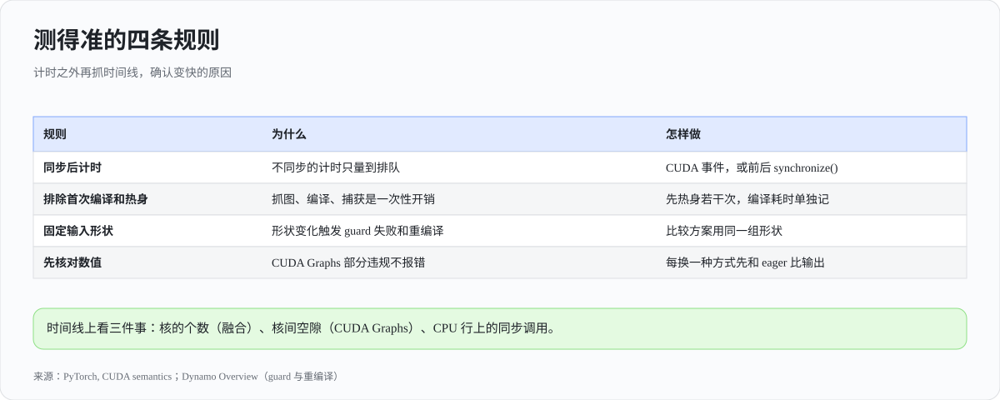
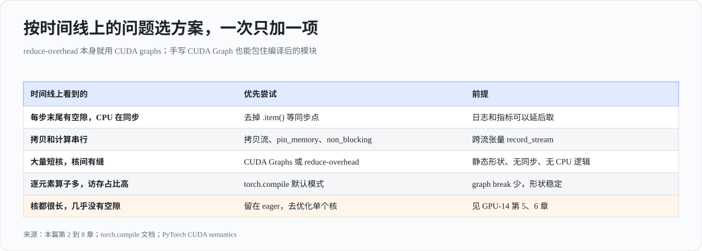

# GPU-15｜单机｜PyTorch 运行时

> 🎯 **这篇文档解决什么问题**：同样的模型和 GPU，有的代码让 GPU 一直忙，有的让 GPU 一半时间在等。差别常常出在 PyTorch 运行时，核本身反倒相同：CPU 怎样把工作排进队列、哪里在同步、拷贝和计算是否重叠、每个核的发射成本有多高。本篇按 PyTorch 的 CUDA semantics 文档、torch.compile 文档、PyTorch 2 论文和 NVIDIA 的 CUDA Graphs 资料，讲清异步执行、同步点、多流、CUDA Graphs 和 torch.compile 各自解决什么问题，收益从哪里来，以及怎样测得准。

**使用方式**：第 1、2 章讲异步执行、同步点和发射开销。第 3 章讲多流和拷贝。第 4 章讲 CUDA Graphs。第 5 到 7 章讲 torch.compile：流水线、graph break 与重编译、收益来源。第 8 章讲测量，第 9 章讲怎么选，第 10 章给清单和自测。

**代码**：zero-to-gpu/15-runtime/ 下的 sim_launch.py、sim_compile.py、sim_streams.py、test_runtime.py 只需 Python 标准库，check_runtime.py、gpu_runtime.py 需要 PyTorch。模拟器漏算访存时间、流水线忽略填充排空、测试引用了错误的论文编号，第 10 章逐条说明。

<b>🧭 主线位置</b>：GPU-00（[GPU-00｜索引｜从 0 开始 GPU 优化：路线、章节与练习](./README.md)）建立了时间账 T = T_compute + W_mem + W_host + W_comm + W_idle。GPU-14（[GPU-14｜单机｜性能分析与 Profiling](./14-profiling.md)）给出了测这本账的工具。本篇处理 W_host 里由 PyTorch 运行时产生的部分：同步、发射和串行的拷贝，并用融合减少 W_mem。单卡的运行时理顺之后，下一步是对一整台机器做验收，交给 GPU-16（[GPU-16｜单机｜单机验收与调优](./16-node-burnin.md)）。

## 导读 · 先给结论

- <b>CPU 只负责排队。</b>GPU 操作默认异步，不同步就计时只量到排队时间；调试用 CUDA_LAUNCH_BLOCKING=1（第 1 章）。[[1]](https://docs.pytorch.org/docs/main/notes/cuda.html)
- <b>GPU 等 CPU 有两种原因。</b>同步点清空队列；短核的发射追不上执行，V100 上 2.9 µs 的核逐个同步时每个 9.6 µs（第 2 章）。[[2]](https://developer.nvidia.com/blog/cuda-graphs/)[[3]](https://docs.pytorch.org/docs/main/generated/torch.cuda.set_sync_debug_mode.html)
- <b>多流的正确性靠用户。</b>wait_stream 管先后，record_stream 防止显存被提前复用；先 pin 再拷可能更慢（第 3 章）。[[1]](https://docs.pytorch.org/docs/main/notes/cuda.html)[[4]](https://docs.pytorch.org/tutorials/intermediate/pinmem_nonblock.html)
- <b>CUDA Graphs 录一次、重放多次。</b>重放跳过 Python、C++ 和驱动开销；CPU 逻辑和动态形状不会报错，只会算错（第 4 章）。[[1]](https://docs.pytorch.org/docs/main/notes/cuda.html)
- <b>torch.compile 分三层。</b>Dynamo 抓图、AOTAutograd 切前后向、Inductor 生成 Triton；A100 上 180 多个模型推理 2.27 倍、训练 1.41 倍（第 5 章）。[[5]](https://pytorch.org/assets/pytorch2-2.pdf)
- <b>收益漏在断图和重编译。</b>依赖张量值的分支和 .item() 会断图；guard 失败就重编译，超过上限退回 eager（第 6 章）。[[6]](https://docs.pytorch.org/docs/main/user_guide/torch_compiler/torch.compiler_troubleshooting.html)
- <b>收益主要来自融合和内联。</b>两项都去掉时推理只剩 0.80 倍；去掉 CUDA Graphs 只少 0.10（第 7 章）。[[5]](https://pytorch.org/assets/pytorch2-2.pdf)


<b>📎 与系列其他文档的分工</b>：GPU-03（[GPU-03｜硬件｜CUDA 编程模型：线程层级、stream 与编译链](./03-cuda.md)）讲 CUDA 的 stream 和编译链，本篇讲 PyTorch 怎样用它们。GPU-07（[GPU-07｜硬件｜Triton、CUTLASS 与 CuTe DSL](./07-dsl.md)）讲 Triton，Inductor 生成的就是 Triton 核。GPU-10（[GPU-10｜系统｜显存管理](./10-memory-mgmt.md)）讲缓存分配器和显存，record_stream 的原因在那里。GPU-11（[GPU-11｜系统｜PCIe、NUMA 与 GPUDirect](./11-pcie-gdr.md)）讲 pinned 内存和 PCIe。GPU-14（[GPU-14｜单机｜性能分析与 Profiling](./14-profiling.md)）讲时间线工具，本篇每一步都要配合它看。

## 第 1 章 · 异步执行：CPU 只负责排队

GPU-14 给出了看时间线的工具。时间线上很多空隙来自 PyTorch 运行时自身：Python 一行行执行，框架把算子分派成 kernel，再交给驱动排进队列。理解这条链，先要理解一件事：PyTorch 调用 GPU 时，CPU 只是把工作放进队列就返回了。

### 入队就返回

PyTorch 文档的说法是：GPU 操作默认是异步的，调用一个用到 GPU 的函数时，操作被放进对应设备的队列，但不一定马上执行[[1]](https://docs.pytorch.org/docs/main/notes/cuda.html)。调用者通常感觉不到这一点，因为两条规则保证了结果正确：同一设备按入队顺序执行，CPU 和 GPU 之间、两块 GPU 之间拷贝数据时 PyTorch 会自动做必要的同步[[1]](https://docs.pytorch.org/docs/main/notes/cuda.html)。

异步带来的好处是 CPU 可以一边排队，GPU 一边执行，两者重叠。只要 CPU 排队的速度比 GPU 执行快，GPU 就一直有活干；反过来，CPU 排得比 GPU 跑得慢，GPU 就会在核与核之间空等，这是第 2 章的主题。

### 异步带来的两个副作用

第一个副作用是报错的位置。异步执行时，GPU 上的错误要等操作真正执行时才报出来，所以栈信息指向的不是发起这次操作的那一行[[1]](https://docs.pytorch.org/docs/main/notes/cuda.html)。排查时可以设置环境变量 `CUDA_LAUNCH_BLOCKING=1`，强制同步执行[[1]](https://docs.pytorch.org/docs/main/notes/cuda.html)，让错误在出问题的那一行报出来。这个变量会让程序变慢，只用于调试。

第二个副作用是计时。不做同步就计时，结果是不准的[[1]](https://docs.pytorch.org/docs/main/notes/cuda.html)：Python 里用 time.time() 量一段 GPU 代码，量到的只是排队的时间。如果队列已满，CPU 要等 GPU 执行完才能继续排队，这时候量到的时间会包含 GPU 执行的部分，给人错误的印象。反之，如果队列空着，量到的时间就极短，远小于真实耗时。正确的做法是计时前调用 torch.cuda.synchronize()，或者用 CUDA 事件计时[[1]](https://docs.pytorch.org/docs/main/notes/cuda.html)：

```python
start = torch.cuda.Event(enable_timing=True)
end = torch.cuda.Event(enable_timing=True)
start.record()
y = model(x)            # 被测的 GPU 工作
end.record()
torch.cuda.synchronize()  # 等事件记录完成
print(start.elapsed_time(end), "ms")
```



按五步闭环看异步执行：

- **定天花板**：CPU 排队比 GPU 执行快时，GPU 不会空等。
- **测实际**：用事件或同步后计时，再看 nsys 时间线上 CPU 行和 GPU 行的关系。
- **定位等待**：GPU 行上的空隙对应 CPU 行上的什么（第 2 章）。
- **消除或隐藏**：减少同步点，降低每个核的发射成本（第 2 到 7 章）。
- **复测**：同样的计时方法再测一次。

一个常见的误区是用 time.time() 包住一次前向来测模型速度。现象是测出来的时间极短，改了模型之后数字几乎不变，或者忽长忽短。原因是没有同步，量到的只是 CPU 把工作放进队列的时间，长短取决于队列满没满。改法是用 CUDA 事件计时，或者计时前后各调用一次 torch.cuda.synchronize()。

> 🔑 **本章要点**：PyTorch 的 GPU 操作默认异步：CPU 把工作放进队列就返回，同一设备按入队顺序执行。异步让报错位置滞后（调试时用 CUDA_LAUNCH_BLOCKING=1），也让不同步的计时失真（用 CUDA 事件计时）。这一章是五步闭环的“测实际”：先把时间测对。

## 第 2 章 · 同步点和发射开销：GPU 在等 CPU

异步执行的前提是 CPU 跑在 GPU 前面。有两种情况会打破这个前提：代码里出现了同步点，CPU 必须停下来等 GPU；或者每个核太短，CPU 排队的速度追不上 GPU 执行的速度。两种情况在时间线上都表现为 GPU 空着。

### 同步点

需要把 GPU 上的数据拿回 CPU 的操作都会同步，例如 .item()、.cpu()、打印一个 GPU 张量，以及根据张量的值做 Python 的 if 判断。这些写法在训练循环里很常见，比如每一步都把 loss 用 .item() 取出来打日志。每出现一次，CPU 就要等 GPU 把之前排队的工作全部做完，队列被清空，异步带来的重叠也就没了。

PyTorch 提供了一个找同步点的开关 torch.cuda.set_sync_debug_mode：设为 “warn“ 或 1 时，遇到同步操作发出警告；设为 ”error” 或 2 时直接报错[[3]](https://docs.pytorch.org/docs/main/generated/torch.cuda.set_sync_debug_mode.html)。这是实验特性，并非所有同步操作都会被发现[[3]](https://docs.pytorch.org/docs/main/generated/torch.cuda.set_sync_debug_mode.html)，但用来扫一遍训练循环已经很有用。

### 发射开销

没有同步点时，GPU 仍然可能等 CPU。NVIDIA 介绍 CUDA Graphs 的博客在 V100 上测了一个执行时间 2.9 µs 的短核：每次发射后都同步时，每个核平均花 9.6 µs；去掉逐个同步、让发射互相重叠后是 3.8 µs；用 CUDA Graph 后是 3.4 µs[[2]](https://developer.nvidia.com/blog/cuda-graphs/)。逐个同步时每个核多出的约 6.7 µs，比核本身还长。这还只是 CUDA 层面的开销，PyTorch 在上面还有 Python 解释、算子分派和参数检查。

PyTorch 的 CUDA Graphs 博客说明了这在训练里什么时候变得重要：强扩展到很多卡时，每个 GPU 操作只剩几微秒，框架提交工作的延迟就会让 GPU 利用率变低[[7]](https://pytorch.org/blog/accelerating-pytorch-with-cuda-graphs/)。所以小 batch 推理、强扩展训练、大量逐元素小算子的模型，最容易出现发射受限。


按五步闭环处理 GPU 等 CPU：

- **定天花板**：GPU 在稳态窗口内连续工作。
- **测实际**：nsys 时间线上核与核之间的空隙，CPU 行上的同步调用。
- **定位等待**：空隙前是同步调用，还是一串密集的发射。
- **消除或隐藏**：去掉不必要的同步；减少核的个数（第 5 章）或降低每次发射的成本（第 4 章）。
- **复测**：空隙缩短，步时间下降。

一个常见的误区是每一步都调用 loss.item() 打日志。现象是 GPU 时间线上每一步末尾都有一段空隙，下一步的核要等这段空隙过去才开始。原因是 .item() 让 CPU 等 GPU 做完这一步的全部工作，下一步的排队被推迟。改法是每隔若干步再取一次，或者把 loss 留在 GPU 上累加，到打日志时再取。

> 🔑 **本章要点**：GPU 等 CPU 有两种原因：同步点（.item()、.cpu()、根据张量值做 Python 判断）清空了队列，或者每个核太短，发射追不上执行。V100 上 2.9 µs 的短核逐个同步时每个 9.6 µs。torch.cuda.set_sync_debug_mode 能帮忙找同步点。这一章是五步闭环的“定位等待”：先认清 GPU 在等什么。

## 第 3 章 · 流、事件和拷贝：让搬运和计算重叠

同一个流里的工作按顺序执行，拷贝做完了才能算，算完了才能拷回。要让拷贝和计算在时间上重叠，就要把它们放到不同的流里，再用事件和等待关系保证正确的先后。本章讲 PyTorch 里流的语义、两个容易用错的接口，以及 pinned 内存和 non_blocking。

### 流的语义

CUDA 流是属于某个设备的一条线性执行序列，默认情况下每个设备使用自己的默认流[[1]](https://docs.pytorch.org/docs/main/notes/cuda.html)。同一个流里的操作按创建顺序串行执行；不同流之间的操作可以并发，相对顺序任意，除非显式同步[[1]](https://docs.pytorch.org/docs/main/notes/cuda.html)。当前流是默认流时，PyTorch 在数据移动时会自动做必要的同步；用了非默认流，正确同步就是用户自己的责任[[1]](https://docs.pytorch.org/docs/main/notes/cuda.html)。

PyTorch 文档里的例子很典型：在默认流上生成张量 A，切到新流 s 上计算 sum(A)，sum 可能在 A 生成完之前就开始执行。修正需要两处：s.wait_stream（默认流） 保证 A 生成完再开始；A.record_stream(s) 保证在 sum(A) 完成之前 A 的显存不会被释放[[1]](https://docs.pytorch.org/docs/main/notes/cuda.html)。后者和缓存分配器有关：分配器按流管理显存块，A 在默认流上分配，如果不登记它也在 s 上被使用，A 的引用一释放，这块显存就可能被默认流上的新张量复用（显存管理见 GPU-10）。错过这一步的后果是数据在另一条流还在读时就被覆盖，导致计算结果错误。

另外两点也要注意。等待要放在真正需要结果的地方，创建流之后立刻等待没有意义，只会让它无法和默认流上的工作并行[[1]](https://docs.pytorch.org/docs/main/notes/cuda.html)。这种被称为“急切等待”的做法会完全抵消多流的效益。反向传播时，每个反向算子在对应前向算子所用的流上执行[[1]](https://docs.pytorch.org/docs/main/notes/cuda.html)，所以前向用了多流，反向会沿用同样的并行结构。

### pinned 内存和 non_blocking

从 pinned（页锁定）内存出发的主机到 GPU 拷贝要快得多；张量 pin 住以后，to() 或 cuda() 加上 non_blocking=True 就可以异步拷贝，与计算重叠[[1]](https://docs.pytorch.org/docs/main/notes/cuda.html)。DataLoader 加 pin_memory=True 会直接返回放在 pinned 内存里的批次[[1]](https://docs.pytorch.org/docs/main/notes/cuda.html)。

但 PyTorch 的专题教程提醒了两点。第一点，先调用 pin_memory() 再 to(device, non_blocking=True)，可能比直接 to(device) 慢一倍[[4]](https://docs.pytorch.org/tutorials/intermediate/pinmem_nonblock.html)，因为 pin 一块内存本身有代价；一般来说直接用 non_blocking=True 吞吐就不错，不管原张量是否已经在 pinned 内存里[[4]](https://docs.pytorch.org/tutorials/intermediate/pinmem_nonblock.html)。第二点，CPU 到 GPU 方向用 non_blocking=True 是安全的，其他方向也可以用，但必须在读数据之前做一次设备同步[[4]](https://docs.pytorch.org/tutorials/intermediate/pinmem_nonblock.html)，否则读到的可能是还没拷完的数据。


按五步闭环安排拷贝和计算：

- **定天花板**：拷贝和计算完全重叠时，步时间取两者中较长的那个。
- **测实际**：nsys 时间线上拷贝和核是否在同一时间段出现。
- **定位等待**：拷贝和计算是否被放在同一个流里，或者被同步点隔开。
- **消除或隐藏**：拷贝放到独立的流，用 wait_stream 和 record_stream 维护正确性，DataLoader 打开 pin_memory。
- **复测**：时间线上拷贝和核出现重叠。

一个常见的误区是开了一个新流做拷贝，却只调用了 wait_stream，没有调用 record_stream。现象是偶尔出现数值错误，难以复现。原因是张量的显存在另一条流还在用时就被分配器回收、交给了新的张量。改法是跨流使用的张量都要 record_stream，或者在合适的位置让两条流同步。

> 🔑 **本章要点**：同一流内串行，不同流之间可并发；用了非默认流，正确性靠用户：wait_stream 保证先后，record_stream 防止显存被提前复用。H2D 方向 non_blocking=True 是安全的，D2H 要同步后再读；先 pin 再拷可能更慢。这一章是五步闭环的“消除或隐藏”：把搬运藏到计算后面。

## 第 4 章 · CUDA Graphs：录一次，重放多次

第 2 章说过，短核的发射开销可能比核本身还长。CUDA Graphs 的思路是：把一串工作录下来，以后整串一起提交，省掉每个核单独发射的开销。本章讲 PyTorch 怎样录制和重放，以及哪些代码不能录。

### 原理

CUDA graph 是一个流（以及依赖它的流）所做工作的记录，主要是 kernel 和它们的参数。PyTorch 用流捕获来构建图[[1]](https://docs.pytorch.org/docs/main/notes/cuda.html)：捕获状态下发到流上的工作并不真正在 GPU 上运行，而是被记进图里[[1]](https://docs.pytorch.org/docs/main/notes/cuda.html)。之后每次重放，跳过所有参数准备和 kernel 分派，包括 Python、C++ 和 CUDA 驱动的开销[[1]](https://docs.pytorch.org/docs/main/notes/cuda.html)，整张图通过一次 cudaGraphLaunch 提交[[1]](https://docs.pytorch.org/docs/main/notes/cuda.html)。重放时 kernel 在 GPU 上也会略快，但主要收益是省掉 CPU 开销[[1]](https://docs.pytorch.org/docs/main/notes/cuda.html)。

效果取决于原来 CPU 开销占多大比例。第 2 章引用的 V100 例子里，2.9 µs 的核用 CUDA Graph 后平均每个 3.4 µs[[2]](https://developer.nvidia.com/blog/cuda-graphs/)。在 MLPerf 训练 v1.0 中，Mask R-CNN 用 272 块卡时 CUDA Graphs 带来 1.70 倍加速，BERT 用 4096 块卡时是 1.12 倍[[7]](https://pytorch.org/blog/accelerating-pytorch-with-cuda-graphs/)。两者都是强扩展到大量 GPU、每卡工作量很小的场景。

### 怎样录

PyTorch 提供 torch.cuda.CUDAGraph 类和两个封装：torch.cuda.graph 和 torch.cuda.make_graphed_callables[[1]](https://docs.pytorch.org/docs/main/notes/cuda.html)。这组 API 目前是 beta[[1]](https://docs.pytorch.org/docs/main/notes/cuda.html)。捕获前要先在一个旁路流上跑几轮 eager 迭代热身[[1]](https://docs.pytorch.org/docs/main/notes/cuda.html)。因为每次重放都读写同样的内存地址，必须长期持有捕获时用的输入和输出张量；要在新数据上运行，就把新数据拷进捕获时的输入张量，重放，再从输出张量读结果[[1]](https://docs.pytorch.org/docs/main/notes/cuda.html)。

```python
static_x = torch.randn(N, D, device="cuda")
s = torch.cuda.Stream(); s.wait_stream(torch.cuda.current_stream())
with torch.cuda.stream(s):            # 旁路流上热身
    for _ in range(3):
        y = model(static_x)
torch.cuda.current_stream().wait_stream(s)
g = torch.cuda.CUDAGraph()
with torch.cuda.graph(g):
    static_y = model(static_x)
for batch in loader:
    static_x.copy_(batch)              # 新数据拷进固定地址
    g.replay()
    use(static_y)
```

### 哪些不能录

文档把限制分成两类。违反了会报错的：让 CPU 和 GPU 同步的操作（例如 .item()）不允许；基于 CPU 或 GPU 数据的动态控制流不允许，除非是基于 GPU 数据、用 torch.cond() 实现[[1]](https://docs.pytorch.org/docs/main/notes/cuda.html)。违反了可能悄悄算错的：CPU 上的工作不会被录进去，重放时直接被跳过[[1]](https://docs.pytorch.org/docs/main/notes/cuda.html)；动态形状不允许，图假定每次重放时每个张量的大小和布局都一样[[1]](https://docs.pytorch.org/docs/main/notes/cuda.html)。后一类更危险，因为程序不会报错，而是给出静默的错误结果。



按五步闭环使用 CUDA Graphs：

- **定天花板**：发射开销全部省掉后的步时间。
- **测实际**：时间线上 CPU 发射是否跟不上 GPU。
- **定位等待**：哪一段代码是静态形状、无同步、无 CPU 逻辑的，可以整段录。
- **消除或隐藏**：整网络或部分网络录图，输入输出用固定张量。
- **复测**：对比录图前后的步时间，并核对数值。

一个常见的误区是把包含 CPU 逻辑的代码整段录进图里，比如在前向里更新一个 Python 计数器或根据它选择分支。现象是程序不报错，结果却不对，或者某些步骤像是被跳过了。原因是 CPU 上的工作不会被录制，重放时被省略。改法是录图前确认代码段内没有 CPU 逻辑和动态形状，把这类逻辑移到图外。

> 🔑 **本章要点**：CUDA Graph 录一次、重放多次，重放跳过 Python、C++ 和驱动开销，整图一次提交，主要收益是省 CPU 开销。录图要在旁路流热身、输入输出用固定张量；.item() 和动态控制流会报错，CPU 逻辑和动态形状会悄悄出错。这一章是五步闭环的“消除或隐藏”：把发射开销压到一次。

## 第 5 章 · torch.compile：从 Python 字节码到 Triton 核

CUDA Graphs 省的是发射开销，核的个数和每个核搬的字节都没变。torch.compile 更进一步：把一串算子抓成图，融合成更少的核，让中间结果不必写回显存。本章讲它的流水线，下一章讲它在哪里会断开、什么时候会重新编译。

### 三层

PyTorch 2 的论文把 torch.compile 分成三部分。TorchDynamo 利用 CPython 的帧求值 API（PEP 523），在 Python 字节码执行前改写它[[8]](https://docs.pytorch.org/docs/main/user_guide/torch_compiler/torch.compiler_dynamo_overview.html)，把其中的 PyTorch 操作序列抽成一张 FX 图，交给可以替换的后端去编译[[8]](https://docs.pytorch.org/docs/main/user_guide/torch_compiler/torch.compiler_dynamo_overview.html)。AOTAutograd 为编译后端加上训练支持：Dynamo 只抓前向，AOTAutograd 生成前向和反向的联合图，再用 min-cut 算法切成前向图和反向图，并据此决定哪些激活留给反向重算[[5]](https://pytorch.org/assets/pytorch2-2.pdf)。TorchInductor 是默认后端，在 GPU 上生成 OpenAI Triton 代码，在 CPU 上生成 C++[[5]](https://pytorch.org/assets/pytorch2-2.pdf)。torch.compile 的 backend 参数默认就是 inductor[[9]](https://docs.pytorch.org/docs/main/generated/torch.compile.html)。

抓图依赖程序的一些动态性质，所以 Dynamo 在每张图上附一组检查条件，叫 guard，下次调用时先检查，不满足就重新抓图编译。guard 系统横跨 TorchDynamo、AOTAutograd 和 TorchInductor 三层，每一层都可以为自己的特化添加 guard[[5]](https://pytorch.org/assets/pytorch2-2.pdf)。

### 效果有多大

论文在 NVIDIA A100 上用 180 多个真实模型做了评测，TorchInductor 相对 eager 的几何平均加速是推理 2.27 倍、训练 1.41 倍[[5]](https://pytorch.org/assets/pytorch2-2.pdf)。这是 2.x 早期版本在一组基准模型上的结果，具体模型的收益要自己测。第 7 章会用论文里的消融实验看这些收益分别来自哪里。

### 模式

torch.compile 的 mode 参数有四个取值：default、reduce-overhead、max-autotune 和 max-autotune-no-cudagraphs[[9]](https://docs.pytorch.org/docs/main/generated/torch.compile.html)。default 在性能和编译开销之间取平衡；reduce-overhead 用 CUDA graphs 减少 Python 开销，适合小 batch，代价是会多占一些显存[[9]](https://docs.pytorch.org/docs/main/generated/torch.compile.html)，因为它会缓存每次调用所需的工作区。max-autotune 会花更长的编译时间去搜索更快的核配置。



按五步闭环使用 torch.compile：

- **定天花板**：融合后核的个数和必须读写的字节（第 7 章）。
- **测实际**：编译前后的步时间，排除首次编译（第 8 章）。
- **定位等待**：图在哪里断开，哪里在反复重编译（第 6 章）。
- **消除或隐藏**：修掉 graph break，固定会变的形状，按场景选 mode。
- **复测**：同样的输入再测一次。

一个常见的误区是把 torch.compile 当成一个开关，打开后不看效果。现象是开了编译，步时间没有变化，甚至更慢。原因可能是图被切成很多小段，或者形状每步都在变导致反复重编译，融合的收益被抵消。改法是用第 6 章的日志检查 graph break 和重编译，再决定怎么改。

> 🔑 **本章要点**：torch.compile 分三层：Dynamo 用 PEP 523 改写字节码抓出 FX 图，AOTAutograd 展开反向，Inductor 生成 Triton 核；guard 决定什么时候重编译。论文在 A100 的 180 多个模型上测得推理 2.27 倍、训练 1.41 倍的几何平均加速。这一章是五步闭环的“消除或隐藏”：用编译减少核的个数。

## 第 6 章 · graph break 和重编译：编译收益漏在哪里

torch.compile 不能把所有 Python 代码都变成图。抓不进去的地方，图会断开，后面重新开始一张新图，中间回到 Python 执行，这叫 graph break。图抓好之后，如果下次调用时 guard 不满足，还要重新编译。这两件事是编译收益最常见的漏点。

### graph break

数据相关的操作会导致 graph break，包括依赖张量值的控制流（if 语句、以张量为条件的循环）以及直接访问张量数据（.item、.data_ptr）[[6]](https://docs.pytorch.org/docs/main/user_guide/torch_compiler/torch.compiler_troubleshooting.html)。在非动态形状模式下，返回动态形状的算子也会断图[[8]](https://docs.pytorch.org/docs/main/user_guide/torch_compiler/torch.compiler_dynamo_overview.html)。断一次图本身不致命，但每一处断点都意味着一次回到 Python、一次新图的开头和结尾，融合的范围被切小。

找断点用日志。`TORCH_LOGS="graph_breaks" python train.py` 会打印每一处断点的位置和原因，形如 Graph break in user code at 某文件某行[[6]](https://docs.pytorch.org/docs/main/user_guide/torch_compiler/torch.compiler_troubleshooting.html)。想看 Dynamo 更详细的过程，可以用 TORCH_LOGS="+dynamo,guards,bytecode"[[8]](https://docs.pytorch.org/docs/main/user_guide/torch_compiler/torch.compiler_dynamo_overview.html)。如果要求整个函数必须是一张图，可以传 fullgraph=True：做不到时直接报错[[9]](https://docs.pytorch.org/docs/main/generated/torch.compile.html)，适合在 CI 里守住关键路径不被新代码打断。

### guard 和重编译

以张量为例，guard 检查的内容包括 Python 类、dtype、device、requires_grad、维数、各维大小和步长等[[8]](https://docs.pytorch.org/docs/main/user_guide/torch_compiler/torch.compiler_dynamo_overview.html)，任何一条不满足，图就会被重新抓取和编译[[8]](https://docs.pytorch.org/docs/main/user_guide/torch_compiler/torch.compiler_dynamo_overview.html)。所以 batch 大小、序列长度每步都在变，会不断触发重编译。dynamic 参数默认是 None，表示检测到形状变化后，重编译时生成一个更动态的核[[9]](https://docs.pytorch.org/docs/main/generated/torch.compile.html)，从而避免以后每个新形状都重来一次。

重编译次数有上限，由 torch._dynamo.config.recompile_limit 等配置决定；超过上限后，这个函数不再尝试编译，直接以 eager 方式运行，并给出警告[[6]](https://docs.pytorch.org/docs/main/user_guide/torch_compiler/torch.compiler_troubleshooting.html)。文档里的例子在缓存上限 8 时停止重编译[[6]](https://docs.pytorch.org/docs/main/user_guide/torch_compiler/torch.compiler_troubleshooting.html)。这意味着形状变化太多的函数，可能在不知不觉中退回了 eager。


按五步闭环检查编译收益：

- **定天花板**：整段前向和反向各是一张图，不重编译。
- **测实际**：graph_breaks 日志里的断点数，重编译的次数和原因。
- **定位等待**：断点落在哪一行，guard 因为哪一项失败。
- **消除或隐藏**：把 .item() 和依赖张量值的 if 移出热点路径，把变长输入分桶或打开动态形状。
- **复测**：断点和重编译减少，步时间下降。

一个常见的误区是在 forward 里用 if x.sum() > 0 这类判断做分支。现象是编译后速度提升远低于预期，日志里每一步都有 graph break。原因是依赖张量值的控制流会断图，前后两段各自编译，中间回到 Python。改法是用 torch.where 之类的张量运算代替分支，或者把判断移到 forward 之外。

> 🔑 **本章要点**：依赖张量值的控制流、.item() 和非动态模式下的动态形状算子会断图，用 TORCH_LOGS="graph_breaks" 找断点，用 fullgraph=True 守住关键路径。guard 检查 dtype、device、形状和步长，不满足就重编译，超过上限后悄悄退回 eager。这一章是五步闭环的“定位等待”：找到编译收益漏掉的地方。

## 第 7 章 · 收益来自哪里：融合、内联和 CUDA Graphs

torch.compile 的加速不是一个整体，它由几项优化叠加而成。PyTorch 2 的论文做了一组消融实验：每次去掉一项优化，看加速掉多少。这组数据能回答一个实际问题：编译的收益主要来自少发射几个核，还是来自少搬几次数据。

### 消融实验

实验在 NVIDIA A100 上用 float16 的 HuggingFace 模型做，数字是相对 eager 的几何平均加速[[5]](https://pytorch.org/assets/pytorch2-2.pdf)。全部优化打开时推理 1.91 倍、训练 1.45 倍[[5]](https://pytorch.org/assets/pytorch2-2.pdf)，比第 5 章的整体平均略低，因为这里只用了一个模型集合。消融实验的设计逻辑是：从完整的编译配置开始，逐次关闭一个优化，重新测试，看加速掉多少。

| 去掉的优化 | 推理加速 | 训练加速 |
|---|---|---|
| 无（全部打开） | 1.91× | 1.45× |
| 去掉 CUDA Graphs | 1.81×（−0.10） | 1.37×（−0.08） |
| 去掉融合 | 1.68×（−0.23） | 1.27×（−0.18） |
| 去掉内联 | 1.58×（−0.33） | 1.31×（−0.14） |
| 同时去掉融合和内联 | 0.80×（−1.11） | 0.59×（−0.86） |

表中数字均来自论文的表 4[[5]](https://pytorch.org/assets/pytorch2-2.pdf)。读法有三点。融合和内联是收益的主体：两项同时去掉，编译后的代码比 eager 还慢，推理只剩 0.80 倍，训练只剩 0.59 倍。这意味着编译在这个配置下反而引入了额外开销。单独去掉其中一项时损失有限（融合单独去掉是 1.68×，内联单独去掉是 1.58×），说明两者部分可以互相替代，都是在减少中间结果的读写和核的个数。CUDA Graphs 的贡献在这组模型上排在后面，推理少 0.10，训练少 0.08。

### 对选择的意义

这和前几章的分析一致。融合把多个逐元素算子合成一个核，中间结果留在寄存器里，既少了核的个数，也少了读写显存的字节；CUDA Graphs 只省发射开销，核和字节都不变。对于小 batch 推理、每个核都很短的场景，CUDA Graphs 的比重会上升，这正是 reduce-overhead 模式的用途[[9]](https://docs.pytorch.org/docs/main/generated/torch.compile.html)。



按五步闭环判断该开哪些优化：

- **定天花板**：融合后理论上必须读写的字节和最少的核数。
- **测实际**：default 和 reduce-overhead 两种模式各测一次。
- **定位等待**：剩下的时间是发射开销还是访存。
- **消除或隐藏**：发射受限时用 reduce-overhead，访存受限时看融合范围是否被 graph break 切断。
- **复测**：同样的输入和计时方法。

一个常见的误区是认为 torch.compile 的加速主要来自 CUDA Graphs，于是对大 batch 训练也一律用 reduce-overhead。现象是显存占用上升，速度和 default 模式相差无几。原因是大 batch 时每个核足够长，发射开销本来就不是瓶颈，收益主要来自融合；reduce-overhead 还会多占显存。改法是先看时间线上的空隙，确实发射受限时再用 reduce-overhead。

> 🔑 **本章要点**：PyTorch 2 论文的消融实验（A100、float16 HuggingFace）显示，融合和内联是编译收益的主体：两项都去掉时推理降到 0.80 倍、训练 0.59 倍；去掉 CUDA Graphs 只少 0.10 和 0.08。大 batch 训练靠融合，小 batch 推理才轮到 reduce-overhead。这一章是五步闭环的“定位等待”：先知道收益来自哪一项。

## 第 8 章 · 测得准：热身、编译时间和同步

运行时的优化往往只差百分之几到几十，测量方法稍有偏差就会得出相反的结论。本章把前几章散落的测量要点集中起来，给出一套对比 eager、torch.compile 和 CUDA Graphs 的测法。

### 四条规则

1. **同步后计时**：不同步的计时只量到排队时间[[1]](https://docs.pytorch.org/docs/main/notes/cuda.html)。用 CUDA 事件，或者计时前后调用 torch.cuda.synchronize()（第 1 章）。
2. **排除首次编译和热身**：torch.compile 第一次调用要抓图、编译、生成核，CUDA Graphs 要热身和捕获，这些都是一次性开销。计时要从稳态开始，并单独记录编译耗时，评估它在整个任务里是否划算。热身要足够消除初始波动。
3. **固定输入形状**：形状变化会触发 guard 失败和重编译[[8]](https://docs.pytorch.org/docs/main/user_guide/torch_compiler/torch.compiler_dynamo_overview.html)，计时里混进重编译，结果就失真。比较不同方案时用同一组形状；要评估变长输入，单独统计重编译次数。
4. **核对数值**：CUDA Graphs 在违反部分限制时不报错，只是结果不对[[1]](https://docs.pytorch.org/docs/main/notes/cuda.html)。每换一种执行方式，先和 eager 的输出比一次。

```python
def bench(fn, x, warmup=10, iters=50):
    for _ in range(warmup):            # 热身：编译、捕获、分配器预热
        fn(x)
    torch.cuda.synchronize()
    s, e = torch.cuda.Event(enable_timing=True), torch.cuda.Event(enable_timing=True)
    s.record()
    for _ in range(iters):
        fn(x)
    e.record(); torch.cuda.synchronize()
    return s.elapsed_time(e) / iters    # 每次的毫秒数
```

### 和时间线一起看

计时只告诉你快了多少，不告诉你为什么。每个方案都应该抓一段 nsys 时间线（GPU-14），看三件事：核的个数是否减少（融合），核与核之间的空隙是否缩短（CUDA Graphs），CPU 行上还有没有同步调用（第 2 章）。如果计时显示变快了，时间线却看不出变化，要怀疑测量本身，例如热身不够或者有一次性的编译混进了计时。



按五步闭环做一次对比：

- **定天花板**：同一输入下 eager 的时间线，标出空隙和核的个数。
- **测实际**：按四条规则测 eager、compile、CUDA Graphs。
- **定位等待**：时间线上哪一项变了。
- **消除或隐藏**：选收益最大且能保证正确性的方案。
- **复测**：换一组输入形状再测，确认没有重编译。

一个常见的误区是只跑一次就比较 eager 和 torch.compile。现象是编译版本比 eager 慢很多，于是得出“编译没用”的结论。原因是第一次调用包含了抓图和编译的时间。改法是先热身若干次再计时，编译耗时单独记录。

> 🔑 **本章要点**：比较运行时方案要守四条：同步后计时，排除首次编译和热身，固定输入形状，先核对数值。计时之外再抓一段时间线，确认变快的原因是核少了、空隙短了还是同步少了。这一章是五步闭环的“测实际”和“复测”：结论要能复现。

## 第 9 章 · eager、torch.compile、CUDA Graphs 怎么选

三种执行方式不是互斥的：torch.compile 的 reduce-overhead 模式本身就用 CUDA graphs[[9]](https://docs.pytorch.org/docs/main/generated/torch.compile.html)，手写的 CUDA Graph 也可以包住编译后的模块。选择的依据是时间线上看到的问题，以及代码能满足哪些前提。

### 按问题选

| 时间线上看到的 | 优先尝试 | 前提 |
|---|---|---|
| 每步末尾有空隙，CPU 行上是同步调用 | 去掉 .item() 等同步点（第 2 章） | 日志和指标可以延后取 |
| 拷贝和计算串行 | 独立的拷贝流、pin_memory、non_blocking（第 3 章） | 跨流张量 record_stream |
| 大量短核，核间有缝 | CUDA Graphs 或 mode="reduce-overhead"（第 4、7 章） | 静态形状、无同步、无 CPU 逻辑 |
| 核多、逐元素算子多，访存占比高 | torch.compile 默认模式（第 5、7 章） | graph break 少，形状稳定 |
| 编译后收益小 | 查 graph break 和重编译（第 6 章） | 能改动热点路径的代码 |

### 什么时候留在 eager

有些情况下 eager 更合适。调试和开发阶段，eager 的报错位置清楚（配合 CUDA_LAUNCH_BLOCKING=1[[1]](https://docs.pytorch.org/docs/main/notes/cuda.html)），编译会让栈信息复杂得多。输入形状变化极多、又不能分桶时，反复重编译可能超过上限、悄悄退回 eager[[6]](https://docs.pytorch.org/docs/main/user_guide/torch_compiler/torch.compiler_troubleshooting.html)，不如一开始就用 eager 并把精力放在核本身。每个核都很长、时间线上几乎没有空隙时，CUDA Graphs 没有可省的东西，编译能做的融合也有限，这时瓶颈在单个核（GPU-14 第 5、6 章）。

CUDA Graphs 的 PyTorch API 目前是 beta[[1]](https://docs.pytorch.org/docs/main/notes/cuda.html)，而且违反部分限制时不会报错。用在生产路径上之前，要有和 eager 对比数值的测试，并在形状、分支变化时重新验证。



按五步闭环选择执行方式：

- **定天花板**：时间线上空隙为零、核数最少时的步时间。
- **测实际**：eager 的时间线。
- **定位等待**：空隙属于同步、拷贝还是发射，核是否以逐元素为主。
- **消除或隐藏**：按上表选一种，逐项加，不要一次全开。
- **复测**：每加一项按第 8 章的规则测一次。

一个常见的误区是一次把 torch.compile、CUDA Graphs、多流全部打开。现象是速度有变化，但不知道是哪一项起的作用，出了数值问题也无从排查。原因是几项优化相互作用，混在一起无法归因。改法是从时间线上最大的问题开始，一次只加一项，每次都测时间、核对数值。

> 🔑 **本章要点**：按时间线上的问题选方案：同步空隙先去同步点，拷贝串行用多流，短核密集用 CUDA Graphs 或 reduce-overhead，逐元素算子多用 torch.compile 默认模式。调试阶段、形状极多变、核都很长时留在 eager。这一章是五步闭环的“消除或隐藏”：一次只加一项。

## 第 10 章 · 上线前核对清单与自测

前九章沿五步闭环处理 GPU 等 CPU 的问题：第 1 章讲异步执行和计时，第 2 章讲同步点和发射开销，第 3 章用多流重叠拷贝和计算，第 4 章用 CUDA Graphs 压发射开销，第 5 到 7 章讲 torch.compile 的流水线、漏点和收益来源，第 8 章讲测量，第 9 章讲怎么选。本章把它们压成一张核对清单，再配上代码练习和自测题。

### 📌 核对清单

| 检查项 | 怎样查 | 通过的标志 |
|---|---|---|
| 计时可信 | CUDA 事件或同步后计时；排除热身和首次编译（第 1、8 章） | 重复测量结果稳定 |
| 热点路径没有同步 | `torch.cuda.set_sync_debug_mode("warn")` 扫一遍（第 2 章） | 训练循环里没有每步的 .item() |
| 拷贝和计算重叠 | nsys 时间线；DataLoader pin_memory=True（第 3 章） | 拷贝与核在时间上重叠 |
| 跨流张量安全 | wait_stream 与 record_stream 成对（第 3 章） | 多流下数值与单流一致 |
| CUDA Graph 段可录 | 无 .item()、无动态控制流、无 CPU 逻辑、形状固定（第 4 章） | 录图前后输出一致 |
| graph break 已知 | `TORCH_LOGS="graph_breaks"`；关键函数 fullgraph=True（第 6 章） | 热点路径上没有断点 |
| 没有反复重编译 | 重编译日志；变长输入分桶或 dynamic（第 6 章） | 稳态下不再编译 |
| mode 按场景选 | default 与 reduce-overhead 各测一次（第 7 章） | 收益和显存代价都记录在案 |
| 一次只加一项优化 | 每加一项都测时间、核对数值（第 9 章） | 每项收益可归因 |

### 代码练习

zero-to-gpu/15-runtime/ 下有 sim_launch.py、sim_compile.py、sim_streams.py、test_runtime.py，只需 Python 标准库；check_runtime.py 和 gpu_runtime.py 需要 PyTorch。主编的环境是系统自带的 Python 3.9.6，没有 GPU 也没有 PyTorch，模拟器和测试都能跑通，25 条测试全部通过，后两个脚本只打印“未安装 PyTorch”。模拟器有几处问题，适合当作找错练习：

- `python3 sim_compile.py typical --batch 128 --seq 1024 --d 4096 --ff 14336`：编译前后的 HBM 读写量算出来是 17770.4 MB 和 6013.0 MB，但“Memory”时间两列都是 0.0 us，总时间只有 42 us 和 17 us。按 H100 SXM 的 3.35 TB/s[[10]](https://www.nvidia.com/en-us/data-center/h100/)，6013 MB 读写一遍也要约 1.79 ms，模拟器漏算了访存时间，2.47 倍的“加速”只反映了它假设的发射开销。
- `python3 sim_streams.py compare`：10 批、每段 200 us 的三段流水算出总时间 2000 us、加速 3.00 倍。三段流水有填充和排空，理论上要 (10 + 2) × 200 = 2400 us，加速是 2.5 倍。三段一样长时，输出却说瓶颈是 H2D。
- `python3 sim_launch.py compare`：CUDA Graph 录制加 100 次重放的加速写成 4.76 倍，而 graph 子命令的表里 100 次重放是 4.81 倍，两处分母不同。README 说 5 us 发射间隔出自 PyTorch 的 CUDA semantics 文档，该文档没有给出这个数字[[1]](https://docs.pytorch.org/docs/main/notes/cuda.html)；本篇第 2 章用的是 NVIDIA 博客里 V100 的实测值。
- `python3 test_runtime.py`：Test 23 标注出处为“Ansel et al. 2403.00286”，这个 arXiv 编号实际是一篇超导腔的量子物理论文[[11]](https://arxiv.org/abs/2403.00286)，PyTorch 2 的论文见第 5 章的引用。Test 24 的“NVIDIA Blackwell Guide”区间同样找不到出处。这些测试检查的是作者自定的区间，通过不代表模型正确。

### 自测题

1. 为什么 time.time() 包住一次前向测不出模型的速度？应该怎样测？
2. 训练循环每一步都调用 loss.item()，时间线上会出现什么？怎样改？
3. 在新流上使用默认流生成的张量，为什么除了 wait_stream 还要 record_stream？
4. CUDA Graph 录制的代码里有一个 Python 计数器在每步加一，重放时会怎样？会报错吗？
5. PyTorch 2 论文的消融实验里，去掉 CUDA Graphs 和同时去掉融合与内联，加速分别变成多少？这说明编译收益主要来自哪里？
6. 一个函数的输入序列长度每步都不同，开了 torch.compile 之后可能发生什么？怎样确认？

### 下一步

单卡上的运行时开销处理完，一台 8 卡机器要上线，还要做一整套验收：硬件、互连、通信、温度和功耗、长时间稳定性，以及怎样建立性能基线。这些交给 GPU-16（[GPU-16｜单机｜单机验收与调优](./16-node-burnin.md)）。

## 参考文献

按正文首次引用顺序编号，资料截至 2026 年 11 月中。

[1] PyTorch, CUDA semantics [docs.pytorch.org/docs/main/notes/cuda.html](https://docs.pytorch.org/docs/main/notes/cuda.html)

[2] NVIDIA Technical Blog, Getting Started with CUDA Graphs (2019) [developer.nvidia.com/blog/cuda-graphs/](https://developer.nvidia.com/blog/cuda-graphs/)

[3] PyTorch, torch.cuda.set_sync_debug_mode [docs.pytorch.org/docs/main/generated/torch.cuda.set_sync_debug_mode.html](https://docs.pytorch.org/docs/main/generated/torch.cuda.set_sync_debug_mode.html)

[4] PyTorch Tutorials, A guide on good usage of non_blocking and pin_memory() in PyTorch [docs.pytorch.org/tutorials/intermediate/pinmem_nonblock.html](https://docs.pytorch.org/tutorials/intermediate/pinmem_nonblock.html)

[5] Ansel et al., PyTorch 2: Faster Machine Learning Through Dynamic Python Bytecode Transformation and Graph Compilation, ASPLOS 2024 [pytorch.org/assets/pytorch2-2.pdf](https://pytorch.org/assets/pytorch2-2.pdf)

[6] PyTorch, torch.compile Troubleshooting [docs.pytorch.org/docs/main/user_guide/torch_compiler/torch.compiler_troubleshooting.html](https://docs.pytorch.org/docs/main/user_guide/torch_compiler/torch.compiler_troubleshooting.html)

[7] PyTorch Blog, Accelerating PyTorch with CUDA Graphs (2021) [pytorch.org/blog/accelerating-pytorch-with-cuda-graphs/](https://pytorch.org/blog/accelerating-pytorch-with-cuda-graphs/)

[8] PyTorch, Dynamo Overview [docs.pytorch.org/docs/main/user_guide/torch_compiler/torch.compiler_dynamo_overview.html](https://docs.pytorch.org/docs/main/user_guide/torch_compiler/torch.compiler_dynamo_overview.html)

[9] PyTorch, torch.compile API [docs.pytorch.org/docs/main/generated/torch.compile.html](https://docs.pytorch.org/docs/main/generated/torch.compile.html)

[10] NVIDIA, H100 Tensor Core GPU [www.nvidia.com/en-us/data-center/h100/](https://www.nvidia.com/en-us/data-center/h100/)

[11] arXiv:2403.00286, Niobium coaxial cavities with internal quality factors exceeding 1.5 billion for circuit quantum electrodynamics [arxiv.org/abs/2403.00286](https://arxiv.org/abs/2403.00286)

---

[在 Colab 里跑本章 CPU 练习](https://colab.research.google.com/github/chenziyaos/zero-to-gpu/blob/main/colab/15-runtime.ipynb) · 上一章：[GPU-14｜单机｜性能分析与 Profiling](./14-profiling.md) · [目录](./README.md) · 下一章：[GPU-16｜单机｜单机验收与调优](./16-node-burnin.md)
