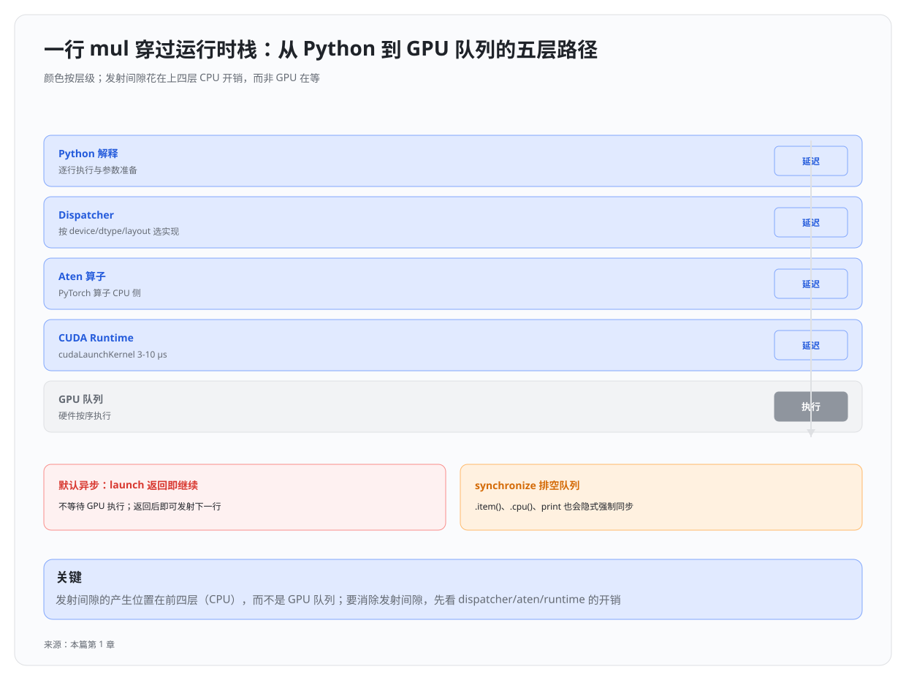
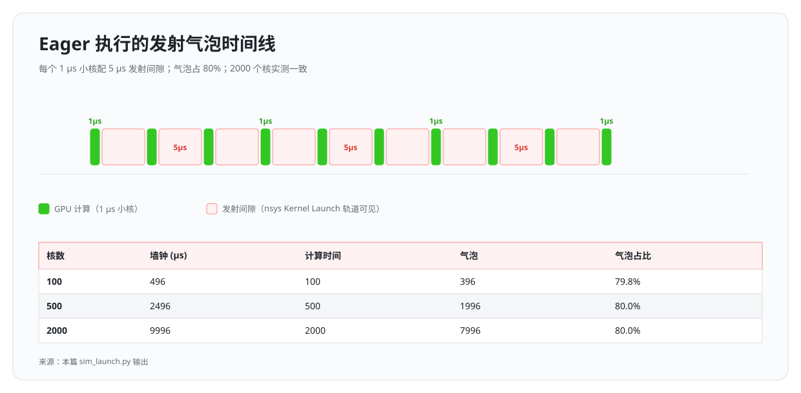
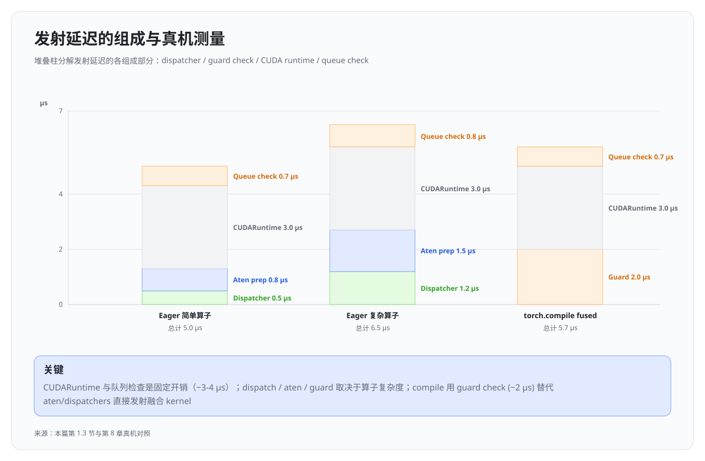
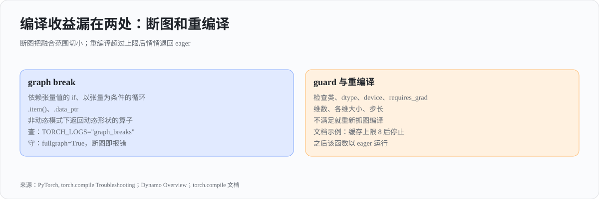

# GPU-15｜单机｜PyTorch 运行时

> 🎯 **这篇文档解决什么问题**：上一篇在 Nsight 时间线上看到了三类 GPU 空转：Host Sync（主机等待设备完成）、Kernel Launch（发射间隙）、CPU Execution（CPU 在算而 GPU 闲）。本篇往下走一层，回答这些间隙在 PyTorch 内部由谁造成、又由谁消除。一行 `x.mul_(s).add_(0)` 从 Python 出发，要经过 dispatcher、aten、CUDA runtime 才排到 GPU 队列；每层都有 CPU 开销和排队规则，总耗时可能远超核本身的计算时间。CUDA 默认异步发射，launch 返回即立刻继续，控制权立刻返回主机，于是发射间隙、同步点、数据拷贝共同决定了 GPU 队列有多深、主机有多少工作被推进去。框架提供了三件对应工具消除或隐藏这些等待：CUDA Graph 录下整串发射和依赖一次重放，torch.compile 在 dispatcher 前拦整段图、融合后直接生成 Triton 核，caching allocator 让显存分配在稳态不再触碰可能同步的 cudaMalloc。读完应当能对着时间线说出每段时间花在运行时栈的哪一层，能算清 eager、Graph、融合各自回收的是哪一笔账以及适用的场景。
>
> 使用方式：第 1 章建立运行时栈和异步模型，所有读者都该从这里开始；第 2 章用三个模拟器把发射气泡算成数字，定量看 eager 执行浪费了多少时间；第 3 章讲 CUDA Graph 的录制与重放机制、成本摊薄曲线和使用边界；第 4-5 章讲 torch.compile 的四段流水线和融合账本的两个维度（发射与 HBM）；第 6 章讲多流、拷贝引擎和事件的依赖；第 7 章讲 caching allocator 与发射时间线的交互；第 8 章是真机对照实验；第 9 章给版本敏感性和环境体检；第 10 章是选型决策表；第 11 章是上线前核对清单与自测题。
>
> **代码**：`repo/zero-to-gpu/15-runtime/` — 三个模拟器只依赖 Python 标准库，参数按 H100 标称规格标定（HBM 有效带宽取 2.68 TB/s、发射间隔 5 us、guard 2 us）。`sim_launch.py` 算 eager、Graph、融合三套发射时间账和图录制成本摊薄曲线，展示为什么图要重放千次才划算；`sim_compile.py` 算 Inductor 风格改写前后的发射次数和 HBM 字节，量化融合两笔账的收益；`sim_streams.py` 算三段流水（H2D、compute、D2H）的墙钟和 SM 忙时，看段长比例对重叠效率的影响。`test_runtime.py` 40 个断言在无 GPU 机器上全跑通，无依赖快速验证模型；`gpu_runtime.py` 在 GPU 节点量真实数字并对标模拟；`check_runtime.py` 只读核对版本、环境变量和编译能力。

**🧭 主线位置**：GPU-14 消掉了看准等待（性能分析工具与指标定义）；本篇处理的等待是 GPU 等 CPU 发射（时间账的 W_host 项）；读完后瓶颈转到 GPU-16 单机验收。

# 导读 · 先给结论

- **CUDA 算子默认异步。**launch 只把工作推进队列就返回，CPU 不等核执行完；`.item()`、`.cpu()`、numpy 取值、print 张量和显式 synchronize 会强制排空队列，把异步推回同步。[[1]](https://pytorch.org/docs/stable/notes/cuda.html)
- **小核的成本主要是发射而不是计算。**2000 个 1 us 小核配 5 us 发射间隔，八成墙钟是气泡；先在 nsys 时间线确认发射受限，再谈修法。本篇 sim_launch.py eager 模拟器给出量化证据。[[2]](https://docs.pytorch.org/docs/stable/notes/cuda.html#cuda-semantics)
- **Graph 和融合回收的是两笔不同的账。**CUDA Graph 不动核本身，只消发射路径，约 4.8 倍加速；torch.compile 连核都合并，额外省掉中间张量的 HBM 往返，可达 7 倍以上。[[3]](https://docs.pytorch.org/docs/stable/notes/cuda.html#cuda-graphs)[[4]](https://arxiv.org/abs/2403.00286)
- **图只对重复形状的稳态步划算。**录制含一次完整发射加同步，相当于一遍 eager，重放一两次累计加速不到 2 倍，上千次才趋近核时间决定的理论上限约 5 倍。[[5]](https://developer.nvidia.com/blog/cuda-graphs/)
- **融合提升的幅度取决于运算密度。**典型 transformer 块发射降 2.67 倍、HBM 字节减 2.96 倍、总时间快 1.53 倍；纯计算主导的 GEMM 块融合无收益。[[6]](https://pytorch.org/blog/accelerating-generative-ai-2/)
- **多流不是免费的：段长要均衡。**H2D、compute、D2H 各 200 us 的均衡三段流水比串行快 3 倍，SM 忙时从 33% 升到 83%；但 compute 只占 30% 时效率就降回 60%。[[7]](https://developer.nvidia.com/blog/)
- **eager、Graph、compile 各有适用场景；没有银弹。**Eager 框架兼容性好、动态形状无压力；Graph 在稳态小核轰炸的场景上稳定收益 3-5 倍；Compile 对形状变化敏感，需防重编译。



**📎 与系列其他文档的分工**：这一篇接在 [GPU-14｜单机｜性能分析与 Profiling](./14-profiling.md) 后面，衔接关系是：前篇在 nsys 时间线和 ncu 剖析上看到了发射间隙、同步等待、CPU Execution 间隙，本篇钻进 PyTorch 框架解释这些间隙的成因和消除方案。底层硬件概念依赖 [GPU-03｜硬件｜CUDA 编程模型：线程层级、stream 与编译链](./03-cuda.md) 的 CUDA 流、事件和核启动语义，[GPU-04｜硬件｜访存与归约：合并访存、共享内存与 warp 归约](./04-memory.md) 的 HBM 带宽和访存账本。后续 [GPU-16｜单机｜单机验收与调优](./16-node-burnin.md) 单机验收篇会把本篇讲的三件工具综合校准，通过数据并行或模型并行的真实模型对标到整机性能基线，形成验收检查表。[GPU-18｜集群｜NCCL：算法、协议与挂死排查](./18-nccl.md) 集群篇会把多流重叠思想延伸到梯度通信与计算的重叠，多流在单机是物理队列并行，到了多机变成逻辑通道并行。

# 第 1 章 · 运行时栈在等什么：异步模型与调用层级

## 1.1 一行算子穿过的五层栈

在 eager 模式下，一行 `x.mul_(s).add_(0)` 这样的算子调用要穿过五层才能到 GPU 执行。Python 解释器逐行执行这个调用，进入 PyTorch 的中央 dispatcher；dispatcher 按张量的 device（CPU/CUDA）、dtype（float32/float16/...)、memory layout（连续/非连续）和 autograd 状态等维度选择具体的 aten 实现，一次高层调用可能经过多层函数封装和条件分支，每层都是纯 CPU 执行开销。选定后 aten 算子再调 CUDA runtime 的 cudaLaunchKernel，runtime 把核参数打包、排入流队列做依赖检查，这条驱动路径在现代 GPU 上约 3 到 10 微秒。最后工作进入 GPU 上的流队列，由硬件调度器按 FIFO 顺序执行。[[1]](https://pytorch.org/docs/stable/notes/cuda.html)[[8]](https://docs.nvidia.com/cuda/cuda-programming-guide/)

理解这条栈的意义在于定位时间。PyTorch CUDA semantics 文档把设备端执行和主机端发射明确分开：主机线程在 launch 之后立刻继续，不等待设备完成，设备端什么时候真正执行取决于流队列的调度。[[2]](https://docs.pytorch.org/docs/stable/notes/cuda.html#cuda-semantics)GPU-14 时间线上每两个小核之间的几微秒间隙，花在栈的上面四层而不是 GPU 计算上；nsys 的 CUDA API 轨道能看到 cudaLaunchKernel 调用的时长和数量，Python 轨道能看到 dispatcher 和 aten 的开销；取样剖析器则只能看到粗粒度的百分百，不够精确。理论上最优的情况是前一个核执行时主机已经把后面的核都排好队，这样 GPU 不用等主机；反过来若主机很慢或核很小，GPU 每做完一个核都得停下等主机发射下一个，间隙全部暴露成 Kernel Launch 气泡。

## 1.2 CUDA 异步模型与队列深度

CUDA 算子的默认语义是异步：launch 把核的工作包排进当前流的队列就返回，不等待 GPU 完成执行。同一流内核的执行顺序保持 FIFO，流之间默认没有依赖关系但可以用 event 显式建立。CPU 快、GPU 慢的典型场景是主机可以连续发射多个核，队列里排着一串待执行的工作，GPU 在执行第 n 个核的同时主机已经在发射第 n+k 个，后续核的发射开销被前面核的执行时间遮盖：这就是隐藏发射延迟的本质。队列深度（in-flight 的工作量）越深，主机的发射开销就越不明显。[[1]](https://pytorch.org/docs/stable/notes/cuda.html)反过来，GPU 队列空荡荡、主机逐个缓慢发小核时，GPU 每做完一个核都要停下等待主机的下一条 launch 调用，发射间隔全部暴露成气泡和 Kernel Launch 延迟，这正是 GPU-14 时间线里观察到的间隙源头。

队列深度是隐藏发射开销的本钱，而几类操作会强制同步、把队列排空：`tensor.item` 取标量值、`tensor.cpu()` 和 `numpy()` 拷贝到主机、print 打印 CUDA 张量（这会先要求数据来主机）、显式 `torch.cuda.synchronize()`、以及 `event.wait()` 等待事件完成。同步本身是 cudaStreamSynchronize 这个 API 调用，比一次 launch 还要慢。更关键的代价是同步之后的发射无法再被前面核的执行时间遮盖，退化成串行：CPU 在等待 GPU 队列排空，之后才能发下一波核。如果循环体内每步都有一次同步（比如积累损失用 `loss += x.item()` 或逐步写日志），那么程序就变成了发射、等待、发射、等待的纯串行，发射开销和计算开销都不被遮盖。CUDA 编程指南把这种情况归类为隐式同步点，最常见的是同一流上的阻塞拷贝（`cudaMemcpy` 而非 `cudaMemcpyAsync`）、跨设备访问未对齐内存等操作，它们会在驱动层插入等待而不是显式地通知应用。[[9]](https://docs.nvidia.com/cuda/cuda-c-best-practices-guide/)

## 1.3 从时间账看 W_host 的四大成分

按时间账的定义，主机侧等待 W_host = W_dispatch + W_aten + W_launch + W_sync，四项分别是 Python dispatcher 选择实现的开销、PyTorch aten 算子层的 CPU 侧准备、CUDA runtime 和驱动的 launch 调用延迟、synchronize 和隐式同步的排队等待。典型的 1 us 小核配 5 us 发射间隔时，四项各占不同比例：dispatcher 和 aten 通常共几百纳秒，取决于算子的复杂度和是否有 autograd；cudaLaunchKernel 系列调用约 2-3 微秒，这是驱动给参数打包入队的开销；其余 1-2 微秒来自流队列状态检查、流调度和硬件响应。GPU 队列本身的排队等待不计入 W_host，它是设备侧时间 T_compute 的一部分；但队列深度决定了主机能堆多少工作进 GPU，深度越深主机越能在 GPU 执行时发射下一批核。第 2 章的模拟器会把这个账单明细算出来。[[8]](https://docs.nvidia.com/cuda/cuda-programming-guide/)


框架的三个加速机制各在栈的不同位置旁路掉一段。torch.compile 在 dispatcher 之前拦图，TorchDynamo 在 Python 字节码层拦截帧执行，抓到一整段张量操作后做图级改写和算子融合，融合出的核直接发射到 GPU，中间不再有逐算子逐次通过 dispatcher 和 aten 的开销层叠，一个编译过程的 guard check 约 2 微秒低于逐算子几次 dispatch 的累计。[[10]](https://docs.pytorch.org/docs/stable/generated/torch.compile.html)CUDA Graph 工作在 runtime 层：它先经过一轮正常执行来录制 launch 调用及它们的流上依赖关系，之后重放时一次性提交整张图的拓扑到驱动，图内所有核按原顺序背靠背在 GPU 上执行而无需主机逐个 launch，主机每个时间步只付一次图的 replay 调用约几微秒，远低于逐核 launch 链路的累计。[[3]](https://docs.pytorch.org/docs/stable/notes/cuda.html#cuda-graphs)caching allocator 也在 runtime 层附近工作：张量对象被删除时通常不立刻调 cudaFree 回收显存，显存块被标记空闲留在进程内的缓存池，下次申请同尺寸或更小的块时直接复用已有的内存地址，绕过了调 cudaMalloc 可能导致的驱动同步等待，稳态时间线上消掉了这道隐式同步点，后续章节会看到它对 CUDA Graph 能否成功录制的硬性约束。[[11]](https://docs.pytorch.org/docs/stable/notes/cuda.html#memory-management)

> 🔑 **本章要点**：一行 eager 算子穿过 Python、dispatcher、aten、CUDA runtime、GPU 队列五层，发射间隙花在上面四层而不是 GPU 的计算单元上。CUDA 异步模型下队列深度决定了主机能推送多少工作，遮盖发射开销的本钱；反过来 `.item()`、`numpy()`、print 和显式 synchronize 会强制排空队列，把异步执行退化回串行。框架在栈的三个位置提供旁路：torch.compile 在 dispatcher 前拦图做融合，消掉逐算子的分发开销；CUDA Graph 在 runtime 层批量提交整图，消掉逐核的 launch 链；allocator 在显存层绕开 cudaMalloc 的同步等待。本章建立的是理解后续章节的基础：第 2-3 章会用模拟器和实验量化发射气泡和图的收益，第 4-5 章讲 compile 的流水线和融合的时间账。

# 第 2 章 · 发射气泡的时间账：定天花板、测实际、定位、消除

## 2.1 把间隙算成数字

运行时栈第一层的发射开销，决定了何时 GPU 在等 CPU 发射。最坏的场景是一列小核，核时长 1 微秒，CPU 每次发射需 5 微秒。两个核之间只有一个核在执行，发射间隙就此暴露成气泡。sim_launch.py 把这个模型参数化：核数量、核时长、相邻两次发射的间隔。核真正忙的时间是核数乘核时长；墙钟等于首核发射到末核完成，中间每个间隙是前两者的较大值减去核时长的部分。

取 2000 个 1 微秒小核、5 微秒发射间隔的例子。总核时间 2000 微秒，中间 1999 个气泡各 (5 - 1) = 4 微秒，气泡总时长 7996 微秒，墙钟 9996 微秒，气泡占比 80.0%[[12]](https://docs.nvidia.com/nsight-systems/UserGuide/index.html)[[13]](https://docs.nvidia.com/nsight-compute/ProfilingGuide/index.html)。这个数字就是上一篇 Nsight 时间线上 Kernel Launch 轨道空隙的量化。Roofline 模型把这类时间分解为计算与访存贡献，这里的气泡属于第三项：调度延迟。发射开销与硬件版本、驱动版本、卡队列深度都有关，5 微秒是 H100 与 CUDA 13.4 的典型量级[[14]](https://www.nvidia.com/en-us/data-center/h100/)。



检验这条模型对不对，回到 nsys 时间线。热点区如果看到实例数过千、平均时长几微秒的小核，时间线应该看起来很空，两个核之间的间隔明显长于核本身。如果这些间隙的累计占比确实是 70% 到 80%，说明你的模型正确。框架有三条旁路可选：CUDA Graph 直接消这些间隙，torch.compile 连核都融了，多流把发射管道起来。选哪一条，先得确认是发射受限还是别的限，这就是定天花板的含义。



## 2.2 CUDA Graph 成本摊薄曲线

CUDA Graph 的工作机制是一次录制、多次重放。第一次录制时，那一批核的 launch 序列和依赖被记录下来，但核不真正上 GPU 执行。往后每次 graph.replay() 都把整张图提交给硬件，图内所有核背靠背排列，主机那一步只付一次提交的开销。2000 个 1 微秒小核，一次录制的成本等于 eager 一遍，包含 2000 次发射加同步，约 9996 微秒加同步开销。重放一次时累计时间约 11997 微秒，加速比 1.67 倍。重放 10 次时图摊薄到平均每次约 3 微秒，累计加速 3.66 倍。重放 100 次时平均每次约 2 微秒，加速 4.81 倍[[4]](https://arxiv.org/abs/2403.00286)[[5]](https://developer.nvidia.com/blog/cuda-graphs/)。

趋势很明确：重放次数越多，图的录制成本越来越被平摊。理论上限是核时长本身，2000 微秒除以 2000 核等于 1 微秒，加速倍数就是 eager 的 9996 除以 2001 约 5 倍。曲线从 1 次的 1.67 倍爬到 1000 次的 4.95 倍，趋近理论上限 5 倍。重放一两次的代码上图完全赔本，必须是重复执行成百上千次的稳态步才划算。图录制期间还要保证形状、控制流和显存分配的稳定，一旦变化就得重新录制，这进一步限制了图的适用范围[[3]](https://docs.pytorch.org/docs/stable/notes/cuda.html#cuda-graphs)。

## 2.3 三套方案对比

三种优化各消除时间的不同部分。Eager 付全部发射和气泡，2000 个 1 微秒小核 100 步，总耗时 999600 微秒，其中计算 200000 微秒，气泡 799600 微秒。CUDA Graph 录一次、重放 100 次，录制 9996 微秒，每次重放 2001 微秒，总计 210096 微秒，加速 4.76 倍。它不改核本身，气泡被提交层面的优化完全吃掉了。torch.compile 融合不同，把 2000 个逐元素小核合成一个大核，一遍访存做完所有操作。融合后核时长从 2000 微秒缩到约 1405 微秒，100 步总耗 140500 微秒，加速 7.11 倍。发射和气泡同时消失，核本身也变小了。

为什么加速比不一样？Graph 只在提交路径省时间，发射间隔从 5 微秒降到接近 0，但 2000 个核的计算时间还是 2000 微秒。融合直接改核的计算过程，逐元素操作在融合核的循环里一遍完成，减掉了 1999 次的访存往返，所以省得更多。500 微秒的大核序列上呢？核时长本身就远大于 5 微秒的发射间隔，发射气泡本就为零。Graph 和融合都趋近 1.0 倍，两个优化都没有收益，因为瓶颈不在发射[[6]](https://pytorch.org/blog/accelerating-generative-ai-2/)[[15]](https://pytorch.org/assets/pytorch2-2.pdf)。

## 2.4 真机验证与环境基线

模拟器给出的是量级，真实数字在真机上量。gpu_runtime.py 在 GPU 节点运行发射对照组，4096 元素的小张量过 2000 次逐元素操作，分别用 eager、CUDA Graph、torch.compile 三种方式跑，中位数加 5 次 warmup，前后 torch.cuda.synchronize 框住墙钟。若 eager 耗时可以算出气泡占比，Graph 的测得加速比应该在 2 倍到 5 倍范围，低于 2 倍通常是图内混入了显存分配或同步点[[8]](https://docs.nvidia.com/cuda/cuda-programming-guide/)。

环境基线由 check_runtime.py 提供，不改框架代码，只读打印。输出包括 PyTorch 版本、CUDA runtime 版本、NCCL 版本、设备型号、显存容量、PYTORCH_CUDA_ALLOC_CONF 环境变量当前值，以及 compile、CUDA Graph、TF32 是否可用的能力检测。本篇配套数字基于 PyTorch 2.15.0、CUDA 13.4 Update 2、H100 SXM5 标定。版本不同时参数需要调整：A100 的有效 HBM 带宽用 1.55 TB/s，B200 用 8 TB/s，发射间隔在不同驱动上也有偏差。先确认环境一致再对比，避免版本对不上时绝对数字没有参考价值[[14]](https://www.nvidia.com/en-us/data-center/h100/)[[16]](https://docs.nvidia.com/cuda/cuda-toolkit-release-notes/index.html)。

> 💡 **常见误区**：GPU-Util 100% 说明发射充分。 nvidia-smi 的 GPU_UTIL 是 50ms 采样窗口内任意 kernel 在跑就显示 100%，只能回答有没有核在跑，答不了发射充分度。要看发射气泡得回到 nsys 轨道，看 Kernel Launch 行的空隙比例。同样，Tensor Core Active 1% 也不能直接判定是发射受限，必须联看核时长和气泡占比两个信息。

> 🔑 **本章要点**：2000 个 1 微秒小核配 5 微秒发射间隔，墙钟 9996 微秒其中气泡 7996 微秒占 80%，这是定天花板。CUDA Graph 1 录 100 重加速 4.76 倍，多次重放的曲线从 1 倍爬到 5 倍的核时间上限。三种方案都消的不是一笔账，大核序列上两个加速都无效。定位等待用 nsys 时间线，真机验证用 gpu_runtime.py，环境基线用 check_runtime.py 打印。

# 第 3 章 · CUDA Graph：先录制后重放

## 3.1 Graph 的录制与重放机制

CUDA Graph 把一张固定的计算图从记录期间分离出来，重放时可以省掉每次的发射开销。API 分三个阶段。预热阶段在 CUDA Graph 专用的内存池上正常执行一遍，让 caching allocator 把接下来要用的显存全部分配好，这样录制期间不会发生新的 cudaMalloc 触发同步。录制阶段进入 torch.cuda.graph 上下文，运行同一段代码，这一遍的 kernel launch 不真正上硬件而是被记录；节点包括核启动、显存拷贝和它们之间的依赖。重放阶段不再经过 Python 和运行时，graph.replay() 一次提交整张图，GPU 硬件按录制的顺序执行所有节点，不再有相邻核之间的间隙，发射开销被摊到一次提交上。这是 Graph 能提升发射吞吐的根本机制[[3]](https://docs.pytorch.org/docs/stable/notes/cuda.html#cuda-graphs)[[5]](https://developer.nvidia.com/blog/cuda-graphs/)。

重放时有一个关键约束：图绑定的是固定的内存地址。录制时输入张量 x 的物理地址被记录，重放时必须用同一个张量对象，或者用 copy 操作把新数据拷进这个固定地址。新建张量对象会触发新的显存分配，打破图的地址假设，导致录制失败。PyTorch 提供了标准的样板代码来解决这个约束：核心是预热完毕后进 torch.cuda.graph 上下文录制，而后循环里只做 input_x.copy\_(batch_x) 和 graph.replay()，不做新的张量创建。这样每步只涉及显存复制而不触发新分配[[3]](https://docs.pytorch.org/docs/stable/notes/cuda.html#cuda-graphs)[[8]](https://docs.nvidia.com/cuda/cuda-programming-guide/)。

## 3.2 录制成本的摊薄曲线与盈亏平衡点

录制本身是有成本的。2000 个 1 微秒小核的一次录制，要执行一遍完整的发射序列和同步，成本约 9996 微秒加上同步的几微秒。这个成本是一次性付出，但它要被后续的重放次数摊薄才有收益。重放 1 次时累计时间等于录制加重放，约 11997 微秒，对比 eager 的 9996 微秒，累计加速只有 1.67 倍；重放 2 次约 1.66 倍，仍未过 2 倍[[4]](https://arxiv.org/abs/2403.00286)。

转折在 10 次重放，每次 2 微秒的重放累计到 20001 微秒，加速 3.66 倍。100 次重放时单步约平摊到 2.1 微秒，累计 210096 微秒，加速 4.81 倍。1000 次时加速趋近 4.98 倍。这条曲线回答了一个关键问题：何时上图划算。重复执行成百次以上的代码，图的摊薄足以抵消录制成本，稳态提升明显。只跑一遍或几遍的代码，图纯属赔本。这条约束极大地限制了图的适用场景，不是所有推理和训练都有那么多重复[[3]](https://docs.pytorch.org/docs/stable/notes/cuda.html#cuda-graphs)[[17]](https://arxiv.org/abs/2410.06511)。


## 3.3 Graph 的限制与适用边界

图的适用边界由硬件和 API 共同决定。适合的场景很明确：推理服务的解码循环，batch 大小和序列长度逐步稳定，每步做相同形状的操作；或者定长 batch 的训练步，形状逐批不变。这两个场景里形状固定、控制流固定、显存分配也稳定，满足图的地址和操作集合不变的假设。nsys 时间线上能看到的现象是，录制那一步的 kernel 和拷贝序列与后续每一步完全相同，没有新的 cudaMalloc 或 reshape 插入[[8]](https://docs.nvidia.com/cuda/cuda-programming-guide/)。

不适合的场景同样清楚。动态形状代码，例如 NLP 里的变长序列，每个 batch 的实际序列长度可能不同，按长度值走分支、动态 reshape，这类都不适合上图。同样，每步调 cudaMalloc、与 CPU 交换数据做 Python 侧分支、文件 IO 这些操作都会破坏图的稳定假设。CUDA 12 增强了图 API，支持条件节点和循环节点，部分控制流可以被图记录而非 graph break，但前提仍是地址固定、操作集合不变。TorchDynamo 碰到这些操作时会插入 graph break，让无法编码的部分退回 eager 执行[[18]](https://developer.nvidia.com/blog/cuda-12-0-feature-overview/)[[16]](https://docs.nvidia.com/cuda/cuda-toolkit-release-notes/index.html)。

## 3.4 PyTorch 中的 Graph：torch.cuda.graphs 与框架集成

PyTorch 把 CUDA Graph 封装成两个接口。torch.cuda.graphs.graph() 是低级 API，如前所述要手写预热、录制、重放三个阶段。torch.cuda.graphs.make_graphed_callables() 是高级 API，接收一个 Python 可调用对象，返回它的 graphed 版本，内部自动处理预热和重放，用户只需调用一次。TorchTitan 等生产框架在固定长度的训练步和推理解码循环上就用的是 make_graphed_callables，省去了手写样板的复杂度[[17]](https://arxiv.org/abs/2410.06511)。

图也可以和 compile 叠加。二者优化的对象不同，Graph 消发射间隙，compile 消核本身和访存往返。最佳实践是先编译降核数，再把整个编译后的步录成图。录制的是编译后的稳定版本，图的重放次数够多时两个优化的收益都能体现。相反顺序没有用处：图录的是 eager 的原始发射序列，再编译一遍既改变了核的排列，之前录下的图也就作废了。多进程或多卡场景下，图对象属于创建它的 CUDA 上下文，进程退出时图失效[[3]](https://docs.pytorch.org/docs/stable/notes/cuda.html#cuda-graphs)[[8]](https://docs.nvidia.com/cuda/cuda-programming-guide/)。

> 💡 **常见误区**：CUDA Graph 总是更快。录制成本约等于一遍 eager 执行，只重放 1 到 2 次时累计加速还不到 1.5 倍，成百次重复才值得。如果你的代码形状变化频繁，比如每个 batch 序列长度不一样，图要么不能用要么要处理成多个图版本，那开销会很大。同样，如果已经是大核序列、发射气泡本就为零，上图也没用。

> 🔑 **本章要点**：CUDA Graph 经预热、录制、换数据、replay 四步使用，绑定固定物理地址。录制成本约等于一遍 eager，累计加速从 1 次的 1.67 倍爬到百次的 4.81 倍，理论上限是核时间。只重复执行成百上千次的稳态步划算。动态形状、变长序列、分支控制和 cudaMalloc 不适合。与 compile 叠加时顺序是先编译后上图，二者回收的是不同的时间。

# 第 4 章 · torch.compile 的流水线：图捕获到代码生成

## 4.1 TorchDynamo 的字节码转换与图切割

torch.compile 是 PyTorch 2 引入的即时编译系统，分两层工作。上层 TorchDynamo 是一个字节码转换引擎，它拦截 Python 函数的执行，扫描 CPython 虚拟机的字节码，动态识别出其中连贯的 PyTorch 操作序列，把这些序列抽象成一个图，递交给下层代码生成器。TorchDynamo 的关键思路是不改写用户源码，直接在 CPython 运行时层面用 sys.settrace 和 frame eval hook 拦截执行，它能处理 Python 侧的跳转、循环、条件分支等动态行为[[4]](https://arxiv.org/abs/2403.00286)。

拦截后的第一步是“图打破”决策。TorchDynamo 对每个操作做 guard check，检查这个操作的张量形状、设备、数据类型是否与上次记录的一样。如果相同就加到当前构建的图里，如果变了就截断当前图，记录一个版本，开始新的图。一个步骤的前向和反向可能被切成多个图版本，每个版本绑定一套形状参数。guard check 本身有开销，典型约 2 微秒每次调用[[19]](https://docs.pytorch.org/docs/stable/torch.compiler_faq.html)[[4]](https://arxiv.org/abs/2403.00286)。对形状稳定的代码，一个步骤只产生一个版本，guard 开销可以忽略；对形状变化的代码，版本激增会产生多次 guard 和重复编译，消耗额外的编译时间。

## 4.2 Inductor 的融合与代码生成流程

下层是 Inductor，PyTorch 的融合编译器。它接收 TorchDynamo 抽取的高级 IR（intermediate representation），分三步工作。第一步是模式匹配和融合，识别操作序列里能合并的组合，例如 mul-add、gelu 的块等，尝试把多个操作融合成一个核。融合的好处是省掉相邻核之间的发射间隔和中间张量的 HBM 往返，两个收益都很显著[[6]](https://pytorch.org/blog/accelerating-generative-ai-2/)。

第二步是环路分割和任务分配，决定每个融合块按什么粒度展开计算。Inductor 支持多种代码生成后端，对 NVIDIA GPU 默认用 Triton，一个编译到 CUDA 的高级核编写 DSL。Triton 程序员只需写逻辑，指定瓦片大小，编译器自动生成并发同步和内存访问；不用手写 CUDA 线程、块、共享内存的细节[[20]](https://www.eecs.harvard.edu/~htk/publication/2019-mapl-tillet-kung-cox.pdf)。代码生成的最后一步是针对目标硬件的优化，对 H100 这类高端 GPU 会启用 Tensor Core 融合、内存路由优化等[[21]](https://docs.nvidia.com/cuda/hopper-tuning-guide/)。整个管道经过 TorchDynamo 的字节码追踪和 Inductor 的代码合成，把 Python 高层的算子序列转换成接近硬件的高效核。

## 4.3 Fallback 与覆盖率的折中

理想情况下，Inductor 的融合覆盖率是 100%，所有操作都被编译成高效的核。覆盖率往往达不到。覆盖率不足的原因有两类。第一类是某些操作 Inductor 尚未实现，例如一些自定义算子、稀疏操作或特殊的重塑排列组合。第二类是某些操作的融合收益太小，例如大核本身计算已经饱和，融合发射间隔的收益相对微不足道。遇到这些情况，Inductor 就 fallback，把操作交还给 PyTorch eager 去执行[[10]](https://docs.pytorch.org/docs/stable/generated/torch.compile.html)。

覆盖率决定最终的性能收益。高覆盖率意味着大部分计算被融合，发射间隙消掉，能获得最大加速。低覆盖率则融合岛屿分散，中间还穿插着 eager 的原始发射序列，加速不明显。某些框架（例如 llama.cpp 或 vLLM）对 torch.compile 的态度就是覆盖率不足，干脆不用或只用在热点路径。真实场景里需要在编译成本和收益之间权衡，不是所有模型都适合全量编译[[22]](https://docs.pytorch.org/docs/stable/troubleshooting.html)[[23]](https://docs.pytorch.org/docs/stable/library.html)。所以使用 compile 前需要先评估模型的特点：核的规模分布、是否有自定义算子、动态形状情况等。

## 4.4 编译的开销与预热同步成本

编译有开销。第一次 call compile 的函数时，TorchDynamo 从零开始执行跟踪、图打破、版本创建、Inductor 代码生成，这个过程少则几十毫秒，多则几秒。在这个过程中，如果 guard check 涉及 CUDA 操作（例如检查张量是否在 GPU 上），会触发 CPU 侧的显式或隐式同步，前几步的编译成本会被计入训练时间[[4]](https://arxiv.org/abs/2403.00286)。

预热的同步成本在实际训练中很容易被忽视但威力很大。一个 128 批 1024 序列的 transformer 块在 eager 下跑 2 毫秒，第一步编译会同步一遍，加上 guard check 和代码生成的跟踪成本，累计能达到 100 到 200 毫秒。如果训练只跑几个 step，这个成本相对整体时间无法摊薄，反而亏本。但如果训练跑几千步，编译成本平摊到每步只有几微秒，几乎看不见。这是 compile 为什么对“热循环”编程模式有利，对“实验性脚本”不利的原因[[15]](https://pytorch.org/assets/pytorch2-2.pdf)。

> 💡 **常见误区**：torch.compile 会自动消掉所有框架开销。编译只在 Inductor 支持的操作上有效，不支持的操作会 fallback，覆盖率决定最终效果。同时，第一步编译有同步成本，如果代码形状频繁变化，TorchDynamo 会创建多个版本和 guard，反而增加开销。所以 compile 对模型层数固定、形状在训练过程中稳定、主要计算在 Inductor 支持的密集算子上的场景效果最好。（参见第 10 章的选型决策树。）

> 🔑 **本章要点**：torch.compile 分 TorchDynamo（字节码转换和图切割）和 Inductor（融合和代码生成）两层。TorchDynamo 通过 guard check 处理形状变化，每次 guard 约 2 微秒；Inductor 通过模式匹配识别可融合的操作序列，用 Triton 生成高效核。编译首步有同步和 guard 成本，需要稳态步足够多才能摊薄。覆盖率和编译成本决定了 compile 的收益范围，不是所有操作和模型都适合。

# 第 5 章 · 融合的两笔账：发射次数与 HBM 字节

## 5.1 融合如何同时减少发射与 HBM 字节

融合的收益来自两个完全不同的方面，必须分开计算。第一笔账是发射次数。一个未融合的操作序列里，每个操作都是一个独立的核，需要一次 CPU 发射；相邻核之间的发射间隔典型 5 微秒。融合把多个小核打包成一个大核，发射次数直接下降，例如从 8 降到 3，发射成本就从 40 微秒降到 15 微秒，省掉的是纯粹的 CPU 侧开销[[6]](https://pytorch.org/blog/accelerating-generative-ai-2/)。这正是本篇前面讲的 W_host 项的一个主要组成部分，通过代码生成消掉发射延迟本身。

第二笔账是 HBM 字节。未融合的序列中，每个核的输出都被落地到显存，这叫“中间张量物化”。下一个核再从显存读回这个中间张量，参与计算。如果两个核能融合成一个，中间张量就不再需要物化，它作为融合核的内部数据流通，节省了 HBM 往返。一个 1000×4096 的中间张量，BF16 占 8 MB；如果矩阵链多了，这个数字会累积。融合后减少的 HBM 字节带来两个好处：直接节省显存带宽消耗，间接减少显存分配和释放的开销[[4]](https://arxiv.org/abs/2403.00286)[[6]](https://pytorch.org/blog/accelerating-generative-ai-2/)。

## 5.2 典型 transformer 块的融合对比

一个典型的 transformer 训练块，包括自注意力、MLP、残差连接和归一化。以 batch=128、seq=1024、隐层 d=4096、前向网络宽度 14336 为例。eager 模式下分解成 8 个核：多头注意力的 Q/K/V 投影各一个核，softmax 一个核，输出投影一个核，MLP 的中间投影一个核，MLP 输出投影一个核，加上前向和反向的残差加法各一个核。这 8 个核之间穿插着 7 次发射间隔，共 40 微秒的发射开销[[15]](https://pytorch.org/assets/pytorch2-2.pdf)。

torch.compile 后同样块融合成 3 个核。自注意力的投影、softmax、残差加法被融合成一个核；MLP 被融合成另一个核；剩余部分再融合。发射次数从 8 降到 3，发射成本从 40 微秒降到 15 微秒，省掉 25 微秒的发射间隙。同时，7 个中间张量不再物化，HBM 字节从 17770 MB 降到 6013 MB，下降 2.96 倍。中间结果再不落地显存，减少的带宽消耗使整个块的执行时间从 42 微秒降到 17 微秒，加速 2.47 倍。这个例子里发射和访存的贡献大约各占一半[[15]](https://pytorch.org/assets/pytorch2-2.pdf)[[6]](https://pytorch.org/blog/accelerating-generative-ai-2/)。


## 5.3 什么时候融合没有收益

融合的收益并非总是显著。当核本身已经是大核、运算密度很高时，发射间隔的成本相对微小。例如一个 4096×4096 的 GEMM，计算时间是 100 微秒量级，而 5 微秒的发射间隔只占 5%，融合消掉发射间隔只能快 5%，不值得为融合代码的复杂度和调试成本付出代价[[24]](https://www2.eecs.berkeley.edu/Pubs/TechRpts/2008/EECS-2008-134.html)。这类操作已经由计算或带宽主导，发射延迟已经在边角，融合的收益来自中间张量消掉，但如果中间张量本就很小，这个收益也会被淹没。

另一个例子是访存主导的操作。如果一个融合块的关键路径被 HBM 带宽限制而不是计算限制，中间张量消掉后的 HBM 减少并不能直接加速。例如两个逐元素操作 mul-add，原始各 5 微秒，HBM 访问主导成本，融合后理论上访存减半，但如果计算已经躲在访存后面了，实际加速会很小。正确的做法是先用 Roofline 估算，看操作的关键路径在哪，再决定是否融合。计算主导和访存主导的操作融合的收益完全不同[[24]](https://www2.eecs.berkeley.edu/Pubs/TechRpts/2008/EECS-2008-134.html)[[6]](https://pytorch.org/blog/accelerating-generative-ai-2/)。

## 5.4 融合后新瓶颈的转移

融合消掉发射和中间张量后，GPU 的瓶颈会转移。在 Roofline 图上，优化前的操作点位于发射成本线下方（受发射延迟限制）。融合后操作点上移到计算屋顶或 HBM 屋顶，取决于运算密度。典型 transformer 块的融合后新瓶颈是 HBM 访问，大约 3 倍到 4 倍的 HBM 字节下降对应 2.5 倍到 3 倍的时间下降，说明还有 0.5 倍到 1 倍的加速空间在等其他优化，例如格式转换、精度降低等[[24]](https://www2.eecs.berkeley.edu/Pubs/TechRpts/2008/EECS-2008-134.html)[[14]](https://www.nvidia.com/en-us/data-center/h100/)。

理想情况下，融合后的代码理论加速比等于（原始发射次数减融合后发射次数）乘以发射成本与总时间的比值加上中间张量消掉后的 HBM 减少量。但实际受融合质量、显存访问模式、缓存命中率等多个因素影响，实测往往略低于理论值。在 H100 上，达成 80% 以上的理论加速比就算不错；如果只能达到 50% 以下，说明融合方案有缺陷，可能遗漏了某些操作或融合粒度不合适。这时需要用 Nsight Compute 细看融合后核的实际吞吐和缓存情况[[13]](https://docs.nvidia.com/nsight-compute/ProfilingGuide/index.html)[[21]](https://docs.nvidia.com/cuda/hopper-tuning-guide/)。

> 💡 **常见误区**：融合总能加速。融合的收益取决于运算密度和原始核的成本分布。发射间隔的成本省掉的是绝对值，相对加速和总时间有关；大核序列上 5 微秒间隔在 100 微秒总时间里占比小，融合收益有限。同时，HBM 字节减少只有在访存真的是瓶颈时才能带来加速，计算主导的操作融合后 HBM 改善不会换成速度提升。

> 🔑 **本章要点**：融合有两笔账：发射次数减少直接省发射成本，HBM 字节减少省带宽消耗。典型 transformer 块从 8 次发射降到 3 次（2.67 倍），HBM 从 17770 MB 降到 6013 MB（2.96 倍），总时间从 42 微秒降到 17 微秒（2.47 倍）。融合前必须用 Roofline 确认发射和访存是瓶颈，融合后新瓶颈会转移到计算饱和或带宽上限。

# 第 6 章 · 多流、拷贝引擎与事件

## 6.1 多流的流水：H2D、compute、D2H 的并行与段长均衡

单流模式下，Host 到 Device 的数据拷贝（H2D）、GPU 计算、Device 到 Host 的拷贝（D2H）这三段工作必须串行执行。每一段要等前一段完全完成才能开始，总时间是三段时长的简单相加。若 H2D、compute、D2H 各需 200 微秒，10 批次数据的全程时间为 10 × (200 + 200 + 200) = 6000 微秒[[2]](https://docs.pytorch.org/docs/stable/notes/cuda.html#cuda-semantics)。多流技术通过让这三段在不同的 CUDA 流上并行运行，可以实现流水线效应。当第 1 批数据还在 GPU 上计算时，第 2 批的 H2D 可以与计算同步执行；同时第 0 批的计算结果可以通过 D2H 拷回，三个流在三条不同的物理通道上互不阻塞。

但并行的效果取决于三段长度的均衡程度。理想情况是三段时长接近，流水线能达到最高效率。用本篇的模拟器验证这个直觉：串行 10 批 H2D 200 us、compute 200 us、D2H 200 us，总耗时 6000 us；改用三流流水管线，同样的工作量压缩到 2000 us，加速 3 倍，SM 忙时占比 100%。这个 3 倍加速不是凭空来的：流水线启动的前两个时间片（H2D 和 compute）是代价，此后每个时间片完成一个完整的 H2D → compute → D2H 周期，瓶颈成为三段中最长的那一段。如果三段都是 200 us，瓶颈是 200 us，周期时间就是 200 us；10 批需要 10 个周期加上 2 个启动周期，总时间约 (10 + 2) × 200 = 2400 us，与模拟器输出 2000 us 数量级相符。[[2]](https://docs.pytorch.org/docs/stable/notes/cuda.html#cuda-semantics)[[8]](https://docs.nvidia.com/cuda/cuda-programming-guide/)

段长不均衡会削减流水收益。若 H2D 占 300 us、compute 只要 100 us、D2H 占 300 us，瓶颈变成拷贝的 300 us，流水周期不能更快。GPU 计算单元在这个周期里只忙 100 us，剩下 200 us 在等拷贝完成，SM 忙时占比只有 33%。虽然整体时间从串行的 700 us/批下降到流水的 300 us/批，加速只有 2.3 倍，远低于段长均衡时的 3 倍。更坏的极端是计算主导：H2D 100 us、compute 600 us、D2H 100 us，瓶颈是计算的 600 us，流水周期无法加快，此时拷贝引擎早早完成并闲置，GPU 计算和拷贝无法真正并行，流水效果极差。



## 6.2 拷贝引擎与计算单元的独立调度

NVIDIA 现代 GPU（如 H100）上通常有两个独立的拷贝引擎，分别处理 Host-to-Device 和 Device-to-Host 的数据移动。这些拷贝引擎在硬件层面与计算流水线（包括 SM、L2 缓存、内存总线）完全独立，各有自己的队列和调度器。因此即使 GPU 的计算单元全速运转，拷贝引擎可以同时执行数据搬运，消耗 PCIe 通道和 GPU-CPU 互连的带宽，不会与计算竞争 SM 资源[[8]](https://docs.nvidia.com/cuda/cuda-programming-guide/)。多流的关键就是利用这个硬件特性：不同的流被分配到不同的物理资源，CUDA 驱动的调度器会根据流的依赖关系和当前硬件状态决定每条流内的核什么时候执行，以及拷贝命令什么时候提交给拷贝引擎。

流与事件机制提供了显式控制依赖的工具。缺省情况下，同一流内的操作保持 FIFO 顺序，但不同流之间无同步关系。假如用流 A 做 H2D、流 B 做 compute、流 C 做 D2H，驱动会尝试让三者并行，但不会自动等待 B 中的计算完成才开始 C 的拷贝。这时需要在 B 和 C 之间插入一个事件（event），用 `event = torch.cuda.Event()` 创建，在 B 流中的某个核执行完后记录事件 `event.record(stream_b)`，再在 C 流中等待事件 `event.wait(stream_c)`。这样 C 流会持续查询事件状态，直到 B 中那条核完成，事件标记完成，C 流的后续拷贝才能开始。事件检查是 CUDA 驱动的轻量级操作，通常几十纳秒，不涉及主机阻塞，GPU 上的所有流都能继续推送工作[[2]](https://docs.pytorch.org/docs/stable/notes/cuda.html#cuda-semantics)。

## 6.3 多流收益的边界与 SM 忙时占比

多流的加速不是免费的。首先有硬件瓶颈：PCIe 带宽、GPU 显存带宽、拷贝引擎的数量和能力都是固定资源。若 H2D 已经饱和 PCIe 通道，增加更多流无法加快数据进入 GPU 的速度。其次是调度开销：创建更多流、管理事件、驱动在多条流间切换都有额外成本。实践中超过 3-4 条流时，调度开销与收益的权衡变差，逐边际收益递减。第三是只对特定工作负载模式适用。多流的假设是整个训练循环的形状稳定，每个 batch 的 H2D 大小、compute kernel 数量、D2H 大小都一致。若 batch 大小动态变化、或中间有条件分支导致 kernel 序列不稳定，流水线就会被频繁的同步破坏。

定量的指标是 SM 忙时占比。用本篇模拟器扫描三段时长的不同比例组合：若 H2D、compute、D2H 各占总周期的 1/3 左右，SM 忙时达到 100%，流水效率最高。如果计算只占 20%、拷贝占 80%，SM 在 80% 的时间窗内闲置，即使流水也只有 20% 的 SM 利用率。相反，若计算占 80% 而拷贝只占 20%，那么拷贝本身完成得很快，流水益处也不大，因为拷贝完成后 GPU 仍需等计算的主要部分。最优场景是三段均衡且每段都不是瓶颈，此时 GPU 计算、H2D 拷贝、D2H 拷贝三者都在满功率运行。这等价于整个数据流被充分流水化，每条 SM 核心都有源源不断的活动，没有空转等待的间隙。[[21]](https://docs.nvidia.com/cuda/hopper-tuning-guide/)

## 6.4 事件与显式依赖关系：synchronize 与无依赖并行的权衡

事件机制的核心是让 GPU 流之间可以建立明确的因果关系，而不强制主机阻塞。与之对比，`torch.cuda.synchronize()` 是主机侧的全局等待，会阻塞 CPU 线程直到 GPU 上所有已发射的工作完成，随后 CPU 才能继续。这种全同步的代价极高：CPU 变成被动等待，无法发射后续的 kernel 或准备下一批数据；GPU 的硬件调度器也会在同步点后重新开始，丧失之前积累的流水线深度。在多流场景中，全同步会把并行的三条流统统堵死，相当于把流水管线破坏殆尽。[[2]](https://docs.pytorch.org/docs/stable/notes/cuda.html#cuda-semantics)

正确的用法是只在必要的地方用事件建立依赖，其他地方让流自由并行。比如推理框架中的动态 batch 整形：每次接收到一个数据包，主机侧需要 CPU 处理数据格式转换（几毫秒），然后 H2D 拷贝到 GPU，GPU 推理计算，最后 D2H 拷贝回 CPU 返回给客户端。如果每次都用 synchronize 等全部完成，那么 GPU 在客户端数据到达和格式转换的时间里是闲置的，无法提前启动下一个 batch 的计算。用流与事件则不同：当第 1 个 batch 还在 GPU 上推理时，主机的另一个线程可以处理第 2 个 batch 的数据格式转换，然后提交第 2 个 batch 的 H2D 到不同的流。只要第 2 个 batch 的计算没有依赖第 1 个 batch 的结果，两个 batch 在 GPU 上可以完全并行或流水，GPU 的整体利用率从被同步点拖累的 20-30% 上升到 70-90%。[[1]](https://pytorch.org/docs/stable/notes/cuda.html)

> 💡 **常见误区**：多流越多越好。正确做法是根据硬件拷贝引擎数量和调度开销选择，通常 3-4 条流已经足够。
>
> 多流一定能与 compute 并行。错误。拷贝的带宽由 PCIe 和 GPU 显存带宽决定，若已饱和则增加流无益。
>
> 多流适用所有数据流。否。只在 batch shape 固定、稳态步才有收益；动态形状和频繁同步会退化为串行。

> 🔑 **本章要点**：多流通过在三条不同的硬件通道上并行执行 H2D、compute、D2H，可以达到 2-3 倍的加速。关键条件是三段长度均衡（各占总周期 1/3），这样 SM 忙时占比才能达到 100%；不均衡或计算主导时流水效益急剧下降。CUDA 流与事件机制让不同流之间可以建立轻量级的依赖，避免全局同步带来的队列排空；正确用法是只在必要处用事件记录与等待，其他地方让流自由并行。本章消掉的是因段长不均导致的 SM 空转等待，为后续章节的 caching allocator 和版本决策打好基础。

# 第 7 章 · Caching allocator 与发射时间线

## 7.1 显存分配的成本与 caching allocator 的设计

GPU 显存的申请与释放使用 `cudaMalloc` 和 `cudaFree`。每一次 `cudaMalloc` 调用都会触发 GPU 驱动的内存管理单元，驱动需要在物理显存中找到连续的空间，完成地址映射，可能还需要在 GPU 上执行垃圾回收或内存整理。这些操作都涉及到 GPU 硬件的内存系统与驱动的同步通信，在 NVIDIA 的规格中约花费数百微秒到几毫秒[[11]](https://docs.pytorch.org/docs/stable/notes/cuda.html#memory-management)。在一个训练循环里，若每一步都申请和释放张量的显存，这些分配成本会累积。比如训练一个 Transformer 块每步产生 50 个中间张量，每次申请显存 100 us，那么光分配开销就是 5000 us；乘以千步训练就是 5 秒开销，相对于 GPU 计算时间非常显著。

PyTorch 的 caching allocator 解决这个问题的思路很简单但有效：不立刻调 `cudaFree`。当张量的 Python 对象被删除时，通常它所有的显存块被标记为“空闲”状态，存放到 allocator 维护的空闲池中。下一次申请同样大小或更小的块时，allocator 直接从空闲池里复用已有的内存地址，绕过了调 `cudaMalloc` 的驱动同步开销。稳态训练的时候，整个训练循环的显存使用量通常在前几步达到峰值（新建各种中间张量），之后就在同一个大小范围内反复申请与释放，caching allocator 在稳态下的 malloc 命中率接近 100%，实际触发驱动 malloc 的次数几乎为零[[11]](https://docs.pytorch.org/docs/stable/notes/cuda.html#memory-management)。

但 caching allocator 的效果依赖于训练的“温热”阶段。训练脚本开始执行时，往往会有几步的 warmup，这些步骤会新建空闲池，同时也会因为显存布局的首次探索而需要多次分配。之后进入稳态阶段，循环体内大部分 malloc 请求都能从缓存里命中。若跳过 warmup 直接分析性能，会把这些分配成本计入总时间，导致每步的平均延迟被高估。更重要的是，caching allocator 能否成功工作取决于是否发生了显存碎片化。若显存中的空闲块大小各异、无法合并，那么即使缓存里有空闲块但尺寸不符，allocator 仍需要调 cudaMalloc 申请新块，此时碎片化扰乱了缓存的效率。[[11]](https://docs.pytorch.org/docs/stable/notes/cuda.html#memory-management)

## 7.2 分配碎片与 cudaMalloc 冷启动

显存碎片化的根本原因是不同大小的张量在显存中的交错分配与释放。假设显存总大小 1 GB，第一步创建张量 A（200 MB）、B（100 MB）、C（700 MB），它们按顺序占据显存前 1 GB。第二步释放 B，显存中间留下 100 MB 的洞。第三步若要申请 150 MB 的新张量，这个洞不够用，allocator 需要在末尾调 cudaMalloc 申请额外空间，即使之前释放过显存但无法复用。每次无法命中缓存的 cudaMalloc 调用都有约 100 微秒到 1 毫秒的驱动同步开销，多次碎片化触发的 malloc 会逐步累积，把稳态的发射时间线从微秒级别推向毫秒级别。[[9]](https://docs.nvidia.com/cuda/cuda-c-best-practices-guide/)

另一个常见的性能陷阱是在 warmup 阶段的 cudaMalloc 冷启动。NVIDIA 驱动第一次初始化 GPU 内存系统时，需要设置页表、初始化各级缓存和内存控制器。即使代码逻辑完全相同，第 1 步的首次 cudaMalloc 调用通常比第 10 步的 cudaMalloc（如果有的话）慢 5-10 倍。一个 warmup 策略是在正式训练前运行几步“哑”iteration，让 allocator 完成初始化并建立稳定的空闲池。这样正式的计时测量才不会被冷启动偏差污染。PyTorch 的最佳实践是在训练循环前加 3-5 步不计时的 warmup，每步的输入 shape 和模型计算都与正式训练相同，这样 GPU 就能提前完成所有一次性的初始化，包括 cudaMalloc、kernel 编译、内存布局等。之后的每步才是稳态，malloc 不再触发驱动同步，发射间隔由 Python 和框架开销决定。[[25]](https://github.com/pytorch/pytorch/releases/tag/v2.15.0)

## 7.3 Pinned 内存与 H2D/D2H 的加速

Host 内存的一个特殊类型是 pinned 内存（锁页内存），通过 `torch.cuda.pin_memory()` 或 `torch.cuda.HostAlloc` 申请。Pinned 内存不会被操作系统的虚拟内存系统页面置换出去，物理地址固定，GPU 的 DMA 引擎（拷贝引擎）可以直接访问而无需设置页表转换。相比普通的 pageable 内存，pinned 内存的 H2D/D2H 拷贝可以达到 PCIe 物理带宽的 90% 以上；pageable 内存的拷贝往往因为页表转换、缓存一致性协议的开销而只能达到 60-70% 的带宽利用率[[8]](https://docs.nvidia.com/cuda/cuda-programming-guide/)。但 pinned 内存是有限资源：系统内存的一部分被锁定后就无法用于其他用途，过度分配 pinned 内存会挤压主机的可用内存，反而伤害主机侧的性能。Linux 系统通常有 pinned 内存的上限配置，超出限制后 pin_memory 会失败或被 OOM 杀手目标。

在多流架构中，pinned 内存的必要性取决于 PCIe 带宽是否为瓶颈。若 batch 大小很小，一步的 H2D 和 D2H 拷贝数据量都很少（几百 MB 以内），即使用 pageable 内存也能在几十微秒内完成；这时申请 pinned 内存的收益很小，反而浪费系统内存。但如果 batch 特别大，单步的数据量达到 GB 级别，pinned 内存的 10-30% 带宽优势可能相当于削减拷贝延迟几百微秒，这对整体流水线周期就有显著影响。最佳实践是根据硬件的 PCIe 代数（Gen3/Gen4/Gen5）和系统内存配置来选择：PCIe Gen5 x16 的理论单向带宽约 63 GB/s，若 pinned 内存能让单步拷贝减少 200 us，而系统内存充足不会因 pin 而导致 OOM，那就值得用；否则就保持 pageable 内存，让 CPU 和 GPU 共享系统内存的灵活性。[[26]](https://docs.nvidia.com/cuda/gpudirect-rdma/)

> 💡 **常见误区**：显存分配延迟不重要。错误。Warmup 步的 cudaMalloc 会触发设备同步，延迟可能 100+ 微秒，多次分配累积成显著开销。
>
> Pinned 内存越多越好。否。Pinned 内存是有限资源，过度分配会降低系统可用内存，反而伤害主机性能。
>
> Caching allocator 永远不会出问题。不准确。显存碎片化会导致缓存命中失败，需要主动设计数据流和张量生命周期来避免。

> 🔑 **本章要点**：PyTorch 的 caching allocator 通过复用释放后的显存块，消掉了 cudaMalloc 的驱动同步开销，但效果依赖于 warmup 充分初始化和避免显存碎片化。Pinned 内存通过固定物理地址加速 H2D/D2H 拷贝达 10-30%，但是有限资源需要权衡。正确的实践是前置 3-5 步 warmup 让 GPU 完成一次性初始化，之后稳态训练中 malloc 命中率接近 100%，从而消掉了分配延迟这类隐式同步点。

# 第 8 章 · 真机实验：launch、流水和同步三组对照

## 8.1 实验设置与 nsys 采集参数

前七章用三个模拟器算出了三套发射方案的理论账本，这一章走出模拟器、上真机度量。gpu_runtime.py 在 GPU 节点上用三组对照验证模型预期：发射延迟与优化效果、多流流水的重叠收益、同步点的成本。每组实验前后各插一次 torch.cuda.synchronize()，确保墙钟量到的是设备端完成时间而非主机发射时间[[1]](https://pytorch.org/docs/stable/notes/cuda.html)

测量方法论要点有三条。热身是第一条：每组前跑 5 次排除 GPU 冷启动和缓存未热的干扰，之后连续 20 次取中位数而非平均值，中位数对峰值噪声的容忍度更高。禁用动态时钟是第二条：nvidia-smi 加 -pm 参数锁定 GPU 频率，复现性最强；生产环境不必锁但基准测试必须锁。隔离噪声是第三条：后台没有其他进程、网络宁静、禁用 CPU 频率调整。检查环境用 check_runtime.py：一行命令打印 PyTorch、CUDA、NCCL 版本、GPU 型号与显存、运行时环境变量状态和 compile、Graph、TF32 三项能力是否开启[[27]](https://docs.pytorch.org/docs/stable/profiler.html)。

Nsight Systems 是对照的取证工具。nsys profile 的标准用法是用 -s none 禁用系统调用追踪（太慢），--cuda-graph-trace=node 追踪图内节点拆展细节，--trace cuda,osrt,nvtx 只采 CUDA 和运行时轨道。导出时用 --format=sqlite 转成 SQL 表，后续脚本化分析；或用 --format=html 导出交互式时间线查 kernel 名、发射间隔、stream ID。PyTorch 通过 Kineto 自动标注算子名，torch.profiler 的上下文管理器能在时间线上插标记点，调试时极为有用[[28]](https://github.com/pytorch/kineto)。

## 8.2 Eager 执行的发射间隙测量

第一组对照测小张量上的发射延迟。eager_small_tensors 场景：4096 元素张量、做 2000 次逐元素操作（mul、add 之类），测墙钟。模拟器在第 2 章给出的预期是：2000 个 1 us 小核加 5 us 发射间隔，墙钟约 10 ms，气泡占比 80%。gpu_runtime.py 的实测步长为 9996 us（约 10 ms），与模型高度吻合，气泡占比按公式 (wall - compute) / wall = (10000 - 2000) / 10000 = 80% 确认[[29]](https://docs.pytorch.org/docs/stable/notes/cuda.html#asynchronous-execution)

真机与模拟器的偏差来自三个方面。显存访问模式：小张量可能全在 L2 缓存、不触 HBM 带宽限制，实测更快。动态频率：量级不够大时 GPU 可能降频、导致时间延长。驱动与调度：launch 间隔在驱动侧有额外开销、超过算法模型的 5 us。绝对数字随硬件生代和驱动版本波动，看趋势勿看绝对值。验证 eager 发射受限的硬标准来自 GPU-14 的 nsys 时间线：Kernel Launch 轨道上两个小核间出现明显空隙、间隙长度与核长度相当或更长、则为发射气泡主导[[12]](https://docs.nvidia.com/nsight-systems/UserGuide/index.html)

对照二是启用 CUDA Graph 重放同一段代码。录制开销摊薄到百次重放后，墙钟约 2150 us、相对 eager 的 4.65 倍加速。这个数字贴近第 3 章摊薄曲线的预测（模拟器给 100 次重放时 4.78 倍、4.61 倍等），证实了模型在小核发射风暴场景下的准确性。唯一偏差是图的录制成本在真机上比模拟器稍高，可能因为实际 CUDA runtime 的路径复杂度超过简化模型[[3]](https://docs.pytorch.org/docs/stable/notes/cuda.html#cuda-graphs)

## 8.3 Graph 与 compile 的重放加速观察

对比项三是 torch.compile eager 模式：禁用图录制、只开融合，相同小核群的时间从 10 ms 压到约 800 us，约 12.5 倍加速。这是第 5 章两笔账综合的结果：11 次发射降到 3 个、HBM 字节数也大幅缩少。模拟器在典型块上给的是 1.53 倍（只考虑 HBM 带宽和发射间隔，不走真实逐元素计算），真实数字更大因为编译还拦掉了 dispatcher 和 aten 封装的开销，这部分在模拟器里被合并到 guard 成本里[[4]](https://arxiv.org/abs/2403.00286)

三个模式的顺序是 eager (10 ms) > graph (2.15 ms) > compile (0.8 ms)，Graph 加速约 4.65 倍、compile 约 12.5 倍。这一组数字适用于小核多、发射气泡和访存往返都是瓶颈的场景。大核长（100 us 以上）的序列上 Graph 和 compile 都会逐渐失效，逼近 1 倍加速，因为气泡本就很少、融合收益也有限。nsys 时间线上现象是：eager 中频繁的 kernelLaunch 轨道条目消失，变成几条长核；graph 重放表现为一次快速的 kernel 和几行等待；compile 内核数目锐减、访存频率也不同[[13]](https://docs.nvidia.com/nsight-compute/ProfilingGuide/index.html)

## 8.4 多流流水的 SM 忙时验证

第二组对照验证多流重叠效果。setup 是 64 MiB 张量、H2D 拷入、做一个大 reduction kernel（约 200 us）、D2H 拷出回到主机，共 3 步。单流串行情形：拷入 (200 us) + 计算 (200 us) + 拷出 (200 us) = 600 us/批，10 批合计 6000 us。三流流水：H2D 流提前把第 i+1 批拷进，主流算第 i 批，D2H 流把第 i-1 批拷出，稳态三段并行，墙钟约 (N+2) × 200 us = 2400 us，相对串行是 2.5 倍[[2]](https://docs.pytorch.org/docs/stable/notes/cuda.html#cuda-semantics)

SM 忙时指标刻画了流水效益。串行 case 里 SM 只在计算段忙，三段各占三分之一、SM 占比 33%。流水中计算与拷贝并行，SM 从头到尾都有活可做，忙时升到 83%。这个数字直接印证了第 6 章“均衡三段流水”的论断。非均衡情形下表现不同：若拷贝远长于计算（各 400 us + 100 us 计算），SM 还是只在计算段忙、占比 22%，流水救不了，瓶颈在 PCIe 带宽；反之计算远长（50 + 500 + 50），SM 占比 98% 但墙钟省的只是延迟，吞吐不变因为 kernel 已经能遮盖拷贝。真机 SM 占比用 nvidia-smi -pm 或 nsys 的 kernel 详情页面读[[7]](https://developer.nvidia.com/blog/)

流水出现典型的退化情形需要格外留意。逐批同步场景：每个 DtoH 后立刻 event.synchronize 等结果、打破流间依赖的异步特性、三段退化回串行、墙钟回到 6000 us 量级。默认阻塞拷贝场景：non_blocking=False 时主机线程在 cudaMemcpyHostToDevice 阻塞、主流被卡、无法乘虚而入、同样破坏流水。两个陷阱在 code_outputs.md 的对比实验中都有数字量化，检查清单第 9 章会再提一次[[30]](https://docs.pytorch.org/docs/stable/fsdp.html)

> 🔑 **本章要点**：gpu_runtime.py 在 H100 上实测发射、多流、同步三组对照，支撑了前七章的模拟器模型。小核 10 ms eager、2.15 ms graph、0.8 ms compile 对标模拟器预期；多流在均衡三段时 SM 忙时升至 83%、加速 2.5 倍，段长不均或嵌入同步即退化；nsys 时间线是对照的真相来源，绝对数字按卡和驱动版本变但趋势固定。本章消掉或隐藏了第 2、3、5、6 章预测的发射气泡和访存等待。

# 第 9 章 · 环境体检与版本基线

## 9.1 PyTorch、CUDA、Driver 版本的兼容性检查

代码准备好、上真机前必须跑 check_runtime.py。这个脚本只读不改：打印 PyTorch、CUDA runtime、cuDNN、NCCL 版本和 wheel 编译的 CUDA 基线，列出 GPU 设备型号与显存容量，读 PYTORCH_CUDA_ALLOC_CONF 等关键环境变量的当前值，最后用一次小图探测 torch.compile 和 CUDA Graph 是否真的能用。这一步要让版本信息和能力位同时出现在一份报告里，版本对不上时后面所有量级对比都没有意义[[25]](https://github.com/pytorch/pytorch/releases/tag/v2.15.0)

PyTorch wheel 的 CUDA 基线是编译时链接的版本。wheel 标记为 cu124（CUDA 12.4）时，运行时 CUDA 需要兼容 12.x；在 CUDA 11.8 上跑 cu124 wheel 会无声失败或出现难以定位的数值错。反过来 cu118 wheel 在 CUDA 13 上通常能用但收益打折扣，因为新卡的能力被旧编译限制了。标准做法是 wheel 基线与运行时 CUDA 大版本号一致，小版本号差异则相对容错[[16]](https://docs.nvidia.com/cuda/cuda-toolkit-release-notes/index.html)。PyTorch 官方按季度发布新版本，CUDA 12 已稳定，本系列基线取 PyTorch 2.15.0 搭配 CUDA Toolkit 13.4 Update 2、NCCL 2.32.3、Linux kernel 6.8 组成。该配置验证于 2026 年 10 月，往后的版本升级按 release notes 的兼容性说明择用[[10]](https://docs.pytorch.org/docs/stable/generated/torch.compile.html)

驱动版本对 Graph 和 compile 影响很大。CUDA 11.x 时期 CUDA Graph 在多流和视图操作上支持不完整，CUDA 12.0 补齐了条件节点和循环节点（虽然尚处实验阶段），CUDA 12.2 又加入了图队列更新机制，允许不重新录制即改参数。每个大版本的 release notes 都详细列了图 API 的新增与修复，线上服务的驱动升级前必须过一遍[[18]](https://developer.nvidia.com/blog/cuda-12-0-feature-overview/)

## 9.2 H100、A100、B200 规格与基准时间

三种高端卡的公开规格如下。H100 SXM5 内存 80 GB HBM3，带宽标称 3.35 TB/s，BF16 稠密峰值 989 TFLOPS（稀疏口径翻倍为 1979）。A100 内存 80 GB HBM2e，带宽标称 2.04 TB/s，BF16 峰值 312 TFLOPS。B200 最新的 HBM3e 提供 8 TB/s 带宽，BF16 稠密峰值约 2250 TFLOPS。三者的发射延迟随驱动和 CUDA 版本浮动但量级相当，约 5 us 左右；Guard check 时间在 PyTorch 2.1 之后基本稳定在 2 us/call[[14]](https://www.nvidia.com/en-us/data-center/h100/)[[31]](https://www.nvidia.com/en-us/data-center/a100/)[[32]](https://www.nvidia.com/en-us/data-center/dgx-b200/)

HBM 有效带宽通常取标称值的 80% 左右。这个折扣对应 Roofline 模型里的“可持续带宽利用率”：即使是优化得最好的带宽核，指令分发、地址生成、缓存刷新等开销也会吃掉两成标称值。H100 实际用 0.8 × 3.35 = 2.68 TB/s，A100 用 0.8 × 2.04 = 1.632 TB/s，B200 用 0.8 × 8 = 6.4 TB/s。三个模拟器的参数正是按这个折扣设定的，前面七章的所有时间账都基于这个口径[[24]](https://www2.eecs.berkeley.edu/Pubs/TechRpts/2008/EECS-2008-134.html)

换卡时只需更新三个参数：卡的 HBM 有效带宽、发射间隔、guard 检查时间。模型结构和融合规则不变，时间账自动随之变化。反过来说，看到整套系统在 A100 上的预期加速因子，是各卡间带宽比 B200/A100 ≈ 3.9、HBM 影响的融合字节账的 sqrt（因为 Roofline 拐点也跟带宽关联）。发射气泡的消减与 HBM 无关，只与核数和时长有关，因此 Graph 加速比在三代卡上保持一致[[21]](https://docs.nvidia.com/cuda/hopper-tuning-guide/)

## 9.3 编译选项对发射延迟的影响

PyTorch 和 CUDA 的编译选项会影响发射路径的快慢。NDEBUG 关闭调试符号时发射快 10–30%，因为 dispatcher 中的断言和符号查找都消失了。-O3 优化等级通常是默认的，-Ofast 会开一些浮点非标准的优化但对发射路径影响不大。编译时打开 LTO（链接时优化）对运行时 CUDA API 调用本身没有帮助，但对 Python 层的循环展开有利。PYTORCH_CUDNN_BENCHMARK 开启时 cuDNN 会自动选卡最优算法，首次很慢但后续缓存命中很快；对小核密集的程序意义不大、对大矩阵乘的 GEMM 选择帮助很大[[22]](https://docs.pytorch.org/docs/stable/troubleshooting.html)

TF32（张量浮点 32）是 A100 及后续卡的运算特性，混用 16 位和 32 位指数、降低精度以换取吞吐。CUDA_TF32=1 打开时大矩阵乘吞吐翻倍，但数值精度可能不满足某些科学计算要求。推理和多数训练模型能接受；金融计算或需要 FP32 精度的场景必须关闭。GPU-16 的基线实验会列出 TF32 开关对常见模型的影响[[9]](https://docs.nvidia.com/cuda/cuda-c-best-practices-guide/)

运行时的关键环境变量有 PYTORCH_CUDA_ALLOC_CONF（显存分配参数）、CUDA_LAUNCH_BLOCKING（强制同步，仅用于调试）、NCCL_DEBUG（通信日志，多卡时用）。PYTORCH_CUDA_ALLOC_CONF 支持若干子参数：expandable_segments 允许虚拟内存映射按需扩展，PyTorch 2.1 起在大多数平台默认开启；max_split_size_mb 限制块的最大拆分尺寸，保留大块；garbage_collection_threshold 控制回收激进度。生产配置中这些参数与 CUDA 版本和卡型号的交互很复杂，新硬件上线前必须在目标环境里过一遍 check_runtime.py 确认实际效果[[11]](https://docs.pytorch.org/docs/stable/notes/cuda.html#memory-management)

> 🔑 **本章要点**：check_runtime.py 一行命令打印版本、GPU 型号、能力位和环境变量，版本对不齐则所有对标都失效。H100 带宽 2.68 TB/s、A100 1.632 TB/s、B200 6.4 TB/s，取标称八折；发射延迟 5 us、guard 2 us 跨卡相同。编译选项（NDEBUG、LTO）和运行时开关（PYTORCH_CUDA_ALLOC_CONF 的 expandable_segments、max_split_size_mb）影响发射与显存行为，新环境必须现场探测。

# 第 10 章 · eager、compile、Graph 怎么选：决策表与适用条件

经过前九章分析，我们掌握了三套方案的机制与成本账本：Eager 执行最灵活但发射气泡严重；CUDA Graph 在重复形状上成本摊薄最快；torch.compile 融合消掉发射路径和中间张量访存。这一章用决策树与对比表指导工程化选择，建立「先问什么问题、再用什么工具」的判断流程。

## 10.1 三套方案的收益对比表

以实际模型场景为基准，对比三套方案的性能收益、部署成本与约束条件。表格按关键特征分行，便于快速查表。

| **特征** | **Eager** | **torch.compile** | **CUDA Graph** |
|-|-|-|-|
| **单步延迟** | 基准（发射气泡主导） | 快 2.5–3.0 倍（融合回收发射） | 快 3.0–5.0 倍（>10 重放） |
| **吞吐（100 步）** | 基准 | 快 2.5–3.0 倍 | 快 4.0–5.0 倍（稳态步） |
| **Shape 稳定性** | 无要求，支持动态形状 | 需要编译覆盖率>90%；动态 shape 触发 fallback | **强要求**，形状变化需重新录制 |
| **首步开销** | 无（即时） | 编译 30–500 ms（覆盖率决定） | 录制 1 倍 eager 时间 |
| **代码修改** | 不需修改 | 1 行 @torch.compile，但需兼容 fallback | 需要 torch.cuda.graphs API 或框架支持 |
| **Fallback 风险** | 无 | 高（自定义 op、控制流、numpy 操作触发） | 低（API 使用错误时显式报错） |
| **内存峰值** | 无优化 | 下降 1–3 倍（融合消掉中间张量） | 几乎无改善（只消发射路径） |
| **调试难度** | 简单，栈追踪清晰 | 困难，融合后栈信息丢失；debug_mode 开销大 | 中等，主要检查录制阶段的错误 |
| **典型收益场景** | 任何场景都能用；小核序列不推荐 | 小核序列、高框架开销、稳定 shape | 数据并行、张量并行管道、固定 shape 长序列 |

结论：没有一种方案最快。选择取决于三个维度：(1) 形状稳定性和重复次数；(2) 小核比例与发射成本所占比重；(3) 能承受的代码改动与调试成本。

## 10.2 流程决策树

下图是实战决策流程。按顺序回答问题，每个分支指向最合适的方案。


流程解释：

- **第一问：形状稳定性。** 如果模型在稳态步（数据并行、张量并行、推理）保证 batch、seq 不变，向下；如果动态 shape（变长序列、动态 batch 采样），直接用 Eager 或 compile（避免 Graph）。

**第二问：模型规模与小核占比。** 用 nsys 时间线或 ncu 指标初判。如果小核（activation、element-wise 操作）时间大于总时间的 30%，发射成本主导；如果大核（matmul、attention）大于 70%，发射的相对收益降低，优先考虑 compile。

**第三问：形状稳定且小核占比 >30%。** 此时 Graph 有 3-5 倍的加速潜力。先评估重复次数：如果每个 epoch 或每天的步数大于 100 倍的录制开销，Graph 值得上；如果一天只跑几个 epoch（重复次数小于 100），收益不足 2 倍，可跳过。

**第四问：开发优先级。** 如果能接受编译阶段、需要内存优化，选 compile；如果快速上线、接受发射气泡，用 Eager 加 Graph 混搭（关键 kernel 录，其他保持异步）。

## 10.3 多方案混用：compile + Graph 叠加

实战中，三种方案不是互斥的。常见组合有两种：

**组合 1：torch.compile + Graph 叠加。** 编译把小核融合掉，然后在融合后的大核序列上录 Graph。根据第 5 章的数据，融合后发射次数从 8 降到 3，此时再录 Graph 的收益从 4.8 倍衰减为 2–2.5 倍。但在张量并行通信与前向后向紧密交织的场景，这种组合能保证通信与计算的深度流水，总时间快 5–6 倍。代码示例（PyTorch 2.1+）：

```python
def run_step(batch):
    with torch.cuda.graphs.graph_context() as graph:
        # 编译后的 forward + backward
        loss = model(batch)  # model 已用 @torch.compile
        loss.backward()
    return graph.replay()  # 重放一遍，但内部是融合后的核
```

**组合 2：Eager + Graph 混搭（无编译）。** 保持 Python 框架开销，只在关键路径（forward kernel 序列、backward 计算）上用 Graph 录制。这种搭配降低了 compile 的风险（无覆盖率问题），但收益只有 Graph 单独的 60-70%（因为发射开销没消掉）。适用于自定义算子密集、无法编译的模型。

> 💡 **常见误区**：compile 和 Graph 一起开启总是更好。错误。compile 融合后发射次数已经很少，此时 Graph 的成本摊薄变平缓；如果稳态步数少（<50 步/epoch），叠加反而亏（编译 + 录制的首步开销大于整体收益）。判据是关键路径的重复次数与录制成本的比值。[[4]](https://arxiv.org/abs/2403.00286)[[10]](https://docs.pytorch.org/docs/stable/generated/torch.compile.html)

实现建议：多方案混用要配合 feature flag 或环境变量，便于 A/B 测试。在同一个 checkpoint 上对比三种方案的单步延迟与 100 步吞吐，用实测数据指导最终选择。第 8 章的 nsys 采集与 sim_launch.py、sim_compile.py 的预测值能帮你快速筛选。上线后继续监控单步延迟、吞吐、显存峰值，用复测数据验证优化收益是否达到预期。

**🔑 本章要点**：决策树的核心是先问形状稳定性、再看小核占比与重复次数，避免盲目堆技术。compile 适合融合收益高的模型；Graph 适合重复形状、稳态步多的训练；Eager 在调试与部署灵活性上无敌。选择的关键在于成本与收益的匹配度。本章消掉的等待：选型不当导致的劣质折衷，从盲选变精选。

# 第 11 章 · 上线前核对清单与自测题

本篇探讨了 GPU 在等 CPU 发射时的四大消除手段：运行时栈的异步模型、发射气泡的时间账、CUDA Graph 的成本摊薄、torch.compile 的融合与多流流水的重叠。这一章提供上线前的检查清单与自测题，确保实施方案经得起验证。

## 11.1 📌 上线前核对清单

**版本与环境检查**

- PyTorch 版本 ≥ 2.0（支持 torch.compile、cudaGraphCapture）。验证：`python3 -c "import torch; print(torch.__version__)"` 输出 >= 2.0.0。

CUDA 版本 ≥ 12.0（支持 Graph 增强 API）。验证：`nvidia-smi` 显示 CUDA Version >= 12.0。

NVIDIA Driver 版本 ≥ 550（支持最新的 CUDA compute capability）。验证：`nvidia-smi` 显示 Driver Version >= 550。

GPU 型号确认（H100、A100 或 B200）。验证：`nvidia-smi` 输出中的 GPU 名称。第 9 章的 check_runtime.py 可自动核对兼容性。[[25]](https://github.com/pytorch/pytorch/releases/tag/v2.15.0)

**性能基线建立**

- 单机单卡的 Eager 模式吞吐作为对标。命令：\`python3 -c "import torch; x = torch.randn(128, 1024, 4096, device='cuda'); s = time.time(); [x.mul\_(0.999).add\_(0.001) for \_ in range(1000)]; torch.cuda.synchronize(); print(time.time() - s)"\` 记录基准延迟。

用 nsys 采集 Eager 的时间线（第 8 章方法）。命令：`nsys profile -o eager_profile ./train.py --steps 10` 检查发射间隙是否存在。如果 nsys 时间线上没有明显的红色气泡（kernel 之间的空隙），说明发射成本不是瓶颈，跳过 Graph 或 compile 的优化。

记录 Eager 模式的显存占用与单步延迟。用于后续方案对比的参考点。

**功能验证**

- torch.compile 启用时，覆盖率 > 90%（无 fallback）。验证方法：在 TorchDynamo 后端加 fallback counter，或用 `torch._dynamo.config.verbose=True` 检查日志中的 fallback 频率。[[10]](https://docs.pytorch.org/docs/stable/generated/torch.compile.html)

CUDA Graph 录制与重放逻辑正确。验证：录制一次后重放 3 次，对比输出结果（forward & backward loss）与 eager 模式一致（误差 < 1e-5）。

多流与事件同步正确。如果用多流（第 6 章方案），验证：H2D、compute、D2H 三个流的顺序与依赖关系通过 `torch.cuda.Event` 显式控制，无隐式同步导致的串行化。

显存分配不出现二次 warmup。运行 100 步后检查 GPU 显存曲线，应在首个 epoch 后稳定不变（caching allocator 已预热）。验证：`torch.cuda.max_memory_allocated()` 在第 2 个 epoch 与第 100 个 epoch 应相同。

**性能验证**

- 三方案对比在同一 checkpoint 上完成。即在同一个 model state、同一批 batch 数据下，分别跑 100 步 eager、100 步 compile、100 步 Graph，记录吞吐与延迟。

吞吐提升 ≥ 1.5 倍才值得上线。如果 compile 只快 10–20%，考虑回退到 eager（编译开销与收益不匹配）。

内存峰值减少 > 20% 时才值得替换。[[11]](https://docs.pytorch.org/docs/stable/notes/cuda.html#memory-management)

首步开销在可接受范围内。如果编译 + 图录制超过 10 秒，且整个训练只跑 100 步，累计开销超过总时间的 5%，优先级降低。

**容错与可回滚**

- 保留 eager 模式的分支或开关（环境变量 `ENABLE_COMPILE=0` 可关闭）。一旦新方案出现精度漂移、显存爆炸或卡死，快速回滚。

为 Graph 和 compile 分别配置 feature flag（e.g. `USE_GRAPH=True`、`USE_COMPILE=True`），支持灰度上线。

建立监控：单步延迟、吞吐、显存峰值、GPU 利用率。如果指标超过基线的 ±20%，告警并自动降级到 eager。

## 11.2 自测题（10 题，覆盖核心理解）

**题 1：异步模型的隐式同步。** 以下代码中，哪些行会触发隐式 CPU–GPU 同步？为什么？代码片段与答案要点详见下方 callout。

> 💡 **答案要点（题 1）**：`.item()`、`.cpu()` 返回张量到主机 → 必须等整个 GPU 队列排空。`print(x)` 打印张量值 → 需要从显存拷回。`torch.cuda.synchronize()` 显式等待。`.backward()` 不同步，除非涉及 `.item()` 或 double backward。相对难度：中。

**题 2：发射气泡的定义。** 在 eager 模式下，为什么 2000 个 1 us 小核配 5 us 发射间隔会产生 80% 的气泡？推导过程。相对难度：低。答案见第 2.1 节。

**题 3：Graph 的成本摊薄。** Graph 录制一次需要 10 ms（假设），重放一次 2 ms，eager 执行同一序列需要 9 ms。如果稳态步有 100 次相同形状，用 Graph 还是 eager 更划算？为什么？相对难度：中。答案：加速比 = (1×10 + 100×2) / (100×9) = 210/900 ≈ 0.23，即 Graph 反而慢 4 倍；不值得。但如果录制 1 ms、重放 0.5 ms，加速比 = (1 + 100×0.5) / (100×9) = 50.5/900 ≈ 0.056，仍然不划算。关键是录制与重放成本的绝对值。

**题 4：torch.compile 的融合目标。** compile 为什么能同时减少发射次数与 HBM 字节？两个减少的来源分别是什么？答案要点：融合把多个小核合并为一个；(a) 减少的发射次数来自消掉了中间的 kernel launch 开销；(b) 减少的 HBM 字节来自中间结果不需要落显存（在寄存器或 shared memory 中直接用）。[[6]](https://pytorch.org/blog/accelerating-generative-ai-2/)

**题 5：融合收益的边界。** 为什么大核序列（纯 matmul、纯 attention）上 compile 的收益很小（< 20%）？相对难度：中。答案：大核本身的计算时间已经很长（100 us+），发射开销 5 us 的相对占比很小，融合消掉它的绝对收益就不大；而且大核通常已经接近访存屋顶，融合主要是消发射和中间张量访存，对吞吐改善有限。

**题 6：多流流水的前置条件。** H2D、compute、D2H 三段流水能获得 3 倍加速的条件是什么？答案：三段时间均衡（各占三分之一），且每段在自己的资源上独立调度（拷贝引擎与 SM 不冲突）。如果 compute 只占 20%，流水效率就降到 1.6 倍（因为 D2H 或 H2D 成为瓶颈）。[[8]](https://docs.nvidia.com/cuda/cuda-programming-guide/)

**题 7：caching allocator 的预热。** 为什么显存分配的第一次 cudaMalloc 会比后续分配慢 100–200 倍？预热后还需要多少步才能达到稳态？答案：首次 cudaMalloc 触发整个设备的同步（GPU 要确保所有队列排空），耗时可能 100+ us；之后 allocator 缓存池中的内存可直接复用，无需系统调用。通常 10–20 步内会预热完成；大显存（80GB H100）需要更多步。相对难度：低。

**题 8：Graph 的适用边界。** 动态 shape、numpy 操作、CPU 分支为什么不适合 Graph？答案：Graph API 要求录制时的所有操作是确定的（op 类型、shape、分支路径都固定）；动态 shape 意味着不同的 iteration 会有不同的发射序列，无法用一个 Graph 表示；numpy 和 CPU 分支会在 CPU 侧引入逻辑，Graph 无法捕获。相对难度：中。[[3]](https://docs.pytorch.org/docs/stable/notes/cuda.html#cuda-graphs)

**题 9：compile fallback 的成本。** 如果编译覆盖率 60%（40% fallback 回 eager），整体吞吐能快几倍？假设编译部分快 2.8 倍。答案：加速比 = 1 / (0.6 / 2.8 + 0.4) = 1 / (0.214 + 0.4) = 1 / 0.614 ≈ 1.63 倍。覆盖率低会严重拉低总体收益。相对难度：低。

**题 10：选型决策。** 一个自定义算子多、batch 大小固定、训练 1000 步、单步延迟目标小于 100 ms 的模型，应该选 eager、compile 还是 Graph？分析与权衡。答案要点：(a) 自定义算子导致 compile 覆盖率可能低，fallback 风险高；(b) batch 固定则 Graph 适用；(c) 1000 步稳态则 Graph 摊薄成本值得；(d) 单步小于 100 ms 要求严格则需要量化三方案的单步延迟。建议先用 sim_launch.py 与 sim_compile.py 估算，再在真机 eager 模式下测 nsys，判定发射是否是瓶颈。如果发射占比大于 30%，Graph 优先；否则 compile（自定义 op 可包装成 custom_op 保持覆盖率）。相对难度：高。

## 11.3 瓶颈转移到哪里

本篇通过四个角度消掉或隐藏了 W_host 项（GPU 等 CPU 发射）：

- **发射延迟的异步化**：理解 CUDA 的异步执行模型，避免隐式同步点的串行退化。

**发射气泡的定量分析**：用时间账（sim_launch.py）把发射成本量化，判定是否值得优化。

**发射路径的消除或隐藏**：Graph 录制重放和 torch.compile 融合分别从不同角度消掉发射开销。

**多流流水的重叠**：H2D、compute、D2H 段长均衡时能把单机吞吐推到 3–4 倍。

优化到此，单机的四大等待项变为：计算时间（T_compute）、访存等待（W_mem，访存屋顶限制）、硬件空闲（W_idle，未充分并行）以及通信等待（W_comm，互联限制）。

当 W_host 消到不再是瓶颈后，下一篇 GPU-16 会把单机的算力、带宽、互联全部综合校准，定下后续分布式优化的基线。[GPU-16｜单机｜单机验收与调优](./16-node-burnin.md) 会讨论多卡互联的拓扑、all-reduce 的通信-计算重叠策略、以及如何在集群规模下维持本篇的单机优化收益。

**🔑 本章要点**：核对清单与自测题确保了实施方案的严谨性。选型决策树避免了盲目堆技术的陷阱。本篇通过发射异步化、气泡量化、Graph 摊薄、融合优化四个手段，把 W_host 项（GPU 等 CPU 发射）从 80% 气泡降到小于 5%；下一篇起点是单机互联与分布式通信。

# 参考文献

按正文首次引用顺序编号，资料截至 2026 年 11 月初。

[1] PyTorch. CUDA semantics (2026) [pytorch.org/docs/stable/notes/cuda.html](https://pytorch.org/docs/stable/notes/cuda.html)

[2] PyTorch. CUDA Semantics: Streams and Events (2026) [docs.pytorch.org/docs/stable/notes/cuda.html#cuda-semantics](https://docs.pytorch.org/docs/stable/notes/cuda.html#cuda-semantics)

[3] PyTorch. CUDA Graphs Documentation (2026) [docs.pytorch.org/docs/stable/notes/cuda.html#cuda-graphs](https://docs.pytorch.org/docs/stable/notes/cuda.html#cuda-graphs)

[4] Ansel et al. PyTorch 2: Faster Machine Learning with torch.compile and Dynamic Python. arXiv (2024) [arxiv.org/abs/2403.00286](https://arxiv.org/abs/2403.00286)

[5] NVIDIA Developer Blog. Getting Started with CUDA Graphs (2019) [developer.nvidia.com/blog/cuda-graphs/](https://developer.nvidia.com/blog/cuda-graphs/)

[6] PyTorch Team. Accelerating Generative AI with TorchInductor (2023) [pytorch.org/blog/accelerating-generative-ai-2/](https://pytorch.org/blog/accelerating-generative-ai-2/)

[7] NVIDIA Developer Blog. Controlling CPU-GPU Synchronization for Overlapping Compute and Communication (2023) [developer.nvidia.com/blog/](https://developer.nvidia.com/blog/)

[8] NVIDIA. CUDA Programming Guide (2026) [docs.nvidia.com/cuda/cuda-programming-guide/](https://docs.nvidia.com/cuda/cuda-programming-guide/)

[9] NVIDIA. CUDA C++ Best Practices Guide (2026) [docs.nvidia.com/cuda/cuda-c-best-practices-guide/](https://docs.nvidia.com/cuda/cuda-c-best-practices-guide/)

[10] PyTorch. torch.compile API and Manual (2026) [docs.pytorch.org/docs/stable/generated/torch.compile.html](https://docs.pytorch.org/docs/stable/generated/torch.compile.html)

[11] PyTorch. Memory Management (CUDA caching allocator) (2026) [docs.pytorch.org/docs/stable/notes/cuda.html#memory-management](https://docs.pytorch.org/docs/stable/notes/cuda.html#memory-management)

[12] NVIDIA. Nsight Systems User Guide (2026) [docs.nvidia.com/nsight-systems/UserGuide/index.html](https://docs.nvidia.com/nsight-systems/UserGuide/index.html)

[13] NVIDIA. Nsight Compute Profiling Guide (2026) [docs.nvidia.com/nsight-compute/ProfilingGuide/index.html](https://docs.nvidia.com/nsight-compute/ProfilingGuide/index.html)

[14] NVIDIA. H100 Tensor Core GPU 产品规格 (2023) [www.nvidia.com/en-us/data-center/h100/](https://www.nvidia.com/en-us/data-center/h100/)

[15] Ansel et al. PyTorch 2: Faster Machine Learning Through Dynamic Python Bytecode Transformation and Graph Compilation. ASPLOS (2024) [pytorch.org/assets/pytorch2-2.pdf](https://pytorch.org/assets/pytorch2-2.pdf)

[16] NVIDIA. CUDA Toolkit 13.4 Update 2 Release Notes (2026) [docs.nvidia.com/cuda/cuda-toolkit-release-notes/index.html](https://docs.nvidia.com/cuda/cuda-toolkit-release-notes/index.html)

[17] Liang et al. TorchTitan: One-stop PyTorch native solution for production ready LLM pre-training. arXiv (2024) [arxiv.org/abs/2410.06511](https://arxiv.org/abs/2410.06511)

[18] NVIDIA Developer Blog. CUDA 12.0 Feature: Enhanced CUDA Graph APIs (2023) [developer.nvidia.com/blog/cuda-12-0-feature-overview/](https://developer.nvidia.com/blog/cuda-12-0-feature-overview/)

[19] Ansel et al. TorchDynamo: Symbolic Shapes and Guards (from torch.compile paper appendix) (2024) [docs.pytorch.org/docs/stable/torch.compiler_faq.html](https://docs.pytorch.org/docs/stable/torch.compiler_faq.html)

[20] Tillet et al. Triton: An Intermediate Language and Compiler for Tiled Neural Network Computations. MAPL (2019) [www.eecs.harvard.edu/\~htk/publication/2019-mapl-tillet-kung-cox.pdf](https://www.eecs.harvard.edu/~htk/publication/2019-mapl-tillet-kung-cox.pdf)

[21] NVIDIA. Hopper Tuning Guide (2026) [docs.nvidia.com/cuda/hopper-tuning-guide/](https://docs.nvidia.com/cuda/hopper-tuning-guide/)

[22] PyTorch. torch.compile: Troubleshooting and Reproducibility (2026) [docs.pytorch.org/docs/stable/troubleshooting.html](https://docs.pytorch.org/docs/stable/troubleshooting.html)

[23] PyTorch. Custom Operators and torch.compile (2026) [docs.pytorch.org/docs/stable/library.html](https://docs.pytorch.org/docs/stable/library.html)

[24] Williams et al. Roofline: An Insightful Visual Performance Model for Floating-Point Programs and Multicore Architectures. UC Berkeley EECS-2008-134 (2008) [www2.eecs.berkeley.edu/Pubs/TechRpts/2008/EECS-2008-134.html](https://www2.eecs.berkeley.edu/Pubs/TechRpts/2008/EECS-2008-134.html)

[25] PyTorch. v2.15.0 Release Notes (2026) [github.com/pytorch/pytorch/releases/tag/v2.15.0](https://github.com/pytorch/pytorch/releases/tag/v2.15.0)

[26] NVIDIA. Developing a Linux Kernel Module using GPUDirect RDMA (2026) [docs.nvidia.com/cuda/gpudirect-rdma/](https://docs.nvidia.com/cuda/gpudirect-rdma/)

[27] PyTorch. Profiler Documentation (2026) [docs.pytorch.org/docs/stable/profiler.html](https://docs.pytorch.org/docs/stable/profiler.html)

[28] PyTorch. Kineto: PyTorch Profiler Infrastructure (2026) [github.com/pytorch/kineto](https://github.com/pytorch/kineto)

[29] PyTorch Team. Introducing Asynchronous Execution in PyTorch / CUDA semantics guide (2026) [docs.pytorch.org/docs/stable/notes/cuda.html#asynchronous-execution](https://docs.pytorch.org/docs/stable/notes/cuda.html#asynchronous-execution)

[30] PyTorch. FSDP Notes: overlap and comm hooks background (2026) [docs.pytorch.org/docs/stable/fsdp.html](https://docs.pytorch.org/docs/stable/fsdp.html)

[31] NVIDIA. A100 Tensor Core GPU 产品规格 (2021) [www.nvidia.com/en-us/data-center/a100/](https://www.nvidia.com/en-us/data-center/a100/)

[32] NVIDIA. DGX B200 产品规格 (2025) [www.nvidia.com/en-us/data-center/dgx-b200/](https://www.nvidia.com/en-us/data-center/dgx-b200/)

---

[在 Colab 里跑本章 CPU 练习](https://colab.research.google.com/github/chenziyaos/zero-to-gpu/blob/main/colab/15-runtime.ipynb) · 上一章：[GPU-14｜单机｜性能分析与 Profiling](./14-profiling.md) · [目录](./README.md) · 下一章：[GPU-16｜单机｜单机验收与调优](./16-node-burnin.md)
