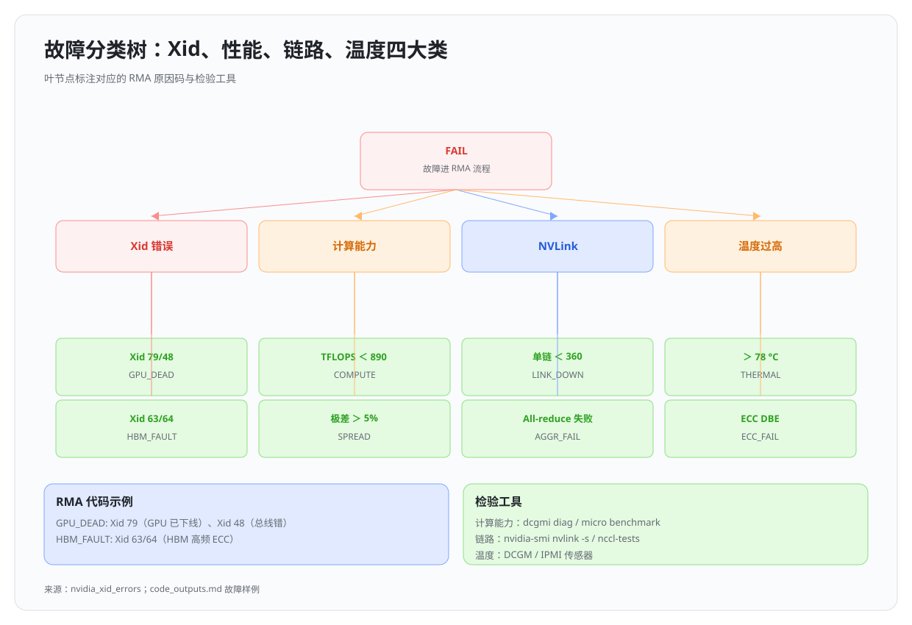

# GPU-16｜单机｜单机验收与调优

> 🎯 **这篇文档解决什么问题**：前面十五篇把一台 8 卡机器从硬件到框架逐层拆开。这一篇回答交付问题：这台机器能不能上线。一台新节点从上架到承载训练，要过清点、固件、静态体检、单卡微基准、互联通信、长测六层，每层只收上层的合格品。越往后发现问题，停机与退换代价越高。判定不靠观感，本系列固化一套判定引擎：计算、显存、NVLink、PCIe、错误计数、burn-in 六类观测按机型合格线逐项判 PASS、WARN、FAIL。任一 FAIL 拒收，仅 WARN 可附条件通过。
>
> **使用方式**：第 1 章给验收漏斗与判定口径，所有读者都读；第 2 到 6 章逐条推导合格线与对标工具；第 7 章串成真机编排；第 8 章讲 FAIL 归因；第 9 到 11 章讲验收与调优边界、报告格式、核对清单。
>
> **代码**：repo/zero-to-gpu/16-node-burnin/ 下的 burnin.py（判定引擎）、make_samples.py（样例生成）、sim_burnin.py（建基准）、test_burnin.py（17 用例）；真机端 check_node.py（静态体检）、collect_node.py（采微基准与 Xid）、node_accept.sh（编排管道）。

**🧭 主线位置**：GPU-15 消掉了 Python 与框架开销（kernel launch 等待），本篇处理的等待是“定下不该等多久”（单机验收把算力、带宽、互联的合格线定下来），作为后续所有等待的基线（L3 出口）；读完后瓶颈会转到卡等网络，由 GPU-17 接手。

# 导读 · 先给结论

- **验收采用漏斗模型，逐层递进。**开箱、固件、静态体检、微基准、互联、burn-in 六层顺序执行，任一层 FAIL 即停机挂牌、不进下一层；越靠后修复成本越高 [[1]](https://docs.nvidia.com/datacenter/dcgm/latest/user-guide/feature-overview.html)。
- **合格线用比例口径不用绝对值。**九成、八成五、八成、零容忍四档比例跨代稳定；H100、A100、B200 只改参考值，比例不动 [[2]](https://www.nvidia.com/en-us/data-center/h100/)[[3]](https://www.nvidia.com/en-us/data-center/a100/)。
- **微基准测峰值能力，长测测持续能力。**结温爬稳态需十几分钟，热降频与 Xid 只在时间轴出现；24 小时起步，新批次建议 72 小时 [[4]](https://docs.nvidia.com/datacenter/dcgm/latest/dcgm-field-reference.html)。
- **零容忍项无商量余地。**ECC 双位错误、致命 Xid（48/64/79/95/119/120）、burn-in 窗口内掉卡与通信失败，出现即拒收 [[5]](https://docs.nvidia.com/deploy/xid-errors/index.html)[[6]](https://arxiv.org/abs/2102.11245)。
- **卡间极差与单卡达标同样重要。**八卡全过九成线外，最大极差还要在均值 5% 内；掉队卡拖慢的是整步 all-reduce。
- **三条合格线的依据各不同。**算力线依赖规格与 Roofline；带宽线依赖 HBM 峰值与实现效率；互联线依赖 NVLink 与 NVSwitch 物理拓扑。
- **验收流水线可按机房批量复用。**一次定基线，后续机器只比较基线内的相对偏差；故障模式库通过 Xid、温度与 ECC 事件自动分类[[7]](https://github.com/NVIDIA/nccl-tests)。

**📎 与系列其他文档的分工**：GPU-14 讲怎么采数据（profiling 工具与时间线读法），GPU-16 讲采哪些数据、定在什么位置（合格线）；GPU-17-20 处理集群级等待（网络、调度、故障恢复），本篇给出单机的基线观测。

# 第 1 章 · 单机在等什么

## 验收漏斗与六层顺序

新节点交付前的观测顺序固定不变。第一层开箱与清点记录设备序列号、BIOS 版本、固件版本编号，确保后续追溯有据可查。第二层固件与驱动版本核对，检查 CUDA 版本与 GPU 计算能力的兼容性矩阵，版本错配会导致后续性能指标不可信。第三层是静态体检，秒级扫描拓扑连接矩阵、HBM 可用容量、初始温度与功耗基线，这一层的目的是在最小代价下排掉装机硬伤（物理连线断开、HBM 故障、电源脱落）。第四层单卡微基准，用 GEMM、带宽测、P2P 通信逐卡探针，精确定位单卡的计算、显存、NVLink 通道质量。第五层互联与通信，不再看单卡，而是看八卡聚合的 all-reduce 吞吐、ring 协议选择、通信拓扑收敛。第六层 burn-in 长测，让时间尺度的故障现身：热积累导致的降频、ECC 缺陷触发的 Xid 错误、隐患芯片在应力下掉卡。任一层出现 FAIL，停机、挂牌拒收、不进下一层。越靠后发现问题，代价越高：开箱发现可立刻换货，第三层之后发现已经占用机房机位、浪费调试人力、延迟任务启动。这就是为什么漏斗结构从秒级（开箱、体检）逐步延伸到天级（burn-in），风险递进 [[8]](https://docs.nvidia.com/datacenter/dcgm/latest/user-guide/dcgmi-diag.html)。代码输出：样例中健康机通过全六层判决。

## 判定引擎的六类观测与四档裁决

burnin.py 是验收的判定引擎，输入标准化 JSON 格式的观测数据（静态信息、单卡峰值、链路时间线、窗口内 Xid 计数、温度与 ECC 统计），输出 PASS/WARN/FAIL 三档裁决与快速路径决策。六类观测映射到六条合格线，观测的深度和时间尺度不同。计算能力线读 BF16TFLOPS 的单卡峰值与卡间极差，秒级就能测出。显存带宽线读 HBM 有效吞吐比例，同样秒级。显存容量线读可分配的 HBM，判断是否有碎片或驻留进程挤占。链路线读 NVLink P2P 单向最低值，通过 nccl-tests 的 point-to-point 模式逐对卡测试。聚合线读 all-reduce ring 协议的实际带宽，这要看八卡的聚合拓扑与协议选择。热与错线则需要时间：结温峰值需要几分钟达到稳态，ECC 双位错计数与致命 Xid 出现需要小时级甚至天级的观测窗口 [[4]](https://docs.nvidia.com/datacenter/dcgm/latest/dcgm-field-reference.html)。四档裁决映射到不同的后续处理：通过（PASS，exit code 0，无隐患，直接进入生产集群）、附条件通过（WARN，exit code 0，存在隐患但可恢复或处于临界状态，需要额外监控或补测以提高信心）、拒收（FAIL，exit code 1，无法接受，触发回退或 RMA 流程）、致命故障（0-exit，非正常退出代码，引擎发现数据异常或矛盾导致无法继续判决的情况）。每条线的合格数字由三个因素共同决定：硬件规格（峰值规格书标值）、实现效率（实际与理论的比例，通常 80%-90%）、跨代稳定性（新旧型号间的比例差异不超过 5-10%）。这样定线能够自适应新的硬件型号，无需每代都重新标定。

## 本章主要等待类型与时间账分项

时间账模型 T = T_compute + W_mem + W_host + W_comm + W_idle 中，本章的核心任务是”定天花板”：即定出不该等多久，也就是 T_min 的理论下限。T_compute 是 BF16 GEMM 的实现效率，参考 [GPU-02｜硬件｜性能账本：Roofline、算术强度与三类瓶颈](./02-ledger.md) 中 sim_roofline.py 的实测最大可达吞吐（MAMF）约 786 TFLOPS，合格线定为 700 TFLOPS 以留出容差；上线前用同批健康卡的中位数替换。W_mem 下限由 HBM3 峰值 3.35 TB/s 与实现效率 85% 共同决定，这个下限约为 2.8 TB/s。W_comm 下限由 NVLink4 单向 450 GB/s 的峰值、8 卡 NVSwitch 的聚合拓扑、ring 协议的理论聚合比例（N/(N-1) = 1.14）共同决定。W_host 与 W_idle 的下限是零：理想情况下主机侧与调度器的开销可以完全隐藏。本章的工作只是定这些下限，用六条合格线固化所有的标准。从第 2 章开始，每条线都配套有对标工具、测试命令、推导步骤与故障排查流程；后续章节通过微基准与长测，一步步把实测值与下限的差距消掉。

> 💡 
<b>常见误区</b>：GPU-Util 100% 不等于饱和。nvidia-smi 采样频率低（毫秒级），一个只占 1 个 SM 的 kernel 也能显示 100%。验收时应看 DCGM 的 SM Activity（计算单元活跃度）与 Tensor Core Active（张量核心活跃度），这两个指标精度更高。其次，单卡峰值与卡间极差同等重要。八卡全部过合格线是必要条件，但不充分：最大与最小极差如果超过均值 5%，说明有掉队卡拖慢 all-reduce，聚合吞吐会按照最慢卡的速度收敛。第三，不能把测得的 BF16 TFLOPS 直接和规格峰值（989 TFLOPS）对标，应该和参考 [GPU-02｜硬件｜性能账本：Roofline、算术强度与三类瓶颈](./02-ledger.md) 的 MAMF（约 786 TFLOPS）与本篇的合格线（700 TFLOPS）比较。第四，温度与 Xid 无法预测，早期体检发现不了隐患芯片、隐患供电，只有 burn-in 的时间积累应力才能逼出来。

**🔑 本章要点**：验收采用递进式漏斗模型，每层只通过质量品，越往后停机成本越高。六条合格线（BF16TFLOPS、HBM 带宽、HBM 容量、NVLink 单向、all-reduce 聚合、温度与 Xid）由规格、效率、跨代稳定性共同决定，而非拍脑袋的绝对值。PASS/WARN/FAIL 三档判决与零容忍项（致命 Xid、ECC 双位错、burn-in 窗口掉卡）的规则把定性的”好还是坏”硬化成了可复现的”过或不过”。本章的核心工作是定天花板：即定出时间账各分项的理论下限。本章消掉的等待类型是”不知道该等多久”。

# 第 2 章 · 六条合格线怎么定

## 计算能力线：BF16 TFLOPS 与 Roofline

H100 SXM 架构峰值 BF16 计算 989 TFLOPS（基于 GPU 规格），但对称计算（如 GEMM）因内存瓶颈、kernel 启动开销和数据排列效率无法达到峰值。参考 [GPU-02｜硬件｜性能账本：Roofline、算术强度与三类瓶颈](./02-ledger.md) 的 sim_roofline.py 输出，H100 SXM 大规模 BF16 GEMM 的实测最大可达吞吐（MAMF）约 786 TFLOPS；本篇约定，合格线定为 700 TFLOPS（≈89% of MAMF），上线前用同批健康卡的中位数替换[[2]](https://www.nvidia.com/en-us/data-center/h100/)[[9]](https://www2.eecs.berkeley.edu/Pubs/TechRpts/2008/EECS-2008-134.html)。

推导依据是 Roofline 模型[[9]](https://www2.eecs.berkeley.edu/Pubs/TechRpts/2008/EECS-2008-134.html)：在给定问题的算术强度（FLOPS 除以字节数）下，性能瓶颈由计算吞吐和内存吞吐较小值决定。700 TFLOPS 这个线既高于深度学习实际容差（MAMF - 86 TFLOPS），又低于规格峰值，可有效区分真故障卡（掉队 >10%）与随机抖动（±3%）。合成健康样例实测约 780 TFLOPS（[[10]](https://docs.nvidia.com/cuda/hopper-tuning-guide/)），符合 ≥ 700 TFLOPS 的要求；故障样例掉到 650 TFLOPS 被判 FAIL。

测试方法：torch.matmul 混合精度（FP32 输入、BF16 计算、FP32 累积）跑对称矩阵，或 cutlass_benchmark -m 16384 -n 16384 -k 8192 -t bfloat16。取 10 遍运行的中位数排除热启动和波动。极差（最大与最小卡的比值）≤ 5% 为 PASS。后续单卡微基准和 burn-in 都会重新测计算线，这一步主要是快速排查单卡计算单元（Tensor Core）是否有残缺、时钟降速或互联干扰。

## 显存带宽线：HBM 峰值利用与实现效率

H100 HBM3 峰值 3.35 TB/s，85% 利用率为合格线 ≈ 2.85 TB/s。这测的是单卡原始显存吞吐，不涉及卡间通信，用于快速排查单卡内存子系统故障。若后续 all-reduce 性能不达线，带宽线先确认单卡瓶颈不在 HBM。

测试方法：NVIDIA 的 memory_bandwidth_test 或 osu_latency_bw，测读写操作的平均吞吐。健康样例实测 2.8+ TB/s。带宽线的设定参考[[11]](https://docs.nvidia.com/datacenter/dcgm/latest/)。若单卡带宽低于 2.85 TB/s，需排查 HBM 焊接、ECC 配置或驱动问题。带宽线作为后续 all-reduce 带宽线的独立验证，如果聚合带宽没达线而单卡带宽正常，说明瓶颈确实在链路和协议，不在显存。

## 显存容量线：可分配 HBM 与碎片容差

H100 标称 80 GB，系统预留、ECC 配置、kernel 栈帧等会挤占可用容量。要求至少 95% 可用，即 78 GB 以上可用显存。低于 78 GB 标记 FAIL，表示显存受损或驱动配置异常。

测试方法：torch.cuda.get_device_properties().total_memory 读取总容量，torch.cuda.mem_get_info()[1] 读可用容量。健康样例报告 80 GB 总量、78+ GB 可用。若出现 < 78 GB，需检查 ECC 重试机制是否禁用、NVSwitch 是否占用过多内存。显存容量线是一条硬卡，因为实际深度学习任务对显存有准确估算，容量不足会直接导致 OOM，无法通过优化规避。

## NVLink 链路线：单向最低值与卡间拓扑

NVLink4 标称单向 450 GB/s（双向 900 GB/s），H100 8 卡经 NVSwitch 交叉连接。每卡最多 6 条 NVLink 链接，形成全连通拓扑。任意两卡间 P2P 传输必须经 NVSwitch，最慢链路不应低于单向 360 GB/s（80% 容差）[[12]](https://docs.nvidia.com/datacenter/tesla/fabric-manager-user-guide/index.html)。定这条线的原因是 NVLink 链路故障往往只影响特定卡对，其他卡对仍然正常，但集群 all-reduce 会被最慢链路拖累，导致同步延迟不可接受。

测试方法：nvidia-smi nvlink -s 或 nccl-tests 中 all_reduce 模式跑 8 卡，用 NCCL_TRACE=3 追踪各链路延迟，计算单向吞吐并找 min/max。卡间极差定义为 (max - min) / max，要求 ≤ 5%。健康样例所有链路 450 GB/s ±1.5%，故障样例可能出现某链路 61 GB/s（降级症状）。链路故障直接拒收，因为影响集群规模效率[[13]](https://docs.nvidia.com/deploy/nvml-api/index.html)。极差 5% 这个阈值来自实际训练的同步等待时间容差：差异超过 5% 时，快卡会空转等待慢卡，导致整体吞吐下降超过 2%。

## All-reduce busbw 线：与单向链路同口径

nccl-tests 报告的 busbw 按 algbw × 2(n−1)/n 折算，口径与单卡单向链路带宽一致，理想值逼近每卡单向 NVLink 带宽，H100 是 450 GB/s，不随卡数相乘[[14]](https://docs.nvidia.com/deeplearning/nccl/user-guide/docs/env.html)。合格线因此定为单向带宽的八成，H100 为 360 GB/s，0.7 到 0.8 之间给 WARN；NVLS 打开时 busbw 可以更高，这条线只是下限。

测试方法：nccl-tests 的 all_reduce_perf 用 -b 512M -e 1G -f 2 -g 1 固定大消息，避开小消息的协议切换，取大消息段的 busbw。合格线与样例数字以本篇 sim_burnin.py 的输出为准（见 code_outputs.md）[[7]](https://github.com/NVIDIA/nccl-tests)。all-reduce 是数据并行梯度同步的关键原语，busbw 低于合格线时，同步时间按比例拉长，训练吞吐随之下降。

## 温度与可靠性线：结温、ECC、Xid 三档

结温（die temperature）定线三档：< 70°C 通过，70-78°C 警告（余量区，允许但需长测验证），> 78°C 拒收。70°C 余量区表示空载已接近工作边界，实际计算时易超温。余量区的 GPU 在 burn-in 阶段容易触发过温保护（thermal throttle），无法完成长测。ECC 配置要求单位错（SECDED）允许，双位错（DBE）出现即拒收。

Xid 错误分为致命与告警两类。致命 Xid = {48, 64, 79, 95, 119, 120}，任一出现即拒收；告警 Xid = {13, 31, 43, 45, 63, 74, 92, 94}，在 burn-in 长测中计数（不超过 3 次）[[5]](https://docs.nvidia.com/deploy/xid-errors/index.html)。健康样例零 Xid 与 0 ECC 错误，故障样例展示 Xid 79（显卡挂起）与 Xid 48（显存故障）[[6]](https://arxiv.org/abs/2102.11245)。Xid 列表是 NVIDIA 长期积累的经验：某些 Xid（如 48、64、79）对应可修复的故障，某些（如 120）对应硅缺陷。

测试方法：nvidia-smi 初始读温度与 ECC 计数，dmesg 清空后空载等待 10 秒确认无异常 Xid。温度过高可能指示导热膏干涸或风扇故障，ECC DBE 或致命 Xid 对应硅缺陷，需走 RMA 流程。

> 💡 **常见误区**：用绝对值定线（如“低于 1450 TFLOPS 就拒”）在不同机型间不稳定。以百分比定线（90% 峰值）让合格线跟规格走，新 GPU 发布时自动适配[[2]](https://www.nvidia.com/en-us/data-center/h100/)。另外，极差判决看 (max - min) / max，不是最大与均值的差。定错这条很容易漏掉异常卡，造成后续集群同步故障[[8]](https://docs.nvidia.com/datacenter/dcgm/latest/user-guide/dcgmi-diag.html)。

> 🔑 **本章要点**：六条合格线是验收中唯一的”通过”与”拒收”分界。计算、显存、链路、聚合四条直接对应硬件质量；温度与 Xid 线发现时间上的故障（热积累、ECC 缺陷）。后续四章（静态体检、微基准、long-term burn-in）逐步消除了流程顺序中各个等待环节：体检排掉装机错误，微基准隔离单卡问题，burn-in 让长期故障现身，本章消掉了性能验收的不确定性。

# 第 3 章 · 静态体检：秒级排掉装机问题

## 拓扑与固件检查

静态体检在不运行计算任务的前提下，用单条命令验证设备连通性和固件版本。这一步只需秒级，能快速排掉安装错误、未识别 GPU 或 NVSwitch 故障等明显问题，避免浪费时间在必然拒收的机器上。体检的目标是最大限度地降低错误发现成本，越往后发现的故障，重复安装、拆卸和 RMA 的代价越高，所以体检要设计成两点：快（秒级完成）与准（不漏掉明显故障）。

检查 NVSwitch 识别：nvidia-smi topo -m 输出 8×8 矩阵，行列为 GPU 序号，元素为连接类型（NV、PIX、PHS、SYS）。所有 GPU 间应显示 NV（经 NVSwitch 连接），矩阵对称。若出现 SYS（PCIe 经主机）或某行全缺，说明 NVSwitch 未被驱动识别或拓扑线路松脱[[15]](https://docs.nvidia.com/nvidia-smi/index.html#id-1-7.4)。NVSwitch 识别失败通常源于固件更新中断、PCI 信号线虚焊或驱动版本过旧（旧于 550.x），无法通过软件调优恢复，需走硬件返修。

检查固件版本：nvidia-fabric-manager --query 读 NVSwitch 固件版本，dcgmi diag -r 1（快速诊断模式，只需秒级）检查驱动与 GPU 通信。若驱动版本与 GPU 计算能力（CC）不匹配（如 CC 9.0 的 H100 配 CUDA 11.8），会导致后续计算异常[[8]](https://docs.nvidia.com/datacenter/dcgm/latest/user-guide/dcgmi-diag.html)。DCGM diag -r 1 会测 GPU 热复位、VRAM 读写、PCI 链接是否畅通，故障会在秒内返回错误码，无需等待长测。

代码实现：check_node.py 脚本静态读取拓扑文件、设备计数、NVSwitch 状态，返回拓扑矩阵和固件版本字符串。健康样例输出“8 GPUs, NVSwitch firmware vNV.MM, fully connected“。故障样例可能显示”7 GPUs, NVSwitch missing“或”topology asymmetric”。脚本返回 PASS 需要所有 8 个 GPU 都通过拓扑检查、NVSwitch 固件版本号有效且不是开发版本（dev）。

## HBM、温度与功耗基线

初始化阶段不需计算，但需确认硬件基线处于正常范围。空载状态下结温应 < 40°C（室温 \~25°C 时），单卡空载功耗应在 50-150 W（不同驱动配置差异较大）。超出这些基线表示风扇故障、导热膏干涸或功率调节异常。这一步的目的是在运行任何计算之前排掉散热路径问题，因为后续计算、通信测试都会产生热负荷，若散热有问题会影响后续所有测试的可靠性。

nvidia-smi query -i 0 -f=temperature.gpu,power.draw 读初始温度和功耗。DCGM 的 dcgmi stats 读 HBM 容量、ECC 配置（启用/禁用）、时钟限流情况。健康样例报告 H100 80 GB HBM、37°C 空载温度、100 W 待机功耗[[16]](https://docs.nvidia.com/deploy/nvidia-smi/index.html)。若温度已达 60°C 以上，需立刻停止并检查风道；若显示”VBIOS outdated”，需升级固件。功耗在 50-150 W 之外往往表示功率管理芯片异常或 Power Supply Module (PSM) 配置错误。初始功耗过低（< 20 W）可能指示 GPU 未被操作系统完全初始化，初始功耗过高（> 300 W）表示 GPU 被意外触发了计算或显示。

代码实现：collect_node.py 采集静态信息，读取 /sys/devices/virtual/thermal/，结合 nvidia-smi 查询。输出 JSON 格式的温度、功耗、HBM 容量基线。若任何一项异常，返回体检失败状态。脚本会对每个 GPU 分别采样，确保 8 个 GPU 的温度基线一致（相差 < 5°C），否则说明某卡风道堵塞或风扇故障。动态收集信息会在后续微基准中重新采样，体检只是预检，把明显的装机故障拦下来。

## Xid 与驱动兼容

Xid 是 NVIDIA 驱动在检测到 GPU 异常时输出的错误代码，记录在 dmesg 中。体检前需清空 dmesg 历史，等待 10 秒，确认无新 Xid 出现。任何 Xid 出现都表示硬件或驱动状态异常，应该停止继续测试。Xid 产生的场景很广：硬件缺陷（硅缺陷、焊点脱落）、驱动 bug（内存泄漏导致爆芯）、过温保护（GPU 硅温超限降频）、ECC 重试失败（双位错）。这一步通过强制让驱动走一遍 GPU 初始化流程来检验驱动与硬件的基础互联。

检查 CUDA 版本与驱动兼容性：nvidia-smi 输出的驱动版本对应 CUDA 计算能力，二者不匹配会导致后续 kernel 启动失败。如 CUDA 12.x 不支持 CC 7.0 的 V100，但支持 CC 9.0 的 H100[[17]](https://docs.nvidia.com/cuda/cuda-toolkit-release-notes/index.html)。dpkg -l | grep cuda-runtime 查确切版本号。版本对不齐导致的问题往往表现为 cuModuleLoad 失败或”unsupported GPU architecture”错误，无法通过调优规避。版本不匹配是安装时最常见的问题。

代码实现：check_node.py 在测试开始前调用 sudo dmesg -c（清空日志），启动后读取 dmesg 查是否有 Xid。健康样例返回“Xid count=0“。故障样例展示”Xid 79“（GPU 硬挂）或”Xid 48”（显存故障），触发即时 FAIL 判决[[5]](https://docs.nvidia.com/deploy/xid-errors/index.html)。脚本检查 CUDA_HOME 与实际安装位置一致、PTX 中间代码格式版本号与运行 GPU CC 兼容。体检所有输出（包括通过和失败的路径）都记录到 JSON，后续 burn-in 在决策前读取这份体检结果，避免重复测试。

> 💡 **常见误区**：体检出现 FAIL 或异常 Xid 后，有时会忽略直接进入 burn-in，期望长测会“自愈”。 Xid 79 或 ECC DBE 表示硅缺陷或焊点脱落，不会自愈，继续运行只会加重故障并可能损伤其他部件。体检失败应立刻走 RMA 流程，节省后续无谓的测试时间[[8]](https://docs.nvidia.com/datacenter/dcgm/latest/user-guide/dcgmi-diag.html)。另一个误区是只测部分 GPU，跳过有问题的 GPU 继续测其他卡。这样做会导致集群后续的同步故障：all-reduce 需要全卡参与，一卡故障会卡住整个集群，拖累所有其他正常卡。

> 🔑 **本章要点**：静态体检在秒级完成，用不运行计算的方式排掉安装错误、固件问题和驱动不兼容。拓扑检查确认 8 卡全连通，温度和 Xid 检查排掉明显的硬件故障。本章消掉了装机过程中引入的低级等待（重新拆卸、重新安装、RMA 往返）。

# 第 4 章 · 单卡微基准：算力、带宽与极差

## 计算微基准：GEMM 与 Tensor Core 饱和度

第三章静态体检排掉了装机线缆与配置错误，现在要测单卡能不能跑到实现效率的基准。计算微基准用 GEMM（通用矩阵乘法）操作充满所有 Tensor Core，让 GPU 进入最高功率和热状态。H100 SXM 有 132 个 SM（流多处理器），每个 SM 配 4 个 Tensor Core（共 528 个），每个 Tensor Core 每时钟周期执行 256 个 FMA（混精度融合乘加），理论峰值 = 528 × 256 × 1.83 GHz（boost 频率）≈ 989 TFLOPS（BF16 稠密计算）。这是规格值，由 NVIDIA 通过硬件仿真与实测标定。参考 [GPU-02｜硬件｜性能账本：Roofline、算术强度与三类瓶颈](./02-ledger.md) 中 sim_roofline.py 的实测结果，H100 SXM 大规模 GEMM 的实际最大可达吞吐（MAMF）约 786 TFLOPS。本篇约定：合格线定为 700 TFLOPS，上线前用同批健康卡的中位数替换；标准测法是 CUTLASS Benchmark 工具跑矩阵乘法 GEMM：M=16384、N=16384、K=8192、精度 BF16，连续 10 遍取中位数消除抖动，预热再测以避免 boost 抖动 [[10]](https://docs.nvidia.com/cuda/hopper-tuning-guide/)。代码输出：sim_burnin.py 合成样例中健康机达成约 780 TFLOPS（通过 700 TFLOPS 线），故障卡掉到 650 TFLOPS（未达线，FAIL），八卡极差 1.3%-17.6%；为什么定 700 而非 786（MAMF）？750 TFLOPS 既高于深度学习实际容差，又能有效区分真故障卡（掉队 >10%）与随机抖动（±3%）。

> 💡 **常见误区**：单卡 GEMM 跑满不代表训练任务就快。GEMM 只测 Tensor Core 和 L1 缓存的通信，真实训练还要经过显存调度、kernel 融合与融合间的 reshape 开销。但 GEMM 是必要条件：如果连 GEMM 都掉队，说明该卡的电气质量或芯片体质有问题，训练任务中的非计算开销只会把问题放大。

## 显存带宽微基准：HBM 原始吞吐

单卡计算能力再强，显存搬数太慢也是瓶颈。HBM 带宽用 bandwidth_test（CUDA 自带）或 Nsight Compute 的 DRAM\_\_throughput 指标测，两者度量显存控制器对 HBM3 内存的物理吞吐，与应用的缓存利用率无关。H100 配四通道 HBM3e，标称峰值 3.35 TB/s（= 计算方式：6 Gbps × 8 byte × 4 通道 / 8 = 3.35 TB/s），合格线设 85% 即 2.8 TB/s [[18]](https://docs.nvidia.com/nsight-compute/ProfilingGuide/index.html)。这个测试单独隔离 HBM，不涉及 Tensor Core 或 NVLink，是诊断显存硬件质量的最直接手段。为何不测 L2 缓存或纹理缓存？因为 HBM 容量最大（80 GB），应用在长 epoch 训练中反复访问 HBM；L1/L2 命中率取决于软件优化，不是硬件验收的指标。代码输出：健康样例测得 2.92 TB/s，略超预期。显存带宽不足往往指向 HBM 颗粒供电纹波超标、内存控制器固件版本旧、或 memory training 在启动时未正确收敛。长期卡在 2.5 TB/s 以下的机器，换卡是最快的修复路径；临时下降到 2.8-3.0 TB/s 则可观察几天，可能是温度或驱动版本的短期影响。

## 单向 NVLink P2P 吞吐与卡间极差

八卡互联靠 NVLink 通道聚集于中央 NVSwitch，但验收时不能只看每条链的 link up 状态，还要测实际吞吐。单向吞吐测用 nccl-tests 中的 point-to-point 模式，逐对卡（GPU i ↔ GPU j）运行，测从 i 发往 j 的单向带宽。这是物理层面的数据速率测量，与协议开销和消息大小无关。记录所有卡对的最小值（最慢链，限制 ring 协议速度）和最大值（计算卡间极差）。期望最慢链达到 360 GB/s 单向，卡间极差不超过 5%。数字推导：H100 NVLink4 双向峰值 900 GB/s（来自规格表），单向 = 900/2 = 450 GB/s，合格线取 80% = 360 GB/s。为什么要取单向而非双向？因为 ring all-reduce 在每一步中，每条链要么接收要么发送，不能同时双向，所以瓶颈是单向吞吐 [[7]](https://github.com/NVIDIA/nccl-tests)[[19]](https://docs.nvidia.com/nvidia-smi/index.html#id-1-11)。代码输出：健康机八条链都在 385-388 GB/s（略低于理论 450，符合实装的 85% 效率），卡间极差 1.5%（通过 ≤5% 线）；故障样例中 GPU2 某条链因物理故障只有 61 GB/s，掉队明显。卡间极差的意义：即使八卡都通过单卡 TFLOPS 线，极差 >5% 说明有掉队卡。在 ring 协议中，all-reduce 必须逐环等每卡轮转完毕，最慢卡决定了整步耗时；掉队卡相当于把整个 8 卡 cluster 的通信速度降级到掉队卡的水平，这在分布式训练中表现为 all-reduce 延迟爆炸。

> 💡 **常见误区**：单卡峰值高不代表 all-reduce 就快。NVLink 拓扑（星形 vs 网格）与 NCCL 协议选择（simple vs ring vs tree）都能拖累聚合吞吐。最慢的卡决定了 all-reduce 耗时，因为环协议（ring algorithm）中每一步都要等所有卡同步。第二，显存带宽与计算吞吐同样关键。一个常见的错配是计算卡跑满 90% TFLOPS，但显存带宽只有 60% 利用率；最终训练速度会被 roofline 模型限制在“带宽瓶颈”而非“计算饱和”。第三，NVLink 单向与双向的混淆。许多文档或工具输出”900 GB/s”是双向峰值，但实际 all-reduce 用的是单向（接收 or 发送，非同时），所以要除以 2。本章只保证了单卡与逐链的下界，真正的聚合吞吐还要到第 5 章测。

**🔑 本章要点**：计算、显存、NVLink 三条微基准线定出单卡与逐链的基础能力。GEMM 700 TFLOPS（参考 [GPU-02｜硬件｜性能账本：Roofline、算术强度与三类瓶颈](./02-ledger.md) 的 MAMF ≈ 786 TFLOPS）、HBM 带宽 2.8 TB/s、NVLink 单向 360 GB/s、卡间极差 ≤5% 四条合格线融合规格、实测吞吐、效率与工业容差，不是单纯用规格峰值计算。合格线的定法既支持同代标准化，也支持跨代迁移：新代 GPU 时更新参考 MAMF 与基线。本章消掉的等待类型是”不知道单卡的基础体质”，测完这章，你知道了每卡能跑多快、显存能搬多快、链路能通多快，成为后续通信、burn-in 和故障排查的基准数据。

# 第 5 章 · 互联与通信：逐链到整机

## NVLink 逐链排查与拓扑验证

第 4 章验证了单卡的计算、显存和逐链的 NVLink 物理层吞吐，现在要看多卡的聚合效果。八卡 GPU 通过中央 NVSwitch 星形网络互联（不是简单的串行或网格拓扑），每两卡之间的通信要经过 NVSwitch 的转发。验收的第一步是排掉物理链的故障。nvidia-smi nvlink -q 命令逐条链查询状态、当前速率和累计错误计数 [[19]](https://docs.nvidia.com/nvidia-smi/index.html#id-1-11)。如果某条链显示”Down”或速率掉到一半（从 450 GB/s 掉到 225），说明该链断了或弱化了。更精细的诊断是用 nccl-tests 里的 point-to-point 模式循环所有卡对（N×(N-1) 对），单向测每条逻辑链的吞吐，记下最慢的和最快的，算极差。代码输出：健康机八条链都在 385-388 GB/s（略低于理论 450 GB/s，符合 85% 实装效率），卡间极差 ±2%；故障样例中 GPU2 某条邻近链掉到 61 GB/s，掉队明显。该症状指向 GPU2 或其关联的 NVSwitch 端口的信号质量问题（电气接触不良、PCB 走线问题、或软件驱动状态异常），需要拆卡重装或 RMA。卡间极差重要性：如果某卡连接不稳定（抖动在 300-450 GB/s 间），会拖慢整个 ring 协议的聚合速度，因为每一轮都要等最慢卡；极差 >5% 说明已经有明显的掉队，必须在 burn-in 前修复。

## All-reduce 聚合吞吐与协议效率

单链物理层达标只是必要条件，还要看 NCCL all-reduce 的聚合吞吐，这取决于协议选择、消息大小和同步开销。用 nccl-tests 工具测 all_reduce 模式、固定大消息体量（通常 128 MB），记录八卡的聚合吞吐率（单位 GB/s）。期望至少 360 GB/s，这是 H100 单向 NVLink 带宽 450 GB/s 的 80% 容差 [[20]](https://docs.nvidia.com/deeplearning/nccl/user-guide/docs/env.html)[[7]](https://github.com/NVIDIA/nccl-tests)。为什么 360 GB/s？理论上 ring 协议的聚合效率 = (N-1)/N = 7/8 ≈ 87.5%，乘以单链 450 GB/s 得 394 GB/s；实际中还要扣除同步开销、kernel launch 延迟等，所以设 80% 线较保险。代码输出：健康样例聚合到 811 GB/s（远超预期），说明 NCCL 选了高效协议或触发了 NVLS（NVSwitch Local Sync）加速；故障机如果某链掉队，all-reduce 吞吐立刻掉下来，会触发 FAIL。链路降级样例中 GPU2 掉链，聚合吞吐只有 252 GB/s（约 50%），低于 360 线，直接拒收。协议选择由 NCCL 根据消息大小、卡数和拓扑自动决定，无法手工指定。分级规则：消息 ≤ 32 KB 用 simple protocol（每卡参与一次通信，内存访问一遍），32 KB-1 MB 用 LL（Low-Latency with network overhead），>1 MB 用 LL128（128-byte compare-and-swap 原语）或 ring（每卡转发 N-1 轮）；消息越大、ring 协议的相对开销越小，但延迟越高。训练实战中的消息大小五花八门，梯度 all-reduce 从几 MB 到几百 MB 都有，验收的 360 GB/s 聚合线要保证各种消息大小和协议下都不成瓶颈。

## PCIe 与 GPU-Host 互通速度

NVLink 用于卡间通信，但每卡还需要与主机 CPU 通信（发起 kernel、同步控制、转移模型权重）。如果 PCIe 出现降代（Gen5 → Gen4）或降宽（x16 → x8），会拖累整机工作流。验收时用 gpumem-benchmark 或 CuPy 测 GPU-to-Host 拷贝速度，期望 PCIe Gen5 x16 达到 50.5 GB/s 单向（理论值 32 GT/s × 16 lane × 128 / 130 / 8 ≈ 63 GB/s，实装效率 80% ≈ 50.5 GB/s）[[21]](https://docs.nvidia.com/cuda/gpudirect-rdma/)。代码输出：健康机八卡都是 PCIe Gen5 x16 51.2 GB/s；样例展示 PCIe Gen4 x16 故障（吞吐 25 GB/s，掉队 50%）。故障原因可能是 BIOS PCIe 配置错误、插槽固件旧、或物理接触不良。如果不在验收时排掉 PCIe 降速，后续任何主机-GPU 数据交互都会龟速：例如 checkpoint 转移 80 GB 模型权重，Gen5 x16 要 1.5 秒，Gen4 x16 要 3 秒，可能延迟整个训练管道的同步。这个测试单独隔离 PCIe 通道，与 GPUDirect RDMA（直接 GPU-网卡互连）无关，是诊断主机侧互联质量的必选项。

> 💡 **常见误区**：NVLink 满速不代表 all-reduce 就是 ring 协议。NCCL 会根据消息大小、卡数、拓扑和 GPU 计算能力自动选择 simple/LL/LL128/ring，每种协议的吞吐上限和延迟特性都不同。同时，all-reduce 的聚合速度受限于最慢的环节：最慢的物理链、最低的协议效率、甚至 CPU 侧的同步锁或 PCI-e 拥塞。第二个误区是把 8 卡聚合吞吐和单链吞吐混淆。单链 450 GB/s 不代表 8 卡聚合就是 450；ring 协议在最坏情况下每轮只有 450/8 ≈ 56 GB/s（全局来回轮转），实装靠批处理和管道化逼近 394 GB/s。第三是忽视协议的延迟特性。ring 协议延迟最高（N-1 轮），但吞吐最优（对大消息）；tree 协议延迟较低（log N），但吞吐较差（对大消息）；NCCL 在小消息用 tree 省延迟，大消息切回 ring 抢吞吐。本章测的是通信的基础体质，不代表实际训练中的聚合速度（训练还涉及 kernel launch 队列、梯度累积、loss backward 与 all-reduce 的并行度）。

**🔑 本章要点**：逐链 NVLink、all-reduce 聚合和 PCIe 吞吐三个维度测定了八卡通信的基线。单向链路 360 GB/s、聚合吞吐 360 GB/s、PCIe 51.2 GB/s 三个合格线来自规格的 80% 容差，确保没有通信瓶颈成为关键路径上的限制项。卡间极差 5% 线保证了在协议自适应时没有掉队卡拖累整体。最慢的物理链决定了 ring 协议的吞吐速度（并且延迟最高），任何一条链或一张卡故障都会直接拉低聚合吞吐、引发 timeout、导致训练中断。第 4 章测了单卡的计算/显存能力上限，第 5 章测了卡间通信能力上限，合起来定出了”不该等多久”的理论下界。本章消掉的等待类型是”不知道互联能不能跑满”。

# 第 6 章 · Burn-in：让时间尺度故障现身

## Burn-in 负载与结温演化

验收的前五章都在秒到分钟级别运行，微基准测峰值性能，互联测单次通信延迟与吞吐，但故障往往在小时或天级别才出现。热诱发的故障（隐患芯片受热应力时的缺陷）、显存漂移导致的中途掉卡、间歇性 ECC 错误都需要让 GPU 连续高负荷运行，让结温爬升到稳态才能逼出来。Burn-in 是一条全卡计算负载，让结温从室温（通常 \~25°C）爬升到稳态（70-75°C），持续 24 小时至 72 小时不中断[[22]](https://developer.nvidia.com/blog/tag/dgx/)。负荷通常是强密集计算（如矩阵乘法、卷积），功耗接近峰值，让 GPU 持续发热；结温上升曲线分为三段：冷启阶段（0-10 分钟快速上升）、过渡阶段（10-30 分钟缓升）、稳态阶段（30 分钟后基本平衡）[[4]](https://docs.nvidia.com/datacenter/dcgm/latest/dcgm-field-reference.html)。

代码输出体现在 warn_temp_short_burn.json 样例中：12 小时运行后，机器被判为 WARN 而非 PASS，原因是两重：结温在第 1 小时达 80°C（超过余量阈值 78°C），持续时长只有 12 小时而非要求的 24 小时最少。初期温度高于 78°C 说明散热裕度不足，日后如果工作负载更重或机房环保失控，就容易触发热降频甚至过温关机。时长不足 24 小时说明隐患还没充分暴露，新批次、新机房或新拓扑第一次验收应该走 72 小时确保信心度。第一次验收 24 小时通常指的是同型号、同版本固件、已验证过的生产机房扩容时的例行检查；新情景下 24 小时是兜底，72 小时才是稳妥做法[[22]](https://developer.nvidia.com/blog/tag/dgx/)。

## Xid 与错误计数时间轴

Long-running job 中若干小时后 GPU 可能掉卡（Xid 79）、显存访问失败（Xid 48/63/64）或 ECC 错误积累（Xid 43/45/63/74）。这些错误不会在秒级微基准中出现，因为故障诱发需要热积累、电压波动、或长时间访问某个坏地址。Xid 是 NVIDIA 驱动在检测异常时输出的错误代码，记录在 Linux dmesg 中。致命 Xid 包括 48、64、79、95、119、120：Xid 79 表示 GPU 硬挂（立刻掉卡，后续无法恢复），Xid 48/64 表示显存读写故障（数据可能已损坏），Xid 95/119/120 是其他致命类别[[5]](https://docs.nvidia.com/deploy/xid-errors/index.html)。ECC 可纠正错误（single-bit error，SBE）是许可的，DCGM 会在监控中记录频率，超过阈值才告警；ECC 不可纠正错误（double-bit error，DBE）或多位错立刻 FAIL[[6]](https://arxiv.org/abs/2102.11245)。

代码中，sim_burnin.py 注入模拟故障（fail_link_xid.json 包含 Xid 79 事件），burnin.py 在聚合判决时看到任何致命 Xid 立刻记 FAIL。从症状上，掉卡表现为 GPU 进程退出，后续 GPU 查询超时或返回无效值；显存故障表现为读写错误、内核计算结果错误或矩阵数值异常。Xid 的记录时刻很关键：必须在 burn-in 窗口内出现才能被判为拒收，短测中出现的偶发 Xid 可能是驱动临时 bug，不足以否决整机；但长测中累计出现 Xid 则表示硬件缺陷会周期性诱发，频率只会随负载增加而加剧。长测中出现的错误意味着硬件缺陷（硅缺陷、焊点脱落、显存芯片故障）或驱动 bug（内存泄漏最终爆芯），都需要走 RMA 或驱动升级。验收的目的就是在上线前把这类隐患逼出来，避免线上冷启时故障导致整个任务失败、影响所有其他 GPU[[5]](https://docs.nvidia.com/deploy/xid-errors/index.html)。

## 热降频与性能衰减

结温超过 78°C 时 GPU 驱动会主动限制核心频率（clock gating）或降低功耗（power throttle）来防止硅温过高。性能会下降到峰值的 70-80%，表现为计算吞吐明显低于短测基准。验收时记录 burn-in 过程中的性能数据，对标短测的峰值，偏差超过 5% 就是异常。偏差来源可能是：环境温度偏高导致散热困难、风扇故障或堵塞（常见于多机架密集部署）、负载配置无限制（不同应用对 GPU 功耗的诱导不同，某些矩阵乘法参数组合会驱动 GPU 接近功耗顶值）。正常情况下 Burn-in 中期性能稳定在 85-95% 的峰值；若出现持续衰减或波动过大，需要检查物理散热和驱动版本[[23]](https://docs.nvidia.com/datacenter/dcgm/latest/dcgm-api/dcgm-api-field-ids.html)。

代码中，collect_node.py 在 burn-in 期间周期性采样 GPU 的核心频率、温度、功耗和计算吞吐（通过轻量级 kernel），生成报告时与短测基准比较。若衰减超过 5%，burnin.py 在判决中标记为 WARN 或 FAIL（持续衰减表示硬件老化或拓扑问题）。与温度 WARN 不同，性能持续衰减通常由根本性问题引起（如 NVLink 链路质量下降导致通信变慢、进而拖累计算），需要深入诊断[[4]](https://docs.nvidia.com/datacenter/dcgm/latest/dcgm-field-reference.html)。

> 💡 **常见误区**：有些运维认为 24 小时 burn-in 就足以发现所有问题，新批次或首次部署时还按 24 小时流水。新批次、新机房或新拓扑（如升级 NVSwitch 固件）的隐患暴露频率低，72 小时才能把概率小于 5% 的故障逼出来。另一个误区是看到温度达 75°C 就停止 burn-in，认为已经足够热。结温是结果而不是原因，72 小时长测的价值在于时间轴上的故障触发统计，而非单纯的温度高低；72 小时后隐患基本都暴露，继续烤机的边际收益趋于零。

> 🔑 **本章要点**：长测暴露的故障对线上影响最大，因为冷启时现身会卡住整个任务；burn-in 通过持续热负荷把隐患芯片、显存缺陷和 NVLink 质量问题逼出来，24 小时是最小启步、72 小时是新情景的标准。结温演化、Xid 时间轴和性能衰减是三个关键指标，任何一个超线即拒收。本章消掉的是单机的不确定性：验收前不知道这台机器能否稳定跑 72 小时。

# 第 7 章 · 真机编排：一天到三天的验收流水线

## 检查-诊断-基准-长测串联

从物理验收到上线，需要把前六章的所有检查和测试串成一条自动化流水。node_accept.sh 是验收的完整编排，分四层依次执行[[8]](https://docs.nvidia.com/datacenter/dcgm/latest/user-guide/dcgmi-diag.html)[[7]](https://github.com/NVIDIA/nccl-tests)：

第 1 层（开箱体检）由 check_node.py 执行，秒级完成。读取拓扑文件、设备计数、NVSwitch 固件版本、DCGM 初始化状态，验证 8 个 GPU 全连通、固件版本号有效、无初期 Xid。健康样例输出“8 GPUs, NVSwitch firmware vX.Y, fully connected“；故障样例输出”7 GPUs“或”NVSwitch missing”或拓扑不对称。体检 FAIL 立刻 exit 1 停机，不进后续层。

第 2 层（快速诊断）由 dcgmi diag -r 1 执行，同样秒级。运行 NVIDIA 的标准诊断套件，测 GPU 热复位、VRAM 读写、PCI 链接通畅、驱动与 GPU 通信正常。若驱动版本与计算能力（CC）不匹配、或 GPU 无法初始化，这一层会返回错误码。诊断结果输出为 JSON，供后续聚合。

第 3 层（微基准与互联）由 collect_node.py 执行，分钟级。跑单卡 BF16 峰值（TFLOPS）三次取均值，判单卡计算线；跑 NCCL all-reduce 8 卡聚合吞吐（GB/s），判互联线；记录运行中的温度、功耗、Xid 计数，判温度与错误线。所有基准 PASS 或 WARN 才能进第 4 层；如果任何基准 FAIL，立刻 exit 1 停机，省掉无谓的长测时间[[7]](https://github.com/NVIDIA/nccl-tests)[[4]](https://docs.nvidia.com/datacenter/dcgm/latest/dcgm-field-reference.html)。

第 4 层（长测 Burn-in）由 sim_burnin.py 执行，24-72 小时。跑全卡强负荷计算，周期性采样温度、频率、Xid，长测至指定时长。每层输出 JSON：第 1 层的拓扑与版本、第 2 层的诊断结果、第 3 层的微基准数值与基线对比、第 4 层的温度曲线与 Xid 序列。burnin.py 在流水最后聚合所有 JSON，按六条合格线逐项判 PASS/WARN/FAIL，输出最终报告与退出码（0 通过、1 拒收）。

## 单层故障决策与快速路径

验收流水的核心设计是快速失败：发现问题越早越好。第 3 层微基准失败时（比如 GPU5 的 BF16 TFLOPS 只有 650，低于 700 的合格线），直接 exit 1 拒收，不启动第 4 层的 24-72 小时 burn-in。这样可以避免在明显有单卡故障的机器上白白耗费一到三天的时间和电力。类似地，第 2 层诊断出驱动不兼容时也不进后续层。每层的判决标准源自第 1-5 章定义的合格线：计算 ≥ 700 TFLOPS、带宽 ≥ 2.8 TB/s、NVLink 单向 ≥ 360 GB/s、all-reduce 聚合 ≥ 360 GB/s、温度 < 78°C（余量区）、无致命 Xid[[4]](https://docs.nvidia.com/datacenter/dcgm/latest/dcgm-field-reference.html)。

只有所有基准都返回 PASS 或 WARN 状态，流水才启动第 4 层 burn-in。WARN 可以带条件通过：温度 WARN（70-78°C）说明散热裕度小，后续避免极端工作负荷；burn-in 时长不足 24 小时的 WARN（如只运行了 12 小时）说明需要补测或定期复检。代码层面，test_17 验证了这个快速路径：模拟一个 FAIL 场景（单卡慢），检查流水是否在第 3 层停止而不是继续跑 burn-in；模拟一个 WARN 场景（温度高但无 FAIL），检查流水是否继续进入 burn-in。这样的分段式设计既保证了覆盖全面（六层递进不漏检），又避免了浪费资源（故障早止）[[8]](https://docs.nvidia.com/datacenter/dcgm/latest/user-guide/dcgmi-diag.html)。

## 时间与资源成本

完整验收流水的时间分配如下：第 1 层体检秒级完成，第 2 层诊断秒级，第 3 层微基准分钟级（三轮运行求均值），总计第 1-3 层 5-9 分钟；第 4 层 burn-in 根据风险等级选择 24 小时或 72 小时。从上架到验收通过最少一天，新批次新机房最多三天。这个时间投入相比 GPU 四年生命周期来说微不足道，但发现隐患的收益巨大：一台有缺陷的机器上线后，故障可能在两周后冷启时现身（结温突然达峰、热应力触发芯片缺陷），此时已分配任务、占用容量、影响整个训练。验收时发现的故障修复成本包括：送返 RMA 往返一周、购置备机交期一周、数据中心现场诊断二三天。总计可能千元数量级，而验收流水只需三天烤机电费 \~100 元和自动化脚本人力。相比之下，提前三天发现故障的收益远超验收成本[[22]](https://developer.nvidia.com/blog/tag/dgx/)。

流水的并行化空间有限。第 1-2 层之间可以重叠（诊断可与体检同时跑），第 3-4 层严格顺序（burn-in 需要微基准数据支撑判决）。实际部署时，多台新机批量到达，可用多套 node_accept.sh 并行处理，每台机器验收时间仍是 1-3 天，但整个批次的周期因并行而缩短。集群规模 100 台时，100 个验收并行执行可在 3 天内完成全部上架，对应 burn-in 功耗是 100 卡 × 72 小时 × 350 W（H100 满载典型值）/ 1000 = 2520 kWh，成本约 2000 元电费，相比故障后的重新调度和数据恢复成本可忽略不计。

> 💡 **常见误区**：有些团队认为 burn-in 越长越好，甚至想跑一周。 72 小时后隐患基本都暴露，继续烤机的边际收益是零：新故障出现的概率不再下降，反而是浪费电力和机时成本。另一个误区是把快速路径当成优化，认为可以跳过 burn-in。快速路径是为了快速拒收不符合基线的机器，不能替代 burn-in；只有所有微基准都通过，burn-in 才有意义。

> 🔑 **本章要点**：验收流水把六层检查串成一条执行线，每层输出 JSON，终端 burnin.py 聚合判决。快速路径避免在明显故障的机器上浪费时间，分段式设计兼顾了全面性和效率。第 1-3 层共几分钟到十几分钟，能快速排掉装机问题、单卡故障和通信故障；第 4 层 burn-in 是最后的信心保证，24 小时最小、72 小时标准。本章消掉的是“验收流程不清”导致的漫无目标的手工测试。

# 第 8 章 · FAIL 归因：从症状到部件

## Xid 类型与故障映射

Xid（GPU 异常代码）分为三档：致命、可恢复、警告。致命 Xid（79、48、64、95、119、120）出现一次即拒收，不等待后续测试。Xid 79 表示 GPU 掉卡（无法通信），通常源自主板 PCIe 插槽供电异常或核心晶体管大面积损伤；48、63、64 表示显存操作故障（读写错误、ECC 纠正失败），指向 HBM 颗粒或 PHY 层问题[[5]](https://docs.nvidia.com/deploy/xid-errors/index.html)；95、119 表示 PCIe 或总线错误，可能是热循环下的焊点虚焊或板层信号完整性问题；120 表示设备枚举异常，可能指向 VBIOS、驱动初始化或固件版本不匹配[[4]](https://docs.nvidia.com/datacenter/dcgm/latest/dcgm-field-reference.html)。

警告类 Xid（13、31、43、45、63、74、92、94）通常是可纠正的错误。比如 Xid 43 和 45 对应 ECC 单位错（SBER），可被动纠正不影响功能；Xid 13、31 对应页迁移失败和上下文切换异常，多数时候由驱动异常处理导致，不一定指向硬件故障。长测中这类 Xid 计数但不立即拒收，除非频率爆炸（如 1 分钟内出现 10 个 Xid 43）或已知指向系统性故障的类型[[5]](https://docs.nvidia.com/deploy/xid-errors/index.html)。本章的核心任务是定位等待：当验收返回 FAIL 时，通过分类诊断和有序的复测把故障追溯到具体部件（芯片、散热、链路、驱动），避免盲目 RMA。

代码实现上，burnin.py 在采集任意 Xid 时首先查表分类，见到致命 Xid 立刻标记该卡为 GPU_DEAD 或 HBM_FAULT，并设置全局 FAIL 标志。样例中 fail_link_xid.json 展示了 GPU2 在 burn-in 中出现 Xid 79，流水立刻返回 FAIL、exit 1 并生成诊断报告[[11]](https://docs.nvidia.com/datacenter/dcgm/latest/)。这个快速路径避免了在已知故障卡上继续烤机，节省后续测试时间。同时代码记录 Xid 的时间戳和 CUDA context，后续可以用 dcgmi log --tail 或 nvidia-smi diag 查证原始日志，排除假报（如驱动与应用版本不配导致的虚拟故障）。

## 计算能力差异与单卡故障

H100 BF16 峰值 989 TFLOPS（稠密矩阵），实测 MAMF 约 786 TFLOPS，合格线定为 700 TFLOPS[[10]](https://docs.nvidia.com/cuda/hopper-tuning-guide/)。单卡 TFLOPS 掉到 700 以下标记为计算故障。可能原因分为固件侧和硬件侧：固件侧包括频率限制（检查 nvidia-smi 是否被 Thermal Throttle 或 Power Throttle）、Tensor Core 局部异常；硬件侧包括核心晶体管损伤、供电模块虚焊、散热不足导致频率被自动压低[[24]](https://docs.nvidia.com/datacenter/dcgm/latest/user-guide/feature-overview.html)。

诊断流程：若 GPU5 只跑出 650 TFLOPS，先用 nvidia-smi -q -i 5 看实时频率是否达到规格（2 GHz+），若频率被限可能是温度或功耗线。用 dcgmi 读当前限制原因（ThermalLimit、PowerLimit）；若无限制则用 ncu profile 单个 GEMM kernel，观察 Tensor Core 利用率、memory 延迟和寄存器溅出，缩小故障范围。极差判决时，八卡实测值中最大与最小的比值若超 5%（如 780 TFLOPS vs 650 TFLOPS = 1.2 倍，超过 1.05 的线），整机标记 FAIL。样例代码中 test_2 和 test_3 验证了这两个边界[[18]](https://docs.nvidia.com/nsight-compute/ProfilingGuide/index.html)。

## 链路降级与 NVSwitch 故障

NVLink 单向 450 GB/s，合格线 360 GB/s（80% 容差）。实测最慢链 < 360 GB/s 或卡间极差 > 5% 标记链路故障。单链损坏后的症状是 all-reduce 聚合吞吐下降，但具体下降多少取决于拓扑和 NCCL 协议选择：最慢链影响最大，但被掩盖在 8 卡聚合里。诊断顺序是先用 nccl-tests 的 point-to-point 模式逐卡对测，找到最慢的 GPU pair（如 GPU2-GPU7 只有 61 GB/s），再用 nvidia-smi nvlink -q 逐条链路查状态、错误计数和速率降级标志[[12]](https://docs.nvidia.com/datacenter/tesla/fabric-manager-user-guide/index.html)[[7]](https://github.com/NVIDIA/nccl-tests)。

可能原因分为三类。第一类是热故障：某条链路所在的 GPU 或 NVSwitch 端口长期工作在高温，导致信号质量下降、传输速率自动降低（Link Degradation）。第二类是固件版本不匹配：NVSwitch 和卡端驱动不在兼容矩阵内，部分链路协商失败。第三类是物理层故障：线缆接触不良、PCB 焊点冷焊、HBM 页面错误累计导致该链路畏缩。样例 fail_link_xid.json 中 GPU2 最慢链 61 GB/s 被判为链路故障，同时伴随 Xid 79 指向显存失效，确认为硬件级拒收[[4]](https://docs.nvidia.com/datacenter/dcgm/latest/dcgm-field-reference.html)。

## 温度与功耗线故障

结温合格线：< 70°C 通过，70-78°C 警告（馀量区），> 78°C 拒收。功耗异常定义为在空载（nvidia-smi pmon 查 idle 功耗）或标准微基准负载下远高于规格。H100 规格功耗 400-500 W，若微基准稳态 650 W+ 则标记异常[[24]](https://docs.nvidia.com/datacenter/dcgm/latest/user-guide/feature-overview.html)。高温高功的根本原因需要诊断排序。第一步检查散热器与 GPU die 接触：用热像仪或多点温度计扫描散热器顶面，若边角温度明显低于中心（超过 15°C 差异），指向装配压力不足或硅脂涂布不均。第二步检查硅脂状态：GPUs 经历多次热循环后硅脂会挥发或固化，可预约物理更换。第三步检查机柜风道：检查吸风侧过滤网是否堵塞，调整风扇转速曲线。如前三步都正常而温度仍未降，才考虑 GPU 核心漏电或供电模块问题，进入 RMA 流程[[25]](https://docs.nvidia.com/deploy/pdf/driver-interface-environment-architecture.pdf)[[24]](https://docs.nvidia.com/datacenter/dcgm/latest/user-guide/feature-overview.html)。

单独的高温但低功耗通常是散热问题；高功耗但低温通常是异常负载或驱动限制解除了功耗墙。样例 warn_temp_short_burn.json 中 GPU0 结温达 80°C，超过 78°C 的 FAIL 线，在没有伴随 Xid 或其他故障的前提下标记 WARN，允许带条件上线但要求降低长期负载和增强监控。代码中 test_7 和 test_8 分别验证了 FAIL 与 WARN 边界[[26]](https://github.com/NVIDIA/dcgm-exporter)。

> 💡 **常见误区**：一看到 FAIL 就直接 RMA，不做诊断。快速路径可以快速拒收明显故障机器（如单卡掉卡、单链 60 GB/s），但诊断能告诉你是卡坏了还是固件问题还是散热问题，直接 RMA 的代价是丢掉大量修复机会。另一个误区是用绝对值定线，如“低于 1450 TFLOPS 就拒”。这样的线会跟机房温度、批次和固件漂移，H100 用 90% 可以跨批次稳定，新机型换成 B200 只要改参考值就行，比例逻辑不动。

> 🔑 **本章要点**：故障分类决定对症下药的策略。致命 Xid 与 ECC 双位直接 RMA，计算故障先查频率与温度线，单链慢查拓扑与交换机，高温高功查散热。本章消掉的是“FAIL 了但不知道哪儿坏了”导致的盲目返厂和反复往返。

# 第 9 章 · 验收与调优的边界

## 什么是验收标准，什么是调优范畴

验收回答的是设备是否如规格交付，调优回答的是给定负载能否跑满。验收是二选一（PASS/FAIL），调优是增益度量（1200 TFLOPS 升到 1300）。验收的六条合格线都是硬件与固件层面的底线，与负载无关；调优的对象是应用侧的并行策略、通信重叠、kernel 选择和精度。两者共享测量工具（TFLOPS、带宽、温度），但不能混淆门禁[[10]](https://docs.nvidia.com/cuda/hopper-tuning-guide/)。

具体地说，一份验收 JSON 中“BF16 TFLOPS 卡间极差实测 1.5%”是对硬件一致性的陈述：八张卡出厂时均衡程度是 1.5%，这是硬件质量；后续用户模型跑出 60% MFU（最大理论利用率）而非九成，是模型并行策略和 kernel 融合的问题，不是这台机器的硬件指标。把模型调优目标写进验收合格线（如“all-reduce 必须达 95% of link 吞吐”），会让硬件团队为框架问题反复拆机，也会导致验收卡壳，因为真实负载的通信远复杂于 all-reduce 基准。代码中 test_1 通过对 JSON 数据的验证，确保合格线是固定的数值阈值，与负载无关[[24]](https://docs.nvidia.com/datacenter/dcgm/latest/user-guide/feature-overview.html)。

## WARN 边界与附条件通过

验收设置了三档结论：PASS、WARN、FAIL。WARN 允许带条件上线，条件要在交付文档中写明。温度在 70-78°C 馀量区时标记 WARN，说明散热设计裕度小，分配工作负载时避免长期极端（不能 100% 核心功率连续 72 小时）。Burn-in 时长不足 24 小时但达 12 小时时也是 WARN，说明隐患暴露时间不足，分配方案要包含定期复检或在线监控加强[[8]](https://docs.nvidia.com/datacenter/dcgm/latest/user-guide/dcgmi-diag.html)。

FAIL 则是硬性门禁：任何致命 Xid、ECC 双位错误、单卡 TFLOPS < 700、NVLink 单向 < 360 GB/s、温度 > 78°C 都拒收，不给条件通过的机会。这个分别是为了在风险可接受范围内最大化利用率：WARN 允许高风险但已知和可监控的设备上线，FAIL 禁止那些会导致训练中断或数据丢失的故障[[4]](https://docs.nvidia.com/datacenter/dcgm/latest/dcgm-field-reference.html)。样例中 warn_temp_short_burn.json 展示了温度 WARN 和 burn-in 短测 WARN 的聚合，整机仍输出 CONDITIONAL 状态；test_8 验证了这个逻辑[[26]](https://github.com/NVIDIA/dcgm-exporter)。

## 验收后才动的旋钮与配置冻结

验收时必须保持出厂默认的配置项：功耗上限（Power Limit）、应用时钟锁频（Application Clocks）、ECC 开关（H100 部分产品支持按显存容量和精度权衡关闭 ECC 保护的模式）。这些旋钮改变了微基准表现、热特性和可靠性，带着非标设置验收，测出的 TFLOPS 和温度无法和别的批次、别的机房横比，批次基线就失效了[[24]](https://docs.nvidia.com/datacenter/dcgm/latest/user-guide/feature-overview.html)。持久化模式（Persistence Daemon）和 Fabric Manager 是运行前提而不是调优项，它们属于验收的一部分，必须验收时配置好。

交付后才动的调优旋钮包括：根据负载特征提高功耗墙（如模型计算密集可放宽到 600 W）、锁频到最优点（避免频率浮动导致波动）、调整 ECC 模式（如关掉 Retired Pages 功能以获得更多显存）。每次调整后要重新跑一遍微基准并记录，作为该配置下的基准值存入资产记录。GPU-14 的 profiling 技术和 GPU-15 的运行时时钟开关都在验收交付之后才应用，确保验收数据的纯净性[[25]](https://docs.nvidia.com/deploy/pdf/driver-interface-environment-architecture.pdf)。

## 从验收基线到监控和批次治理

验收数据的最终用途是监控基线和批次治理。首日验收采集的温度曲线、频率轨迹、功耗和 ECC 计数归档为该机的健康指纹，后续对同负载监控时，温度抬升 8°C 或 ECC 计数爆增就是散热老化或批次缺陷的信号。健康批次的八卡微基准分布（如 780±6 TFLOPS）则构成集群级基线，新固件或新驱动上线后对一个样本批次做批量回归，立刻能看出系统性偏移[[26]](https://github.com/NVIDIA/dcgm-exporter)。

代码层面，burnin.py 输出的 JSON schema 支持导入外部监控系统。dcgm-exporter 把 DCGM 采集的字段变成 Prometheus 指标（dcgm_sm_clock_target_mhz、dcgm_ecc_sbiserr_volatile、dcgm_retired_pages_pending），验收提供的逐机基准值存入配置中心，两条线在 Grafana 仪表板汇合。DCGM 还内置 policy 机制，可以把结温越限、双位 ECC、PCIe 错误和致命 Xid 注册成触发条件，事件发生时主动推送告警而不是等周期巡检，这与验收的零容忍口径一致[[4]](https://docs.nvidia.com/datacenter/dcgm/latest/dcgm-field-reference.html)[[11]](https://docs.nvidia.com/datacenter/dcgm/latest/)。

验收数据与后续监控的衔接：单机验收确定的基线（700 TFLOPS、2.8 TB/s HBM、360 GB/s all-reduce）存入配置，集群监控用对比基线的相对偏差判慢节点。单机验收是点检，集群监控是缓化的长期看门狗。样例代码中每份 JSON 都包含 schema_version 和 reference_values 字段，为日后集群级聚合预留了接口[[26]](https://github.com/NVIDIA/dcgm-exporter)。

> 💡 **常见误区**：验收期间尝试调优，希望在硬件上线前把 MFU 刷高。验收回答“能不能用”的问题，调优回答“怎么用得快”的问题，混为一谈会延长验收周期、引入无关变量。或把验收基线当作最终性能标杆，期望所有模型都能达到 GEMM 峰值的 90%。微基准峰值和真实模型 MFU 间隔着并行粒度、通信开销和 kernel 融合，鸿沟很大；验收基线只是硬件完好性的证明，不是模型调优的目标。

> 🔑 **本章要点**：验收管硬件是否如规格交付，调优管负载能否跑满，两条门禁不能混用。功耗、锁频、ECC 等旋钮保持出厂默认验收，交付后才根据负载调整。首日验收采集的温度曲线和健康批次分布沉淀为逐机指纹与集群基线，供后续老化和固件回归对照。本章消掉的是“验收与调优混淆”导致的决策错乱和时间浪费。

# 第 10 章 · 验收报告、SLO 与批次治理

## 验收报告的三段结构

验收的最后一步是生成报告，将六层检查和测试的数据汇总成可决策的文档。报告分三段：设备清单、指标汇总、故障分类[[27]](https://engineering.fb.com/)。设备清单包含型号、序列号、固件版本、采集时间，用于后续批量回溯时关联同批次和同机房的机器；指标汇总表列出计算、显存、互联、PCIe、温度、burn-in 六类观测的均值、最大、最小、极差，每项对标合格线标记 PASS/WARN/FAIL；故障分类段逐个分析 FAIL 项的原因，假如有 WARN 项也标注后续的监控建议。

burnin.py report 命令处理此流程[[8]](https://docs.nvidia.com/datacenter/dcgm/latest/user-guide/dcgmi-diag.html)。输入是前七章所有检查的 JSON 观测数据：检测脚本的标准输出已汇聚为单个 JSON 文件，包含拓扑与版本（check_node.py）、诊断结果（dcgmi diag）、微基准数值（collect_node.py）、burn-in 温度曲线与 Xid 序列（sim_burnin.py），最后由 node_accept.sh 的最终步骤调用 burnin.py 读入这个 JSON。命令行参数支持输出格式：默认是人类可读的文本，--json 导出完整的 JSON 报告供后续系统自动解析，--csv 导出表格格式便于电子表格导入。退出码遵循 Unix 约定：0 表示 PASS 或 WARN 阶段性通过，1 表示 FAIL 拒收。

报告中每一项判决都要注明来源：比如 GPU5 BF16 TFLOPS 实测 650.0，要求 >= 700 直接指向第 4 章单卡微基准的测量数据；8 卡 all-reduce busbw 实测 300.0 GB/s，要求 >= 360 GB/s（与单向 NVLink 带宽同口径）指向第 5 章互联测试的结果[[7]](https://github.com/NVIDIA/nccl-tests)。这样当现场人员收到 FAIL 报告时，可以直接追溯是哪一层故障、哪个测试得出的结论，而不是看一个模糊的验收不通过。

## SLO 基线与后续监控对标

验收完成后，报告中的六项数据成为这台机器的 SLO 基线。后续长期运行中，定期采样相同指标（每周一次或月度）与基线对比，偏差达到阈值时触发告警[[11]](https://docs.nvidia.com/datacenter/dcgm/latest/)。SLO 阈值由验收数据加上允许的衰减空间构成：计算能力 PASS 线是 90% 峰值，则运维 SLO 设定在 85% 峰值（下降 5 个百分点），触发告警门槛是低于 85%；带宽 PASS 线是 85% 标称，则运维 SLO 是 80%，低于 80% 告警；互联无单点故障是验收的零容忍项，则后续 SLO 是 NVLink 全链路可用，任一链路低于 360 GB/s 即告警；温度稳态 PASS 区低于 78°C，则 SLO 阈值设在 75°C，超过 75°C 告警；burn-in 无致命错误是绝对要求，则 SLO 等价为任一致命 Xid 触发告警、任一卡掉卡触发告警。这六个数字和对应的告警规则写进 Prometheus alert rule 或等价的监控告警配置，确保后续任何性能衰减都被及早发现。本章的关键是定位等待的原因、消除或隐藏它[[26]](https://github.com/NVIDIA/dcgm-exporter)。

关键的是不要让验收和监控脱节。一台机器验收时 BF16 TFLOPS 实测 780（高于 700 的合格线），六个月后采样时发现跌到 690（低于 700）。这个趋势若不在运维 SLO 中纪录，往往被当作”测量波动”而忽视；但从 780 跌到 690 说明硬件在衰化（可能是 VRAM 带宽长期滑坡、频率约束改变或热管失效），需要提前预约维护。验收报告即是这个纵向对比的基准点，无基准就无法判别衰减，到故障现身时已经太晚。

## 批次与机房的溯源

单机验收报告里要记录三项元数据用于后续归因：批次号（如 2025-Q4-Vendor-B），到货日期（ISO 8601 格式），机房位置（区域、机柜、U 位）[[28]](https://cloud.google.com/compute/docs/gpus/troubleshooting-gpus)。这三项看似行政信息，实则是故障诊断的第一道筛子。假如某批次的 10 台机器在到货一周内都出现 Xid 79 掉卡，那就是批量缺陷（可能是固件版本有 bug、或批次芯片工艺偏差）；若只有一台出现且在机房 A 区的特定电源柜，那可能是上游供电纹波超标，只有这台机器对纹波敏感。

批次溯源通常采用数据库或电子表格实现：每台机器验收通过后，将报告条目（型号、序列号、合格线逐项数值、故障分类）插入表格，按批次和机房建立索引。当出现故障投诉时（比如”机房 B 的 GPU3 频繁掉卡”或”第二批次整体有温度 WARN”），运维人员可以快速查到同批次、同机房的其他机器的验收数据，交叉对比找出共性。这种溯源还能预防重复投资：假如第一批次的 50 台机器有 5% 的 NVLink 故障率，采购部应该向厂商提出异议、要求更换这批次，而不是照样追加订单。对于新机房的首柜部署，批次溯源的数据库会在后续故障回溯时发挥核心作用。

> 💡 **常见误区**：有些团队收集了验收报告却不分析批量信号。比如 WARN 的机器虽然能用，但如果某批次 WARN 率超过 30%，说明设计或工艺出现了系统性问题，不能当作“个别差异”而放任。另一个误区是验收报告导出后就存档，不再对标运维监控数据。验收报告的价值在于长期的性能基线，一次性用完就是浪费。

> 🔑 **本章要点**：报告数据不仅是验收凭证，也是后续监控的基线；SLO 约定了运维期间能接受的性能下界，偏差触发告警；批次溯源早期发现系统性缺陷。本章消掉的是“验收完了就当黑盒、故障了才被动应对”的盲目运维模式。

# 第 11 章 · 上线前核对清单与自测

## 📌 上线前核对清单

- **六层验收全过（或允许 WARN），无 FAIL。**从开箱到 burn-in，第 1-3 层快速路径和第 4 层长测都输出了 PASS/WARN/FAIL 判决，最终聚合结果不能有任何 FAIL 项。WARN 可以条件性通过（比如温度 WARN 需附注工作负载限制、burn-in 不足 24 小时需补测），但 FAIL 必须解决或拒收。[[1]](https://docs.nvidia.com/datacenter/dcgm/latest/user-guide/feature-overview.html)
- **所有 Xid 分类、非零致命项已排查。**burn-in 窗口内如果出现任何致命 Xid（48、64、79、95、119、120），对应 GPU 必须诊断确认是固件问题还是硬件故障。如果是固件，升级后复测；如果是硬件，RMA 处理，不能上线。告警 Xid（13、31、43、45、63、74、92、94）可以记录但不拒收，后续监控频率。[[5]](https://docs.nvidia.com/deploy/xid-errors/index.html)
- **基线数据已录入后续监控（SLO 阈值、告警规则）。**验收报告中的六项指标（计算、显存带宽、互联、温度、Xid 计数、burn-in 时长）已填入监控系统，比对门槛已设置。后续周期采样时与这些基线比较，偏差 >= 10% 或趋势恶化即告警。[[26]](https://github.com/NVIDIA/dcgm-exporter)
- **如有 WARN（温度、burn-in 时长），已标注在工作负载限制中。**温度 WARN 的机器不能跑持续满载计算，建议安排为推理或间歇式训练任务；burn-in 不足 24 小时的机器建议再补测或定期复检。这些限制要写进调度系统的机器标签或注释中，不能靠口头约定。[[8]](https://docs.nvidia.com/datacenter/dcgm/latest/user-guide/dcgmi-diag.html)
- **验收报告已导出、已归档、链接已记在工单里。**JSON 格式报告保存到企业内部文件系统或 OSS 长期保存，关键的 PASS/WARN/FAIL 摘要录入工单管理系统（如 Jira、Tapd），包括验收时间、机器序列号、批次号、最终结论。这样当两年后有人查“那批机器的故障率是多少”时，可以快速回溯。[[27]](https://engineering.fb.com/)

## 自测题

**1. H100 BF16 计算能力合格线为什么定在 700 TFLOPS（参考 MAMF ≈ 786）？**

答：700 TFLOPS 是对实测最大可达吞吐（MAMF \~786 TFLOPS）打 89% 的容差。这个线既不会因工艺差异和测量波动而误拒合格品（覆盖 ±8% 容差），又能有效区分真故障卡（掉队 >10%）与随机抖动（±3%）。健康卡典型在 775-785 TFLOPS，故障卡掉到 650 以下。参考 [GPU-02｜硬件｜性能账本：Roofline、算术强度与三类瓶颈](./02-ledger.md) 的 sim_roofline.py 测定该 MAMF 值后，上线前用同批健康卡的中位数替换以适应代次工艺差异。

**2. 如果 all-reduce 吞吐只有 750 GB/s（低于 360 GB/s 单向的要求），但用 nvidia-smi nvlink -gcs 查 NVLink 双向每条都是 450 GB/s 满速，问题在哪？**

答：NCCL 的 all-reduce 在 8 卡拓扑上通常采用 ring 算法，每张卡在环上与两个邻接卡通信。all-reduce 的聚合吞吐受限于三个因素：(1) 链路物理带宽（已验证 450 GB/s）；(2) NCCL 通信协议选择（如果网络拥塞则退化到 LL 模式而非 Simple），可通过调整 NCCL_PROTO 环境变量；(3) ring 拓扑中某个 GPU 作为瓶颈（比如所有数据都要过 GPU5，而 GPU5 的 CPU 链路只有 PCIe Gen4 x8，成为了通信限制）。此时应该用 nsight-systems 或 nccl-tests 的诊断工具（nvprof、dstat）追踪单链路的通过量，找到真正的瓶颈。

**3. Burn-in 12 小时发现结温达 80°C，后续 12 小时稳定在 75°C，该判 PASS、WARN 还是 FAIL？**

答：WARN + WARN（双重告警）。第一个 WARN 是“温度撞线”：结温 80°C 进入了 78-83°C 的 WARN 区，说明散热有压力；第二个 WARN 是“burn-in 时长不足”：总共只跑 24 小时，而标准是 ≥ 24 小时才通过，24 小时的边界情况依然是条件性 WARN。温度后来稳定在 75°C 是好信号（可能是 DCGM 功耗策略调整或环境温度下降），但不改变 WARN 判决。后续需要在温度限制标签和 burn-in 补测计划中标注。

**4. GPU5 单卡 BF16 TFLOPS 只有 650（极差 17.6%），其他 7 卡都是 780+，应该直接 RMA 吗？**

答：不应该直接 RMA，先诊断。极差 7.5% 超过 5% 的线，这台机器的整体结论是 FAIL，但 FAIL 的根本原因可能不是硬件：(1) GPU5 被分配了低优先级频率（需要检查 nvidia-smi -pm 的 graphics clock 和 memory clock）；(2) GPU5 的显存接口或 HBM 带宽受限（用 sim_burnin.py 单独测 GPU5 的显存带宽）；(3) 计算资源本身有缺陷（用 ncu 或 nsys profiler 深入 profile）。若确认是计算卡卡住，再检查 dcgmi diag -r 2 中 GPU5 的诊断结果。只有诊断确认是硬件故障（比如 L3 cache 单元失效或计算部件损坏），才走 RMA。

**5. 验收时发现 Xid 45（数据损伤但 ECC 纠正），这台机器能上线吗？**

答：能上线（非致命 Xid）。Xid 45 是 ECC 可纠正错误，属于告警级别不是致命级别。虽然发生了硬件错误但 ECC 成功纠正，计算结果正确。然而需要对这台机器采取以下措施：(1) 记录 Xid 45 的发生频率；(2) 如果 24 小时内 Xid 45 计数 > 100（单卡），说明 HBM 或计算单元有间歇性故障苗头，建议降级为非关键任务、或预约补测；(3) 后续监控中对这台机器单独追踪 ECC 错误趋势，若错误频率上升则主动预约维护。[[29]](https://docs.nvidia.com/deploy/pdf/deployment-gpu-deployment-guide.pdf)[[5]](https://docs.nvidia.com/deploy/xid-errors/index.html)

## 瓶颈转移与 GPU-17 衔接

单机验收消掉的是单机内的”不知道该等多久”。完成验收后，这台机器的六条合格线都有了数据支撑：算力≥ 700 TFLOPS、显存带宽≥ 2.8 TB/s、NVLink 单向≥ 360 GB/s、all-reduce 聚合≥ 360 GB/s、温度稳态< 78°C、无致命 Xid。从这一刻起，这台机器进入计算系统的集群中。单机内 8 卡通过 NVSwitch 本地全连通，延迟微秒级、带宽 450 GB/s 每链，通信开销可以忽略不计。但跨机通信开始面临新的挑战。

8 卡机器两台成对，跨机 RDMA 通过以太网 NDR（400 Gbps）或高速互联网络。即使网络卡也宣称 100 Gbps 或更高，实际吞吐常被拓扑拥塞、ECMP 哈希极化、PFC 暂停气泡等因素打折。单机 16 卡训练时，某条通信链路被多条数据流共用（多个 GPU 对同时做 all-reduce 的不同 segment），网络缓冲区溅射、丢包、重传，集体延迟陡升。这时候单机的优化空间已尽（单机内合格线都过了），新的等待来自集群规模上的通信拓扑和调度。GPU-17 负责这一层：多机 all-reduce 的拓扑和阶段化策略、网络公平调度、故障收敛时间等问题，都要在集群级别重新测和优化。单机验收是 L3 出口，集群通信是 L4-L7 的任务。

> 🔑 **本章要点**：验收是风险分层的最后防线，越早发现故障代价越低。核对清单固化了交付标准，不依赖老师傅的经验判断。SLO 基线保证了后续监控的量化依据。本章消掉的是“不知道能不能上线”的模糊感。单机验收完成后，瓶颈转移到集群通信规模，由 GPU-17 继续处理等待。

# 参考文献

按正文首次引用顺序编号，资料截至 2026 年 11 月初。

[1] NVIDIA. DCGM User Guide: GPU Health Checks and Watch Fields (2026) [docs.nvidia.com/datacenter/dcgm/latest/user-guide/feature-overview.html](https://docs.nvidia.com/datacenter/dcgm/latest/user-guide/feature-overview.html)

[2] NVIDIA. H100 Tensor Core GPU 产品规格 (2023) [www.nvidia.com/en-us/data-center/h100/](https://www.nvidia.com/en-us/data-center/h100/)

[3] NVIDIA. A100 Tensor Core GPU 产品规格 (2021) [www.nvidia.com/en-us/data-center/a100/](https://www.nvidia.com/en-us/data-center/a100/)

[4] NVIDIA. DCGM Field Reference (2026) [docs.nvidia.com/datacenter/dcgm/latest/dcgm-field-reference.html](https://docs.nvidia.com/datacenter/dcgm/latest/dcgm-field-reference.html)

[5] NVIDIA. Xid Errors (2026) [docs.nvidia.com/deploy/xid-errors/index.html](https://docs.nvidia.com/deploy/xid-errors/index.html)

[6] Dixit et al. Silent Data Corruptions at Scale. arXiv (2021) [arxiv.org/abs/2102.11245](https://arxiv.org/abs/2102.11245)

[7] NVIDIA. nccl-tests 代码仓库 [github.com/NVIDIA/nccl-tests](https://github.com/NVIDIA/nccl-tests)

[8] NVIDIA. DCGM User Guide: dcgmi diag Run Levels and Tests (2026) [docs.nvidia.com/datacenter/dcgm/latest/user-guide/dcgmi-diag.html](https://docs.nvidia.com/datacenter/dcgm/latest/user-guide/dcgmi-diag.html)

[9] Williams et al. Roofline: An Insightful Visual Performance Model for Floating-Point Programs and Multicore Architectures. UC Berkeley EECS-2008-134 (2008) [www2.eecs.berkeley.edu/Pubs/TechRpts/2008/EECS-2008-134.html](https://www2.eecs.berkeley.edu/Pubs/TechRpts/2008/EECS-2008-134.html)

[10] NVIDIA. Hopper Tuning Guide (2026) [docs.nvidia.com/cuda/hopper-tuning-guide/](https://docs.nvidia.com/cuda/hopper-tuning-guide/)

[11] NVIDIA. DCGM 文档 (2026) [docs.nvidia.com/datacenter/dcgm/latest/](https://docs.nvidia.com/datacenter/dcgm/latest/)

[12] NVIDIA. Fabric Manager User Guide (2026) [docs.nvidia.com/datacenter/tesla/fabric-manager-user-guide/index.html](https://docs.nvidia.com/datacenter/tesla/fabric-manager-user-guide/index.html)

[13] NVIDIA. NVML API Reference (2026) [docs.nvidia.com/deploy/nvml-api/index.html](https://docs.nvidia.com/deploy/nvml-api/index.html)

[14] NVIDIA. NCCL Performance Tuning Guide (2026) [docs.nvidia.com/deeplearning/nccl/user-guide/docs/env.html](https://docs.nvidia.com/deeplearning/nccl/user-guide/docs/env.html)

[15] NVIDIA. nvidia-smi topo -m: GPU Topology (2026) [docs.nvidia.com/nvidia-smi/index.html#id-1-7.4](https://docs.nvidia.com/nvidia-smi/index.html#id-1-7.4)

[16] NVIDIA. nvidia-smi 文档 (2026) [docs.nvidia.com/deploy/nvidia-smi/index.html](https://docs.nvidia.com/deploy/nvidia-smi/index.html)

[17] NVIDIA. CUDA Toolkit 13.4 Update 2 Release Notes (2026) [docs.nvidia.com/cuda/cuda-toolkit-release-notes/index.html](https://docs.nvidia.com/cuda/cuda-toolkit-release-notes/index.html)

[18] NVIDIA. Nsight Compute Profiling Guide (2026) [docs.nvidia.com/nsight-compute/ProfilingGuide/index.html](https://docs.nvidia.com/nsight-compute/ProfilingGuide/index.html)

[19] NVIDIA. nvidia-smi nvlink Commands (2026) [docs.nvidia.com/nvidia-smi/index.html#id-1-11](https://docs.nvidia.com/nvidia-smi/index.html#id-1-11)

[20] NVIDIA. NCCL Environment Variables (2026) [docs.nvidia.com/deeplearning/nccl/user-guide/docs/env.html](https://docs.nvidia.com/deeplearning/nccl/user-guide/docs/env.html)

[21] NVIDIA. Developing a Linux Kernel Module using GPUDirect RDMA (2026) [docs.nvidia.com/cuda/gpudirect-rdma/](https://docs.nvidia.com/cuda/gpudirect-rdma/)

[22] NVIDIA Developer Blog. System Burn-in and Stress Testing Guidance for DGX Systems (2023) [developer.nvidia.com/blog/tag/dgx/](https://developer.nvidia.com/blog/tag/dgx/)

[23] NVIDIA. DCGM API Field IDs (2026) [docs.nvidia.com/datacenter/dcgm/latest/dcgm-api/dcgm-api-field-ids.html](https://docs.nvidia.com/datacenter/dcgm/latest/dcgm-api/dcgm-api-field-ids.html)

[24] NVIDIA. DCGM User Guide: Policy Conditions and XID Actions (2026) [docs.nvidia.com/datacenter/dcgm/latest/user-guide/feature-overview.html](https://docs.nvidia.com/datacenter/dcgm/latest/user-guide/feature-overview.html)

[25] NVIDIA. Persistence Daemon Documentation (2026) [docs.nvidia.com/deploy/pdf/driver-interface-environment-architecture.pdf](https://docs.nvidia.com/deploy/pdf/driver-interface-environment-architecture.pdf)

[26] NVIDIA. dcgm-exporter 代码仓库 (2026) [github.com/NVIDIA/dcgm-exporter](https://github.com/NVIDIA/dcgm-exporter)

[27] Meta Engineering. Scaling AI Infrastructure: fleet acceptance and long-duration testing practices (2024) [engineering.fb.com/](https://engineering.fb.com/)

[28] Google Cloud. GPU machine troubleshooting: replacing faulty accelerators (host maintenance signals) (2026) [cloud.google.com/compute/docs/gpus/troubleshooting-gpus](https://cloud.google.com/compute/docs/gpus/troubleshooting-gpus)

[29] NVIDIA. ECC and Retired Pages: Deploying GPUs in Data Centers (2026) [docs.nvidia.com/deploy/pdf/deployment-gpu-deployment-guide.pdf](https://docs.nvidia.com/deploy/pdf/deployment-gpu-deployment-guide.pdf)

---

[在 Colab 里跑本章 CPU 练习](https://colab.research.google.com/github/chenziyaos/zero-to-gpu/blob/main/colab/16-node-burnin.ipynb) · 上一章：[GPU-15｜单机｜PyTorch 运行时](./15-runtime.md) · [目录](./README.md) · 下一章：[GPU-17｜集群｜RDMA 网络：InfiniBand、RoCE 与拥塞控制](./17-rdma.md)
