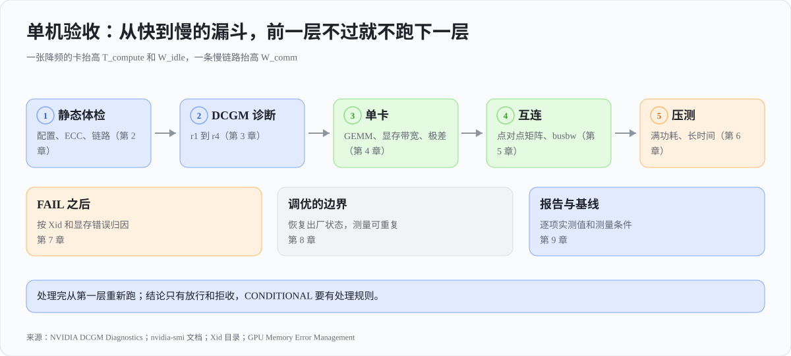
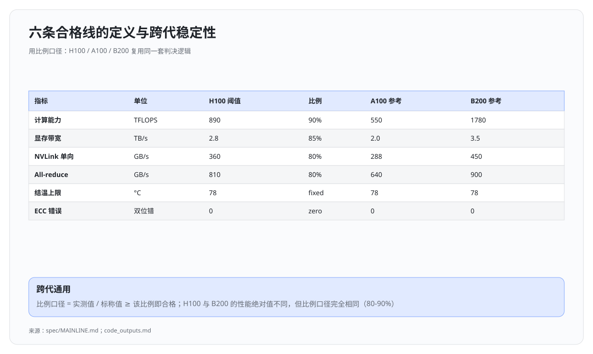
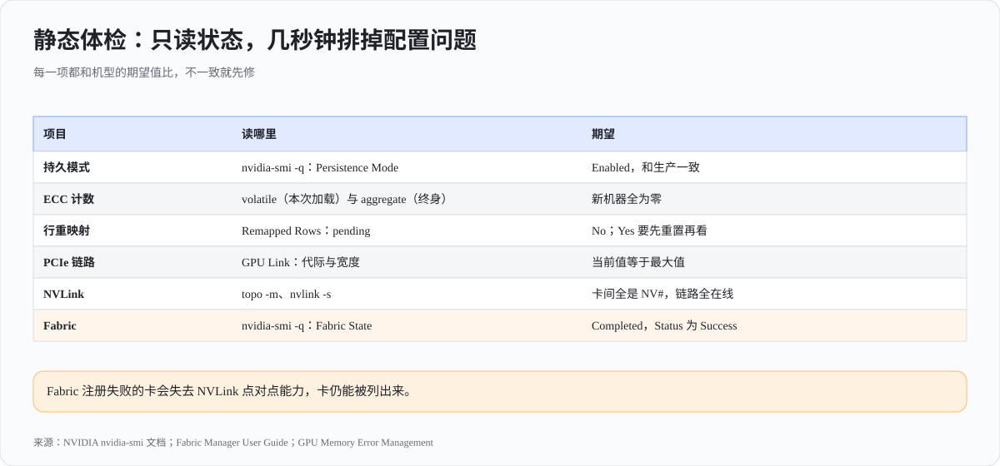
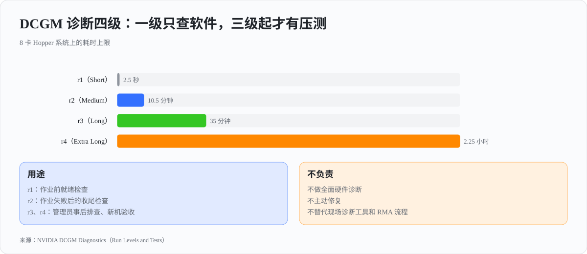
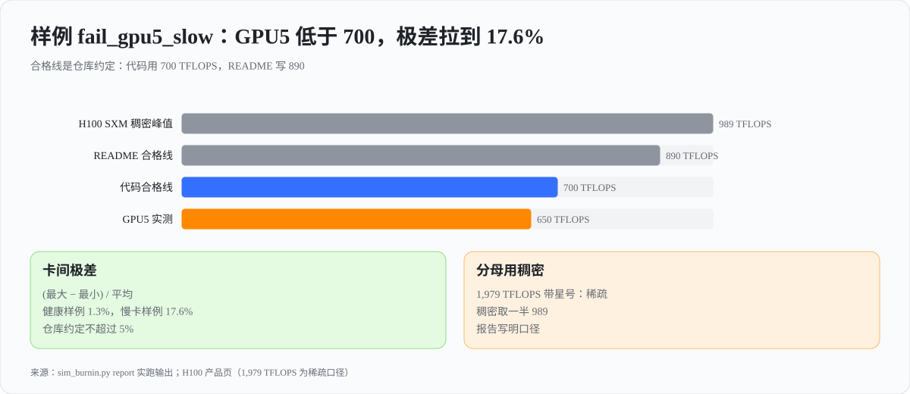
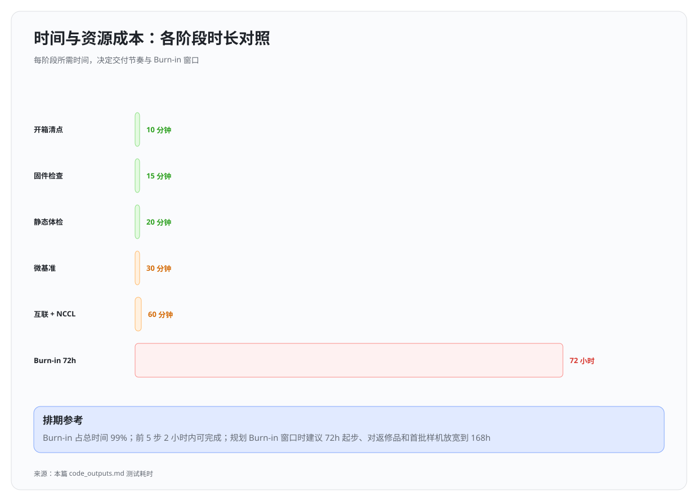
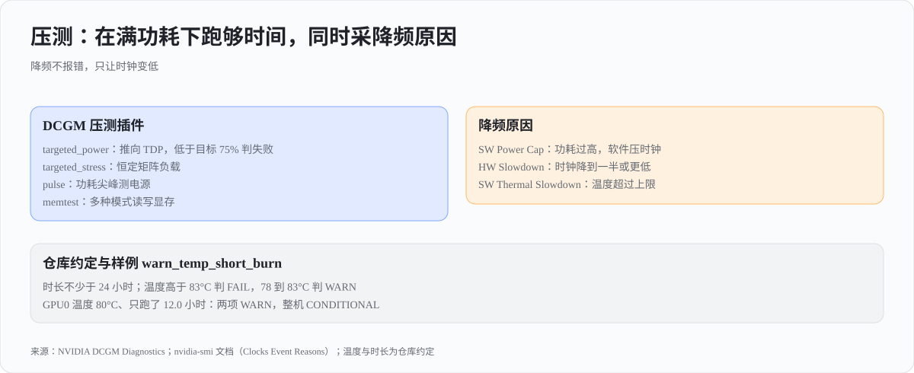
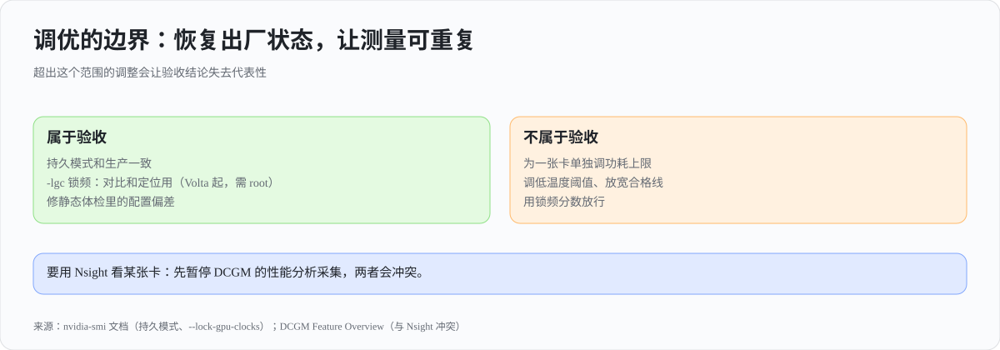
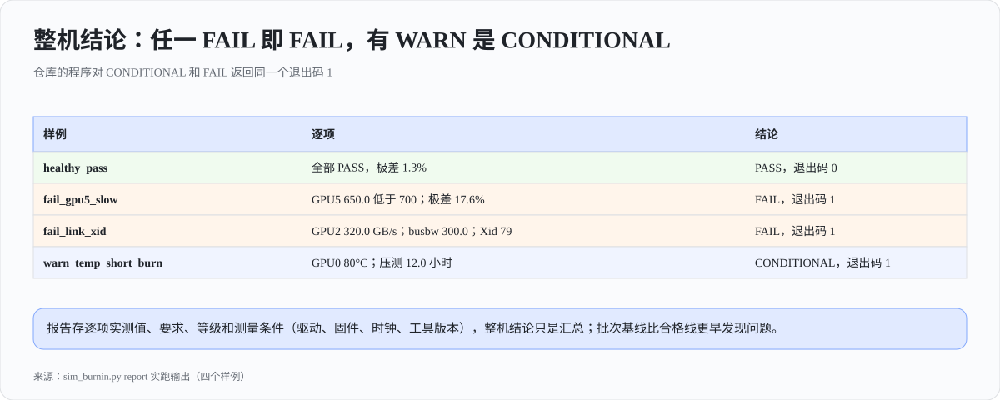

# GPU-16｜单机｜单机验收与调优

> 🎯 **这篇文档解决什么问题**：一台 8 卡 GPU 机器到货或修完，要判断它能不能接生产作业。多卡作业按最慢的卡和最慢的链路走，所以验收要逐卡、逐链路地查。本篇按 NVIDIA 的 DCGM 诊断、nvidia-smi、Xid 目录和显存错误管理文档，把单机验收排成一个从快到慢的漏斗：静态体检、DCGM 诊断、单卡微基准、互连、压测，再讲 FAIL 之后怎样归因、调优的边界在哪里，以及怎样写报告、建基线。

**使用方式**：第 1 章讲验收要回答什么。第 2 到 6 章按漏斗顺序讲各层检查。第 7 章讲 FAIL 之后的归因，第 8 章讲调优的边界，第 9 章讲报告和基线，第 10 章给清单和自测。

**代码**：zero-to-gpu/16-node-burnin/ 下的 sim_burnin.py、make_samples.py、test_burnin.py 只需 Python 标准库，判定程序读 JSON 观测数据输出逐项结论。README 和代码的 BF16 合格线不一致、CONDITIONAL 的退出码和说明不符，第 10 章逐条说明。

<b>🧭 主线位置</b>：GPU-00（[GPU-00｜索引｜从 0 开始 GPU 优化：路线、章节与练习](./README.md)）建立了时间账 T = T_compute + W_mem + W_host + W_comm + W_idle。前面的篇目分别处理了账上的各项，GPU-15（[GPU-15｜单机｜PyTorch 运行时](./15-runtime.md)）处理了运行时开销。本篇在机器上线前检查：一张降频的卡会抬高 T_compute 和 W_idle，一条慢链路会抬高 W_comm。单机验收之后，多机之间的网络交给 GPU-17（[GPU-17｜集群｜RDMA 网络：InfiniBand、RoCE 与拥塞控制](./17-rdma.md)）。

## 导读 · 先给结论

- <b>最慢的卡决定整机。</b>环形 all-reduce 按最慢的一跳走，验收看最小值和卡间极差（第 1 章）。[[1]](https://github.com/NVIDIA/nccl-tests/blob/master/doc/PERFORMANCE.md)
- <b>先读状态再加负载。</b>持久模式、ECC、PCIe 代际和宽度、NVLink、Fabric State 几秒钟就能查完（第 2 章）。[[2]](https://docs.nvidia.com/deploy/nvidia-smi/index.html)[[3]](https://docs.nvidia.com/datacenter/tesla/fabric-manager-user-guide/index.html)
- <b>DCGM 诊断分四级。</b>8 卡 Hopper 上最长 2.25 小时；一级只查软件，三级起才有压测和通信测试（第 3 章）。[[4]](https://docs.nvidia.com/datacenter/dcgm/latest/user-guide/dcgm-diagnostics.html)
- <b>单卡和规格比，也和邻居比。</b>H100 SXM 稠密 BF16 峰值是 1,979 的一半；一张慢卡会把极差拉到 17.6%（第 4 章）。[[5]](https://www.nvidia.com/en-us/data-center/h100/)
- <b>互连和每方向 450 GB/s 比。</b>点对点矩阵定位链路，busbw 确认整个环（第 5 章）。[[6]](https://developer.nvidia.com/blog/nvidia-hopper-architecture-in-depth/)[[1]](https://github.com/NVIDIA/nccl-tests/blob/master/doc/PERFORMANCE.md)
- <b>降频不报错。</b>压测要同时采 SW Power Cap、HW Slowdown 和 SW Thermal Slowdown（第 6 章）。[[2]](https://docs.nvidia.com/deploy/nvidia-smi/index.html)[[4]](https://docs.nvidia.com/datacenter/dcgm/latest/user-guide/dcgm-diagnostics.html)
- <b>FAIL 按 Xid 和显存错误归因。</b>79 多半是 PCIe 链路；行重映射要重置才生效，返修由现场诊断工具判定（第 7 章）。[[7]](https://docs.nvidia.com/deploy/xid-errors/analyzing-xid-catalog.html)[[8]](https://docs.nvidia.com/deploy/a100-gpu-mem-error-mgmt/rma-policy-thresholds-for-row-remapping.html)

<b>📎 与系列其他文档的分工</b>：GPU-02（[GPU-02｜硬件｜性能账本：Roofline、算术强度与三类瓶颈](./02-ledger.md)）讲矩阵乘为什么达不到峰值，本篇的单卡合格线以它为背景。GPU-09（[GPU-09｜系统｜驱动、CUDA 兼容与 Xid](./09-driver.md)）讲驱动、CUDA 兼容和 Xid 的来源，本篇只用 Xid 做归因。GPU-11（[GPU-11｜系统｜PCIe、NUMA 与 GPUDirect](./11-pcie-gdr.md)）讲 PCIe 链路，静态体检里的代际和宽度在那里展开。GPU-13（[GPU-13｜单机｜NVLink 与 NVSwitch](./13-nvlink.md)）讲 NVLink、NVSwitch 和 nccl-tests，本篇把它们用在验收上。GPU-14（[GPU-14｜单机｜性能分析与 Profiling](./14-profiling.md)）讲 DCGM 指标和 Nsight。GPU-20（[GPU-20｜集群｜可靠性与可观测：故障、静默错误与 checkpoint](./20-reliability.md)）讲集群层面的故障和容错。

## 第 1 章 · 单机验收要回答什么

前面几篇讲了单卡、显存、互连和运行时。一台新的 8 卡机器到货，或者一台机器修完回到资源池，要先回答一个问题：它能不能接生产作业。单机验收就是把这个问题拆成一组可以测、可以判的检查。本章说明为什么要逐卡、逐链路地查，以及整个流程的顺序。

### 一块慢卡拖慢整台机器

多卡训练每一步都要做集合通信。GPU-13 讲过，环形 all-reduce 按最慢的一跳走[[1]](https://github.com/NVIDIA/nccl-tests/blob/master/doc/PERFORMANCE.md)；同样，数据并行里每一步要等最慢的那张卡算完。所以一台 8 卡机器的速度由最差的那张卡、最差的那条链路决定，整机的平均值没有意义。一张卡降频、一条 NVLink 掉线，在整机跑分里可能只表现为几个百分点的下降，到了训练作业里却会拖慢每一步。

这决定了验收的两个原则：其一，逐卡、逐链路记录，看最小值和卡间差异，不只看平均；其二，结论只有两种：放行或拒收。介于两者之间的情况要有明确的处理办法，例如延长压测或换件后复测。

### 从快到慢的漏斗

验收按耗时从短到长排：静态体检几秒钟就能排掉驱动、配置和链路状态的问题（第 2 章）；DCGM 诊断分四级，8 卡 Hopper 系统上最长的一级在 2.25 小时以内[[4]](https://docs.nvidia.com/datacenter/dcgm/latest/user-guide/dcgm-diagnostics.html)（第 3 章）；然后是单卡微基准和互连测试（第 4、5 章），最后是长时间压测（第 6 章）。前一层不过，后一层就不必跑。出了问题按 Xid 和显存错误归因（第 7 章）。

按五步闭环做单机验收：

- **定天花板**：机型规格和同批次健康机器的基线。
- **测实际**：逐卡、逐链路的体检、诊断、基准和压测结果。
- **定位等待**：哪张卡、哪条链路、哪个部件拖了后腿。
- **消除或隐藏**：换件、修配置，不能修的拒收。
- **复测**：修完从漏斗的第一层重新跑。

一个常见的误区是用整机的平均跑分做验收。现象是机器通过了验收，上线后训练作业的步时间比同型号机器慢一截。原因是一张降频的卡或一条掉线的链路被平均值掩盖了，而训练要等最慢的那一张。改法是逐卡、逐链路记录，用最小值和卡间差异判定。

> 🔑 **本章要点**：多卡作业按最慢的卡和最慢的链路走，所以验收要逐卡、逐链路看最小值和卡间差异，结论只有放行和拒收。流程按耗时从短到长排成漏斗：静态体检、DCGM 诊断、微基准、互连、长时间压测。这一章是五步闭环的“定天花板”：先定下要比的基线。

## 第 2 章 · 静态体检：几秒钟排掉配置问题

很多“性能问题”其实是配置问题：驱动没装对、持久模式没开、PCIe 链路降速、NVLink 少了一条、Fabric Manager 没起来。这些不需要跑负载，读几条命令的输出就能发现。本章列出要读的项目和判断方法。

### 要读的项目

- **持久模式**：打开后，即使没有活动的客户端，NVIDIA 驱动也保持加载[[2]](https://docs.nvidia.com/deploy/nvidia-smi/index.html)，省掉每次启动程序时的驱动加载延迟。在 nvidia-smi -q 里看 Persistence Mode 是否为 Enabled。
- **ECC 计数**：分两种，volatile 计数记录自上次驱动加载以来的错误，aggregate 计数永久保留，相当于整个寿命的累计[[2]](https://docs.nvidia.com/deploy/nvidia-smi/index.html)。新机器两者都应为零；修回来的机器重点看 aggregate 里不可纠正的错误。
- **行重映射**：显存每个 bank 都有备用行[[9]](https://docs.nvidia.com/deploy/a100-gpu-mem-error-mgmt/row-remapping.html)，出错的行会被映射到备用行，这个过程要在 GPU 重置后才生效，并且永久保留[[9]](https://docs.nvidia.com/deploy/a100-gpu-mem-error-mgmt/row-remapping.html)。如果看到 pending 标志，表示下次重置时会发生重映射[[10]](https://docs.nvidia.com/deploy/a100-gpu-mem-error-mgmt/error-recovery-and-response-flags.html)，验收前要先重置再看结果。
- **PCIe 链路**：nvidia-smi -q 的 GPU Link 信息给出 PCIe 链路的代际和宽度[[2]](https://docs.nvidia.com/deploy/nvidia-smi/index.html)，当前值要等于最大值。降代或降宽的卡，主机和 GPU 之间的拷贝会变慢（GPU-11）。
- **拓扑和 NVLink**：nvidia-smi topo -m 里 GPU 之间应该全是 NV#，nvidia-smi nvlink -s 每条链路都在线（GPU-13 第 4 章）。
- **Fabric 状态**：NVSwitch 机器上每张卡的 Fabric State 应为 Completed、Status 为 Success[[3]](https://docs.nvidia.com/datacenter/tesla/fabric-manager-user-guide/index.html)；注册失败的卡会失去 NVLink 点对点能力[[3]](https://docs.nvidia.com/datacenter/tesla/fabric-manager-user-guide/index.html)。

### 写成脚本，开机即查

这些检查都只读，可以写成一个脚本在机器开机后自动跑，结果和机型的期望值比对。DCGM 的一级诊断也覆盖了其中一部分，例如软件库版本、待退休的页、PCIe 和 NVLink 接口检查[[4]](https://docs.nvidia.com/datacenter/dcgm/latest/user-guide/dcgm-diagnostics.html)。

按五步闭环做静态体检：

- **定天花板**：机型说明书上的链路代际、宽度、NVLink 条数。
- **测实际**：nvidia-smi -q、topo -m、nvlink -s、Fabric State。
- **定位等待**：和期望值不一致的卡和链路。
- **消除或隐藏**：重新安装驱动、开持久模式、重插或换件、重启 Fabric Manager 并重置 GPU。
- **复测**：所有项目和期望值一致后再进下一层。

一个常见的误区是只看 nvidia-smi 能不能列出 8 张卡。现象是 8 张卡都在，压测也没报错，训练速度却偏低。原因是某张卡的 PCIe 链路降成了低代或窄宽，或者某条 NVLink 不在线，这些都不影响卡被列出来。改法是逐项比对链路代际、宽度、NVLink 状态和 Fabric State。

> 🔑 **本章要点**：静态体检只读、几秒钟完成：持久模式、ECC 的 volatile 和 aggregate 计数、行重映射与 pending 标志、PCIe 代际和宽度、topo -m 与 nvlink -s、Fabric State。逐项和机型期望值比对，不一致就先修。这一章是五步闭环的“测实际”：先排掉不用跑负载就能发现的问题。

## 第 3 章 · DCGM 诊断：四个级别各管什么

静态体检只读状态，不给 GPU 加负载。下一层是 NVIDIA 的 DCGM 诊断（dcgmi diag），它按级别跑一组插件，从软件环境查到显存、互连和功耗。本章说明四个级别的耗时、包含的插件和判失败的条件，以及它不负责什么。

### 四个级别

DCGM 文档给出了每个级别的用途：一级当作就绪检查，二级在作业失败后当收尾检查，三级和四级由管理员在事后排查时运行[[4]](https://docs.nvidia.com/datacenter/dcgm/latest/user-guide/dcgm-diagnostics.html)。耗时是在 Hopper 系统上测得的上限[[4]](https://docs.nvidia.com/datacenter/dcgm/latest/user-guide/dcgm-diagnostics.html)，8 卡机器上一级小于 2.5 秒，二级小于 10.5 分钟，三级小于 35 分钟，四级小于 2.25 小时[[4]](https://docs.nvidia.com/datacenter/dcgm/latest/user-guide/dcgm-diagnostics.html)。

| 级别 | 8 卡 Hopper 耗时上限 | 包含的插件 |
|---|---|---|
| r1（Short） | 2.5 秒 | software |
| r2（Medium） | 10.5 分钟 | software、pcie、memory、memory_bandwidth |
| r3（Long） | 35 分钟 | 以上，加 diagnostic、targeted_stress、targeted_power、nvbandwidth、nccl_tests |
| r4（Extra Long） | 2.25 小时 | 以上，加 memtest、pulse |

表里的插件对应后面几章：pcie 插件检查点对点传输的正确性以及写数据时的错误和重传[[4]](https://docs.nvidia.com/datacenter/dcgm/latest/user-guide/dcgm-diagnostics.html)（第 5 章），memory_bandwidth 插件测每张卡读写自己显存的速度[[4]](https://docs.nvidia.com/datacenter/dcgm/latest/user-guide/dcgm-diagnostics.html)（第 4 章），targeted_power、targeted_stress、pulse 和 memtest 属于压测（第 6 章）。用 -r 也可以只跑指定的插件，例如把 PCIe 和 Diagnostic 两项放在一起跑[[4]](https://docs.nvidia.com/datacenter/dcgm/latest/user-guide/dcgm-diagnostics.html)。

### 判失败的条件和覆盖不到的地方

压测类插件在测试期间出现不可恢复的显存错误、温度越限或 Xid，就判失败[[4]](https://docs.nvidia.com/datacenter/dcgm/latest/user-guide/dcgm-diagnostics.html)。整套诊断覆盖的面包括：待退休的页、PCIe 和 NVLink 接口、显存、计算引擎[[4]](https://docs.nvidia.com/datacenter/dcgm/latest/user-guide/dcgm-diagnostics.html)，以及 PCIe 重传计数、拓扑限制、权限和驱动、cgroups 检查[[4]](https://docs.nvidia.com/datacenter/dcgm/latest/user-guide/dcgm-diagnostics.html)。

文档也写明了它不做的事：不提供全面的硬件诊断，不主动修复问题，不替代现场诊断工具[[4]](https://docs.nvidia.com/datacenter/dcgm/latest/user-guide/dcgm-diagnostics.html)，也不处理 RMA 流程。所以 DCGM 报出问题后，要不要返修由厂商的现场诊断工具判定（第 7 章）。

按五步闭环用 DCGM 诊断：

- **定天花板**：各插件自带的判定标准。
- **测实际**：新机器跑 r3 或 r4，日常就绪检查跑 r1。
- **定位等待**：失败插件的名字和它报出的卡号。
- **消除或隐藏**：按失败类别进第 4 到 7 章的处理。
- **复测**：处理后重跑失败的那个插件，再跑完整级别。

一个常见的误区是只在新机器上跑一级诊断就上线。现象是 r1 通过，但上线后跑满功耗时出现降频或 Xid。原因是一级只包含 software 插件，不加负载，显存、互连、功耗都没有测。改法是验收用 r3 或 r4，r1 留给作业启动前的就绪检查。

> 🔑 **本章要点**：DCGM 诊断有四个级别，8 卡 Hopper 上耗时上限分别是 2.5 秒、10.5 分钟、35 分钟、2.25 小时；一级只查软件，三级起才有压测、nvbandwidth 和 nccl_tests。它不替代厂商的现场诊断，返修要另行判定。这一章是五步闭环的“测实际”：用标准工具给每张卡出一份体检结果。

## 第 4 章 · 单卡微基准：和规格比，也和邻居比

诊断通过说明硬件没有坏，但没有说明每张卡跑得有多快。单卡微基准用大矩阵乘和显存带宽测试给每张卡打一个分，再把 8 张卡放在一起比。本章说明比什么、和谁比，以及仓库的合格线从哪里来。

### 两把尺子：规格和同机的其他卡

第一把尺子是规格。H100 SXM 的 BF16 Tensor Core 峰值标为 1,979 TFLOPS，星号注明这是稀疏口径[[5]](https://www.nvidia.com/en-us/data-center/h100/)，稠密矩阵乘按一半算是 989 TFLOPS；显存是 80 GB、带宽 3.35 TB/s[[5]](https://www.nvidia.com/en-us/data-center/h100/)。实测的 GEMM 达不到峰值，GPU-02 讲过原因，所以合格线一般取峰值的一个比例。DCGM 的 memory_bandwidth 插件测的就是每张卡读写自己显存的速度[[4]](https://docs.nvidia.com/datacenter/dcgm/latest/user-guide/dcgm-diagnostics.html)，可以直接和 3.35 TB/s 对比。

第二把尺子是同一台机器的其他卡。同型号、同批次的 8 张卡应该跑出几乎一样的分数，一张卡明显低于其他卡，多半是这张卡降频、散热或供电有问题，即使它仍高于规格比例线。仓库的代码用卡间极差衡量：（最大值 − 最小值） / 平均值。

| 项目 | H100 SXM 规格 | 仓库的合格线 | 线的来源 |
|---|---|---|---|
| BF16 GEMM | 1,979 TFLOPS（稀疏），稠密 989 | README 写 890，代码用 700 | 仓库约定 |
| HBM 带宽 | 3.35 TB/s | 标称的 85%，约 2.85 TB/s | 仓库约定 |
| HBM 容量 | 80 GB | 标称的 98% | 仓库约定 |
| 卡间极差 | 无 | ≤ 5% | 仓库约定 |

表里的合格线都是仓库自己的约定，NVIDIA 没有给出验收比例。README 写 BF16 线是 890 TFLOPS，即 989 的九成；代码里实际用的是 700 TFLOPS，注释说它约为 GPU-02 里一个 786 TFLOPS 参考值的 89%，这两个数不一致，第 10 章列为代码问题。

### 样例：一张慢卡两项都不过

仓库的 fail_gpu5_slow 样例里，GPU5 的 BF16 实测 650.0 TFLOPS，低于代码的 700 合格线；8 张卡的极差因此变成 17.6%，远超 5% 的线。结论是 FAIL，退出码 1。健康样例的极差是 1.3%。两项同时报出，说明问题集中在一张卡上，下一步看这张卡的时钟、温度和降频原因（第 6 章）。

按五步闭环做单卡微基准：

- **定天花板**：规格表的稠密峰值和显存带宽，以及同批次健康机器的分数。
- **测实际**：每张卡的 GEMM TFLOPS、显存带宽、可用容量。
- **定位等待**：低于比例线的卡，以及拉大极差的那张卡。
- **消除或隐藏**：查这张卡的降频原因，换件或拒收。
- **复测**：处理后重测整台机器，确认极差回到线内。

一个常见的误区是拿稀疏口径的 1,979 TFLOPS 当分母。现象是实测稠密 GEMM 只有“峰值的四成多”，被误判为整批机器不合格。原因是星号注明了稀疏，稠密峰值是一半。改法是分母用 989，并在报告里写明口径。

> 🔑 **本章要点**：单卡微基准用两把尺子：规格的稠密峰值和显存带宽，以及同机其他卡的分数。比例线是仓库约定，代码用 700 TFLOPS 而 README 写 890；卡间极差能把一张慢卡挑出来，样例里 17.6% 远超 5%。这一章是五步闭环的“定位等待”：找出拖后腿的那一张卡。

## 第 5 章 · 互连：逐条链路测，再测集合通信

单卡都合格，多卡作业仍可能慢在互连上。GPU-13 讲了 NVLink、NVSwitch 和测量工具，本章把它们用在验收上：先逐对测点对点带宽，再测整机的 all-reduce，两项都和链路的单向带宽比。

### 点对点矩阵

H100 的 NVLink 总带宽是 900 GB/s[[6]](https://developer.nvidia.com/blog/nvidia-hopper-architecture-in-depth/)，这是双向合计，每个方向 450 GB/s。nvbandwidth 可以用 -p device_to_device 只跑卡与卡之间的拷贝[[11]](https://github.com/NVIDIA/nvbandwidth)，输出一张 8 × 8 的矩阵。验收时看矩阵里的最小值，以及有没有某一行或某一列整体偏低：一行偏低指向一张卡，单个格子偏低指向一条路径。

仓库的合格线是单向带宽的八成，即 360 GB/s。它的 fail_link_xid 样例里，GPU2 的点对点带宽实测 320.0 GB/s，低于 360，判 FAIL。DCGM 的 pcie 插件同时检查点对点传输的正确性和传输中的错误、重传[[4]](https://docs.nvidia.com/datacenter/dcgm/latest/user-guide/dcgm-diagnostics.html)，带宽和正确性要分开看。

NVSwitch 机器还要确认 Fabric State。注册失败的卡会失去 NVLink 点对点能力[[3]](https://docs.nvidia.com/datacenter/tesla/fabric-manager-user-guide/index.html)，这时点对点矩阵里这张卡的一行会掉到 PCIe 的水平，和链路降速的表现不同。

### all-reduce 的总线带宽

nccl-tests 输出的 busbw 由 algbw 乘以 2(n−1)/n 得到[[1]](https://github.com/NVIDIA/nccl-tests/blob/master/doc/PERFORMANCE.md)，它应该反映硬件瓶颈的速度[[1]](https://github.com/NVIDIA/nccl-tests/blob/master/doc/PERFORMANCE.md)，所以可以和链路的单向带宽直接比。仓库用同样的 360 GB/s 做合格线。fail_link_xid 样例的 busbw 是 300.0 GB/s，也不过；GPU2 那条慢链路拖住了整个环，这正是第 1 章说的最慢一跳。

DCGM 的三级和四级诊断已经包含 nvbandwidth 和 nccl_tests 两个插件[[4]](https://docs.nvidia.com/datacenter/dcgm/latest/user-guide/dcgm-diagnostics.html)，可以作为第一遍；需要逐个消息大小看曲线时，再单独跑 nccl-tests。

按五步闭环测互连：

- **定天花板**：每个方向 450 GB/s，合格线按约定取比例。
- **测实际**：nvbandwidth 的点对点矩阵，nccl-tests 的 busbw 曲线。
- **定位等待**：矩阵里偏低的行、列或格子，对应到卡和链路。
- **消除或隐藏**：查 nvlink -s 和 Fabric State，重插或换件。
- **复测**：矩阵最小值和 busbw 都回到线上。

一个常见的误区是只跑 all-reduce，不看点对点矩阵。现象是 busbw 偏低，但不知道是哪张卡、哪条链路。原因是 all-reduce 只给出整个环的一个数，最慢的一跳被摊进了总时间。改法是先跑点对点矩阵定位，再用 all-reduce 确认整体。

> 🔑 **本章要点**：互连验收和每方向 450 GB/s 比：nvbandwidth 的点对点矩阵定位到卡和链路，nccl-tests 的 busbw 确认整个环；仓库两项合格线都是 360 GB/s。Fabric 注册失败会让一张卡退回 PCIe。这一章是五步闭环的“定位等待”：把慢链路找出来。

## 第 6 章 · 压测：在满功耗下跑够时间

微基准每项只跑几分钟，有些问题要在满功耗、长时间之后才出现：散热不足导致降频，电源扛不住功耗尖峰，显存在高温下出错。压测就是把这些条件造出来。本章说明 DCGM 的压测插件各测什么、怎样读降频原因，以及仓库对时长和温度的约定。

### 压测插件

| 插件 | 做什么 | 暴露的问题 |
|---|---|---|
| targeted_power | 把功耗推向 TDP 并保持；达不到目标功耗的 75% 判失败 | 供电、散热、功耗墙 |
| targeted_stress | 持续排队矩阵运算，调节负载达到目标性能 | 持续负载下的降频 |
| diagnostic | 大矩阵乘的同时往显存各处写数据并读回校验 | 计算和显存的正确性 |
| pulse | 让功耗剧烈波动，制造电流尖峰 | 电源能否承受瞬变 |
| memtest | 用多种模式读写显存，类似 memtest86 | 显存单元故障 |

表中各项的说明都来自 DCGM 文档：targeted_power 的目标是把 GPU 推向 TDP 并在整个测试中保持[[4]](https://docs.nvidia.com/datacenter/dcgm/latest/user-guide/dcgm-diagnostics.html)，判定线默认是目标功耗的 75%，目标功耗默认为 TDP 减 1[[4]](https://docs.nvidia.com/datacenter/dcgm/latest/user-guide/dcgm-diagnostics.html)；targeted_stress 持续排队矩阵运算并调节负载[[4]](https://docs.nvidia.com/datacenter/dcgm/latest/user-guide/dcgm-diagnostics.html)；diagnostic 插件做大矩阵乘的同时往显存各个地址写数据并检查能否读回[[4]](https://docs.nvidia.com/datacenter/dcgm/latest/user-guide/dcgm-diagnostics.html)；pulse 让功耗波动以制造电流尖峰，检查电源是否完全正常[[4]](https://docs.nvidia.com/datacenter/dcgm/latest/user-guide/dcgm-diagnostics.html)；memtest 和 memtest86 类似，用多种模式读写显存[[4]](https://docs.nvidia.com/datacenter/dcgm/latest/user-guide/dcgm-diagnostics.html)。测试期间出现不可恢复的显存错误、温度越限或 Xid，都判失败[[4]](https://docs.nvidia.com/datacenter/dcgm/latest/user-guide/dcgm-diagnostics.html)。

### 读降频原因

压测时要同时采集时钟和降频原因。nvidia-smi -q 的 Clocks Event Reasons 里有几项和验收直接相关：SW Power Cap 表示功耗太高，软件把时钟压到请求值以下[[2]](https://docs.nvidia.com/deploy/nvidia-smi/index.html)；HW Slowdown 表示硬件降速，核心时钟降到一半甚至更低[[2]](https://docs.nvidia.com/deploy/nvidia-smi/index.html)；SW Thermal Slowdown 表示温度超过最高工作温度，软件压低时钟[[2]](https://docs.nvidia.com/deploy/nvidia-smi/index.html)。满负载下偶尔出现 SW Power Cap 属于正常调节，HW Slowdown 和温度降频出现在验收里就要追查散热和供电。

仓库对压测的约定是：时长不少于 24 小时，期间掉卡、ECC 双位错误、降频事件、通信失败的计数全为零；温度高于 83°C 判 FAIL，78 到 83°C 之间判 WARN。这些数字都是仓库约定，不同机型的温度上限要查厂商的规格。warn_temp_short_burn 样例里，GPU0 温度 80°C、压测只跑了 12.0 小时，两项 WARN，整机结论是 CONDITIONAL。

按五步闭环做压测：

- **定天花板**：TDP、温度上限和约定的时长。
- **测实际**：r4 的压测插件，加上长时间的训练类负载，同时采时钟、温度、功耗和降频原因。
- **定位等待**：哪张卡先降频，降频原因是功耗、硬件还是温度。
- **消除或隐藏**：查风道、散热、电源，换件。
- **复测**：重跑完整时长，不能只补跑剩下的小时数。

一个常见的误区是压测时只看有没有报错。现象是压测通过，上线后同一张卡的作业比其他卡慢。原因是降频不报错，只让时钟变低。改法是压测期间按秒采时钟和降频原因，把 HW Slowdown 和温度降频列为验收项。

> 🔑 **本章要点**：压测在满功耗和长时间下暴露散热、供电和显存问题：targeted_power 推向 TDP，pulse 制造功耗尖峰，memtest 查显存。降频不报错，要同时采 SW Power Cap、HW Slowdown 和 SW Thermal Slowdown。24 小时和 83°C 是仓库约定。这一章是五步闭环的“测实际”：在接近生产的条件下测。

## 第 7 章 · FAIL 之后：按 Xid 和显存错误归因

验收报出 FAIL，下一步是判断问题出在哪个部件、能不能现场修。驱动把 GPU 的错误以 Xid 的形式写进内核日志，NVIDIA 的 Xid 目录给出每个编号的含义和建议处理；显存错误另有行重映射和返修门槛。本章把两者整理成验收能用的判断表。

### 常见的 Xid

| Xid | 含义 | 目录建议的处理 | 验收里怎样判 |
|---|---|---|---|
| 48 | 双位 ECC 错误，GPU 检测到不可纠正错误 | WORKFLOW_XID_48（按专门流程处理） | 拒收，查显存 |
| 63 | 显存行重映射事件 | IGNORE | 记录，查重映射计数 |
| 64 | 显存行重映射失败 | RESET_GPU，CONTACT_SUPPORT | 拒收，联系厂商 |
| 74 | 到其他 GPU 或 NVSwitch 的 NVLink 连接出问题 | WORKFLOW_NVLINK_ERR，CONTACT_SUPPORT | 查链路，复测互连 |
| 79 | GPU 从总线上掉了 | RESTART_BM，CONTACT_SUPPORT | 拒收，查 PCIe 链路 |
| 94 | 被隔离的显存错误 | RESTART_APP | 记录，看是否反复出现 |
| 95 | 未被隔离的显存错误 | RESET_GPU | 拒收，查显存 |
| 119、120 | GSP RPC 超时、GSP 错误 | RESET_GPU，INVESTIGATE_SW | 重置后复测，同时查驱动版本 |

表中的含义和建议处理来自 Xid 目录[[7]](https://docs.nvidia.com/deploy/xid-errors/analyzing-xid-catalog.html)。Xid 79 的说明指出它常由 PCI Express 链路上的硬件故障引起[[7]](https://docs.nvidia.com/deploy/xid-errors/analyzing-xid-catalog.html)，所以除了换卡，还要查转接卡、线缆和主板插槽。Xid 74 也可能是链路远端的设备出了问题[[7]](https://docs.nvidia.com/deploy/xid-errors/analyzing-xid-catalog.html)，一张卡故障时，与它相连的另一张卡也会报 74，归因时要两端一起看。目录里的建议处理会随驱动版本更新，验收时按当时的驱动版本查原文。

仓库把 48、64、79、95、119、120 列为致命 Xid，零容忍；把 13、31、43、45、63、74、92、94 列为告警。对照目录，119 和 120 建议的处理是重置 GPU 并排查软件[[7]](https://docs.nvidia.com/deploy/xid-errors/analyzing-xid-catalog.html)，归为“需要返修”偏重；74 的建议是联系厂商[[7]](https://docs.nvidia.com/deploy/xid-errors/analyzing-xid-catalog.html)，只记告警又偏轻。验收可以沿用仓库的分组，但判拒收前要按目录的建议处理复核。

### 显存错误：行重映射和返修门槛

HBM 每个 bank 都有硬件备用行[[9]](https://docs.nvidia.com/deploy/a100-gpu-mem-error-mgmt/row-remapping.html)。出错的行被映射到备用行，这要在 GPU 重置后才生效，并且在 GPU 的整个寿命里保留[[9]](https://docs.nvidia.com/deploy/a100-gpu-mem-error-mgmt/row-remapping.html)。验收时看 nvidia-smi -q 的 Remapped Rows：pending 标志表示下次重置时会发生重映射[[10]](https://docs.nvidia.com/deploy/a100-gpu-mem-error-mgmt/error-recovery-and-response-flags.html)，要先重置再复测；发生过重映射的卡要看累计次数。

要不要返修由 NVIDIA 的现场诊断工具判定[[8]](https://docs.nvidia.com/deploy/a100-gpu-mem-error-mgmt/rma-policy-thresholds-for-row-remapping.html)。文档给出了几条门槛，例如一个 bank 已经有 8 行因不可纠正错误被重映射后，再次重映射会失败[[8]](https://docs.nvidia.com/deploy/a100-gpu-mem-error-mgmt/rma-policy-thresholds-for-row-remapping.html)；不可纠正错误累计重映射达到 512 次[[8]](https://docs.nvidia.com/deploy/a100-gpu-mem-error-mgmt/rma-policy-thresholds-for-row-remapping.html)。DCGM 诊断不替代现场诊断工具[[4]](https://docs.nvidia.com/datacenter/dcgm/latest/user-guide/dcgm-diagnostics.html)，所以 DCGM 报显存问题后，要用现场诊断工具确认，再走返修。

按五步闭环归因：

- **定天花板**：Xid 目录和返修门槛。
- **测实际**：内核日志里的 Xid、ECC 计数、Remapped Rows。
- **定位等待**：按 Xid 编号对应到显存、PCIe、NVLink 或软件。
- **消除或隐藏**：重置、换件，达到门槛的走返修。
- **复测**：处理后从静态体检重新开始。

一个常见的误区是重置 GPU 后错误消失就放行。现象是一张卡报过 Xid 95，重置后诊断通过，上线几天后又出现。原因是重置让 pending 的行重映射生效，掩盖了显存在持续出错。改法是记录每次 Xid 和重映射计数，同一张卡重复出现就拒收并走现场诊断。

> 🔑 **本章要点**：FAIL 之后按 Xid 目录归因：79 多半是 PCIe 链路，64 和 95 要重置并联系厂商，63 和 94 记录并观察。显存行重映射要重置才生效且永久保留，返修由现场诊断工具按门槛判定。这一章是五步闭环的“消除或隐藏”：判断修、换还是返修。

## 第 8 章 · 调优的边界：让测量可重复，不为过线而调

验收里的“调优”和作业调优不同。作业调优是让程序跑得更快；验收调优只做两件事：把机器调到出厂应有的状态，以及让测量结果可以重复。超出这个范围的调整，例如为了过线去改功耗设置，会让验收失去意义。本章说明哪些调整属于验收，哪些不属于。

### 属于验收的调整

- **持久模式**：打开后驱动在没有客户端时也保持加载[[2]](https://docs.nvidia.com/deploy/nvidia-smi/index.html)，每次启动测试程序不再等驱动初始化，测量结果更稳定。生产机器一般也打开，验收时要和生产保持一致。
- **锁定时钟做对比测试**：nvidia-smi 的 --lock-gpu-clocks=MIN_GPU_CLOCK,MAX_GPU_CLOCK（-lgc）可以把 GPU 时钟锁在一个区间[[2]](https://docs.nvidia.com/deploy/nvidia-smi/index.html)，从 Volta 起支持，需要 root[[2]](https://docs.nvidia.com/deploy/nvidia-smi/index.html)。比较两张卡、两次修复前后时，锁定时钟可以排除动态调频带来的波动。正式的性能分数仍要在生产使用的时钟设置下测，否则分数和上线后的表现对不上。
- **修配置偏差**：静态体检里和机型期望值不一致的项目（第 2 章），例如持久模式没开、Fabric Manager 没起来，修好属于恢复出厂状态。

### 不属于验收的调整

为了让一张卡过线而单独调高它的功耗上限、调低温度阈值、或者放宽合格线，都会让这张卡和同机其他卡处在不同的条件下，验收结论就不能代表它上线后的表现。合格线本身可以改，但要对整批机器统一改，写清理由，并记录在基线里（第 9 章）。

测量工具之间也会互相干扰。DCGM 采集性能分析指标时，会和 Nsight Systems、Nsight Compute 等开发工具冲突[[12]](https://docs.nvidia.com/datacenter/dcgm/latest/user-guide/feature-overview.html)；验收期间要用 Nsight 看某张卡的细节，先暂停 DCGM 的性能分析采集（GPU-14 第 8 章）。

按五步闭环划清调优边界：

- **定天花板**：出厂配置和生产使用的设置。
- **测实际**：当前配置和期望值的差异。
- **定位等待**：哪些差异是配置偏差，哪些是硬件问题。
- **消除或隐藏**：修配置偏差；硬件问题按第 7 章处理，不靠调参掩盖。
- **复测**：在生产设置下重测。

一个常见的误区是锁定时钟测出达标的分数，就按这个分数放行。现象是验收时 8 张卡分数整齐，上线后卡间差异又出现。原因是锁频把一张降频卡的问题掩盖了，生产环境不锁频。改法是锁频只用于对比和定位，放行的分数在生产设置下测。

> 🔑 **本章要点**：验收调优只做两件事：恢复出厂状态，让测量可重复。持久模式和生产保持一致；-lgc 锁频用于对比和定位，放行分数在生产设置下测；不为一张卡单独改功耗或放宽合格线。用 Nsight 前先暂停 DCGM 的性能分析采集。这一章是五步闭环的“消除或隐藏”：分清能修的和不该调的。

## 第 9 章 · 报告与基线：让每台机器可比

一台机器验收完，要留下一份别人能看懂、以后能对比的报告。批量上线时，几百台机器的报告还要能汇总、能发现批次问题。本章说明报告的结构、整机结论怎样汇总，以及怎样建立和更新基线。

### 报告和整机结论

仓库的做法是每一层检查输出一份 JSON 观测数据，交给判定程序汇总。每一项给出实测值、要求和等级（PASS、WARN、FAIL），整机结论按三条规则汇总：任一项 FAIL，整机 FAIL；没有 FAIL 但有 WARN，整机 CONDITIONAL；全部 PASS，整机 PASS。四个样例的结论分别是 PASS、FAIL、FAIL、CONDITIONAL。

CONDITIONAL 需要一条处理规则。warn_temp_short_burn 的两项 WARN，一项是压测时长不够，补跑即可；另一项是温度落在余量区，需要查散热。两者都不该直接放行，也不该直接拒收。仓库的程序对 CONDITIONAL 返回退出码 1，和 FAIL 相同，自动化流程只看退出码时会把它当成拒收；如果流程要区分两者，就要读报告里的结论字段。

### 基线和批量治理

合格线是比例，比例的分母是规格；但同一批机器更有用的参照是它们自己。验收一批机器时，记录每台、每张卡的分数，算出这一批的分布，作为基线。之后的机器和基线比，一台机器低于批次分布的下沿，即使高于合格线，也值得查。修回来的机器和它自己上次的分数比，可以看出修复是否到位。

基线要记下测量条件：驱动版本、固件版本、时钟设置、测试工具的版本和参数。条件变了，基线要重测，不能直接比。合格线的改动同样要记录：改了什么、为什么、从哪一天起生效。本篇用到的 90%、85%、80%、24 小时、83°C 都是仓库的约定，换机型或换厂商时要重新确认。

按五步闭环管理报告和基线：

- **定天花板**：规格和批次基线。
- **测实际**：每台机器的逐项报告。
- **定位等待**：低于基线下沿的机器和卡。
- **消除或隐藏**：按第 6、7 章处理。
- **复测**：处理后和自己上次的分数、批次基线各比一次。

一个常见的误区是只存整机结论。现象是半年后同一台机器训练变慢，翻验收记录只有一个 PASS，没法判断是不是一开始就偏慢。原因是没有存逐卡的实测值和测量条件。改法是报告存全部实测值、要求、等级和测量条件，整机结论只是汇总。

> 🔑 **本章要点**：报告存逐项实测值、要求、等级和测量条件；整机结论按 FAIL、CONDITIONAL、PASS 汇总，CONDITIONAL 要有处理规则，仓库对它和 FAIL 返回同一个退出码。批次基线比合格线更能发现问题，测量条件变了就重测。这一章是五步闭环的“复测”：用基线确认修复到位。

## 第 10 章 · 验收核对清单与自测

前九章按漏斗的顺序处理单机验收：第 1 章讲为什么逐卡、逐链路看，第 2 章做静态体检，第 3 章跑 DCGM 诊断，第 4 章测单卡，第 5 章测互连，第 6 章做压测，第 7 章按 Xid 和显存错误归因，第 8 章划清调优的边界，第 9 章讲报告和基线。本章把它们压成一张核对清单，再配上代码练习和自测题。

### 📌 核对清单

| 检查项 | 怎样查 | 通过的标志 |
|---|---|---|
| 配置和期望一致 | nvidia-smi -q：持久模式、PCIe 代际和宽度（第 2 章） | 所有卡和机型期望值一致 |
| 链路和 Fabric 正常 | topo -m、nvlink -s、Fabric State（第 2 章） | 全是 NV#，链路在线，Completed |
| 显存没有历史错误 | ECC aggregate、Remapped Rows、pending（第 2、7 章） | 计数为零，没有 pending |
| DCGM 诊断通过 | dcgmi diag -r 3 或 -r 4（第 3 章） | 全部插件 Pass |
| 单卡分数达标且整齐 | GEMM、显存带宽，按卡记录（第 4 章） | 高于合格线，极差在线内 |
| 互连达标 | nvbandwidth 矩阵、nccl-tests busbw（第 5 章） | 矩阵最小值和 busbw 都过线 |
| 压测期间没有降频和错误 | 长时间负载，采时钟、温度和降频原因（第 6 章） | 没有 HW Slowdown、温度降频、Xid |
| 测量条件已记录 | 驱动、固件、时钟设置、工具版本（第 8、9 章） | 报告里条件齐全，可和基线比 |

### 代码练习

zero-to-gpu/16-node-burnin/ 下有 sim_burnin.py、make_samples.py 和 test_burnin.py，只需 Python 标准库。主编在系统自带的 Python 3.9.6 上运行，四个样例的结论分别是 PASS、FAIL、FAIL、CONDITIONAL，17 条测试全部通过。代码和 README 有几处不一致，适合当作找错练习：

- README 写 BF16 合格线是 890 TFLOPS（989 的九成），示例输出也写“GPU5 实测 850.0 要求 >= 890”；代码里实际用的是 BF16_TFLOPS_PASS = 700.0，运行结果是“GPU5 实测 650.0 要求 >= 700”。THRESHOLDS 里的 bf16_tflops_ratio = 0.90 只作参考，没有参与判定。
- 700 的注释说它约为“GPU-02 里 786 MAMF 参考值”的 89%，786 这个数本篇没有找到出处。
- README 说程序输出 PASS（0）或 FAIL（1），实际还有 CONDITIONAL，退出码也是 1（第 9 章）。
- 致命 Xid 的分组和 Xid 目录的建议处理不完全一致：119、120 目录建议重置 GPU 并排查软件，74 目录建议联系厂商，代码却只记告警（第 7 章）。
- 90%、85%、98%、5%、80%、24 小时、83°C 和 78°C 都是仓库约定，NVIDIA 文档没有给出这些验收比例；样例数据由 make_samples.py 生成，不是真实机器的测量。

### 自测题

1. 为什么验收要看 8 张卡的最小值和极差，而不是平均值？
2. nvidia-smi -q 显示某张卡 Remapped Rows 的 pending 为 Yes，验收应该怎么做？
3. DCGM 诊断一级通过，能不能说明这台机器可以上线？为什么？
4. H100 SXM 的 BF16 峰值标为 1,979 TFLOPS，验收时稠密 GEMM 应该和哪个数比？
5. nccl-tests 的 busbw 偏低，怎样找出是哪条链路？
6. 压测期间出现 HW Slowdown 但没有报错，这台机器能放行吗？下一步查什么？

### 下一步

单机验收确认了一台机器内部的卡、显存和 NVLink。多台机器组成集群后，机器之间靠 RDMA 网络通信，网卡、交换机和拓扑带来新的瓶颈和新的验收项。这些交给 GPU-17（[GPU-17｜集群｜RDMA 网络：InfiniBand、RoCE 与拥塞控制](./17-rdma.md)）。

## 参考文献

按正文首次引用顺序编号，资料截至 2026 年 11 月中。

[1] NVIDIA. nccl-tests: Performance reported by NCCL tests [github.com/NVIDIA/nccl-tests/blob/master/doc/PERFORMANCE.md](https://github.com/NVIDIA/nccl-tests/blob/master/doc/PERFORMANCE.md)

[2] NVIDIA. nvidia-smi Documentation [docs.nvidia.com/deploy/nvidia-smi/index.html](https://docs.nvidia.com/deploy/nvidia-smi/index.html)

[3] NVIDIA. Fabric Manager User Guide [docs.nvidia.com/datacenter/tesla/fabric-manager-user-guide/index.html](https://docs.nvidia.com/datacenter/tesla/fabric-manager-user-guide/index.html)

[4] NVIDIA. DCGM User Guide: DCGM Diagnostics [docs.nvidia.com/datacenter/dcgm/latest/user-guide/dcgm-diagnostics.html](https://docs.nvidia.com/datacenter/dcgm/latest/user-guide/dcgm-diagnostics.html)

[5] NVIDIA. H100 Tensor Core GPU 产品页 [www.nvidia.com/en-us/data-center/h100/](https://www.nvidia.com/en-us/data-center/h100/)

[6] NVIDIA Technical Blog. NVIDIA Hopper Architecture In-Depth (2022) [developer.nvidia.com/blog/nvidia-hopper-architecture-in-depth/](https://developer.nvidia.com/blog/nvidia-hopper-architecture-in-depth/)

[7] NVIDIA. Xid Errors: Analyzing Xid Errors with the Xid Catalog [docs.nvidia.com/deploy/xid-errors/analyzing-xid-catalog.html](https://docs.nvidia.com/deploy/xid-errors/analyzing-xid-catalog.html)

[8] NVIDIA. GPU Memory Error Management: RMA Policy Thresholds for Row Remapping [docs.nvidia.com/deploy/a100-gpu-mem-error-mgmt/rma-policy-thresholds-for-row-remapping.html](https://docs.nvidia.com/deploy/a100-gpu-mem-error-mgmt/rma-policy-thresholds-for-row-remapping.html)

[9] NVIDIA. GPU Memory Error Management: Row Remapping [docs.nvidia.com/deploy/a100-gpu-mem-error-mgmt/row-remapping.html](https://docs.nvidia.com/deploy/a100-gpu-mem-error-mgmt/row-remapping.html)

[10] NVIDIA. GPU Memory Error Management: Error Recovery and Response Flags [docs.nvidia.com/deploy/a100-gpu-mem-error-mgmt/error-recovery-and-response-flags.html](https://docs.nvidia.com/deploy/a100-gpu-mem-error-mgmt/error-recovery-and-response-flags.html)

[11] NVIDIA. nvbandwidth 代码仓库 [github.com/NVIDIA/nvbandwidth](https://github.com/NVIDIA/nvbandwidth)

[12] NVIDIA. DCGM User Guide: Feature Overview [docs.nvidia.com/datacenter/dcgm/latest/user-guide/feature-overview.html](https://docs.nvidia.com/datacenter/dcgm/latest/user-guide/feature-overview.html)

---

[在 Colab 里跑本章 CPU 练习](https://colab.research.google.com/github/chenziyaos/zero-to-gpu/blob/main/colab/16-node-burnin.ipynb) · 上一章：[GPU-15｜单机｜PyTorch 运行时](./15-runtime.md) · [目录](./README.md) · 下一章：[GPU-17｜集群｜RDMA 网络：InfiniBand、RoCE 与拥塞控制](./17-rdma.md)
