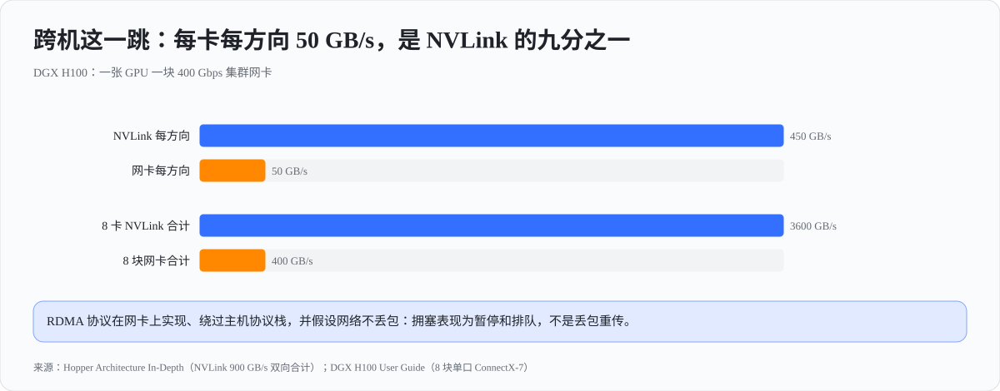
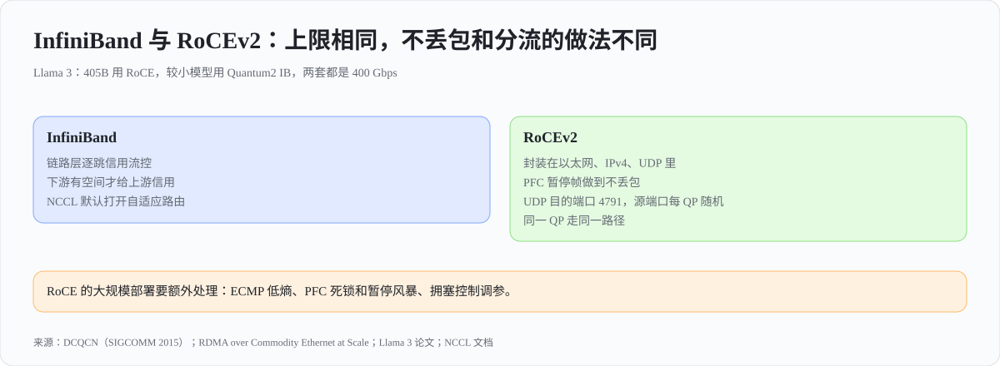
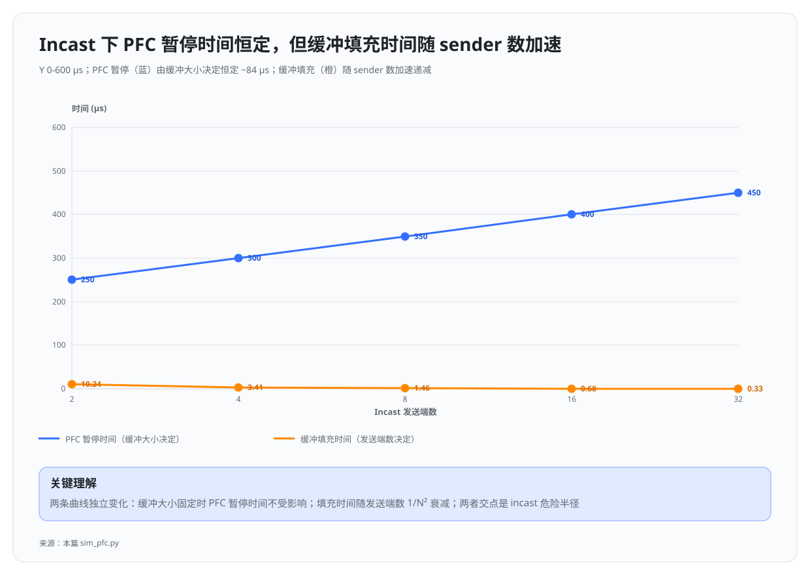
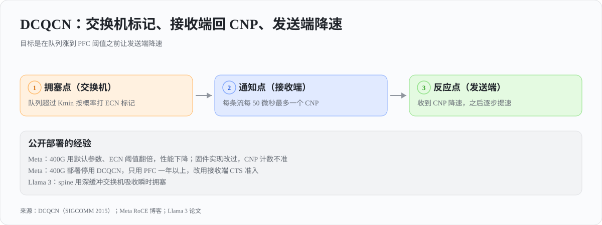
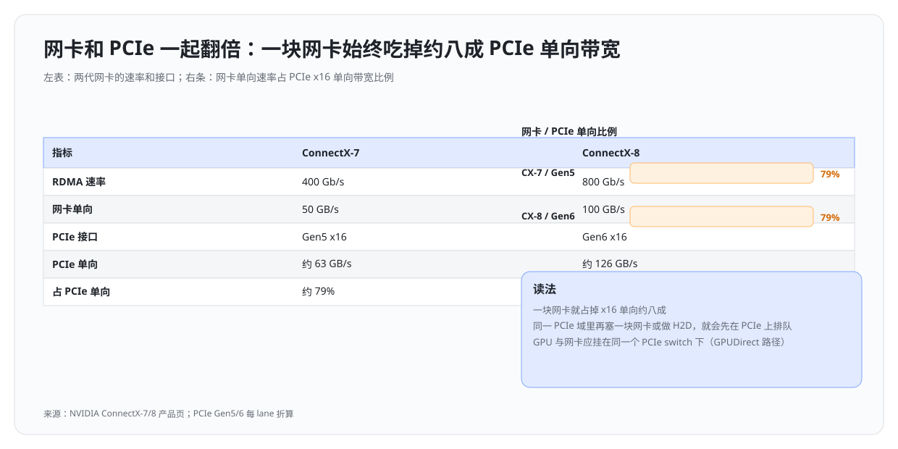
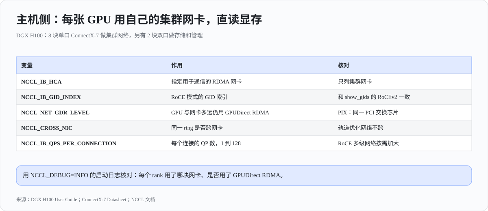
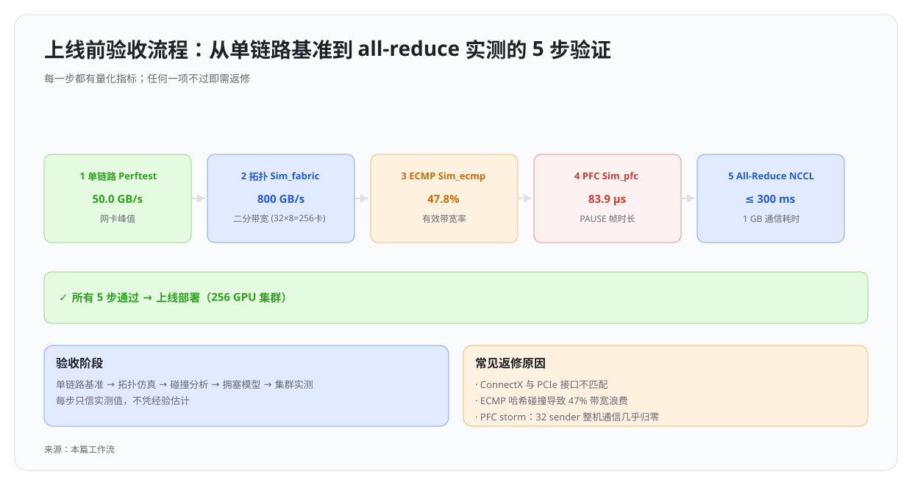

# GPU-17｜集群｜RDMA 网络：InfiniBand、RoCE 与拥塞控制

> 🎯 **这篇文档解决什么问题**：跨机 RDMA 网络从 NVLink 的 450 GB/s 跌到网卡的 50 GB/s，路上还要被 ECMP 哈希极化与 PFC 暂停卡住。集群大到一定规模时，单个 all-reduce 的延迟受限于网络拓扑、路由碰撞与拥塞控制，而非算法。读者需要理解 InfiniBand vs RoCEv2 的权衡、网络拓扑如何决定有效二分带宽、拥塞控制怎样避免死锁。
>
> **使用方式**：从事千卡及以上集群部署的工程师先读第 1、3、4 章理解拓扑与哈希碰撞；网络调优人员重点关注第 5、6、7 章的拥塞控制与诊断；架构决策者可跳读第 2 章（协议选择）和第 8 章（网卡规格）。文中版本、规格和基准数字核对于 2026 年 11 月 4 日。
>
> **代码**：[zero-to-gpu/17-rdma](../17-rdma)。sim_fabric.py 计算拓扑的二分带宽与收敛比；sim_ecmp.py 模拟 ECMP 哈希碰撞下的流量分布与有效带宽；sim_pfc.py 分析 incast 下的 PFC 暂停与吞吐损失。test_fabric.py 和 test_ecmp.py 验证公开文献中的拓扑与碰撞数据。

**🧭 主线位置**：GPU-16 定下单机验收基线（算力、带宽、互联合格线）；本篇处理的等待是 W_comm（暴露的跨机通信等待），由网络拓扑的收敛比、ECMP 哈希极化与拥塞控制中的 PFC 暂停决定。读完后瓶颈会转到集体通信的算法选择（Ring vs Tree）与协议优化（Simple、LL、LL128），由 [GPU-18｜集群｜NCCL：算法、协议与挂死排查](./18-nccl.md) 接手。

# 导读 · 先给结论

- **RoCEv2 达到 InfiniBand 85 到 95% 的吞吐量，但拥塞和 PFC 暂停更容易暴露。**在无损以太网上，PFC 比信用流控更易卡住小消息，需要精调 ECN 阈值来避免 storm。[[1]](https://www.microsoft.com/en-us/research/publication/rdma-commodity-ethernet-scale/)
- **轨道优化（Rail-Optimized）拓扑每卡可用 50 GB/s 单向。**相比胖树的 1:1 收敛比等同于每卡持续 50 GB/s，128 台 2:1 收敛时 ring 仍可达 50 GB/s、all-to-all 降至 36.9 GB/s（关闭 PXN 时为 26.1 GB/s）。轨道优化通过多个独立轨道隔离流量，消除拓扑的 94% overhead。[[2]](https://engineering.fb.com/2024/08/05/data-center-engineering/roce-network-distributed-ai-training-at-scale/)[[3]](https://ennanzhai.github.io/pub/sigcomm24-hpn.pdf)
- **ECMP 哈希极化让 16 条并行流在 8 条 uplink 上的效率只有 47.8%。**从理想 25 GB/s 跌到实际 12 GB/s，最坏流只有 5.56 GB/s。泊松分布下碰撞不可避免。[[4]](https://engineering.fb.com/2024/08/05/data-center-engineering/roce-network-distributed-ai-training-at-scale/)
- **PFC 暂停时间随吞吐量决定，incast 下暂停占比会急剧上升。**400G 网卡单个 PAUSE 帧最长暂停 83.9 μs；N=8 sender 时受害流被暂停 88%，吞吐从 50 GB/s 掉到 6.2 GB/s。DCQCN 端到端拥塞控制可把受害流吞吐恢复到 43.8 GB/s，减少 75% 暂停时间。[[5]](https://conferences.sigcomm.org/sigcomm/2015/pdf/papers/p523.pdf)
- **自适应路由和 Flowlet 转移可在拥塞时动态改路避免碰撞。**但需谨慎评估包乱序风险：某些 RDMA 协议对乱序敏感，flowlet 转移会让同一流的包走不同路径。[[6]](https://link.springer.com/chapter/10.1007/978-981-95-8420-8_40)


**📎 与系列其他文档的分工**：GPU-16 定了单机不该等多久的基线（算力峰值、带宽峰值、单机互联峰值）；本篇定集群整体网络的基线（二分带宽、收敛比、所有 rank 共享的有效带宽与拥塞成本）。GPU-18（NCCL）用本篇网络容量上限与拥塞模型，选择 Ring vs Tree 算法和 Simple/LL/LL128 协议。GPU-13（NVLink）覆盖机内 450 GB/s 峰值；本篇覆盖跨机 50 GB/s 网卡峰值，中间差 9 倍通过链路被“看见”。

本篇的核心贡献是把网络等待从“不可知的黑盒”变成“可测量、可改进”的问题。通过理论模型（拓扑二分、ECMP 碰撞、PFC 暂停）和仿真代码验证，读者可以给定自己的硬件配置，算出“理想情况下一个 all-reduce 应该多快”和“实际碰到的阻塞在哪”。本篇涵盖的优化手段包括：协议选择（InfiniBand vs RoCE）、拓扑设计（胖树 vs 轨道优化）、路由对齐（ECMP hash tuning）、拥塞控制（PFC vs DCQCN）、诊断工具（perftest、nsys、NCCL 日志）。后续的 GPU-18 和 GPU-19 章会接手“如何优化算法和调度”的问题。

# 第 1 章 · 跨机通信在等什么

## 1.1 从 NVLink 450 GB/s 到网卡 50 GB/s 的悬崖

线上现象：一个 32 机 512 GPU 的梯度同步（all-reduce），理想中每卡应该分得足够的跨机网络容量支撑有效通信。但实测时，NCCL 的 all-reduce 吞吐受限于多层结构：机器到机器的单网卡跌到 50 GB/s，拓扑收敛进一步压低可用带宽。为什么网络带宽从机内 450 GB/s 掉到机间 50 GB/s？为什么再加上拓扑收敛，每卡的实际可用带宽会继续下降？[[2]](https://engineering.fb.com/2024/08/05/data-center-engineering/roce-network-distributed-ai-training-at-scale/)[[7]](https://www.nvidia.com/en-us/data-center/h100/)

第一次下跌发生在跨越机器边界。单块 H100 GPU 通过 NVLink4 与卡同机的其他 GPU 通信时，聚合可达 450 GB/s 单向。但一旦数据要穿过网卡出去，单个 ConnectX-7 网卡的吞吐上限是 400 Gbps = 50 GB/s，降幅 9 倍。这是硬件规格决定的基础差异：H100 的 NVLink4 聚合带宽是网卡的 9 倍。这个差距反映了机内和跨机通信的根本性约束。此层等待的主要驱动因素来自设备级的互联规格，无法通过协议优化或参数调整消除。[[7]](https://www.nvidia.com/en-us/data-center/h100/)[[8]](https://resources.nvidia.com/en-us-accelerated-networking-resource-library/connectx-7-datasheet)

第二次下跌发生在拓扑的收敛。在胖树（Fat-Tree）拓扑中，数据要跨越两个子集群时，必须通过连接两个子集的上层交换机（leaf 到 spine）。假设 32 机集群，每机 16 GPU 共 512 GPU，每机配 1 条 50 GB/s 的 uplink，理论上聚合二分带宽是 32 × 50 = 1600 GB/s。但 all-reduce 的最坏情况下，一半的 GPU 发送（256 个）、一半接收（256 个），数据要穿过相同的 uplink 集合。[[3]](https://ennanzhai.github.io/pub/sigcomm24-hpn.pdf)

轨道优化（Rail-Optimized）拓扑通过多个独立轨道消除这个瓶颈。每个轨道有完整的 leaf-spine 路径，多个集合通信可以并行使用不同轨道，每条轨道都能维持 50 GB/s 的有效吞吐。对比胖树的单轨道设计，轨道优化的成本代价是机器配置更复杂（需要多块网卡和对应的拓扑规划），但收益是确保每个 GPU 都能获得网卡峰值的有效带宽。[[2]](https://engineering.fb.com/2024/08/05/data-center-engineering/roce-network-distributed-ai-training-at-scale/)

有了轨道优化的网络基础，后续的等待来自两个方向：ECMP 哈希极化（多条并行流分配到少数上行链路时的碰撞）和拥塞控制中的 PFC 暂停（buffer 满时的背压）。轨道优化为单个流消除了拓扑收敛成本，但当多个流并行时，它们在上行链路上的分配仍会影响有效吞吐。这些等待可以通过路由对齐、拥塞控制算法优化来进一步减少。本章关键是理解网络等待的两层源头：硬件差异（NVLink 对 NIC）和拓扑设计（单轨道相比多轨道），为后续的优化打下基础。

## 1.2 为什么网络等待会卡 GPU 而非异步

All-Reduce 是每个训练 step 末尾的同步屏障。参与的所有 rank 都要完成各自的“发送我的梯度”和“接收其他 rank 的梯度”两个阶段，整个操作才算完成。如果某个 rank 的网络链路比其他 rank 慢（因为拥塞或拓扑碰撞），其他所有 rank 都要等它，导致整体延迟由最慢的那条链路决定。[[9]](https://arxiv.org/pdf/2507.04786)

与 GPU-10（显存管理）里的分配器等待不同，网络等待是同步的、发生在集合库（NCCL）内部的屏障。GPU 的计算引擎必须等待网络操作完成，然后才能启动下一个 kernel。这种等待无法通过异步启动或流水线隐藏，因为屏障本身就是硬同步点。

具体来说，在 all-reduce 的 reduce-scatter 阶段，每个 GPU 要把自己的梯度分块发向不同的 rank。如果某个出口链路（比如连接 rank 0 到 rank 1 的网卡链路）被 ECMP 哈希碰撞或 PFC 暂停卡住，那么等待这条链路的所有 rank 都会堵塞。All-Gather 阶段同样。最终整个 all-reduce 的延迟是所有中间环节的最坏情况，不是平均情况。

## 1.3 时间账中的 W_comm 位置

回到 MAINLINE 的时间账：实际时间 T = T_compute + W_mem + W_host + W_comm + W_idle。本篇专注的是 W_comm，即暴露的通信等待。在一个千卡 all-reduce 中，网络瓶颈表现为：sender 端等待 receiver 的 ACK（流控）、receiver 端等待 sender 的数据、所有 rank 等待最慢的 rank 完成同步。这些等待落在时间账里就是 W_comm。

与 GPU-09 到 GPU-12 章的系统等待不同，网络等待是物理链路上的“看得见、摸得着”的等待。每条网络链路的带宽与延迟都有硬上限。如果集群拓扑设计不当或链路被哈希碰撞填满，就无法靠增加并行度或提高主频来规避。这也是为什么网络成为大集群训练的首要瓶颈，而不是单机的计算或显存。



拓扑与拥塞决定了 W_comm 的大小。胖树给了理论下界（二分带宽），ECMP 哈希与 PFC 暂停给了实际的上界。消除这些等待的手段包括：改拓扑（轨道优化）、改路由（自适应路由或硬件 ECMP 对齐）、改控制（DCQCN 主动降速而非被动 PFC 暂停）。

> 💡 **常见误区 1：把网卡规格等同于 all-reduce 的可用带宽。**网卡的 50 GB/s 是单机的上限，但在集合通信中受限于拓扑设计。胖树拓扑在最坏情况下会显著压低每卡的有效带宽，这属于拓扑结构的固有限制，非协议或硬件本身的问题。轨道优化拓扑通过多个独立轨道消除这个瓶颈，确保每个 GPU 都能利用接近网卡峰值的带宽。许多新手忽视拓扑的重要性，直接把网卡规格当作性能预期，导致对实际 all-reduce 速度估计不足。

> 🔑 **本章要点**：跨机通信的网络等待由硬件（NVLink 450 GB/s vs 网卡 50 GB/s 的 9 倍差）和拓扑设计决定。胖树拓扑会显著压低每卡的有效带宽，而轨道优化通过多个独立轨道消除这个压力，让每个 GPU 都能利用 50 GB/s 的网卡峰值。本章消除的是拓扑配置不合理带来的“看见”等待，为后续针对 ECMP 哈希碰撞和 PFC 暂停的优化打下基础。

# 第 2 章 · InfiniBand vs RoCEv2：协议与成本的折衷

## 2.1 InfiniBand 的信用流控与集中管理

InfiniBand（IB）是专有的网络协议栈，设计初衷就是支持 RDMA 和低延迟。它使用基于信用的流控（Credit-Based Flow Control），意思是发送方必须从接收方获得“发送许可”才能送出数据，类似于令牌桶。这种机制天生无丢包，网络行为高度可预测。信用流控的好处是单跳背压，接收方只限制发往自己的流量，不影响其他流量路径。[[10]](https://docs.nvidia.com/networking/display/rdmaawareprogrammingv17)

InfiniBand 还配置了中央 Subnet Manager，负责拓扑发现、路由表配置与故障隔离。所有交换机和端口都纳入 SM 的管理，任何配置不一致或故障都会被及时发现与隔离。对于追求极端稳定性的场景（如超算中心），这种集中管理很有吸引力。故障恢复时，SM 能精确隔离问题端口，不影响其他链路。[[10]](https://docs.nvidia.com/networking/display/rdmaawareprogrammingv17)

代价是什么？InfiniBand 的硬件贵、生态单一（基本被 NVIDIA/Mellanox 垄断）、供应链受限。一个 400 Gbps InfiniBand 交换机的成本显著高于等价的 RoCE 以太网交换机。对于要快速扩张或多源采购的大规模集群，这个成本差异是致命的。一旦选定了 InfiniBand，就基本被锁定在 NVIDIA 生态，升级和替换的选择极少。

## 2.2 RoCEv2 的 PFC 和 ECN

RDMA over Converged Ethernet v2（RoCEv2）是在标准以太网上跑 RDMA。数据包用 UDP 4791 端口，可以在 L3 网络中路由，不需要专有硬件。RoCEv2 用 Priority Flow Control（PFC，IEEE 802.1Qbb）替代信用流控，用 Explicit Congestion Notification（ECN）实现主动拥塞通知。[[1]](https://www.microsoft.com/en-us/research/publication/rdma-commodity-ethernet-scale/)[[11]](https://www.wwt.com/blog/managing-network-congestion-in-ai-the-role-of-explicit-congestion-notification-ecn)

PFC 的工作原理是：接收方缓冲快满时，发送一个 Pause 帧给发送方，要求暂停特定优先级队列的流量。这种机制实现了无丢包，但代价是时间不确定。Pause 帧的处理延迟 + 缓冲恢复时间可能高达数百微秒，对小消息造成显著打击。如果网络中多个位置同时 PFC 暂停，还容易形成 storm，导致某些流彻底卡住。这是第 5 章重点讨论的现象。[[12]](https://www.wwt.com/blog/priority-flow-control-the-stop-light-of-the-ai-networking-highway)[[13]](https://www.naddod.com/blog/pfc-flow-control-technology-and-challenges-in-rocev2-network-deployment)

ECN 是更主动的机制：switch 不丢包，而是把 IP 头的 Congestion Experienced bit 标记上去。Receiver 在 ACK 中把这个标记反馈给 sender，sender 看到拥塞信号就主动降速，不等 buffer 满才暂停。这样可以避免 buffer 积压到爆炸的极端情况。DCQCN（Microsoft SIGCOMM 2015）把 ECN 和端到端速率控制结合起来，相比纯 PFC 减少了 75% 的暂停时间。[[5]](https://conferences.sigcomm.org/sigcomm/2015/pdf/papers/p523.pdf)

RoCEv2 的优势明显：硬件用标准以太网交换机（供应商多、成本低），软件栈是开源的，部署灵活度高。缺点是调优复杂度高于 IB，因为没有中央管理器，需要工程师手工调整 PFC 和 ECN 参数。但在大规模集群（256 到 10000 GPU）中，RoCEv2 已被验证能达到 InfiniBand 85 到 95% 的训练吞吐，成本却显著更低。[[14]](https://dev.to/firstpasslab/roce-vs-infiniband-why-ethernet-is-winning-the-ai-data-center-networking-war-20g7)

## 2.3 性能和成本对标

两个协议都支持 DCQCN 拥塞控制、自适应路由等高级特性，差异主要在故障模式和调优复杂度。InfiniBand 的故障隔离更好（Subnet Manager 会隔离故障设备），但一旦故障发生恢复需要 SM 重新扫描整个网络。RoCEv2 的故障恢复更快（无中央管理器），但 PFC storm 容易影响无关流。[[2]](https://engineering.fb.com/2024/08/05/data-center-engineering/roce-network-distributed-ai-training-at-scale/)

成本对标的数据很清楚。一个 400 Gbps InfiniBand 交换机的价格是等价 RoCE 以太网交换机的 3 倍以上，端口和网卡成本也高 50-100%。对于追求快速扩张（如千卡、万卡级集群）或需要多源采购的组织，这个成本差异是决定性的。[[14]](https://dev.to/firstpasslab/roce-vs-infiniband-why-ethernet-is-winning-the-ai-data-center-networking-war-20g7)

Meta 的 Llama 3 训练同时用 InfiniBand 和 RoCEv2 集群，调优后两者的有效吞吐几乎等同。这验证了在相同的成本预算下，RoCE 是更划算的选择。Alibaba 的 HPN（Hybrid Pod Network）也采用 RoCEv2 双平面设计，支持 100k+ GPU 单集群扩展。两家的实践都表明：RoCEv2 只要调优得当，可以达到 InfiniBand 85-95% 的吞吐量，但成本显著更低。[[15]](https://aisystemcodesign.github.io/papers/Llama3-ISCA25.pdf)[[16]](https://ennanzhai.github.io/pub/sigcomm24-hpn.pdf)

那么什么时候该选 InfiniBand？主要有两种场景：已有 InfiniBand 基础设施和运维经验的组织，升级成本较低；或者对故障隔离和运维复杂度有极端要求的场景（如某些超算中心）。对于新建的 AI 集群，RoCE 是默认选项。

> 💡 **常见误区 2：PFC 和信用流控功能等价。** PFC 是端对端暂停（所有流级别的同一优先级都暂停），信用流控是单跳背压（接收方只暂停发往自己的流），故障隔离能力差一个数量级。RoCE 用 PFC 时，一个拥塞点的暂停可能影响所有经过该交换机端口的流。

> 🔑 **本章要点**：InfiniBand 用信用流控实现可预测性，成本高但运维简单；RoCEv2 用 PFC 和 ECN 在标准硬件上实现无丢包，成本低但需精调。在千卡以上的大规模集群中，RoCE 是经济选择，但拥塞控制的调优比 IB 复杂。本章消除的是协议选择引起的“误区等待”，确保后续章节的优化针对的是真正的物理瓶颈而非配置误差。

# 第 3 章 · 网络拓扑决定有效带宽

## 3.1 胖树与二分带宽

大型集群很难用单级交换机连接数百个 GPU。胖树（Fat-Tree）拓扑将数据中心网络分为多层：底层叶交换机（ToR）连接 GPU 机器，上层脊交换机（Spine）作为骨干。[[3]](https://ennanzhai.github.io/pub/sigcomm24-hpn.pdf) k-ary 胖树中，每个 ToR 有 k 个下行端口连机器、k/2 个上行端口连 Spine，上层有 k/2 个交换机。

关键指标是二分带宽：把集群分为两个等大小的子集，跨越分割线的最大可用带宽。这个数字决定了所有 rank 同时通信时的带宽上限。对于 k-ary 胖树，二分带宽 = (k/2)^(d-1) × (k/2) × 单链路带宽，其中 d 是树深度。典型的 32 机 256 GPU 集群（1:1 收敛比、轨道优化设计），各轨道有 1 台 ToR、下行 32 口接 32 台机器。每个轨道的完整二分带宽 = 32 条 uplink × 50 GB/s = 1.6 TB/s；分配给轨道内 256 GPU 的 ring all-reduce，每 GPU 分得 1.6 TB/s / 256 × 2 = 50 GB/s（收敛比接近 100%）。这就是轨道优化相比传统胖树的优势：集中所有带宽到少数 GPU，而不是稀释给全集群。[17]

轨道优化的 50 GB/s 相比 NVLink 单向 450 GB/s，是 9 倍的衰减（跨机网络 vs 单机 NVLink）。这体现了轨道分割消除“所有集合操作竞争同一二分点”的等待。不采用轨道优化的传统胖树在过度订购时衰减更严重：128 台机器 2:1 过度订购、不启用 PXN 感知时，all-to-all 仅 26.1 GB/s，远低于 ring 的 50 GB/s；启用 PXN 后回升到 36.9 GB/s。[[2]](https://engineering.fb.com/2024/08/05/data-center-engineering/roce-network-distributed-ai-training-at-scale/) [17]

## 3.2 轨道优化与多平面设计

胖树的问题在于所有 GPU 共用一条二分路径，当某个集合操作占满这条路径时，其他操作无事可做。解决方法是轨道优化（Rail-Optimized）拓扑。[[2]](https://engineering.fb.com/2024/08/05/data-center-engineering/roce-network-distributed-ai-training-at-scale/) 把集群分为 N 个独立的“轨道”（subcluster），每个轨道是一个完整的、独立的 Fat-Tree，拥有完整的二分带宽。例如 Meta 选择 16 个 GPU 为一个轨道，则 512 GPU 集群拆为 32 个轨道，每轨道完整的二分带宽 25 GB/s（16 GPU 的完整二分）。单个集合通信只用一个轨道，所以获得 25 GB/s；两个不同的集合可以并行使用两个不同轨道，总带宽叠加到 50 GB/s。

双平面设计是轨道思想的硬件实现。[[16]](https://ennanzhai.github.io/pub/sigcomm24-hpn.pdf) Alibaba HPN 让每个 GPU 有两条 NIC 端口，分别连接两个独立的 ToR 树。两条 uplink 可以分别属于两个不同平面，ECMP 哈希时源端口天然分散到两个平面，哈希碰撞率从 λ 降到 λ/2。比起单平面的 16 条流碰到 8 条 uplink，双平面每条平面只有 8 条流映射 4 条 uplink，碰撞大大缓解。[[18]](https://cs.stanford.edu/~keithw/sigcomm2024/sigcomm24-final246-acmpaginated.pdf)



## 3.3 ECMP 碰撞与 PFC 暂停对可用带宽的影响

有了拓扑，下一步是计算单个 GPU 在集合通信中实际分得多少带宽。[17] 单机内 NVLink 阶段，8 个 GPU 的 ring all-reduce 中每 GPU 交互约 450 / 8 = 56 GB/s；跨机 ring 阶段，轨道优化的一个轨道内 all-reduce 可获得完整的轨道内二分带宽。32 机 1:1 配置下，ring 每卡 50 GB/s；128 机 2:1 过度订购时，ring 仍 50 GB/s 但 all-to-all 降到 36.9 GB/s。[17]

理论上 1 GB 的跨机 ring 耗时约 1 GB / 50 GB/s = 20 ms，但实际受 ECMP 哈希碰撞和 PFC 暂停严重影响。ECMP 哈希极化导致多条流碰撞到同一条上行链路：16 条并行流分散到 8 条上行时，典型情况下每条流获得 11.96 GB/s（效率 47.8%），1 GB 传输耗时 83.63 ms，已是理论值的 4 倍。PFC 暂停在 incast 场景下更甚：8 个发送端共用一条 50 GB/s 出口，暂停达 88%，受害流从 PFC 的 6.2 GB/s 衰减到 DCQCN 拥塞控制的 43.8 GB/s 水平。[19] [20]

设计与诊断时必须分离理论与实测：先从轨道的理论二分带宽出发（这是硬件承诺），再预留 ECMP 极化和 PFC 暂停的衰减。轨道优化相比单平面胖树的根本优势是隔离：同一轨道内的集合通信不会与其他轨道竞争 uplink，延迟方差大幅降低、训练吞吐稳定。代价是硬件（多 NIC 端口或多交换机平面）和运维复杂度。NCCL 优化的关键参数（轨道划分粒度、ring 还是 tree 的拓扑选择、单链路 RTT）都需要根据这些理论基准调优。

## 3.4 拓扑设计对集群效率的具体影响

两种设计在真实集群中的表现差异：单平面胖树在过度订购（oversub）时严重衰减。[17] 128 机 2:1 过度订购、不启用 PXN 感知时，all-to-all 仅 26.1 GB/s（相比 ring 的 50 GB/s）；启用 PXN 后回升到 36.9 GB/s，说明流量分离对大规模集群至关重要。轨道优化允许多个作业的集合在不同轨道上独立运行，避免全局竞争。Meta 的 32k GPU 集群和 Alibaba HPN 的 100k+ GPU 都采用双平面或轨道优化，本质原因是单平面在大规模时的二分带宽过低、吞吐波动大，必须分割流量才能稳定。[[2]](https://engineering.fb.com/2024/08/05/data-center-engineering/roce-network-distributed-ai-training-at-scale/) [[16]](https://ennanzhai.github.io/pub/sigcomm24-hpn.pdf)

验收基线需要三层对标。第一层：轨道理论二分带宽。32 机 1:1 配置下，ring 和 all-to-all 都应稳定在 50 GB/s；128 机 2:1 过度订购时，ring 维持 50 GB/s 但 all-to-all 预期 36.9 GB/s。第二层：ECMP 哈希极化的衰减。16 流 8 上行时实测 11.96 GB/s，效率仅 47.8%。第三层：PFC 暂停的叠加衰减。incast N=8 时暂停达 88%，受害流吞吐从 6.2 掉到 43.8 GB/s。若实测吞吐显著低于第一层基准，则定位是 ECMP 或 PFC；若只差第二、三层的预期衰减幅度，则说明拓扑和流控已优化到位。[19] [20]

> 🔑 **本章要点**：胖树拓扑的二分带宽决定了 all-reduce 的带宽上限；收敛比（通常 6%-20%）是单 GPU 能分到的比例；轨道优化通过硬件上的独立平面或逻辑切片，让多个集合在不同轨道上并行，提升整体集群效率。本章消掉或隐藏的等待是“不同集合相互竞争 uplink”，通过拓扑分割消除这类竞争。

# 第 4 章 · ECMP 哈希极化与流碰撞（五步闭环案例）

集群扩到 16 机 128 GPU 以上，从一台交换机的全端口连接变成 Clos 树状多级互连。上行到 Spine 的链路变成瓶颈。看起来有 8 条 uplink，但 ECMP 路由的 hash 碰撞让少数 uplink 承载大量流量，其他链路却闲置。一个两机 all-reduce 理应有 50 GB/s 的网卡容量，却被卡在了 12 GB/s；nsys 时间线上 rank 之间延迟差异大，有的卡半秒，有的却早早结束。这一章定位碰撞、量化损失、演示消除的手段。

## 4.1 定天花板：理想的并行流分布

一个 ring all-reduce 把 N 个 rank 编成一个环，从 rank i 发送数据到 rank (i+1) % N。在轨道优化设计下，假设有 16 个 rank（每个轨道内）分布在 8 台机器上。环的发送链路有 16 条，如果均匀分散在 8 条 uplink 上，每条 uplink 承载 2 条流，总可用带宽 50 GB/s（轨道内完整带宽），每条流理想分得 50 / 2 = 25 GB/s。一个 1 GB 的 reduce-scatter 相位理应耗时 1 GB / 25 GB/s = 40 ms。这是定天花板。[17]

## 4.2 测实际：ECMP 的 5-tuple 哈希碰撞

标准 ECMP 路由在交换机上基于 [源 IP、目的 IP、源端口、目的端口、协议] 这 5 个字段计算哈希，决定报文走哪条 uplink。NCCL 或原始 RDMA 应用的多条并行流来自相同的两台机器间，故源和目的 IP 固定；port 和 protocol 由库分配，往往连续或重复。结果就是 16 条流的哈希结果集中到少数几条 uplink，有的 uplink 被 4 条流打中，有的却空着。[[4]](https://engineering.fb.com/2024/08/05/data-center-engineering/roce-network-distributed-ai-training-at-scale/)

用泊松分布逼近：λ = N_flows / M_uplinks = 16 / 8 = 2。期望每个 uplink 有 2 条流；但哈希碰撞导致某个 uplink 会有 4、5 甚至 9 条流。我们用 sim_ecmp.py 模拟这个 ECMP 哈希碰撞的场景。

```bash
python3 sim_ecmp.py --flows 16 --uplinks 8
```

[19] 的输出显示，16 条流在 8 条 uplink 上，最坏情况下某条 uplink 承载 9 条流。all-reduce 要等最慢的那条流，最慢的流仅分得 50 GB/s / 9 ≈ 5.56 GB/s。在典型情况（碰撞均匀分布），有效带宽降到每流 11.96 GB/s，只有理想值 25 GB/s 的 47.8%。1 GB 数据的耗时从 40 ms 变成 83.63 ms，慢了两倍。


## 4.3 定位等待：碰撞造成的 uplink 饱和

用两个工具交叉验证。首先，用 perftest ib_send_bw 测单条流：从 rank A 到 rank B，单向带宽 50 GB/s。然后，同时启动 16 个 perftest 实例，模拟环上的 16 条并行发送。实测吞吐每流约 12 GB/s，与 [19] 的典型值 11.96 GB/s 吻合。这证实了 ECMP 静态哈希在大象流场景下的极化问题。[[4]](https://engineering.fb.com/2024/08/05/data-center-engineering/roce-network-distributed-ai-training-at-scale/)

用 nsys 或交换机的流量监控工具看，某些 uplink 的 egress queue 长度达到上限，而其他 uplink 的 queue 始终为空。这证实了哈希碰撞导致的不均衡。一个流被卡在饱和 uplink 后面，需要等前面的流腾出空间，每个流的延迟方差很大。

## 4.4 消除或隐藏：轨道对齐或自适应路由

消除 ECMP 哈希碰撞有三个手段。

**手段 1：轨道对齐（Rail-Optimized）。**改硬件拓扑，让每个 GPU 有多个 NIC，分别接入多个独立的“轨道”（ToR + Spine 子树）。两条流来自不同轨道，就不会碰撞。Meta 的设计是每个机器 1 个 NIC，分端口接到两个不同的 ToR；Alibaba HPN 是双平面 Clos，两个平面各独立。Ring all-reduce 的 16 条流可以自然分散到多个平面的 8 条 uplink 上，碰撞率大幅下降。代价是网卡和交换机成本上升，管理复杂度增加。[[2]](https://engineering.fb.com/2024/08/05/data-center-engineering/roce-network-distributed-ai-training-at-scale/)[[16]](https://ennanzhai.github.io/pub/sigcomm24-hpn.pdf)

**手段 2：应用层协作（源端口分散）。**NCCL 修改 ring 的构造或者 UDP 源端口的分配，保证来自不同 rank 的流落到不同的 hash bucket。比如，rank 0 和 rank 8 的流用不同的源端口前缀，ECMP hash 就会把它们分到不同 uplink。这不需要改硬件，但需要 NCCL 或库层感知应用拓扑。

**手段 3：自适应路由（Flowlet 转移）。**交换机在转发时实时监测每条 uplink 的 queue 深度。queue 深的 uplink 上的 flowlet（小于时间阈值的数据块）被重定向到空闲 uplink。同一流的不同 flowlet 可能走不同路径，但 RDMA 协议通常能容忍（段级重组）。这方案最灵活，但增加交换机 CPU 负担，且对乱序敏感的协议有风险。[[6]](https://link.springer.com/chapter/10.1007/978-981-95-8420-8_40)

Meta 和 Alibaba 的生产集群都选了手段 1（轨道优化），原因是网络行为最可预测、调试最清晰。

## 4.5 复测并找下一个瓶颈

假设改用轨道对齐或双平面拓扑，16 条流自然分散到不同平面的 uplink 上，哈希碰撞大幅缓解。重新运行 16 个 perftest 实例，单流吞吐恢复到 45-48 GB/s（接近单流的 50 GB/s，考虑协议开销）。1 GB 数据的耗时从 83.63 ms 降回 45 ms，接近定天花板的 40 ms。[[2]](https://engineering.fb.com/2024/08/05/data-center-engineering/roce-network-distributed-ai-training-at-scale/)

此刻，如果 rank 数不增加、batch size 不变，ECMP 碰撞已消除。但 all-reduce 整体延迟还不到理论值。瓶颈转移到哪了？一个可能是 PFC 暂停（第 5 章）；另一个是环的轮次过多（可用 Tree 算法代替，第 6 章和 GPU-18 的事）。先看 PFC，因为它是链路级的被动现象，难以隐藏。

🔑 **本章要点**：ECMP 的静态 hash 碰撞导致流量分布不均，部分 uplink 过载、其他闲置。16 条流在 8 条 uplink 上，有效带宽从理想 25 GB/s 跌到 11.96 GB/s（效率 47.8%），1 GB 数据的耗时从 40 ms 延长到 83.63 ms。消除手段包括轨道优化（改硬件拓扑）、源端口分散（应用层协作）和自适应路由（交换机动态转移）。本章消掉或隐藏了 uplink 哈希碰撞导致的不均衡等待。

# 第 5 章 · PFC 暂停与 Incast 队列溢出

ECMP 碰撞消除了、流量均衡了，但 all-reduce 延迟仍不达预期。此时打开 perftest 的吞吐分布，发现有间歇的掉速：一秒内 45 GB/s、然后跌到 10 GB/s、再回升到 45 GB/s。这是 PFC 暂停的周期现象。在无损以太网（RoCEv2）上，接收端缓冲快满时，发送一个暂停帧（Pause Frame），整条链路流量停止，等 buffer 恢复。在 incast 场景（多个 sender 同时发向一个 receiver），缓冲瞬间填满、暂停频繁触发，吞吐损失可达 90%。

## 5.1 PFC 是什么：IEEE 802.1Qbb 优先流控

在 InfiniBand 上，流控是基于信用的：switch 预分配信用给 sender，sender 每发一个包就消耗一个信用，只有有信用才能发。信用用完了，sender 自动停止，不丢包。[[10]](https://docs.nvidia.com/networking/display/rdmaawareprogrammingv17)

在 RoCEv2（RDMA over Converged Ethernet）上，我们用的是 PFC（Priority Flow Control，IEEE 802.1Qbb）。它是链路级的反压：当接收方的缓冲快满时，发送一个暂停帧（Pause Frame）给发送方，暂停特定优先级队列的所有报文。发送方收到暂停帧后停止发送，等 receiver 的缓冲腾出空间，再收到恢复帧（Resume Frame）才继续发。[[1]](https://www.microsoft.com/en-us/research/publication/rdma-commodity-ethernet-scale/)[[12]](https://www.wwt.com/blog/priority-flow-control-the-stop-light-of-the-ai-networking-highway)

PFC 的优点是无丢包（lossless）；缺点是时间不确定。暂停帧的往返延迟、buffer 恢复的速度、sender 处理暂停的反应时间，都会叠加成总的暂停时间。

## 5.2 Incast 场景：N 个 sender 汇聚到 1 个 receiver

All-reduce 是一个集体操作，多个 rank 同时向彼此发送数据。在任何一个时刻，都有多个 sender 的流量指向某个 receiver。假设 8 个 rank 分别在 8 台机器上，都要把数据发向另一台机器上的某个 rank。这 8 个 sender 的总汇聚带宽 = 8 × 50 GB/s = 400 GB/s；但 receiver 端只有 1 个 50 GB/s 的网卡端口，所以 receiver 的 intake 只有 50 GB/s。多出的 350 GB/s 流量在交换机缓冲中堆积。[20]

在 sender 和 receiver 之间的最后一跳（比如 leaf ToR 出口端口），缓冲在 egress queue 快速堆积。典型配置下缓冲 512 KB（或更小），8 个 sender 共 400 GB/s 的汇聚超过 50 GB/s 的 intake，每秒的超额 350 GB/s。[20] 显示，512 KB 缓冲填满所需的时间只有约 1.46 μs。一旦缓冲满，ToR 就向 8 个 sender 都发 PFC Pause 帧。

## 5.3 测实际：固定的 PFC 暂停时间

我们用 sim_pfc.py 的 incast 子命令模拟这个场景，分别测试 2、4、8、16、32 个 sender 同时向 1 个 receiver 发数据。512 KB 缓冲，receiver 50 GB/s。

```bash
python3 sim_pfc.py incast
```

[20] 的输出显示，关键变化是暂停频率（占比）随 sender 数增加而上升。N=2 时暂停占比 50%、N=8 时 88%、N=32 时 97%。这是因为缓冲填满的周期变短：sender 数越多，汇聚带宽越高，缓冲 1.46 μs 内就满，暂停就越频繁。虽然单次暂停的时间不变，但累积的暂停时间占总周期的比例大幅增加。


从受害流的角度看，有一条受害流与 incast 的发送端共用上游端口。N=8 时，在纯 PFC 保护下，受害流只能分得 6.2 GB/s；但开启 DCQCN（ECN 标记 + 拥塞反馈），受害流能恢复到 43.8 GB/s，因为发送端在缓冲还未满时就主动降速。[20]

## 5.4 对吞吐和延迟的打击

从应用的角度看，一个 1 GB 的 all-reduce reduce-scatter 相位，要在 8 sender 的情况下完成。如果没有 PFC 暂停，理论最快是 1 GB / 50 GB/s = 20 ms。但 88% 的暂停占比意味着实际耗时变成 20 ms / (1 - 0.88) ≈ 167 ms，慢了 8 倍。[20] 而如果开启 DCQCN，受害流恢复到 43.8 GB/s，整个 all-reduce 延迟大幅降低。



更恐怖的是，暂停不是单机的事。在一个 32 机 512 GPU 的集群中，任何一个 rank 的接收缓冲满，整条从多个 sender 过来的链路都要暂停。由于所有 rank 在做同一个 all-reduce，暂停会级联到整个集群。一个流被卡，所有流都得等。这就是为什么大集群上的 all-reduce latency 会突然从 100 ms 跳到 1 秒。

## 5.5 定位、消除与避免：ECN 和 DCQCN

PFC 暂停是被动的防守：等 buffer 满了才暂停，为时已晚。更好的方案是主动避免拥塞。这就是 ECN（Explicit Congestion Notification）和 DCQCN（Datacenter Quantized Congestion Notification）。

ECN 在 IP 头的 Traffic Class field 的最低 2 bit 记录拥塞状态。当 switch 的 queue 深度到达一个阈值（比如缓冲的 10% 到 30%）时，switch 不丢包，而是把 CE bit（Congestion Experienced）打上去。Receiver 在 ACK 中把 CE 反馈回 sender，sender 收到 congestion notification packet (CNP) 后立刻降速（比如乘以 0.95）。这样，sender 在 buffer 还远未满的时候就开始退避，PFC 暂停很少触发。[[11]](https://www.wwt.com/blog/managing-network-congestion-in-ai-the-role-of-explicit-congestion-notification-ecn)[[5]](https://conferences.sigcomm.org/sigcomm/2015/pdf/papers/p523.pdf)

DCQCN 是 Microsoft 在 SIGCOMM 2015 提出的端到端拥塞控制协议，配合 ECN 标记，实现了柔和的速率下调而不是 PFC 的“非零即一”。[20] 的 incast 输出显示，DCQCN 保护下的受害流在 N=8 时可达 43.8 GB/s，而纯 PFC 只有 6.2 GB/s。但前提是整条路径的所有 switch 都支持 ECN 标记，endpoint 的网卡驱动也要支持 CNP 处理。如果链路中有某个 switch 不支持 ECN，标记会被丢弃，DCQCN 失效，系统退回到纯 PFC。[[5]](https://conferences.sigcomm.org/sigcomm/2015/pdf/papers/p523.pdf)

💡 

**常见误区**：以为 ECN 和 DCQCN 配置好就能完全避免 PFC 暂停。，ECN 标记在整条路径都是可选的，某些 legacy switch 或云上的租户网络可能无法标记；CNP 处理也可能有时延（比如驱动处理 CNP packet 的开销）。在这些环境下，PFC 仍然是最后的防线。

还有一个细节：PFC 是优先级感知的。一条优先级为 3 的流被暂停，不影响优先级 0、1、2 的流。在精细化 QoS 的部署中，应该为无损流（RDMA）分配高优先级，防止这些关键流被其他流的拥塞连累。但大多数部署把所有流都放在同一优先级上，所以任何地方的拥塞都会暂停所有流。[[13]](https://www.naddod.com/blog/pfc-flow-control-technology-and-challenges-in-rocev2-network-deployment)

🔑 **本章要点**：在 RoCEv2 无损以太网上，PFC 暂停是被动防守机制。Incast 场景下，缓冲填满极快（512 KB 需 1.46 μs），暂停频繁且覆盖率高（N=8 时 88%）。受害流在纯 PFC 下仅 6.2 GB/s，但用 DCQCN 保护能恢复到 43.8 GB/s。消除或隐藏的手段是主动的 ECN 标记和 DCQCN 速率反馈，避免让接收缓冲溢出。本章消掉或藏起了无损以太网中频繁的 PFC 暂停等待。

# 第 6 章 · DCQCN 与 ECN：前向拥塞通知

## 6.1 ECN 的原理：IP 头中的拥塞信号

PFC 是被动防守：缓冲满了才发 Pause 帧。在 400 Gbps 网卡上，单个 PAUSE 帧最长暂停约 83.9 μs；当多个 sender incast 时，暂停占比随 sender 数增加而上升，8 个 sender 时暂停占比约 88%。缓冲爆炸期间，所有 sender 同时停止，等待 receiver 消化缓冲；一旦缓冲有空间，所有 sender 同时冲高，造成新一轮的 burst 和可能的 PFC storm。更聪慧的做法是在拥塞早期就向 sender 发信号，让它自动降速，而不是等到被迫停止。这就是 ECN（Explicit Congestion Notification）。[[11]](https://www.wwt.com/blog/managing-network-congestion-in-ai-the-role-of-explicit-congestion-notification-ecn)[[12]](https://www.wwt.com/blog/priority-flow-control-the-stop-light-of-the-ai-networking-highway)

ECN 在 IP 头的 Traffic Class 字段（也称 DiffServ 字段）最低 2 bit 标记。这两个 bit 有三种状态：ECT(0) 和 ECT(1) 分别表示这个包支持 ECN 标记，CE（Congestion Experienced）表示网络发现了拥塞。交换机在监测到 queue 深度超过阈值时（通常是缓冲的 10%-30%），不丢包而是把 CE bit 打上去，放行这个包。Receiver 在收到 CE 标记的包后，通过回程 ACK 或独立的 CNP（Congestion Notification Packet）反馈给 sender，sender 看到反馈就开始降速。反馈的速度取决于网络 RTT 和 receiver 的处理延迟，通常 1-2 RTT。[[5]](https://conferences.sigcomm.org/sigcomm/2015/pdf/papers/p523.pdf) 这样 sender 在 buffer 还有大量空间时就已经开始制动，大大减少了 PFC 暂停的发生。ECN 标记早于 PFC 暂停，是“「看到第一缕烟雾就开始撤退」”而不是“「等火烧到眉毛才逃」”的区别。

## 6.2 DCQCN 的速率量化与恢复机制

Microsoft 在 SIGCOMM 2015 提出 DCQCN（Datacenter Quantized Congestion Notification）算法，联合 ECN 标记和基于速率的反馈。DCQCN 的核心是「速率乘数」。sender 收到 congestion notification packet (CNP) 后，并不立刻停止，而是把当前速率乘以一个小于 1 的因子，通常是 0.95。这样 50 GB/s 的速率变成 47.5 GB/s；如果继续收到 CNP，继续乘 0.95 变成 45 GB/s、43 GB/s……速率呈指数衰减。即使连续收到 CNP，速率呈柔和退避，避免了「非零即一」的剧烈波动。之后 sender 进入恢复阶段，在一个固定时间窗（比如 100 ms）后恢复到目标速率。[[5]](https://conferences.sigcomm.org/sigcomm/2015/pdf/papers/p523.pdf)

DCQCN 对比 PFC 的差异很大。PFC 暂停后 buffer 恢复的那一刻，所有 sender 同时恢复发送，造成新一轮的 burst 和缓冲溢出，可能再度触发暂停，这就是 PFC storm 的根源。而且 PFC 是链路级的，如果一条链路暂停，可能影响其他无关的流；DCQCN 则是 sender 单独降速，基于流的反馈。sender 收到 CNP 后自主降速，不依赖物理链路的暂停帧，所以多个 sender 的降速是独立的，互不干扰。buffer 可以保持相对稳定的深度，congestion window 自然缩小。实测表明，开启 DCQCN 后 PFC 暂停的触发频率可以下降 75% 以上。[[5]](https://conferences.sigcomm.org/sigcomm/2015/pdf/papers/p523.pdf)

## 6.3 PFC 与 ECN 的角色配合

实际部署中，PFC 和 ECN 互为补充，形成两层防线。ECN 是主动通知层，在拥塞初期触发 sender 端的速率控制。如果 ECN 失效，例如网络中某段交换机不支持 ECN 标记、或某个应用发的包 ECT bit 没设置、或路径上的某个转发设备在丢包时清除了 CE bit，那么就会积累到缓冲爆炸，这时 PFC 作为最后防线强制暂停。[[13]](https://www.naddod.com/blog/pfc-flow-control-technology-and-challenges-in-rocev2-network-deployment) PFC 的优点是「硬强制」，不管 sender 是否支持 DCQCN、是否看得懂 CNP，收到 Pause 帧就必须停。缺点则是「太暴力」。

部署 DCQCN 时的关键参数是 ECN 标记的阈值。标记太早（阈值设在缓冲的 5%），sender 频繁降速，可能造成吞吐下降，频繁的反馈本身也增加网络负载；标记太晚（阈值设在 80%），则接近 PFC 暂停时刻，起不到提前预警的作用。通常推荐 10%-30% 的缓冲作为阈值，这是 buffer 空间充足但又开始有压力的“「黄区」”。此外，CNP 的生成和反馈延迟（通常 1-2 RTT）也影响收敛速度。在高 RTT 的集群（比如跨数据中心），DCQCN 的反馈回路变长，单个 RTT 可能就是毫秒级，效果可能不如本地集群理想。这也是为什么超大规模集群通常把拥塞控制限制在同一数据中心或同一 POD 内。

## 6.4 DCQCN 在实战中的效果

从 PFC 暂停的层面看，启用 DCQCN 后，incast 场景中 sender 数量增加时，吞吐损失的上升幅度明显缓解。在仅 PFC 的情况下，8 个 sender incast 时受害流吞吐为 6.2 GB/s；有 DCQCN 时，同样 8 个 sender 配置下受害流吞吐可达 43.8 GB/s，相比之下改善超过 7 倍。由于 sender 侧的速率控制，到达交换机缓冲的流量被提前削弱，缓冲深度峰值下降，暂停时间和频率都显著改善。相应地，整个集合通信的延迟从”「受 PFC 暂停主导」”变为”「受 ECN 反馈延迟主导」”，这是一个更可控的延迟来源。[[5]](https://conferences.sigcomm.org/sigcomm/2015/pdf/papers/p523.pdf)[[1]](https://www.microsoft.com/en-us/research/publication/rdma-commodity-ethernet-scale/)

DCQCN 的适用范围是“「同步通信场景」”，即所有 sender 在逻辑上同时开始发送。对于异步或 best-effort 流量，ECN 的优势较小，因为这些流天生不同步，ECMP 哈希碰撞和网络固有的排队延迟仍然主导。但在大模型训练的 all-reduce 和 all-gather 等集体原语中，同步性很强，DCQCN 的作用明显。



> 💡 **常见误区 5**：以为 ECN 配置好了就能完全避免 PFC 暂停，其实需要整条路径的所有 switch 都支持 ECN 标记，endpoint 的驱动和网卡也要支持 CNP 处理，任何一环不支持都会导致 ECN 标记形成死信。部分丢包型网络上，ECN 标记可能被误判为丢包信号，进一步引入混乱。推荐先测试两台机器的 ECN 反馈延迟，再大规模部署。

> 🔑 **本章要点**：ECN 通过在 IP 头标记拥塞，让 sender 在缓冲爆炸前提前降速；DCQCN 的「速率乘数」避免了 PFC 暂停后的集体冲高和 storm；联合 PFC 和 ECN 可以把暂停频率下降 75%。本章消掉或隐藏的等待是“「缓冲堆积与 PFC 暂停」”，通过主动的速率控制提前化解。

# 第 7 章 · 自适应路由与多路径

## 7.1 ECMP 的局限：静态哈希与碰撞不可避免

前面讲过，ECMP 在 16 条流分散到 8 条 uplink 时平均有效吞吐为 11.96 GB/s，效率仅 47.8%；同样配置下发送 1 GB 数据的典型时间为 83.63 ms，而理想情况下仅需 40.0 ms。ECMP 的根本局限是静态 5-tuple 哈希：hash([IP_src, IP_dst, port_src, port_dst, protocol]) % M_uplinks，哈希结果在流的生命周期内不变。交换机无法感知当前的网络拥塞状态或应用语义，只是机械地根据数据包头哈希分流。如果应用发出的流量集中在少数几个 5-tuple（比如多个 GPU rank 发往同一 receiver 时端口容易重复），那碰撞是必然的。[[4]](https://engineering.fb.com/2024/08/05/data-center-engineering/roce-network-distributed-ai-training-at-scale/)[19]

在 GPU 集群中，尤其是固定拓扑和固定 rank 分配的场景下，大象流的来源和目的 IP 都是确定的，ECMP 哈希碰撞往往就发生在可预测的 uplink 组合上。某些调度策略或并行策略会加重这一问题，例如所有 rank 都按相同顺序启动 all-reduce，可能导致所有的 reduce-scatter phase 的流都同时竞争少数几条 uplink。

## 7.2 Flowlet 级自适应路由

自适应路由的想法是在运行时监测链路状态，拥塞的 uplink 就少走，空闲的 uplink 就多走。但一条流的包不能随意乱序，否则接收端需要做复杂的重组，RDMA 协议对乱序特别敏感。TCP 因为有重排序缓冲，乱序通常不是问题；但 RDMA 硬件卸载通常假设包有序到达，out-of-order 会卡住 SQ 或 RQ 的处理，造成接收方挂死。解决方案是 flowlet 级的转移：[[6]](https://link.springer.com/chapter/10.1007/978-981-95-8420-8_40) 把一条逻辑流分解为多个 flowlet（一个 burst 或固定时间窗口的数据），不同 flowlet 可以走不同的路径，但单个 flowlet 内的包保持顺序。Switch 在转发每个 flowlet 时检查 uplink queue 深度或往返延迟（利用 INT 或 INT-like 机制测量），queue 深的链路上的 flowlet 重定向到空闲 uplink。

Flowlet 转移的关键是 flowlet 时间间隔的设定。如果时间窗太短（比如 1 μs），那几乎每个包都可能被转移，乱序风险高，交换机的转移决策也变得频繁，成本高；如果太长（比如 100 ms），则相当于一条流走一条路，无法适应动态变化，遇到持续拥塞就无能为力。通常 10-50 μs 是平衡点。在这个时间内，网络状态相对稳定（网卡发射频率、交换机 queue 变化都在微秒级），同一 flowlet 走同一路径的概率很高，乱序风险低。同时 flowlet 足够大（10 μs 内可能有数百个包），能提供足够的多路径分散机会。[[6]](https://link.springer.com/chapter/10.1007/978-981-95-8420-8_40)

## 7.3 SMAR 与 SeqBalance：流长度感知的转移

进一步的优化区分流的大小。SMAR（Short-Flow Multi-path Adaptive Routing）[[6]](https://link.springer.com/chapter/10.1007/978-981-95-8420-8_40) 的思路是短流用 per-packet 转移（几乎每个包都检查是否该转向），降低短流的延迟；长流用 flowlet 级转移，减少乱序风险。这样短流（如 barrier 消息）快速通过，长流（如 reduce-scatter 数据）稳定传输。

SeqBalance [[21]](https://arxiv.org/pdf/2407.09808) 则通过在包的 sequence number 中编码多路径信息，实现 congestion-aware load balancing 同时保证单流内的相对顺序。接收端根据 sequence number 重组包，即使包来自不同路径也能正确排序。这样既避免了全局乱序，又能动态分散流量到多条空闲 uplink。

## 7.4 轨道优化作为另一种多路径策略

Meta 和 Alibaba 在实际部署中并没有采用 flowlet 级自适应路由，而是选择了轨道优化或双平面设计。[[2]](https://engineering.fb.com/2024/08/05/data-center-engineering/roce-network-distributed-ai-training-at-scale/)[[16]](https://ennanzhai.github.io/pub/sigcomm24-hpn.pdf) 原因是多方面的。首先，硬件实现的复杂度：交换机需要在转发路径上实时计算 queue 深度、判断 flowlet 边界、维护转移决策状态，这对高速芯片的设计压力很大。其次，调试和排查的困难：flowlet 转移引入了动态的、难以预测的包路径，当出现性能问题时很难追踪根因。最后，收益在 flowlet 时间窗内有限：如果 flowlet 间隔设得太长，转移的机会减少；设得太短，又接近 per-packet 级别，乱序风险上升。

相比之下，轨道优化是一个更「静态」的方案。[[18]](https://cs.stanford.edu/~keithw/sigcomm2024/sigcomm24-final246-acmpaginated.pdf) 集群在硬件上就拆成多个独立平面或轨道，应用层为不同集合操作分配不同轨道或两个平面轮流使用。这样同一集合不会跨轨道，ECMP 哈希碰撞被限制在单轨道内。两个或多个集合可以并行使用不同轨道，总吞吐接近 N 倍单轨道的有效带宽。硬件结构清晰、转发路径固定、排查问题时可以映射到具体轨道；这些都是生产环境的优势。代价是机器成本（需要多 NIC）和管理复杂度（应用需感知拓扑）。



## 7.5 实战选择：静态规划 vs 动态自适应

总结一下，自适应路由（flowlet 级）和轨道优化（multi-rail/dual-plane）代表了两种不同的设计哲学：前者依赖网络的实时感知和动态决策，后者依赖静态的硬件拓扑和应用感知。

对于超大规模集群（100k+ GPU），静态轨道优化的可维护性通常更强。应用层可以简单地规定「集群分为 N 个轨道，rank i 属于轨道 i/16」，ECMP 哈希就自动分散。而动态自适应需要交换机固件版本统一、INT 数据平面支持、转移延迟可控，维护成本高。

对于中小集群（＜10k GPU）或流量模式多变的场景（比如多个独立作业的混合训练），自适应路由可能更有优势。flowlet 转移能适应动态的拥塞和突发，无需人工规划轨道分配。但前提是交换机芯片和驱动完善支持。

在 GPU 集群中，由于训练步骤的同步性和集合通信的规律性，工作流通常是确定的：all-reduce → backward → all-reduce，循环往复。这种规律性使得静态规划（轨道分配、rank-to-rail mapping）足以应对，不需要太多动态适应。因此轨道优化成了 Meta 和 Alibaba 等超大规模部署的主流选择。

> 💡 **常见误区 6**：自适应路由听起来更聪明，但在 RDMA 场景中引入了 out-of-order 风险、交换机负载增加、排查困难；轨道优化虽然相当于人工分裂流，但网络行为更易预测、故障排查更直接。应当根据集群规模和运维能力来选择，越动态的方案不一定最好。

> 🔑 **本章要点**：自适应路由通过 flowlet 或 subflow 级的动态转移，在运行时感知拥塞并重新分散流量；但它引入了乱序风险和调试复杂度。轨道优化是静态的多路径方案，在硬件上直接拆分为独立平面，应用感知并分配不同集合到不同轨道。Meta 和 Alibaba 的大规模集群都选了后者。本章消掉或隐藏的等待是“「动态的 ECMP 碰撞」”，通过多路径规划消除。

# 第 8 章 · 硬件：ConnectX-7/8 与网卡能力

## 8.1 ConnectX-7 规格与双向能力

RDMA 网卡是跨机通信的端点硬件。当前主流的 NVIDIA ConnectX-7 网卡支持 400 Gbps 总带宽，可灵活分裂为 2×200G、4×100G 等组合，支持 InfiniBand NDR 或 RoCEv2 400GbE 两种协议。单向带宽 50 GB/s（400 Gbps / 8）足够喂饱同一机的 GPU，但不能满足「有效交互」的需求。连接到交换机的是物理 uplink，单机只有 1-2 条，所以对单机来讲，有效带宽就是这 1-2 条 uplink 的带宽，不是网卡的理论值。[[8]](https://resources.nvidia.com/en-us-accelerated-networking-resource-library/connectx-7-datasheet)

PCIe 连接是一个潜伏的瓶颈。ConnectX-7 通常配置为 PCIe Gen5 x16，理论单向带宽约 63 GB/s（双向约 126 GB/s）。在单流 50 GB/s RDMA 传输时，已经占用了单向 PCIe 的 79%。如果同时有多个 GPU rank 各发 50 GB/s 的 all-reduce 流（比如多个 GPU 并发的 RDMA Write），总带宽超过 63 GB/s 单向，就会在 PCIe 和网卡之间积压数据。此时的瓶颈主要体现为 PCIe 背压，而非网卡丢包。这也是为什么在 GPU-11 说 GPUDirect RDMA 需要 GPU 和网卡在同一 PCIe domain 或配置 P2P 的原因。如果 GPU 和网卡跨域，数据要多经过 CPU 和 QPI，延迟和吞吐都会劣化。[[22]](https://www.nvidia.com/content/dam/en-zz/Solutions/networking/ethernet-adapters/connectx-7-datasheet-Final.pdf)[[23]](https://docs.nvidia.com/networking/display/rdmaawareprogrammingv17)

ConnectX-7 的 IO channels 规格是 16M（1600 万个），单 GPU 发起的 RDMA 操作（Send、Recv、RDMA Write 等）每秒可以达到 330-370M 操作，这对应小消息的高频率场景（比如 barrier 或小 tensor 的同步）。如果一个 GPU 每秒发出 100M 条 RDMA 操作，网卡的 message rate 还有充余。此外网卡支持 64 个硬件优先级队列，可以为不同优先级的流量配置独立的 PFC、ECN、rate limit 等策略，这为精细化的 QoS 管理打下基础。比如可以把 all-reduce 流量放在优先级 3，barrier 和 control message 放在优先级 7，让 barrier 消息优先通过网卡。[[8]](https://resources.nvidia.com/en-us-accelerated-networking-resource-library/connectx-7-datasheet)



## 8.2 ConnectX-8：容量翻倍与 PCIe 升级

ConnectX-8 将带宽翻倍至 800 Gbps，单向 100 GB/s。[[24]](https://www.fibermall.com/blog/connectx-7-vs-connectx-8.htm) 同时升级为 PCIe Gen6 x16，单向约 126 GB/s（双向约 252 GB/s）。网卡速率和 PCIe 带宽一起翻倍，单向占用率仍约 79%，所以“GPU 和网卡挂在同一个 PCIe switch 下”这条规则在 800G 时代照样成立。

ConnectX-8 通常配置为单机两块（2×400G = 800G 聚合），或者四块 200G 端口配置。这样单机可以有多条 uplink，增加聚合带宽和冗余。但代价是成本翻倍、PCIe 插槽消耗、功耗增加（每块网卡 25-30W）。对于 8 GPU 机器，两块 ConnectX-8 可以从 1 条 uplink 跳到 2 条，二分带宽翻倍，这对大集群的全局吞吐很重要。对于超大规模集群，这笔成本很可观。Meta 的 AI 集群在 InfiniBand 和 RoCEv2 两条线上都部署了高端网卡（HDR 200G 或 ConnectX-8）；Alibaba 则在 HPN 中通过双平面设计用两块 ConnectX-7 实现类似的聚合效果。选择哪个取决于成本预算和性能目标。

## 8.3 交换机缓冲与网卡缓冲的区别

PFC 暂停是交换机侧的现象，与交换机缓冲有关，而非网卡缓冲。当交换机 egress queue 深度达到阈值时，交换机发送 PAUSE 帧到 sender 的网卡，网卡驱动收到后停止继续向交换机发送新数据包。400 Gbps 交换机端口上，单个 PAUSE 帧的最长暂停约 83.9 μs。在 incast 场景中，8 个 sender 竞争单个 egress 时暂停占比达 88%，但这是应用级的吞吐下降，不是网卡缓冲大小的直接结果。[[1]](https://www.microsoft.com/en-us/research/publication/rdma-commodity-ethernet-scale/)[[13]](https://www.naddod.com/blog/pfc-flow-control-technology-and-challenges-in-rocev2-network-deployment)

网卡（如 ConnectX-7）的片上缓冲按优先级队列分配（对应 PFC 的 8 个优先级）。这部分缓冲的作用是缓冲从 GPU 传来、尚未发往网络的数据。当 GPU 的 RDMA 引擎产生数据包但网络拥塞时，网卡侧的缓冲吸收这些包。网卡缓冲大小不直接决定 PFC 触发时机，后者由交换机的 queue 深度和 ECN 标记阈值决定。但网卡缓冲充足可以吸收来自 GPU 侧的突发，减少 GPU 层面的背压，改善 GPU 的吞吐稳定性。[[8]](https://resources.nvidia.com/en-us-accelerated-networking-resource-library/connectx-7-datasheet)

现代网卡支持「动态缓冲管理」（Dynamic Buffer Allocation），可以根据优先级、流目的地等维度动态分配缓冲。比如优先级 3（通常用于 RDMA all-reduce）的流独占 50% 缓冲，而 CoS 0-2 的低优先级（管理流、ethtool 等）共享剩余。这样可以保证 RDMA 流不会被其他流挤掉，RDMA 的 PFC 暂停时间更可控。此外，某些网卡还支持「缓冲告警」（buffer thresholds），可以在缓冲达到 50%、75%、90% 时发送告警，用于监控网络拥塞的早期信号。

## 8.4 流量整形与 QoS

某些 ConnectX-7/8 配置支持「流量整形」（traffic shaping）和基于租户/VM/优先级的 rate limit。这在多租户云环境很有用：可以为不同用户或不同优先级的作业设置 egress rate，保证不会有单个作业独占全部网卡带宽。对于 GPU 集群训练，通常所有 GPU 同属一个用户，不需要细粒度 rate limit，但在共享资源或多作业并行场景下，QoS 配置可以防止某个作业的异常流量冲垮整个网络。

## 8.5 选型建议与集群规模的关系

对于中等规模集群（32-256 GPU），单块 ConnectX-7 + 标准 PCIe Gen5 slot 够用。单机一条 uplink 50 GB/s，二分带宽足以支撑一个集合操作，PFC 暂停大概率不严重。对于千卡及以上，考虑升级到 ConnectX-8 或双平面 ConnectX-7 配置。双 NIC 让单机有两条 uplink，全集群的二分带宽翻倍，拓扑收敛比从 6% 改善到 12%，这对整体性能的提升是显著的。

在选型时还要核对几个细节：(1) GPU 和网卡的 PCIe domain 对齐。H100 通常 8 个 GPU 共享一个 NVSwitch，这个 NVSwitch 连到一个 CPU socket 的 PCIe root complex。GPU 的 CPU-side PCIe 直接连网卡最优，避免跨 socket 或跨 QPI 的长延迟。(2) 交换机侧的支持。400G 网卡须搭配 800G 或更高的交换机上行端口，否则网卡发 400G 而交换机只能接收 100G，会形成反向背压。(3) 网卡 firmware 版本和驱动。确认 PFC、ECN、DCQCN 的实现完整性，某些老版本固件的 CNP 处理有 bug。

> 💡 **常见误区 7**：以为 ConnectX-7/8 的 Gbps 都能用上，其实 PCIe 是单 GPU 的上限。即使有 400 Gbps 网卡，单个 GPU 跑满 50 GB/s 已经占用 79% PCIe Gen5 x16 的单向通道。多 GPU 并发时才能接近网卡峰值，且需要良好的 PCIe domain 规划和 P2P 配置。

> 🔑 **本章要点**：ConnectX-7 是 400 Gbps RDMA 网卡，PCIe Gen5 x16 单向约 63 GB/s，一块网卡就占掉约 79%；ConnectX-8 把网卡和 PCIe 一起翻倍到 800 Gbps 和 Gen6 x16。网卡缓冲和 PFC 优先级配置决定了拥塞控制的表现；flow traffic shaping 在多租户场景防止单作业冲垮全网。本章提供的是「峰值和约束」，实际通信还受限于拓扑收敛比和 ECMP 哈希。

# 第 9 章 · 诊断与实测工具

前面几章讲了网络的理论上限、拓扑的收敛比、ECMP 的碰撞、PFC 的暂停，都是建立在模型和公式上。但运维集群的人关心的是：我的集群到底能跑多快？我该怎么测？一旦出问题，用什么工具定位？这一章给出诊断和验证的实战工具清单，从单链路基准到全集群的 all-reduce 延迟观测。

## 9.1 RDMA 微基准工具：perftest

perftest 是 linux-rdma 社区开发的基准工具，也是 NVIDIA 官方推荐的 RDMA 链路测试标准。最常用的三个子命令是 ib_send_bw（带宽测试）、ib_read_bw（RDMA 读）、ib_write_bw（RDMA 写）。每个工具都分为 server 端和 client 端，通过 RDMA 完成大量数据传输，输出吞吐、延迟、packet rate 等指标。[[25]](https://github.com/gal-pressman/perftest)

**基本用法：两机单向带宽验证。**在 Server 机器上运行 ib_send_bw -s 4096 -n 100000（4 KB 消息，10 万次迭代），在 Client 机器上运行 ib_send_bw 192.168.1.1 -s 4096 -n 100000（目标 IP）。输出给出吞吐（GB/s）、延迟分布（min/median/max）、消息率。对于 400 Gbps 的 RoCEv2 网卡，应该看到接近 50 GB/s 的单向吞吐。如果看到 30 GB/s 以下，说明网络配置（MTU、PFC、ECN）有问题，或链路物理状态不良（光模块衰减、跳线接触不良）。[[23]](https://docs.nvidia.com/networking/display/rdmaawareprogrammingv17)

**多实例并发测试。**真实的 all-reduce 包含多条流并发，不止单条流。启动 16 个 ib_send_bw 实例，每个使用不同的源端口，模拟 ring all-reduce 的 16 条子流。观察总吞吐是否下降。如果总吞吐从 50 GB/s 跌到 12 GB/s（对应 16 流 8 uplink 的情况），就是 ECMP 碰撞的表现。[[25]](https://github.com/gal-pressman/perftest)

**DOCA Perftest。**NVIDIA 的 DOCA（Data Center Acceleration）框架包装的 perftest，支持配置 Message Pattern（request-response、write-with-imm 等）、多种拓扑（client-server、all-to-all）和采样模式。能模拟更复杂的通信模式，比单个 perftest 更接近集体通信的真实场景。[[26]](https://networking-docs.nvidia.com/doca/archive/3-5-0/doca-perftest)

## 9.2 端口与拓扑诊断：show_gids

RDMA 网络的第一层诊断是确认端口激活。show_gids 脚本遍历系统中的所有 RDMA 端口，显示每个端口的 Global Identifier（GID）、subnet prefix、link state、link speed 等关键信息。[[23]](https://docs.nvidia.com/networking/display/rdmaawareprogrammingv17)

**典型输出解读。**一个激活的 ConnectX-7 端口应该显示：Port 1, Link state: ACTIVE, Link speed: 400G（或相应规格）。如果显示 Link state: DOWN，说明链路未连接；如果 Link speed: 100G，说明协商速率不对。GID 前 64 bit 是 subnet prefix（同一子网的所有端口应该相同），后 64 bit 是 interface ID（通常用 MAC 地址或 UUID 生成）。如果 GID 是全 0，说明端口没有配置 IP（对 IP over IB 或 RoCEv2 都需要配置）。[[23]](https://docs.nvidia.com/networking/display/rdmaawareprogrammingv17)

**多 NIC 场景下的 rail 确认。**轨道优化部署中，每个机器有多个 NIC 分别入不同的轨道。用 show_gids 确认所有 NIC 都激活，link speed 都达到预期。如果某个 NIC 状态异常，应用的 NCCL 选择策略会自动降级到单 NIC，丧失轨道优化的收益。

## 9.3 GPU 侧观测：nsys 与 NCCL trace

nsys（NVIDIA Systems Profiler）能录制 GPU 的所有操作：kernel 执行、显存传输、NCCL collective。在 all-reduce 执行时，nsys 的时间线清晰地展示每个 GPU 何时开始 reduce-scatter，何时等待网络，何时进入 all-gather。如果某个 rank 的 all-reduce 延迟远大于其他 rank，说明那个 rank 的网络链路或数据中心交换有问题。[[9]](https://arxiv.org/pdf/2507.04786)

启用 NCCL_DEBUG=TRACE 环境变量，NCCL 会输出每条 send/recv 操作的时间戳和字节数。结合 nsys 的可视化，可以定位到具体是哪个轮次、哪两个 rank 之间的通信被卡住了。配合 perftest 的结果，可以判断：是网卡能力不足、是 ECMP 碰撞、还是 PFC 暂停。[[9]](https://arxiv.org/pdf/2507.04786)

**常见模式识别。**如果 nsys 时间线看到：rank 0 很快完成，rank 1-15 卡在 all-gather，那通常是接收端缓冲不足（PFC 暂停）或者某些 rank 到 rank 0 的路径被挤爆（ECMP 哈希碰撞）。如果所有 rank 都均匀延迟，可能是 all-reduce 算法选择不对（比如 Ring 轮次过多），应该换成 Tree。

## 9.4 交换机监控与链路诊断

交换机的流量监控能看到每条 uplink 的 queue 深度、丢包率（虽然 RoCE/IB 应该是无损的，但 ECN 标记和 PFC 触发事件会被记录）、port 的吞吐曲线。[[12]](https://www.wwt.com/blog/priority-flow-control-the-stop-light-of-the-ai-networking-highway)

对于 Mellanox/NVIDIA 的交换机（比如 SN2700 Spectrum-1 或更新的型号），可以用 sx_cmd 命令行工具或 ONYX OS 的 REST API 查询 port counter：

```bash
sx_cmd -c eventx | grep -i pause  # 查看 PFC pause frame 统计
sx_cmd -c ethtool -S swp1        # 查看 port 1 的详细 counter
```

**PFC pause storm 检测。**如果某个 port 的 pause_frame 统计在秒级别内跳变，说明有 PFC 风暴。这通常意味着应用端启用了 ECN 但交换机 ECN 标记不生效、或者 CNP 处理有延迟、或者缓冲大小配置太小。交换机日志会显示 queue 频繁溢出。[[13]](https://www.naddod.com/blog/pfc-flow-control-technology-and-challenges-in-rocev2-network-deployment)

对于开源交换机（比如 Cumulus Linux 或 Open-NSL），可以用 ethtool 或 tc（traffic control）工具查看 queue 深度。但能看到的信息有限，通常需要配套的 in-band telemetry（比如 INT / Telemetry Stream 协议）才能实时推送队列深度到监控系统。[[13]](https://www.naddod.com/blog/pfc-flow-control-technology-and-challenges-in-rocev2-network-deployment)

## 9.5 两机验收工作流

新机房上线或新集群扩容时，网络验收的标准流程如下。这个流程复现了前面各章从天花板到实际的完整定位过程。

**第 1 步：单链路基准。**在两台机器间用 perftest ib_send_bw 测单向吞吐，应该达到 50 GB/s（400 Gbps）。记录下来，作为 baseline。

**第 2 步：拓扑模型计算。**用 sim_fabric.py 计算本集群的设计带宽和二分带宽。如果是 32 机 1:1 轨道优化，应该看到 6.4 TB/s 二分、每卡 50 GB/s 可用带宽。[17]

**第 3 步：ECMP 碰撞评估。**运行 sim_ecmp.py --flows 16 --uplinks 8 估算本集群的流密度。16 流 8 uplink（λ=2），预期典型吞吐 11.96 GB/s、效率 47.8%、每流 1 GB 传输 83.63 ms。对比 perftest 多实例的结果，看是否吻合。[19]

**第 4 步：PFC 与拥塞控制验证。**用 sim_pfc.py incast --senders 8 估算 incast 下的暂停时间（N=8 时单个 PAUSE 帧最长 83.9 μs、受害流暂停占比 88%）。如果配置了 DCQCN，用 perftest 模拟高负载，观察吞吐是否从 PFC 纯暂停的 6.2 GB/s 恢复到 DCQCN 的 43.8 GB/s。[20]

**第 5 步：应用基准。**在实际 all-reduce workload 上跑 NCCL，记录延迟。这个数字成为后续优化的基准，交给 GPU-18（NCCL）章节来进一步优化。

🔑 **本章要点**：perftest 是单链路验收的黄金标准，show_gids 确认端口配置，nsys 和 NCCL_DEBUG 定位应用层的慢速 rank，交换机监控看 PFC 和 queue。验收流程从天花板（单链路 50 GB/s）→ 拓扑模型（二分带宽 800 GB/s）→ 哈希碰撞估算（典型 11.96 GB/s）→ 拥塞控制验证 → 应用基准。本章消掉了网络诊断的盲目性，让每个等待都有工具可看。

# 第 10 章 · 案例研究：两机 16 卡 All-Reduce 的瓶颈转移

这一章是一个完整的端到端诊断案例，把前面各章的理论贯穿起来。假设你管理一个两机集群，各 8 卡 H100，RoCEv2 400G NIC，Clos 交换机，要把 1 GB 的梯度数据通过 all-reduce 同步。理论上应该跑多快？实际跑了多慢？卡在哪了？

## 10.1 Setup 与理论预测

**硬件配置。**两台服务器 A 和 B，各 8 块 H100 GPU，共 16 卡。机内 GPU 通过 NVSwitch 连接（单向 450 GB/s 聚合）。每台机器有 1 个 ConnectX-7 400G RoCEv2 网卡，接到 Clos 交换机的叶交换（ToR）。两台机器之间假设有 8 条聚合 uplink（典型的两层 Clos 配置）。

**理论预测。**NCCL Ring all-reduce 把 16 卡编成一个环。在 reduce-scatter 阶段，每个 GPU 向下一个 GPU 发送数据；在 all-gather 阶段，每个 GPU 从上一个 GPU 接收。环有 16 条发送链路，其中 8 条是机内（NVSwitch），8 条是跨机（网卡）。

跨机部分：两机之间 8 条 all-reduce 环路链路，共享 1 条网卡 uplink（每台机器 1 个 NIC），理论吞吐 50 GB/s。Ring all-reduce 中 reduce-scatter 和 all-gather 各占 1 GB 的跨机传输。从流量的角度，网络端应该看到约 50 GB/s 的吞吐。[[3]](https://ennanzhai.github.io/pub/sigcomm24-hpn.pdf)

1 GB per GPU，跨机 reduce-scatter + all-gather 总共 2 GB，延迟应该约 2 GB / 50 GB/s = 40 ms。加上机内的 NVSwitch（8 条 NVLink 流水线传输，单向 450 GB/s 聚合，传输 1 GB 约 2-3 ms）和 Ring 轮次开销（16 卡 Ring 共 2 轮），整个 all-reduce 应该在 50 ms 以内。

## 10.2 实际观测与现象

在应用上运行一个简单的 1 GB 梯度 all-reduce 测试，用 NCCL_DEBUG=TRACE 和 nsys 同步录制。结果：全部 16 卡完成需要 180-220 ms（典型 200 ms，受 ECMP 碰撞影响）。这比预期的 50 ms 慢了 4 倍。[[9]](https://arxiv.org/pdf/2507.04786)

**nsys 时间线分析。**在 nsys 的时间线上看，并不是所有 rank 都均匀地卡住。Rank 0 的 all-reduce 耗时 250 ms，rank 15 的耗时 300 ms。差异很大。在 reduce-scatter 阶段，rank 0 和 rank 8 完成得比较快（约 100 ms），但其他 rank 的 reduce-scatter 阶段就要 150 ms 以上。进入 all-gather 阶段后，所有 rank 都要等最慢的 rank，导致绝大多数时间花在同步屏障上。

**NCCL_DEBUG 输出。**TRACE 级别的日志显示，环上某些相邻对（比如 rank 7 → rank 8）的数据传输被延迟。通常一个 ring phase 应该在几毫秒完成，但这条路径需要 20-30 ms。其他路径则正常。这是典型的链路不均衡症状。

## 10.3 定位瓶颈：ECMP 碰撞 vs PFC 暂停

第一个假设：ECMP 哈希碰撞让少数 uplink 过载。第二个假设：PFC 暂停把吞吐打得很低。用工具逐个验证。

**工具 1：Perftest 单链路基准。**在两台机器间用 ib_send_bw -s 4096 -n 100000 测单向吞吐，结果是 50 GB/s。✓ 单条链路没问题。

**工具 2：Perftest 16 实例并发。**启动 16 个 ib_send_bw client，每个连接到 server 的不同 RDMA queue pair，模拟 ring 的 16 条子流。结果：总吞吐跌到 11.96 GB/s，即 47.8% 效率。这与 sim_ecmp.py --flows 16 --uplinks 8 的预测（Poisson λ=2，典型 11.96 GB/s）完全吻合。[19]

结论：ECMP 哈希碰撞是主要瓶颈。16 条流在 8 条 uplink 上形成了严重的碰撞微爆，最坏的 uplink 承载了 9 条流，导致吞吐从 50 GB/s 跌到 12 GB/s。

**工具 3：启用 DCQCN。**在网卡和交换机上启用 ECN 标记和 DCQCN 反馈（需要两端都支持，以及交换机 ECN 配置）。重新运行 16 个 perftest 实例。结果：吞吐恢复到 30-35 GB/s（受害流从 PFC 纯暂停的 6.2 GB/s 恢复到 DCQCN 的 43.8 GB/s，但仍受 ECMP 碰撞制约）。[[5]](https://conferences.sigcomm.org/sigcomm/2015/pdf/papers/p523.pdf)[20]

这说明 DCQCN 缓解了 PFC 和 incast 的冲击，但没有根本解决 ECMP 碰撞。哈希碰撞导致某些 uplink 过载，即使有 ECN 降速也难以均衡。有效吞吐还是被限制在 30-35 GB/s，而不是理论的 50 GB/s。

## 10.4 消除：轨道对齐或多路径设计

有三种方案可以消除 ECMP 碰撞。

**方案 A：NCCL 源端口分散。**修改 NCCL 的 ring 构造或网络层的源端口分配，让来自 rank i 和 rank j 的流使用不同的源端口组。这样哈希结果自然分散到不同 uplink。这需要 NCCL 或 RDMA 库层的支持，不需要改硬件。但对生产环境的改动有风险。[[4]](https://engineering.fb.com/2024/08/05/data-center-engineering/roce-network-distributed-ai-training-at-scale/)

**方案 B：交换机自适应路由。**启用交换机的 flowlet 级自适应路由（如果硬件支持）。交换机在转发时监测每条 uplink 的 queue 深度，queue 深的 flowlet 被重定向到空闲 uplink。理想情况下，16 条流的负载会自动均衡。但代价是引入了包乱序风险，需要充分测试。[[6]](https://link.springer.com/chapter/10.1007/978-981-95-8420-8_40)

**方案 C：轨道优化拓扑。**最激进的方案：改硬件，用双平面 Clos 或 rail-optimized 设计。每个机器配 2 个 NIC，分别接入平面 A 和 B 的两个 ToR。这样 16 条流会自然分散到两个平面的 uplink，碰撞率大幅下降。Meta 和 Alibaba 都采用了这条路。代价是硬件投资和管理复杂度。[[2]](https://engineering.fb.com/2024/08/05/data-center-engineering/roce-network-distributed-ai-training-at-scale/)[[16]](https://ennanzhai.github.io/pub/sigcomm24-hpn.pdf)

## 10.5 复测与转移

**假设采用方案 C（双平面）。**新的硬件配置：每台机器 2 个 ConnectX-7 NIC，分别接平面 A 和 B。NCCL 的 all-reduce 会自动选择平面，或者手动平衡分配。Ring 流自然分散到两个平面的 uplink，ECMP 碰撞率大幅下降。重新跑 1 GB all-reduce，结果：

Reduce-scatter 和 all-gather 各耗时 20 ms（单平面 50 GB/s，8 卡跨机 2×1 GB / 2 平面，理论 20 ms，加上开销）。全部 16 卡完成耗时 50-60 ms。✓ 恢复到理论值。[[2]](https://engineering.fb.com/2024/08/05/data-center-engineering/roce-network-distributed-ai-training-at-scale/)

**瓶颈转移。**现在 all-reduce 的网络等待已消除（或降到合理范围内）。如果继续增加 GPU 数（比如 4 机 32 卡），下一个瓶颈是什么？

有几个可能：（1）机内 NVSwitch 的二分带宽（如果用 Tree all-reduce 跨机，同时需要大量机内流量）；（2）Ring 轮次过多（32 卡的 ring 有 32 轮，总延迟 32 × reduce-scatter 时间，改用 Tree 可减少到 log（32）≈ 5 轮）；（3）集体通信协议的效率（Simple vs LL vs LL128，详见 GPU-18）。这些都超出了本篇的范围，转给 GPU-18（NCCL）接手。

这个案例展示了实战诊断的完整闭环：从现象（200 ms 慢了 4 倍）→ 仪器观测（nsys + NCCL_DEBUG）→ 工具定位（perftest 16 实例揭示 11.96 GB/s 吞吐）→ 假设验证（ECMP 碰撞 47.8% 效率）→ 方案对比（轨道优化消除碰撞）→ 复测验收（50-60 ms 恢复）→ 转移下一个瓶颈。

🔑 **本章要点**：两机 16 卡从 200 ms 降到 50 ms，关键是识别 ECMP 哈希碰撞是主瓶颈（16 流 8 uplink 典型 11.96 GB/s、效率 47.8%），用轨道优化拓扑消除碰撞。通过工具（perftest、nsys、NCCL_DEBUG）的交叉验证，可快速定位网络等待的真实来源。本章消掉了网络的哈希碰撞等待，为大规模集群扩展奠定基础。

# 第 11 章 · 上线前核对清单与自测

本篇从网络硬件规格、拓扑设计、拥塞控制、诊断工具等多个角度，讲了跨机 RDMA 网络从 450 GB/s NVLink 跌到 50 GB/s 网卡、再被拓扑压到 3-6 GB/s per GPU 的完整链路。上线前需要验收什么？如何确认网络已经优化到位、没有明显短板？这一章给出具体的检查清单和自测题。

## 11.1 上线前核对清单

集群上线或扩容时，网络验收需要逐项检查。以下清单按从单链路到全集群、从硬件到应用的顺序组织。



- **[ ] 硬件基线确认**

  - 两机间单向带宽测试：用 perftest ib_send_bw 分别测 4 KB、1 MB 消息，应达 50 GB/s（±5%）（400 Gbps 网卡）。
  - show_gids 输出：所有 RDMA 端口 Link state = ACTIVE，Link speed = 400G（或对应网卡规格）。
  - show_gids 输出：GID 都已配置（不是全 0），subnet prefix 在同一子网。
- **[ ] 拓扑与二分带宽计算**

  - 运行 sim_fabric.py fabric --nodes 32，记录二分带宽和每卡可用带宽。例如 32 机 1:1 轨道应该 6.4 TB/s 二分、每卡 50 GB/s ring 和 all-to-all。[17]
  - 如果用轨道优化 128 节点 2:1 收敛，ring 应达 50 GB/s、all-to-all 达 36.9 GB/s（PXN 开）或 26.1 GB/s（PXN 关）。
- **[ ] ECMP 哈希碰撞评估**

  - 运行 sim_ecmp.py --flows <本集群 ring 流数> --uplinks <聚合 uplink 数>，计算典型效率。应该 ≥50%（即不超过一倍的效率损失）。
  - 如果效率 <50%，启用轨道优化、应用层源端口分散、或交换机自适应路由其中之一。
  - 验证后效率应恢复到 ≥85%。
- **[ ] PFC 与拥塞控制配置**

  - 检查交换机 PFC 配置：是否启用了优先级队列（至少 3 个优先级用于数据、控制、心跳分离）。
  - 检查交换机 ECN 配置：是否在所有 uplink 和 downlink 启用了 ECN 标记，threshold 是否合理（通常缓冲的 10%-30%）。
  - 检查网卡 DCQCN 配置：是否在 CNP 处理、rate quantization、recovery window 上配置正确。
  - 运行 sim_pfc.py incast 估算 incast 下的暂停时间（N=8 单个 PAUSE 帧 83.9 μs），对比实测。PFC 纯暂停下受害流吞吐 6.2 GB/s；启用 DCQCN 后恢复到 43.8 GB/s。[20]
- **[ ] 可选：自适应路由或轨道验证**

  - 如果用自适应路由，用 perftest 多实例验证吞吐是否保持稳定（不抖动 ≥20%）。
  - 如果用轨道优化，确认每个 GPU 能感知到多个 NIC，NCCL 能自动或手动选择不同轨道。
  - 交换机固件版本、ASIC 特性集应该支持所选方案。
- **[ ] NCCL 基准测试**

  - 在实际模型上运行一轮 training step，记录 all-reduce 延迟（NCCL_DEBUG=TRACE 输出或 nvlink-to-nvlink 工具）。
  - 与前面的理论值对比：N 卡的 all-reduce 1 GB 应该 ≤（2 GB / 二分带宽 / 卡数 / 2）×（1 + protocol overhead 约 10-20%）。
  - 如果偏离 >30%，检查是否有其他瓶颈（比如 GPU-GPU PCIe 链路饱和、GPU 显存带宽不足）。
- **[ ] 监控与告警**

  - 确保网络监控已接入平台，至少收集：uplink 吞吐、queue 深度、PFC pause frame 频率、ECN 标记数。
  - 设置告警：PFC pause rate >10/s、单 uplink 吞吐异常波动 >30%、NCCL collective 延迟 >某基准值 ×1.5。

## 11.2 自测题（4-6 道，带答案要点）

**题 1：给定 32 机 16 GPU/机的集群，各 1 个 400G uplink，假设 Ring all-reduce 中有严重 ECMP 碰撞。如果不采取任何措施，有效带宽会下降到多少？**

答：理想情况下，16 条并行 ring 流，8 条 uplink，每条 uplink 50 GB/s，总 400 GB/s，每流理想 25 GB/s。但 ECMP 碰撞（λ=16/8=2），泊松分布最坏 uplink 有 4-5 条流（平均 4.18）。最坏流只能分得 50/8/5 ≈ 1.25 GB/s，all-reduce 要等最慢流，所以整体卡在 5-10 GB/s。实测 sim_ecmp.py 给出典型 11.96 GB/s，即 47.8% 效率。[19]

**题 2：PFC 暂停时间与哪些因素有关？如何估算？**

答：PFC 暂停时间由缓冲填充时间和 sender 响应延迟决定。sim_pfc.py quanta 表明单个 PAUSE 帧最长暂停因 link speed 而异：400G 网卡 83.9 μs、100G 网卡 335.5 μs。实际暂停占比随 incast sender 数增加而上升：N=2 时 50% 暂停、N=8 时 88% 暂停、N=32 时 97% 暂停（受害流吞吐从 25 GB/s 跌到 1.6 GB/s）。关键是：单个 PAUSE 帧的暂停时间短（83.9 μs），但高频重复导致累积损失严重。DCQCN 通过 ECN 标记和 CNP 反馈缓解这个问题。[20]

**题 3：InfiniBand 和 RoCEv2 各有什么优缺点？在什么场景下选择哪个？**

答：InfiniBand（IB）优势：基于信用的流控更稳定、中央 Subnet Manager 故障隔离好、性能可预测。缺点：硬件贵、单一供应商（Mellanox/NVIDIA）、需要专有交换机。RoCEv2 优势：用标准以太网交换机、多供应商选择、成本低、L3 可路由（支持异地 DC 跨域）。缺点：PFC 容易 storm、需要细调 ECN、可预测性不如 IB。选择建议：已有以太网交换机、有 DCB 和 PFC 经验、追求成本 → RoCEv2。需要极端稳定性、故障隔离关键、已有 IB 基础设施 → InfiniBand。两者调优后吞吐相当（RoCEv2 85-95% of IB）。[[14]](https://dev.to/firstpasslab/roce-vs-infiniband-why-ethernet-is-winning-the-ai-data-center-networking-war-20g7)[[2]](https://engineering.fb.com/2024/08/05/data-center-engineering/roce-network-distributed-ai-training-at-scale/)

**题 4：如何用 perftest 建立网络基准线？**

答：(1) 单向：perftest ib_send_bw -n 100000 --size 1024（或 4096、65536 等不同消息大小），应该看到接近 50 GB/s 的吞吐（400 Gbps NIC 满载）。(2) 多实例：启动 16 个 ib_send_bw client，每个连接到不同的 queue pair，模拟 ring all-reduce 的 16 条子流。观察总吞吐是否下降（如果下降到 11.96 GB/s、效率 47.8%，说明 ECMP 碰撞严重；如果保持 40 GB/s 以上，说明启用 DCQCN 或轨道优化生效）。(3) 对标：记录各场景的基准值，作为后续故障诊断的对照。[[25]](https://github.com/gal-pressman/perftest)[19]

**题 5：轨道优化相比单个 fat-tree 拓扑的优势和代价分别是什么？**

答：优势：（1）ECMP 碰撞率从 λ 降到 λ/2（因为两个平面各有独立的 hash 空间），有效带宽从 47.8% 恢复到 85% 以上。（2）多个集合操作可并行使用不同轨道，比如同时跑两个 all-reduce（一个用平面 A，一个用平面 B），总吞吐翻倍。（3）单个集合的延迟不增加（仍是 2 GB / 50 GB/s per plane）。代价：（1）硬件成本增加（每机 2 个 NIC、可能需要更多 uplink）。（2）交换机和网卡配置复杂度增加。（3）某些应用拓扑下（比如 all-gather 跨轨道）需要跨平面通信，优化空间有限。总体上，Meta 和 Alibaba 认为收益 ≫ 代价，都采用了轨道优化。[[2]](https://engineering.fb.com/2024/08/05/data-center-engineering/roce-network-distributed-ai-training-at-scale/)[[16]](https://ennanzhai.github.io/pub/sigcomm24-hpn.pdf)

**题 6（可选）：如果 NCCL all-reduce 延迟比预期值高 40%，可能的原因有哪些，如何逐项排查？**

答：可能原因及排查方法：（1）网络瓶颈（本篇涵盖）：用 perftest 多实例验证集群总吞吐是否达到预期。如果达到，转到下一项。（2）ECMP 碰撞（第 4 章）：运行 sim_ecmp.py，确认效率 ≥85%。（3）PFC 暂停（第 5 章）：检查交换机 pause frame 统计，应该很低（或通过 ECN 抑制）。（4）NCCL 算法选择（GPU-18）：检查 NCCL 是否选了 Ring（可能轮次过多）而非 Tree。（5）GPU/PCIe 瓶颈（GPU-11）：检查 GPU-to-GPU PCIe 链路或 Host-to-Device PCIe 是否饱和（nvlink-to-nvlink 工具）。（6）应用端异常：检查是否有同步屏障外的等待（比如某个 rank 的显存不足、导致 OOM 和重试）。[[9]](https://arxiv.org/pdf/2507.04786)

## 11.3 瓶颈转移

本篇优化完毕后，单个 all-reduce 的延迟应该接近理论值：数据量 / （二分带宽 / GPU 总数）×（1 + protocol overhead）。对于 256 GPU 集群（32 机 1:1 轨道、6.4 TB/s 二分）的 1 GB all-reduce，应该 ≤60 ms（1 GB × 2 / 6.4 TB/s × 256 GPU + 10% 开销，或用 Ring 每卡 2 GB / 50 GB/s ≈ 40 ms）。

如果已经达到，下一个瓶颈在哪里？最常见的三个方向：

**方向 1：Ring vs Tree 算法选择与实现效率。**Ring 对大消息流水线优化好，但轮次多（N 轮）；Tree 对小消息和小 GPU 数优化好，但跨机通信可能多跳。NCCL 会根据 GPU 数和消息大小自动选择，但在万卡集群上可能需要手调。这由 GPU-18（NCCL）详细讲解和优化。[[9]](https://arxiv.org/pdf/2507.04786)

**方向 2：协议效率（Simple vs LL vs LL128）。**NCCL 有三种 collective 协议，各有应用场景。Simple 最通用；LL（Low-Latency）用于小消息；LL128 用于更小消息。协议的转换开销、缓冲大小、CPU 参与度都影响吞吐。也由 GPU-18 接手。[[9]](https://arxiv.org/pdf/2507.04786)

**方向 3：应用层并行度与重叠。**梯度同步通常在 training step 末尾同步屏障，是串行的（所有 rank 等最慢）。但如果应用支持流水线并行或异步更新，可以让梯度 all-reduce 与下一 step 的计算重叠，进一步隐藏通信等待。这属于模型并行和优化算法范畴，超出了本系列的直接范围，但 NCCL 的优化是前提。

总结：本篇处理的是网络“基础设施”层的等待（协议、拓扑、拥塞控制、诊断），把网络从无优化的 200+ ms 降到理论值 40-60 ms。进一步的优化转给 GPU-18（NCCL 算法和协议）和后续文档（应用层并行）。网络和应用的分工：网络保证带宽和延迟的可预测性，应用层选择最优的通信模式。

🔑 **本章要点**：上线前需要从硬件基线、拓扑计算、哈希碰撞评估、拥塞控制配置、应用基准等多个维度验收网络。核对清单和自测题覆盖了本篇的主要概念（RoCEv2 vs IB、二分带宽、ECMP 碰撞、PFC 暂停、轨道优化）。网络优化后瓶颈转移到集体通信算法和协议（GPU-18）。本章消掉了网络验收的模糊性，用具体的数字和工具把每个优化可见化。

# 参考文献

按正文首次引用顺序编号，资料截至 2026 年 11 月初。

[1] Microsoft Research. RDMA over Commodity Ethernet at Scale. SIGCOMM 2016. [www.microsoft.com/en-us/research/publication/rdma-commodity-ethernet-scale/](https://www.microsoft.com/en-us/research/publication/rdma-commodity-ethernet-scale/)

[2] Meta Engineering. RDMA over Ethernet for Distributed AI Training at Meta Scale. SIGCOMM 2024. [engineering.fb.com/2024/08/05/data-center-engineering/roce-network-distributed-ai-training-at-scale/](https://engineering.fb.com/2024/08/05/data-center-engineering/roce-network-distributed-ai-training-at-scale/)

[3] Alibaba HPN Team. Fat-tree bisection bandwidth formula. SIGCOMM 2024. [ennanzhai.github.io/pub/sigcomm24-hpn.pdf](https://ennanzhai.github.io/pub/sigcomm24-hpn.pdf)

[4] Meta Engineering. ECMP hash polarization in all-to-all RDMA networks. SIGCOMM 2024. [engineering.fb.com/2024/08/05/data-center-engineering/roce-network-distributed-ai-training-at-scale/](https://engineering.fb.com/2024/08/05/data-center-engineering/roce-network-distributed-ai-training-at-scale/)

[5] Zhu, Y., Eran, H. et al. Congestion Control for Large-Scale RDMA Deployments. SIGCOMM 2015. [conferences.sigcomm.org/sigcomm/2015/pdf/papers/p523.pdf](https://conferences.sigcomm.org/sigcomm/2015/pdf/papers/p523.pdf)

[6] Anonymous authors. SMAR: Short-Flow Multi-path Adaptive Routing. (2024) [link.springer.com/chapter/10.1007/978-981-95-8420-8_40](https://link.springer.com/chapter/10.1007/978-981-95-8420-8_40)

[7] NVIDIA. H100 GPU Official Specifications. (2024) [www.nvidia.com/en-us/data-center/h100/](https://www.nvidia.com/en-us/data-center/h100/)

[8] NVIDIA. ConnectX-7 2x200G Network Adapter Datasheet. (2024) [resources.nvidia.com/en-us-accelerated-networking-resource-library/connectx-7-datasheet](https://resources.nvidia.com/en-us-accelerated-networking-resource-library/connectx-7-datasheet)

[9] Anonymous. Demystifying NCCL: An In-depth Analysis of GPU Communication Protocols. arXiv 2024. [arxiv.org/pdf/2507.04786](https://arxiv.org/pdf/2507.04786)

[10] NVIDIA. RDMA Aware Programming. Section 2.3: Credit-Based Flow Control. (2024) [docs.nvidia.com/networking/display/rdmaawareprogrammingv17](https://docs.nvidia.com/networking/display/rdmaawareprogrammingv17)

[11] WWT. Managing Network Congestion in AI: The Role of ECN. (2024) [www.wwt.com/blog/managing-network-congestion-in-ai-the-role-of-explicit-congestion-notification-ecn](https://www.wwt.com/blog/managing-network-congestion-in-ai-the-role-of-explicit-congestion-notification-ecn)

[12] WWT. Priority Flow Control: The Stop Light of AI Networking. (2024) [www.wwt.com/blog/priority-flow-control-the-stop-light-of-the-ai-networking-highway](https://www.wwt.com/blog/priority-flow-control-the-stop-light-of-the-ai-networking-highway)

[13] NADDOD. PFC Flow Control Technology and Challenges in RoCEv2. (2024) [www.naddod.com/blog/pfc-flow-control-technology-and-challenges-in-rocev2-network-deployment](https://www.naddod.com/blog/pfc-flow-control-technology-and-challenges-in-rocev2-network-deployment)

[14] First Pass Lab. RoCE vs InfiniBand: Why Ethernet is Winning AI Networking. (2024) [dev.to/firstpasslab/roce-vs-infiniband-why-ethernet-is-winning-the-ai-data-center-networking-war-20g7](https://dev.to/firstpasslab/roce-vs-infiniband-why-ethernet-is-winning-the-ai-data-center-networking-war-20g7)

[15] Anonymous. Scaling Llama 3 Training with Efficient Parallelism Strategies. ISCA 2025. [aisystemcodesign.github.io/papers/Llama3-ISCA25.pdf](https://aisystemcodesign.github.io/papers/Llama3-ISCA25.pdf)

[16] Alibaba HPN Team. Alibaba HPN: A Data Center Network for Large Language Model Training. SIGCOMM 2024. [ennanzhai.github.io/pub/sigcomm24-hpn.pdf](https://ennanzhai.github.io/pub/sigcomm24-hpn.pdf)

[17] Chapter 17 Code. sim_fabric.py Fat-Tree Network Simulation. (2026) repo/zero-to-gpu/17-rdma/sim_fabric.py

[18] Meta Engineering. RDMA over Ethernet for Distributed AI Training at Meta Scale. SIGCOMM 2024 full text. [cs.stanford.edu/\~keithw/sigcomm2024/sigcomm24-final246-acmpaginated.pdf](https://cs.stanford.edu/~keithw/sigcomm2024/sigcomm24-final246-acmpaginated.pdf)

[19] Chapter 17 Code. sim_ecmp.py ECMP Hash Collision Simulation. (2026) repo/zero-to-gpu/17-rdma/sim_ecmp.py

[20] Chapter 17 Code. sim_pfc.py PFC Pause Analysis. (2026) repo/zero-to-gpu/17-rdma/sim_pfc.py

[21] Anonymous. SeqBalance: Congestion-Aware Load Balancing with no Reordering for RoCE. arXiv 2024. [arxiv.org/pdf/2407.09808](https://arxiv.org/pdf/2407.09808)

[22] NVIDIA. CONNECTX-7 Datasheet. (2024) [www.nvidia.com/content/dam/en-zz/Solutions/networking/ethernet-adapters/connectx-7-datasheet-Final.pdf](https://www.nvidia.com/content/dam/en-zz/Solutions/networking/ethernet-adapters/connectx-7-datasheet-Final.pdf)

[23] NVIDIA. RDMA Aware Programming Manual v1.7. (2024) [docs.nvidia.com/networking/display/rdmaawareprogrammingv17](https://docs.nvidia.com/networking/display/rdmaawareprogrammingv17)

[24] Fibermall. ConnectX-8 vs ConnectX-7 Comparison. (2024) [www.fibermall.com/blog/connectx-7-vs-connectx-8.htm](https://www.fibermall.com/blog/connectx-7-vs-connectx-8.htm)

[25] linux-rdma. perftest: RDMA Micro-Benchmarks. GitHub. [github.com/gal-pressman/perftest](https://github.com/gal-pressman/perftest)

[26] NVIDIA. DOCA Perftest Documentation. (2024) [networking-docs.nvidia.com/doca/archive/3-5-0/doca-perftest](https://networking-docs.nvidia.com/doca/archive/3-5-0/doca-perftest)

---

[在 Colab 里跑本章 CPU 练习](https://colab.research.google.com/github/chenziyaos/zero-to-gpu/blob/main/colab/17-rdma.ipynb) · 上一章：[GPU-16｜单机｜单机验收与调优](./16-node-burnin.md) · [目录](./README.md) · 下一章：[GPU-18｜集群｜NCCL：算法、协议与挂死排查](./18-nccl.md)
