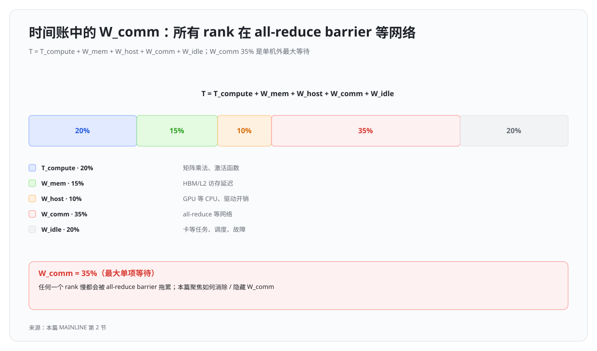
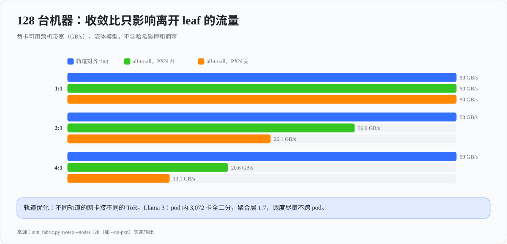
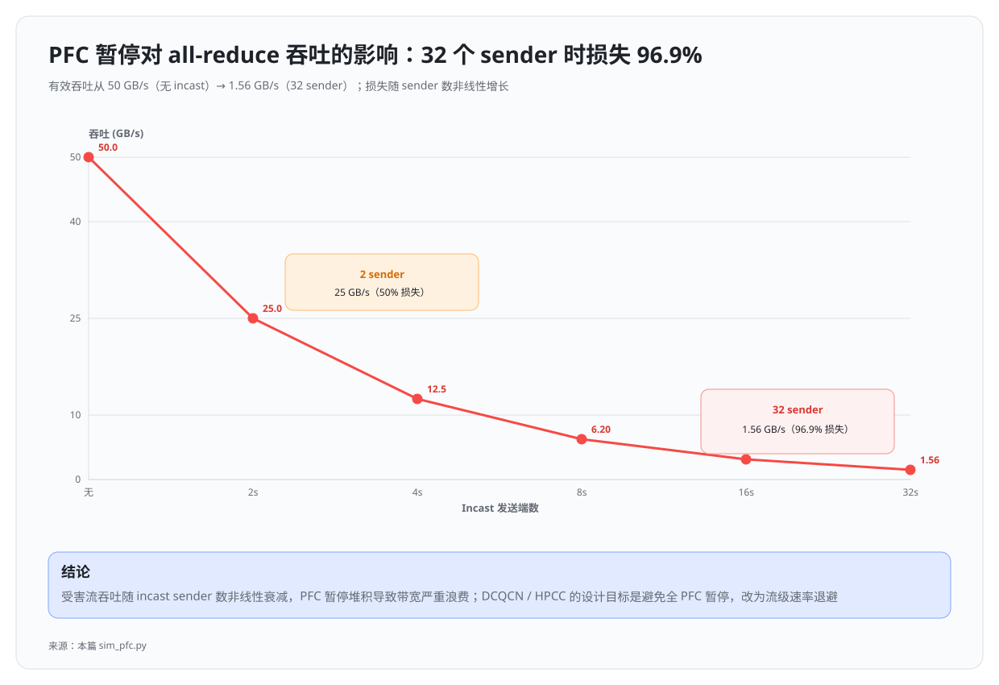

# GPU-17｜集群｜RDMA 网络：InfiniBand、RoCE 与拥塞控制

> 🎯 **这篇文档解决什么问题**：训练扩到多台机器后，集合通信要经过网卡和交换机，每卡每方向只有 NVLink 的九分之一带宽，而且网络里的拥塞还会再打折扣。本篇按 DCQCN 和微软 RoCE 部署的论文、Meta 和阿里巴巴的训练网络实践、Llama 3 论文以及 NCCL 文档，讲清 RDMA 网络为什么要求不丢包，拓扑、ECMP 哈希、PFC 和拥塞控制各让通信等在哪里，以及主机侧要怎样配置、怎样分层诊断。

**使用方式**：第 1、2 章讲跨机这一跳的上限和两种 RDMA 网络。第 3 到 7 章讲网络里的等待：拓扑、哈希、PFC、拥塞控制、多路径。第 8 章讲主机配置，第 9 章讲诊断，第 10 章给清单和自测。

**代码**：zero-to-gpu/17-rdma/ 下的 sim_fabric.py、sim_ecmp.py、sim_pfc.py 只需 Python 标准库，另有两个要在 RDMA 机器上运行的脚本。sim_ecmp.py 需要 Python 3.12 以上，perftest 脚本的参数有误，第 10 章逐条说明。

<b>🧭 主线位置</b>：GPU-00（[GPU-00｜索引｜从 0 开始 GPU 优化：路线、章节与练习](./README.md)）建立了时间账 T = T_compute + W_mem + W_host + W_comm + W_idle。GPU-13（[GPU-13｜单机｜NVLink 与 NVSwitch](./13-nvlink.md)）处理了机内的 W_comm，GPU-16（[GPU-16｜单机｜单机验收与调优](./16-node-burnin.md)）验收了单台机器。本篇处理跨机那部分 W_comm 里网络造成的等待。集合通信库怎样用这张网络，交给 GPU-18（[GPU-18｜集群｜NCCL：算法、协议与挂死排查](./18-nccl.md)）。

## 导读 · 先给结论

- <b>跨机这一跳窄得多。</b>H100 的 NVLink 每方向 450 GB/s，400 Gbps 网卡每方向 50 GB/s（第 1 章）。[[1]](https://developer.nvidia.com/blog/nvidia-hopper-architecture-in-depth/)[[2]](https://docs.nvidia.com/dgx/dgxh100-user-guide/introduction-to-dgxh100.html)
- <b>RDMA 假设网络不丢包。</b>IB 靠链路层信用流控，RoCEv2 靠 PFC；Llama 3 在两种网络上调到了同等性能（第 2 章）。[[3]](https://conferences.sigcomm.org/sigcomm/2015/pdf/papers/p523.pdf)[[4]](https://arxiv.org/pdf/2407.21783)
- <b>收敛比只影响离开 leaf 的流量。</b>轨道对齐的 ring 不受影响，all-to-all 受影响大；Llama 3 的聚合层是 1:7（第 3 章）。[[5]](https://ennanzhai.github.io/pub/sigcomm24-hpn.pdf)[[4]](https://arxiv.org/pdf/2407.21783)
- <b>训练流量的熵太低。</b>ECMP 让少量大流挤在一起，Meta 用多 QP 加按 QP 哈希，AllReduce 最多提升 40%（第 4 章）。[[6]](https://engineering.fb.com/2024/08/05/data-center-engineering/roce-network-distributed-ai-training-at-scale/)
- <b>PFC 暂停会扩散。</b>按端口和优先级暂停，造成队头阻塞，大规模部署遇到过死锁和暂停风暴（第 5 章）。[[3]](https://conferences.sigcomm.org/sigcomm/2015/pdf/papers/p523.pdf)[[7]](https://www.microsoft.com/en-us/research/wp-content/uploads/2016/11/rdma_sigcomm2016.pdf)
- <b>拥塞控制没有通用参数。</b>DCQCN 靠 ECN 和 CNP 让发送端降速；Meta 在 400G 上停用了它，改用接收端准入（第 6 章）。[[3]](https://conferences.sigcomm.org/sigcomm/2015/pdf/papers/p523.pdf)[[6]](https://engineering.fb.com/2024/08/05/data-center-engineering/roce-network-distributed-ai-training-at-scale/)
- <b>PXN 让流量留在轨道内。</b>跨轨道的数据先经 NVLink 换到同号卡（第 7 章）。[[8]](https://docs.nvidia.com/deeplearning/nccl/user-guide/docs/env.html)

<b>📎 与系列其他文档的分工</b>：GPU-11（[GPU-11｜系统｜PCIe、NUMA 与 GPUDirect](./11-pcie-gdr.md)）讲 PCIe 和 GPUDirect RDMA，本篇只说明 NCCL 怎样选用。GPU-13（[GPU-13｜单机｜NVLink 与 NVSwitch](./13-nvlink.md)）讲机内互连和 nccl-tests。GPU-18（[GPU-18｜集群｜NCCL：算法、协议与挂死排查](./18-nccl.md)）讲 NCCL 的算法、协议和挂死排查。GPU-22（[GPU-22｜LLM｜MoE 与专家并行：all-to-all 与负载均衡](./22-moe-ep.md)）讲 MoE 的 all-to-all，它对收敛比最敏感。

## 第 1 章 · 跨机这一跳在等什么

GPU-13 讲了机内的 NVLink，GPU-16 验收了单台机器。训练规模一旦超过一台机器，集合通信就要经过网卡和交换机。本章先算清跨机这一跳和机内差多少，再说明 RDMA 网络为什么要求不丢包，以及这个要求带来的一串问题。

### 机内和跨机差一个数量级

H100 的 NVLink 总带宽是 900 GB/s[[1]](https://developer.nvidia.com/blog/nvidia-hopper-architecture-in-depth/)，每个方向 450 GB/s。DGX H100 为集群网络配了 8 块单口 ConnectX-7 网卡[[2]](https://docs.nvidia.com/dgx/dgxh100-user-guide/introduction-to-dgxh100.html)，每块最高 400 Gb/s[[2]](https://docs.nvidia.com/dgx/dgxh100-user-guide/introduction-to-dgxh100.html)，换算成每个方向 50 GB/s。也就是说，一张卡经 NVLink 能发出 450 GB/s，经自己的网卡只有 50 GB/s，相差 9 倍。按整机算，8 张卡的 NVLink 每方向合计 3600 GB/s，8 块网卡合计 400 GB/s。

这个差距决定了多机训练的通信设计：尽量把通信量大的并行维度放在机内（GPU-21），跨机的那部分要把网卡用满，并且不能让网络里的拥塞再打折扣。时间账上，跨机通信计入 W_comm，没有被计算重叠掉的部分直接拉长每一步。

### RDMA 要求网络不丢包

RDMA 让网卡直接在两端预先注册的内存之间搬数据，传输协议完全在网卡上实现，绕过主机的协议栈[[3]](https://conferences.sigcomm.org/sigcomm/2015/pdf/papers/p523.pdf)，所以 CPU 开销和延迟都低。代价是这套协议为了简单，假设网络不丢包[[3]](https://conferences.sigcomm.org/sigcomm/2015/pdf/papers/p523.pdf)。InfiniBand 在链路层用逐跳的信用流控满足这个假设；以太网上的 RoCEv2 要靠 PFC 暂停帧（第 2、5 章）。不丢包的网络里，拥塞不会表现为丢包重传，而是表现为暂停和排队，这会沿链路向上游扩散，影响无关的流量。

跨机这一跳的等待因此有几类来源：拓扑和收敛比限制了能用的带宽（第 3 章），ECMP 哈希让多条大流挤在同一条链路上（第 4 章），incast 触发 PFC 暂停（第 5 章），拥塞控制的参数和固件（第 6 章），以及网卡、GID、GPUDirect 的配置（第 8 章）。

按五步闭环看跨机通信：

- **定天花板**：每卡网卡带宽，400 Gb/s 即每方向 50 GB/s。
- **测实际**：perftest 测两机点对点，nccl-tests 测集合通信（第 9 章）。
- **定位等待**：拓扑、哈希碰撞、PFC 暂停、拥塞控制、配置。
- **消除或隐藏**：调度感知拓扑、增加流的熵、调拥塞控制、和计算重叠。
- **复测**：每改一处，重跑同样的测试。

一个常见的误区是拿机内的 busbw 推算多机训练的通信时间。现象是从 8 卡扩到 16 卡，步时间增加远超预期。原因是跨机后环上最慢的一跳变成网卡，每方向只有 50 GB/s，是 NVLink 的九分之一。改法是按跨机带宽重新算通信时间，并检查并行切分是否把大流量留在了机内。

> 🔑 **本章要点**：跨机这一跳每卡每方向 50 GB/s，是 NVLink 450 GB/s 的九分之一。RDMA 把协议放在网卡上，假设网络不丢包；以太网靠 PFC 实现这一点，拥塞因此表现为暂停和排队，而不是丢包。这一章是五步闭环的“定天花板”：跨机的上限由网卡决定。

## 第 2 章 · InfiniBand 与 RoCEv2：不丢包的两种做法

两种网络都能跑 RDMA，区别在于怎样做到不丢包、怎样分散流量。选哪一种牵涉成本、运维团队和已有设施，本章只比较和性能、排障直接相关的机制。

### 机制对比

|  | InfiniBand | RoCEv2 |
|---|---|---|
| 封装 | IB 自己的协议栈和专用硬件 | RDMA 传输包封装在以太网、IPv4、UDP 里 |
| 不丢包靠什么 | 链路层逐跳信用流控 | PFC 暂停帧，按优先级 |
| 多路径 | 子网管理器配置路由，NCCL 默认使用自适应路由 | ECMP 按 UDP 头哈希，目的端口固定 4791，源端口每个 QP 随机 |
| 公开的大规模案例 | Llama 3 较小的模型（Quantum2） | Llama 3 405B；Meta、阿里巴巴的训练网络 |

InfiniBand 的链路层用逐跳、基于信用的流控防止缓冲区溢出丢包[[3]](https://conferences.sigcomm.org/sigcomm/2015/pdf/papers/p523.pdf)：下游有空间才给上游发信用，上游有信用才发。RoCEv2 把 RDMA 传输包封装进以太网、IPv4 和 UDP 包[[7]](https://www.microsoft.com/en-us/research/wp-content/uploads/2016/11/rdma_sigcomm2016.pdf)，因此能跑在已有的以太网设施上。UDP 头是为了 ECMP 多路径：目的端口固定为 4791，源端口按 QP 随机选择[[7]](https://www.microsoft.com/en-us/research/wp-content/uploads/2016/11/rdma_sigcomm2016.pdf)，交换机用标准五元组哈希，同一个 QP 的流量走同一条路径[[7]](https://www.microsoft.com/en-us/research/wp-content/uploads/2016/11/rdma_sigcomm2016.pdf)。这一点决定了第 4 章的哈希碰撞问题。多路径方面，NCCL 在 IB 网络上默认打开自适应路由，在 RoCE 网络上默认关闭[[8]](https://docs.nvidia.com/deeplearning/nccl/user-guide/docs/env.html)（第 7 章）。

### 大规模实践里两者都能用

Llama 3 405B 在 RoCE 网络上训练[[4]](https://arxiv.org/pdf/2407.21783)，同一系列较小的模型在 Quantum2 InfiniBand 上训练[[4]](https://arxiv.org/pdf/2407.21783)，两套网络的卡间互连都是 400 Gbps[[4]](https://arxiv.org/pdf/2407.21783)，团队把两者调到了同等的性能[[4]](https://arxiv.org/pdf/2407.21783)。公开资料里，RoCE 的大规模部署记录了更多需要处理的问题：PFC 引起的死锁、传输层活锁和网卡的暂停帧风暴[[7]](https://www.microsoft.com/en-us/research/wp-content/uploads/2016/11/rdma_sigcomm2016.pdf)，ECMP 的低熵[[6]](https://engineering.fb.com/2024/08/05/data-center-engineering/roce-network-distributed-ai-training-at-scale/)，以及拥塞控制在新速率下的调参[[6]](https://engineering.fb.com/2024/08/05/data-center-engineering/roce-network-distributed-ai-training-at-scale/)。这些在第 4 到 6 章展开。

按五步闭环比较两种网络：

- **定天花板**：两者的网卡速率相同时，带宽上限相同。
- **测实际**：同样的 perftest 和 nccl-tests，在两种网络上各测一次。
- **定位等待**：IB 看子网管理器和路由；RoCE 看 PFC、ECN 和哈希。
- **消除或隐藏**：按各自的机制调。
- **复测**：在目标规模上测，而不只是两台机器。

一个常见的误区是在两台机器上测出 RoCE 和 IB 带宽一样，就认为大规模下也一样。现象是两机测试达标，扩到几百台后 RoCE 集群的集合通信明显变慢。原因是两台机器之间没有哈希碰撞和 incast，RoCE 的问题都出现在多路径和多对一的场景。改法是按目标规模和真实流量模式测，并单独测 incast 场景。

> 🔑 **本章要点**：InfiniBand 用链路层信用流控做到不丢包，RoCEv2 用 PFC，并靠 UDP 源端口让 ECMP 分散流量，同一 QP 走同一路径。Llama 3 在两种网络上调到了同等性能，RoCE 要额外处理哈希、PFC 和拥塞控制。这一章是五步闭环的“定天花板”：两者上限相同，差在怎样逼近上限。

## 第 3 章 · 拓扑与收敛比：哪些流量离开 leaf

网卡带宽是上限，拓扑决定流量能不能用满它。训练集群的网络普遍采用轨道优化的 leaf-spine 结构，再按规模决定上层是否收敛。本章说明轨道优化的含义、收敛比影响哪类流量，以及两个公开的大规模拓扑。

### 轨道优化：同号网卡接同一组交换机

阿里巴巴 HPN 的论文这样描述轨道优化：属于不同轨道的网卡接到不同的 ToR 交换机[[5]](https://ennanzhai.github.io/pub/sigcomm24-hpn.pdf)。一台 8 卡机器的第 i 号网卡和所有机器的第 i 号网卡在同一条轨道上，同号卡之间通信只经过本轨道的交换机。HPN 再加上双 ToR，一台主机在后端网络里接 16 台 ToR[[5]](https://ennanzhai.github.io/pub/sigcomm24-hpn.pdf)；它这样设计的原因是 ToR 单点故障对训练影响最大[[5]](https://ennanzhai.github.io/pub/sigcomm24-hpn.pdf)。NCCL 的 NCCL_CROSS_NIC 取值取决于网络是不是轨道优化的[[8]](https://docs.nvidia.com/deeplearning/nccl/user-guide/docs/env.html)，设为 0 时同一个 ring 或 tree 始终用同一块网卡，避免跨轨道[[8]](https://docs.nvidia.com/deeplearning/nccl/user-guide/docs/env.html)。

Meta 的训练集群用两张独立的网络[[6]](https://engineering.fb.com/2024/08/05/data-center-engineering/roce-network-distributed-ai-training-at-scale/)：前端网络负责数据读取、checkpoint 等，后端网络专给分布式训练用，两者互不干扰。

### 收敛比只影响离开 leaf 的流量

leaf 交换机的端口一部分向下接网卡，一部分向上接 spine，下行与上行之比就是收敛比。只在 leaf 内的流量不受影响，离开 leaf 的流量共享上行。仓库的 sim_fabric.py 按这个模型计算 128 台机器、每卡 400 Gb/s 时的每卡可用带宽：

| 收敛比 | leaf / 轨道 | ring GB/s | all-to-all，PXN 开 | all-to-all，PXN 关 |
|---|---|---|---|---|
| 1:1 | 4 | 50.0 | 50.0 | 50.0 |
| 2:1 | 4 | 50.0 | 36.9 | 26.1 |
| 4:1 | 3 | 50.0 | 20.6 | 13.1 |

轨道对齐的 ring 每台 leaf 只有两条边离开 leaf，所以在三种收敛比下都是 50.0 GB/s；all-to-all 的目的地分散在所有 leaf 上，收敛比从 1:1 到 4:1，每卡从 50.0 掉到 20.6 GB/s。关掉 PXN 后跨轨道的流量也要经过 spine，4:1 时只剩 13.1 GB/s（PXN 见第 7 章）。32 台机器时每条轨道只要一台 leaf，ring 和 all-to-all 都是 50.0 GB/s。这是一个流体模型，没有包含哈希碰撞和拥塞（第 4、5 章）。

公开的大规模拓扑都在按这个思路取舍。Llama 3 的 RoCE 集群里，每个机架 16 张卡、两台服务器[[4]](https://arxiv.org/pdf/2407.21783)，192 个机架组成一个 3,072 卡的 pod，pod 内全二分带宽[[4]](https://arxiv.org/pdf/2407.21783)；8 个 pod 组成 24K 卡的集群[[4]](https://arxiv.org/pdf/2407.21783)，聚合层的收敛比是 1:7[[4]](https://arxiv.org/pdf/2407.21783)。并行方式和作业调度都按拓扑优化，尽量减少跨 pod 的通信[[4]](https://arxiv.org/pdf/2407.21783)。HPN 用两层双平面结构在一个 pod 里连接 15K 张卡[[5]](https://ennanzhai.github.io/pub/sigcomm24-hpn.pdf)。

按五步闭环看拓扑：

- **定天花板**：每卡网卡带宽，以及流量离开 leaf 的比例乘以收敛比。
- **测实际**：在同一 leaf 内和跨 leaf 各测一次 nccl-tests。
- **定位等待**：跨 leaf 明显变慢时，看收敛比和流量模式。
- **消除或隐藏**：调度把作业放在同一 leaf 或 pod 内；保持 NCCL 轨道对齐。
- **复测**：按作业实际的放置测。

一个常见的误区是用 all-reduce 的测试结果评估 MoE 作业的网络。现象是 all-reduce 达标，MoE 的 all-to-all 却慢一截。原因是轨道对齐的 ring 几乎不离开 leaf，不受收敛比影响，all-to-all 则大量跨 leaf。改法是按作业的集合通信类型分别测，MoE 作业单测 all-to-all（GPU-22）。

> 🔑 **本章要点**：轨道优化让同号网卡接同一组交换机，NCCL 的 ring 沿轨道走，几乎不受收敛比影响；all-to-all 跨 leaf 多，按模型在 4:1 下每卡从 50.0 掉到 20.6 GB/s。Llama 3 的 pod 内无收敛、聚合层 1:7，调度尽量不跨 pod。这一章是五步闭环的“定位等待”：先看流量离不离开 leaf。

## 第 4 章 · ECMP 哈希：少量大流挤在同一条链路上

leaf 到 spine 有多条等价路径，交换机用 ECMP 按包头哈希选一条。普通数据中心流量多而小，哈希能摊匀；训练流量少而大，哈希很容易让两条大流落在同一条链路上，各拿一半带宽。本章说明这个问题为什么在训练网络里特别突出，以及公开部署的三种处理办法。

### 训练流量的熵太低

ECMP 按五元组哈希，即源和目的 IP、源和目的 UDP 端口、协议，随机地把流放到路径上[[6]](https://engineering.fb.com/2024/08/05/data-center-engineering/roce-network-distributed-ai-training-at-scale/)。RoCEv2 同一个 QP 的流量走同一条路径[[7]](https://www.microsoft.com/en-us/research/wp-content/uploads/2016/11/rdma_sigcomm2016.pdf)，一个 QP 就是一条流。HPN 的论文指出，LLM 训练在每台主机上只产生少量周期性的突发流[[5]](https://ennanzhai.github.io/pub/sigcomm24-hpn.pdf)，这让 ECMP 容易出现哈希极化，流量分布不均[[5]](https://ennanzhai.github.io/pub/sigcomm24-hpn.pdf)。Meta 的经验相同：由于流的熵太低，ECMP 在训练负载上表现很差[[6]](https://engineering.fb.com/2024/08/05/data-center-engineering/roce-network-distributed-ai-training-at-scale/)。

仓库的 sim_ecmp.py 用随机哈希模拟这个过程：16 条流哈希到 8 条上行，合计 400.0 GB/s。理想情况下每条流 25.00 GB/s；按一万次抽样的平均，最挤的那条上行有 4.18 条流，每条流只剩 11.96 GB/s，是理想值的 47.8%；最坏的一次有 9 条流挤在同一条上行，每条 5.56 GB/s。集合通信要等最慢的流，所以按最挤的那条上行算。

### 三种处理办法

- **固定路径**：Meta 早期按目的地把流量固定到指定路径。机架只分配了一部分给作业、或网络有故障时，流量分布不均，训练性能下降超过 30%[[6]](https://engineering.fb.com/2024/08/05/data-center-engineering/roce-network-distributed-ai-training-at-scale/)；短期缓解办法是把 ToR 上行带宽翻倍[[6]](https://engineering.fb.com/2024/08/05/data-center-engineering/roce-network-distributed-ai-training-at-scale/)，成本很高。
- **增加流的数量**：集合通信库把一个连接拆到多个 QP 上，交换机再按目的 QP 字段做哈希，Meta 称为 E-ECMP[[6]](https://engineering.fb.com/2024/08/05/data-center-engineering/roce-network-distributed-ai-training-at-scale/)，AllReduce 性能最多提升 40%[[6]](https://engineering.fb.com/2024/08/05/data-center-engineering/roce-network-distributed-ai-training-at-scale/)。Llama 3 的集合通信库在两张卡之间建 16 条流[[4]](https://arxiv.org/pdf/2407.21783)，E-ECMP 哈希 RoCE 头里的额外字段把它们分散开[[4]](https://arxiv.org/pdf/2407.21783)。NCCL 里对应的是 NCCL_IB_QPS_PER_CONNECTION，适用于需要多个 QP 获得足够路由熵的多级网络[[8]](https://docs.nvidia.com/deeplearning/nccl/user-guide/docs/env.html)，取值 1 到 128，默认 1[[8]](https://docs.nvidia.com/deeplearning/nccl/user-guide/docs/env.html)。
- **减少需要哈希的层级**：HPN 用两层双平面结构，在聚合层避免了哈希极化[[5]](https://ennanzhai.github.io/pub/sigcomm24-hpn.pdf)。

Meta 也指出，增加流数之后，哈希的概率性仍然是这类路由的一个持续的缺点[[6]](https://engineering.fb.com/2024/08/05/data-center-engineering/roce-network-distributed-ai-training-at-scale/)，所以还需要拥塞控制和自适应路由兜底（第 6、7 章）。

按五步闭环处理哈希碰撞：

- **定天花板**：上行总带宽除以流数。
- **测实际**：跨 leaf 的 nccl-tests，多次重复看波动。
- **定位等待**：交换机上行端口的利用率是否明显不均。
- **消除或隐藏**：增加 QP 数、交换机按 QP 哈希、调度减少跨 leaf。
- **复测**：重复多次，看最差值是否改善。

一个常见的误区是只跑一次 nccl-tests 就下结论。现象是同一组机器，有时带宽达标，有时只有一半。原因是每次建连接时 QP 的源端口随机，哈希结果随之变化，一次测试只抽到了一种分布。改法是重复多次建连接测试，看分布和最差值，并检查交换机上行端口的利用率。

> 🔑 **本章要点**：ECMP 按五元组哈希，一个 QP 一条路径；训练流量少而大，熵太低，模拟中 16 条流哈希到 8 条上行时只有理想值的 47.8%。处理办法是固定路径、拆成多个 QP 并按 QP 哈希、或者减少需要哈希的层级。这一章是五步闭环的“定位等待”：找出被哈希挤在一起的流。

## 第 5 章 · PFC：不丢包的代价是暂停会扩散

RoCE 靠 PFC 做到不丢包：交换机某个端口的队列快满时，向上游发暂停帧，上游停发一段时间。这个机制简单可靠，但它暂停的是整个端口上的一个优先级，而不是造成拥塞的那条流。本章说明暂停帧的时长、它带来的队头阻塞和不公平，以及大规模部署遇到的死锁和风暴。

### 暂停帧和它的时长

PFC 由 IEEE 802.1Qbb 标准化[[9]](https://en.wikipedia.org/wiki/Ethernet_flow_control)，暂停帧对八个优先级分别给出暂停时间[[9]](https://en.wikipedia.org/wiki/Ethernet_flow_control)。时间字段是一个 0 到 65535 的整数[[9]](https://en.wikipedia.org/wiki/Ethernet_flow_control)，单位是 quanta，每个 quanta 等于 512 个比特时间[[9]](https://en.wikipedia.org/wiki/Ethernet_flow_control)。所以一个暂停帧最长让 400 Gb/s 的链路停 65535 × 512 比特的时间，约 83.9 微秒；仓库的 sim_pfc.py quanta 算出 100、200、800 Gb/s 下分别是 335.5、167.8、41.9 微秒。速率越高，一个暂停帧的上限越短，交换机就要更频繁地发帧。

### 队头阻塞、受害流和扩散

PFC 按端口和优先级暂停，不按流暂停，这会造成队头阻塞[[3]](https://conferences.sigcomm.org/sigcomm/2015/pdf/papers/p523.pdf)；DCQCN 的论文用实验展示了 PFC 带来的队头阻塞和不公平[[3]](https://conferences.sigcomm.org/sigcomm/2015/pdf/papers/p523.pdf)。典型场景是 incast：多个发送端同时发往一个接收端，出口满了，交换机暂停上游端口，和 incast 共用这个上游端口的无关流量（受害流）也一起停下。

| incast 发送端数 | 每发送端 GB/s | 上游端口暂停占比 | 受害流，PFC | 受害流，DCQCN |
|---|---|---|---|---|
| 2 | 25.0 | 50% | 25.0 | 25.0 |
| 8 | 6.2 | 88% | 6.2 | 43.8 |
| 32 | 1.6 | 97% | 1.6 | 48.4 |

表中是仓库 sim_pfc.py incast 的输出，链路 400 Gb/s、Xoff 阈值 512 KB，采用流体近似，忽略反应时间。8 个发送端时，每个只能拿 6.2 GB/s，上游端口有 88% 的时间被暂停，受害流在 PFC 下也只剩 6.2 GB/s；如果用 DCQCN 让发送端提前降速、不触发暂停，受害流能拿到 43.8 GB/s（第 6 章）。

暂停还会逐跳向上游扩散。微软在大规模部署 RoCEv2 时遇到了 PFC 引起的死锁、RDMA 传输层活锁，以及网卡不停发暂停帧的风暴[[7]](https://www.microsoft.com/en-us/research/wp-content/uploads/2016/11/rdma_sigcomm2016.pdf)，最后在网卡和 ToR 交换机两处都加了看门狗[[7]](https://www.microsoft.com/en-us/research/wp-content/uploads/2016/11/rdma_sigcomm2016.pdf)，发现持续暂停就切断。

按五步闭环处理 PFC：

- **定天花板**：不触发暂停时的线速。
- **测实际**：交换机和网卡的 PFC 暂停帧计数、暂停时长。
- **定位等待**：暂停从哪个端口开始，是 incast 还是慢接收端。
- **消除或隐藏**：拥塞控制让发送端提前降速，看门狗防风暴，调度减少 incast。
- **复测**：暂停计数和受害流吞吐都要看。

一个常见的误区是看到不丢包就认为网络健康。现象是没有丢包、没有重传，但部分作业的通信时间忽长忽短。原因是拥塞变成了暂停，暂停又拖累了共用端口的其他作业。改法是把 PFC 暂停帧计数和暂停时长纳入监控，按端口告警。

> 🔑 **本章要点**：PFC 按端口和优先级暂停，一帧最长约 83.9 微秒（400 Gb/s）；它不区分流，incast 时共用上游端口的受害流一起停下，按模型 8 个发送端时上游有 88% 的时间被暂停。大规模部署还遇到过死锁和暂停风暴，需要看门狗。这一章是五步闭环的“定位等待”：找到暂停从哪里开始。

## 第 6 章 · 拥塞控制：DCQCN、ECN 与接收端准入

PFC 是最后一道防线，触发了就会暂停一片流量。拥塞控制的目标是在队列涨到 PFC 阈值之前，让发送端自己降速。RoCE 上最常见的是 DCQCN，它依靠交换机的 ECN 标记。本章说明 DCQCN 的三个角色，以及公开部署里它遇到的问题和替代做法。

### DCQCN 怎样工作

DCQCN 是基于速率的端到端拥塞控制，建立在 QCN 和 DCTCP 之上[[3]](https://conferences.sigcomm.org/sigcomm/2015/pdf/papers/p523.pdf)，大部分功能在网卡里实现[[3]](https://conferences.sigcomm.org/sigcomm/2015/pdf/papers/p523.pdf)。它有三个角色：

- <b>交换机（拥塞点）</b>：出口队列长度超过阈值时，给到达的包打 ECN 标记[[3]](https://conferences.sigcomm.org/sigcomm/2015/pdf/papers/p523.pdf)。标记概率在 Kmin 和 Kmax 之间随队列长度上升，最高到 Pmax。
- <b>接收端网卡（通知点）</b>：收到带标记的包，就给这条流的发送端回 CNP；每条流每 N 微秒最多发一个 CNP[[3]](https://conferences.sigcomm.org/sigcomm/2015/pdf/papers/p523.pdf)，论文的部署里 N 取 50 微秒[[3]](https://conferences.sigcomm.org/sigcomm/2015/pdf/papers/p523.pdf)。
- <b>发送端网卡（反应点）</b>：收到 CNP 就按比例降速，一段时间没有 CNP 再逐步提速。

第 5 章的模型里，DCQCN 让队列停在 Kmin 附近，不触发 PFC，8 个 incast 发送端时受害流能拿到 43.8 GB/s，PFC 下只有 6.2 GB/s。这是理想情况下的结果，真实效果取决于参数和网卡固件。

### 公开部署的经验

Meta 的经验说明参数和固件的影响很大。升级到 400G 时，他们用默认的 DCQCN 参数、并把 ECN 阈值调到 200G 时的两倍，性能反而下降[[6]](https://engineering.fb.com/2024/08/05/data-center-engineering/roce-network-distributed-ai-training-at-scale/)；排查发现固件里的 DCQCN 实现改过，引入了缺陷，CNP 计数也不准[[6]](https://engineering.fb.com/2024/08/05/data-center-engineering/roce-network-distributed-ai-training-at-scale/)。最后他们在 400G 部署上不用 DCQCN[[6]](https://engineering.fb.com/2024/08/05/data-center-engineering/roce-network-distributed-ai-training-at-scale/)，只用 PFC 做流控、不用任何传输层拥塞控制，运行了一年以上[[6]](https://engineering.fb.com/2024/08/05/data-center-engineering/roce-network-distributed-ai-training-at-scale/)。

Meta 用来替代的是接收端驱动的流量准入[[6]](https://engineering.fb.com/2024/08/05/data-center-engineering/roce-network-distributed-ai-training-at-scale/)：发送端的 CPU 代理线程要等接收端发来 clear-to-send 包，才能发起 RDMA write[[6]](https://engineering.fb.com/2024/08/05/data-center-engineering/roce-network-distributed-ai-training-at-scale/)，这样网络上在途的数据量受接收端控制。Llama 3 在 spine 层用了深缓冲交换机，用来吸收集合通信造成的瞬时拥塞[[4]](https://arxiv.org/pdf/2407.21783)。

这些做法说明拥塞控制没有通用的最优参数，要结合速率、拓扑、固件版本和集合通信库的实现一起测。

按五步闭环调拥塞控制：

- **定天花板**：不拥塞时的线速，以及 PFC 不触发时的受害流吞吐。
- **测实际**：ECN 标记数、CNP 数、PFC 暂停计数，配合 incast 测试。
- **定位等待**：是 ECN 阈值太高导致 PFC 先触发，还是太低导致吞吐下降。
- **消除或隐藏**：调 Kmin、Kmax、Pmax，核对网卡固件，或改用接收端准入。
- **复测**：换速率、换固件之后重新测，不沿用旧参数。

一个常见的误区是网络升速后按比例放大旧的 ECN 阈值。现象是 200G 时调好的参数，到 400G 后吞吐不升反降。原因是速率、缓冲和固件实现都变了，阈值不是简单的线性关系，Meta 就遇到了这种情况。改法是在新速率上重新做 incast 测试调参，并核对固件里的 CNP 计数是否正确。

> 🔑 **本章要点**：DCQCN 让交换机按队列长度打 ECN 标记，接收端每 50 微秒最多回一个 CNP，发送端据此降速，目标是赶在 PFC 之前处理拥塞。参数和固件影响很大，Meta 在 400G 上停用了 DCQCN，改用接收端准入。这一章是五步闭环的“消除或隐藏”：让发送端在暂停之前降速。

## 第 7 章 · 多路径与 PXN：把流量分散，并留在轨道内

第 4 章讲了 ECMP 哈希的问题和增加流数的办法。网络和集合通信库还有两种手段：交换机按实时负载选路的自适应路由，以及 NCCL 用 NVLink 先把数据转到目标轨道的 PXN。本章说明两者各解决什么问题，以及在 NCCL 里怎样打开或关闭。

### 自适应路由

ECMP 的路径由包头决定，与链路当时的负载无关。自适应路由让交换机按端口的拥塞情况选择出口。NCCL 的 NCCL_IB_ADAPTIVE_ROUTING 控制是否使用支持自适应路由的传输方式，NCCL 文档说明自适应路由可以改善大规模下的通信性能；它在 IB 网络上默认打开，在 RoCE 网络上默认关闭[[8]](https://docs.nvidia.com/deeplearning/nccl/user-guide/docs/env.html)。RoCE 网络是否支持自适应路由取决于交换机和网卡，打开前要确认两端都支持。

Meta 指出，即使增加了流数，哈希的概率性仍然是 ECMP 的持续缺点[[6]](https://engineering.fb.com/2024/08/05/data-center-engineering/roce-network-distributed-ai-training-at-scale/)，这正是自适应路由要解决的问题。

### PXN：先走 NVLink，再走同号网卡

all-to-all 里，一张卡要把数据发给其他机器上所有编号的卡。轨道优化网络里，第 i 号网卡只直连第 i 条轨道；发给第 j 号卡的数据要么跨轨道经过 spine，要么先在机内经 NVLink 转给第 j 号卡，再从它的网卡发出。后一种就是 PXN：NCCL 文档把它描述为通过 NVLink 和一张中间 GPU，使用非本地的网卡做跨机通信[[8]](https://docs.nvidia.com/deeplearning/nccl/user-guide/docs/env.html)，从 NCCL 2.12 开始提供[[8]](https://docs.nvidia.com/deeplearning/nccl/user-guide/docs/env.html)，用 NCCL_PXN_DISABLE=1 关闭。

第 3 章的 sim_fabric.py 结果显示了 PXN 的作用：128 台机器、收敛比 2:1 时，all-to-all 每卡在 PXN 打开时是 36.9 GB/s，关闭后是 26.1 GB/s；4:1 时分别是 20.6 和 13.1 GB/s。原因是 PXN 让跨轨道的流量在机内完成换轨，网络上只走本轨道。

按五步闭环使用多路径和 PXN：

- **定天花板**：轨道内的带宽，以及收敛比下跨 leaf 的带宽。
- **测实际**：all-to-all 分别在 PXN 开和关时测，IB 网络对比自适应路由开和关。
- **定位等待**：跨轨道流量是否走了 spine，上行是否不均。
- **消除或隐藏**：保持 PXN 打开，确认自适应路由的软硬件支持后打开。
- **复测**：在目标规模上测 all-to-all 和 all-reduce。

一个常见的误区是为了排查问题关掉 PXN 后忘了打开。现象是排障结束后，MoE 作业的 all-to-all 比之前慢。原因是 NCCL_PXN_DISABLE=1 让跨轨道流量都上了 spine，在有收敛的网络里带宽下降。改法是排障用的环境变量在作业模板里显式管理，结束后核对 NCCL 的启动日志。

> 🔑 **本章要点**：自适应路由按实时负载选路，弥补 ECMP 的概率性，NCCL 在 IB 上默认打开、RoCE 上默认关闭。PXN 让跨轨道流量先经 NVLink 换到同号卡，网络上只走本轨道；按模型 4:1 收敛时 all-to-all 从 13.1 提高到 20.6 GB/s。这一章是五步闭环的“消除或隐藏”：分散流量，并让它少离开轨道。

## 第 8 章 · 网卡与主机配置：让每张卡用上自己的网卡

网络本身没问题，主机侧的配置也会让带宽打折：NCCL 选错了网卡、RoCE 用错了 GID、GPU 和网卡之间的数据绕道主机内存。本章说明一台训练机器上网卡的布局，以及 NCCL 里几个和网卡相关的变量。

### 一台机器上的网卡

ConnectX-7 有 1、2、4 口的版本，总带宽最高 400 Gb/s[[10]](https://www.nvidia.com/content/dam/en-zz/Solutions/networking/ethernet-adapters/connectx-7-datasheet-Final.pdf)，主机接口是 PCIe Gen5 x16 或 x32[[10]](https://www.nvidia.com/content/dam/en-zz/Solutions/networking/ethernet-adapters/connectx-7-datasheet-Final.pdf)。DGX H100 有两类网卡：集群网络用 8 块单口 ConnectX-7[[2]](https://docs.nvidia.com/dgx/dgxh100-user-guide/introduction-to-dgxh100.html)，每块最高 400 Gbps[[2]](https://docs.nvidia.com/dgx/dgxh100-user-guide/introduction-to-dgxh100.html)，正好一张 GPU 一块；存储和带内管理另用 2 块双口 ConnectX-7[[2]](https://docs.nvidia.com/dgx/dgxh100-user-guide/introduction-to-dgxh100.html)。训练流量应该只走那 8 块集群网卡，并且每张 GPU 用离自己最近、和它挂在同一个 PCIe 交换芯片下的那一块。

GPU 和网卡挂在同一个 PCIe 交换芯片下时，网卡可以通过 GPUDirect RDMA 直接读写显存，不经过主机内存（GPU-11）。NCCL 用 NCCL_NET_GDR_LEVEL 控制 GPU 与网卡相距多远时仍使用 GPUDirect RDMA[[8]](https://docs.nvidia.com/deeplearning/nccl/user-guide/docs/env.html)，PIX 表示两者在同一个 PCI 交换芯片下时使用[[8]](https://docs.nvidia.com/deeplearning/nccl/user-guide/docs/env.html)。

### NCCL 里和网卡相关的变量

| 变量 | 作用 | 验收时看什么 |
|---|---|---|
| NCCL_IB_HCA | 指定 NCCL 使用哪些 RDMA 网卡 | 只包含计算网卡，不含存储和管理网卡 |
| NCCL_IB_GID_INDEX | RoCE 模式下使用的 GID 索引 | 和 show_gids 里 RoCEv2 的那一项一致 |
| NCCL_NET_GDR_LEVEL | GPU 与网卡相距多远时仍用 GPUDirect RDMA | GPU 和网卡在同一 PCIe 交换芯片下（PIX） |
| NCCL_CROSS_NIC | 是否允许同一 ring 跨网卡 | 轨道优化网络设为 0 或保持默认 |
| NCCL_IB_QPS_PER_CONNECTION | 每个连接用几个 QP | RoCE 多级网络按需加大 |

NCCL_IB_HCA 指定用于通信的 RDMA 网卡[[8]](https://docs.nvidia.com/deeplearning/nccl/user-guide/docs/env.html)，在有存储网卡的机器上要显式列出计算网卡。NCCL_IB_GID_INDEX 是 RoCE 模式下的 GID 索引[[8]](https://docs.nvidia.com/deeplearning/nccl/user-guide/docs/env.html)，NCCL 文档建议用 show_gids 命令确定取值[[8]](https://docs.nvidia.com/deeplearning/nccl/user-guide/docs/env.html)；新版本默认自动选择，但在多 VLAN、IPv4 和 IPv6 并存的机器上，还是要核对它选中的是 RoCEv2 的那一项。仓库的 show_gids.sh 列出各端口的 GID、RoCE 版本和链路状态，可以直接用。

按五步闭环检查主机配置：

- **定天花板**：每张 GPU 一块 400 Gb/s 网卡。
- **测实际**：NCCL_DEBUG=INFO 的启动日志里，每个 rank 用了哪块网卡、是否用了 GPUDirect RDMA。
- **定位等待**：网卡选错、GID 错、GDR 没开。
- **消除或隐藏**：显式设置 NCCL_IB_HCA 和 GID，核对拓扑。
- **复测**：perftest 加 --use_cuda，再跑 nccl-tests（第 9 章）。

一个常见的误区是让 NCCL 自动选网卡而不核对。现象是跨机带宽只有预期的一部分，网卡计数显示存储网卡上有训练流量。原因是存储网卡也支持 RDMA，被 NCCL 当成了可用网卡。改法是用 NCCL_IB_HCA 只列计算网卡，并在启动日志里确认。

> 🔑 **本章要点**：DGX H100 一张 GPU 配一块 400 Gbps 的集群网卡，另有 2 块存储和管理网卡；训练流量只走集群网卡，并用 GPUDirect RDMA 直读显存。NCCL_IB_HCA、NCCL_IB_GID_INDEX、NCCL_NET_GDR_LEVEL 要和硬件布局一致，并在启动日志里核对。这一章是五步闭环的“测实际”：确认每张卡真的用上了自己的网卡。

## 第 9 章 · 诊断：从一对网卡测到全集群

跨机通信慢，可能慢在链路、网卡、主机配置、交换机或拥塞。诊断要分层，从一对网卡开始，逐步扩大到全规模，每一层都排除一类原因。本章给出分层的顺序和每层用的工具。

### 分层的顺序

| 层 | 工具 | 回答的问题 |
|---|---|---|
| 链路和地址 | ibstat、ibv_devinfo、show_gids.sh | 端口是否 Active，速率是否正确，GID 是否有 RoCEv2 |
| 两机点对点 | ib_write_bw，-x 指定 GID，-a 扫消息大小，--use_cuda 走显存 | 一对网卡之间能否跑满 |
| 集合通信 | nccl-tests，两机到全规模 | 整个环或 all-to-all 能拿多少 busbw |
| 网络计数 | 交换机和网卡的 PFC、ECN、CNP 计数 | 有没有暂停、标记和降速 |

perftest 是 RDMA 的微基准集合，ib_write_bw 用 RDMA write 测带宽[[11]](https://github.com/linux-rdma/perftest)。几个常用参数：-x 指定 GID 索引[[11]](https://github.com/linux-rdma/perftest)，-a 从 2 字节到 2^23 字节扫一遍消息大小[[11]](https://github.com/linux-rdma/perftest)，-c 指定连接类型[[11]](https://github.com/linux-rdma/perftest)，-D 按时长运行[[11]](https://github.com/linux-rdma/perftest)；编译时带上 CUDA，就可以用 --use_cuda 让数据直接从显存发出[[11]](https://github.com/linux-rdma/perftest)，这样测的是 GPUDirect RDMA 的路径，而不是主机内存。

### 读结果

两机点对点达到网卡速率的大部分，说明链路、网卡和主机配置基本正常；再跑两机 nccl-tests，结果明显低于点对点，问题多在 NCCL 的配置（第 8 章）。两机正常、规模扩大后才变慢，问题多在网络：跨 leaf 时看收敛比和哈希（第 3、4 章），incast 时看 PFC 计数（第 5 章）。nccl-tests 的结果要重复多次，ECMP 的哈希每次建连接都会变（第 4 章）。

仓库的 gpu_perftest_bw.sh 不能直接拿来用：它调用的是 ib_send_bw，和 README 写的 ib_write_bw 不一致；参数里 -a 后面跟了 GID_BASED，而 -a 是扫消息大小的开关；-t 被当成传输类型 UD，而 perftest 里 -t 是发送队列深度[[11]](https://github.com/linux-rdma/perftest)；脚本解析了消息大小和时长两个参数却没有用上。脚本注释也写明它没有在真机上测过。第 10 章把这些列为练习。

按五步闭环做诊断：

- **定天花板**：网卡速率和两机点对点的结果。
- **测实际**：按表从上到下逐层测。
- **定位等待**：第一层不达标的地方就是问题所在的层。
- **消除或隐藏**：按层处理，链路换线缆，配置改变量，网络调拥塞控制或调度。
- **复测**：从出问题的那一层重新往上测。

一个常见的误区是直接在全规模上跑训练作业判断网络好坏。现象是作业慢，但不知道是哪台机器、哪条链路、哪个配置。原因是全规模的结果混合了所有层的问题。改法是先两机点对点、再两机集合通信、再逐步扩大规模，每一步留下结果作为基线。

> 🔑 **本章要点**：诊断从一对网卡开始：链路和 GID，ib_write_bw 点对点（--use_cuda 测显存路径），两机 nccl-tests，再扩到全规模，同时看 PFC、ECN、CNP 计数。仓库的 perftest 脚本参数有误，不能直接使用。这一章是五步闭环的“测实际”：一层一层排除原因。

## 第 10 章 · 上线前核对清单与自测

前九章沿着跨机这一跳处理 W_comm：第 1 章算清机内和跨机的差距，第 2 章比较 InfiniBand 和 RoCEv2，第 3 章讲拓扑和收敛比，第 4 章讲 ECMP 哈希，第 5 章讲 PFC，第 6 章讲拥塞控制，第 7 章讲自适应路由和 PXN，第 8 章讲网卡和主机配置，第 9 章讲分层诊断。本章把它们压成一张核对清单，再配上代码练习和自测题。

### 📌 核对清单

| 检查项 | 怎样查 | 通过的标志 |
|---|---|---|
| 网卡布局正确 | NCCL_DEBUG=INFO 启动日志；NCCL_IB_HCA（第 8 章） | 每张 GPU 用自己的集群网卡 |
| GID 和 GDR 正确 | show_gids.sh；日志里的 GDR 标记（第 8 章） | RoCEv2 GID；GPUDirect RDMA 已用 |
| 一对网卡跑满 | ib_write_bw --use_cuda（第 9 章） | 接近网卡速率 |
| 轨道对齐 | NCCL_CROSS_NIC；同 leaf 与跨 leaf 各测一次（第 3 章） | ring 不受收敛比影响 |
| 哈希碰撞可控 | 多次重复 nccl-tests；上行端口利用率（第 4 章） | 最差值和平均值接近 |
| PFC 不频繁 | 交换机和网卡的暂停计数（第 5 章） | 没有持续暂停，看门狗已开 |
| 拥塞控制有效 | incast 测试；ECN、CNP 计数（第 6 章） | 受害流吞吐不被拖垮 |
| PXN 打开 | NCCL_PXN_DISABLE 未设置为 1（第 7 章） | all-to-all 不走 spine 换轨 |

### 代码练习

zero-to-gpu/17-rdma/ 下有 sim_fabric.py、sim_ecmp.py、sim_pfc.py 三个模拟器和对应的测试，以及两个要在 RDMA 机器上运行的脚本。主编在系统自带的 Python 3.9.6 上运行，test_fabric.py 和 test_pfc.py 各 6 条全部通过，sim_fabric.py 和 sim_pfc.py 的输出与 README 一致。有几处问题适合当作找错练习：

- sim_ecmp.py 第 183 行在 f-string 里嵌套了双引号，Python 3.12 之前是语法错误，所以 sim_ecmp.py 和 test_ecmp.py 在 3.9 上都跑不起来。换成 Python 3.14.7 后，sim_ecmp.py 的输出和 README 一致（每流理想 25.00、典型 11.96 GB/s，效率 47.8%）。
- test_ecmp.py 全部通过，但它自己打印出了矛盾的结果：allreduce_latency 一项的碰撞场景比基线更快（41.82 ms 对 61.39 ms），并注明“unexpected”；meta_roce_scenario 一项里上行更多的场景反而更慢（14.2 对 36.4 GB/s）。测试只检查数值落在宽松的区间，没有检查方向。
- sim_ecmp.py 的“典型”带宽用平均意义下最挤的那条上行来算每条流，“最坏”用一万次抽样里的最大值，两者都假设所有流同时满速，没有拥塞控制。
- gpu_perftest_bw.sh 用的是 ib_send_bw 而不是 README 写的 ib_write_bw；-a GID_BASED、-t UD 的用法和 perftest 的参数定义不符；消息大小和时长参数没有用上（第 9 章）。
- sim_fabric.py 和 sim_pfc.py 都是流体模型，不含哈希碰撞、反应时间和缓冲动态，结果只用来比较趋势。

### 自测题

1. DGX H100 的一张卡经 NVLink 和经网卡每方向各能发多少？差几倍？
2. RoCEv2 为什么要把 RDMA 包封装进 UDP？同一个 QP 的流量会走几条路径？
3. 为什么轨道对齐的 ring 几乎不受收敛比影响，而 all-to-all 受影响很大？
4. 16 条大流哈希到 8 条上行，为什么平均下来每条流拿不到 25 GB/s？有哪些办法改善？
5. 400 Gb/s 链路上一个 PFC 暂停帧最长让链路停多久？PFC 为什么会拖累无关的流？
6. Meta 在 400G 部署上为什么停用了 DCQCN？用什么办法控制在途流量？

### 下一步

网络这一层理顺之后，跨机通信的效率还取决于 NCCL 怎样选算法和协议、怎样建环和树，以及通信挂死时怎样排查。这些交给 GPU-18（[GPU-18｜集群｜NCCL：算法、协议与挂死排查](./18-nccl.md)）。

## 参考文献

按正文首次引用顺序编号，资料截至 2026 年 11 月中。

[1] NVIDIA Technical Blog. NVIDIA Hopper Architecture In-Depth (2022) [developer.nvidia.com/blog/nvidia-hopper-architecture-in-depth/](https://developer.nvidia.com/blog/nvidia-hopper-architecture-in-depth/)

[2] NVIDIA. DGX H100 User Guide: Introduction to the NVIDIA DGX H100 System [docs.nvidia.com/dgx/dgxh100-user-guide/introduction-to-dgxh100.html](https://docs.nvidia.com/dgx/dgxh100-user-guide/introduction-to-dgxh100.html)

[3] Zhu et al. Congestion Control for Large-Scale RDMA Deployments. SIGCOMM 2015 [conferences.sigcomm.org/sigcomm/2015/pdf/papers/p523.pdf](https://conferences.sigcomm.org/sigcomm/2015/pdf/papers/p523.pdf)

[4] Llama Team, AI @ Meta. The Llama 3 Herd of Models. arXiv 2407.21783 (2024) [arxiv.org/pdf/2407.21783](https://arxiv.org/pdf/2407.21783)

[5] Qian et al. Alibaba HPN: A Data Center Network for Large Language Model Training. SIGCOMM 2024 [ennanzhai.github.io/pub/sigcomm24-hpn.pdf](https://ennanzhai.github.io/pub/sigcomm24-hpn.pdf)

[6] Engineering at Meta. RoCE networks for distributed AI training at scale (2024) [engineering.fb.com/2024/08/05/data-center-engineering/roce-network-distributed-ai-training-at-scale/](https://engineering.fb.com/2024/08/05/data-center-engineering/roce-network-distributed-ai-training-at-scale/)

[7] Guo et al. RDMA over Commodity Ethernet at Scale. SIGCOMM 2016 [www.microsoft.com/en-us/research/wp-content/uploads/2016/11/rdma_sigcomm2016.pdf](https://www.microsoft.com/en-us/research/wp-content/uploads/2016/11/rdma_sigcomm2016.pdf)

[8] NVIDIA. NCCL User Guide: Environment Variables [docs.nvidia.com/deeplearning/nccl/user-guide/docs/env.html](https://docs.nvidia.com/deeplearning/nccl/user-guide/docs/env.html)

[9] Wikipedia. Ethernet flow control [en.wikipedia.org/wiki/Ethernet_flow_control](https://en.wikipedia.org/wiki/Ethernet_flow_control)

[10] NVIDIA. ConnectX-7 Datasheet [www.nvidia.com/content/dam/en-zz/Solutions/networking/ethernet-adapters/connectx-7-datasheet-Final.pdf](https://www.nvidia.com/content/dam/en-zz/Solutions/networking/ethernet-adapters/connectx-7-datasheet-Final.pdf)

[11] linux-rdma. perftest 代码仓库 [github.com/linux-rdma/perftest](https://github.com/linux-rdma/perftest)

---

[在 Colab 里跑本章 CPU 练习](https://colab.research.google.com/github/chenziyaos/zero-to-gpu/blob/main/colab/17-rdma.ipynb) · 上一章：[GPU-16｜单机｜单机验收与调优](./16-node-burnin.md) · [目录](./README.md) · 下一章：[GPU-18｜集群｜NCCL：算法、协议与挂死排查](./18-nccl.md)
