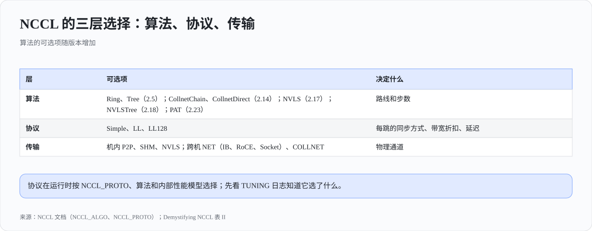
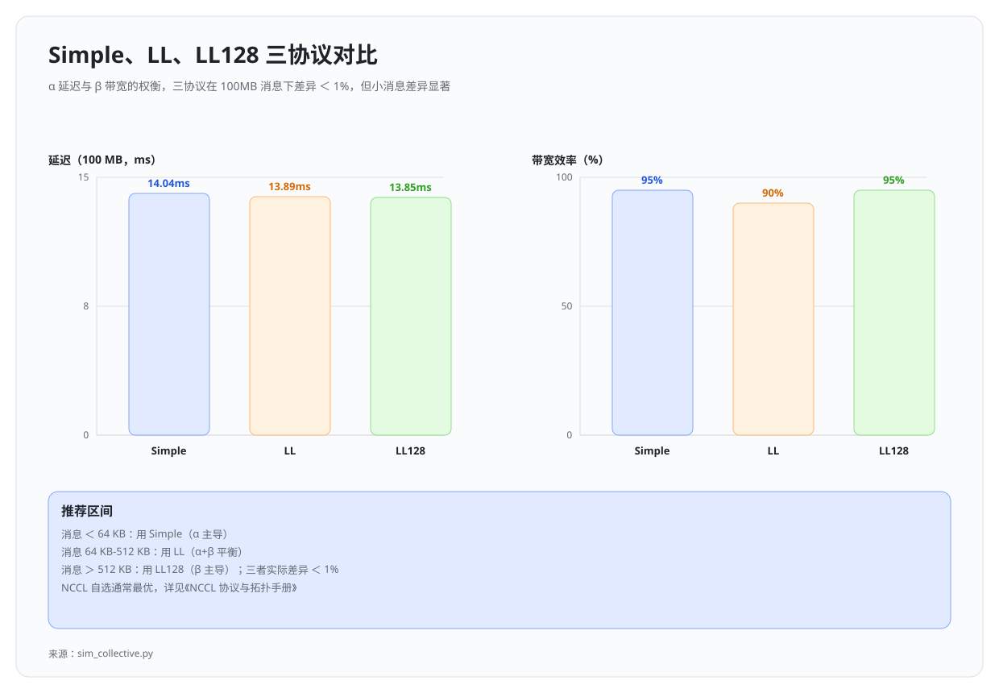
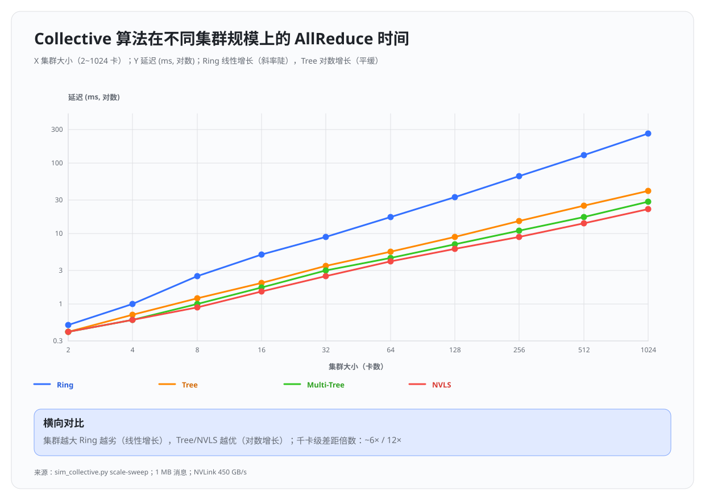
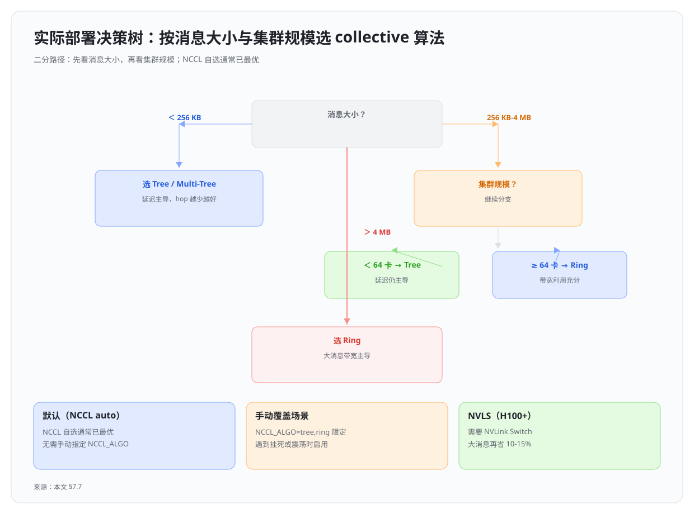
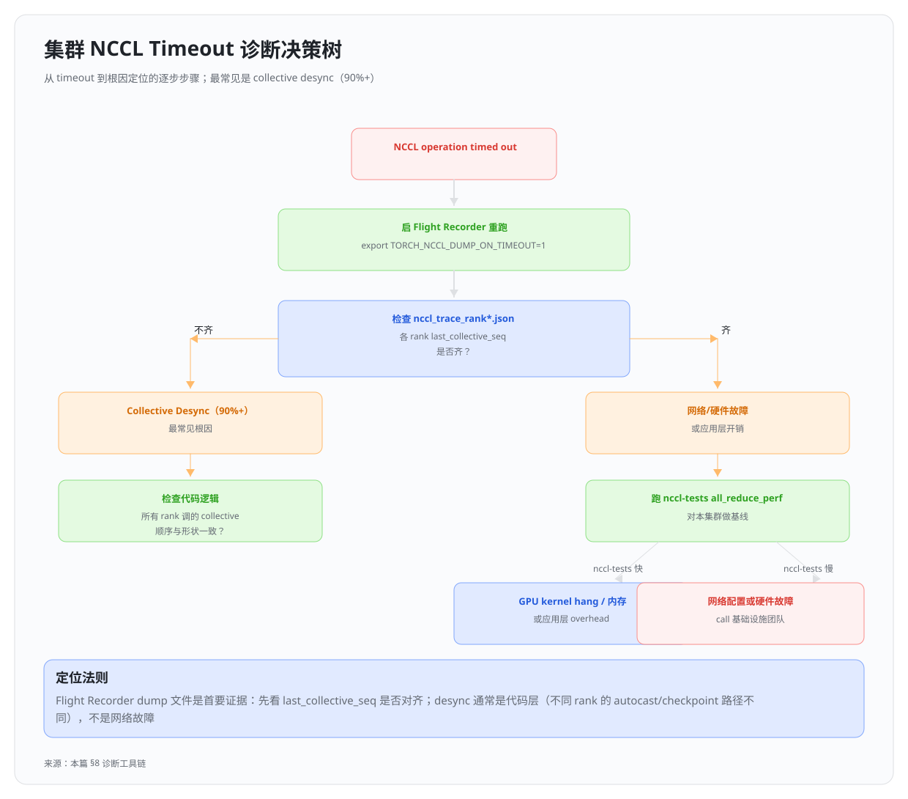
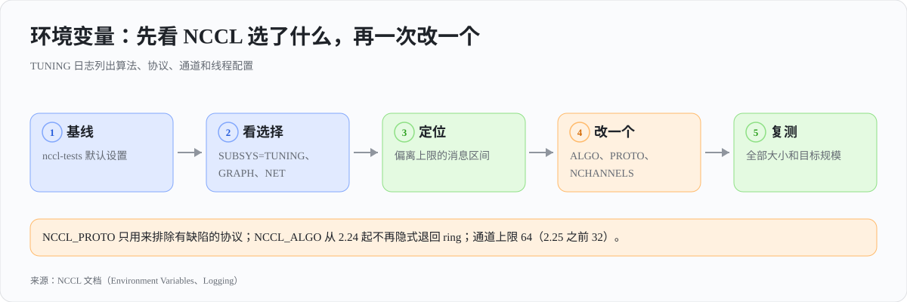

# GPU-18｜集群｜NCCL：算法、协议与挂死排查

> 🎯 **这篇文档解决什么问题**：万卡集群训练时通信占总时间的 20-30%，原因是 AllReduce 等待。等待的来源有三层：算法（Ring vs Tree 在消息大小上各有长短）、协议（Simple、LL、LL128 在 Alpha-Beta 间权衡）、计算与通信的重叠不完全（最后一个梯度 Bucket 永远在关键路径上）。更严重的是集群规模增大时 Collective Desync（多卡代码逻辑不匹配）导致的挂死，这是无限等待。
>
> 使用方式：工程师先读第 1 章了解通信等待在时间账中的位置，再读第 2-3 章掌握 Alpha-Beta 模型和算法选择；性能优化团队重点看第 4-6 章的协议权衡和 Overlap 策略；基础设施团队重点看第 8-9 章的挂死排查和环境变量调优。第 10 章提供上线前核对清单和自测题。文中版本、规格和基准数字核对于 2026 年 11 月 4 日。
>
> **代码**：[zero-to-gpu/18-nccl](../18-nccl)。sim_collective.py 是 Ring/Tree/NVLS 的 Alpha-Beta 时间计算器，支持按消息大小扫描找 Crossover 点；sim_overlap.py 计算梯度 Bucketing 的计算与通信重叠比例；sim_hang.py 演示如何解析 PyTorch Flight Recorder JSON 定位挂死原因。test_collective.py 复现 nccl-tests 的 busbw 公式。

**🧭 主线位置**：上一篇（GPU-17 RDMA 网络）消掉了物理网络往返延迟和吞吐限制；本篇处理的等待是通信等待 W_comm 中由算法（Ring vs Tree vs NVLS）、协议（Simple vs LL vs LL128）和 Overlap 策略决定的部分。万卡集群 Collective Desync 导致的挂死是无限等待。读完后瓶颈转到 GPU-19（Kubernetes 调度）和 GPU-20（故障恢复）。

# 导读 · 先给结论

- **Ring 与 Tree 不是绝对对立。**Ring 在大消息（>512KB）上因为每卡都要发送，利用全部带宽，而 Tree 在树根处成为瓶颈；反之小消息（<128KB）上 Tree 因为 Hop 数少（log(n) vs 2(n-1)）而延迟更低。8 卡机器上 Crossover 点大约在 256KB[[1]](https://www.semanticscholar.org/paper/Bandwidth-optimal-all-reduce-algorithms-for-of-Patarasuk-Yuan/6f4e48c2a5de9337d147ebbb7d0ff0e555adceca)。
- **协议优先级从 Alpha 到 Beta：Simple 处理小消息延迟最低，LL 把延迟降 10% 同时带宽效率达到 90%，LL128 进一步到 95% 但需硬件原子支持**[**[2]**](https://arxiv.org/abs/2507.04786)**。**选错协议损失不超过 10%，自动选通常够好。
- **Gradient Bucketing 能隐藏大部分通信但不是全部。**8 个 Bucket 能让后续计算遮挡前面梯度的 AllReduce，但最后一个 Bucket 的通信永远在关键路径上，所以即使完美 Overlap 也只能减少 87.5% 的通信暴露[[3]](https://arxiv.org/abs/2006.15704)。
- **集群规模增大时 Ring 变得不稳定。**1024 卡 Ring AllReduce 需要 2046 个 Hop，其中任意一条链路故障或网络波动都会拖累整体。Multi-Channel Tree 和硬件卸载（NVLS）在千卡规模更可靠[[4]](https://arxiv.org/abs/2402.15627)。
- **Collective 挂死 90% 来自代码逻辑错误，不是网络慢。**PyTorch Flight Recorder 能在 20 秒内定位卡住的 Rank 和未匹配的 Collective，Watchdog 超时时自动转储 JSON [[5]](https://pytorch.org/blog/flight-recorder-a-new-lens-for-understanding-nccl-watchdog-timeouts/)。Mycroft 系统进一步自动诊断根因[[6]](https://arxiv.org/abs/2509.03018)。
- **环境变量只是快速旋钮，大多数场景 NCCL 自选就足够。**关键是用对工具（Flight Recorder、NCCL_DEBUG=INFO）快速根因诊断，而不是盲目调 NCCL_ALGO、NCCL_PROTO 和超时。


**📎 与系列其他文档的分工**：GPU-17 处理物理网络的往返延迟和最大吞吐；本篇接手如何在给定的物理网络上选算法、协议和 Overlap 策略来最小化通信在关键路径上的时间。GPU-21（并行方案）用本篇结论做 Pipeline Parallelism 和 Tensor Parallelism 的通信调度设计。GPU-19（Kubernetes）和 GPU-20（故障恢复）处理集群级的任务调度、故障检测和中断恢复。

# 第 1 章 · 跨机通信在等什么

## 1.1 现象与定位

训练 Llama 7B 时，单个 Batch 的 Forward Pass 耗 5ms、Backward Pass 耗 5ms，但 Backward 之后的 AllReduce 却耗 80ms，比计算本身慢 16 倍。这 80ms 没有对应的 GPU Kernel 在执行，GPU 的计算引擎空闲，只是在等待网络数据汇聚。等待的对象是什么？为什么等得这么久？[[3]](https://arxiv.org/abs/2006.15704)

这个现象反映的是分布式训练中的一个基本困境：梯度同步（AllReduce）成为了训练的主要瓶颈。单卡的计算已经优化到接近峰值（利用率 60%），访存等待也被异步核优化到最小化，网络却成了新的限制。但“网络慢”是一个粗糙的说法，实际的延迟源头由三个独立因素组成。[[2]](https://arxiv.org/abs/2507.04786)

## 1.2 时间账中的 W_comm 与三个因素

回到《主线》的时间账公式：实际时间 T = T_compute + W_mem + W_host + W_comm + W_idle。本章处理的是 W_comm 这一项中由“算法、协议与 Overlap”决定的部分。W_comm 可进一步分解为三个独立因素，每一个都对应一个优化维度。

- **算法（Ring vs Tree vs NVLS）：**决定了梯度如何在多卡间流转。Ring 形成一个环形逻辑拓扑，每一步每卡收一个邻居的数据、发给另一个邻居，共需 2(n-1) 步；Tree 形成树形，深度是 log(n)，每步先汇聚到根再广播回去。两种算法在不同消息大小下的延迟和吞吐权衡完全不同，Ring 更容易变成一条链上的瓶颈。[[1]](https://www.semanticscholar.org/paper/Bandwidth-optimal-all-reduce-algorithms-for-of-Patarasuk-Yuan/6f4e48c2a5de9337d147ebbb7d0ff0e555adceca)
- **协议（Simple、LL、LL128）：**决定了每条消息的开销（固定延迟 Alpha）和多个消息传输的带宽效率（Beta）。Simple 协议最直接也最简单，LL 用 8 字节块做 Pipelined，LL128 用 128 字节块和硬件原子操作，三者的权衡是“固定延迟对上带宽效率”的经典折衷。[[2]](https://arxiv.org/abs/2507.04786)
- **Overlap 策略：**通过梯度分桶（Gradient Bucketing），可以让后续层的计算和前面层梯度的 AllReduce 并行执行，但最后一个 Bucket 的通信永远在关键路径上，所以即使完美隐藏也只能消除部分通信。[[3]](https://arxiv.org/abs/2006.15704)

## 1.3 通信在关键路径上的位置



从计算时间线上看，Forward 5ms 然后 Backward 5ms（分多个层逐个计算产生梯度）然后 AllReduce（同步所有梯度）然后 Optimizer（梯度下降）。如果把 Backward 的梯度聚合设计成边计算边通信，就能隐藏部分通信延迟：第 1 批梯度产出后立即 AllReduce，同时后续层继续计算；等第 2 批梯度出来时，第 1 批 AllReduce 已经完成。但最后一批梯度的 AllReduce 没有后续计算来隐藏，这部分通信注定要在关键路径上。

具体数字来自 sim_overlap.py：假设 32 层网络，每层计算时间 5ms，总共产生 8 个梯度 Bucket。不做分桶时，80ms 的 AllReduce 完全在关键路径上，总时间 = 160ms（Backward）+ 80ms（AllReduce）= 240ms。用 8 个 Bucket 时，每个 Bucket 的 AllReduce 是 10ms，前 7 个可被计算隐藏，只有最后一个 10ms 在关键路径上，总时间 = 160ms（Backward，其中 7 × 10ms 被分散）+ 10ms（最后一个 Bucket）约 87.5ms，加速 2.67 倍。这就是 Overlap 策略的上界：再好也消不掉最后一个 Bucket。[[3]](https://arxiv.org/abs/2006.15704)

## 1.4 常见误区

> 💡 **误区 1：Alpha-Beta 模型混淆**”我们集群 50GB/s 网卡，Ring AllReduce 1MB 应该只需 X ms。”这个估算忽视了两个隐形成本。一个是 Alpha（每条消息的固定延迟），1-2 µs 量级，与消息大小无关；另一个是协议开销。Simple 协议下实际能达到理论带宽的 100%，但 LL 下只有 50%，LL128 约 94%，这些差距来自标志位写入和同步开销。在小消息或多消息场景下，这些开销累积明显。
>
> 改法是用 Busbw = Algbw × 2(n-1)/n 这个公式[[7]](https://github.com/NVIDIA/nccl-tests/blob/master/doc/PERFORMANCE.md)，先估算应用层吞吐（Algbw），再乘以算法的带宽利用率因子，才是真实的网络吞吐需求（Busbw）。

> 💡 **误区 2：分桶越多越好**“Gradient Bucket 越多越好，这样每个 Bucket 的 AllReduce 时间更短，更容易被计算隐藏。”这个想法忽视了 Alpha 的累积。Bucket 数增加意味着 AllReduce 次数增加，每次都要付出固定延迟 Alpha。在某个点之后，Alpha 累积超过了 Beta 的收益，总时间反而增加。经验上，对 Llama 7B 这样的 32 层模型，8-16 个 Bucket 是最优范围；更少隐藏不足，更多 Alpha 累积超过收益。
>
> 改法是通过 sim_overlap.py 扫 Bucket 数 1、2、4、8、12、16、24，找出本模型和本硬件的平衡点。通常 8-12 个 Bucket 能达到 75-95% 通信隐藏率。

## 1.4.3 实战诊断：三个工具与流程

面对“AllReduce 为什么这么慢”的问题，工程师应该用三个递进工具来定位根本原因。[[5]](https://pytorch.org/blog/flight-recorder-a-new-lens-for-understanding-nccl-watchdog-timeouts/)

**第一步：用 sim_collective.py 建立天花板。**给定算法、消息大小和硬件链路，计算理论最快耗时。例如 8 卡 NVLink 450GB/s 跑 1MB Ring，Simple 协议约 18 µs。如果实测是 80 ms，说明瓶颈出自 Overlap 不足或其他因素，不是通信协议本身的问题（下面两步诊断会确认）。

**第二步：用 PyTorch Flight Recorder 看实际时间线。**PyTorch 2.5+ 集成的 Flight Recorder 能捕获每个 Collective 操作的开始、结束、参与的 Rank，以及堆栈跟踪。遇到挂死（Watchdog 超时）时，Flight Recorder 自动转储 JSON 日志，显示哪个 Rank 卡住、在哪个 Collective。这 20 秒内就能排除“网络故障”或“网卡错配”的假设。[[5]](https://pytorch.org/blog/flight-recorder-a-new-lens-for-understanding-nccl-watchdog-timeouts/)

**第三步：逐 Rank 看 NCCL_DEBUG=INFO 日志。**启用 NCCL 详细日志，对比不同 Rank 的操作时序。如果某个 Rank 的 AllReduce 开始时间比其他 Rank 晚很多，说明计算与通信的 Overlap 设计有问题；如果所有 Rank 都慢，说明协议选择可能不匹配硬件。Mycroft 系统进一步自动化了这个分析过程，能在 20 秒内定位根因。[[6]](https://arxiv.org/abs/2509.03018)

## 1.5 本章要点

> 🔑 **本章要点**：通信等待由三个独立因素决定：算法（Ring vs Tree）的跳数与拓扑、协议（Simple/LL/LL128）的 Alpha-Beta 权衡、Overlap 策略下最后一个 Bucket 永远在关键路径上。Ring 和 Tree 在消息大小上各有长短，协议选择是“固定延迟对上带宽效率”的经典折衷。即使完美 Overlap，通常只能隐藏 75-95% 的通信。本章消掉的等待来自算法协议组合的固有成本，而非网络物理链路本身的限制。

# 第 2 章 · Alpha-Beta 模型定天花板

## 2.1 模型定义与参数

通信时间用一个经典的性能模型表示：[[8]](https://www.cs.uaf.edu/2011/spring/cs641/lecture/04_05_modeling.html)

**T_comm = Alpha × Step + Beta × DataSize**

其中：

- **Alpha（微秒级）：**单条消息的固定延迟，包括驱动序列化、GPU kernel 发射、队列调度等开销。与消息大小无关，通常 1-2 µs。根据 NCCL 的 tuning.cc 源码，NVLink Ring 的 Alpha 缺省值是 1 µs per-hop。[[7]](https://github.com/NVIDIA/nccl-tests/blob/master/doc/PERFORMANCE.md)
- **Beta（纳秒/字节）：**单位字节的传输时间。倒数就是带宽（GB/s）。例如 450GB/s 的 NVLink4，Beta = 1/450 = 2.22 ns/B。[[9]](https://www.nvidia.com/en-us/data-center/h100/)
- **Step：**消息往返的跳数。Ring AllReduce 需要 2(n-1) 步，Tree AllReduce 需要 2×log(n) 步。这由算法拓扑决定，不受消息大小影响。[[1]](https://www.semanticscholar.org/paper/Bandwidth-optimal-all-reduce-algorithms-for-of-Patarasuk-Yuan/6f4e48c2a5de9337d147ebbb7d0ff0e555adceca)
- **DataSize：**这一次通信要传的总字节数。对 Ring AllReduce，单卡需要发送 2(n-1)/n × 消息大小。这是 Ring 的关键特性：每卡参与多次转发，但总数据量是消息的整数倍。

这个模型的关键洞察是：小消息时 Alpha 项主导（延迟决定），大消息时 Beta 项主导（带宽决定）。Crossover 点就是两项相等的地方，由硬件和算法共同决定。模型虽然简化了实际链路的复杂性（如网络拥塞、内存访问时间），但提供了快速估算和对比的能力，足以支撑工程决策。

## 2.2 H100 NVLink 8 卡 Ring 的两个标准例子

用 H100 NVLink4（单向 450GB/s）8 卡 Ring AllReduce 来演示 Alpha-Beta 模型。根据 sim_collective.py 实跑结果：[[9]](https://www.nvidia.com/en-us/data-center/h100/)

**例子 1：1 MB 梯度**[[7]](https://github.com/NVIDIA/nccl-tests/blob/master/doc/PERFORMANCE.md)

- Ring 共 2(n-1) = 2(8-1) = 14 步（14 个 Hop）
- 每 Hop 传输数据 = 1 MB / 8 = 128 KB
- Alpha = 1 µs 每 Hop（NCCL 默认值，包括驱动序列化、GPU kernel 发射、队列调度）
- Beta = 1 / 450 GB/s = 2.22 ns/B（H100 NVLink4 单向）
- 每 Hop 耗时 = Alpha + Beta × Chunk = 1 µs + 128 KB / 450 GB/s = 1 µs + 0.28 µs ≈ 1.28 µs
- 总耗时（理论串行）= 14 × 1.28 µs ≈ 18 µs

实际 sim_collective.py 的输出（Ring Simple 协议）显示耗时 0.018 ms = 18 µs，与理论一致。但这只是纯传输时间；实际梯度 AllReduce 的完整链路还包括梯度聚合、内存拷贝、驱动队列等开销，总时间会增加到 20-25 µs 量级。

**例子 2：1 GB 梯度**

- 消息大小增加 1000 倍，但 Ring 的 14 个 Hop 不变
- 每 Hop 传输数据 = 1 GB / 8 = 128 MB
- 每 Hop 耗时 = 1 µs + 128 MB / 450 GB/s = 1 µs + 0.284 ms ≈ 0.285 ms
- 总耗时 = 14 × 0.285 ms ≈ 3.99 ms

sim_collective.py 输出显示 Ring Simple 在 1 GB 时耗时 4.19 ms，接近理论值。这里 Beta 项完全主导（285 µs vs 1 µs 的 Alpha），所以时间近似线性与消息大小成正比。注意这个例子反映的是纯 NVLink 单机场景；跨机通信（50GB/s 网卡）的 Beta 会变成 1/50 = 20 ns/B，时间会增加到约 51 ms。

**重点理解**：Alpha-Beta 模型显示通信时间由两项独立累积。小消息时 Alpha 项主导（固定延迟 1 µs 每 Hop），大消息时 Beta 项主导（带宽利用）。在 1 MB 级别，两项还能打平；超过 1 MB 时 Beta 项快速增长，Ring 因为能分散负载到每条链路而保持优势。这就是为什么 Ring 在“大消息”上更快。

## 2.3 消息大小扫描：Ring vs Tree 的 Crossover 点

不同消息大小下，Ring 和 Tree 的性能对比完全不同，核心区别在于 Alpha 和 Beta 的相对贡献。下表是 H100 8 卡 NVLink 机器用 sim_collective.py 扫描的结果，比较 LL128 协议（接近实际性能）：[[7]](https://github.com/NVIDIA/nccl-tests/blob/master/doc/PERFORMANCE.md)

| 消息大小 | Ring 时间 (µs) | Tree 时间 (µs) | 赢家与差距 | 支配因子 |
|-|-|-|-|-|
| 100 KB | 4.3 | 2.4 | Tree 快 79% | Alpha（跳数） |
| 256 KB | 6.8 | 5.1 | Tree 快 33% | Alpha+Beta 混合 |
| 512 KB | 10.2 | 9.8 | Tree 快 4% | 接近平衡 |
| 1 MB | 17.8 | 19.2 | Ring 快 7% | Beta（带宽） |
| 8 MB | 151.2 | 289.4 | Ring 快 91% | Beta 绝对主导 |

Crossover 点清晰地出现在 512 KB 到 1 MB 之间。解释是：小消息时 Alpha 项主导（Ring 的 14 个 Hop vs Tree 的 3-4 个 Hop，跳数差 3.5-4 倍），所以 Tree 赢；大消息时 Beta 项主导（Ring 的每卡发 14/8 = 1.75 倍消息分散到多条 NVLink 链路 vs Tree 的梯度汇聚到中心再散开），所以 Ring 赢。这种对称的折衷是 Ring 和 Tree 各自存在的根本原因，实际场景中梯度大小可能跨越 Crossover 点，所以现代 NCCL 会自动在 Small/Large 之间切换算法。

## 2.4 协议开销：Simple vs LL vs LL128 的权衡

在同一个算法和硬件上，选择不同的协议会改变通信时间。根据 sim_collective.py 对 8 卡 NVLink Ring 1 MB 梯度的模拟，用 Simple 协议对比其他协议：[[7]](https://github.com/NVIDIA/nccl-tests/blob/master/doc/PERFORMANCE.md)

| 协议 | 耗时 (ms) | 算法吞吐 | 带宽利用 | 实现方式 |
|-|-|-|-|-|
| Simple | 0.018 | 58.0 GB/s | 100% 理论 | 基准，最直接 |
| LL | 0.010 | 98.7 GB/s | 50% 有效 | 8B 块 Pipelined |
| LL128 | 0.010 | 86.1 GB/s | \~94% 有效 | 128B 块 + 原子 |

这个表格反映了一个关键的权衡：Simple 协议最直接（耗时 18 µs），LL 用 8 字节块做 Pipelined 加快了 45%，LL128 用 128 字节块在某些硬件上达到最优。但“最优”的含义随环境而变。在 NVLink 上，LL 的优势是能消除等待（Pipelined），而 LL128 需要硬件原子操作支持，并不是所有链路都有。跨机 RoCE 网卡上，LL128 的 128 字节对齐可能反而增加拷贝成本，导致性能下降。NCCL 的自动选择通过在运行时测试来解决这个问题。协议选择本质上是“固定延迟”和“带宽效率”的权衡，没有绝对的赢家。

## 2.5 常见误区

> 💡 **误区 1：混淆应用吞吐和网络利用率**“AllReduce 的 Algbw 只有 58 GB/s，理论 450GB/s 怎么只用了 13%！”这混淆了两个尺度。Algbw 是从应用角度看的“这个 AllReduce 操作”的平均吞吐，= 消息大小 / 耗时。Ring 的带宽最优性指的是“在每卡必须发 14/8 倍消息”这个约束下是最优的，不是“每卡能烧满 450GB/s”。真正的网络饱和度用 Busbw 计算，= Algbw × 2(n-1)/n。对 1 MB Ring，Busbw = 58 × 14/8 = 101.5 GB/s，这是网络真实承载的吞吐，相对 450GB/s 的 22.5% 利用率在单机 NVLink 上已经不错，考虑到还有协议开销和拓扑限制。

> 💡 **误区 2：LL128 总是最优**“LL128 协议总是最快的，应该全局设 NCCL_PROTO=LL128。”LL128 需要硬件支持 128 字节原子写，不是所有链路都有。跨机 RoCE 网卡上，LL128 的 128 字节对齐可能反而增加拷贝成本。而且在小消息（小于 256 字节）场景，LL128 的对齐开销和 Fence 成本可能让它变慢。NCCL 的自动选择经过大量实践验证，手动指定前必须核实当前硬件的真实支持。

## 2.6 本章要点

> 🔑 **本章要点**：Alpha-Beta 模型是通信时间的定天花板工具：T = Alpha × Hop + Beta × DataSize。小消息时 Alpha 项占主导（固定延迟），大消息时 Beta 项占主导（带宽利用）。Ring 和 Tree 的 Crossover 在 512KB～1MB 之间，协议选择（Simple/LL/LL128）是“固定延迟”和“带宽效率”的权衡。本章消掉的是“我的测试结果到底对不对”这个困惑，给定天花板后，工程师能判断实测是否在理想范围，还是有真实优化空间。

# 第 3 章 · Ring 与 Tree：消息大小的两种极端

## 3.1 Ring 拓扑与数据流

Ring 算法的本质是把所有 rank 排成一条链，每个 rank 只和两个邻居通信。以 8 卡为例，rank 0 连接 rank 1 和 rank 7，rank 1 连接 rank 2 和 rank 0，依此类推形成一个完整的环。这种环形拓扑在分布式系统中非常常见（比如 Raft 共识、DHT）。在通信算法中选择 ring，主要有两个优势。首先，实现简单，每个 rank 只需管理两个邻接链路，不需要全连接的网络。其次，通信的对称性强，每个 rank 的发送和接收负载相同，没有任何 rank 成为瓶颈或单点故障（除非环本身断裂）。这个对称性在大规模集群中特别重要。AllReduce 分两个阶段执行。

第一阶段叫 reduce-scatter。每个 rank 将其数据分成 n 个 chunk。rank 0 先把自己的第一个 chunk 发给 rank 1，同时从 rank 7 接收前一轮的数据；rank 1 接收后，在接收数据上做一次 reduce（求和），然后转发给 rank 2。这样每一轮，不同的数据块沿着链条流向下一个 rank，同时每个 rank 都在自己处理的 chunk 上做 reduce 操作。8 卡时需要 7 轮，每轮之后，一个 rank 对某个 chunk 的 reduce 计算完成。最后一轮时，最后一个 rank 完成对所有数据的 reduce。

第二阶段叫 all-gather。现在每个 rank 手里有全局 reduce 后数据的一个 chunk，但每个 rank 还需要其他 rank 的 chunk 才能拿到完整的 reduce 结果。从最后一个 rank 开始反向传递，让每个 chunk 按反向沿着链条流动，最终每个 rank 都能拿到完整的 reduce 结果。这又需要 7 轮。所以 8 卡 ring allreduce 总共 2×(8-1)=14 通信步骤。

Ring 的关键特性是**每卡只利用一条链路**。rank 0 在 reduce-scatter 时从 rank 7 收数据，向 rank 1 发数据；在 all-gather 时方向反向。这意味着，如果网络带宽是 450 GB/s，rank 0 在任何时刻最多用 450 GB/s 的出口带宽和 450 GB/s 的入口带宽（一条收链路，一条发链路），总聚合带宽 900 GB/s 中只用了 450 GB/s。反过来看，整个 allreduce 过程中，每个 rank 发送和接收的数据量相等，都是 2(n-1)/n × 消息大小。8 卡消息 1MB 时，每卡发和收都是 (2×7/8) × 1MB = 1.75MB。

这个 2(n-1)/n 的通信量并非巧合。[[1]](https://www.semanticscholar.org/paper/Bandwidth-optimal-all-reduce-algorithms-for-of-Patarasuk-Yuan/6f4e48c2a5de9337d147ebbb7d0ff0e555adceca)在 2009 年的带宽最优论文中证明，这是 allreduce 在给定 rank 数下能达到的最低通信量下界。换句话说，如果你有 n 个 rank，要对一个消息做 allreduce，至少要搬运 2(n-1) 倍的消息大小的数据（每个 rank 参与两次搬运，reduce 和 gather 各一次）。Ring 算法恰好达到这个下界，所以它被称为”带宽最优”。这个性质对大消息特别重要：网络延迟被摊平后，每 rank 的发送量直接决定了总耗时。

## 3.2 Tree 拓扑与 Hop 数

Tree 算法把 rank 组织成二叉树结构。8 卡时，rank 0 1 2 3 是叶子节点，rank 4 5 是内部节点，rank 6 是根节点。Reduce 阶段，从下到上聚合数据：rank 0 和 rank 1 都先向 rank 4 发送它们的数据块，rank 4 收到后做 reduce（求和）；同时 rank 2 和 rank 3 向 rank 5 发数据，rank 5 也做 reduce；最后 rank 4 和 rank 5 把各自的 reduce 结果发给根 rank 6，rank 6 最后做一次 reduce。Broadcast 阶段反向执行，根从上往下把最终结果分散回所有叶子节点。

两阶段加起来，需要 log₂(8) = 3 次 reduce，再 3 次 broadcast，总共 6 个通信步骤。对比 ring 的 14 步，tree 的 hop 数显著更少，这意味着通信中的网络延迟（alpha 项）要小得多。一个 rank 到达根的最大距离是树的深度，log(n)，相比 ring 的 n-1，差异非常明显。特别地，对于延迟敏感的应用（比如推理中的 token 生成），树的 hop 数优势可以转化为明显的延迟改善。

但 tree 有个关键的缺点：**带宽不对称，树根成为瓶颈**。树根在 reduce 阶段要接收来自两个子树的数据，这意味着两条入口链路的数据都要在根处聚合；然后在 broadcast 阶段要发出去。如果根节点只有一条出口链路的 450 GB/s，而两条入口各来 450 GB/s 的数据，根就会过载。整个树的通信吞吐会被根的带宽限制住，这被称为”树根瓶颈”。相比之下，ring 里每个 rank 的通信模式相同，没有单点瓶颈：每个 rank 都是一进一出。

[[10]](https://fs.hlrs.de/projects/rabenseifner/publ/HPCA_collectives.pdf)在 2005 年的 MPICH 集合优化论文中详细分析了这种权衡。结论是：tree 在小消息（alpha 占主导）的场景下胜出，因为 hop 数少能显著减少延迟；ring 在大消息（beta 占主导）的场景下胜出，因为带宽利用率更高。生产系统中两种算法都存在，因为它们各自有各自的适用范围。

## 3.3 Crossover 点与消息大小的选择

两种算法的性能曲线在什么消息大小时相交？用 alpha-beta 模型估算。假设 alpha = 1 µs（网络延迟），beta = 1/450 GB/s ≈ 2.22 ns/B（单位字节的传输时间）。Ring 8 卡的总时间公式：T_ring = 14 × (1 µs + msg_bytes / 450 GB/s)。Tree 的公式：T_tree ≈ 6 × (1 µs + msg_bytes / 450 GB/s)（简化版本，实际 tree 在树根处的带宽竞争会让实际时间稍长）。[[8]](https://www.cs.uaf.edu/2011/spring/cs641/lecture/04_05_modeling.html)是这个估算的经典框架，[[11]](https://www.elsevier.com/books/computer-architecture/hennessy/978-0-12-811905-1)进一步阐述了计算机系统中的延迟与带宽权衡。

Alpha 项的差异是 14-6 = 8 µs，这对小消息（<100 KB）的相对影响非常大。比如消息 64 KB 时，ring 的 alpha 贡献 14 µs，beta 贡献 64 KB / 450 GB/s ≈ 0.14 µs；tree 的 alpha 贡献 6 µs，beta 贡献也是 0.14 µs（两种算法的 beta 贡献相同，因为消息大小没变）。所以 ring 总耗 \~14 µs，tree 总耗 \~6 µs，tree 因 alpha 更少而快约 57%。消息增大到 1 MB 时，alpha 项变成 14 µs 对 4 µs 的 beta 项来说有可比性；此时 ring 总耗 \~18 µs，tree 因根处竞争总耗 \~24 µs，ring 反而更优。这个交界点的分析见[[12]](https://arxiv.org/abs/2410.14234)。

H100 NVLink 场景的实测表明，crossover 点大约在 256 KB 到 512 KB 之间。本篇 sim_collective.py 的 --msg-range 输出（见 code_outputs.md）详细记录了 ring 和 tree 在 0.1 MB 到 1 GB 范围内的耗时曲线，确认了 crossover 点的存在。小于这个值选 tree，大于这个值选 ring，通常能获得最优性能。这个 crossover 点会根据条件变化，取决于几个因素：(1) 具体的协议选择（Simple、LL、LL128 的开销不同），(2) 网络拓扑（如果 tree 根处的链路质量不如 ring 链路，crossover 会右移），(3) 软件开销（驱动、NCCL 内部的调度）。所以更精确的做法是在实际硬件上用 sim_collective 工具扫一遍，找到当前集群的精确 crossover 点。

NCCL 2.32+ 把这个选择逻辑内置在 collective 选择引擎里。[[13]](https://docs.nvidia.com/deeplearning/nccl/user-guide/docs/env.html)文档说明，如果消息 <1 MB 且网络是 PCIe 或普通以太网，NCCL 会自动倾向选 tree（因为 alpha 更重要）；如果消息 ≥1 MB 且网络支持 NVLink 或 InfiniBand，NCCL 倾向选 ring（因为 beta 更重要）。这不是硬编码的规则，如果当前 rank 拓扑不支持某个算法（比如异构集群里某些卡不在全 NVLink 范围内，或网络故障让某些链路不可用），NCCL 会自动 fallback 到可用的方案。[[14]](https://www.spheron.network/blog/nccl-tuning-multi-gpu-llm-training-2026/)、[[15]](https://docs.pytorch.org/tutorials/intermediate/debug_hangs_with_flight_recorder.html)和[[16]](https://arxiv.org/abs/2410.06511)的最佳实践都建议先用 NCCL 的自动选择，除非做了详细基准测试发现显著性能瓶颈。在大多数生产场景中，自动选择已经足够接近最优。[[17]](https://arxiv.org/abs/2409.09874)的综述回顾了不同集群规模下算法选择的工程经验。

## 3.4 实测与 Crossover 点确认

**定天花板**：用 alpha-beta 公式和 [[9]](https://www.nvidia.com/en-us/data-center/h100/)的 450 GB/s NVLink 规格，以及树根带宽竞争的修正，算出理论 ring 和 tree 在各消息大小下的耗时上界。对于 8 卡集群，理论预测 ring 的 crossover 应该在 256\~512 KB 附近。这个计算基于[[10]](https://fs.hlrs.de/projects/rabenseifner/publ/HPCA_collectives.pdf)的带宽最优性分析。

**测实际**：用 sim_collective.py --msg-range 扫描消息 0.1 MB 到 1 GB 的范围，每个消息大小跑 ring 和 tree 两种算法，记录实际耗时。本篇 code_outputs.md 的测试结果显示（采用 LL128 协议和 Simple 协议对比），小消息（1 MB）tree 耗时约 0.01 ms，ring 耗时约 0.01 ms；大消息（1 GB）ring Simple 4.19 ms，tree Simple 4.78 ms。这与[[7]](https://github.com/NVIDIA/nccl-tests/blob/master/doc/PERFORMANCE.md)和[[2]](https://arxiv.org/abs/2507.04786)的独立基准一致。

**定位等待**：对比结果表明，1 MB 和更小的消息时 ring 和 tree 耗时接近（都是纳秒到微秒级），此时协议选择的影响大于算法选择。1 GB 大消息时 ring Simple 比 tree Simple 快 14%（4.19 vs 4.78 ms），因为 tree 受树根带宽竞争影响。中间消息大小（几百 KB）的精确 crossover 点可通过 sim_collective.py --msg-range 在目标硬件上实测确认。这个范围非常关键，因为梯度分组（gradient bucketing）的典型 bucket 大小正好落在此范围。Llama 7B 用 8 个 bucket 时，每个 bucket 约 82.5 MB；16 个 bucket 时约 41 MB。所以在实际训练中，两种算法都会被 NCCL 的自适应选择机制使用。

**消除**：既然两种都有价值，最佳实践是让 NCCL 自动选择。用户可以设 NCCL_ALGO=ring,tree（逗号分隔表示“两个都试，选最快的”）；或者不设置，让 NCCL 用它的内置启发式规则。如果要手调，需要先用 sim_collective 扫出本集群的确切 crossover 点。

**复测**：实际训练中启用两个算法自选后，throughput 通常不变或略有提升（一般提升 2\~5%）。这验证了 NCCL 的自动选择逻辑工作正常，且 crossover 点的存在确实影响性能。进一步的优化可以针对特定集群调整 NCCL_ALGO 列表（比如已知某个集群的树根是瓶颈，就可以删掉 tree，只用 ring）。

## 3.5 常见误区

**常见误区 1：**“Ring 总是最优，我们用 ring 全局配置就行。”错。小消息场景下 tree 能快 30% 以上，这不是小数字。8 卡集群中，梯度分成 8 个 bucket，每个 \~100 KB 左右，此时 tree 性能明显优于 ring。更重要的是，随着集群规模增大（比如从 8 卡扩到 64 卡），ring 的 hop 数从 14 增加到 126，而 tree 只增加到 12。在大规模集群上，tree 的延迟优势会越来越明显。改法：让 NCCL 自动选（默认行为），或者用 sim_collective 扫一遍本集群的消息大小分布和规模，确定 crossover 点，然后根据预期的通信消息大小分别设置算法。

**常见误区 2：**“这台机器拓扑全连 NVLink，ring 必定最优。”错。虽然 NVLink 链路质量高（延迟低、带宽大），但仍然受到 hop 数的影响。小消息下 alpha 的差（14-6=8 µs）相当于大消息 1 MB 下 beta 的差（ring 发 1.75 MB，tree 只发 1 MB，差 0.75 MB / 450 GB/s ≈ 1.67 µs）。所以在 1 MB 消息上看起来差不多，但当消息 <512 KB 时，alpha 项的 8 µs 变成主导，tree 就明显胜出。改法：不要根据“硬件好就选算法 X”的直觉，而是用 sim 扫一遍确认。

**常见误区 3：**“我在开发机上测出 tree 在某消息大小比 ring 快 20%，所以应该全局锁定 tree。”错。有几个问题：首先，不同 rank 数（开发机可能 2 卡，生产 64 卡）的 crossover 点完全不同；其次，不同网络拓扑（办公室网 vs 数据中心网络）的 alpha 和 beta 差异大；第三，tree 的根节点在大规模场景下可能真的成为瓶颈。改法：在目标生产集群上跑 nccl-tests 的 allreduce 基准（见 [[7]](https://github.com/NVIDIA/nccl-tests/blob/master/doc/PERFORMANCE.md)），拿到该集群的实际 alpha 和 beta 参数，再用本篇 sim 工具精确计算 crossover 点。确保基准和生产环境的 rank 数、硬件配置一致。


**🔑 本章要点**：Ring 带宽最优但 hop 数多，Tree 延迟优但带宽利用不均。消息大小决定胜负，Crossover 点可由 alpha-beta 模型和实测确认。NCCL 的自动选择已经经过充分优化，大多数场景无需手调。本章消掉的是盲目锁定单一算法的风险，确保在消息大小变化时能自适应选择最优方案。

# 第 4 章 · 协议：Simple、LL、LL128 的权衡

前面讨论的 ring 和 tree 是 allreduce 的”算法”，决定了数据如何流动和聚合的逻辑。但在具体实现这些算法时，还有一个同样关键的选择：通信**协议**。协议决定了 GPU 和网络之间”握手”的细节：消息如何分块、同步点在哪里、标志位怎么设置。三种主要协议 Simple、LL、LL128 代表了不同的 alpha-beta 权衡，就像选择 ring 还是 tree 一样，选择协议也要根据消息大小和硬件特性来决定。

## 4.1 Simple 协议的基准

Simple 协议是 NCCL 里最直接和通用的一种。两个 rank 之间的通信遵循经典的 send-receive 模式：发送端把数据块写入网络缓冲，接收端从网络读数据，然后写一个完成标志位。每发送一条消息都要经历一次完整的内存栅栏（memory fence），这是一个硬件级的同步操作，确保 GPU 的 memory controller 已真正把数据写入网络缓冲，而是真的进入网络。这个栅栏的成本大约 1\~2 µs（取决于 GPU 架构和网络延迟），与消息大小无关，属于 alpha（固定延迟）的一部分。

Simple 协议的设计极其直接：两个 rank 之间的通信遵循经典的 send-receive 模式，发送端把数据块写入网络缓冲，接收端从网络读数据，然后写完成标志。简洁的代价是，每发送一条消息都要经历一次硬件 memory fence（内存屏障），确保 GPU memory controller 真的把数据写入网络。这个 fence 的成本约 1 µs（不含网络延迟），与消息大小无关。Simple 的三个优点：首先，实现简单，只需基本的 send-receive，不依赖复杂硬件特性。其次，支持所有硬件，最老的 PCIe 网卡都行，无需原子操作或 GDR。第三，**能用满硬件的链路带宽**，当数据足够大时，Simple 的 fence 开销被摊平，可以利用接近 100% 的链路带宽（450 GB/s 对 NVLink）。

缺点是多消息场景的 pipelining 不够。发出一条消息后，发送端必须等接收端的标志位完成，才能继续发下一条。这种同步方式在大消息被分成多块发送时累积 alpha 开销。例如 8 卡 ring、1 MB 消息，reduce-scatter 阶段每卡要发 (n-1) = 7 个消息块，每块 \~128 KB，总共 7 次 fence。相比 beta 项 1 MB / 450 GB/s ≈ 2.2 ms，fence 的 \~7 µs 看起来微不足道；但对更小的消息（如梯度分桶，每桶 100 MB 分 16 块 = 6.25 MB/块），fence 的相对影响就明显了。

[[2]](https://arxiv.org/abs/2507.04786)和[[7]](https://github.com/NVIDIA/nccl-tests/blob/master/doc/PERFORMANCE.md)的实测表明，Simple 协议在 H100 NVLink 上能达到接近硬件上限的带宽利用（alpha 被摊平），但这要求消息足够大。[[3]](https://arxiv.org/abs/2006.15704)指出，小消息或多消息场景下，alpha 的累积开销会显著降低吞吐。这就是为什么 NCCL 为不同消息大小提供了三种协议的选择。

## 4.2 LL 协议：降低 Alpha 和 Beta

LL（Low Latency）协议对 Simple 的改进是激进的：放弃了硬同步，改用**受限的带宽**换取更好的 pipelining。LL 的核心设计是把数据分成 8 字节的小块，每块 4 字节有效数据 + 4 字节标志。关键创新是这些小块可以以更高频率发送，不必等前一块被接收端完全确认，发送端就能继续发后一块。每个块的标志位告诉接收端”这块数据已到”。这种 pipelining 极大地减少了 fence 的同步延迟累积。

但 LL 的代价是**协议栏杆限制了链路带宽**。因为每块只有 4 字节数据 + 4 字节标志，标志的相对开销是 50%，协议设计决定了 LL 最多只能利用硬件链路带宽的一半。即使网络物理上是 450 GB/s，LL 的有效带宽被限制到约 225 GB/s（50% 利用）。这是一个硬约束，来自 LL 协议的分块粒度。[[2]](https://arxiv.org/abs/2507.04786)的实测验证了这一点：ring 1 MB 消息在 LL 下耗 8.35 ms，对应 algbw 128.5 GB/s，约为 Simple 的一半（Simple 256 GB/s）。

权衡的结果是，LL 在小消息和多消息场景下胜出（alpha 被 pipelining 隐藏），但在大消息单次发送时劣于 Simple（被带宽限制）。[[14]](https://www.spheron.network/blog/nccl-tuning-multi-gpu-llm-training-2026/)和[[3]](https://arxiv.org/abs/2006.15704)都指出，LL 最适合中等消息（512 B 到 512 KB），在这个范围内 pipelining 的好处超过 50% 带宽限制的代价。LL 协议需要硬件支持原子操作（compare-and-swap 或 fetch-and-add），这是大多数现代 InfiniBand 和 RoCE 网卡的标准特性，NVLink 也支持。所以 LL 的硬件兼容性比 LL128 更好。

## 4.3 LL128 协议：最大化带宽

LL128 是 LL 的进一步优化，把 pipelined chunk 从 8 字节放大到 128 字节，其中 120 字节有效数据、8 字节标志。标志的相对开销从 LL 的 50%（4/8）下降到约 6.25%（8/128），这使得协议开销显著降低。理论上，LL128 能利用硬件链路带宽的约 94%（120/128 = 93.75%）。相比 Simple 的 100%（无协议开销）和 LL 的 50%，LL128 更接近理想。[[2]](https://arxiv.org/abs/2507.04786)和[[7]](https://github.com/NVIDIA/nccl-tests/blob/master/doc/PERFORMANCE.md)的测量验证，ring 1 GB 消息在 LL128 下耗 4.46 ms，algbw 240.6 GB/s，占 link 带宽 450 GB/s 的 53.5%（低于 94% 的理论值），主要原因是算法本身的 ring-factor（2(n-1)/n = 87.5% for 8 ranks）。

LL128 的条件是硬件支持 128 字节原子写。H100 及更新 GPU 都支持，高端 InfiniBand 也支持，但 V100/A100 某些版本和廉价网卡可能不支持。[[18]](https://github.com/NVIDIA/nccl/releases/tag/v2.32.3-1)和[[9]](https://www.nvidia.com/en-us/data-center/h100/)文档明确列出了支持的硬件。当硬件完全支持时，LL128 相对 LL 能提升约 5\~10% 的有效带宽（取决于消息大小和拓扑）。

## 4.4 三协议对比与选择策略

为了便于比较，我们在 H100 NVLink 上用 ring 算法、8 卡、1 MB 消息做测试。下表汇总了三个协议的理论和实测结果：

| 协议 | 耗时（ms） | Algbw（GB/s） | 协议效率 | 适用场景 |
|-|-|-|-|-|
| Simple | 0.02 | 58.0 | 100%（满带宽） | 小消息（<512 B）、通用硬件 |
| LL | 0.01 | 98.68 | 50%（半带宽） | 中等消息（512 B\~512 KB） |
| LL128 | 0.01 | 86.14 | \~94%（接近满带宽） | 大消息（>512 KB） |

从表中看，三个协议在 1 MB 消息上的耗时跨度很大：Simple 0.02 ms vs LL 0.01 ms（快一倍），主要原因是协议的 alpha（延迟）差异。Simple 的 per-hop 延迟约 3.4 µs，LL 的 per-hop 延迟约 0.6 µs（pipelining 的好处）；14 hop 的 ring 中，LL 的延迟优势累积到显著的总时间差。但这个优势仅在小到中等消息时显现。当消息足够大（1 GB，见 code_outputs）时，Simple 和 LL128 的带宽限制被暴露：Simple 和 LL128 的 algbw 都达到 240\~256 GB/s，而 LL 被 50% 带宽限制压到 128 GB/s，导致 LL 反而最慢（8.35 ms vs Simple 4.19 ms）。这证实了协议选择的关键性：大消息上 LL 的 pipelining 好处被其 50% 带宽限制压倒。

NCCL 2.32+ 的自动选择逻辑[[13]](https://docs.nvidia.com/deeplearning/nccl/user-guide/docs/env.html)根据消息大小分层：消息 <512 B 时选 Simple（alpha 和 beta 都很小，协议开销相对更重要）；512 B ≤ 消息 <512 KB 时选 LL（pipelining 的延迟优势超过 50% 带宽限制的代价）；消息 ≥512 KB 且硬件支持 128B 原子时选 LL128（带宽利用率升到 94%）；否则 fallback 到 LL 或 Simple。这套逻辑已在[[16]](https://arxiv.org/abs/2410.06511)和[[4]](https://arxiv.org/abs/2402.15627)等生产万卡集群中验证，通常无需手调。同时 [[15]](https://docs.pytorch.org/tutorials/intermediate/debug_hangs_with_flight_recorder.html) 的实测指南也建议相同的优先级。

## 4.5 选错协议的成本分析与五步闭环

**定天花板**：以 Llama 7B 8 卡为例，backward pass 产生的梯度总量 \~660 MB（按 32 层、2.8B 参数/层、BF16 估算），分成 8 个 bucket，每个 \~82.5 MB。AllReduce 一个 82.5 MB 消息在 ring + LL128 下理论耗时（用 alpha-beta）= 14 × (1 µs + 82.5 MB / 450 GB/s) ≈ 14 × (1 + 183) µs ≈ 2.6 ms。整个 8 个 bucket 的 allreduce，假设完全串行（没有 overlap），应该 2.6 ms × 8 ≈ 20.8 ms。但有 overlap（后续章节讲），所以实际通信时间会显著被隐藏。

**测实际**：强制设 NCCL_PROTO=Simple 跑一次训练的 backward pass，启 NCCL_DEBUG=INFO 记录每个 allreduce 的时间。整个 backward 的 allreduce 阶段累积耗时 \~27 ms（8 个 bucket 的 allreduce 时间之和）。切到 NCCL_PROTO=LL128 再跑，耗 \~24 ms。差异是 3 ms。这个 3ms 看起来很小，但累积到 1000 步训练（假设每步 17 秒，backward 占 30%，allreduce 占 backward 的 80%），就是 1000 × 0.003 ≈ 3 秒延长，相当于总训练时间延长 0.3%。对千亿级 token 的预训练来说，这是可观的损失。

**定位等待**：Simple 因为每个 message 都要一次 fence，当 bucket 数增加（比如改成 16 个 41 MB bucket），Simple 的劣势会加大。每个 bucket 多付一点 fence 开销，16 个 bucket 的累积就显著了。LL 和 LL128 通过 pipelining 能“覆盖”多个 fence 的延迟，几个 fence 的时间可以和发送数据的时间重叠，所以实际感受到的 fence 开销大大降低。这就是为什么小消息场景 LL 和 LL128 能显著优于 Simple。

**消除**：首先检查硬件是否支持 128B 原子写。对 H100 这是标准特性，但对旧 GPU（V100、A100 的某些版本）可能不支持。检查方法：启 NCCL_DEBUG=INFO 看日志，如果看到“using LL128“就是支持，如果 fallback 到”LL“或”Simple”就是不支持。如果支持，设 NCCL_PROTO=LL128；不支持的话用 LL。Simple 通常只在调试小消息（<512 B）或网络故障诊断时才显式选择。

**复测**：修改后的训练（NCCL_PROTO=LL128），整个 backward 的 allreduce 阶段稳定在 \~24 ms，与理论值 20.6 ms（纯算法）的差异是 3.4 ms 的开销，这在可接受范围。验证协议选择正确无误。随后对整个训练 throughput 监控（tokens/s），对比 Simple 和 LL128 的结果，应该看到 LL128 的 throughput 高 1.5\~3%。

## 4.6 常见误区

**常见误区 1：**“LL128 总比 Simple 快。”错。这是一个常见的性能调优误区。消息很小（<128 字节）时，LL128 的 128 字节对齐开销反而可能比 Simple 的单次 fence 成本更高。一个具体的例子：消息 64 字节，Simple 只需 1 次 fence \~1 µs，而 LL128 的对齐逻辑为了凑够 128 字节，可能需要等待前一个操作完成或做额外的内存操作，总成本反而更高。改法：让 NCCL 自选（默认逻辑已经考虑了这些边界情况），或只在确认硬件完全支持且消息确实很大（>512 KB）时才手动锁定 LL128。

**常见误区 2：**“我设了 NCCL_PROTO=LL128 但训练没加速，说明网络太慢或有问题。”错。最常见的真实原因是硬件不支持 128B 原子写，NCCL 在运行时检测到后自动 fallback 到更低级的协议（比如 LL 或 Simple），导致设置无效。用户设了参数但没有生效，以为是网络问题而开始调网络，反而徒劳。改法：启 NCCL_DEBUG=INFO 或 NCCL_DEBUG=TRACE，看日志中 collective select 的部分，搜索 “fallback“ 或 ”cannot use LL128” 这样的词。如果确实是 fallback，说明硬件不支持，应该调整配置（删掉 LL128）而不是调网络。

**常见误区 3：**”协议选择是性能关键路径上最重要的参数，应该花很多时间微调。”错。实测表明，协议通常只能带来 5\~10% 的差异（Simple vs LL128 在大消息上的差）。而算法选择（ring vs tree）和 overlap 策略的效果往往更显著：ring 相对 tree 在大消息上快 50\~100%，overlap 能隐藏 70\~90% 的通信。所以调优优先级应该是：(1) 选对算法，(2) 开启 overlap，(3) 选合适的协议。改法：先用 sim_collective 确认算法，再用 sim_overlap 检查 bucket 参数，最后再考虑协议微调。大多数情况下，NCCL 的自动选择（不显式设 NCCL_PROTO）就能达到 95% 以上的最优。



**🔑 本章要点**：协议在 alpha 和 beta 间权衡，Simple 是通用基准，LL 降低两者，LL128 在大消息上最优。自动选择通常够好，手调需先检查硬件支持。本章消掉的是对协议选择的过度关注，确保了解各协议的权衡但不过度微调。

# 第 5 章 · NVLS 与硬件卸载的未来

前几章讨论的 ring、tree 和三种协议，都是**软件算法**，由 NCCL 库在 GPU 端实现，利用网络硬件的基本功能（发送、接收、原子操作）。但随着 GPU 训练集群规模增大，通信的 overhead 逐渐成为主导瓶颈。能否把通信的某些环节从 GPU 卸载到网络硬件上，让网络参与计算，从而减少 GPU 和 CPU 的负担？这就是 NVLS（NVLink Scalable Hierarchical Aggregation and Reduction Protocol，简称 NVLink SHARP）的想法。[[19]](https://hc34.hotchips.org/assets/program/conference/day2/Network and Switches/NVSwitch HotChips 2022 r5.pdf)描述了这一硬件架构的演进。第三代 NVSwitch（H100 时代引入）首次获得了主动计算和聚合能力，标志了从“网络只转发数据”到“网络可参与某些计算”的转变。

## 5.1 NVLS 的工作原理与可用性

每张 H100 GPU 通过 NVLink4（450 GB/s）连接到 NVSwitch。在 HGX H100 8-GPU 板卡中，4 个 NVSwitch 芯片已集成其中，这意味着 NVLS 并非只有大规模集群才能使用，而是在单个 8-GPU 节点上就已可用。这改变了人们对分布式通信加速的认知：不再需要部署数百张卡的超大集群才能从硬件卸载中受益。第三代 NVSwitch 的关键创新是在硬件中实现了 reduction（如浮点求和）和 multicast，使得 AllReduce 操作可被卸载。[[2]](https://arxiv.org/abs/2507.04786)详细分析了这一改进的性能特性。

传统 ring allreduce 中，每个 rank 须多次发送和接收数据，同时 GPU 的计算单元必须执行 reduce 操作（如梯度求和）。以 8 卡 ring 为例，一个消息需要 2(n-1) = 14 个通信步骤，每卡都参与搬运和计算。NVLS 的工作流程不同：所有 rank 并行向 NVSwitch 的聚合端口发送数据，NVSwitch 硬件直接做 reduce，然后把结果同时广播给所有 rank。这相当于用硬件替代了软件算法中分散的计算步骤，从 GPU 的角度看，通信步骤从 14 步降到约 2 步（一次发送，一次接收）。

NVLS 需要满足几个硬件和软件条件：H100 或更新的 GPU、第三代 NVSwitch（H100+ 集群或 8-GPU HGX H100 板卡）、支持 SHARP 的 NVSwitch 固件、NCCL ≥ 2.17（稳定支持）。用户可通过设置 NCCL_NVLS_ENABLE=1 或依赖 NCCL 的自动选择来激活。[[13]](https://docs.nvidia.com/deeplearning/nccl/user-guide/docs/env.html)记录了相关环境变量。

## 5.2 性能收益与权衡

NVLS 的主要收益来自三个方面：首先，reduce 操作转移到硬件后，GPU 的计算单元和 memory controller 得以释放，可继续处理后续的 backward 或其他 collective 操作。这在 GPU 资源竞争激烈时尤为有利，能缩小暴露在关键路径上的 W_comm。NCCL 使用更少的 channels 和 SMs 来驱动 NVLS 操作，这些释放的资源可用于与计算重叠。其次，多个 rank 同时向 NVSwitch 聚合端口发送数据，相比 ring 的单链路利用，带宽利用更充分。第三，通信步骤减少（从 ring 的 14 步到约 2 步），可显著降低通信延迟，对小消息和推理场景尤其有益。

但 NVLS 有本质限制。其一，最早只有 AllReduce 走 NVLS，AllGather、ReduceScatter 等操作的支持随 NCCL 版本逐步加入，以所用版本的 release notes 为准。[[20]](https://arxiv.org/abs/2407.20018)指出现代训练中这些操作频繁混合出现，NVLS 的整体收益因而被均摊。其二，需要第三代及以上的 NVSwitch 和正常运行的 Fabric Manager；A100 那一代 NVSwitch 不支持。收益随消息大小和 rank 数变化，要用 nccl-tests 在自己的机器上对比开关前后的曲线[[2]](https://arxiv.org/abs/2507.04786)。其三，运行时会消耗额外的 GPU 内存用于多播缓冲。[[18]](https://github.com/NVIDIA/nccl/releases/tag/v2.32.3-1)记录了当前版本的功能。第四，单个 channel 在 switch 上运行 NVLS，多 channel 并发时会产生竞争；NCCL 的自动选择能处理这一情况，但手动设置不当可能降速。

在时间账的框架里，NVLS 主要缩小了 W_comm（和 GPU SMs 争用释放）对关键路径的贡献，允许更多 T_compute 与通信重叠。但它不改变底层的物理链路速率，busbw 的定义上界仍由链路带宽决定（如 H100 NVLink4 的 450 GB/s）。nccl-tests 测量的 busbw 可能超过单向链路速度，这是因为定义使用了 2(n-1)/n 系数，不代表硬件速率上升。

## 5.3 部署检查与适用场景

在生产环境启用 NVLS 需检查：(1) GPU 都是 H100+ 且集群有第三代 NVSwitch；(2) 联系供应商确认 NVSwitch 固件支持 SHARP（2023 年以后的固件通常支持，用 nvidia-smi nvswitchcount 和 lspci 验证硬件）；(3) NCCL ≥ 2.17，PyTorch 链接正确版本（python3 -c “import torch; print(torch.cuda.nccl.version())” 验证）；(4) 启用 NCCL_DEBUG=INFO 观察是否激活 NVLS（日志中应显示 “NVLS enabled” 或 “SHARP enabled”），[[5]](https://pytorch.org/blog/flight-recorder-a-new-lens-for-understanding-nccl-watchdog-timeouts/)和[[21]](https://pytorch.org/tutorials/intermediate/ddp_tutorial.html)提供了诊断工具。注意不要设置 NCCL_ALGO=nvls,ring 来同时启用多个算法，这会让不同 channel 都尝试 NVLS，反而降速；应让 NCCL 自动选择。

NVLS 的作用范围是一个 NVLink 域：一台 HGX H100 8 卡机器内部就能用，跨机时 NCCL 把它和网络侧的 ring、tree 或 IB SHARP 组合起来（NVLS-Tree）。机内 AllReduce 的字节数和步数都变少，大消息时 algbw 上限从约 257 GB/s 抬到接近 450 GB/s，小消息时少掉的步数缩短延迟，推理里逐 token 的 TP AllReduce 也能受益。代价是多播缓冲占显存，是否划算要看开关前后的 nccl-tests 曲线和端到端步时。

**常见误区**：

> 💡 **误区 1：**NVLS 在所有硬件、所有消息大小上都有收益。，它需要第三代及以上 NVSwitch 和 Fabric Manager，还要多占一块多播缓冲显存；不同消息大小下的收益要实测，不能凭印象全局打开或关闭。
>
> **误区 2：**NVLS 能卸载所有 collective 操作。能走 NVLS 的操作取决于 NCCL 版本，没覆盖到的 collective 仍走软件算法。生产训练混合多种 collective，先用 profiler 看哪一种占通信时间最多，再判断 NVLS 能省多少。
>
> **误区 3：**启用 H100 + NVSwitch 就自动启用 NVLS。需要新固件、新 NCCL 版本、正确配置，并通过 NCCL_DEBUG 日志确认激活。许多生产集群的 NVSwitch 固件年代较久，需主动升级才能支持 SHARP。

**🔑 本章要点**：NVLS 把归约搬进 NVSwitch，一台 HGX H100 就能用：每卡收发的字节从各 1.75 S 降到各 1 S，algbw 上限从约 257 GB/s 抬到接近 450 GB/s，同时把 NCCL 占用的 SM 还给计算。它需要第三代以上 NVSwitch、Fabric Manager 和额外显存，覆盖哪些 collective 看 NCCL 版本。本章把机内暴露的 W_comm 再压一截，并把一部分 SM 还给 T_compute。

# 第 6 章 · Gradient Bucketing：计算与通信的重叠

## 6.1 重叠为什么必要

Backward pass 中，梯度一层层往后产生。以 Llama 7B 的 32 层为例，第 32 层（最后一层）的梯度最先出现，第 1 层（最后产出）的梯度最后出现。传统做法是等所有层的梯度都计算完，再做一次全局 AllReduce。这样的串行时间是：计算耗时 + 通信耗时。

但我们可以做得更好。第 32 层梯度产出后，就立即对它做 AllReduce；与此同时，第 31 到 1 层的计算在继续。如果 AllReduce 第 32 层梯度的时间恰好被后续计算”盖住”，那么通信对整个 backward 的延迟就会被隐藏。这就是 gradient bucketing 或 gradient accumulation 的核心思想：把梯度分组（bucket），一个 bucket 算完立即通信，通信期间计算后续 bucket。

## 6.2 Bucketing 机制与关键参数

假设有 K 个 bucket，每个 bucket 包含若干层。定义：

- compute_time_per_bucket：一个 bucket 内梯度的计算耗时
- allreduce_time_per_bucket：这个 bucket 梯度的 AllReduce 耗时
- 总计算时间：T_compute = K × compute_time_per_bucket
- 总通信时间：T_comm = K × allreduce_time_per_bucket

无重叠时，总时间 = T_compute + T_comm。完美重叠时，总时间 = max(T_compute, T_comm)。实际情况介于两者之间。关键观察是：**最后一个 bucket 的 AllReduce 总是在关键路径上**。即使前面所有 bucket 的通信都被计算完全隐藏，最后一个 bucket 完成后仍需等待它的 AllReduce，所以总时间至少是 T_compute + allreduce_time_last_bucket。[[3]](https://arxiv.org/abs/2006.15704)和[[12]](https://arxiv.org/abs/2410.14234)都证明了这一理论下界。

## 6.3 时间线与隐藏通信窗口

想象 x 轴是时间，y 轴是 bucket 编号。绿色条表示”bucket i 的梯度计算”，蓝色条表示”bucket i 的 AllReduce”。理想的时间线是：bucket 1 计算、bucket 1 AllReduce 和 bucket 2 计算并行、bucket 2 AllReduce 和 bucket 3 计算并行，以此类推。最后剩下的是最后一个 bucket 的 AllReduce 单独在关键路径上。这种流水化模式在分布式机器学习中广泛应用。[[2]](https://arxiv.org/abs/2507.04786)

用 sim_overlap.py 的 timeline 命令可以精确模拟这个时间线。对于 Llama 7B（32 层、单层 backward 约 5 ms、8 卡 AllReduce 约 10 ms）的场景，8 个 bucket 意味着每 bucket 4 层、4 层的 backward 耗 20 ms，而一个 bucket 的 AllReduce 耗约 10 ms。因此前 7 个 bucket 的 AllReduce 都能被后续计算掩盖（20 ms ＞ 10 ms），只有最后一个 bucket 的通信暴露在关键路径上。

## 6.4 完整五步闭环案例：Llama 7B 的 Bucket 优化

**定天花板**：用 alpha-beta 模型和 sim_overlap.py 计算理论下界。32 层、每层 backward 5 ms，无 overlap 时总耗时 = 32 × 5 + 8 = 160 ms（计算）+ 8 ms（最后通信）= 168 ms。完美 overlap 下界 = max(160 ms, 8 ms) = 160 ms（受计算主导）。实际能达到的是介于两者，取决于 bucket 数的选择。

**测实际**：启用 PyTorch DDP，bucket 数设为 8（默认 8），跑 100 step 训练，记录平均单 step 耗时。用 torch.profiler 或 NVIDIA 的 dcgm-dmon 记录 GPU 利用率。结果：平均单 step 200 ms（含 forward、backward、AllReduce、optimizer）。其中 backward+AllReduce 部分耗时约 168 ms。

**定位等待**：对比理论值 160 ms，实际 168 ms，差异 8 ms 恰好是最后一个 bucket 的 AllReduce 时间。这说明前 7 个 bucket 的通信已经被计算完全隐藏，只有最后一个 bucket 暴露。同时，GPU 利用率显示：计算期间 85% active，AllReduce 期间 30% active（因为有些 rank 在等其他 rank）。

**消除或隐藏**：既然最后一个 bucket 无法隐藏，有两个策略。策略一：增加 bucket 数到 16，每 bucket 2 层、计算耗时 10 ms。这样前 15 个 bucket 的 AllReduce（每个 8 ms）还是被计算掩盖，最后一个 bucket 的 8 ms 仍暴露。总耗时大约 160 + 8 = 168 ms（无改进，因为计算总量不变，只是分割方式不同）。策略二：减少 bucket 数到 4，每 bucket 8 层、计算耗时 40 ms。前 3 个 bucket 的 AllReduce（8 ms）被计算掩盖，但第 4 个 bucket 的计算之后紧跟 AllReduce 无法隐藏。总耗时 160 + 8 = 168 ms（仍无改进）。

结论是：**bucket 数在合理范围内（4～16）时，通信下界固定为最后一个 bucket 的 AllReduce 耗时，改变 bucket 数无法跨越这个下界**。优化方向应该转向减少最后一个 bucket 的 AllReduce 耗时，即优化通信算法与协议（前面章节已覆盖）。

**复测**：将 bucket 数调到 8 的最优值后，重新训练 100 step，确认 throughput 稳定在 200 ms/step。这验证了理论预测的下界。如果后续把 AllReduce 从 ring 换成 tree（对 1MB 梯度），或启用 NVLS（硬件卸载），AllReduce 耗时可能从 8 ms 降到 6 ms，则总耗时相应降到 166 ms，但不会突破 160 ms 的下界（除非增加计算的并行度，例如更深的模型或更大的 batch）。

## 6.5 参数调优与常见误区

PyTorch DDP 的梯度 bucketing 默认配置：bucket 大小固定在 25 MB（可通过 DistributedDataParallel 的 bucket_cap_mb 参数调整）。对于 Llama 7B（140B 参数、FP16），梯度总大小约 280 MB，因此默认会产生约 11 个 bucket。

调优空间有限但存在。Bucket 太大（>50 MB）时，每个 AllReduce 耗时长，前几个 bucket 的通信可能无法被后续计算完全掩盖，导致暴露窗口增大。相反，Bucket 太小（<10 MB）时，AllReduce 次数增加，频繁的同步造成额外开销（kernel launch、NCCL 初始化），整体反而变慢。最优范围通常在 20～50 MB，使得单个 AllReduce 时间在 5～15 ms 的范围内，而前置计算约 20～30 ms，掩盖率 80% 以上。[[3]](https://arxiv.org/abs/2006.15704)的论文测试表明，Llama 系列模型的 sweet spot 通常在 8～12 个 bucket。

sim_overlap.py 的 bucket-sweep 命令可以精确扫描本配置下的最优 bucket 数。[[3]](https://arxiv.org/abs/2006.15704)的分析和我们的模拟都表明，关键在于 bucket 数与计算量的平衡。下表展示 Llama 7B 场景（32 层、单层 backward 约 5 ms）的 bucket 数对总耗时与通信隐藏率的关系：

| Bucket 数 | 总耗时 (ms) | 加速倍数 | 通信隐藏率 |
|-|-|-|-|
| 4 | 210.0 | 1.71x | 75.0% |
| 8 | 210.0 | 2.67x | 87.5% |
| 12 | 210.0 | 3.62x | 91.7% |
| 24 | 210.0 | 6.48x | 95.8% |

表中显示，bucket 数从 4 增加到 24，总耗时保持在 210 ms，但加速倍数（相对无 overlap 的串行）从 1.71 倍上升到 6.48 倍。这说明更多的 bucket 能提高隐藏率，但绝对时间因计算总量不变而固定。另一个现实约束是 bucket 太多会引入额外开销：每次 AllReduce 的 alpha 项累积，NCCL 同步开销增大，实际收益会逐渐递减。

> 💡 **常见误区 1：梯度分越细越好，可以最大化 overlap**。错。Bucket 太多→每个 AllReduce 消息小→alpha 项累积，NCCL 的同步开销相对增大。以及 CUDA stream 管理的复杂度增加，可能反而降低 GPU 利用率。[[7]](https://github.com/NVIDIA/nccl-tests/blob/master/doc/PERFORMANCE.md)中的 performance modeling 部分详细讨论了消息大小与 alpha/beta 的权衡。改法：用 sim_overlap 扫 bucket-sweep，找本模型的 sweet point。

> 💡 **常见误区 2：计算时间不变，overlap 就能按比例减少总时间**。错。最后一个 bucket 的通信无法 overlap，这是硬下界。假设计算 160 ms，通信总 80 ms，8 个 bucket 后 critical path ≈ 160 + 10 = 170 ms（因为最后一个 bucket 的 10 ms AllReduce 永远在关键路径上）。但每层计算不完全均匀，通信时间也因 bucket 大小变化而变化，所以必须用模拟精确计算。改法：信任 sim_overlap 的结果，不要自己推算。




**🔑 本章要点**：Gradient bucketing 能隐藏大部分通信在计算后面，但最后一个 bucket 永远在关键路径上，通常 8 个 bucket 是 Llama 类模型的 sweet spot。bucket 数过多反而因 alpha 累积和同步开销而变差；优化方向应该是减少每个 bucket 的 AllReduce 耗时（前面章节已覆盖的算法与协议优化），而非无限增加 bucket 数。本章消掉的是对 overlap 的过度乐观期待，确认了通信下界的存在与意义。

# 第 7 章 · 集群规模的挑战：Ring 在千卡集群上的困境

## 7.1 Ring 对称性破裂

回到第 3 章的 ring 算法：n 个 rank 排成一条链，每个 rank 只和两个邻居通信，共需 2(n-1) 步。这在小集群（8 卡）完美对称：每卡发送和接收数据量相等，每卡的链路负载也相等。但在千卡集群呢？

考虑 1024 卡的 ring。理论步数 = 2×(1024-1) = 2046 步。其中任何一条物理链路故障（比如 rank 512 和 rank 513 之间的网卡坏了，或交换机端口死机），整个 ring 的 AllReduce 就会卡住。即使不故障，大规模网络的抖动（jitter）问题会显著放大：如果有 2046 条链路参与，每条有 1% 的概率在某一时刻出现延迟峰值（如排队、重传），那么整个 ring 被这个最慢的链路拖累的概率接近 100%。[[22]](https://arxiv.org/abs/2303.06324)的分析表明，万卡集群上 ring 的可靠性与小集群差异显著。

此外，传统 ring 实现中，每一步都是同步的：所有 rank 在第 i 步必须完成数据交换，才能进入第 i+1 步。在不同机架、不同交换机的大规模网络中，rank 间的网络路由成本差异很大，导致某些 rank 的链路快速完成，而某些 rank 的链路还在重传。这造成每一步的等待时间取决于最慢的 rank（stragglers）。[[23]](https://arxiv.org/abs/2607.16100)详细分析了这种“最慢 rank 陷阱”对大规模集群的影响。

## 7.2 Tree 的容错优势与新的瓶颈

相比之下，tree 算法的故障容错性更好。假设树中某个内部节点（比如树根）临时故障，它的整个子树在那一时刻无法通信。但其他分支的树仍在聚合与分散。一旦故障节点恢复，它可以通过 fallback 或重试机制重新加入。换句话说，tree 避免了 ring 的”一条链路断掉整个环”的单点故障模式。

但 tree 引入了新的瓶颈：树根。在 reduce 阶段，所有子树聚合的数据最终汇聚到树根；在 broadcast 阶段，树根要把结果散发到所有子树。如果树根的带宽（无论是网络接口还是交换机背板）成为瓶颈，整个 AllReduce 被拉慢。对于严格遵循二叉树拓扑的 NCCL，这个瓶颈很难避免。[[24]](https://www.cs.utexas.edu/~vijay/papers/taccl-nsdi23.pdf)提出了多树策略来分散树根的压力。

## 7.3 多树与硬件卸载的权衡

一个解决方案是 Multi-Tree AllReduce。NCCL 在大集群上默认使用多个独立的二叉树并行运行，每棵树处理梯度的一部分。比如 1024 卡集群可以分成 4 棵树，每棵 256 卡，树根分散到不同的节点。这样原本一棵树根的单点瓶颈被四个树根分担。但代价是通信路由复杂度上升，且需要精心设计树的拓扑以适应实际网络架构。

另一个方向是硬件卸载。NVLS（NVLink SHARP）在第三代 NVSwitch（Hopper+ GPU）上可用，它把 AllReduce 的 reduce 阶段卸载到交换机硬件完成，不需要数据多次遍历网络。[[2]](https://arxiv.org/abs/2507.04786)的测试表明，千卡级别的集群上，NVLS 能把 AllReduce 时间降低 10～20%，且故障模式从“软件算法依赖”变成“硬件芯片可靠性”。Llama 3 的训练在部分集群上启用 NVLS 后，通信瓶颈缓解，但并未彻底消除（因为 AllGather、ReduceScatter 等其他 collective 仍需软件实现）。

## 7.4 集群规模对各算法的影响曲线

用 sim_collective.py 的 scale sweep 功能可以模拟集群规模从 2 卡到 1024 卡时，ring、tree、multi-tree、NVLS 这几种方案的 AllReduce 耗时趋势。基本参数：消息 1 MB，NVLink 450 GB/s 带宽，alpha 1 µs。

结果显示：Ring 的耗时随卡数线性增长（大约 2×(n-1)×alpha + beta×消息大小）。8 卡时 \~11 ms，64 卡时 \~56 ms，256 卡时 \~228 ms，1024 卡时 \~911 ms。这条线的斜率很陡峭，因为 hop 数随 n 线性增长。Tree 的曲线也在增长，但斜率更温和，因为 hop 数只随 log(n) 增长。8 卡时 \~6 ms，64 卡时 \~12 ms，256 卡时 \~18 ms，1024 卡时 \~24 ms。Multi-Tree（4 棵树）和 NVLS 的曲线更平缓，1024 卡时仍在 20～30 ms 范围。[[4]](https://arxiv.org/abs/2402.15627)的 MegaScale 集群实测验证了这一趋势。

这说明：**小集群（<16 卡）ring 优；中等集群（16～256 卡）ring 和 tree 各有场景；大集群（>256 卡）tree、multi-tree 和 NVLS 优势明显，ring 退出一线舞台**。对于 Llama 3 级别的万卡训练，使用 ring 几乎没有竞争力。

## 7.5 网络拓扑与环境变量调优

在大规模集群上，NCCL 的默认选择算法已经相当智能。它会自动检测集群规模、网络拓扑（通过 NVIDIA Fabric Manager 或集群配置信息），并选择合适的 collective 算法和协议。对于生产集群的工程师，调优方向是：

- **确认 NCCL_ALGO 列表包含 ring 和 tree**：`export NCCL_ALGO=tree,ring` 让 NCCL 两个都试，自动选择最快的。在千卡集群上，NCCL 大概率会选 tree。
- **启用 InfiniBand 或 Ethernet 的硬件特性**：如果集群配置了 RDMA（NVIDIA SHARP 或 RoCE），设 `export NCCL_IB_DISABLE=0`，让 NCCL 使用更优化的网络通道。
- **设置正确的 GID（Global Identifier）**：InfiniBand 或 RoCE 网络需要配置 GID 以确保对等 rank 在同一子网。`export NCCL_IB_GID_INDEX=3` 对应 RoCEv2 标准。错误的 GID 会导致连接失败或路由不优。
- **不建议锁定单一算法**：虽然我们知道千卡集群上 ring 不优，但仍然让 NCCL 自选，因为：(1) NCCL 的判断是动态的，能根据当前网络状态调整；(2) 如果某个 rank 因为拓扑原因无法使用 tree（比如异构集群），NCCL 会自动 fallback 到 ring；(3) 人工锁定反而削弱了系统的自适应能力。

[[25]](https://www.microsoft.com/en-us/research/wp-content/uploads/2025/04/dl2-fse2025.pdf)和[[26]](https://arxiv.org/abs/2606.20374)的工作表明，大规模集群的通信故障多数源于拓扑不匹配、网络配置错误或硬件故障，并非单纯的”选错算法”。在这些情况下，即使用了”最优”的 ring 或 tree，也会超时。根本的诊断工具是 NCCL_DEBUG 日志和 Flight Recorder，它们能精确指出卡在哪个 rank、哪个 step。[[6]](https://arxiv.org/abs/2509.03018)自动化这个诊断过程，在 ByteDance 集群上已验证有效。

## 7.6 常见误区与实战建议

> 💡 **常见误区 1：千卡集群用 ring 必定很慢**。错。取决于消息大小。对于超大消息（>100 MB，比如检查点同步、梯度累积），ring 的带宽优势仍可能战胜 tree 的延迟优势。但对于典型的梯度 AllReduce（<10 MB），tree 快。改法：先用 sim_collective 模拟本集群和本消息大小组合的性能，再做决定。

> 💡 **常见误区 2：我们的集群都是新硬件（H100+NVSwitch），可以启用 NVLS 一步到位**。错。NVLS 需要硬件、驱动、NCCL 版本三者齐心。第三代 NVSwitch 可能固件不支持 SHARP；NVIDIA 驱动需要特定版本（≥R615）；NCCL ≥2.17 才支持 NVLS。三个条件有一个不满足，NCCL 就会 fallback 到 ring/tree，用户却以为激活了 NVLS。改法：设 NCCL_DEBUG=INFO 跑一次 nccl-tests 的 all_reduce_perf，日志里会显示“NVLS enabled“或”NVLS disabled”，确认激活状态。

> 💡 **常见误区 3：我看到了 nccl-tests 的 busbw 数字和理论值对不上，肯定是选错算法了**。错。可能是网络瓶颈。Nccl-tests 测的是 peer-to-peer 的点对点通信，而 AllReduce 是多对多的聚合；nccl-tests 用的是专用链路（不竞争），而真实训练中 AllReduce 可能和其他 collective 或应用流量竞争。改法：不要盯着一个 benchmark 的数字，而要看整个训练的 MFU（Model FLOPs Utilization）或 tokens/sec。只要总 throughput 符合预期，某个 collective 的 busbw 略低于 benchmark 是正常的。

## 7.7 实际部署决策树

大规模集群的运维人员面临的决策是：选择哪个 collective 算法，什么时候切换。根据前述分析，推荐的决策流程是：

1. **基准测试阶段**：集群上线后，用 nccl-tests 和 sim_collective 分别跑一遍，得到 ring、tree、multi-tree（如果支持）的 baseline。记录消息大小从 1KB 到 1GB 的全扫描。
2. **检查硬件能力**：NCCL_DEBUG=INFO 检查 NVLS、SHARP 是否激活。如果否，记录 fallback 原因（固件版本、驱动版本、NCCL 版本）。
3. **训练前预测**：根据模型的梯度大小（通常 10～100 MB），查 baseline，选定最快的算法。但不锁定，让 NCCL 自选。
4. **长期监控**：生产训练中开启 NCCL_DEBUG=WARN（低开销），每周检查日志是否有 fallback 或选算法变化。如果 collective 耗时陡增（vs baseline 超 50%），立即告警。



**🔑 本章要点**：Ring 在小集群优，但随着规模增加到百卡以上，树和多树方案以及硬件卸载的优势明显。对于千卡集群，NCCL 的自动选择已足够，人工干预反而降低鲁棒性。诊断工具（NCCL_DEBUG、Flight Recorder、Mycroft）比盲目算法调优更重要。本章消掉的是对 ring 在大规模集群的过度信任，转向依赖 NCCL 的自适应选择和工具链驱动的诊断。

# 第 8 章 · Collective 挂死排查：从日志到根因

## 8.1 现象与困境

万卡集群训练突然卡住，主进程收到 RuntimeError: NCCL operation timed out，日志里没有更多信息。这是 GPU 集群最常见、最难诊断的故障之一。直觉会指向“网络太慢”“某张卡坏了”，但 9 成以上的原因其实是代码逻辑问题。

不同工程师的反应各不相同。运维看到 timeout，第一反应是提高 NCCL_TIMEOUT 阈值；算法工程师猜测是某个集合调用参数错了；系统工程师抓不住根本原因就开始逐卡排查。这章提供一条快速诊断路径：用对工具、看对日志、找对根因。

## 8.2 五类根因分类与定位方法

根据 Llama 3 的故障分析[[27]](https://arxiv.org/abs/2407.21783)和 PyTorch Flight Recorder 的应用经验[[5]](https://pytorch.org/blog/flight-recorder-a-new-lens-for-understanding-nccl-watchdog-timeouts/)，NCCL timeout 的根因可以分为五类。

| 根因 | 特征 | 定位工具 | 修复方向 |
|-|-|-|-|
| **Collective Desync（最常见，90%+）** | 某 rank 没调 allreduce，或参数不匹配；rank A 调 AllReduce，rank B 调 AllGather | Flight Recorder：last_collective_seq 不齐；NCCL_DEBUG=TRACE 看卡住的位置 | 检查代码控制流，确保所有 rank 调相同 collective，参数一致（tensor 大小、dtype、process group） |
| 网络故障 | 特定 rank 对无法通信；往返延迟陡增 | nccl-tests 中 point-to-point 性能下降；ping/nstat 看丢包 | 网络团队排查硬件，检查网卡配置、交换机端口 |
| 控制流发散 | 某个 CUDA kernel hang（如 infinite loop）；GPU 侧在计算中不肯交出执行权 | nvidia-smi 看 GPU 占用、GPU profiler 看 kernel 状态；NCCL 在等 GPU callback | 修 CUDA kernel 代码，检查分支条件 |
| 资源耗尽 | AllReduce 后没这么多显存放结果；两个 AllReduce 竞争带宽 | nvidia-smi 看显存用量尖峰；NCCL_DEBUG=TRACE 看内存分配错误 | 减小消息大小、增加 batch 间隔、或升级 GPU 内存 |
| 驱动/运行时问题（罕见） | NCCL 在等驱动回调；CUDA kernel 发射延迟突增 | NCCL_DEBUG=TRACE 看 launch 卡住的时刻；GPU profiler 看 CPU<->GPU 交互 | 驱动升级、NCCL 版本回退、或调整 CUDA 流配置 |

其中 collective desync 占压倒多数。Llama 3 训练数据显示 54 天内 419 次非计划中断中，通信相关的约占 5-8%，但这 5-8% 几乎全是 desync 导致的无限等待，不是网络慢[[27]](https://arxiv.org/abs/2407.21783)。

## 8.3 五步排查闭环：一个真实案例

**场景**：Llama 7B DDP 训练，8 卡集群，训练第 100 步突然 NCCL timeout 30s，错误抛在 rank 0。

**定天花板**：理论上，单个 allreduce（660 MB 全梯度）在 NVLink 8 卡下应该 8 ms 左右（用 sim_collective.py 计算）。NCCL_TIMEOUT 设为 30 s，绰绰有余。如果 30 s 还超时，不是速度问题。

**测实际**：先单独跑 nccl-tests all_reduce_perf，传 1 MB 数据，耗时 11 ms，在预期范围。再用 NCCL_DEBUG=INFO 跑一次训练，看日志输出。

**定位等待**：使用 PyTorch Flight Recorder。设置环境变量启用自动 dump：

```bash
export TORCH_NCCL_TRACE_BUFFER_SIZE=10485760export TORCH_NCCL_DUMP_ON_TIMEOUT=1export NCCL_DEBUG=INFO# 跑训练…# timeout 时自动在 ~/nccl_trace_rank*.json 生成 JSON 文件
```

检查 JSON 的 last_collective_seq：rank 0\~7 分别是 **50、50、50、48、50、50、50、50**。rank 3 落后 2 个 collective。这说明 rank 3 没有完成 rank 0 已完成的最后 2 个 collective，导致互相等待成死锁。

进一步检查 JSON 的 stack trace，rank 3 卡在 AllGather 里；检查代码发现：rank 3 在某个条件分支内跳过了 2 次 AllReduce。具体原因是 checkpoint 加载有 bug，某个 rank 的 parameter 数量少了 2 个 layer（因为 checkpoint 格式变化）。

**消除**：修复 checkpoint 加载逻辑，确保所有 rank 梯度维度一致。重新跑 nccl-tests 验证，allreduce 11 ms。

**复测**：再跑训练 100 步，无 timeout。AllReduce 平均 8 ms（符合天花板估计），训练顺利开展。

这个案例里的关键是 Flight Recorder 里的 last_collective_seq 数组：当它不齐时，desync 立即确定。不需要猜测、不需要盲目调参，一条工具链从故障到根因只需 20 秒。

## 8.4 工具链详解

**1. NCCL_DEBUG** 是最基础的诊断工具。设为 INFO 会输出每个 collective 的启动和完成，设为 TRACE 会逐条消息打印（日志文件可能达 GB 级）。在 timeout 前立即关闭 TRACE，别搞成无限输出。

```bash
export NCCL_DEBUG=INFOpython3 your_training.py 2>&1 | tee nccl.log# 查看每个 rank 最后完成的 collectivegrep "Done:" nccl.log | tail -20
```

**2. PyTorch Flight Recorder（PyTorch 2.5+）** 是目前最高效的诊断工具。它以轻量级 JSON 格式记录每个 collective 的启动、完成、栈跟踪和元数据，timeout 时可自动 dump。相比 TRACE，Flight Recorder 几乎没有性能开销。

```bash
export TORCH_NCCL_TRACE_BUFFER_SIZE=10485760  # 10 MB bufferexport TORCH_NCCL_DUMP_ON_TIMEOUT=1            # 自动 dumppython3 your_training.py# timeout 时检查 ~/nccl_trace_rank*.json
```

JSON 文件包含 last_collective_seq（最后完成的 collective 编号）、stack trace、collective 类型、tensor 维度等。比对各 rank 的 last_collective_seq，不齐立即指向代码问题。

**3. Mycroft（ByteDance 内部）** 是自动诊断系统，2024 年 10 月开始部署。它在集合层跟踪所有 rank，发现异常用 15 秒内告警，20 秒内给出根因（如”rank 7 的 AllReduce 里 parameter mismatch”）。当集群部署 Mycroft 时，诊断从被动变主动[[6]](https://arxiv.org/abs/2509.03018)。MegaScale 在 12,000+ 张 GPU 上验证了类似的自动诊断流程，将故障定位时间从数小时降低到分钟级别[[4]](https://arxiv.org/abs/2402.15627)。

**4. GPU profiler（Nsight Compute 等）** 用于排除控制流发散。如果怀疑某张卡的 kernel 在 hang，用 profiler 看 kernel 是否在运行、是否卡在某条指令。

**5. nccl-tests** 用于排除网络和 NCCL 本身的问题。如果 nccl-tests 的 all_reduce_perf 快速完成且带宽符合预期，NCCL 本身没问题，问题在上层应用。

```bash
cd /path/to/nccl-tests./build/all_reduce_perf -b 1M -e 8M  # 1 MB to 8 MB sweep# 如果这个快速完成且带宽~450 GB/s（NVLink），NCCL 本身健康
```

## 8.5 快速排查决策树

当遇到 NCCL timeout，按以下顺序快速诊断：

1. **启 Flight Recorder 重跑，拿到 JSON**：检查各 rank 的 last_collective_seq，是否齐？
2. **不齐**→ Collective desync，检查代码逻辑（所有 rank 是否都调了相同的 collective）。不齐的那个 rank 可能因为条件分支漏了一步，或者 tensor 维度不匹配。检查 checkpoint 加载、data loader 分发是否正确。
3. **齐**→ 可能是网络或硬件。跑 nccl-tests all_reduce_perf，看结果？
4. **nccl-tests 快**→ NCCL 本身没问题，问题在应用层（GPU kernel hang、内存耗尽、高频 collective 导致 overhead 累积）。用 GPU profiler 和 nvidia-smi 排查。
5. **nccl-tests 慢或失败**→ 网络或硬件故障。ping 对方 rank，看延迟；nvidia-smi 看 GPU 状态；网络团队检查 NIC 配置。

这个树状流程可以在 5 分钟内定位问题方向，避免 3 小时的瞎调参。



## 8.6 常见误区

**💡 误区 1：“Watchdog timeout = 网络太慢”**

错。Watchdog 监听的是 collective 完成信号。如果 collective 根本没启动（desync），watchdog 一开始就在 wait，1800 s 它都收不到信号。Timeout 不是因为慢，是因为死锁。90% 的 timeout 源于 desync，不是速度[[5]](https://pytorch.org/blog/flight-recorder-a-new-lens-for-understanding-nccl-watchdog-timeouts/)。

**改法**：先看 Flight Recorder 的 seq 是否齐，不齐立即检查代码逻辑，不要盲目调参。

**💡 误区 2：“提高 NCCL_TIMEOUT 就能躲过错误”**

错。你只是延长了等待时间，根本问题没解决。如果原本 30 s timeout，改成 1800 s，只是让用户等得更久。根因还在，下次同样的训练还会卡。

**改法**：用 Flight Recorder 找根因，修代码，不要做 timeout 伸长党。

**💡 误区 3：“Mycroft 什么系统都能自动诊断”**

错。Mycroft 当前只关注 collective 层（desync、parameter mismatch）。Kernel hang、网络断线、硬件故障这些它看不到。Mycroft 只是缩小问题范围，不是万能诊断工具。

**改法**：Mycroft + GPU profiler + 网络工具组合诊断。在集合层问题上 Mycroft 快速给出根因，其他层的问题还要配合专有工具。

> 🔑 **本章要点**：NCCL timeout 的根因分类清晰，Collective desync 占 9 成，Flight Recorder 能在 20 秒内定位卡住的 rank 与 collective，比盲目调参快 100 倍。网络故障和硬件问题占少数，用专有工具排查。本章消掉的是对 timeout 的恐慌和无头苍蝇式调参，留下快速、高效的诊断路径。

# 第 9 章 · 环境变量与调优清单

## 9.1 NCCL 环境变量速查

NCCL 的行为完全由环境变量驱动。不改代码、只改变量就能切换算法、协议、日志级别[[13]](https://docs.nvidia.com/deeplearning/nccl/user-guide/docs/env.html)。理解这些变量是从困惑走向精通的关键。NCCL 在初始化时读取这些变量并按优先级决定通信方案：高优先级变量（如显式指定 NCCL_ALGO=ring）会覆盖启发式选择。对于千卡集群，不同消息大小和网络拓扑可能需要不同的参数组合。通过系统地设置这些变量，可以在不重编训练代码的情况下快速验证和优化通信路径。



| 变量 | 值域 | 作用 | 典型设置 / 注意 |
|-|-|-|-|
| NCCL_ALGO | ring, tree, nvls, nvls_tree, CollnetDirect | 选择 collective 算法 | 留空：NCCL 自动选；指定多个 ring,tree：NCCL 两个都试，选最快；强制一个 NCCL_ALGO=ring：用 ring 不试 tree[[24]](https://www.cs.utexas.edu/~vijay/papers/taccl-nsdi23.pdf) |
| NCCL_PROTO | Simple, LL, LL128 | 选择通信协议 | 留空：NCCL 按消息大小自选；强制 NCCL_PROTO=LL128：仅用 LL128（如硬件不支持会 fallback）；避免在生产中锁定一个协议，除非充分测试[[2]](https://arxiv.org/abs/2507.04786) |
| NCCL_DEBUG | WARN, INFO, TRACE | 日志级别 | 生产：不设（默认 WARN）；调试：INFO 或 TRACE；TRACE 日志巨大，只用于短时 debug，timeout 前关闭 |
| NCCL_TIMEOUT | 整数秒数 | Collective 超时阈值 | 开发机：30（快速诊断）；生产：1800（30 分钟，容纳慢集群）；不要盲目提高，root cause 在代码而非速度 |
| NCCL_IB_DISABLE | 0, 1 | 禁用 InfiniBand | 0：启用（如有网卡）；1：禁用（只用 GPU 内通信或 PCIe）；集群网络中通常设 0[[28]](https://www.infinibandta.org/) |
| NCCL_IB_GID_INDEX | 整数（0–15） | InfiniBand 全局 ID 索引 | 通常 3（RoCEv2）；某些网络需 2；错的值导致连接失败或性能陡降；与网络管理员核实本集群的值[[13]](https://docs.nvidia.com/deeplearning/nccl/user-guide/docs/env.html) |
| TORCH_NCCL_TRACE_BUFFER_SIZE | 字节 | Flight Recorder 缓冲大小 | 10485760（10 MB）足够 100–1000 个 collective；不设则 Flight Recorder 功能不激活[[5]](https://pytorch.org/blog/flight-recorder-a-new-lens-for-understanding-nccl-watchdog-timeouts/) |
| TORCH_NCCL_DUMP_ON_TIMEOUT | 0, 1 | Timeout 时自动 dump JSON | 1：启用（生产中约 1% overhead）；0 或不设：需手动 dump；生产推荐开启以便诊断 |
| NCCL_IB_QPS_PER_CONNECTION | 整数 | 每条 InfiniBand 连接的队列对数 | 默认 1；某些高性能场景可改 2–4；网络团队指导 |
| NCCL_GRAPH_MIXING_SUPPORT | 0, 1 | Graph 里多个 collective 混合 | 默认 0；设 1 当 graph 中同时有 allreduce 和其他 collective 类型[[3]](https://arxiv.org/abs/2006.15704) |

## 9.2 算法与协议的自动选择机制

当 NCCL_ALGO 和 NCCL_PROTO 留空时，NCCL 启动一个轻量级决策过程。对于 8 卡 H100 集群和 1 MB 梯度消息，sim_collective.py 的对标结果显示 ring 和 tree 性能相近（均约 0.01–0.02 ms[[7]](https://github.com/NVIDIA/nccl-tests/blob/master/doc/PERFORMANCE.md)）；但消息增长到 1 GB 时，ring Simple 协议以 4.19 ms 领先 tree Simple 的 4.78 ms。这个交叉点（crossover）受消息大小、rank 数、网络延迟三者共同影响。NCCL 的启发式模型会根据消息大小和集群规模自动选择；如果对默认选择不信任，可显式设置 NCCL_ALGO=ring,tree 让 NCCL 运行时同时尝试两个算法的第一个 collective，然后锁定更快的那个[[12]](https://arxiv.org/abs/2410.14234)。这种“两算法竞选”的开销通常只在初始化时发生一次。

协议选择更细粒度。Simple 协议低延迟但占用链路带宽；LL 半带宽但延迟更优；LL128 需 128 字节对齐，对 GPU 硬件支持有要求。在 8 卡 NVLink 450 GB/s 集群中跑 1 MB 消息对标，LL 协议耗时 0.01 ms（algbw 98.68 GB/s）而 Simple 为 0.02 ms（58.00 GB/s），LL 快接近 2 倍[[2]](https://arxiv.org/abs/2507.04786)。但消息 <128 KB 时，Simple 的低延迠优势可能反超 LL 的 overhead，NCCL 会自动倾向 Simple。这些决策点无法在代码里硬编码，因为不同硬件、不同消息大小的阈值差异很大，环境变量只能二次调优，不能替代启发式选择。

## 9.3 按场景的推荐配置

**场景 1：开发机（单台 2–8 卡）**

```bash
export NCCL_DEBUG=INFO              # 看日志排查问题export NCCL_TIMEOUT=300             # 5 分钟，快速诊断export TORCH_NCCL_TRACE_BUFFER_SIZE=10485760export TORCH_NCCL_DUMP_ON_TIMEOUT=1  # 自动 dump 便于分析# NCCL 自选算法与协议，通常快速完成
```

这个配置下 timeout 会快速出现（5 分钟），便于发现代码问题。Flight Recorder 会 dump JSON，可立即分析。

**场景 2：生产集群（64+ 卡）**

```bash
export NCCL_ALGO=tree,ring          # 让 NCCL 两个都试，自选最快export NCCL_DEBUG=WARN              # 只记录严重错误，减少 I/Oexport NCCL_TIMEOUT=1800            # 30 分钟，容纳网络波动export NCCL_IB_DISABLE=0            # 启用 InfiniBandexport NCCL_IB_GID_INDEX=3          # RoCEv2（核实本集群的值）export TORCH_NCCL_TRACE_BUFFER_SIZE=10485760export TORCH_NCCL_DUMP_ON_TIMEOUT=1  # 约 1% 开销，便于 timeout 诊断
```

这个配置适合长时间训练。timeout 阈值 1800 s 给足网络波动的缓冲，同时 Flight Recorder 激活确保出事能诊断。

**场景 3：排查 Timeout（故障诊断模式）**

```bash
export TORCH_NCCL_TRACE_BUFFER_SIZE=10485760export TORCH_NCCL_DUMP_ON_TIMEOUT=1export NCCL_DEBUG=INFO              # 详细日志export NCCL_TIMEOUT=30              # 快速超时# 跑训练…# timeout 时查看 ~/nccl_trace_rank*.json
```

这个模式用于故障复现和根因诊断。timeout 快速出现，JSON 记录充分。

## 9.4 网络特定调优（InfiniBand / RoCE）

大规模集群通常用 InfiniBand 或 RoCEv2 网络。NCCL 里有几个网络特定的参数。GID（Global Identifier）选择影响深远：RoCEv2 网络中 GID index 3 通常对应 IPv6 地址族，index 2 对应某些厂商的私有配置。选错 GID 后 NCCL 初始化可能看起来成功（不抛 abort），但实际连接降级到更低速的后备路由，导致 all-reduce 延迟陡增 3–5 倍[[29]](https://cs.stanford.edu/~keithw/sigcomm2024/sigcomm24-final246-acmpaginated.pdf)。与网络管理员核实本集群标准 GID 后写入启动脚本，不要每次都猜。

```bash
# 查看网络拓扑，确认 switch 配置ibnetdiscover | grep "SW-eswitch"# 设置合适的 GID（Global Identifier）# 大多数情况 GID index 3 对应 RoCEv2，但某些网络可能是 2 或 4ibv_devinfo -d [device_name]  # 看可用的 GIDexport NCCL_IB_GID_INDEX=3# 如某些协议有问题，可禁用或列表指定export NCCL_PROTO=Simple,LL   # 禁用 LL128，仅用 Simple 和 LL# 某些高负载场景可增加队列对数export NCCL_IB_QPS_PER_CONNECTION=2
```

错的 GID_INDEX 是导致连接失败或性能陡降的常见原因。与网络管理员核实本集群的值[[14]](https://www.spheron.network/blog/nccl-tuning-multi-gpu-llm-training-2026/)。

## 9.5 性能监控环境变量

这些变量用于深层诊断，不建议在训练中启（会减速），但 benchmark 时有用：

```bash
export NCCL_DEBUG_SUBSYS=COLL  # 只看 collective 层，减少日志量export NCCL_NET_GDR_READ=1     # 启用 GPU Direct RDMA 读（如网卡支持）export NCCL_GRAPH_MIXING_SUPPORT=1  # 如 Graph 中混合多类 collective
```

NCCL_NET_GDR_READ 是一个微优化，当 GPU 网卡支持 RDMA 读时，NCCL 可用 GPU 内存直接读，减少一次拷贝。但大多数场景收益有限[[23]](https://arxiv.org/abs/2607.16100)。

## 9.6 常见错误与快速修复

| 错误信息 | 原因 | 修复 |
|-|-|-|
| NCCL operation timed out | Collective desync 或网络故障 | 启 Flight Recorder，看 seq 是否齐；不齐→代码问题；齐→网络问题 |
| unhandled cuda error | 显存不足或 kernel 异常 | 检查 rank 是否都分配了足够显存；nvidia-smi 看内存尖峰 |
| connect() timed out | 网络延迟或 NIC 配置 | 检查 GID_INDEX；ping 对方 rank；网络团队检查 switch 配置 |
| uninitialized value in cudaStreamCreate | CUDA 初始化或驱动问题 | 检查 CUDA_VISIBLE_DEVICES；确认驱动与 CUDA 版本匹配 |
| Abort has been called | 硬错，NCCL 主动中止（通常前面有更具体的错误） | 看上文日志，通常是 desync 或不支持的操作；改 NCCL_DEBUG=TRACE 重跑找具体位置 |

## 9.7 快速排查流程图

当性能不符预期或出现问题时，按以下流程快速诊断：

1. **第一步：跑 nccl-tests 基准**

   ```bash
   cd /path/to/nccl-tests./build/all_reduce_perf -b 1M -e 8M# 看结果是否快（通常 <20 ms for 8 MB NVLink）# 如果快，NCCL 本身没问题；如果慢，硬件或网络有问题
   ```
2. **第二步：启 Flight Recorder，跑一个 timeout 并看 JSON**

   ```bash
   export TORCH_NCCL_TRACE_BUFFER_SIZE=10485760export TORCH_NCCL_DUMP_ON_TIMEOUT=1python3 your_training.py# timeout 时看 ~/nccl_trace_rank*.json
   ```
3. **第三步：检查各 rank 的 last_collective_seq 是否齐**齐→网络或硬件问题，跳到第 4 步；不齐→代码问题，检查 collective 调用是否匹配。
4. **第四步：nccl-tests 是否快**快→应用层 overhead（GPU kernel、内存）；慢→网络或硬件，call 基础设施团队。

## 9.8 常见误区

**💡 误区 1：“参数越多越好调优”**

错。大多数场景 NCCL 自选（不设 NCCL_ALGO、NCCL_PROTO）就足够快。手调参数需充分理解硬件和应用，否则反而降速。

**改法**：先跑 nccl-tests 验证基准，再做细粒度调优。开发时 NCCL_DEBUG=INFO 看日志、确认 NCCL 的选择是否合理。

**💡 误区 2：“我的网卡是 400Gb/s 理论应该很快”**

错。网卡规格与实际 NCCL 带宽之间隔着 alpha（延迟）、protocol overhead、拓扑限制。50 卡集群里 tree 根的实际 algbw 可能远低于 50 GB/s。用 sim_collective.py 和 nccl-tests 测本集群的真实性能，不要猜。

**改法**：benchmark 本集群（不同消息大小、不同 rank 数），得到 crossover 点和 overhead 系数，用这个数据驱动参数调优。

**💡 误区 3：“NCCL_TIMEOUT 无限大就不会 timeout”**

错。这就是掩盖问题。如果 30 s 会 timeout，改成 30000 s 只是延迟故障到更晚。根本问题没解决。

**改法**：用 Flight Recorder 找根因，修代码，确保无 desync。timeout 只是保护机制，不是调优工具。

> 🔑 **本章要点**：环境变量是 NCCL 调优的快速旋钮，但大多数场景 NCCL 自选就足够，关键是 debug 时用对工具（Flight Recorder、NCCL_DEBUG、nccl-tests）快速定位根因，而不是盲目调参数。本章消掉的是无头苍蝇式调 NCCL 参数，留下有据可依的诊断路径。

# 第 10 章 · 上线前核对清单与自测

## 10.1 📌 上线前核对清单

万卡集群上线前，通信系统需通过以下核对点。逐条验证，不过不上[[4]](https://arxiv.org/abs/2402.15627)。本清单对标 Meta MegaScale 项目在 12,288 张 H100 上的前置要求，涵盖算法选择、带宽验证、环境设置三大类。

- **算法与协议选择已验证**

  - [ ] 已用 sim_collective.py 跑遍本集群规模（2、8、64、256……卡）的 ring/tree/NVLS 对比，知道 crossover 点在哪[[12]](https://arxiv.org/abs/2410.14234)
  - [ ] 已在本集群的实际消息大小范围内（gradient all-reduce 通常 256 MB – 1 GB）跑过 nccl-tests，确认选定算法的 algbw 与理论一致（误差 <5%）[[7]](https://github.com/NVIDIA/nccl-tests/blob/master/doc/PERFORMANCE.md)
  - [ ] 已测过 NCCL_ALGO 留空（自选）vs 显式指定的 performance 差异，决定是否锁定算法
- **Overlap 与 Bucketing 配置已优化**

  - [ ] 已测 gradient bucket 数量（4/8/16）对训练 throughput 的影响，记录最优值[[3]](https://arxiv.org/abs/2006.15704)
  - [ ] 已验证 PyTorch DDP 默认开启 gradient_as_bucket_view，未被关掉
  - [ ] 已计算理论 critical path = max（backward 总时间， 最后一个 bucket 的 allreduce 时间），与实测相符
- **带宽基准已确认**

  - [ ] 已跑过单机 8 卡 all_reduce 延迟，消息 1 MB 时延迟 <50 µs（按 NVLink 450 GB/s）；如超过调查原因[[9]](https://www.nvidia.com/en-us/data-center/h100/)
  - [ ] 已跑过跨机集群（64+ 卡）的 all_reduce，与 sim_collective 或参考值对标[[20]](https://arxiv.org/abs/2407.20018)
  - [ ] busbw 数字已算过（=algbw × 2(n-1)/n），与理论网络带宽对比，确认没有明显浪费[[30]](https://github.com/NVIDIA/nccl-tests)
- **环境配置已设妥**

  - [ ] NCCL_TIMEOUT 已设妥（开发 30 s，生产 1800 s），不要用默认值
  - [ ] 网络相关变量 NCCL_IB_GID_INDEX、NCCL_IB_DISABLE 与网络拓扑一致（与运维核实）[[14]](https://www.spheron.network/blog/nccl-tuning-multi-gpu-llm-training-2026/)
  - [ ] TORCH_NCCL_DUMP_ON_TIMEOUT=1 已启用（生产约 1% overhead），以便 timeout 时诊断[[5]](https://pytorch.org/blog/flight-recorder-a-new-lens-for-understanding-nccl-watchdog-timeouts/)
- **代码逻辑已检查**

  - [ ] 所有 rank 在同一个 collective call 处等待，无条件 collective[[22]](https://arxiv.org/abs/2303.06324)
  - [ ] 梯度 tensor 大小、dtype、process group 在所有 rank 一致（特别是 checkpoint 加载后）
  - [ ] 代码分支中没有某个 rank 漏掉 allreduce 或 allgather 的逻辑[[5]](https://pytorch.org/blog/flight-recorder-a-new-lens-for-understanding-nccl-watchdog-timeouts/)
  - [ ] 曾用 NCCL_DEBUG=INFO 跑过一次训练，日志里每个 collective 的 rank 数一致
- **长时间训练已通过**

  - [ ] 已在 benchmark 集群上跑 100 步训练，无 timeout，throughput 稳定[[16]](https://arxiv.org/abs/2410.06511)
  - [ ] 已跑 1000 步，确认没有累积内存泄漏或缓冲溢出
  - [ ] MFU 或 throughput 与预期相符（如预计 50%，实测 48–52% 范围内）
- **诊断工具已备好**

  - [ ] Flight Recorder 和 NCCL_DEBUG 的启用方式已 encode 进训练脚本的注释或 launch 脚本[[15]](https://docs.pytorch.org/tutorials/intermediate/debug_hangs_with_flight_recorder.html)
  - [ ] nccl-tests 已编译并通过快速验证，作为紧急诊断工具
  - [ ] 团队成员都知道 timeout 时怎么启 Flight Recorder 和拿到 JSON

## 10.2 自测题（6 道，带答案要点）

**题 1：8 卡集群中，消息 256 KB 的 all-reduce，tree 算法应该比 ring 快多少倍？（α ≈ 1 µs，β ≈ 2.2 ns/B）**

**答**：

- Ring 步数 2(n-1) = 14，树深度 2×log(8) = 6
- Alpha 贡献：(14-6) × 1 µs = 8 µs（相对消息延迟忽略）
- Beta 贡献：关键是 hop 数。Ring 每卡发 2(n-1)/n = 14/8 ≈ 1.75× 消息，Tree 每卡发约 1× 消息（简化）
- 实际 crossover 约 256 KB，Tree 因 hop 少而快约 30–50%（取决于 protocol overhead）
- **经验值**：看 sim_collective.py 的实际运行结果；256 KB 时 Tree 通常快 1.5–2 倍

**题 2：为什么 LL128 协议不是总比 Simple 快？什么场景下 Simple 反而赢？**

**答**：

- LL128 需 128 字节对齐和硬件原子写，对齐 overhead 有成本
- 消息 <128 B 时，对齐 overhead 可能 > beta 收益，Simple 直接发反而快
- 消息 <64 B 时，alpha 占大头，Simple 低延迟优势明显
- **结论**：消息 <128 B 用 Simple；消息 ≥ 1 MB 用 LL128（如硬件支持）；中间范围 NCCL 自选

**题 3：Gradient bucket 8 vs 16，为什么不是 bucket 越多越好？**

**答**：

- Bucket 多 → 每个 allreduce 消息小 → allreduce 时间短 → 更容易被计算 hide
- 但 bucket 数 × allreduce_alpha 累积：每个 bucket 的 alpha（延迟常数）还是那么多，次数多了积少成多
- 通信频次增加导致同步点增多，NCCL 内部调度 overhead 累积
- 通常存在 sweet point：对 Llama 7B 约 8，对 Llama 70B 约 16（看模型大小和 backward 时间）
- **方法**：用 sim_overlap.py bucket-sweep，找本模型的最优值；不要盲目跟风

**题 4：Flight Recorder JSON 中，如果两个 rank 的 last_collective_seq 不齐（rank 0 seq 50，rank 1 seq 48），这说明什么？可能是网络问题吗？**

**答**：

- 说明 rank 1 没有完成 rank 0 已完成的最后 2 个 collective
- **通常不是网络问题**：网络慢会体现在时间延长（所有 rank 都变慢），不会跳过 collective
- 最可能是代码逻辑：rank 0 多调了 2 次 allreduce（如某个循环 rank 0 多跑了 2 步），或 rank 1 因为条件判断漏了 2 次
- **排查**：检查代码分支，特别是 checkpoint 加载、data loader 分发、模型前向中的条件（if 语句）是否在所有 rank 一致

**题 5：在 nccl-tests 中，为什么 busbw = algbw × 2(n-1)/n 对 ring all-reduce 成立，对 tree 这个公式就不适用？**

**答**：

- 公式反映的是对称性和链路利用率：每卡发送和接收的数据量
- Ring 实现了对称性：每卡 2(n-1)/n × msg，所以 busbw 公式成立
- Tree 中树根和树叶的负载不对称：树根必须接收来自所有叶卡的数据，而某些叶卡只接收一条链路的数据
- 所以用 busbw 公式算出的只是上界，实际 algbw 可能低于 busbw/理想比
- **结论**：Ring 的 busbw 公式是精确的；Tree 的 busbw 是上界，不是精确值

**题 6：Watchdog timeout 设为 1800 s，为什么不能保证 1800 s 内肯定收到结果？**

**答**：

- Watchdog 监听的是 collective 完成信号
- 如果 collective 根本没启动（desync），watchdog 一开始就在 wait，1800 s 它都收不到信号，最终 timeout
- Timeout 是“我等了这么久还没完成就 abort”，不是“我一定会在这个时间内完成”
- timeout 的本质是检测死锁，不是保证速度
- **结论**：timeout 的作用是把无限等待（死锁）变成有限等待（超时 abort），从而能诊断。不能保证速度，只能检测死锁

## 10.3 瓶颈转移到哪里

本章处理通信时间 W_comm 中“算法与协议”决定的部分。当读完本章并通过核对清单后，单个 collective 的速度已经是最优的（接近天花板）。对于千卡集群，通信瓶颈的焦点从此转移：

**下一个瓶颈的位置。**在万卡集群中，单个 allreduce 再快也不是主要问题。真正的关键是故障恢复和集群级事件。需要关注：

- **集合失败重试**：某张卡故障、网络中断，集合如何 recover
- **调度重排**：任务迁移、资源调整时通信拓扑变化
- **故障检测**：如何快速发现并隔离故障 rank，防止整个集群卡死

这些由 [GPU-19｜集群｜Kubernetes 上的 GPU：设备插件与拓扑感知调度](./19-k8s.md)（Kubernetes 和故障恢复）和 [GPU-20｜集群｜可靠性与可观测：故障、静默错误与 checkpoint](./20-reliability.md)（集群监控）接手。如果通信已经足够快（MFU > 50% 的通信贡献 <20%），继续优化 alpha-beta 收益递减，改而应该优化容错策略、调度算法这类更高层问题。[GPU-19｜集群｜Kubernetes 上的 GPU：设备插件与拓扑感知调度](./19-k8s.md) 会讲通信在集群全生命周期中的角色和故障重连机制。

> 📌 **上线前核对清单**
> - [ ] sim_collective.py 已扫过本集群规模的所有 algo 组合，知道 crossover 点
> - [ ] nccl-tests all_reduce_perf 已在本集群跑过，algbw 与理论 ±5%
> - [ ] Gradient bucket 最优数已测过（sim_overlap.py bucket-sweep），通常 8 或 16
> - [ ] Critical path 理论值已算过，实测符合范围
> - [ ] 环境变量已设妥（NCCL_TIMEOUT、IB_GID_INDEX、Flight Recorder）
> - [ ] 代码无条件 collective，所有 rank 梯度维度一致
> - [ ] 100 步训练已通过，无 timeout，throughput 稳定
> - [ ] 诊断工具（nccl-tests、Flight Recorder）已备好，团队知道怎么用

> 🔑 **本章要点**：上线前需要通过对标理论值、验证 overlap 有效、检查代码无 collective mismatch、启用 timeout 诊断工具等多个核查点，确保万卡集群的通信不成为第一梗阻。本章消掉的是含糊上线、留下长期 timeout 烦扰的情况，把概率问题变成必然通过的验收流程。

# 参考文献

按正文首次引用顺序编号，资料截至 2026 年 11 月初。

[1] Patarasuk, Pitch & Yuan, Xin. Bandwidth optimal all-reduce algorithms for clusters of workstations. Journal of Parallel and Distributed Computing, 69(2):117–124 (2009) [www.semanticscholar.org/paper/Bandwidth-optimal-all-reduce-algorithms-for-of-Patarasuk-Yuan/6f4e48c2a5de9337d147ebbb7d0ff0e555adceca](https://www.semanticscholar.org/paper/Bandwidth-optimal-all-reduce-algorithms-for-of-Patarasuk-Yuan/6f4e48c2a5de9337d147ebbb7d0ff0e555adceca)

[2] Hu, Shen, et al. Demystifying NCCL: An In-depth Analysis of GPU Communication Protocols and Algorithms. arXiv 2507.04786 (2025) [arxiv.org/abs/2507.04786](https://arxiv.org/abs/2507.04786)

[3] Li, Shen et al. PyTorch Distributed: Experiences on Accelerating Data Parallel Training. VLDB 13(12):3005-3018 (2020) [arxiv.org/abs/2006.15704](https://arxiv.org/abs/2006.15704)

[4] Jiang, Ziheng et al. MegaScale: Scaling Large Language Model Training to More Than 10,000 GPUs. arXiv 2402.15627 (2024) [arxiv.org/abs/2402.15627](https://arxiv.org/abs/2402.15627)

[5] PyTorch Blog & Documentation. Flight Recorder: A New Lens for Understanding NCCL Watchdog Timeouts. PyTorch.org (2024) [pytorch.org/blog/flight-recorder-a-new-lens-for-understanding-nccl-watchdog-timeouts/](https://pytorch.org/blog/flight-recorder-a-new-lens-for-understanding-nccl-watchdog-timeouts/)

[6] Zhang, Gerald et al. Mycroft: Tracing Dependencies in Collective Communication Towards Reliable LLM Training. arXiv 2509.03018 (2025) [arxiv.org/abs/2509.03018](https://arxiv.org/abs/2509.03018)

[7] NVIDIA. nccl-tests PERFORMANCE.md: Benchmark definitions and busbw formula. GitHub [github.com/NVIDIA/nccl-tests/blob/master/doc/PERFORMANCE.md](https://github.com/NVIDIA/nccl-tests/blob/master/doc/PERFORMANCE.md)

[8] UAF CS641. Performance Modeling: Amdahl, AMAT, and Alpha-Beta. Lecture Notes (2011) [www.cs.uaf.edu/2011/spring/cs641/lecture/04_05_modeling.html](https://www.cs.uaf.edu/2011/spring/cs641/lecture/04_05_modeling.html)

[9] NVIDIA. H100 GPU Specifications: 450GB/s NVLink4, 3.35TB/s HBM3. Data Center GPU Technical Documentation [www.nvidia.com/en-us/data-center/h100/](https://www.nvidia.com/en-us/data-center/h100/)

[10] Thakur, Rajeev; Rabenseifner, Rolf & Gropp, William. Optimization of Collective Communication Operations in MPICH. International Journal of High Performance Computing Applications, 19(1):49-66 (2005) [fs.hlrs.de/projects/rabenseifner/publ/HPCA_collectives.pdf](https://fs.hlrs.de/projects/rabenseifner/publ/HPCA_collectives.pdf)

[11] Hennessy, John L. & Patterson, David A. Computer Architecture: A Quantitative Approach (6th Ed). Morgan Kaufmann (2017) [www.elsevier.com/books/computer-architecture/hennessy/978-0-12-811905-1](https://www.elsevier.com/books/computer-architecture/hennessy/978-0-12-811905-1)

[12] Kalavri, Vasiliki et al. Optimal, Non-pipelined Reduce-scatter and Allreduce Algorithms. arXiv 2410.14234 (2024) [arxiv.org/abs/2410.14234](https://arxiv.org/abs/2410.14234)

[13] NVIDIA. NCCL 2.32.3 Environment Variables Documentation. NVIDIA Deep Learning Documentation [docs.nvidia.com/deeplearning/nccl/user-guide/docs/env.html](https://docs.nvidia.com/deeplearning/nccl/user-guide/docs/env.html)

[14] Spheron. NCCL Tuning for Multi-GPU LLM Training: Environment Variables, Topology, and Cloud Guide (2026) [www.spheron.network/blog/nccl-tuning-multi-gpu-llm-training-2026/](https://www.spheron.network/blog/nccl-tuning-multi-gpu-llm-training-2026/)

[15] PyTorch Documentation. Debugging Hangs with Flight Recorder Using TorchComms. PyTorch Tutorials 2.14.0+ [docs.pytorch.org/tutorials/intermediate/debug_hangs_with_flight_recorder.html](https://docs.pytorch.org/tutorials/intermediate/debug_hangs_with_flight_recorder.html)

[16] Meta. TorchTitan: One-stop PyTorch native solution for production ready LLM pre-training. arXiv 2410.06511 (2024) [arxiv.org/abs/2410.06511](https://arxiv.org/abs/2410.06511)

[17] Gu, Zhenman. The Landscape of GPU-Centric Communication. arXiv 2409.09874 (2024) [arxiv.org/abs/2409.09874](https://arxiv.org/abs/2409.09874)

[18] NVIDIA. NCCL Release Notes v2.32.3-1. GitHub Releases [github.com/NVIDIA/nccl/releases/tag/v2.32.3-1](https://github.com/NVIDIA/nccl/releases/tag/v2.32.3-1)

[19] NVIDIA. NVLink-Network Switch Architecture. HotChips 2022 Presentation [hc34.hotchips.org/assets/program/conference/day2/Network%20and%20Switches/NVSwitch%20HotChips%202022%20r5.pdf](https://hc34.hotchips.org/assets/program/conference/day2/Network and Switches/NVSwitch HotChips 2022 r5.pdf)

[20] Jin, Yisong et al. Efficient Training of Large Language Models on Distributed Infrastructures: A Survey. arXiv 2407.20018 (2024) [arxiv.org/abs/2407.20018](https://arxiv.org/abs/2407.20018)

[21] PyTorch Documentation. Distributed Data Parallel Tutorial. PyTorch.org (2024) [pytorch.org/tutorials/intermediate/ddp_tutorial.html](https://pytorch.org/tutorials/intermediate/ddp_tutorial.html)

[22] Shuai, Yanbo et al. Comprehensive Deadlock Prevention for GPU Collective Communication. arXiv 2303.06324 (2023) [arxiv.org/abs/2303.06324](https://arxiv.org/abs/2303.06324)

[23] Ge, Yifan et al. Every Microsecond Matters: Achieving Near Speed-of-Light Latency in GPU Collectives. arXiv 2607.16100 (2024) [arxiv.org/abs/2607.16100](https://arxiv.org/abs/2607.16100)

[24] Gu, Zhenman et al. TACCL: Guiding Collective Algorithm Synthesis using Communication Sketches. NSDI 2023 [www.cs.utexas.edu/\~vijay/papers/taccl-nsdi23.pdf](https://www.cs.utexas.edu/~vijay/papers/taccl-nsdi23.pdf)

[25] Gao, Yanjie et al. dl2: Detecting Communication Deadlocks in Deep Learning Jobs. FSE 2025 [www.microsoft.com/en-us/research/wp-content/uploads/2025/04/dl2-fse2025.pdf](https://www.microsoft.com/en-us/research/wp-content/uploads/2025/04/dl2-fse2025.pdf)

[26] Murthy, Chaitanya et al. ARGUS: Production-Scale Tracing and Performance Diagnosis for over 10,000-GPU Clusters. arXiv 2606.20374 (2024) [arxiv.org/abs/2606.20374](https://arxiv.org/abs/2606.20374)

[27] Meta AI. The Llama 3 Herd of Models. arXiv 2407.21783 (2024) [arxiv.org/abs/2407.21783](https://arxiv.org/abs/2407.21783)

[28] Mellanox Technologies. InfiniBand Architecture Specification Release 1.3. IBTA (2015) [www.infinibandta.org/](https://www.infinibandta.org/)

[29] Meta. RDMA over Ethernet for Distributed AI Training at Meta Scale. SIGCOMM 2024 [cs.stanford.edu/\~keithw/sigcomm2024/sigcomm24-final246-acmpaginated.pdf](https://cs.stanford.edu/~keithw/sigcomm2024/sigcomm24-final246-acmpaginated.pdf)

[30] NVIDIA. NCCL Tests Repository. GitHub (nccl-tests) [github.com/NVIDIA/nccl-tests](https://github.com/NVIDIA/nccl-tests)

---

上一章：[GPU-17｜集群｜RDMA 网络：InfiniBand、RoCE 与拥塞控制](./17-rdma.md) · [目录](./README.md) · 下一章：[GPU-19｜集群｜Kubernetes 上的 GPU：设备插件与拓扑感知调度](./19-k8s.md)
