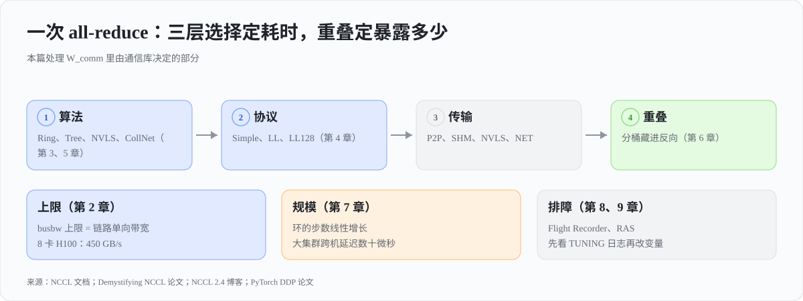
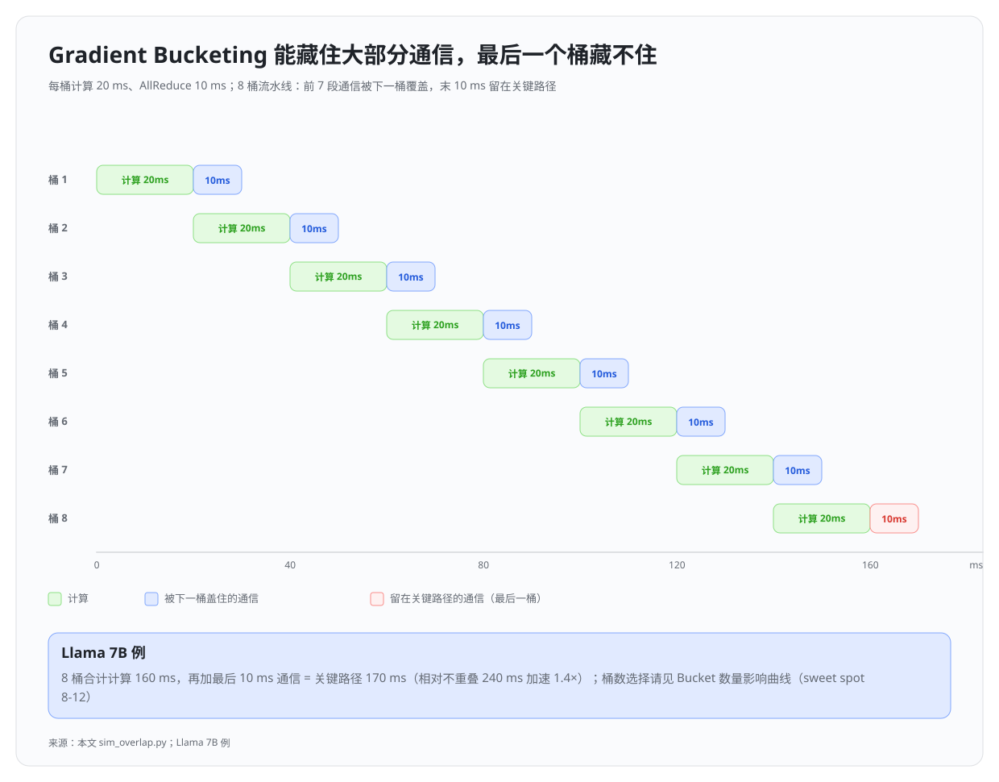
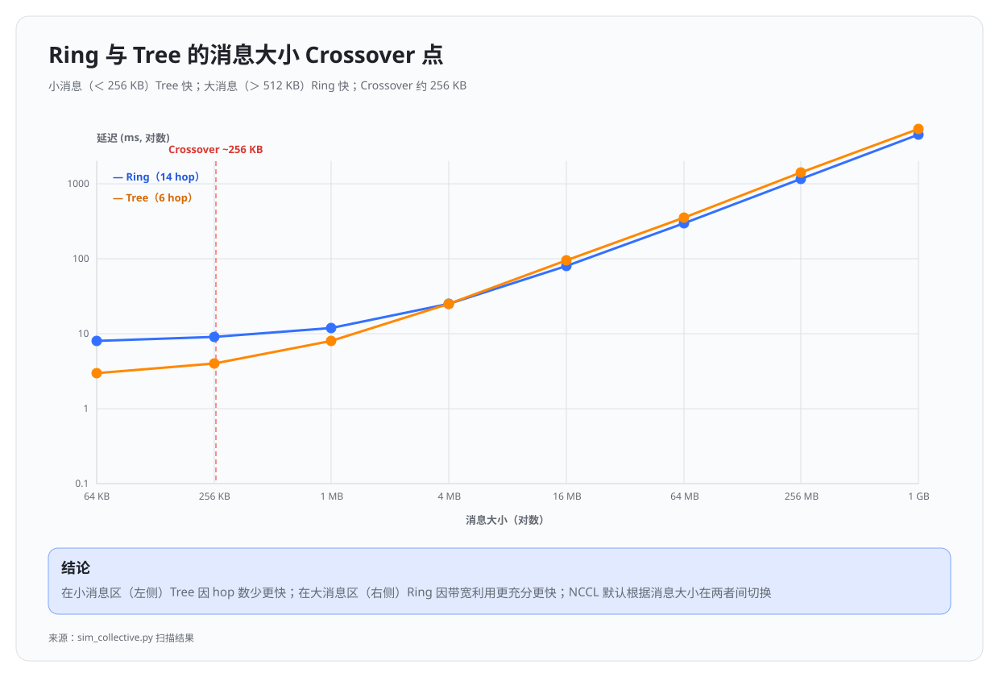
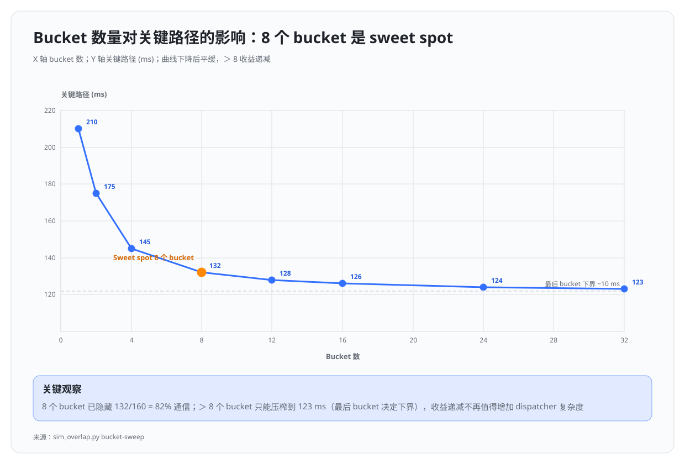

# GPU-18｜集群｜NCCL：算法、协议与挂死排查

> 🎯 **这篇文档解决什么问题**：同样的网络和 GPU，一次 all-reduce 的耗时取决于 NCCL 选了什么算法、什么协议、走哪条通道，以及通信能不能藏进计算。本篇按 NCCL 文档、NCCL 分析论文、NVIDIA 关于双二叉树的博客、PyTorch DDP 论文和 Llama 3 论文，讲清这几层选择各自的代价，怎样用 alpha-beta 模型定上限，怎样排查挂死，以及环境变量该怎样改。

**使用方式**：第 1、2 章讲三层选择和上限模型。第 3 到 5 章讲算法和协议。第 6 章讲重叠，第 7 章讲规模。第 8 章讲挂死排查，第 9 章讲环境变量，第 10 章给清单和自测。

**代码**：zero-to-gpu/18-nccl/ 下的 sim_collective.py、sim_overlap.py、test_collective.py 只需 Python 标准库。README 的期望输出和协议效率写错了，sim_overlap.py 的重叠模型有误，第 10 章逐条说明。

<b>🧭 主线位置</b>：GPU-00（[GPU-00｜索引｜从 0 开始 GPU 优化：路线、章节与练习](./README.md)）建立了时间账 T = T_compute + W_mem + W_host + W_comm + W_idle。GPU-13（[GPU-13｜单机｜NVLink 与 NVSwitch](./13-nvlink.md)）和 GPU-17（[GPU-17｜集群｜RDMA 网络：InfiniBand、RoCE 与拥塞控制](./17-rdma.md)）分别给出了机内和跨机的链路。本篇处理 W_comm 里由通信库决定的部分，以及怎样把它藏进计算。作业在集群里怎样调度，交给 GPU-19（[GPU-19｜集群｜Kubernetes 上的 GPU：设备插件与拓扑感知调度](./19-k8s.md)）。

## 导读 · 先给结论

- <b>NCCL 做三层选择。</b>算法定路线，协议定每跳的同步，传输定物理通道（第 1 章）。[[1]](https://arxiv.org/pdf/2507.04786)[[2]](https://docs.nvidia.com/deeplearning/nccl/user-guide/docs/env.html)
- <b>busbw 的上限是链路单向带宽。</b>8 卡 H100 是 450 GB/s；1 MB 时延迟占主导（第 2 章）。[[3]](https://github.com/NVIDIA/nccl-tests/blob/master/doc/PERFORMANCE.md)[[4]](https://developer.nvidia.com/blog/nvidia-hopper-architecture-in-depth/)
- <b>环的延迟线性增长。</b>双二叉树做到满带宽和对数延迟，24k 卡时延迟最多改善 180 倍（第 3 章）。[[5]](https://developer.nvidia.com/blog/massively-scale-deep-learning-training-nccl-2-4/)
- <b>协议是带宽和延迟的交换。</b>LL 用一半带宽换低延迟，LL128 约 95% 但要 128 字节原子写（第 4 章）。[[1]](https://arxiv.org/pdf/2507.04786)
- <b>交换机能做规约。</b>NVLS 在 NVSwitch 里、CollNet 在网络交换机里，默认设置下不可用时不报错（第 5 章）。[[2]](https://docs.nvidia.com/deeplearning/nccl/user-guide/docs/env.html)[[1]](https://arxiv.org/pdf/2507.04786)
- <b>通信要藏进反向。</b>DDP 默认 25 MiB 一个桶，按参数逆序（第 6 章）。[[6]](https://docs.pytorch.org/docs/main/generated/torch.nn.parallel.DistributedDataParallel.html)[[7]](https://arxiv.org/pdf/2006.15704)
- <b>挂死先找落后的 rank。</b>默认 10 分钟超时，用 Flight Recorder 和 NCCL RAS 查（第 8 章）。[[8]](https://docs.pytorch.org/docs/main/distributed.html)[[9]](https://docs.pytorch.org/tutorials/unstable/flight_recorder_tutorial.html)[[10]](https://docs.nvidia.com/deeplearning/nccl/user-guide/docs/troubleshooting/ras.html)

<b>📎 与系列其他文档的分工</b>：GPU-13（[GPU-13｜单机｜NVLink 与 NVSwitch](./13-nvlink.md)）讲 NVLink、NVSwitch 和 nccl-tests 的读法。GPU-17（[GPU-17｜集群｜RDMA 网络：InfiniBand、RoCE 与拥塞控制](./17-rdma.md)）讲 RDMA 网络、PXN 和网卡配置。GPU-20（[GPU-20｜集群｜可靠性与可观测：故障、静默错误与 checkpoint](./20-reliability.md)）讲故障、静默错误和 checkpoint。GPU-21（[GPU-21｜LLM｜训练并行：TP、PP、DP、ZeRO 与 FP8](./21-train-parallel.md)）讲并行切分，它决定哪些通信留在机内。

## 第 1 章 · NCCL 在一次集合通信里做了哪些选择

GPU-13 讲了机内互连，GPU-17 讲了跨机网络。训练框架调用一次 all-reduce，NCCL 要在这些硬件上决定数据怎样走：用哪种算法、哪种协议、经过哪条通道。本章先把这些选择分成三层，后面各章逐层展开，最后讲挂死排查和调参。

### 三层选择

| 层 | 选项 | 决定什么 |
|---|---|---|
| 算法 | Ring、Tree、CollNet、NVLS、NVLSTree、PAT | 数据按什么路线在卡之间流动，走几步 |
| 协议 | Simple、LL、LL128 | 每一跳怎样同步，带宽打几折，延迟多少 |
| 传输 | P2P、SHM、NVLS、NET、COLLNET | 数据经 NVLink、PCIe、共享内存还是网卡 |

算法的可选项随版本增加：Ring 和 Tree 从 2.5 起就有，CollnetChain 和 CollnetDirect 从 2.14 起，NVLS 从 2.17 起，NVLSTree 从 2.18 起，PAT 从 2.23 起[[2]](https://docs.nvidia.com/deeplearning/nccl/user-guide/docs/env.html)。传输层按物理通道分：机内的 P2P、共享内存和 NVLS，跨机的 NET（InfiniBand、RoCE 或 TCP 套接字），以及 COLLNET[[1]](https://arxiv.org/pdf/2507.04786)。协议在运行时选择，依据是用户设置（NCCL_PROTO）、所用算法和内部的性能模型[[1]](https://arxiv.org/pdf/2507.04786)。

### 选择错了会怎样

同一次 all-reduce，算法和协议选得不合适，通信时间可能差好几倍：小消息用带宽型的组合，延迟占满；大消息用延迟型的协议，带宽打折；规模大了还用环，步数随卡数线性增长。NCCL 的默认选择在大多数情况下合理，但要知道它选了什么、为什么，排障时才知道该怀疑哪一层。时间账上，这些都计入 W_comm。

按五步闭环看一次集合通信：

- **定天花板**：链路带宽和 busbw 的上限（第 2 章）。
- **测实际**：nccl-tests 按消息大小扫一遍，看 busbw 曲线。
- **定位等待**：小消息看延迟，大消息看带宽；对照 NCCL 选的算法和协议（第 3 到 5 章）。
- **消除或隐藏**：和反向计算重叠（第 6 章），必要时调参（第 9 章）。
- **复测**：同样的 nccl-tests 和训练步时间。

一个常见的误区是一遇到通信慢就设置 NCCL_ALGO 和 NCCL_PROTO。现象是某个消息大小变快了，别的消息大小或别的规模反而变慢。原因是这两个变量会覆盖 NCCL 按拓扑和消息大小做的选择，而一次训练里消息大小各不相同。改法是先用日志看清 NCCL 的选择和 nccl-tests 的曲线，确认问题出在哪一层再改（第 9 章）。

> 🔑 **本章要点**：NCCL 对每次集合通信做三层选择：算法决定路线和步数，协议决定每一跳的同步方式和带宽折扣，传输决定走哪条物理通道。默认选择大多合理，排障时要先知道它选了什么。这一章是五步闭环的“定天花板”：先分清通信时间由哪几层决定。

## 第 2 章 · 用 alpha-beta 模型定天花板

判断一次 all-reduce 快不快，要有一个上限作对照。最常用的是 alpha-beta 模型：每一步花一个固定的启动延迟 alpha，再加上数据量除以带宽。本章用它推出环形 all-reduce 的时间和带宽上限，并说明 nccl-tests 的 busbw 为什么能直接和链路带宽比。

### 环形 all-reduce 的时间

n 张卡的环形 all-reduce 先做 reduce-scatter 再做 all-gather，NCCL 的实现每一轮分成 2k−1 步[[1]](https://arxiv.org/pdf/2507.04786)，k 是卡数。按 alpha-beta 模型近似，每张卡收发 2(n−1) 次、每次 S/n 的数据，总时间 T = 2(n−1)(α + S/(nB))。消息越小，α 项占比越大；消息越大，越接近带宽项 2(n−1)S/(nB)。

nccl-tests 定义了两个带宽：algbw 是消息大小除以时间，busbw = algbw × 2(n−1)/n[[3]](https://github.com/NVIDIA/nccl-tests/blob/master/doc/PERFORMANCE.md)。乘上这个因子之后，busbw 应该反映硬件瓶颈的速度[[3]](https://github.com/NVIDIA/nccl-tests/blob/master/doc/PERFORMANCE.md)，可以直接和单条链路的单向带宽比。H100 的 NVLink 总带宽 900 GB/s[[4]](https://developer.nvidia.com/blog/nvidia-hopper-architecture-in-depth/)，每方向 450 GB/s；8 卡环的 2(n−1) 是 14，algbw 的上限是 450 × 8 / 14 ≈ 257 GB/s，busbw 的上限就是 450 GB/s。

### 仓库模型的结果

仓库的 sim_collective.py 按这个模型计算，加上协议的带宽折扣和每步延迟（第 4 章）。8 卡、1 MB、链路 450 GB/s、Simple 协议时，时间 0.018 ms，algbw 58.00 GB/s，busbw 101.51 GB/s，只有链路带宽的 22.6%：1 MB 分成 8 块，每块 128 KB，每一步的延迟占了大头。同样的设置在跨机链路 50 GB/s 上，busbw 36.19 GB/s，是链路的 72.4%，带宽小了，延迟的占比反而低。消息扫到 1 GB、LL128 协议时，环的 algbw 是 240.65 GB/s，换算成 busbw 约 421 GB/s，约为 450 的 93.6%，接近 LL128 的带宽折扣。

模型的价值在于给出形状：小消息看 α，大消息看 B，中间有一段过渡。真实的 α、B 和折扣要用 nccl-tests 在自己的机器上测。

按五步闭环用 alpha-beta 模型：

- **定天花板**：busbw 的上限是链路单向带宽。
- **测实际**：nccl-tests 从小到大扫消息大小。
- **定位等待**：小消息远离上限是延迟问题，大消息远离上限是带宽或协议问题。
- **消除或隐藏**：小消息合并，大消息检查链路和协议。
- **复测**：同样的扫描。

一个常见的误区是拿 1 MB 的 busbw 判断链路好坏。现象是 8 卡 NVLink 机器上 1 MB all-reduce 的 busbw 只有一百多 GB/s，被当成 NVLink 有问题。原因是 1 MB 在 8 卡上每块只有 128 KB，延迟占主导，模型算出来也只有 22.6%。改法是看大消息的 busbw 判断带宽，小消息只看延迟。

> 🔑 **本章要点**：环形 all-reduce 的时间按 2(n−1)(α + S/(nB)) 估算；busbw = algbw × 2(n−1)/n，上限是链路单向带宽，8 卡 H100 是 450 GB/s，algbw 上限约 257 GB/s。1 MB 时延迟占主导，busbw 只有链路的两成多，判断带宽要看大消息。这一章是五步闭环的“定天花板”：给每个消息大小一个上限。

## 第 3 章 · Ring 与 Tree：步数和带宽的取舍

环形算法让每张卡只和两个邻居通信，带宽用得最满，但步数随卡数线性增长。树形算法把步数降到对数级，代价是每一步的数据量和链路利用方式不同。本章说明两者各在什么条件下占优，以及 NCCL 的双二叉树怎样补上树的带宽。

### 环的延迟线性增长

NCCL 2.4 发布时的技术博客写道，环的缺点是延迟随 GPU 数线性增长，这让它难以扩展到几百张卡以上[[5]](https://developer.nvidia.com/blog/massively-scale-deep-learning-training-nccl-2-4/)。在此之前，大规模训练常用分层的二维环降低延迟[[5]](https://developer.nvidia.com/blog/massively-scale-deep-learning-training-nccl-2-4/)。NCCL 2.4 引入了双二叉树，它同时提供满带宽和对数级的延迟，比二维环的延迟还低[[5]](https://developer.nvidia.com/blog/massively-scale-deep-learning-training-nccl-2-4/)。

双二叉树用两棵树同时工作：任何节点都不会在两棵树里同时是内部节点，最多只有一个节点在两棵树里都是叶子[[1]](https://arxiv.org/pdf/2507.04786)。一棵树里叶子节点只发不收、链路闲着，另一棵树正好用上，于是两棵树合起来能用满带宽。博客给出的测试在 Summit 超级计算机上做到 24,576 张卡[[5]](https://developer.nvidia.com/blog/massively-scale-deep-learning-training-nccl-2-4/)，树相对环的延迟改善随规模增大，在 24k 卡时最多达到 180 倍[[5]](https://developer.nvidia.com/blog/massively-scale-deep-learning-training-nccl-2-4/)。

### 8 卡上的分界

仓库的 sim_collective.py 在 8 卡、450 GB/s、LL128 协议下比较两者：

| 消息大小 | Ring algbw GB/s | Tree algbw GB/s | 快的一方 |
|---|---|---|---|
| 1 MB | 86.14 | 125.97 | Tree |
| 10 MB | 204.32 | 197.61 | Ring |
| 100 MB | 236.81 | 209.52 | Ring |
| 1 GB | 240.65 | 210.80 | Ring |

1 MB 时树更快，因为步数少、延迟占主导；10 MB 以上环更快，因为它的带宽项更小。卡数越多，环的步数越多，分界点会向更大的消息移动。这是模型结果，真实的分界要看 NCCL 的选择和 nccl-tests 的曲线。

按五步闭环比较 Ring 与 Tree：

- **定天花板**：环的带宽上限，树的延迟上限。
- **测实际**：nccl-tests 在目标卡数上扫消息大小。
- **定位等待**：用 NCCL_DEBUG_SUBSYS=TUNING 看每个大小选了哪种算法（第 9 章）。
- **消除或隐藏**：一般交给 NCCL 选；确认选错时再限定算法。
- **复测**：在全规模上测，小规模的分界点不能外推。

一个常见的误区是在 8 卡上测出环最快，就在千卡作业里强制用环。现象是千卡作业里小消息的 all-reduce 特别慢。原因是环的步数随卡数线性增长，8 卡时 14 步，千卡时步数和延迟都多出两个数量级。改法是不在小规模上固定算法，让 NCCL 按规模选，或在目标规模上重新测。

> 🔑 **本章要点**：环的带宽最满，但延迟随卡数线性增长；双二叉树用两棵互补的树做到满带宽和对数延迟，Summit 上 24k 卡时延迟最多改善 180 倍。模型里 8 卡的分界在 1 MB 到 10 MB 之间，规模越大分界越往大消息移。这一章是五步闭环的“定位等待”：看延迟和带宽哪个占主导。

## 第 4 章 · 协议：Simple、LL、LL128 的取舍

算法决定数据走哪条路，协议决定每一跳怎样告诉对方“数据到了”。用内存栅栏同步开销大但不占数据带宽，把标志和数据打包在一起同步快但浪费一部分带宽。本章对比 NCCL 的三种协议，并说明 LL128 为什么有硬件前提。

### 三种协议

| 协议 | 同步方式 | 带宽利用率 | 每跳延迟（论文实测量级） |
|---|---|---|---|
| Simple | 内存栅栏，开销大 | 接近峰值 | 约 6 微秒 |
| LL | 4 字节数据 + 4 字节标志，8 字节原子写 | 峰值的 25% 到 50% | 约 1 微秒 |
| LL128 | 120 字节数据 + 8 字节标志 | 约 95% | 约 2 微秒 |

表中数据来自 ETH 和 NVIDIA 研究者合写的 NCCL 分析论文[[1]](https://arxiv.org/pdf/2507.04786)。LL 每次传输是 4 字节数据加 4 字节标志，用一次 8 字节原子写一起发出[[1]](https://arxiv.org/pdf/2507.04786)，接收方看到标志就知道数据有效，不需要栅栏，所以延迟最低，但一半的带宽给了标志。LL128 以 128 字节为单位，其中 120 字节是数据、8 字节是标志，可以用到约 95% 的峰值带宽[[1]](https://arxiv.org/pdf/2507.04786)。Simple 用内存栅栏同步[[1]](https://arxiv.org/pdf/2507.04786)，开销大，适合大块数据。通常小消息选 LL 或 LL128 降低延迟，大消息选 Simple 追求吞吐[[1]](https://arxiv.org/pdf/2507.04786)。

### LL128 的硬件前提

LL128 依赖 128 字节的原子写，这些写入不能被内存系统或互连拆开或重排[[1]](https://arxiv.org/pdf/2507.04786)。在不能保证这一点的系统上，例如受 PCIe 限制的平台，NCCL 会禁用 LL128 以免数据损坏[[1]](https://arxiv.org/pdf/2507.04786)。NCCL 文档也提醒，不建议用户设置 NCCL_PROTO，除非怀疑某个协议有缺陷要把它关掉；在不支持 LL128 的平台上强行打开它可能导致数据损坏[[2]](https://docs.nvidia.com/deeplearning/nccl/user-guide/docs/env.html)。

仓库的 sim_collective.py 按 LL 50%、LL128 120/128 的带宽折扣建模，代码注释写得对；README 却写成 Simple 约 50%、LL 和 LL128 约 95%，和代码、论文都不一致（第 10 章）。按代码的模型，8 卡 1 MB 时 LL 的 busbw 是 172.69 GB/s，Simple 是 101.51 GB/s；测试里 256 MB 时 LL 的耗时是 Simple 的 1.99 倍，体现了 LL 的带宽折扣。

按五步闭环看协议：

- **定天花板**：各协议的带宽折扣和每跳延迟。
- **测实际**：nccl-tests 的曲线，配合 TUNING 日志看每段选了哪种协议。
- **定位等待**：大消息用了 LL，或者平台上 LL128 被禁用。
- **消除或隐藏**：一般交给 NCCL；只在确认协议有缺陷时用 NCCL_PROTO 排除它。
- **复测**：核对数值正确性，再看性能。

一个常见的误区是为了提速在所有机器上设置 NCCL_PROTO=LL128。现象是部分机器上训练损失出现异常，或结果在不同机器间不一致。原因是这些机器的平台不保证 128 字节原子写，NCCL 原本会禁用 LL128。改法是去掉这个设置，让 NCCL 按平台能力选择。

> 🔑 **本章要点**：Simple 用栅栏同步，带宽接近峰值、每跳约 6 微秒；LL 把 4 字节标志和数据打包，延迟约 1 微秒但只用 25% 到 50% 的带宽；LL128 用 120/128 的打包做到约 95%，但需要 128 字节原子写，平台不支持时 NCCL 会禁用它。这一章是五步闭环的“定位等待”：看每一跳的同步方式付出了什么。

## 第 5 章 · NVLS、CollNet 与 PAT：把规约交给交换机

环和树都由 GPU 自己做规约，数据要在卡之间来回搬。如果交换机能在转发时直接做加法，数据量和步数都能减少。NCCL 有两类这样的算法：在 NVSwitch 里规约的 NVLS，在网络交换机里规约的 CollNet。本章说明它们的前提、默认行为和局限。

### 交换机里做规约

| 算法 | 起始版本 | 做法 | 硬件前提 |
|---|---|---|---|
| CollnetChain、CollnetDirect | 2.14 | 规约卸载给支持 SHARP 的网络交换机；Chain 沿链规约再沿链广播 | 网络交换机支持 SHARP |
| NVLS | 2.17 | 机内规约卸载给 NVSwitch；跨机继续经 CollNet | 第三代 NVSwitch，Hopper 及以后 |
| NVLSTree | 2.18 | 机内用 NVLink SHARP，跨机用树 | 同上 |
| PAT | 2.23 | Parallel Aggregated Trees | 无特殊硬件 |

NVLS 和 CollNet 主要用来加速 AllReduce，NVLS 也支持 ReduceScatter 和 AllGather[[1]](https://arxiv.org/pdf/2507.04786)。CollNet 借助 NVIDIA SHARP 把规约或部分集合计算卸载给网络交换机，减少数据搬运和延迟[[1]](https://arxiv.org/pdf/2507.04786)；CollNet Chain 把 GPU 排成一条链，沿链规约再沿链广播[[1]](https://arxiv.org/pdf/2507.04786)。NVLS 和 NVLS Tree 都用 NVLink SHARP 做机内规约，跨机时 NVLS 继续经 CollNet 和支持 SHARP 的交换机，NVLS Tree 用树形扩散[[1]](https://arxiv.org/pdf/2507.04786)。PAT 是 2.23 引入的算法[[1]](https://arxiv.org/pdf/2507.04786)。表中的起始版本来自 NCCL_ALGO 的说明[[2]](https://docs.nvidia.com/deeplearning/nccl/user-guide/docs/env.html)。

### NVLS 的前提和默认行为

NVLink SHARP 要求第三代 NVSwitch（NVLink4）和 Hopper 及以后的 GPU，它让 ncclAllReduce 这样的集合通信卸载到 NVSwitch 上完成[[2]](https://docs.nvidia.com/deeplearning/nccl/user-guide/docs/env.html)。Hopper 一代的 NVSwitch 用组播和网内规约加速集合通信[[4]](https://developer.nvidia.com/blog/nvidia-hopper-architecture-in-depth/)，NVIDIA 给出的收益是最多 2 倍吞吐，并显著降低小块集合通信的延迟[[4]](https://developer.nvidia.com/blog/nvidia-hopper-architecture-in-depth/)。

NCCL_NVLS_ENABLE 的默认值是 2：系统不支持时不报错，但资源分配失败时报错[[2]](https://docs.nvidia.com/deeplearning/nccl/user-guide/docs/env.html)。默认值下还有一个容易忽略的行为：同一张卡上有多个 rank 时，NVLS 会被静默关闭[[2]](https://docs.nvidia.com/deeplearning/nccl/user-guide/docs/env.html)。所以在 H100 机器上看到 all-reduce 没有达到预期，要先用日志确认 NVLS 是否真的启用。按论文的支持表，NVLS 只支持 Simple 协议[[1]](https://arxiv.org/pdf/2507.04786)。

按五步闭环使用 NVLS 和 CollNet：

- **定天花板**：交换机规约能省掉的数据搬运。
- **测实际**：nccl-tests 分别在 NVLS 开和关时测。
- **定位等待**：日志里有没有选中 NVLS 或 CollNet，没选中的原因。
- **消除或隐藏**：满足硬件和配置前提，避免同卡多 rank。
- **复测**：看 busbw 和小消息延迟两头。

一个常见的误区是认为 H100 机器自动用上了 NVLS。现象是升级驱动和 NCCL 后，all-reduce 性能没有变化。原因是 Fabric Manager 没配好、资源不足，或作业在同一张卡上起了多个 rank，NVLS 在默认设置下被静默关闭。改法是用 NCCL_DEBUG=INFO 看初始化日志里 NVLS 的状态，再检查 Fabric Manager 和每张卡上的 rank 数（GPU-13）。

> 🔑 **本章要点**：NVLS 在 NVSwitch 里规约，CollNet 在支持 SHARP 的网络交换机里规约，主要加速 AllReduce；Hopper 的 NVSwitch 组播加规约最多带来 2 倍吞吐。NVLS 需要第三代 NVSwitch，默认设置下不可用时不报错，同卡多 rank 时会被静默关闭。这一章是五步闭环的“消除或隐藏”：让交换机分担规约。

## 第 6 章 · 分桶重叠：把梯度通信藏进反向计算

数据并行每一步都要对全部梯度做 all-reduce。如果等反向全部算完再通信，通信时间就全部暴露在步时间里。DDP 把梯度分成若干个桶，一个桶的梯度算完就开始通信，和后面层的反向计算重叠。本章说明分桶怎样工作、桶的大小怎样取舍，并用一个算例说明能藏住多少。

### DDP 怎样分桶

DDP 把参数分进多个桶，每个桶的梯度规约可以和反向计算重叠[[6]](https://docs.pytorch.org/docs/main/generated/torch.nn.parallel.DistributedDataParallel.html)；bucket_cap_mb 控制桶的大小，不指定时默认 25 MiB[[6]](https://docs.pytorch.org/docs/main/generated/torch.nn.parallel.DistributedDataParallel.html)。分桶的顺序按 model.parameters() 的逆序[[7]](https://arxiv.org/pdf/2006.15704)，因为层通常按前向的调用顺序注册，逆序大致就是反向算出梯度的顺序。DDP 的论文指出桶大小是关键的权衡[[7]](https://arxiv.org/pdf/2006.15704)：桶太小，通信次数多，每次都要付启动延迟（第 2 章）；桶太大，每个桶要等更多梯度才能开始，重叠的机会少。论文报告，配置得当时 DDP 在 256 张卡上接近线性扩展[[7]](https://arxiv.org/pdf/2006.15704)。

### 算例：能藏住多少

假设一步的反向计算 160 ms，梯度 all-reduce 一共 80 ms，分成 8 个桶。每个桶对应 20 ms 的反向计算和 10 ms 的通信。第一个桶在第 20 ms 算完，通信到第 30 ms，此时第二个桶还在算；每个桶的通信都能在下一个桶算完之前结束，只有最后一个桶的 10 ms 通信留在反向之后。所以步时间是 170 ms，不重叠是 240 ms，通信的 87.5% 被藏住。这个结论有两个前提：每个桶的通信比每个桶的计算短，通信和计算不争抢资源。通信比计算长时，桶会排队，暴露的时间等于总通信减去能重叠的部分。

仓库的 sim_overlap.py 在这里有误：它把 --comm-time-ms 当成每个桶的通信时间，8 个桶就成了 640 ms 的通信，同时又把“最佳重叠”算成计算加一个桶的通信，得出 240 ms，比通信本身还短；bucket-sweep 和 example 两个子命令的总时间固定不变，加速比却随桶数增长。第 10 章列为练习。

按五步闭环做重叠：

- **定天花板**：步时间的下限是反向计算加最后一个桶的通信。
- **测实际**：nsys 时间线上看通信核和计算核是否并行（GPU-14）。
- **定位等待**：通信集中在反向结束后，说明桶太大或顺序不对。
- **消除或隐藏**：调 bucket_cap_mb，确认参数注册顺序和反向顺序一致。
- **复测**：步时间和时间线一起看。

一个常见的误区是把桶调得越小越好。现象是桶从 25 MiB 调到很小后，步时间反而变长。原因是每个桶都要付一次集合通信的启动延迟，桶太多时延迟累加，消息又小到落在 busbw 很低的区间。改法是在几个桶大小上实测步时间，取最优，并观察时间线。

> 🔑 **本章要点**：DDP 按参数逆序分桶，默认 25 MiB，一个桶的梯度算完就开始 all-reduce。算例里 160 ms 反向、80 ms 通信、8 个桶，步时间从 240 ms 降到 170 ms，通信藏住 87.5%。桶太小付延迟，太大少重叠，要实测。这一章是五步闭环的“消除或隐藏”：把通信藏进计算。

## 第 7 章 · 规模变大以后：延迟成为主角

8 卡时，一次 all-reduce 的步数不多，带宽是主要矛盾。卡数增加到几百、几千，环的步数线性增长，跨机网络的延迟也变大，小消息的集合通信被延迟主导。本章说明规模对集合通信的影响，以及公开的大规模训练怎样应对。

### 环在大规模上的问题

环的延迟随卡数线性增长，NVIDIA 的博客指出这让它难以扩展到几百张卡以上[[5]](https://developer.nvidia.com/blog/massively-scale-deep-learning-training-nccl-2-4/)。在固定消息大小下，卡数越多，每张卡分到的块越小，延迟项的占比越大。仓库的测试在 1 MB、链路 50 GB/s、每步延迟 1 微秒的设置下给出 2、4、8、16 卡的环 algbw 分别是 45.6、28.0、20.7、15.1 GB/s。真实的跨机延迟更高：Llama 3 论文提到，最外层的流水并行和数据并行要经过多跳网络，延迟可达数十微秒[[11]](https://arxiv.org/pdf/2407.21783)。

应对的办法有三类。第一类是换算法：分层的二维环[[5]](https://developer.nvidia.com/blog/massively-scale-deep-learning-training-nccl-2-4/)，以及对数延迟的双二叉树（第 3 章）。第二类是减少跨机的通信量：把通信量大的并行维度放在机内（GPU-21），跨机只留数据并行和流水并行。第三类是改通信库本身。

### Llama 3 的做法

Llama 3 的集合通信库叫 NCCLX，是 NCCL 的一个分支[[11]](https://arxiv.org/pdf/2407.21783)。论文指出，原版 NCCL 在 FSDP 的 all-gather、reduce-scatter 和流水并行的点对点通信中，需要把数据分块、分阶段拷贝，带来大量小的控制消息、额外的内存拷贝和额外的 GPU 周期。他们按网络延迟调整了分块和数据传输的方式[[11]](https://arxiv.org/pdf/2407.21783)，并让小的控制消息以更高的优先级在网络中传输[[11]](https://arxiv.org/pdf/2407.21783)，避免在深缓冲的核心交换机里被队头阻塞。

这说明规模变大以后，集合通信的瓶颈从链路带宽转向延迟和控制开销，而这些和网络（GPU-17）、并行切分（GPU-21）、通信库的实现都相关，单靠调 NCCL 的环境变量解决不了。

按五步闭环看大规模通信：

- **定天花板**：跨机带宽和跨机延迟，后者在大集群里可达数十微秒。
- **测实际**：在目标规模上跑 nccl-tests，重点看中小消息。
- **定位等待**：延迟主导还是带宽主导；控制消息有没有被阻塞。
- **消除或隐藏**：换算法、调并行切分、和计算重叠。
- **复测**：每次扩规模都重新测。

一个常见的误区是按小规模的 nccl-tests 结果推算大规模的通信时间。现象是从几十卡扩到上千卡，通信时间的增长远超按带宽算的预期。原因是步数和跨机延迟都随规模增长，小规模测试里看不到。改法是在目标规模或接近的规模上测，并把延迟项单独列出来估算。

> 🔑 **本章要点**：规模变大后，环的步数线性增长，大集群的跨机延迟可达数十微秒，中小消息的集合通信被延迟主导。应对办法是换算法、把大通信量的并行维度留在机内、改进通信库；Llama 3 的 NCCLX 按网络延迟调了分块，并给控制消息更高优先级。这一章是五步闭环的“定位等待”：分清延迟和带宽。

## 第 8 章 · 挂死排查：从超时日志找到卡住的 rank

集合通信要求所有 rank 都参与。只要有一个 rank 没有调用、调用顺序不同、或者进程挂了，其他 rank 就会一直等。表面上看是整个作业卡住，最后以超时崩溃收场。本章说明超时机制，以及按症状选用的排查工具。

### 超时之后发生什么

PyTorch 进程组的 timeout 对 NCCL 默认是 10 分钟，对其他后端是 30 分钟[[8]](https://docs.pytorch.org/docs/main/distributed.html)。超过这个时间，集合通信会被异步中止，进程随之崩溃[[8]](https://docs.pytorch.org/docs/main/distributed.html)；这样做是因为 CUDA 执行是异步的，出错之后继续运行用户代码已不安全。NCCL 本身提供 ncclCommGetAsyncError 和 ncclCommAbort 两个接口，让应用检测并处理通信错误[[5]](https://developer.nvidia.com/blog/massively-scale-deep-learning-training-nccl-2-4/)。在 Llama 3 训练的中断统计里，NCCL watchdog 超时有 7 次，占 1.7%，原因归为未知[[11]](https://arxiv.org/pdf/2407.21783)，说明超时往往只是表象，根因要另外查。

### 按症状选工具

| 症状 | 先用什么 | 看什么 |
|---|---|---|
| 初始化卡住 | NCCL_DEBUG=INFO，NCCL_DEBUG_SUBSYS=INIT,BOOTSTRAP,NET | bootstrap 连接、网卡选择、rank 同步 |
| 运行中卡住 | NCCL RAS：ncclras 客户端 | 哪些进程无响应 |
| 超时崩溃 | PyTorch Flight Recorder：TORCH_NCCL_TRACE_BUFFER_SIZE、TORCH_NCCL_DUMP_ON_TIMEOUT | 各 rank 最后完成和卡住的集合通信 |
| 网络错误 | NCCL_DEBUG_SUBSYS=NET | 选中的网卡、建连消息、传输层报错 |

初始化阶段卡住，NCCL 文档建议打开 INFO 日志并只看 INIT、BOOTSTRAP 和 NET 子系统，检查 bootstrap 连接、网卡选择和 rank 同步[[12]](https://docs.nvidia.com/deeplearning/nccl/user-guide/docs/troubleshooting/logging.html)。运行中卡住，NCCL 从 2.24 起提供 RAS 子系统，可以在作业运行时查询健康状态[[10]](https://docs.nvidia.com/deeplearning/nccl/user-guide/docs/troubleshooting/ras.html)，帮助找出无响应的进程等异常[[10]](https://docs.nvidia.com/deeplearning/nccl/user-guide/docs/troubleshooting/ras.html)；它在本机监听 28028 端口[[10]](https://docs.nvidia.com/deeplearning/nccl/user-guide/docs/troubleshooting/ras.html)，用 ncclras 客户端连接即可查询当前作业状态[[10]](https://docs.nvidia.com/deeplearning/nccl/user-guide/docs/troubleshooting/ras.html)。

PyTorch 的 Flight Recorder 在每个 rank 上用环形缓冲记录最近的集合通信。设置 TORCH_NCCL_TRACE_BUFFER_SIZE 为正数就开始记录[[9]](https://docs.pytorch.org/tutorials/unstable/flight_recorder_tutorial.html)，默认值是 2000[[9]](https://docs.pytorch.org/tutorials/unstable/flight_recorder_tutorial.html)；配合 TORCH_NCCL_DUMP_ON_TIMEOUT[[9]](https://docs.pytorch.org/tutorials/unstable/flight_recorder_tutorial.html)，超时时把记录转储到文件，再用 fr_trace.py 汇总分析[[9]](https://docs.pytorch.org/tutorials/unstable/flight_recorder_tutorial.html)。看的是每个 rank 最后完成的是哪一次集合通信、卡在哪一次：大多数 rank 卡在第 N 次而某个 rank 停在第 N−1 次，问题就在这个 rank 上。

按五步闭环排查挂死：

- **定天花板**：正常时每次集合通信的耗时。
- **测实际**：超时日志、Flight Recorder 转储、RAS 状态。
- **定位等待**：哪个 rank 落后，卡在哪一次调用。
- **消除或隐藏**：修代码里的调用顺序或条件分支，处理硬件和网络故障（GPU-16、GPU-17、GPU-20）。
- **复测**：在同样的规模上跑到出问题的那一步之后。

一个常见的误区是遇到超时就把 timeout 调大。现象是作业不再崩溃，而是卡住更久，最后还是失败。原因是挂死的根因多数是某个 rank 没有调用或调用顺序不一致，等多久都等不到。改法是保持合理的 timeout，打开 Flight Recorder，超时时拿到各 rank 的调用记录再查。

> 🔑 **本章要点**：NCCL 集合通信在 PyTorch 里默认 10 分钟超时，之后异步中止并崩溃。初始化卡住看 INIT、BOOTSTRAP、NET 日志，运行中卡住用 NCCL RAS 找无响应进程，超时用 Flight Recorder 对比各 rank 最后的调用。这一章是五步闭环的“定位等待”：找出落后的那个 rank。

## 第 9 章 · 环境变量：先看清再改

NCCL 有上百个环境变量，大多数时候不需要碰。调参的顺序应该是先看日志、确认 NCCL 选了什么，再用 nccl-tests 定位问题出在哪一层，最后只改和这一层相关的变量。本章列出最常用的几个，并说明怎样看 NCCL 的选择。

### 先看 NCCL 选了什么

NCCL_DEBUG_SUBSYS 可以把 INFO 日志按子系统过滤，不设置时只输出 INIT、BOOTSTRAP 和 ENV[[2]](https://docs.nvidia.com/deeplearning/nccl/user-guide/docs/env.html)。排查性能时打开 TUNING 子系统，日志会列出选中的算法（Ring、Tree 等）、协议（Simple、LL、LL128）以及通道和线程的配置[[12]](https://docs.nvidia.com/deeplearning/nccl/user-guide/docs/troubleshooting/logging.html)；看拓扑时打开 GRAPH，看网络时打开 NET。先看清这些，再判断默认选择是否合理。

| 变量 | 作用 | 什么时候改 |
|---|---|---|
| NCCL_DEBUG、NCCL_DEBUG_SUBSYS | 日志级别和子系统；SUBSYS 默认 INIT,BOOTSTRAP,ENV | 任何排查的第一步 |
| NCCL_ALGO | 限定可用的算法 | 确认 NCCL 选错算法后，按集合操作限定 |
| NCCL_PROTO | 限定可用的协议 | 只在怀疑某个协议有缺陷时排除它 |
| NCCL_MIN_NCHANNELS、NCCL_MAX_NCHANNELS | 通道数，上限 64 | 通道太少用不满带宽时 |
| NCCL_NVLS_ENABLE | 是否使用 NVLink SHARP，默认 2 | 排查 NVLS 是否生效时 |

### 改的时候注意什么

NCCL_PROTO 的文档明确不建议用户设置，唯一的例外是怀疑某个协议有缺陷、需要把它关掉；在不支持 LL128 的平台上打开它可能导致数据损坏[[2]](https://docs.nvidia.com/deeplearning/nccl/user-guide/docs/env.html)。NCCL_ALGO 从 2.24 起支持按集合操作分别指定，并且没有把 ring 列为可用算法、某个操作又没有其他可用算法时，NCCL 不会再隐式退回 ring，而是直接失败[[2]](https://docs.nvidia.com/deeplearning/nccl/user-guide/docs/env.html)。通道数的上限是 64，2.25 之前是 32[[2]](https://docs.nvidia.com/deeplearning/nccl/user-guide/docs/env.html)。

这些变量会改变 NCCL 按拓扑和消息大小做的选择，所以每改一个都要在几个消息大小和目标规模上重新测，并把设置写进作业模板，而不是留在某个人的终端里。

按五步闭环调参：

- **定天花板**：nccl-tests 在默认设置下的曲线。
- **测实际**：TUNING、GRAPH、NET 日志。
- **定位等待**：哪个消息区间偏离上限，那里选了什么。
- **消除或隐藏**：一次只改一个变量。
- **复测**：全部消息大小和目标规模，并核对数值正确性。

一个常见的误区是从网上复制一组 NCCL 环境变量直接用。现象是在别的集群上有效的设置，到自己的集群上变慢或报错。原因是这些变量依赖拓扑、网卡、NCCL 版本，例如通道上限和 NCCL_ALGO 的语法都随版本变过。改法是从默认设置开始，按日志和 nccl-tests 的结果逐个加。

> 🔑 **本章要点**：调参先看日志：TUNING 子系统列出算法、协议和通道配置。NCCL_PROTO 只用来排除有缺陷的协议；NCCL_ALGO 从 2.24 起不再隐式退回 ring；通道上限 64。一次只改一个变量，在多个消息大小和目标规模上复测。这一章是五步闭环的“复测”：每改一处都回到同样的测量。

## 第 10 章 · 上线前核对清单与自测

前九章沿着一次集合通信的三层选择处理 W_comm：第 1 章分出算法、协议、传输三层，第 2 章用 alpha-beta 模型定上限，第 3 章比较 Ring 和 Tree，第 4 章比较三种协议，第 5 章讲交换机里的规约，第 6 章讲分桶重叠，第 7 章讲规模变大以后的延迟，第 8 章讲挂死排查，第 9 章讲环境变量。本章把它们压成一张核对清单，再配上代码练习和自测题。

### 📌 核对清单

| 检查项 | 怎样查 | 通过的标志 |
|---|---|---|
| 有 busbw 基线 | nccl-tests 从小到大扫消息大小（第 2 章） | 大消息 busbw 接近链路单向带宽 |
| 知道 NCCL 选了什么 | NCCL_DEBUG_SUBSYS=TUNING（第 9 章） | 各消息区间的算法和协议有记录 |
| 规模对应的算法 | 在目标规模上测（第 3、7 章） | 小消息延迟没有随规模失控 |
| 协议没有被误设 | 检查 NCCL_PROTO（第 4 章） | 未设置，或只排除了有缺陷的协议 |
| NVLS 是否生效 | 初始化日志（第 5 章） | H100 机器上 NVLS 已启用 |
| 通信藏进反向 | nsys 时间线；bucket_cap_mb（第 6 章） | 反向结束后只剩最后一个桶的通信 |
| 挂死可排查 | Flight Recorder、RAS 已打开（第 8 章） | 超时能拿到各 rank 的调用记录 |
| 环境变量有据 | 作业模板里逐条注明原因（第 9 章） | 没有来历不明的设置 |

### 代码练习

zero-to-gpu/18-nccl/ 下有 sim_collective.py、sim_overlap.py 和 test_collective.py，只需 Python 标准库。主编在系统自带的 Python 3.9.6 上运行，6 条测试全部通过。有几处问题适合当作找错练习：

- README 的期望输出写 8 卡 1 MB Simple 的时间 0.022 ms、algbw 47.33、busbw 787.50 GB/s（标为理论最大值）、效率 6.0%；实际运行是 0.018 ms、58.00、101.51 GB/s、22.6%。787.50 是 450 × 14/8，busbw 不会超过链路带宽，这个数没有意义。
- README 写协议效率 Simple 约 50%、LL 和 LL128 约 95%；代码按 LL 50%、LL128 120/128 建模，和论文给出的 Simple 接近峰值、LL 25% 到 50%、LL128 约 95% 一致（第 4 章），README 错了。
- sim_overlap.py 把 --comm-time-ms 当成每个桶的通信时间，timeline 子命令里 8 个桶成了 640 ms 的通信，最佳重叠却只有 240 ms；bucket-sweep 的总时间在 1 到 24 个桶时都是 210 ms，加速比却从 1.00 涨到 6.48；example 的总时间都是 240 ms，加速比涨到 11.33。按第 6 章的算例，160 ms 计算、80 ms 通信、8 个桶时应是 170 ms。
- test_collective.py 的测试只检查数值落在宽松的区间，例如小消息时打印的“Ring 0.01ms vs Tree 0.01ms”也算通过，不能证明模型正确。

### 自测题

1. NCCL 对一次集合通信做哪三层选择？各决定什么？
2. 8 卡 H100 的 all-reduce，busbw 和 algbw 的上限各是多少？为什么 1 MB 时 busbw 远低于上限？
3. 为什么环的延迟随卡数线性增长？双二叉树怎样同时做到满带宽和对数延迟？
4. LL 和 LL128 怎样省掉内存栅栏？各付出什么代价？LL128 为什么有平台限制？
5. 160 ms 反向、80 ms 通信分 8 个桶，步时间是多少？桶太小会怎样？
6. 作业在第 N 次 all-reduce 超时，怎样找出是哪个 rank 出了问题？

### 下一步

通信库理顺之后，作业要在集群里被调度：GPU 怎样暴露给容器，调度器怎样知道卡和网卡的拓扑，把一个作业的 Pod 放在一起。这些交给 GPU-19（[GPU-19｜集群｜Kubernetes 上的 GPU：设备插件与拓扑感知调度](./19-k8s.md)）。

## 参考文献

按正文首次引用顺序编号，资料截至 2026 年 11 月中。

[1] Hu et al. Demystifying NCCL: An In-depth Analysis of GPU Communication Protocols and Algorithms. arXiv 2507.04786 (2025) [arxiv.org/pdf/2507.04786](https://arxiv.org/pdf/2507.04786)

[2] NVIDIA. NCCL User Guide: Environment Variables [docs.nvidia.com/deeplearning/nccl/user-guide/docs/env.html](https://docs.nvidia.com/deeplearning/nccl/user-guide/docs/env.html)

[3] NVIDIA. nccl-tests: Performance reported by NCCL tests [github.com/NVIDIA/nccl-tests/blob/master/doc/PERFORMANCE.md](https://github.com/NVIDIA/nccl-tests/blob/master/doc/PERFORMANCE.md)

[4] NVIDIA Technical Blog. NVIDIA Hopper Architecture In-Depth (2022) [developer.nvidia.com/blog/nvidia-hopper-architecture-in-depth/](https://developer.nvidia.com/blog/nvidia-hopper-architecture-in-depth/)

[5] NVIDIA Technical Blog. Massively Scale Your Deep Learning Training with NCCL 2.4 (2019) [developer.nvidia.com/blog/massively-scale-deep-learning-training-nccl-2-4/](https://developer.nvidia.com/blog/massively-scale-deep-learning-training-nccl-2-4/)

[6] PyTorch. torch.nn.parallel.DistributedDataParallel [docs.pytorch.org/docs/main/generated/torch.nn.parallel.DistributedDataParallel.html](https://docs.pytorch.org/docs/main/generated/torch.nn.parallel.DistributedDataParallel.html)

[7] Li et al. PyTorch Distributed: Experiences on Accelerating Data Parallel Training. VLDB 2020 [arxiv.org/pdf/2006.15704](https://arxiv.org/pdf/2006.15704)

[8] PyTorch. Distributed communication package: torch.distributed [docs.pytorch.org/docs/main/distributed.html](https://docs.pytorch.org/docs/main/distributed.html)

[9] PyTorch Tutorials. Flight Recorder for Debugging Stuck Jobs [docs.pytorch.org/tutorials/unstable/flight_recorder_tutorial.html](https://docs.pytorch.org/tutorials/unstable/flight_recorder_tutorial.html)

[10] NVIDIA. NCCL User Guide: Troubleshooting, RAS [docs.nvidia.com/deeplearning/nccl/user-guide/docs/troubleshooting/ras.html](https://docs.nvidia.com/deeplearning/nccl/user-guide/docs/troubleshooting/ras.html)

[11] Llama Team, AI @ Meta. The Llama 3 Herd of Models. arXiv 2407.21783 (2024) [arxiv.org/pdf/2407.21783](https://arxiv.org/pdf/2407.21783)

[12] NVIDIA. NCCL User Guide: Troubleshooting, Logging [docs.nvidia.com/deeplearning/nccl/user-guide/docs/troubleshooting/logging.html](https://docs.nvidia.com/deeplearning/nccl/user-guide/docs/troubleshooting/logging.html)

---

[在 Colab 里跑本章 CPU 练习](https://colab.research.google.com/github/zyaochen/zero-to-gpu/blob/main/colab/18-nccl.ipynb) · 上一章：[GPU-17｜集群｜RDMA 网络：InfiniBand、RoCE 与拥塞控制](./17-rdma.md) · [目录](./README.md) · 下一章：[GPU-19｜集群｜Kubernetes 上的 GPU：设备插件与拓扑感知调度](./19-k8s.md)
