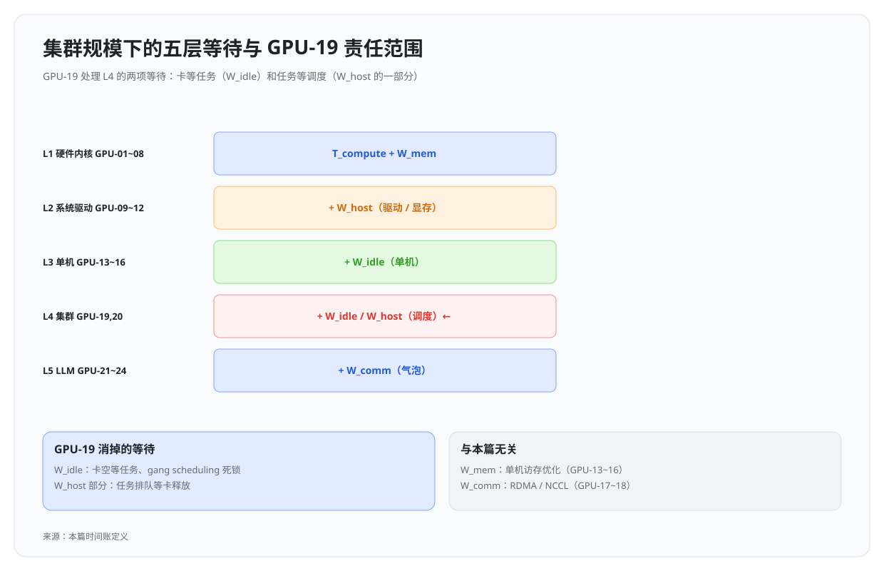
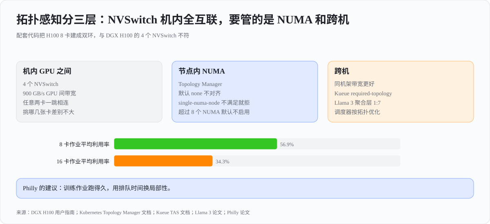
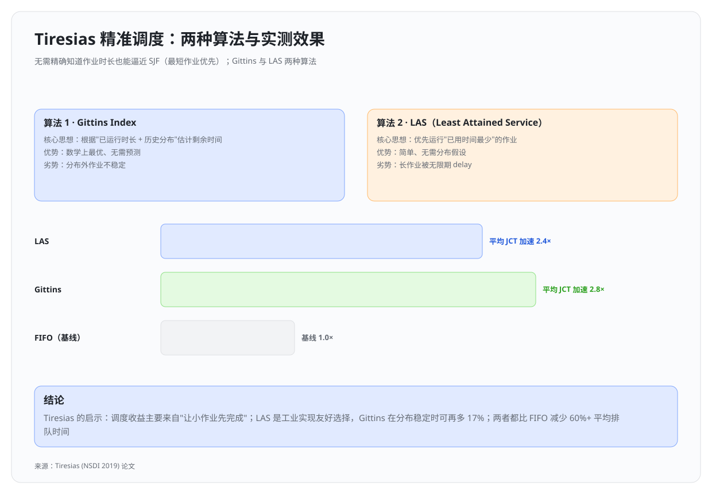
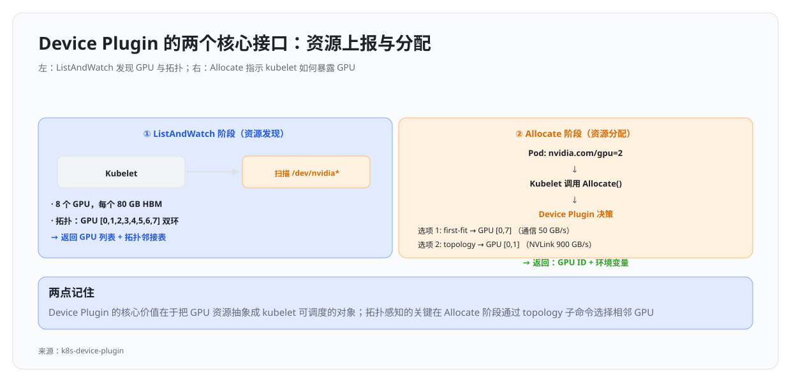

# GPU-19｜集群｜Kubernetes 上的 GPU：设备插件与拓扑感知调度

> 🎯 **这篇文档解决什么问题**：训练作业在集群里还没开始算，就可能在排队；分到的卡可能散在几个机架上，可能只就位了一半，也可能是一张坏卡。本篇按 Kubernetes、Kueue、Volcano 和 NVIDIA 设备插件的文档，以及微软 Philly 集群的公开 trace，讲清调度层怎样看见 GPU、怎样放、怎样排队和共享，以及配套代码哪里建模错了。

**使用方式**：第 1 章量出调度层的损失。第 2、3 章讲设备插件和 DRA。第 4 章讲拓扑，第 5 章讲 gang 调度，第 6、7 章讲碎片、配额和抢占。第 8 章讲坏卡下线，第 9 章讲共享，第 10 章给清单和自测。

**代码**：zero-to-gpu/19-k8s/ 下的 sim_sched.py、sim_gang.py、test_sched.py 只需 Python 标准库，inspect_k8s_gpu.sh 需要 kubectl。sim_sched.py 的机内拓扑和碎片率定义有误，sim_gang.py 的设定不可能死锁，第 10 章逐条说明。

<b>🧭 主线位置</b>：GPU-00（[GPU-00｜索引｜从 0 开始 GPU 优化：路线、章节与练习](./README.md)）建立了时间账 T = T_compute + W_mem + W_host + W_comm + W_idle。GPU-18（[GPU-18｜集群｜NCCL：算法、协议与挂死排查](./18-nccl.md)）处理了通信库决定的 W_comm。本篇处理调度层造成的 W_idle：作业在排队，或者占着卡没满负荷。卡坏了以后怎样检测和恢复，交给 GPU-20（[GPU-20｜集群｜可靠性与可观测：故障、静默错误与 checkpoint](./20-reliability.md)）。

## 导读 · 先给结论

- <b>调度层的损失很大。</b>Philly 里在用 GPU 约 47.7% 的周期被浪费，三分之二卡在用时完全空闲的机器不到 4.5%（第 1 章）。[[1]](https://www.usenix.org/system/files/atc19-jeon.pdf)
- <b>设备插件只给调度器一个整数。</b>GPU 只写在 limits，不能超卖或共享（第 2 章）。[[2]](https://kubernetes.io/docs/concepts/extend-kubernetes/compute-storage-net/device-plugins/)[[3]](https://kubernetes.io/docs/tasks/manage-gpus/scheduling-gpus/)
- <b>DRA 让调度器看见设备属性。</b>v1.35 起稳定，支持 CEL 过滤和共享，但不支持抢占（第 3 章）。[[4]](https://kubernetes.io/docs/concepts/scheduling-eviction/dynamic-resource-allocation/)
- <b>拓扑感知的重点在 NUMA 和跨机。</b>NVSwitch 节点机内任意两卡一跳相连，配套代码的双环模型不对（第 4 章）。[[5]](https://docs.nvidia.com/dgx/dgxh100-user-guide/introduction-to-dgxh100.html)[[6]](https://kubernetes.io/docs/tasks/administer-cluster/topology-manager/)[[7]](https://kueue.sigs.k8s.io/docs/concepts/topology_aware_scheduling/)
- <b>分布式作业要 gang 调度。</b>部分就位会占卡空转，两个作业互占时死锁（第 5 章）。[[8]](https://kueue.sigs.k8s.io/docs/tasks/manage/setup_wait_for_pods_ready/)[[9]](https://volcano.sh/en/docs/podgroup/)[[10]](https://kubernetes.io/docs/concepts/scheduling-eviction/gang-scheduling/)
- <b>排队主要来自碎片。</b>Philly 全部作业的等待时间约 80% 来自碎片，配额排队可以靠抢占缓解（第 6、7 章）。[[1]](https://www.usenix.org/system/files/atc19-jeon.pdf)[[11]](https://kueue.sigs.k8s.io/docs/concepts/cluster_queue/)
- <b>坏卡和共享都要分清边界。</b>坏卡只让新 Pod 避开，time-slicing 不隔离显存和故障（第 8、9 章）。[[2]](https://kubernetes.io/docs/concepts/extend-kubernetes/compute-storage-net/device-plugins/)[[12]](https://github.com/NVIDIA/k8s-device-plugin)

<b>📎 与系列其他文档的分工</b>：GPU-12（[GPU-12｜系统｜MIG、MPS 与容器](./12-sharing.md)）讲 MIG 和 MPS 的切分细节。GPU-13（[GPU-13｜单机｜NVLink 与 NVSwitch](./13-nvlink.md)）讲 NVLink 和 NVSwitch。GPU-16（[GPU-16｜单机｜单机验收与调优](./16-node-burnin.md)）讲单机验收、诊断和烧机。GPU-17（[GPU-17｜集群｜RDMA 网络：InfiniBand、RoCE 与拥塞控制](./17-rdma.md)）讲 RDMA 网络和网卡。GPU-20（[GPU-20｜集群｜可靠性与可观测：故障、静默错误与 checkpoint](./20-reliability.md)）讲故障、静默错误和 checkpoint。

## 第 1 章 · 集群里的 GPU 时间先丢在排队和空转上

前面几篇处理的是作业跑起来以后的时间：算子、显存、通信。放到集群里，作业还没开始跑就可能在排队，跑起来以后分到的卡可能分散在几台机器上、通信变慢，也可能占着卡却没有满负荷。这些都记在时间账的 W_idle 里，归调度层负责。本章用微软 Philly 集群的公开 trace 说明这部分损失有多大、来自哪里，再说明本篇怎样拆解它。

### Philly 的数据：排队、局部性和空转

Philly 是微软内部的多租户 GPU 训练集群。ATC 2019 的论文分析了它两个月的 trace[[1]](https://www.usenix.org/system/files/atc19-jeon.pdf)，研究三个问题：gang 调度和局部性约束对排队的影响，局部性对 GPU 利用率的影响，以及训练中的失败[[1]](https://www.usenix.org/system/files/atc19-jeon.pdf)。论文开头就点出 GPU 集群和传统大数据集群的两点不同：GPU 不能在用户之间细粒度共享，深度学习框架又要求 gang 调度，作业的所有任务必须同时启动[[1]](https://www.usenix.org/system/files/atc19-jeon.pdf)。

几个数字给出了损失的量级。在用的 GPU 里，约 47.7% 的周期被浪费，16 卡作业的利用率最低，只有 40.39%[[1]](https://www.usenix.org/system/files/atc19-jeon.pdf)。8 卡作业的 GPU 周期平均 56.9% 的时间在用，16 卡作业只有 34.3%[[1]](https://www.usenix.org/system/files/atc19-jeon.pdf)，原因是 16 卡作业跨了机器，多了模型聚合的通信。排队方面，当三分之二的 GPU 在用时，完全空闲的服务器不到 4.5%[[1]](https://www.usenix.org/system/files/atc19-jeon.pdf)，也就是说 95.5% 以上的服务器都至少有一张卡被占着，想要整机 8 卡的作业很难找到位置。约 30% 的作业被用户终止或以失败结束[[1]](https://www.usenix.org/system/files/atc19-jeon.pdf)，这部分时间也算在集群的账上。

### 把 W_idle 拆成可以下手的几项

按损失发生的位置，调度层的 W_idle 可以拆成四项，本篇各用一两章处理：

- **资源看不见、分不准**：节点上有几张卡、哪张坏了、哪些卡互相挨着，调度器要先知道。第 2 章讲设备插件和 GPU Operator，第 3 章讲 DRA。
- **放的位置不对**：卡分到了，但跨了 NUMA、跨了机架，通信变慢。第 4 章讲拓扑。
- **拼不齐**：分布式作业要全部 Pod 同时就位，部分就位的 Pod 占着卡空等。第 5 章讲 gang 调度。
- **排不上**：碎片和配额让作业等在队列里。第 6 章讲碎片，第 7 章讲队列、配额和抢占。

剩下两章处理调度层的配套：第 8 章讲监控和健康，坏卡要及时从调度里拿掉；第 9 章讲共享，小作业怎样不独占整卡。第 10 章是核对清单和代码练习。

配套代码 zero-to-gpu/19-k8s/ 的 sim_sched.py 和 sim_gang.py 在单个 8 卡节点上模拟调度。它们能演示排队的概念，但拓扑模型、碎片率的定义和死锁场景都有问题，后文在对应章节说明，第 10 章汇总。

按五步闭环看调度层：

- **定天花板**：集群总 GPU 时间就是上限，作业在队列里和空转的时间都从这里扣。
- **测实际**：统计作业排队时长、分配后到开始训练的时长、在用卡的利用率。
- **定位等待**：区分配额导致的排队和碎片导致的排队，区分局部性差和作业本身慢。
- **消除或隐藏**：用 gang、拓扑感知、配额借用、共享，各章分别处理。
- **复测**：调度策略改了以后，同一组指标再看一遍。

一个常见的误区是只看集群的 GPU 分配率。现象是分配率接近 100%，作业还是排很久，训练也慢。原因是分配率只说明卡被占着，不说明卡在算：部分就位的 gang 作业、跨机分散的作业、失败重跑的作业都占着卡。改法是同时看排队时长和在用卡的利用率，Philly 的 47.7% 浪费就是在“已分配”的卡上测出来的。

> 🔑 **本章要点**：调度层的损失记在 W_idle：作业在排队，或者占着卡没满负荷。Philly 两个月的 trace 里，在用 GPU 约 47.7% 的周期被浪费，三分之二卡在用时完全空闲的服务器不到 4.5%。本篇把 W_idle 拆成看不见、放不对、拼不齐、排不上四项。这一章是五步闭环的“定天花板”：先量清调度层丢了多少。

## 第 2 章 · 设备插件把 GPU 变成一个整数

Kubernetes 本身不认识 GPU。节点上的 GPU 要先被设备插件报告给 kubelet，成为一种扩展资源，调度器才能把 Pod 放上去。这个机制简单可靠，代价是 GPU 只剩一个计数：调度器知道节点上有几张，却不知道它们是哪个型号、彼此怎么连。本章讲设备插件的工作流程、GPU Operator 管理的组件，以及这层抽象丢掉了什么。

### 插件怎样注册和分配设备

设备插件框架自 Kubernetes v1.26 起稳定[[2]](https://kubernetes.io/docs/concepts/extend-kubernetes/compute-storage-net/device-plugins/)。插件通过宿主机上的 Unix socket /var/lib/kubelet/device-plugins/kubelet.sock 向 kubelet 注册[[2]](https://kubernetes.io/docs/concepts/extend-kubernetes/compute-storage-net/device-plugins/)，之后提供几个 gRPC 接口：ListAndWatch 以流的形式上报设备列表，设备状态变化或消失时返回新的列表[[2]](https://kubernetes.io/docs/concepts/extend-kubernetes/compute-storage-net/device-plugins/)；Allocate 在容器创建时调用，让插件做设备相关的准备[[2]](https://kubernetes.io/docs/concepts/extend-kubernetes/compute-storage-net/device-plugins/)；GetPreferredAllocation 从可用设备里给出一个建议组合，但这个建议不保证就是 kubelet 最终的分配[[2]](https://kubernetes.io/docs/concepts/extend-kubernetes/compute-storage-net/device-plugins/)。

Pod 里请求 GPU 的写法也有限制。GPU 只能写在 limits 里，只写 limits 时 requests 取同样的值，两个都写时必须相等[[3]](https://kubernetes.io/docs/tasks/manage-gpus/scheduling-gpus/)。扩展资源只支持整数，不能超卖，设备也不能在容器之间共享[[2]](https://kubernetes.io/docs/concepts/extend-kubernetes/compute-storage-net/device-plugins/)。所以 nvidia.com/gpu: 1 就是一整张卡，调度器做的事情是在节点上找到足够的计数。

### GPU Operator 管的是整套软件栈

设备插件只是让 GPU 可调度的一环。节点上还要有驱动、容器运行时的 GPU 支持、节点标签和监控。NVIDIA 的设备插件以 DaemonSet 形式部署，负责上报每个节点的 GPU 数量、跟踪 GPU 的健康状态、让容器用上 GPU[[12]](https://github.com/NVIDIA/k8s-device-plugin)；它把设备列表交给容器运行时的方式默认是环境变量，也可以选 CDI 等方式[[12]](https://github.com/NVIDIA/k8s-device-plugin)。GPU Operator 用 Kubernetes 的 operator 框架统一管理这些组件，包括驱动、设备插件、NVIDIA Container Toolkit[[13]](https://docs.nvidia.com/datacenter/cloud-native/gpu-operator/latest/overview.html)，以及用 GFD 自动打节点标签、基于 DCGM 的监控等[[13]](https://docs.nvidia.com/datacenter/cloud-native/gpu-operator/latest/overview.html)。

GFD 打的标签让调度器能按型号选节点，例如设备插件文档里用 nvidia.com/gpu.product 这个标签按 GPU 型号选择节点[[12]](https://github.com/NVIDIA/k8s-device-plugin)。配套脚本 inspect_k8s_gpu.sh 用 kubectl get nodes -L nvidia.com/gpu-count 列 GPU 数，这个标签名在设备插件的标签说明里找不到，第 10 章列为练习。查节点 GPU 数更可靠的办法是看节点的 allocatable 里的 nvidia.com/gpu。

### 整数抽象丢掉了什么

一个整数表达不了三类信息。设备属性：型号、显存、是否开了 MIG，只能靠节点标签间接表达。设备之间的关系：8 张卡里哪几张在同一个 NUMA 节点、离哪块网卡近，调度器看不到，只能交给节点上的 kubelet 和插件（第 4 章）。共享：整数资源不能切分，小作业也要独占一整张卡（第 9 章）。第 3 章的 DRA 就是为了补这几项。

按五步闭环检查资源上报：

- **定天花板**：节点 capacity 里的 nvidia.com/gpu 应等于物理卡数。
- **测实际**：对比 capacity 和 allocatable，差值就是被标为不健康的卡。
- **定位等待**：Pod 处于 Pending 时，看调度事件里是哪类资源不足。
- **消除或隐藏**：修驱动和插件，让坏卡及时下线、好卡及时上报。
- **复测**：跑一个请求 1 张卡的测试 Pod，确认能调度并看到设备。

一个常见的误区是在 requests 和 limits 里写不同的 GPU 数，或者只写 requests。现象是 Pod 创建失败，提示资源请求不合法。原因是 GPU 这类扩展资源要求两者相等，并且必须出现在 limits 里。改法是只写 limits。

> 🔑 **本章要点**：设备插件经 kubelet.sock 注册，用 ListAndWatch 上报设备、Allocate 在容器创建时分配。GPU 只写在 limits，只能是整数，不能超卖或共享。GPU Operator 统一管理驱动、插件、Container Toolkit、GFD 和 DCGM 监控。整数抽象丢掉了属性、拓扑和共享三类信息。这一章是五步闭环的“测实际”：先确认调度器看到的卡数和真实一致。

## 第 3 章 · DRA 让调度器看见设备的属性

第 2 章说过，设备插件把 GPU 压成一个整数。动态资源分配 DRA 换了一种方式：设备驱动把每个设备的属性发布出来，工作负载按条件申领设备，调度器在选节点时就把设备一起分配好。本章讲 DRA 的几个对象、它比设备插件多了什么，以及目前的限制。

### 从计数到申领

DRA 在 Kubernetes v1.30 首次提供，自 v1.35 起稳定[[4]](https://kubernetes.io/docs/concepts/scheduling-eviction/dynamic-resource-allocation/)。它的工作流程分两边。设备一侧，DRA 驱动创建 ResourceSlice，向 Kubernetes 报告节点和设备的信息，容量变化时更新它[[4]](https://kubernetes.io/docs/concepts/scheduling-eviction/dynamic-resource-allocation/)；设备驱动和集群管理员再定义 DeviceClass，说明有哪类设备可以申领。工作负载一侧，用户创建 ResourceClaim 或 ResourceClaimTemplate，在某个 DeviceClass 里提出具体要求，Pod 引用这个 claim。调度器给 claim 分配匹配的设备，并把 Pod 放到这些设备所在的节点上。

Kubernetes 文档列出 DRA 的几项好处：用通用表达式语言 CEL 按设备属性细粒度过滤[[4]](https://kubernetes.io/docs/concepts/scheduling-eviction/dynamic-resource-allocation/)；多个容器或 Pod 引用同一个 resource claim 来共享设备[[4]](https://kubernetes.io/docs/concepts/scheduling-eviction/dynamic-resource-allocation/)；在 claim 里附带设备配置。文档同时说明，与之相比，设备插件需要逐个容器请求设备，不支持设备共享，也不支持基于表达式的设备过滤[[4]](https://kubernetes.io/docs/concepts/scheduling-eviction/dynamic-resource-allocation/)。

### DRA 解决什么，还没解决什么

对 GPU 集群，DRA 带来的直接变化是调度决策里能用上设备属性。设备插件的世界里，要“显存至少 80 GB 的卡”，只能靠节点标签和 nodeSelector 间接表达，粒度是节点；DRA 里可以写成对设备属性的 CEL 条件，粒度是设备。共享也从插件的私有配置（第 9 章的 time-slicing）变成了 API 里的一等概念。

限制同样要清楚。Kubernetes 调度器不支持对 DRA 资源的抢占[[4]](https://kubernetes.io/docs/concepts/scheduling-eviction/dynamic-resource-allocation/)：已经在节点上用着 DRA 资源的 Pod，不能被同样需要 DRA 资源的高优先级 Pod 抢占，后者只能 Pending 等资源释放。依赖抢占回收资源的集群（第 7 章），迁到 DRA 之前要评估这一点。另外，用 DRA 的前提是设备有兼容 DRA 的驱动[[4]](https://kubernetes.io/docs/concepts/scheduling-eviction/dynamic-resource-allocation/)，GPU 节点要另外部署 DRA 驱动，和设备插件是两套部署。

按五步闭环评估是否迁到 DRA：

- **定天花板**：列出当前调度规则里靠标签间接表达的设备条件。
- **测实际**：统计因为设备属性不匹配而调度失败或事后发现分错卡的作业。
- **定位等待**：区分问题出在属性表达、共享，还是抢占。
- **消除或隐藏**：属性和共享的问题适合 DRA；强依赖抢占的场景先保留设备插件。
- **复测**：小范围节点试点，对比调度成功率和排队时长。

一个常见的误区是以为换成 DRA 就自动有了拓扑感知和抢占。现象是迁移以后，高优先级作业等不到卡，分配到的卡也未必挨在一起。原因是 DRA 改变的是资源的描述和申领方式，抢占目前不支持，拓扑条件也要在 claim 里写出来。改法是迁移前把这两项作为验收条件逐条测。

> 🔑 **本章要点**：DRA 在 v1.30 首次提供、v1.35 稳定。驱动用 ResourceSlice 发布设备，工作负载用 ResourceClaim 按 CEL 条件申领，多个 Pod 可以共享一个 claim。设备插件做不到逐设备过滤和共享。调度器目前不支持对 DRA 资源抢占。这一章是五步闭环的“定位等待”：调度器看不见设备属性时，等待就无从定位。

## 第 4 章 · 拓扑感知要分三层看，机内反而最不要紧

“拓扑感知调度”常被理解成在 8 张卡里挑互相挨着的几张。对带 NVSwitch 的 H100 节点，这一层其实影响很小；真正影响通信的是另外两层：GPU 和网卡、CPU 是否在同一个 NUMA 节点，以及跨机时 Pod 是否落在同一个机架或网络域里。本章按机内、节点内 NUMA、跨机三层说明各自由谁负责，并指出配套代码在机内拓扑上的错误。

### 机内：NVSwitch 全互联，挑哪几张卡差别不大

DGX H100 有 4 个 NVSwitch，提供 900 GB/s 的 GPU 间带宽[[5]](https://docs.nvidia.com/dgx/dgxh100-user-guide/introduction-to-dgxh100.html)。GPU-13（[GPU-13｜单机｜NVLink 与 NVSwitch](./13-nvlink.md)）讲过，这种结构下任意两张卡都经 NVSwitch 一跳相连，不存在“相邻”和“隔两跳”的区别。所以在这类节点上，4 卡作业拿到 0 到 3 号卡还是 0、2、5、7 号卡，NVLink 带宽是一样的。机内需要挑卡的是没有 NVSwitch 的机型，例如只有 PCIe 或只有部分 NVLink 桥接的服务器，这时要看 nvidia-smi topo -m 的输出决定组合。

配套的 sim_sched.py 把 H100 8 卡节点建模成“双环”：每张卡只和左右两张相连，0 号卡的邻居是 1 和 7。README 也写着利用 H100 的 NVLink 双环拓扑、每个 GPU 连 2 到 3 个邻居。这和 DGX H100 的 NVSwitch 结构不符。代码里所谓“拓扑感知放置”是在这个环上找连通子图，两种策略的拓扑放置比例也只差 70.00% 和 71.00%（第 10 章）。

### 节点内：GPU、网卡和 CPU 的 NUMA 对齐

机内更要紧的是 GPU 和网卡、CPU 的相对位置。跨机通信时，数据从 GPU 经 PCIe 交换机到网卡，如果分给作业的 GPU 和网卡不在同一个 PCIe 和 NUMA 域，就要绕过 CPU 互联，GPUDirect RDMA 也可能用不上（GPU-17，[GPU-17｜集群｜RDMA 网络：InfiniBand、RoCE 与拥塞控制](./17-rdma.md)）。Kubernetes 用 kubelet 的 Topology Manager 处理这一层，策略有 best-effort、restricted、single-numa-node 等[[6]](https://kubernetes.io/docs/tasks/administer-cluster/topology-manager/)。默认策略是 none，不做任何拓扑对齐[[6]](https://kubernetes.io/docs/tasks/administer-cluster/topology-manager/)。single-numa-node 只在能找到合适的 NUMA 组合时才接纳 Pod[[6]](https://kubernetes.io/docs/tasks/administer-cluster/topology-manager/)，否则 Pod 在节点上被拒。还有一个边界：节点上检测到超过 8 个 NUMA 节点时，kubelet 默认不启用 Topology Manager[[6]](https://kubernetes.io/docs/tasks/administer-cluster/topology-manager/)。设备插件的 GetPreferredAllocation 也能给出组合建议，但只是建议[[2]](https://kubernetes.io/docs/concepts/extend-kubernetes/compute-storage-net/device-plugins/)。

### 跨机：同一机架、同一网络域

跨机这一层影响最大。Kueue 的拓扑感知调度文档写道，AI/ML 负载通常有大量 Pod 间通信[[7]](https://kueue.sigs.k8s.io/docs/concepts/topology_aware_scheduling/)，同一组织单元（机架、block）里的 Pod 之间带宽更好[[7]](https://kueue.sigs.k8s.io/docs/concepts/topology_aware_scheduling/)；它提供 podset-required-topology 注解，要求作业的所有 Pod 落在同一个拓扑域里[[7]](https://kueue.sigs.k8s.io/docs/concepts/topology_aware_scheduling/)。Llama 3 的训练集群在聚合层有 1:7 的超额订阅[[14]](https://arxiv.org/pdf/2407.21783)，所以它的作业调度器和并行方式都按网络拓扑优化，尽量减少跨 pod 的通信[[14]](https://arxiv.org/pdf/2407.21783)。

局部性和排队之间要做取舍。Philly 发现放宽局部性约束能减少排队，大作业尤其明显[[1]](https://www.usenix.org/system/files/atc19-jeon.pdf)，超过 8 卡的作业被分散到 2 到 16 台服务器上[[1]](https://www.usenix.org/system/files/atc19-jeon.pdf)；但 8 卡作业的 GPU 周期平均 56.9% 在用，16 卡只有 34.3%[[1]](https://www.usenix.org/system/files/atc19-jeon.pdf)。论文给调度器的建议是用排队时间换局部性[[1]](https://www.usenix.org/system/files/atc19-jeon.pdf)，因为训练作业跑得久，局部性差的损失会持续整个作业。

按五步闭环检查拓扑：

- **定天花板**：机内看 NVSwitch 带宽，跨机看网卡带宽和超额订阅比。
- **测实际**：作业启动后看 NCCL 日志里的通道和网卡选择（GPU-18，[GPU-18｜集群｜NCCL：算法、协议与挂死排查](./18-nccl.md)）。
- **定位等待**：busbw 低时，先查 GPU 和网卡是否同 NUMA，再查 Pod 是否跨了机架。
- **消除或隐藏**：开 Topology Manager，按机架做拓扑感知准入。
- **复测**：同一作业放同一机架和跨机架各跑一次，对比步时间。

一个常见的误区是在 NVSwitch 节点上花力气做机内挑卡。现象是调度器为了凑“相邻”的卡让作业多排队，训练速度却没有变化。原因是 NVSwitch 让任意卡对之间带宽相同。改法是把拓扑约束放在 NUMA 对齐和跨机的机架层面。

> 🔑 **本章要点**：DGX H100 的 4 个 NVSwitch 让任意两卡一跳相连，机内挑卡意义不大，配套代码的“双环”模型不符合事实。节点内要靠 Topology Manager 对齐 GPU、网卡和 CPU，默认策略 none 不做对齐。跨机要靠机架级的拓扑感知调度，Llama 3 的聚合层是 1:7 超额订阅。Philly 的建议是用排队换局部性。这一章是五步闭环的“定位等待”：通信慢先查放的位置。

## 第 5 章 · gang 调度：要么全部就位，要么一个不放

分布式训练的每个 rank 都要参加集合通信，少一个就全体等着。如果调度器一个 Pod 一个 Pod 地放，作业的一部分 Pod 先占了卡，剩下的排不上，已经占着的卡就一直空转。两个这样的作业互相占着对方需要的卡时，还会死锁。gang 调度把一个作业的 Pod 当成一组，凑齐了才一起放。本章讲死锁怎样发生、几种实现怎样配置，以及配套代码演示的局限。

### 部分就位为什么会死锁

Philly 的论文指出，深度学习框架要求 gang 调度，这降低了调度的灵活性[[1]](https://www.usenix.org/system/files/atc19-jeon.pdf)。Kueue 的文档给了死锁的说法：有些作业需要全部 Pod 同时运行，例如同步分布式训练和需要 Pod 间通信的 MPI 作业；在默认配置下，如果资源的实际可用量和 Kueue 里配置的配额不一致，一对这样的作业可能死锁[[8]](https://kueue.sigs.k8s.io/docs/tasks/manage/setup_wait_for_pods_ready/)。举一个最小的例子：集群剩 8 张空卡分在两台机器上，作业 A 和 B 各要 2 个 Pod、每个 Pod 4 张卡。逐个放 Pod 时，A 和 B 可能各放上一个 Pod，各占 4 张卡，各自等另一个 Pod 的 4 张卡，而这 4 张卡正被对方占着。两边都不会主动释放，8 张卡全部空转。

### 三种实现

Volcano 用 PodGroup 表达一组 Pod，minMember 是要同时运行的最少 Pod 数；集群资源满足不了这个最少数量时，PodGroup 里一个 Pod 都不调度[[9]](https://volcano.sh/en/docs/podgroup/)，PodGroup 处于 pending 状态，表示已被接受但资源要求还没满足[[9]](https://volcano.sh/en/docs/podgroup/)。

Kueue 在准入层做。它的 waitForPodsReady 会监视作业，如果作业的 Pod 没有在设定的超时内全部就绪，就把作业驱逐并重新排队[[8]](https://kueue.sigs.k8s.io/docs/tasks/manage/setup_wait_for_pods_ready/)；文档的配置示例里 timeout 是 30m，recoveryTimeout 是 5m，blockAdmission 是 false[[8]](https://kueue.sigs.k8s.io/docs/tasks/manage/setup_wait_for_pods_ready/)。打开 blockAdmission 后，作业按顺序准入，用来防止死锁[[8]](https://kueue.sigs.k8s.io/docs/tasks/manage/setup_wait_for_pods_ready/)，代价是准入变慢。

Kubernetes 自己的调度器也加了 gang 调度，v1.37 起为 Beta，默认关闭[[10]](https://kubernetes.io/docs/concepts/scheduling-eviction/gang-scheduling/)。它按 all-or-nothing 放一组 Pod：集群容纳不了整组，或容纳不了 minCount 指定的最少数量时，一个 Pod 都不绑定到节点[[10]](https://kubernetes.io/docs/concepts/scheduling-eviction/gang-scheduling/)，这些 Pod 进入不可调度队列等资源释放，其他负载可以先调度[[10]](https://kubernetes.io/docs/concepts/scheduling-eviction/gang-scheduling/)。

### 配套代码能演示什么

sim_gang.py 在一个 8 卡节点上模拟 50 个作业，每个作业 2 个 Pod、每个 Pod 2 张卡。实跑结果是 gang 模式平均排队 41.35 秒，顺序模式 83.90 秒，比值约 2.03；test_sched.py 里对应的数字是 97.64 秒和 198.24 秒，比值也约 2.03。两种模式的死锁数都是 0。原因是这个设定里不会出现死锁：每个作业只要 4 张卡，节点有 8 张，两个作业各占一个 Pod 时还剩 4 张，足够任一作业放下第二个 Pod。要演示死锁，需要多个节点、作业大小超过空闲量的一半，并且已放的 Pod 不释放。第 10 章列为练习。

按五步闭环用 gang：

- **定天花板**：作业从提交到全部 Pod 就绪的时间，下限是资源够时的启动时间。
- **测实际**：统计部分 Pod 运行、其余 Pending 的作业数和持续时间。
- **定位等待**：部分就位的作业占着的卡，就是 gang 能收回的空转。
- **消除或隐藏**：用 PodGroup、waitForPodsReady 或原生 gang，超时就整组退回。
- **复测**：看部分就位的作业是否归零，排队时长是否可接受。

一个常见的误区是把超时设得很短，以为能更快释放资源。现象是大作业反复被驱逐重排，镜像拉取和初始化做了很多遍。原因是超时从准入开始计时[[8]](https://kueue.sigs.k8s.io/docs/tasks/manage/setup_wait_for_pods_ready/)，包含拉镜像和启动的时间。改法是按实际启动时长设超时；Pod 根本调度不上的情况，Kueue 提供 unscheduledTimeout，可以更早重排而不缩短留给拉镜像和启动的时间[[8]](https://kueue.sigs.k8s.io/docs/tasks/manage/setup_wait_for_pods_ready/)。

> 🔑 **本章要点**：分布式训练要求 gang 调度，逐个放 Pod 会让部分就位的作业占卡空转，两个作业互占时会死锁。Volcano 用 PodGroup 的 minMember，Kueue 用 waitForPodsReady 的超时驱逐和 blockAdmission，Kubernetes v1.37 的原生 gang 用 minCount。配套代码的单节点设定不可能死锁，两种模式死锁数都是 0。这一章是五步闭环的“消除或隐藏”：把部分就位的空转消掉。

## 第 6 章 · 碎片：卡总数够，凑不出整块

集群里空闲的卡加起来够用，作业却排不上，这就是碎片。8 卡作业要一整台机器，可空闲的 8 张卡分散在 8 台机器上，每台一张。本章用 Philly 的数据说明碎片在排队里占多大比重，讲调度器怎样减少碎片，再说明配套代码里“碎片率”的定义问题。

### Philly：排队主要是碎片造成的

Philly 把排队分成两类：虚拟集群用完自己的配额而排队，叫 fair-share delay；配额内却因为资源碎片找不到足够局部性的卡而排队，论文称为 fragmentation delay[[1]](https://www.usenix.org/system/files/atc19-jeon.pdf)。碎片在 Philly 里很常见：三分之二的 GPU 在用时，完全空闲的服务器不到 4.5%[[1]](https://www.usenix.org/system/files/atc19-jeon.pdf)。按作业大小看，5 到 8 卡的作业里，碎片导致的排队占 74.2% 的次数，更大的作业里碎片占主导[[1]](https://www.usenix.org/system/files/atc19-jeon.pdf)；按全部作业的等待时间算，碎片约占 80%[[1]](https://www.usenix.org/system/files/atc19-jeon.pdf)。论文解释，fair-share 的排队容易用抢占缓解[[1]](https://www.usenix.org/system/files/atc19-jeon.pdf)，碎片在当时的设计里难以克服。

### 怎样减少碎片

减少碎片的基本办法是装箱：小作业尽量挤在已经有作业的机器上，把整机留给大作业。kube-scheduler 的 NodeResourcesFit 插件有两种支持装箱的打分策略，MostAllocated 和 RequestedToCapacityRatio[[15]](https://kubernetes.io/docs/concepts/scheduling-eviction/resource-bin-packing/)；MostAllocated 按资源分配率给节点打分，偏向分配率高的节点[[15]](https://kubernetes.io/docs/concepts/scheduling-eviction/resource-bin-packing/)。配置时可以给每种资源设权重，节点按各资源分配率的加权平均打分[[15]](https://kubernetes.io/docs/concepts/scheduling-eviction/resource-bin-packing/)，GPU 集群可以把 GPU 这类扩展资源的权重设得比 CPU 和内存高，让 GPU 的分配率主导选节点。

队列的排序方式也会放大碎片的影响。Kueue 的 StrictFIFO 按优先级和创建时间排序，排在前面但准入不了的作业会挡住后面的作业，即使后面的作业放得下[[11]](https://kueue.sigs.k8s.io/docs/concepts/cluster_queue/)；默认策略 BestEffortFIFO 允许放得下的新作业越过准入不了的老作业[[11]](https://kueue.sigs.k8s.io/docs/concepts/cluster_queue/)。后者提高利用率，但大作业可能一直被小作业插队，需要配合优先级和抢占（第 7 章）。作业大小本身也是手段：把作业的卡数对齐到 1、2、4、8 这样能整除节点的值，比 3 卡、6 卡更容易拼。

### 配套代码的“碎片率”算的是什么

sim_sched.py 的碎片率公式是 （8 × Σ时长 − Σ卡数 × 时长） ÷ （8 × Σ时长），相当于假设每个作业独占一整台 8 卡机器，再算空着的比例。它只取决于作业大小的分布，和放置策略无关。代码的作业大小分布是 1、2、4、8 卡，概率 0.3、0.4、0.2、0.1，期望 2.7 卡，所以理论值是 1 − 2.7 ÷ 8，即 66.25%。实跑两种策略都是 68.28%，平均排队都是 106.98 秒，“空闲 GPU 小时”都是 6811.28；作业时长是 5 到 20 秒，这个数的单位实际是 GPU 秒。README 说复现了 Philly 的 50% 到 70% 碎片率，Philly 论文里没有这样定义的碎片率。第 10 章列为练习。

按五步闭环处理碎片：

- **定天花板**：按作业大小分布估算整机需求，和空闲整机数对比。
- **测实际**：统计配额内却排队的作业，按大小分组。
- **定位等待**：区分 fair-share 排队和碎片排队。
- **消除或隐藏**：装箱打分，作业卡数对齐，必要时为大作业预留整机。
- **复测**：看大作业的排队时长和空闲整机数。

一个常见的误区是用“空闲卡数”判断能不能再放作业。现象是监控显示有几十张空卡，8 卡作业仍然 Pending。原因是空卡分散在各台机器上，没有一台凑得出 8 张。改法是同时监控按节点统计的空闲卡分布，例如空闲 8 卡的节点数。

> 🔑 **本章要点**：Philly 里三分之二卡在用时完全空闲的机器不到 4.5%，5 到 8 卡作业的排队 74.2% 是碎片造成的，全部作业的等待时间约 80% 来自碎片。装箱打分用 MostAllocated，队列策略 BestEffortFIFO 能让放得下的作业先走。配套代码的碎片率只取决于作业大小分布，两种策略都是 68.28%。这一章是五步闭环的“定位等待”：把碎片排队和配额排队分开。

## 第 7 章 · 队列、配额和抢占决定谁先用卡

多个团队共用一个 GPU 集群时，调度器之上还需要一层管配额：每个团队保底能用多少卡，闲着的卡能不能借给别人，借出去的卡要回来时怎么办。Kubernetes 的默认调度器只管把 Pod 放到节点上，这一层要靠 Kueue、Volcano 这类批调度系统。本章以 Kueue 为例讲配额、借用和抢占，以及抢占在 GPU 训练里的代价。

### Kueue 的配额和借用

Kueue 是 Kubernetes 原生的配额和作业管理系统，决定作业什么时候等待、什么时候准入（可以创建 Pod）、什么时候被抢占（删除运行中的 Pod）[[16]](https://kueue.sigs.k8s.io/docs/overview/)。它装在普通的 Kubernetes 集群上，不替换现有组件[[16]](https://kueue.sigs.k8s.io/docs/overview/)，Pod 放到哪个节点仍由 kube-scheduler 决定。

配额定义在 ClusterQueue 上。nominalQuota 是这个队列在某一时刻能用的资源量；borrowingLimit 是它最多能从同一 cohort 里其他 ClusterQueue 未用的额度中借多少[[11]](https://kueue.sigs.k8s.io/docs/concepts/cluster_queue/)。属于同一个 cohort 的 ClusterQueue 可以互相借用未用的配额[[11]](https://kueue.sigs.k8s.io/docs/concepts/cluster_queue/)。这样每个团队有保底，空闲的卡又不会因为属于别的团队而闲着。队列内部的排序用第 6 章讲过的 StrictFIFO 或默认的 BestEffortFIFO[[11]](https://kueue.sigs.k8s.io/docs/concepts/cluster_queue/)。

### 抢占：收回借出的卡

借出去的卡要能收回来，否则保底就是空话。Kueue 的 reclaimWithinCohort 决定一个等待中的作业能否抢占同一 cohort 里其他队列中超出自己 nominalQuota 的作业[[11]](https://kueue.sigs.k8s.io/docs/concepts/cluster_queue/)；withinClusterQueue 决定放不进本队列配额的作业能否抢占本队列里的作业[[11]](https://kueue.sigs.k8s.io/docs/concepts/cluster_queue/)。Philly 的经验是，配额造成的排队容易用抢占缓解[[1]](https://www.usenix.org/system/files/atc19-jeon.pdf)，碎片造成的排队则难得多（第 6 章）。

抢占在 GPU 训练里代价很高。被抢占的作业 Pod 被删除，上次 checkpoint 之后的进度全部丢失，重新排队后还要重新拉镜像、初始化、加载 checkpoint。所以抢占策略要和 checkpoint 的频率一起设计（GPU-20，[GPU-20｜集群｜可靠性与可观测：故障、静默错误与 checkpoint](./20-reliability.md)）：checkpoint 间隔越长，抢占丢的越多。另一个限制在第 3 章提过：kube-scheduler 不支持对 DRA 资源的抢占[[4]](https://kubernetes.io/docs/concepts/scheduling-eviction/dynamic-resource-allocation/)，用 DRA 申领 GPU 的作业要另想办法收回资源。

按五步闭环配配额：

- **定天花板**：每个团队的 nominalQuota 之和不超过集群的卡数。
- **测实际**：统计各队列的借用量、因配额排队的作业数、被抢占的作业数。
- **定位等待**：配额内排队归碎片（第 6 章），超配额排队归配额。
- **消除或隐藏**：开 cohort 借用，设 borrowingLimit 和回收策略，被抢占的作业从最近 checkpoint 恢复。
- **复测**：看保底团队的排队时长和被抢占作业丢失的 GPU 时间。

一个常见的误区是开了借用却没设回收。现象是某个团队长期借满别人的卡，原主人提交作业后要等借用的作业自己跑完。原因是 reclaimWithinCohort 默认是 Never，不抢占 cohort 里的作业[[11]](https://kueue.sigs.k8s.io/docs/concepts/cluster_queue/)。改法是开启回收，同时要求借用资源的作业定期写 checkpoint。

> 🔑 **本章要点**：Kueue 决定作业何时等待、准入、被抢占，Pod 落到哪个节点仍归 kube-scheduler。ClusterQueue 的 nominalQuota 是保底，同一 cohort 可以借用未用配额，borrowingLimit 限制借多少，reclaimWithinCohort 决定能否收回。抢占会丢掉上次 checkpoint 之后的进度。DRA 资源目前不能抢占。这一章是五步闭环的“消除或隐藏”：用借用消掉配额造成的空闲。

## 第 8 章 · 坏卡要及时从调度里拿掉

大规模训练里，一张卡出错往往会让整个作业失败。调度层的责任是：卡坏了要尽快不再分给新作业，已经用着坏卡的作业要能被发现，修好的卡要验收后再放回来。本章讲 Kubernetes 怎样感知设备健康、监控数据从哪里来，以及一张坏卡从发现到回归的流程。具体的故障类型和恢复手段由 GPU-16（[GPU-16｜单机｜单机验收与调优](./16-node-burnin.md)）和 GPU-20（[GPU-20｜集群｜可靠性与可观测：故障、静默错误与 checkpoint](./20-reliability.md)）负责。

### 设备健康怎样传到调度器

设备会出故障或被关闭。这时设备插件的责任是通过 ListAndWatch 的响应通知 kubelet[[2]](https://kubernetes.io/docs/concepts/extend-kubernetes/compute-storage-net/device-plugins/)。设备被标为不健康后，kubelet 会减少节点上这种资源的 allocatable，让新 Pod 不再分到它[[2]](https://kubernetes.io/docs/concepts/extend-kubernetes/compute-storage-net/device-plugins/)；capacity 不变[[2]](https://kubernetes.io/docs/concepts/extend-kubernetes/compute-storage-net/device-plugins/)；已经分到这张卡的 Pod 仍然绑在这张卡上[[2]](https://kubernetes.io/docs/concepts/extend-kubernetes/compute-storage-net/device-plugins/)。所以对比 capacity 和 allocatable 就能看出节点上有几张坏卡（第 2 章），但正在用坏卡的作业不会被自动迁走。

要知道哪个 Pod 用着坏卡，kubelet 提供 PodResources gRPC 服务，列出在用的设备[[2]](https://kubernetes.io/docs/concepts/extend-kubernetes/compute-storage-net/device-plugins/)。ResourceHealthStatus 特性自 v1.36 起为 Beta 并默认开启[[2]](https://kubernetes.io/docs/concepts/extend-kubernetes/compute-storage-net/device-plugins/)，它在每个容器的状态里加上 allocatedResourcesStatus 字段[[2]](https://kubernetes.io/docs/concepts/extend-kubernetes/compute-storage-net/device-plugins/)，从 Pod 的状态就能看到分到的设备是否健康。NVIDIA 设备插件本身也跟踪 GPU 健康[[12]](https://github.com/NVIDIA/k8s-device-plugin)。

### 监控和下线流程

健康上报只覆盖插件能检测到的故障。更细的信号来自 DCGM：GPU Operator 部署基于 DCGM 的监控[[13]](https://docs.nvidia.com/datacenter/cloud-native/gpu-operator/latest/overview.html)，dcgm-exporter 把 GPU 的硬件遥测导出给 Prometheus[[17]](https://github.com/NVIDIA/dcgm-exporter)。温度、ECC 错误、Xid、NVLink 错误这些指标的含义和阈值见 GPU-16。Philly 里约 30% 的作业被用户终止或以失败结束[[1]](https://www.usenix.org/system/files/atc19-jeon.pdf)，失败的原因横跨整个软件栈，硬件只是其中一类，所以告警要能把硬件故障和程序错误分开。

一张坏卡的处理流程可以写成四步：发现，靠插件上报和 DCGM 告警；隔离，给节点打污点或 cordon，不再接新作业；排空，等现有作业结束或从 checkpoint 迁走；验收，按 GPU-16 的流程诊断和烧机，通过后去掉污点放回集群。验收这一步不能省：未经诊断就放回的卡，可能让下一个作业再失败一次。

按五步闭环管健康：

- **定天花板**：集群可调度卡数等于各节点 allocatable 之和。
- **测实际**：跟踪 capacity 和 allocatable 的差，以及隔离中的节点数。
- **定位等待**：作业失败时查 allocatedResourcesStatus 和 DCGM 告警，判断是不是硬件。
- **消除或隐藏**：坏卡及时隔离，作业从 checkpoint 恢复。
- **复测**：修好的卡验收通过才放回。

一个常见的误区是以为卡被标为不健康后，用着它的作业会被自动重新调度。现象是节点 allocatable 已经减少，作业却一直卡住或反复报错。原因是 Kubernetes 只让新 Pod 不再分到坏卡，已分配的 Pod 仍绑在坏卡上。改法是由作业控制器或运维流程检测设备状态，主动删除 Pod，让作业从 checkpoint 重启。

> 🔑 **本章要点**：设备不健康时，插件经 ListAndWatch 通知 kubelet，allocatable 减少、capacity 不变，已分到坏卡的 Pod 不会被自动迁走。v1.36 起默认开启的 allocatedResourcesStatus 让 Pod 状态能看到设备健康。DCGM 监控由 GPU Operator 部署，dcgm-exporter 导出给 Prometheus。坏卡按发现、隔离、排空、验收四步处理。这一章是五步闭环的“测实际”：调度器看到的可用卡数要真实。

## 第 9 章 · 共享 GPU：先分清隔离和不隔离

推理服务、开发调试、小模型实验往往用不满一张卡，按整卡分配会把大量算力闲置。共享 GPU 有几种做法，差别主要在隔离程度：一个作业能不能占满别人的显存，一个作业崩了会不会带倒别人。本章比较设备插件的 time-slicing 和 MPS、MIG 以及 HAMi，MIG 的切分细节由 GPU-12（[GPU-12｜系统｜MIG、MPS 与容器](./12-sharing.md)）负责。

### 设备插件里的 time-slicing 和 MPS

第 2 章说过，扩展资源不能超卖，设备也不能在容器之间共享[[2]](https://kubernetes.io/docs/concepts/extend-kubernetes/compute-storage-net/device-plugins/)。NVIDIA 设备插件通过配置文件里的扩展选项绕过这一点，提供两种共享：time-slicing 和 MPS，两者互斥[[12]](https://github.com/NVIDIA/k8s-device-plugin)。

time-slicing 让共享同一张卡的负载用 CUDA 时间片轮流执行。插件对这些负载不做任何隔离，每个负载都能访问整张卡的显存，并且处在同一个故障域：一个负载崩溃，其他负载也一起崩溃[[12]](https://github.com/NVIDIA/k8s-device-plugin)。MPS 用一个控制守护进程管理对共享 GPU 的访问，做的是空间划分，可以显式划分显存和计算资源，并对每个负载执行这些限制[[12]](https://github.com/NVIDIA/k8s-device-plugin)。两种方式都按节点生效，不能对单张 GPU 分别配置[[12]](https://github.com/NVIDIA/k8s-device-plugin)。还有一点容易误解：请求多份共享 GPU，并不保证得到成比例的算力，只表示拿到一张和别人共享的卡[[12]](https://github.com/NVIDIA/k8s-device-plugin)。

### MIG、HAMi 和 DRA

MIG 在硬件上把一张卡切成多个实例，各有独立的显存和计算单元，隔离最强。设备插件用 MIG_STRATEGY 控制怎样暴露 MIG 设备，可选 none、single、mixed，默认 none[[12]](https://github.com/NVIDIA/k8s-device-plugin)。MIG 的切分方案和代价见 GPU-12。HAMi 是社区的异构设备共享方案，在不改应用代码的前提下隔离设备显存和算力，并按设备感知的策略调度 Pod[[18]](https://github.com/Project-HAMi/HAMi)。DRA 则把共享变成 API 里的概念，多个容器或 Pod 引用同一个 resource claim 就能共享设备[[4]](https://kubernetes.io/docs/concepts/scheduling-eviction/dynamic-resource-allocation/)（第 3 章）。

选哪种方式，先看两个问题。负载之间能否互相影响：开发环境可以接受 time-slicing，生产推理通常需要 MPS 或 MIG 的显存限制。卡的型号是否支持：MIG 只在部分型号上可用。

按五步闭环用共享：

- **定天花板**：统计各类负载的实际 GPU 利用率和显存占用，找出用不满整卡的。
- **测实际**：共享后测每个负载的延迟和吞吐，和独占时对比。
- **定位等待**：延迟变差时，区分时间片轮转、显存争用和计算争用。
- **消除或隐藏**：按隔离需求在 time-slicing、MPS、MIG 之间选。
- **复测**：故障注入，确认一个负载崩溃时其他负载的表现符合预期。

一个常见的误区是在生产推理上直接开 time-slicing 提高装载率。现象是某个服务显存泄漏或崩溃后，同卡的其他服务一起报错。原因是 time-slicing 不隔离显存，所有负载在同一个故障域。改法是生产负载用 MPS 或 MIG，time-slicing 只用在能接受相互影响的场景。

> 🔑 **本章要点**：time-slicing 和 MPS 互斥，都按节点生效。time-slicing 不隔离，共享显存和故障域；MPS 做空间划分并限制每个负载；请求多份共享 GPU 不保证成比例的算力。MIG 隔离最强，策略默认 none；HAMi 隔离显存和算力；DRA 用 claim 共享。这一章是五步闭环的“消除或隐藏”：把用不满的整卡分给多个负载。

## 第 10 章 · 上线前核对清单与自测

前九章沿着调度层的 W_idle 展开：第 1 章用 Philly 的数据量出损失，第 2、3 章讲调度器怎样看见 GPU，第 4 章讲拓扑的三层，第 5 章讲 gang 调度，第 6 章讲碎片，第 7 章讲配额和抢占，第 8 章讲坏卡下线，第 9 章讲共享。本章把它们压成一张核对清单，再列出配套代码的问题作为练习，最后给出自测题。

### 📌 核对清单

| 检查项 | 怎样查 | 通过的标志 |
|---|---|---|
| 调度器看到的卡数真实 | 对比节点 capacity 与 allocatable 的 nvidia.com/gpu（第 2、8 章） | 差值等于已知坏卡数 |
| GPU 请求写法正确 | 检查 Pod 模板（第 2 章） | 只写 limits，或 requests 与 limits 相等 |
| 设备条件表达清楚 | 列出靠节点标签表达的设备条件（第 3 章） | 型号、显存等条件有明确的标签或 DRA 条件 |
| NUMA 对齐 | kubelet 的 Topology Manager 策略（第 4 章） | 跨机作业的节点上不是默认的 none |
| 跨机局部性 | 作业 Pod 的机架分布（第 4 章） | 大作业落在同一机架或网络域 |
| gang 生效 | 统计部分 Pod 运行、其余 Pending 的作业（第 5 章） | 没有长期部分就位的作业 |
| 碎片可见 | 按节点统计空闲卡分布（第 6 章） | 能直接看到空闲 8 卡的节点数 |
| 配额能借能收 | ClusterQueue 的 borrowingLimit 与 reclaimWithinCohort（第 7 章） | 借用有上限，保底团队能收回 |
| 坏卡能下线 | allocatedResourcesStatus、DCGM 告警（第 8 章） | 坏卡隔离，修好后验收再放回 |
| 共享方式匹配隔离需求 | 节点上的共享配置（第 9 章） | 生产负载不用 time-slicing |

### 代码练习：配套代码的问题

zero-to-gpu/19-k8s/ 的三个脚本只用 Python 标准库，在 Python 3.9.6 上也能跑，README 写的是 3.10 以上。各章已经引用了实跑结果，下面几处与事实或自身描述不符，适合作为练习：

- **机内拓扑建错了**：sim_sched.py 把 H100 8 卡节点建成双环，0 号卡只和 1、7 相连。DGX H100 有 4 个 NVSwitch，任意两卡一跳相连（第 4 章）。练习：把拓扑改成全互联，观察“拓扑感知”放置比例的变化，并思考在全互联下这个指标还有没有意义。
- **碎片率与策略无关**：公式假设每个作业独占一整台 8 卡机器，结果只取决于作业大小分布，理论值 66.25%，实跑两种策略都是 68.28%，排队时间也都是 106.98 秒（第 6 章）。练习：改成多节点，按时间积分统计“有空卡但放不下作业”的卡时。
- **单位写错**：“Total idle GPU hours”是 6811.28，作业时长是 5 到 20 秒，实际单位是 GPU 秒。
- **测试不检查差异**：test_different_strategies_differ 只断言拓扑感知的比例不低于 first-fit，实跑两者都是 71.0%，测试照样通过。
- **死锁演示不成立**：sim_gang.py 的设定是单节点 8 卡、每个作业 4 卡，不可能死锁，两种模式死锁数都是 0（第 5 章）。练习：改成两个节点、每个作业 2 个 Pod 各 4 卡，让已放的 Pod 不释放，复现第 5 章的例子。
- **队列是严格先进先出**：模拟在队首作业放不下时直接停止调度，相当于 StrictFIFO（第 6 章）。练习：改成 BestEffortFIFO，比较排队时间。
- **节点标签不存在**：inspect_k8s_gpu.sh 用 nvidia.com/gpu-count 列 GPU 数，设备插件的标签说明里没有这个标签。改为读取节点 allocatable 中的 nvidia.com/gpu。
- **README 的复现声明**：README 说复现 Gandiva 的 gang 优势、Philly 50% 到 70% 的碎片率和 Tiresias 的排队行为。Philly 论文里没有这样定义的碎片率，模拟的规模和作业时长也和这些论文不可比。

### 自测题

1. 节点 capacity 是 8，allocatable 是 7，说明什么？分到坏卡的 Pod 会怎样？
2. 在 DGX H100 上，4 卡作业拿到 0 到 3 号卡和拿到 0、2、5、7 号卡，NVLink 带宽有什么区别？哪一层拓扑更值得调度器关心？
3. 集群剩 8 张空卡分在两台机器上，两个作业各要 2 个 4 卡 Pod，逐个放 Pod 会出现什么情况？Volcano 和 Kueue 各怎样避免？
4. Philly 里 5 到 8 卡作业的排队有多少是碎片造成的？为什么碎片排队比配额排队难处理？
5. reclaimWithinCohort 的默认值是什么？借用开了而回收没开会怎样？
6. time-slicing 和 MPS 在隔离上有什么区别？请求 2 份共享 GPU 能得到 2 倍算力吗？

**下一步**：调度层把卡分好以后，作业还会遇到硬件故障、静默错误和中断。GPU-20（[GPU-20｜集群｜可靠性与可观测：故障、静默错误与 checkpoint](./20-reliability.md)）讲怎样检测这些故障，以及怎样用 checkpoint 缩短恢复时间。

## 参考文献

按正文首次引用顺序编号，资料截至 2026 年 11 月中。

[1] Jeon et al. Analysis of Large-Scale Multi-Tenant GPU Clusters for DNN Training Workloads. USENIX ATC 2019 [www.usenix.org/system/files/atc19-jeon.pdf](https://www.usenix.org/system/files/atc19-jeon.pdf)

[2] Kubernetes Documentation. Device Plugins [kubernetes.io/docs/concepts/extend-kubernetes/compute-storage-net/device-plugins/](https://kubernetes.io/docs/concepts/extend-kubernetes/compute-storage-net/device-plugins/)

[3] Kubernetes Documentation. Schedule GPUs [kubernetes.io/docs/tasks/manage-gpus/scheduling-gpus/](https://kubernetes.io/docs/tasks/manage-gpus/scheduling-gpus/)

[4] Kubernetes Documentation. Dynamic Resource Allocation [kubernetes.io/docs/concepts/scheduling-eviction/dynamic-resource-allocation/](https://kubernetes.io/docs/concepts/scheduling-eviction/dynamic-resource-allocation/)

[5] NVIDIA. DGX H100 User Guide: Introduction to the NVIDIA DGX H100 System [docs.nvidia.com/dgx/dgxh100-user-guide/introduction-to-dgxh100.html](https://docs.nvidia.com/dgx/dgxh100-user-guide/introduction-to-dgxh100.html)

[6] Kubernetes Documentation. Control Topology Management Policies on a node [kubernetes.io/docs/tasks/administer-cluster/topology-manager/](https://kubernetes.io/docs/tasks/administer-cluster/topology-manager/)

[7] Kueue Documentation. Topology Aware Scheduling [kueue.sigs.k8s.io/docs/concepts/topology_aware_scheduling/](https://kueue.sigs.k8s.io/docs/concepts/topology_aware_scheduling/)

[8] Kueue Documentation. Setup All-or-nothing with ready Pods [kueue.sigs.k8s.io/docs/tasks/manage/setup_wait_for_pods_ready/](https://kueue.sigs.k8s.io/docs/tasks/manage/setup_wait_for_pods_ready/)

[9] Volcano Documentation. PodGroup [volcano.sh/en/docs/podgroup/](https://volcano.sh/en/docs/podgroup/)

[10] Kubernetes Documentation. Gang Scheduling [kubernetes.io/docs/concepts/scheduling-eviction/gang-scheduling/](https://kubernetes.io/docs/concepts/scheduling-eviction/gang-scheduling/)

[11] Kueue Documentation. Cluster Queue [kueue.sigs.k8s.io/docs/concepts/cluster_queue/](https://kueue.sigs.k8s.io/docs/concepts/cluster_queue/)

[12] NVIDIA. k8s-device-plugin README (GitHub) [github.com/NVIDIA/k8s-device-plugin](https://github.com/NVIDIA/k8s-device-plugin)

[13] NVIDIA. GPU Operator Documentation: About the Operator [docs.nvidia.com/datacenter/cloud-native/gpu-operator/latest/overview.html](https://docs.nvidia.com/datacenter/cloud-native/gpu-operator/latest/overview.html)

[14] Llama Team, AI @ Meta. The Llama 3 Herd of Models. arXiv 2407.21783 (2024) [arxiv.org/pdf/2407.21783](https://arxiv.org/pdf/2407.21783)

[15] Kubernetes Documentation. Resource Bin Packing [kubernetes.io/docs/concepts/scheduling-eviction/resource-bin-packing/](https://kubernetes.io/docs/concepts/scheduling-eviction/resource-bin-packing/)

[16] Kueue Documentation. Overview [kueue.sigs.k8s.io/docs/overview/](https://kueue.sigs.k8s.io/docs/overview/)

[17] NVIDIA. dcgm-exporter README (GitHub) [github.com/NVIDIA/dcgm-exporter](https://github.com/NVIDIA/dcgm-exporter)

[18] Project-HAMi. HAMi README (GitHub) [github.com/Project-HAMi/HAMi](https://github.com/Project-HAMi/HAMi)

---

[在 Colab 里跑本章 CPU 练习](https://colab.research.google.com/github/chenziyaos/zero-to-gpu/blob/main/colab/19-k8s.ipynb) · 上一章：[GPU-18｜集群｜NCCL：算法、协议与挂死排查](./18-nccl.md) · [目录](./README.md) · 下一章：[GPU-20｜集群｜可靠性与可观测：故障、静默错误与 checkpoint](./20-reliability.md)
