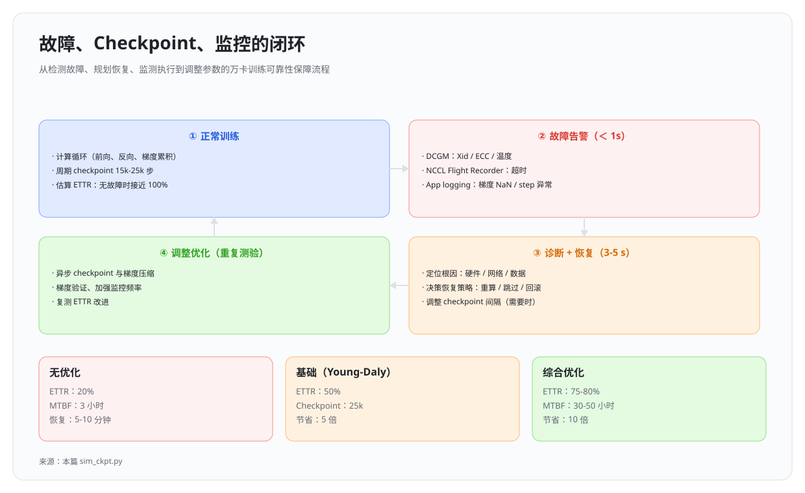
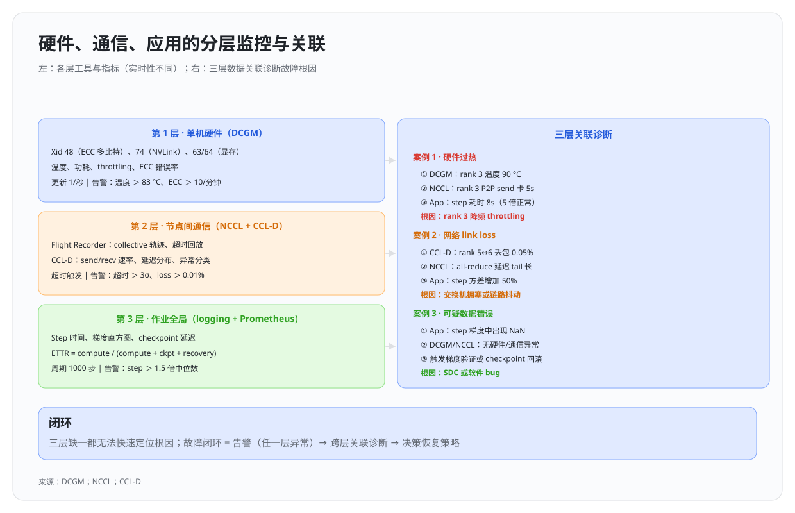
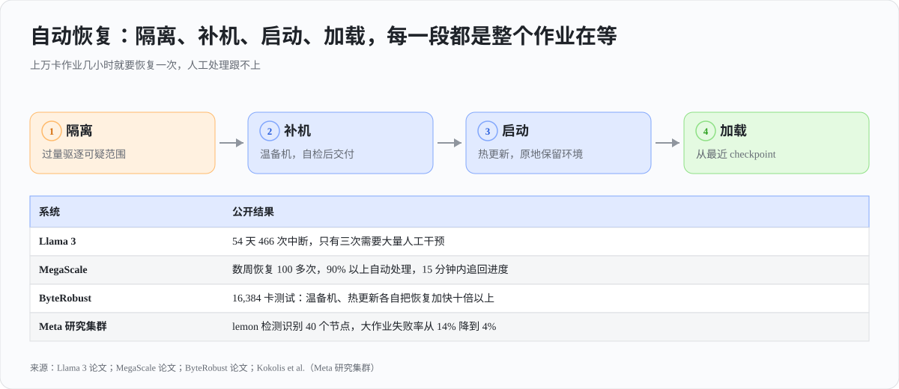
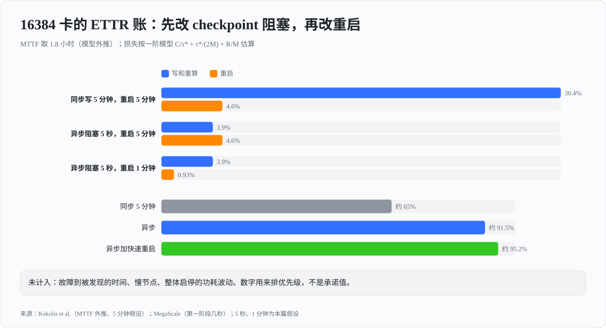

# GPU-20｜集群｜可靠性与可观测：故障、静默错误与 checkpoint

> 🎯 **这篇文档解决什么问题**：上万张卡的同步训练，几小时就会遇到一次故障；每次故障都要发现、定位、换机、重启、重算。本篇按 Llama 3、MegaScale、ByteRobust 和 Meta 研究集群的公开数据，讲清故障有多频繁、checkpoint 间隔怎样定、怎样把 checkpoint 移出关键路径、怎样发现慢节点和静默数据错误，以及怎样用 ETTR 记账、决定先改什么。

**使用方式**：第 1、2 章讲故障频率和 ETTR。第 3、4 章讲 checkpoint。第 5 到 7 章讲发现故障、慢节点和静默数据错误。第 8 章讲自动恢复，第 9 章把各项放进一本账，第 10 章给清单和自测。

**代码**：zero-to-gpu/20-reliability/ 下的 sim_ckpt.py、sim_failures.py、sim_straggler.py、test_reliability.py 只需 Python 标准库。Daly 公式和期望耗时模型有误，README 的“Llama 3 复现”不成立，第 10 章逐条说明。

<b>🧭 主线位置</b>：GPU-00（[GPU-00｜索引｜从 0 开始 GPU 优化：路线、章节与练习](./README.md)）建立了时间账 T = T_compute + W_mem + W_host + W_comm + W_idle。GPU-19（[GPU-19｜集群｜Kubernetes 上的 GPU：设备插件与拓扑感知调度](./19-k8s.md)）处理了调度层的 W_idle。本篇处理作业层面的 W_idle：故障、慢节点和恢复让多少墙钟时间没有推进训练，用 ETTR 衡量。作业跑起来以后模型怎样切分，交给 GPU-21（[GPU-21｜LLM｜训练并行：TP、PP、DP、ZeRO 与 FP8](./21-train-parallel.md)）。

## 导读 · 先给结论

- <b>故障是常态。</b>Llama 3 在 54 天里意外中断 419 次，约 78% 归因于硬件（第 1 章）。[[1]](https://arxiv.org/pdf/2407.21783)
- <b>作业 MTTF 和卡数成反比。</b>1024 卡作业 7.9 小时，外推到 16384 卡约 1.8 小时（第 1 章）。[[2]](https://arxiv.org/pdf/2410.21680)
- <b>用 ETTR 记账。</b>公开系统在上万卡上做到 90% 以上，ByteRobust 在 9,600 卡三个月作业上是 97%（第 2 章）。[[1]](https://arxiv.org/pdf/2407.21783)[[3]](https://arxiv.org/pdf/2402.15627)[[4]](https://arxiv.org/pdf/2509.16293)
- <b>checkpoint 间隔按平方根定。</b>最优间隔约 √(2CM)，损失约 √(2C/M)（第 3 章）。[[2]](https://arxiv.org/pdf/2410.21680)
- <b>阻塞时间是关键。</b>两段式写入把阻塞缩到几秒，恢复时的读取仍在关键路径上（第 4 章）。[[3]](https://arxiv.org/pdf/2402.15627)[[5]](https://docs.pytorch.org/tutorials/recipes/distributed_async_checkpoint_recipe.html)
- <b>慢节点和静默错误不报错。</b>要比较各 rank 的耗时、记录每次 NaN 的机器（第 6、7 章）。[[6]](https://arxiv.org/pdf/2505.05713)[[7]](https://arxiv.org/pdf/2410.12588)[[4]](https://arxiv.org/pdf/2509.16293)
- <b>先改 checkpoint 阻塞，再改重启。</b>16384 卡上同步写 5 分钟时 ETTR 约 65%，异步加快速重启约 95.2%（第 9 章）。[[2]](https://arxiv.org/pdf/2410.21680)

<b>📎 与系列其他文档的分工</b>：GPU-16（[GPU-16｜单机｜单机验收与调优](./16-node-burnin.md)）讲单机验收、DCGM 诊断、Xid 和烧机。GPU-18（[GPU-18｜集群｜NCCL：算法、协议与挂死排查](./18-nccl.md)）讲 NCCL 挂死排查、Flight Recorder 和 RAS。GPU-19（[GPU-19｜集群｜Kubernetes 上的 GPU：设备插件与拓扑感知调度](./19-k8s.md)）讲调度层怎样隔离坏卡。GPU-21（[GPU-21｜LLM｜训练并行：TP、PP、DP、ZeRO 与 FP8](./21-train-parallel.md)）讲并行切分。

## 第 1 章 · 规模越大，故障越频繁

单张 GPU 一年坏一次已经算不上可靠，但放进同步训练里，问题会被规模放大：作业里任何一张卡、一台主机、一根线出问题，整个作业都要停。卡数翻倍，作业两次故障之间的平均时间就减半。本章用 Llama 3 和 Meta 研究集群的公开数据说明故障的频率和构成，再说明配套代码怎样换算作业的故障间隔。

### Llama 3：54 天 419 次意外中断

Llama 3 405B 最多用 16K 张 H100 训练[[1]](https://arxiv.org/pdf/2407.21783)。论文指出，训练是同步的，一张 GPU 出故障就可能要重启整个作业[[1]](https://arxiv.org/pdf/2407.21783)。在一段 54 天的预训练快照里，作业一共中断 466 次[[1]](https://arxiv.org/pdf/2407.21783)，其中 47 次是固件升级、配置或数据集更新这类计划内的中断[[1]](https://arxiv.org/pdf/2407.21783)，其余 419 次是意外中断[[1]](https://arxiv.org/pdf/2407.21783)。按 54 天 419 次算，平均约每 3.09 小时一次。意外中断里约 78% 归因于确认的硬件问题，例如 GPU 或主机部件故障，或者疑似硬件问题，例如静默数据错误[[1]](https://arxiv.org/pdf/2407.21783)；GPU 问题是最大的一类，占 58.7%[[1]](https://arxiv.org/pdf/2407.21783)，其中 HBM3 显存 72 次，占 17.2%[[1]](https://arxiv.org/pdf/2407.21783)。计划内的维护也不少：自动化的集群维护每天至少带来一次中断[[1]](https://arxiv.org/pdf/2407.21783)。

### 作业的故障间隔和卡数成反比

Meta 另一篇论文分析了两个研究集群 11 个月的数据，覆盖四百万个作业、超过 1.5 亿 A100 GPU 小时[[2]](https://arxiv.org/pdf/2410.21680)。它把作业的平均故障间隔 MTTF 写成 (N·r_f)⁻¹，N 是作业用的节点数，r_f 是每节点每天的故障率[[2]](https://arxiv.org/pdf/2410.21680)。实测数据里，1024 卡作业的 MTTF 是 7.9 小时[[2]](https://arxiv.org/pdf/2410.21680)，8 卡作业是 47.7 天[[2]](https://arxiv.org/pdf/2410.21680)；按拟合的模型外推，16384 卡作业的 MTTF 约 1.8 小时，131072 卡作业约 0.23 小时[[2]](https://arxiv.org/pdf/2410.21680)。研究集群的作业和软件栈比 Llama 3 的生产训练杂得多，两组数字不能直接比，但量级一致：上万张卡的作业，几小时就会遇到一次故障。

配套代码 zero-to-gpu/20-reliability/ 的 sim_failures.py 用同样的反比关系换算：按 Llama 3 的 54 天 419 次，得到作业 MTBF 3.09 小时，折算到每张卡约 5.8 年一次故障。这个换算本身没有问题，问题在它后面的蒙特卡洛模拟，第 2 章和第 3 章说明。

按五步闭环看故障：

- **定天花板**：用作业的卡数和单节点故障率估算作业 MTTF。
- **测实际**：按作业记录每次中断的时间、原因和恢复时长。
- **定位等待**：把中断按硬件、软件、网络、计划内维护分类。
- **消除或隐藏**：减少能避免的中断，缩短不能避免的中断（后面各章）。
- **复测**：每月重新统计 MTTF 和中断构成。

一个常见的误区是用小规模试跑的稳定性推断大规模训练。现象是 8 卡上连跑几周没出过事，扩到几千卡后每天中断好几次。原因是作业 MTTF 和卡数成反比，8 卡作业的 MTTF 是 47.7 天，1024 卡就只剩 7.9 小时。改法是上规模前按目标卡数估算 MTTF，并据此设计 checkpoint 和恢复流程。

> 🔑 **本章要点**：Llama 3 在 54 天里意外中断 419 次，平均约 3.09 小时一次，约 78% 归因于硬件，GPU 问题占 58.7%。作业 MTTF 等于 (N·r_f)⁻¹，Meta 研究集群里 1024 卡作业 7.9 小时，外推到 16384 卡约 1.8 小时。这一章是五步闭环的“定天花板”：先算出作业多久会坏一次。

## 第 2 章 · ETTR：把故障的代价记进时间账

故障本身只是一个事件，它的代价是一段时间：发现故障之前空转的时间，诊断和重启的时间，从上一个 checkpoint 重算的时间，以及为了防故障而写 checkpoint 的时间。业界用有效训练时间比 ETTR 把这些汇总成一个数。本章讲 ETTR 的定义、几个公开系统的水平，以及它在时间账里的位置。

### ETTR 的定义

几篇论文的定义一致。Llama 3 说，有效训练时间衡量的是有用训练时间占总耗时的比例[[1]](https://arxiv.org/pdf/2407.21783)。ByteRobust 把 ETTR 定义为有效训练时间和作业墙钟时间之比[[4]](https://arxiv.org/pdf/2509.16293)。Meta 研究集群的论文把 ETTR 定义为有效运行时间和一次作业运行可用墙钟时间之比[[2]](https://arxiv.org/pdf/2410.21680)。MegaScale 的算法更具体：迭代次数乘以每次迭代的训练时间，再除以总训练时间[[3]](https://arxiv.org/pdf/2402.15627)。

放回本系列的时间账 T = T_compute + W_mem + W_host + W_comm + W_idle，ETTR 管的是作业层面的 W_idle：前面各篇讲的是一个训练步里的等待，ETTR 讲的是一次训练任务里有多少墙钟时间根本没有在推进训练。两者相乘才是集群的实际产出：MFU 衡量每一步算得多满，ETTR 衡量有多少时间在算。

### 公开系统的水平

Llama 3 在每天至少一次计划内中断的情况下，做到了超过 90% 的有效训练时间[[1]](https://arxiv.org/pdf/2407.21783)。MegaScale 在 12,288 张 GPU 上训练 175B 模型达到 55.2% 的 MFU[[3]](https://arxiv.org/pdf/2402.15627)，故障恢复后能保持 90% 以上的有效训练时间率[[3]](https://arxiv.org/pdf/2402.15627)。ByteRobust 在一个 9,600 张 GPU、持续三个月的训练作业上达到 97% 的 ETTR[[4]](https://arxiv.org/pdf/2509.16293)。这几个数字的口径略有不同，但给出了目标的量级：上万卡的训练，ETTR 要做到 90% 以上。

ETTR 里的损失可以拆成四项：写 checkpoint 时阻塞训练的时间；故障发生到被发现的时间；诊断、换机、重启、加载 checkpoint 的时间；从上一个 checkpoint 到故障点之间要重算的时间。第 3、4 章处理第一项和第四项，第 5 章处理第二项，第 8 章处理第三项，第 9 章把四项放在一起算。

配套代码的 sim_failures.py 用 Llama 3 的参数跑出平均 ETTR 14.2%，README 把它当作“Llama 3 复现”。这个低值来自它的默认设置：每 1000 步写一次 checkpoint，1000 步只算 100 秒，写一次却要 600 秒，时间主要花在写 checkpoint 上，和 Llama 3 实际超过 90% 的水平无关。第 10 章列为练习。

按五步闭环管 ETTR：

- **定天花板**：ETTR 的上限是 1，减去每一项损失。
- **测实际**：从训练日志里统计有效迭代时间和墙钟时间。
- **定位等待**：按四项拆开损失，找最大的一项。
- **消除或隐藏**：最大的一项先处理。
- **复测**：每周算一次 ETTR，和目标对比。

一个常见的误区是只看 MFU。现象是 MFU 调到很高，训练进度仍然落后计划。原因是 MFU 只在训练运行时统计，故障、重启和重算的时间不在里面。改法是同时报告 MFU 和 ETTR，两者相乘才是有效算力。

> 🔑 **本章要点**：ETTR 是有效训练时间和墙钟时间之比，管作业层面的 W_idle，MFU 乘以 ETTR 才是实际产出。Llama 3 超过 90%，MegaScale 保持 90% 以上，ByteRobust 在 9,600 卡三个月作业上做到 97%。损失分四项：写 checkpoint、发现故障、恢复、重算。配套代码的 14.2% 来自默认参数，和 Llama 3 无关。这一章是五步闭环的“测实际”：把故障的代价换算成时间。

这个近似要求 C 远小于 M。C 和 M 接近时，一个间隔里可能发生不止一次故障，写 checkpoint 时也可能出故障，需要 Daly 的高阶修正。工程上更重要的结论是平方根本身：MTTF 降到四分之一，最优间隔减半，损失翻倍；写一次的代价降到百分之一，最优间隔缩到十分之一，损失也降到十分之一。

## 第 3 章 · checkpoint 间隔：写得勤和重算多之间的平方根

checkpoint 写得越勤，每次故障要重算的就越少，但写 checkpoint 本身也花时间。这两项此消彼长，中间有一个最优间隔。经典的 Young 和 Daly 公式给出了它的近似：最优间隔和“写一次的代价乘以 MTTF”的平方根成正比。本章讲这个公式从哪里来、什么时候成立，并指出配套代码在这里的两处错误。

### 平方根法则

设写一次 checkpoint 阻塞训练 C 秒，作业 MTTF 是 M 秒，间隔是 τ 秒。每个间隔里写 checkpoint 的损失占 C/τ；故障平均发生在间隔中间，每次故障要重算约 τ/2，摊到时间上是 τ/(2M)。两项相加，对 τ 求最小值，得到 τ\* = √(2CM)，此时两项相等，总损失约为 √(2C/M)。Meta 研究集群的论文引用 Daly 和 Young 的经典结论[[2]](https://arxiv.org/pdf/2410.21680)，写出在一些限制性假设下最优间隔近似为 √(2·w_cp/(N·r_f))[[2]](https://arxiv.org/pdf/2410.21680)，其中 w_cp 就是写一次的代价，1/(N·r_f) 就是 MTTF。论文也指出，MTTF 可以用来在 checkpoint 有开销时配置最优策略[[2]](https://arxiv.org/pdf/2410.21680)。

### 配套代码的两处错误

sim_ckpt.py 的 README 例子是 16 张卡、单卡 MTBF 24 小时，作业 MTBF 1.5 小时即 5400 秒，写一次 600 秒，恢复 300 秒。Young 间隔是 √(2 × 600 × 5400)，约 2545.6 秒，按每步 0.1 秒就是 25455 步，代码这一项算对了。按上面的一阶模型，最优点的损失约 2 × 600 ÷ 2545.6，即 47.1%，再加上重启摊销 300 ÷ 5400，即 5.6%。这组参数下 C 已经是 M 的九分之一，一阶模型只能看量级，结论是写一次 600 秒在这个故障率下代价太大。

第一处错误是 Daly 公式。代码写成 √(2M/(1+√(1+2R/M)))，里面没有写 checkpoint 的时间 C，单位也不对：根号里是秒，开出来是秒的平方根。实跑得到 725 步，即 72.5 秒，比写一次 checkpoint 的 600 秒还短。README 给 Daly 公式标的 arXiv 0704.3859 是一篇关于旋转费米气体的物理论文，和 checkpoint 无关。

第二处错误是期望耗时模型。expected_time_to_result 算了 checkpoint 时间和每次故障的恢复时间，没有算故障后要重算的那段进度。于是间隔越长总耗时越短：实跑里 Young 间隔的 ETTR 是 76.2%，把间隔设成整个训练只写一次，ETTR 反而升到 89.1%。扫描结果里“最优”的 Young 间隔，只是因为它恰好是扫描列表里最长的间隔。第 10 章列为练习。

按五步闭环定间隔：

- **定天花板**：用 MTTF 和写一次的阻塞时间算 τ\* 和对应损失。
- **测实际**：测 checkpoint 实际阻塞训练多久，统计实际 MTTF。
- **定位等待**：损失主要在写还是在重算。
- **消除或隐藏**：按 τ\* 设间隔；写的代价大就先缩短阻塞时间（第 4 章）。
- **复测**：MTTF 随规模和集群状态变化，定期重算间隔。

一个常见的误区是固定按步数或按小时写 checkpoint，从小规模沿用到大规模。现象是扩到几千卡后，每次故障都要重算一两个小时的进度。原因是 MTTF 随卡数下降，最优间隔应按平方根缩短。改法是按目标规模的 MTTF 重算间隔，并随实际故障率调整。

> 🔑 **本章要点**：最优 checkpoint 间隔近似为 √(2CM)，此时写和重算的损失相等，总损失约 √(2C/M)，前提是 C 远小于 M。配套代码的 Young 间隔 2545.6 秒是对的；Daly 公式漏了 C、单位不对，引用的 arXiv 编号是物理论文；期望耗时模型漏了重算，所以只写一次 checkpoint 反而得到更高的 89.1%。这一章是五步闭环的“定天花板”：先算出 checkpoint 损失的下限。

## 第 4 章 · 把 checkpoint 移出关键路径

第 3 章的平方根法则说明，checkpoint 的损失取决于写一次阻塞训练多久。阻塞的部分越短，就能写得越勤，故障后重算得越少。各家的做法殊途同归：先把状态快速拷到主机内存，训练马上继续，再由后台慢慢写到持久存储。本章讲这种分两段写的方法、PyTorch 的实现和它的代价，以及恢复这一侧的瓶颈。

### 两段式写入

MegaScale 用两阶段的 checkpoint。第一阶段，每个 GPU worker 把片上状态写到主机内存，然后继续训练[[3]](https://arxiv.org/pdf/2402.15627)；借助 PCIe 的高带宽，这一步可以缩短到几秒[[3]](https://arxiv.org/pdf/2402.15627)。第二阶段，一个后台进程接手，把状态从主机内存异步传到分布式文件系统，MegaScale 用的是 HDFS[[3]](https://arxiv.org/pdf/2402.15627)。ByteRobust 的 checkpoint 机制做到每一步都写 checkpoint，开销小于 0.9%[[4]](https://arxiv.org/pdf/2509.16293)。更早的 CheckFreq 用流水化的内存快照和自适应的写入频率，把恢复时间从小时级降到秒级，运行开销控制在 3.5% 以内[[8]](https://www.usenix.org/system/files/fast21-mohan.pdf)。Llama 3 也提到，为了提高有效训练时间，他们缩短了作业启动和 checkpoint 的时间[[1]](https://arxiv.org/pdf/2407.21783)。

### PyTorch 的异步 checkpoint

PyTorch 的分布式 checkpoint 提供 torch.distributed.checkpoint.async_save[[5]](https://docs.pytorch.org/tutorials/recipes/distributed_async_checkpoint_recipe.html)，需要 PyTorch 2.4.0 或更新版本[[5]](https://docs.pytorch.org/tutorials/recipes/distributed_async_checkpoint_recipe.html)。它的工作方式和上面一样：先把模型拷到内部的 CPU 缓冲区[[5]](https://docs.pytorch.org/tutorials/recipes/distributed_async_checkpoint_recipe.html)，保证写的过程中权重不再变化，代价是增加 CPU 内存占用。文档建议同一时刻只保留一个异步 checkpoint 请求，避免额外的内存压力[[5]](https://docs.pytorch.org/tutorials/recipes/distributed_async_checkpoint_recipe.html)。还可以用 pinned memory 作为常驻的暂存缓冲，这个优化针对的是异步 checkpoint 的主要开销，即拷贝到 checkpoint 缓冲区的内存复制[[5]](https://docs.pytorch.org/tutorials/recipes/distributed_async_checkpoint_recipe.html)。

异步不等于免费。后台写入要在下一次 checkpoint 开始之前完成，所以间隔不能短于后台写一次的时间；后台写入也会和训练争用主机内存带宽、网卡和存储带宽。实际能做到的间隔，取第 3 章的 τ\* 和后台写入时间里较大的那个。

### 恢复也要快

写入可以移到后台，读取不行。MegaScale 指出，从 checkpoint 恢复在关键路径上，训练必须等最后一个 checkpoint 读完才能开始，瓶颈是 HDFS 的带宽[[3]](https://arxiv.org/pdf/2402.15627)。几千张卡同时从同一个文件系统读，带宽很快被打满。常见的缓解方法是让每份数据只读一次，再在节点之间分发；或者把最近的 checkpoint 留在本地内存或邻居节点上，只有整组节点都失效时才回到远端存储。

按五步闭环优化 checkpoint：

- **定天花板**：阻塞时间的下限是把状态拷出 GPU 的时间。
- **测实际**：分别测阻塞时间、后台写入时间和恢复时的读取时间。
- **定位等待**：阻塞长就改异步，后台写慢就看存储带宽，恢复慢就看读取路径。
- **消除或隐藏**：两段式写入，pinned memory 暂存，分层存放。
- **复测**：按新的阻塞时间重算第 3 章的间隔。

一个常见的误区是开了异步写就把间隔缩到很短。现象是 CPU 内存不足或训练明显变慢。原因是上一次的后台写入还没完成，新的 checkpoint 又开始拷贝，缓冲区叠加，后台写入也和训练争带宽。改法是让间隔不短于后台写一次的时间，同时只保留一个在途的异步请求。

> 🔑 **本章要点**：两段式 checkpoint 先拷到主机内存再后台写远端，MegaScale 的阻塞缩到几秒，ByteRobust 每步写开销小于 0.9%，CheckFreq 开销在 3.5% 以内。PyTorch 用 async_save，代价是 CPU 内存，建议只保留一个在途请求。恢复时读取在关键路径上，MegaScale 的瓶颈是 HDFS 带宽。这一章是五步闭环的“消除或隐藏”：把写 checkpoint 藏到训练后面。

## 第 5 章 · 发现故障：心跳、超时和自检

故障发生到被发现之间，整个作业都在空等。同步训练里，一张卡挂了，其他卡会卡在下一次集合通信上，直到超时。发现得越快，空等越短；但检测太敏感又会误报，把好机器踢出去。本章讲三种发现手段：心跳和超时、通信库的诊断工具、停机自检，以及显式故障和隐式故障的区别。

### 显式故障和隐式故障

ByteRobust 统计了生产平台三个月里 778,135 个大模型训练作业的事故[[4]](https://arxiv.org/pdf/2509.16293)。最多的一类是显式的 CUDA 错误，占 36.1%[[4]](https://arxiv.org/pdf/2509.16293)。这类故障有明确的报错和出错机器，处理起来直接。难的是隐式故障：作业挂住不动、训练曲线意外偏离、性能抖动或下降，以及难以定位根因的静默数据错误[[4]](https://arxiv.org/pdf/2509.16293)。三个月里，ByteRobust 识别出 38,236 次显式故障和 5,948 次隐式故障[[4]](https://arxiv.org/pdf/2509.16293)。论文提到，有一次由 CUDA 错误引起的通信挂死，人工诊断花了一个半小时以上[[4]](https://arxiv.org/pdf/2509.16293)。

### 三种发现手段

第一种是心跳和超时。MegaScale 的驱动进程定期接收各执行进程的心跳，在规定的时间窗内收不到，就触发故障恢复流程[[3]](https://arxiv.org/pdf/2402.15627)。PyTorch 的进程组超时也是同一类：NCCL 后端默认 10 分钟，其他后端 30 分钟[[9]](https://docs.pytorch.org/docs/main/distributed.html)。Llama 3 的 419 次意外中断里有 7 次是 NCCL watchdog 超时，占 1.7%[[1]](https://arxiv.org/pdf/2407.21783)。默认的 10 分钟对上万卡的作业很长，但设得太短又会把正常的慢操作当成故障。

第二种是通信库的诊断。PyTorch 的 Flight Recorder 可以在超时时转储各 rank 的集合通信记录，用 TORCH_NCCL_DUMP_ON_TIMEOUT 打开[[10]](https://docs.pytorch.org/tutorials/unstable/flight_recorder_tutorial.html)。NCCL 从 2.24 起提供 RAS 子系统，可以在作业运行时查询 NCCL 作业的健康状态[[11]](https://docs.nvidia.com/deeplearning/nccl/user-guide/docs/troubleshooting/ras.html)。这两个工具的用法见 GPU-18（[GPU-18｜集群｜NCCL：算法、协议与挂死排查](./18-nccl.md)）第 8 章。

第三种是停机自检。MegaScale 在发现故障后让所有执行进程运行一组自检诊断，找出有问题的节点[[3]](https://arxiv.org/pdf/2402.15627)。论文指出这里有一个权衡：诊断时间越长，有效训练时间越少；误报率越高，越多正常机器被不必要地排除[[3]](https://arxiv.org/pdf/2402.15627)。MegaScale 的诊断测试不到 10 分钟[[3]](https://arxiv.org/pdf/2402.15627)。DCGM 的诊断也按这个思路分级：1 级作为就绪检查，2 级在作业失败后作为收尾检查[[12]](https://docs.nvidia.com/datacenter/dcgm/latest/user-guide/dcgm-diagnostics.html)；运行中出现不可恢复的显存错误、温度违规或 Xid，测试判为失败[[12]](https://docs.nvidia.com/datacenter/dcgm/latest/user-guide/dcgm-diagnostics.html)（GPU-16，[GPU-16｜单机｜单机验收与调优](./16-node-burnin.md)）。

按五步闭环做检测：

- **定天花板**：发现时间的下限是心跳间隔或超时设置。
- **测实际**：统计每次故障从发生到触发恢复的时长。
- **定位等待**：发现慢的多是挂死类的隐式故障。
- **消除或隐藏**：心跳加超时，打开 Flight Recorder 和 RAS，失败后自动跑短诊断。
- **复测**：统计误报率，确认没有把好机器大量踢出。

一个常见的误区是把超时当作唯一的检测手段。现象是作业挂住后要等 10 分钟才报错，报错里只有超时，看不出是哪张卡。原因是超时只说明有 rank 没跟上，不说明为什么。改法是超时时自动转储 Flight Recorder，并对涉及的节点跑自检，把“发现”和“定位”连在一起。

> 🔑 **本章要点**：显式故障有报错，ByteRobust 三个月统计里 CUDA 错误占 36.1%；隐式故障包括挂死、曲线偏离、性能下降和静默错误，难在定位。发现手段有心跳和超时（NCCL 默认 10 分钟）、Flight Recorder 和 NCCL RAS、停机自检，MegaScale 的诊断不到 10 分钟。这一章是五步闭环的“定位等待”：缩短故障发生到被发现的空等。

## 第 6 章 · 慢节点：没坏，但拖慢所有人

有些机器不报错，只是慢。同步训练里，每一步都要等最慢的那个 rank，所以一台慢机器会让成千上万张卡一起降速。慢节点不触发任何故障告警，作业看上去一切正常，只是吞吐比预期低。本章用几篇论文的数据说明慢节点有多普遍、损失有多大，以及怎样找到它们。

### 慢节点有多普遍

Llama 3 的论文写道，硬件问题有时会造成仍在工作但变慢的节点，很难发现；哪怕只有一个慢节点，也能拖慢几千张 GPU，表现为通信没有中断，只是很慢[[1]](https://arxiv.org/pdf/2407.21783)。MegaScale 用热力图发现，约 0.5% 的机器在训练中明显更慢[[3]](https://arxiv.org/pdf/2402.15627)，把这些主机隔离移除后，MFU 提升约 0.7%[[3]](https://arxiv.org/pdf/2402.15627)。

字节跳动的一项 what-if 分析研究了生产集群里的慢节点：42.5% 的作业因为慢节点至少慢了 10%[[6]](https://arxiv.org/pdf/2505.05713)，在尾部，慢节点让作业浪费了 45% 的已分配资源[[6]](https://arxiv.org/pdf/2505.05713)。论文还发现慢节点不总是硬件故障引起的，原因可能有多种[[6]](https://arxiv.org/pdf/2505.05713)。阿里巴巴的 FALCON 在一个超过一万张 GPU 的集群上做了统计：这类慢故障由计算和跨节点网络的各种问题引起，持续几十秒到将近十小时，平均让作业完成时间延长到 1.34 倍[[7]](https://arxiv.org/pdf/2410.12588)；人工检查的 27 个大作业里，16 个遇到过慢故障[[7]](https://arxiv.org/pdf/2410.12588)。环境也有影响：Llama 3 观察到吞吐随一天中的时间有 1% 到 2% 的波动，原因是中午温度较高，影响了 GPU 的动态调频[[1]](https://arxiv.org/pdf/2407.21783)。

### 怎样找到慢节点

找慢节点要比较各 rank 的耗时。MegaScale 开发了性能分析工具，记录细粒度的 CUDA 事件，生成全系统的热力图和时间线[[3]](https://arxiv.org/pdf/2402.15627)，慢的机器在热力图上一目了然。Llama 3 开发了工具，优先排查选定进程组里可能有问题的通信[[1]](https://arxiv.org/pdf/2407.21783)，只查少数几个嫌疑对象，通常就能找到慢节点[[1]](https://arxiv.org/pdf/2407.21783)。FALCON 自动检测慢故障并做缓解，在人为注入的慢故障上把训练的减速缓解了 60.1%[[7]](https://arxiv.org/pdf/2410.12588)。

配套代码 sim_straggler.py 的模型是：每一步的时间等于最慢节点的时间。一个慢 1.5 倍的节点让吞吐损失 33.3%，慢节点从 1 个增加到 5 个，损失不变。这个模型说明了同步训练“木桶”的性质，但过于简化：真实的慢节点时快时慢，慢的程度也不同，而且流水线并行和数据并行对慢节点的敏感程度不一样。

按五步闭环处理慢节点：

- **定天花板**：用单机验收的基线（GPU-16）定义每台机器“应有”的速度。
- **测实际**：记录每个 rank 每一步的计算和通信耗时。
- **定位等待**：找出持续比中位数慢的 rank，区分计算慢和通信慢。
- **消除或隐藏**：隔离慢机器，送去诊断（第 8 章）。
- **复测**：移除后对比 MFU 和步时间。

一个常见的误区是只在作业失败时排查机器。现象是作业从不报错，MFU 却比同规模的历史作业低几个百分点。原因是慢节点不触发故障，只降低吞吐。改法是把每个 rank 的步时间作为常规监控，持续偏慢的节点按故障处理。

> 🔑 **本章要点**：慢节点不报错，但同步训练每步都等最慢的 rank。MegaScale 约 0.5% 的机器明显更慢，移除后 MFU 提升约 0.7%；what-if 分析里 42.5% 的作业至少慢 10%；FALCON 统计的慢故障平均让作业完成时间延长到 1.34 倍。找慢节点要比较各 rank 的耗时。这一章是五步闭环的“定位等待”：找出没坏但拖慢全体的机器。

## 第 7 章 · 静默数据错误：只有结果是错的

大多数故障至少会报错或让作业停下。静默数据错误 SDC 不会：硬件算错了，没有任何报错，错误的数字继续参与训练。它可能表现为一次损失突变、一个 NaN，也可能悄悄让模型变差。本章讲 SDC 在大规模集群里有多常见，它在训练里的表现，以及怎样把出错的机器找出来。

### SDC 是系统性问题

SDC 最早在 CPU 上被大规模记录。Meta 在数十万台机器上运行静默错误测试，查出数百颗有这类错误的 CPU，说明 SDC 是跨代际的系统性问题[[13]](https://arxiv.org/pdf/2102.11245)，他们对 SDC 的监测持续了 18 个月以上[[13]](https://arxiv.org/pdf/2102.11245)。Google 把出现这种行为的核称为 mercurial core，观察到的量级是每几千台机器有几个[[14]](https://sigops.org/s/conferences/hotos/2021/papers/hotos21-s01-hochschild.pdf)，并指出这类故障往往是“静默”的，唯一的症状是计算结果错误[[14]](https://sigops.org/s/conferences/hotos/2021/papers/hotos21-s01-hochschild.pdf)。

GPU 上同样存在。Llama 3 的 419 次意外中断里有 6 次归因于 SDC，占 1.4%[[1]](https://arxiv.org/pdf/2407.21783)。这只是被识别出来的部分。ByteRobust 把 SDC 列为大模型训练的关键挑战，它表现为随机的故障，例如损失突然发散或出现 NaN[[4]](https://arxiv.org/pdf/2509.16293)，停机诊断往往在短时间内复现不出来[[4]](https://arxiv.org/pdf/2509.16293)。论文记录了一次由 GPU SDC 引起、和数据类型相关的计算错误，行为不确定，难以稳定复现[[4]](https://arxiv.org/pdf/2509.16293)，最后经过 8 小时以上的离线压力测试才找到出错的机器[[4]](https://arxiv.org/pdf/2509.16293)。

### 怎样把出错的机器找出来

SDC 难在定位：几千台机器里有一台算错，损失曲线上只看到一个尖峰。ByteRobust 的做法是双阶段重放：保持原来的张量并行和流水线并行大小不变，只改变数据并行的划分[[4]](https://arxiv.org/pdf/2509.16293)。第一阶段把机器按编号连续分组，每组重放一遍训练，找出出错的组；第二阶段换一种分组方式，按编号取模重新分组，再找出出错的组[[4]](https://arxiv.org/pdf/2509.16293)。两次出错的组的交集，就是可疑的机器；组的大小选得合适时，交集只剩一台[[4]](https://arxiv.org/pdf/2509.16293)。比起逐台排查，两轮重放就能把范围缩小到很少几台。

预防的一侧，可以在机器上线前和定期维护时跑确定性的计算测试，对比已知正确的结果；DCGM 的诊断里包含显存和计算引擎的检查（GPU-16，[GPU-16｜单机｜单机验收与调优](./16-node-burnin.md)），但对数据类型相关、偶发的计算错误，覆盖有限。训练中的一侧，可以监控损失尖峰和 NaN，出现时先从 checkpoint 回退重跑同一段数据：能复现，多半是数据或代码问题；复现不了，就要怀疑硬件。

按五步闭环处理 SDC：

- **定天花板**：SDC 无法从硬件上完全排除，目标是缩短发现和定位的时间。
- **测实际**：记录每次损失尖峰、NaN 和回退重跑的结果。
- **定位等待**：重跑能复现的归数据或代码，复现不了的怀疑硬件。
- **消除或隐藏**：分组重放定位机器，隔离并做长时间压力测试。
- **复测**：换掉机器后，同一段数据重跑确认损失正常。

一个常见的误区是把偶发的 NaN 当作数值问题，靠调学习率或跳过这批数据处理。现象是 NaN 隔几天出现一次，每次换不同的数据批次。原因可能是某台机器偶发算错，跳过数据只是把症状藏起来。改法是每次 NaN 都记录出现的 rank 和机器，同一台机器反复出现时按 SDC 处理。

> 🔑 **本章要点**：SDC 不报错，唯一的症状是算错。Meta 在数十万台机器里查出数百颗有问题的 CPU，Google 的量级是每几千台机器几个；Llama 3 有 6 次中断归因于 SDC。ByteRobust 遇到过和数据类型相关、难复现的 GPU SDC，用双阶段分组重放定位机器。这一章是五步闭环的“定位等待”：把只表现为数字异常的硬件错误找出来。

## 第 8 章 · 自动恢复：隔离、替换、重启

发现了故障、定位了机器，接下来要把作业尽快恢复起来。一次恢复包括把坏机器移出去、补上一台好机器、重新拉起所有进程、加载 checkpoint。每一步都是整个作业在等。上万卡的作业几小时就要恢复一次，靠人工处理跟不上，必须自动化。本章讲几个公开系统怎样缩短恢复，以及怎样处理反复出问题的机器。

### 自动化程度决定恢复时间

Llama 3 在 54 天的快照里经历了 466 次中断，只有三次需要大量人工干预，其余都由自动化处理[[1]](https://arxiv.org/pdf/2407.21783)。MegaScale 的一次数周的生产训练恢复了 100 多次[[3]](https://arxiv.org/pdf/2402.15627)，90% 以上的软硬件故障被自动发现和修复[[3]](https://arxiv.org/pdf/2402.15627)；诊断测试不到 10 分钟，从最近的 checkpoint 恢复后 15 分钟内能追回崩溃前的进度[[3]](https://arxiv.org/pdf/2402.15627)。

ByteRobust 在替换机器这一步做了两件事。温备机是预先准备好的备用机器，交付前先跑自检，避免整个作业重新调度[[4]](https://arxiv.org/pdf/2509.16293)。热更新是指不改变机器分配的变更，在原地更新，保留运行环境[[4]](https://arxiv.org/pdf/2509.16293)。在 16,384 张 GPU 上的测试里，温备和热更新各自让恢复最多加快十倍以上[[4]](https://arxiv.org/pdf/2509.16293)。定位不清时，ByteRobust 选择过量驱逐：通过三步流程把可疑范围内的机器一并移出，不必精确找到根因[[4]](https://arxiv.org/pdf/2509.16293)。这是用少量好机器换恢复速度。

### 反复出问题的机器

有些机器单次健康检查都能通过，却反复让作业失败。Meta 研究集群的论文称之为 lemon 节点：反复导致作业失败、但现有的健康检查和维修流程识别不出来的服务器[[2]](https://arxiv.org/pdf/2410.21680)。他们用历史作业数据设计了 lemon 检测，识别出 40 个有问题的节点，准确率超过 85%[[2]](https://arxiv.org/pdf/2410.21680)，512 卡以上大作业的失败率从 14% 降到 4%[[2]](https://arxiv.org/pdf/2410.21680)。做法的要点是保留每台机器的历史：被多少个作业排除过、出过多少种 Xid，用历史而不是单次检查做判断。

被移出的机器要经过诊断才能回到集群。DCGM 的 2 级诊断适合在作业失败后作为收尾检查[[12]](https://docs.nvidia.com/datacenter/dcgm/latest/user-guide/dcgm-diagnostics.html)，更深的诊断和烧机流程见 GPU-16（[GPU-16｜单机｜单机验收与调优](./16-node-burnin.md)）。调度层怎样把坏卡从可分配资源里拿掉，见 GPU-19（[GPU-19｜集群｜Kubernetes 上的 GPU：设备插件与拓扑感知调度](./19-k8s.md)）第 8 章。

按五步闭环做恢复：

- **定天花板**：恢复时间的下限是拉起进程和加载 checkpoint 的时间。
- **测实际**：把每次恢复拆成隔离、补机、启动、加载四段计时。
- **定位等待**：找出最长的一段。
- **消除或隐藏**：温备机、热更新、并行加载 checkpoint，lemon 节点长期隔离。
- **复测**：统计恢复时长的分布和人工介入次数。

一个常见的误区是机器出过一次问题、重启后检查通过就放回去。现象是同一台机器隔几天又让作业失败。原因是有些硬件问题是间歇性的，单次检查抓不到。改法是记录每台机器的故障历史，超过阈值的机器长期隔离、送修。

> 🔑 **本章要点**：Llama 3 的 466 次中断只有三次需要大量人工干预；MegaScale 数周恢复 100 多次，90% 以上自动处理，15 分钟内追回进度；ByteRobust 用温备机和热更新把恢复最多加快十倍以上。lemon 检测让 Meta 的大作业失败率从 14% 降到 4%。这一章是五步闭环的“消除或隐藏”：把恢复做成自动流程。

## 第 9 章 · 一本 ETTR 账：在 16384 卡上算一遍

前面几章分别讲了故障频率、checkpoint 间隔、异步写入、检测和恢复。本章把它们放进同一本账：给定作业规模和故障率，checkpoint 阻塞多久、重启多久，ETTR 大约是多少，哪一项最值得先改。算法用第 3 章的一阶模型，参数取自前面各章的公开数据，个别参数是假设，下文会标明。

### 三种配置

规模取 16384 卡。Meta 研究集群的模型对这个规模外推的 MTTF 是 1.8 小时[[2]](https://arxiv.org/pdf/2410.21680)，即 6480 秒。损失按第 3 章的近似估算：在最优间隔 τ\* = √(2CM) 上，写 checkpoint 和重算各占 C/τ\*，再加上每次故障的重启时间 R 摊到 MTTF 上的 R/M。

配置一：同步写 checkpoint，阻塞 5 分钟，重启 5 分钟。这两个 5 分钟和 Meta 那篇论文估算 ETTR 时的假设相同[[2]](https://arxiv.org/pdf/2410.21680)。τ\* = √(2 × 300 × 6480)，约 1971.8 秒，即约 33 分钟。写和重算各占约 15.2%，合计 30.4%；重启占 4.6%。ETTR 约 65%。

配置二：改成两段式异步写，阻塞时间按 5 秒估算（MegaScale 第一阶段是几秒[[3]](https://arxiv.org/pdf/2402.15627)，5 秒是本章的假设），重启仍是 5 分钟。τ\* = √(2 × 5 × 6480)，约 254.6 秒。写和重算合计约 3.9%，重启 4.6%，ETTR 约 91.5%。注意后台写入要在 254.6 秒内完成，否则间隔要放宽（第 4 章）。

配置三：在配置二的基础上，用温备机和热更新把重启缩到 1 分钟（本章的假设）。重启只占约 0.93%，ETTR 约 95.2%。

### 账本告诉我们什么

三个配置的差别说明了先改什么。同步写 5 分钟时，checkpoint 本身吃掉约三成时间，再怎么优化检测和重启都补不回来；改成异步写，损失降到几个百分点，这时重启时间成了大头；把重启缩到 1 分钟，ETTR 才到约 95.2%。这个顺序和公开系统的做法一致：Llama 3 先缩短作业启动和 checkpoint 时间[[1]](https://arxiv.org/pdf/2407.21783)，MegaScale 用两阶段 checkpoint[[3]](https://arxiv.org/pdf/2402.15627)，ByteRobust 用温备机和热更新加快恢复[[4]](https://arxiv.org/pdf/2509.16293)，最终都做到 90% 以上。

这本账有三个没算进去的项：故障发生到被发现的时间（第 5 章），慢节点造成的降速（第 6 章），以及作业整体启停带来的影响，例如 Llama 3 提到的数据中心功耗在几十兆瓦量级上的瞬时波动[[1]](https://arxiv.org/pdf/2407.21783)。一阶模型在 C 接近 M 时也不再准确。所以这些数字用来比较配置和排定优先级，不能当作承诺的 ETTR。

按五步闭环用这本账：

- **定天花板**：用实际 MTTF、阻塞时间、重启时间代入，算出各项损失。
- **测实际**：用训练日志算实际 ETTR，和估算对比。
- **定位等待**：估算和实际差得多的，多半是发现时间或慢节点。
- **消除或隐藏**：先改最大的一项。
- **复测**：规模或集群变了就重算。

一个常见的误区是把优化精力放在检测和诊断上，checkpoint 仍然同步写。现象是检测和恢复都做得很快，ETTR 还是上不去。原因是同步写的阻塞时间决定了 checkpoint 损失的下限，配置一里这一项就有约三成。改法是先按这本账算出各项的比例，从最大的一项改起。

> 🔑 **本章要点**：16384 卡、MTTF 1.8 小时：同步写 5 分钟加重启 5 分钟，ETTR 约 65%；改成阻塞 5 秒的异步写，约 91.5%；再把重启缩到 1 分钟，约 95.2%。先改 checkpoint 阻塞，再改重启。发现时间、慢节点和功耗波动不在这本账里，数字只用来排优先级。这一章是五步闭环的“复测”：把各项改进放回同一本账核对。

## 第 10 章 · 上线前核对清单与自测

前九章沿着故障的代价处理作业层面的 W_idle：第 1 章估算故障频率，第 2 章用 ETTR 记账，第 3 章定 checkpoint 间隔，第 4 章把 checkpoint 移出关键路径，第 5 章讲发现故障，第 6 章讲慢节点，第 7 章讲静默数据错误，第 8 章讲自动恢复，第 9 章把各项放进同一本账。本章把它们压成一张核对清单，再列出配套代码的问题作为练习，最后给出自测题。

### 📌 核对清单

| 检查项 | 怎样查 | 通过的标志 |
|---|---|---|
| 知道作业多久坏一次 | 按卡数和历史故障率估算 MTTF（第 1 章） | 有目标规模下的 MTTF 估计 |
| ETTR 有统计 | 训练日志的有效迭代时间和墙钟时间（第 2 章） | 每周有 ETTR，并拆成四项损失 |
| checkpoint 间隔有依据 | 代入 √(2CM)（第 3 章） | 间隔随 MTTF 调整，不是沿用小规模的值 |
| checkpoint 不阻塞训练 | 测阻塞时间和后台写入时间（第 4 章） | 阻塞在秒级，后台写入短于间隔 |
| 恢复时读取够快 | 测加载 checkpoint 的时间（第 4 章） | 读取没有打满共享存储 |
| 挂死能定位 | Flight Recorder、NCCL RAS、自检（第 5 章） | 超时后能拿到各 rank 记录和可疑节点 |
| 慢节点可见 | 每个 rank 的步时间（第 6 章） | 持续偏慢的节点会被告警 |
| NaN 有记录 | 每次 NaN 的 rank 和机器（第 7 章） | 同一机器反复出现能被识别 |
| 恢复自动化 | 统计人工介入次数（第 8 章） | 大多数中断无需人工 |
| 机器有故障历史 | 按机器记录排除和 Xid（第 8 章） | 反复出问题的机器长期隔离 |

### 代码练习：配套代码的问题

zero-to-gpu/20-reliability/ 的三个模拟器和测试只用 Python 标准库，README 写的是 Python 3.10 以上，在 Python 3.9.6 上也能跑，8 个测试全部通过。下面几处与事实或自身描述不符，适合作为练习：

- **Daly 公式写错**：代码写成 √(2M/(1+√(1+2R/M)))，没有 checkpoint 时间 C，单位是秒的平方根，实跑得到 72.5 秒，比写一次的 600 秒还短（第 3 章）。test_daly_formula_basic 检查的是这个错误的式子，所以测试通过。
- **引用编号不对**：README 给 Daly 标的 arXiv 0704.3859 是一篇关于旋转费米气体的物理论文。
- **期望耗时漏了重算**：expected_time_to_result 只算 checkpoint 和恢复时间，没有算故障后从上一个 checkpoint 重算的进度，所以间隔越长越好：只写一次 checkpoint 的 ETTR 是 89.1%，高于 Young 间隔的 76.2%（第 3 章）。练习：加上每次故障平均重算半个间隔，重新扫描。
- <b>“Llama 3 复现”不成立</b>：sim_failures.py --llama3 的 ETTR 14.2% 来自默认的每 1000 步写一次、每次 600 秒，写 checkpoint 的时间远多于计算，和 Llama 3 超过 90% 的有效训练时间无关（第 2 章）。练习：按第 3 章的 τ\* 设间隔再跑。
- **故障时的损失算法偏大**：模拟里一个间隔内出故障时，把整个间隔的时间都算作损失；平均来说故障发生在间隔中间。
- **慢节点模型过于简化**：sim_straggler.py 让每一步都等于最慢节点的时间，所以 1 到 5 个慢节点的损失都是 33.3%；真实的慢节点时快时慢，程度也不同（第 6 章）。练习：给每个节点每一步加随机波动，看损失怎样随慢节点数变化。

### 自测题

1. Llama 3 在 54 天里有多少次意外中断？硬件问题占多少？
2. 作业 MTTF 和卡数是什么关系？8 卡作业 MTTF 47.7 天，1024 卡作业为什么只有 7.9 小时？
3. 写一次 checkpoint 阻塞 C 秒、MTTF 为 M 秒时，最优间隔和对应损失大约是多少？C 降到原来的百分之一会怎样？
4. 两段式 checkpoint 把什么移出了关键路径？哪一步仍在关键路径上？
5. 慢节点为什么不触发故障告警？怎样发现它？
6. 训练中隔几天出现一次 NaN，每次批次不同，应该怎样排查？

**下一步**：可靠性解决的是作业能不能持续跑。作业跑起来以后，模型要按数据并行、张量并行、流水线并行切到几千张卡上，切法决定了通信量和气泡。GPU-21（[GPU-21｜LLM｜训练并行：TP、PP、DP、ZeRO 与 FP8](./21-train-parallel.md)）讲训练的并行切分。

## 参考文献

按正文首次引用顺序编号，资料截至 2026 年 11 月中。

[1] Llama Team, AI @ Meta. The Llama 3 Herd of Models. arXiv 2407.21783 (2024) [arxiv.org/pdf/2407.21783](https://arxiv.org/pdf/2407.21783)

[2] Kokolis et al. Revisiting Reliability in Large-Scale Machine Learning Research Clusters. arXiv 2410.21680 [arxiv.org/pdf/2410.21680](https://arxiv.org/pdf/2410.21680)

[3] Jiang et al. MegaScale: Scaling Large Language Model Training to More Than 10,000 GPUs. NSDI 2024, arXiv 2402.15627 [arxiv.org/pdf/2402.15627](https://arxiv.org/pdf/2402.15627)

[4] Robust LLM Training Infrastructure at ByteDance (ByteRobust). arXiv 2509.16293 (2025) [arxiv.org/pdf/2509.16293](https://arxiv.org/pdf/2509.16293)

[5] PyTorch Tutorials. Asynchronous Saving with Distributed Checkpoint (DCP) [docs.pytorch.org/tutorials/recipes/distributed_async_checkpoint_recipe.html](https://docs.pytorch.org/tutorials/recipes/distributed_async_checkpoint_recipe.html)

[6] Lin et al. Understanding Stragglers in Large Model Training Using What-if Analysis. arXiv 2505.05713 [arxiv.org/pdf/2505.05713](https://arxiv.org/pdf/2505.05713)

[7] Wu et al. FALCON: Pinpointing and Mitigating Stragglers for Large-Scale Hybrid-Parallel Training. arXiv 2410.12588 [arxiv.org/pdf/2410.12588](https://arxiv.org/pdf/2410.12588)

[8] Mohan et al. CheckFreq: Frequent, Fine-Grained DNN Checkpointing. USENIX FAST 2021 [www.usenix.org/system/files/fast21-mohan.pdf](https://www.usenix.org/system/files/fast21-mohan.pdf)

[9] PyTorch. Distributed communication package: torch.distributed [docs.pytorch.org/docs/main/distributed.html](https://docs.pytorch.org/docs/main/distributed.html)

[10] PyTorch Tutorials. Flight Recorder for Debugging Stuck Jobs [docs.pytorch.org/tutorials/unstable/flight_recorder_tutorial.html](https://docs.pytorch.org/tutorials/unstable/flight_recorder_tutorial.html)

[11] NVIDIA. NCCL User Guide: Troubleshooting, RAS [docs.nvidia.com/deeplearning/nccl/user-guide/docs/troubleshooting/ras.html](https://docs.nvidia.com/deeplearning/nccl/user-guide/docs/troubleshooting/ras.html)

[12] NVIDIA. DCGM User Guide: DCGM Diagnostics [docs.nvidia.com/datacenter/dcgm/latest/user-guide/dcgm-diagnostics.html](https://docs.nvidia.com/datacenter/dcgm/latest/user-guide/dcgm-diagnostics.html)

[13] Dixit et al. Silent Data Corruptions at Scale. arXiv 2102.11245 (2021) [arxiv.org/pdf/2102.11245](https://arxiv.org/pdf/2102.11245)

[14] Hochschild et al. Cores that don't count. HotOS 2021 [sigops.org/s/conferences/hotos/2021/papers/hotos21-s01-hochschild.pdf](https://sigops.org/s/conferences/hotos/2021/papers/hotos21-s01-hochschild.pdf)

---

[在 Colab 里跑本章 CPU 练习](https://colab.research.google.com/github/chenziyaos/zero-to-gpu/blob/main/colab/20-reliability.ipynb) · 上一章：[GPU-19｜集群｜Kubernetes 上的 GPU：设备插件与拓扑感知调度](./19-k8s.md) · [目录](./README.md) · 下一章：[GPU-21｜LLM｜训练并行：TP、PP、DP、ZeRO 与 FP8](./21-train-parallel.md)
