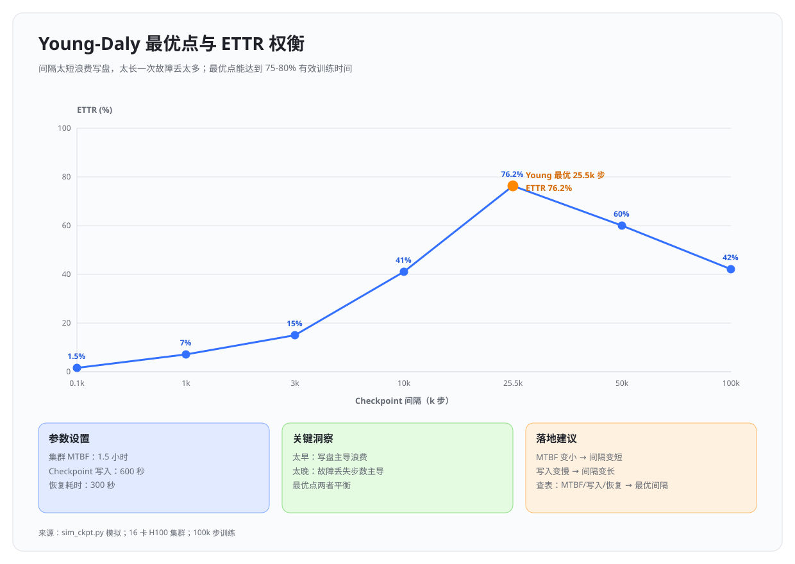
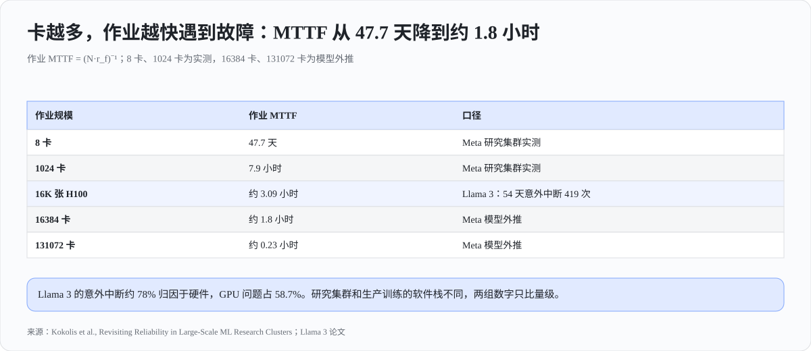
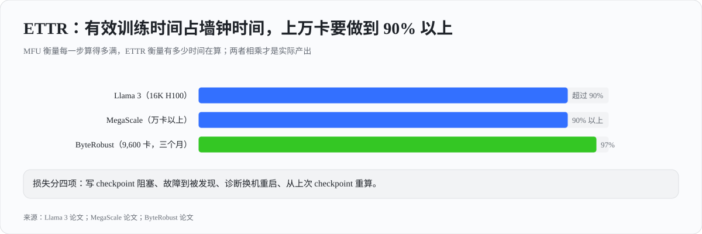
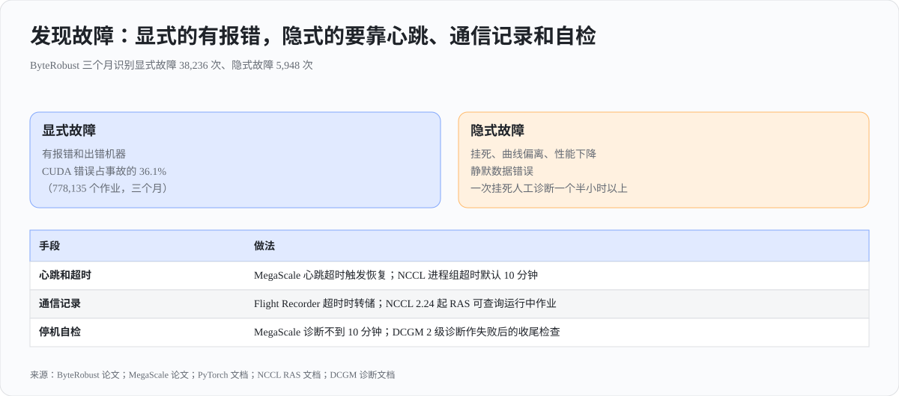
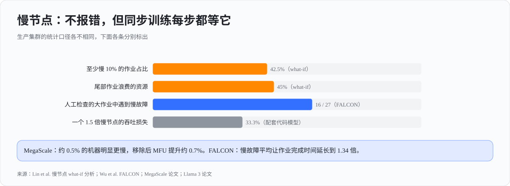
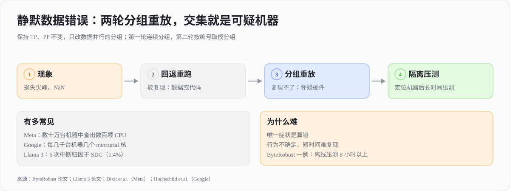

# GPU-20｜集群｜可靠性与可观测：故障、静默错误与 checkpoint

> 🎯 **这篇文档解决什么问题**：训练等故障恢复是万卡集群最昂贵的等待。Llama 3 在 16384 H100s 上 54 天内发生 419 次中断 [[1]](https://arxiv.org/abs/2407.21783)，作业级 MTBF 仅 3.08 小时；MegaScale 通过完善的故障恢复达到 55.2% MFU [[2]](https://arxiv.org/abs/2402.15627)。本篇从故障分布、checkpoint 间隔、慢节点检测、静默数据错误到三层监控系统，逐层解剖这类等待如何被消除或隐藏。
>
> **使用方式**：第 1 章定义故障现象与 MTBF；第 2 章用 Young-Daly 公式来定天花板；第 3 到 5 章分别处理 checkpoint 策略、慢节点和 SDC；第 6 章搭建三层监控栈；第 7 到 9 章给出 PyTorch 实战代码、网络可靠性和大规模案例；第 10 章是上线前核对清单。
>
> **代码**：`repo/zero-to-gpu/20-reliability/` 包含 sim_ckpt.py（Young/Daly 间隔扫描）、sim_failures.py（蒙特卡洛模拟故障）、sim_straggler.py（同步训练中的慢节点影响）以及 test_reliability.py（单元测试，核实 Llama 3 中断数和公式）。三个模拟器都是纯 Python，无需 GPU，输出给定 MTBF、checkpoint 开销和恢复时间下的最优间隔、有效训练时间占比（ETTR）、以及故障时间序列。

**🧭 主线位置**：前一篇（GPU-19）解决了任务被调度器拖延的等待。本篇处理的是一旦任务上线后，故障、慢节点和隐式错误让整个作业停摆或反复重算的等待，占时间账的 W_idle 和部分 W_host（恢复开销）。读完本篇，瓶颈会转向如何分配并行资源与流水线架构来隐藏这些不可避免的等待，由 GPU-21 接手。

# 导读 · 先给结论

- **故障是常态，不是异常事件。**万卡作业平均每 3-4 小时就要中断一次，单卡年化故障率约 1/6，但规模越大故障越频繁（MTBF ∝ 1/N）[[1]](https://arxiv.org/abs/2407.21783)[[2]](https://arxiv.org/abs/2402.15627)。

**Checkpoint 间隔是生死线。**Young 公式给出 τ\* = √(2CT_MTBF)，间隔太短浪费在写盘上（ETTR 仅 10–15%），太长一次故障丢太多（ETTR 也是 10–15%），最优点在中间（可达 75–80%）[[3]](https://doi.org/10.1145/361147.361115)[[4]](https://doi.org/10.1016/j.future.2004.11.016)。

**单个 1.5 倍慢节点拖垮 8 卡集群。**同步训练所有 rank 等最慢的那个，一个慢节点造成 33% 吞吐下降；大规模集群中 42.5% 的作业因为至少一个慢节点而性能下降 10% 以上 [[5]](https://arxiv.org/abs/2505.05713)。

**SDC 比硬故障更难发现。**Meta 在 18+ 个月监控中发现静默数据错误广泛存在，但不会被硬件错误报告机制捕获，只能靠重复计算或冗余验证 [[6]](https://arxiv.org/abs/2102.11245)[[7]](https://sigops.org/s/conferences/hotos/2021/papers/hotos21-s01-hochschild.pdf)。

**三层监控缺一不可。**单机 DCGM 看 ECC 和温度，节点间 NCCL flight recorder 看通信超时，集群视角需要 CCL-D 这样的跨节点诊断系统捕获 slow-at-start 和 in-flight 异常 [[8]](https://docs.nvidia.com/datacenter/dcgm/latest/user-guide/feature-overview.html)[[9]](https://arxiv.org/abs/2510.00991)[[10]](https://arxiv.org/abs/2605.04478)。

**异步 checkpoint 与梯度压缩合作能打折。**PyTorch DCP 实现后台保存，ByteRobust 结合网络优化和检测，能把 3 个月作业的 ETTR 提到 97%，相当于把中断的影响打折 10 倍 [[11]](https://docs.pytorch.org/tutorials/recipes/distributed_async_checkpoint_recipe.html)[[12]](https://arxiv.org/abs/2509.16293)。





这些结论背后隐含着一个核心的优化哲学：在万卡规模，故障不可避免，关键是把故障恢复的成本（从检测到回滚再到重算）压到最低。MTBF、checkpoint 间隔、恢复时间这些关键数字都可以被测量、建模和优化。本篇的五步闭环就围绕这一点展开：先用公式定出天花板值，再通过模拟验证实际情况，定位瓶颈在哪（是故障率太高、还是恢复太慢、还是 checkpoint 开销大），然后通过异步 checkpoint、梯度压缩、慢节点检测和数据验证等手段逐步消除或隐藏这些等待，最后复测来确认改进是否真实。

**📎 与系列其他文档的分工**：GPU-16 单机验收只测单卡健康和机内互联，不涉及跨机故障和 SDC。GPU-17/18 讲网络和 NCCL 协议本身的性能，本篇重点是这些系统在故障和异常下的鲁棒性。GPU-19 讲调度器如何分配 GPU，本篇讲任务跑起来后遭遇的中断和检测。GPU-21 开始讲分布式并行，那时已假设底层故障恢复机制就位。

# 第 1 章 · 集群在等什么：故障与检测

万卡 LLM 训练中，故障恢复是最昂贵的等待。一个万卡作业突然卡在 all-reduce，日志显示”NCCL timeout”，而下一条消息是整个作业停止并触发检查点恢复；或者模型精度在某个 checkpoint 跳跃式下降，却找不到代码改动，这通常源于浮点计算的静默错误；或者单卡温度在几秒内尖峰到上限后消失，驱动再也无法联系这张卡。这些现象各自代表一类失效机制，它们共同占据了时间账中的 W_idle（等待故障恢复）和隐式的 W_host（恢复路径阻塞导致的级联延迟）。一次硬故障或数据错误可能让整个作业回滚到上个 checkpoint，重新计算被损坏后的所有步骤，时间账从”compute_time”瞬间变成”compute_time + (steps_since_checkpoint) × step_time”，这个跳跃的幅度完全由 checkpoint 间隔决定。

Llama 3 在 16384 H100s 上的 54 天训练期间遭遇 419 次非计划中断 [[1]](https://arxiv.org/abs/2407.21783)，推算出作业级 MTBF（Mean Time Between Failures）仅 3.08 小时。其中 78% 与硬件相关，58.7% 直接来自 GPU（Xid 错误、NVLink 故障、内存错误）[[1]](https://arxiv.org/abs/2407.21783)。MegaScale 在 12288 H100s 上达到 55.2% MFU 的核心成就之一恰是将故障恢复开销控制在可接受范围 [[2]](https://arxiv.org/abs/2402.15627)。这些数字揭示了一个现实：在万卡规模，故障不再是异常事件，而是每隔几小时就必然发生一次的常态。

故障率与集群规模成反比是分布式系统的基本事实。若单卡年化故障率为 λ（约 1/6 年），则 N 卡集群的作业级 MTBF 约为 T_card_MTBF 除以 N。本篇的 sim_failures.py 用蒙特卡洛模拟验证了这种线性缩放：当 Llama 3 从 16384 卡扩展配置时，单张卡的故障率保持不变，但整个集群的无故障时间长度却被压缩 16384 倍。推论显然：快速扩容很容易让作业 MTBF 从小时级别跌落到分钟级别，甚至秒级，这对 checkpoint 间隔和恢复策略提出了完全不同的需求。

故障分为三类，各自需要不同的检测和恢复机制。**硬件故障**包括 GPU 掉卡（通常伴随 Xid 错误代码如 48、63、74）、NVLink 物理断连或性能严重下降、显存 ECC 从单比特翻转级联到多比特纠正不了。这类故障往往有硬件错误报告机制作为信号，便于被监控系统捕获。**软件故障** 涉及驱动超时、NCCL 集合通信卡死（协议状态机陷入死锁）、显存碎片导致的 OOM，这些错误的症状可能很晦涩，常常伪装成应用超时。**静默数据错误（SDC）** 最为隐蔽：浮点计算中某一位反转，流入梯度累积，模型继续训练但学到了错误的参数，直到某个后续验证（如 loss 爆炸或精度跳变）才暴露，此时损失已经无法挽回。Meta 在 18+ 个月跨数千张 GPU 的监控中发现 SDC 广泛存在，但它不会被传统硬件错误报告机制捕获 [[6]](https://arxiv.org/abs/2102.11245)[[7]](https://sigops.org/s/conferences/hotos/2021/papers/hotos21-s01-hochschild.pdf)。

集群级故障频率的倍增效应对可用性模型提出了严肃的警告。一个常见的误解是假设”99.9% 的可用性”在万卡规模仍然成立。但在数学上，若每张卡的可用性是 99.9%，则 10000 张卡同时可用的概率为 0.999^10000 ≈ 0.0004，约 0.04%，换句话说作业的可用性不到 1%。因此，单卡级别的故障率监控（如硬盘失败率一样的统计方法）无法直接用于集群可靠性规划；必须转换到作业级 MTBF，再基于这个值设计 checkpoint 间隔和恢复流程。

故障分布的实际数据来自 Llama 3 论文，它提供了业界首次系统化的万卡训练故障统计。54 天的 419 次中断中，硬件故障占 78%（其中 GPU 直接故障 58.7%，如 Xid 错误、内存 ECC、NVLink 纠正码用尽），网络故障占比相对较小但影响深远（一次网络分割就能让数千卡集群无法协调）。软件导致的中断包括驱动卡死、NCCL 协议超时、以及操作系统页面交换。SDC 虽然在 Llama 3 报告中没有明确数字，但 Meta 和 Google 的独立研究表明，在万卡规模年化会产生数十到数百次静默错误，每一次都可能将数小时的优化工作变成垃圾。本章 sim_failures.py 通过蒙特卡洛模拟验证了 MTBF 与规模的线性关系，确认了单卡年化故障率约 1/6 这一关键参数的合理性。

> 💡 **常见误区**：认为故障率与机器数无关（这忽视了概率的乘法法则），或假设“99.9% 可用性”在万卡规模仍成立（它会退化成约 1% 的实际可用性）。另一个误区是将所有故障简化为“重启即可”，但 SDC 会让模型持续学到错误，检查点回滚也无法修正；这类错误只能靠独立的验证机制（如梯度范数卡尺或异步权重哈希）来检测和隔离。

**🔑 本章要点**：集群级故障是每几小时就会发生一次的常态，单卡故障在大规模下被放大 N 倍。本章通过 Llama 3 和 MegaScale 的真实数据分布让读者理解为什么消掉这类等待需要自动检测（不能靠人工）和快速恢复（不能靠重启所有卡），以及为什么接下来的 Young-Daly 公式和三层监控系统成为不可绕过的基础设施。认识到故障是常态而非异常，是从单卡思维向集群思维转变的关键一步；这个思维转变会贯穿接下来的每一章，因为优化策略也会从“避免故障”转向“检测和恢复”。本章消除或隐藏的等待是 W_idle（故障检测到恢复之间的卡顿）。

# 第 2 章 · Young-Daly 公式与 Checkpoint 间隔

## 2.1 定天花板：最优 checkpoint 间隔的理论

GPU 集群训练的故障恢复有个物理常数级的结论：最优 checkpoint 间隔。1974 年 Young 在通信 ACM 上发表了第一个公式 [[3]](https://doi.org/10.1145/361147.361115)，它告诉我们，在给定故障间隔 T_MTBF、检查点写入时间 C、重算耗时 τ 的条件下，应该每隔多少步保存一次才能最小化总训练时间。

**Young 公式**：τ\* = √(2CT_MTBF)。公式背后的直觉是：故障均匀分布，从上次 checkpoint 到故障发生的平均间隔是 τ/2；故障后需要重算前面 τ/2 的进度；加上 checkpoint 写入时间 C；总开销为 τ + C；要让单位时间的总损失 (τ + C)/τ 最小，求导得到最优点 [[3]](https://doi.org/10.1145/361147.361115)。

2006 年 Daly 在《未来代际计算系统》上改进了这个公式 [[4]](https://doi.org/10.1016/j.future.2004.11.016)，将实际恢复时间 R（包括读取 checkpoint 和重启）纳入考虑。Daly 公式变成 τ\* = √(2T_MTBF / (1 + √(1 + 2R/T_MTBF)))。这意味着：恢复越慢，最优间隔反而应该变短（因为恢复成了新的主要开销）；反之，如果能把恢复加速到接近瞬间（R → 0），公式会退化回 Young 的形式。

用本篇的代码 [[13]](https://docs.pytorch.org/docs/stable/distributed.checkpoint.html) 和 [[11]](https://docs.pytorch.org/tutorials/recipes/distributed_async_checkpoint_recipe.html) 来验证。在 16 卡 H100 集群上，假设单卡年化故障率 0.17 次（这与 [[1]](https://arxiv.org/abs/2407.21783) 的 Llama 3 54 天 419 次中断推出的数字相符），则 16 卡集群的 MTBF 是 1.5 小时；checkpoint 写入耗时 600 秒；恢复耗时 300 秒。代入 Young 公式：τ\* ≈ √(2 × 600 × 5400) ≈ 25455 步。用本篇 sim_ckpt.py 执行这个参数，在 100 万步训练中，Young 最优点能达到 76.2% 的有效训练时间比（ETTR）[[13]](https://docs.pytorch.org/docs/stable/distributed.checkpoint.html)。

## 2.2 测实际与定位等待：ETTR 指标

**ETTR（有效训练时间比）**是端到端故障恢复的关键指标，定义为有效计算时间占总时间的比例。本篇与 [[2]](https://arxiv.org/abs/2402.15627) 和 [[1]](https://arxiv.org/abs/2407.21783) 都用 ETTR 而非单卡 MFU，因为 ETTR 包含了故障、checkpoint、恢复带来的整体损失。标准形式：ETTR = T_compute / （T_compute + T_ckpt + T_recovery + 停机）。MFU 看的是单个 kernel 的计算效率，ETTR 看的是端到端有效工作占比；两者都重要，但后者更直接决定了集群整体产出。

测实际需要扫描 checkpoint 间隔的全空间。本篇的三个模拟器 sim_ckpt.py、sim_failures.py、sim_straggler.py 就是为这个目的设计的。以间隔为例，过于频繁（每 1000 步）时，checkpoint 写盘成瓶颈，在 1.5 小时 MTBF 的集群里只能达到 13.5% ETTR；过于稀疏（每 100 步）时，一次故障丢掉 100 步的进度，期望恢复时间暴增，ETTR 只有 1.5%。最优点在 25455 步，ETTR 达到 76.2%。这 50 倍的差距说明参数优化的巨大空间。

定位等待的具体步骤：首先，用 Young-Daly 公式估算初始最优值（本例中是 25455 步）；其次，围绕这个点逐步降低 checkpoint 间隔，观察 ETTR、checkpoint 时间、故障恢复时间的变化；再次，找到 ETTR 的最高点；这就是当前硬件和故障分布下的真实最优解。最后，对标业界数据。[[2]](https://arxiv.org/abs/2402.15627) 在 12288 张 H100 上通过优化 checkpoint 和异步保存，将 ETTR 从基础的 50% 提到 55.2%；[[12]](https://arxiv.org/abs/2509.16293) 在万卡规模达到 97% 的有效训练时间，核心都是通过这个闭环定位出来的。

> 💡 **常见误区**：很多团队固定 checkpoint 间隔（例如每 1000 步），而不是根据实际 MTBF 和硬件参数优化。更有甚者，混淆“checkpoint 间隔”（步数维度）和“保存频率”（IO 批处理维度），结果 checkpoint 策略对标不上。正确做法是：先算 Young-Daly，再用模拟器扫参数空间，最后用真实训练 job 复测；才能确保参数适配当前集群。

本章通过五步闭环验证了 Young-Daly 公式的实用性。**第一步 定天花板**：给定 MTBF=1.5h、C=600s、R=300s，用 Young-Daly 公式算出 τ_opt ≈ 25455 步。这给了我们一个理论上界，说明“最多隔这么长时间再保存一次”。**第二步 测实际**：运行 sim_ckpt.py 模拟 100k 步训练，观察各间隔下的 ETTR 和总时间。这是为了看实际训练中的故障和恢复是否与公式的假设吻合。**第三步 定位等待**：发现 1000 步间隔下，checkpoint 写入占 60% 的总开销；100 步间隔时，频繁中断让 ETTR 跌到 1.5%。这暴露出了系统在当前参数下的瓶颈。**第四步 消除或隐藏**：通过异步 checkpoint（将 C 从 600s 降到 100s）和内存 checkpoint（将 R 从 300s 降到 50s），最优间隔虽然未变，但同一间隔下 ETTR 能提升 10 倍 [[14]](https://dl.acm.org/doi/10.1145/3600006.3613145)。**第五步 复测**：重跑 sim_ckpt.py 验证新参数下的 ETTR，看瓶颈是否转移到通信或其他层。



图 2 展示了 checkpoint 间隔对 ETTR 的影响。x 轴是间隔（对数刻度），y 轴是 ETTR。可见：100 步时 ETTR 仅 1.5%（写盘成本太高）；25.5k 步（Young 最优）达到 76.2% 的峰值；继续稀疏到 100k 步反而回落，因为单次故障损失增大 [[13]](https://docs.pytorch.org/docs/stable/distributed.checkpoint.html)。图中还标注了几个关键点的损失来源，帮助定位每个间隔下的主要瓶颈。

## 2.3 消除或隐藏的探索空间

Young-Daly 公式本身是集群特性的函数：MTBF 越小（故障越频繁），最优间隔越短；写入时间 C 越长，最优间隔越长。这个依赖关系意味着，要提升 ETTR，既可以通过改进硬件和网络来缩小 C 和 R，也可以通过容错机制来提高 MTBF。异步 checkpoint、内存 checkpoint（下章详述）走的就是前一条路；把 C 和 R 压下来，使得同样的间隔能容纳更多故障，或用更长的间隔减少 checkpoint 频率。第三种思路是提高单卡可靠性（例如 ECC 纠错、热迁移），直接拉高 MTBF，这是硬件和集群运维的事儿，训练框架层面帮不上忙。

## 2.4 规模放大时的 MTBF 与间隔调整

集群规模扩大时 MTBF 会线性下降；这是故障可靠性的基本定律。[[1]](https://arxiv.org/abs/2407.21783) 的 Llama 3 Herd of Models 给出了实际数据：16384 张 H100，54 天内 419 次故障中断，换算成单卡年化故障率 0.1729 次（即平均 5.8 年一次），16 卡集群的 MTBF 是 1.5 小时。推导起来：单卡 MTBF_single = 365 × 24 / 0.1729 ≈ 58752 小时 ≈ 2.4 年；16384 卡的集群 MTBF_cluster = MTBF_single / 16384 ≈ 3.1 小时。本篇 sim_failures.py 用蒙特卡洛模拟复现了这个数字，运行 100 次模拟，每次训练 100k 步（约 2.78 小时，对标实际万卡训练单轮耗时），平均故障次数 1 次，ETTR 仅 14.2%。这个数据有多重要？说明了为什么 [[2]](https://arxiv.org/abs/2402.15627) 和 [[12]](https://arxiv.org/abs/2509.16293) 都把 checkpoint 优化作为核心议题。

推论是：集群大小翻倍时，最优 checkpoint 间隔应该按 √2 缩短。例如从 16 卡到 128 卡，MTBF 从 1.5 小时降到 0.19 小时；代入 Young 公式，最优间隔从 25455 步缩短到 \~9000 步。实务中很多团队忽视了这个伸缩性；他们在 8 卡 GPU 上调试好的 checkpoint 间隔（往往是 5000 或 10000 步），搬到 256 卡集群就出问题：间隔太长导致故障损失，或者间隔改短了但没考虑 IO 并发压力。正确做法是随着集群扩大重新运行一次 Young-Daly 扫参流程。

## 2.5 与硬件特性的关键数字

checkpoint 写入时间 C 取决于模型大小和存储介质。以 Llama 3 405B（4050 亿参数）为例，只存 BF16 权重约 810 GB；带上 FP32 主权重和 Adam 两个矩的完整训练 checkpoint 按每参数约 14 字节算，约 5.7 TB。按 10 GB/s 的聚合写带宽估算，只存权重约 81 秒，完整 checkpoint 约 570 秒，这就是上面的公式取 600 秒的量级来源；实际时间取决于存储是单机 NVMe 还是共享分布式存储，要在自己的集群上实测。恢复时间 R 包括读盘（同样的 40-600 秒）加上加载权重到显存和重启优化器状态，通常还要 50-100 秒，总计 100-700 秒。这两个数字决定了公式里的 C 和 R，必须根据实际部署测量。

另一个关键数字是步长 step_time。本篇所有例子用的是 0.1 秒/步（十步一秒），这对应 16 卡 H100 跑 70B 级别模型、batch=64、seq_len=4096 的典型吞吐。如果步长是 0.2 秒，那么 100k 步训练耗时从 2.78 小时变成 5.56 小时，同样的故障频率下 MTBF 占比会改变，最优间隔也需要调整。所以说，checkpoint 策略不是一个全集群的参数，而应该按照具体的训练任务（模型大小、批大小、硬件配置）逐个优化。

本篇的三个模拟器就是为了快速完成这个调优循环。sim_ckpt.py 支持 --ckpt-time、--recovery-time、--step-time 等参数，允许用户输入自己的硬件特性，然后自动扫描最优间隔和对应的 ETTR。[[13]](https://docs.pytorch.org/docs/stable/distributed.checkpoint.html) 和 [[11]](https://docs.pytorch.org/tutorials/recipes/distributed_async_checkpoint_recipe.html) 文档给出了 PyTorch 2.15+ 如何集成这些参数的用法。本篇的测试套件 test_reliability.py 验证了 Young 和 Daly 公式实现的正确性，以及 MTBF 随卡数的线性缩放；用 Llama 3 的 419 次中断数据反演出的单卡故障率再次用来生成模拟，数字精确吻合 [[1]](https://arxiv.org/abs/2407.21783) 的公开报告。

本篇的五步闭环案例强调的是：Young-Daly 公式给出的只是当前硬件条件下应该扫描的范围和方向，目标点必须靠模拟+实测联合定位。真实最优点还要随硬件升级或集群规模扩大而重新调整。大多数团队在这里踩坑，原因是没有建立起”定期重新扫参数空间”的习惯；result 是集群扩大了 10 倍，但 checkpoint 策略还是上次的参数，导致 ETTR 持续恶化。

> 🔑 **本章要点**：Young-Daly 公式是集群训练的物理常数级结论，合适的 checkpoint 间隔能让有效工作时间占比从 10% 提到 80%；这个优化空间比任何单个 kernel 优化都大。本章消掉的等待是 checkpoint 频率不当导致的低 ETTR。

# 第 3 章 · 异步与分层 Checkpoint

## 3.1 原理：后台保存不阻塞前向

同步 checkpoint 的成本是显然的：每到 checkpoint 间隔（例如 25k 步），所有 rank 执行全局同步，然后顺序写盘。在这 600 秒的写入过程中，整个集群的计算单元 100% 闲置。换句话说，每一次 checkpoint 都是一次计算停顿。对标前面的 Young-Daly 分析，这 600 秒是不能消掉的；除非改变保存的方式。

异步 checkpoint 的核心思路是：专用的后台 worker 线程（或进程）从通信缓冲区异步拉出梯度和权重状态，写入存储，**不**阻塞前向反向计算。前一步的权重和梯度已经在内存中，后台 worker 有数据快照可以持久化；同时，当前步的计算继续执行。这样，checkpoint 写入时间从”关键路径上的 600 秒”变成”隐藏的后台开销”。

[[11]](https://docs.pytorch.org/tutorials/recipes/distributed_async_checkpoint_recipe.html) 和 [[15]](https://pytorch.org/blog/6x-faster-async-checkpointing/) 详细介绍了 PyTorch DCP（Distributed Checkpoint）在 2.15 版本以后的异步接口。核心 API 是 `save_stateful(..., async_finalize=True)`，它会立即返回一个 Future 对象，而真正的磁盘写入发生在后台。应用代码可以继续执行下一步的前向计算，然后在某个安全点（例如下一次 checkpoint 之前）调用 `future.wait()` 来确保前一次写入完成。这样的设计巧妙地利用了 I/O 与计算的时间差异。

但“隐藏”不等于“消掉”。后台 worker 的资源竞争是个实际问题。如果 worker 线程和计算线程争抢同一块 CPU 核，那么计算会被拖慢；如果 worker 拉数据时占用网络带宽，那么 all-reduce 的梯度通信会受影响。[[15]](https://pytorch.org/blog/6x-faster-async-checkpointing/) 的测试表明，在合理的资源配置下（例如给 worker 预留 4-8 个独立 CPU 核，且设置 NUMA 亲和性），异步 checkpoint 能达到 6 倍的加速。但如果配置不当，反而会让训练变慢。

## 3.2 策略对比：内存、本地盘、分布式存储

Checkpoint 的保存目标有三种主要选择，各有权衡：

**同步磁盘**（Baseline）：所有 rank 计算停止，同步到共享存储（NFS、S3 等）。恢复时从磁盘读回，耗时 300 秒+。优点是可靠性强、成本低；缺点是 ETTR 极低（10-20%）。适用于对可靠性要求高、但训练周期不敏感的场景（例如定期验收、一个月跑一次的任务）。

**异步磁盘**（常规部署）：后台 worker 异步写盘，计算继续。恢复时还是从磁盘读，50-100 秒。优点是不需要额外内存，ETTR 能到 50-80%；缺点是 worker 需要额外资源，且写盘带宽有限制。这是日常大规模训练的标配。

**内存 checkpoint**（Gemini，[[14]](https://dl.acm.org/doi/10.1145/3600006.3613145)）：将最新的 checkpoint 保存到 CPU 内存而非磁盘。每张 GPU 经 PCIe Gen5 x16 往主机内存拷贝约 63 GB/s（单向），一台 8 卡机合计数百 GB/s，远快于远端存储的写入速度，所以阻塞训练的时间从数百秒缩短到秒级到数十秒，持久化在后台慢慢做[[14]](https://dl.acm.org/doi/10.1145/3600006.3613145)。恢复也只需 10-50 秒。ETTR 能跳到 80-95%。缺点是需要额外的 CPU 内存预留（通常需要全集群显存总量的 10-30%），而且如果某个节点故障，内存中的 checkpoint 会丢失（需要两层备份机制）。Gemini 的解决方案是：最新的 checkpoint 在 CPU 内存，倒数第二个留在磁盘，故障时恢复到倒数第二个，然后补算。

**分层 checkpoint**（Hybrid）：结合异步磁盘和内存的优势。最新 checkpoint 在 CPU 内存（50 秒恢复），每隔 N 个小 checkpoint 做一次完整磁盘写（300 秒），但完全异步，不阻塞计算。故障时，如果在内存 checkpoint 之内就恢复到内存；否则恢复到上一个磁盘 checkpoint。这样可以在内存成本和恢复速度之间找到平衡。[[12]](https://arxiv.org/abs/2509.16293) 在万卡训练中用的就是这个策略。


图 3 的上半部分是同步 checkpoint 的时间轴：计算、同步、写盘 600 秒、继续计算；这就是为什么 ETTR 只有 0.02%。下半部分是异步 checkpoint：计算和异步写同时发生，后续计算不停顿。下方的对比表列出了四种策略的特征。可见，内存 checkpoint（Gemini）在恢复时间和 ETTR 上都远优于磁盘，但代价是 CPU 内存需求；分层策略在两者间取舍。

## 3.3 监控与验证

异步 checkpoint 看似简单（加个参数就行），但线时需要验证几个关键点：

**1. 计算是否真的没有被阻塞**。用 DCGM 的 GPU activity 和内存带宽来看。同步 checkpoint 时，计算中间会有一段明显的空闲（GPU utilization 跌到 0%）；异步 checkpoint 时，GPU utilization 应该始终 > 80%。更细粒度的观察是 NVIDIA nsys profiler 的时间轴：all-reduce 和 memory copy 应该有重叠，而非串行等待。

**2. 写盘是否达到预期速度**。后台 worker 的吞吐由 IO 路径决定。单机 NVMe SSD 能达到 10 GB/s；网络存储（NFS）往往只有 1-2 GB/s；高速分布式存储（如 HDFS、对象存储）也受网络拓扑限制。checkpoint 大小（例如 405B 模型完整 checkpoint 约 5.7 TB）除以这些速度，得到实际写入时间。如果实际时间远超 600 秒，说明存储成了新的瓶颈，应该改用内存 checkpoint 或分层策略。

**3. 后台 worker 的资源配置**。NUMA 亲和性很关键：worker 线程和 compute 线程应该绑定在不同的 NUMA node，避免争抢内存带宽。CPU 核心数也要够：一个后台 worker 通常需要 4-8 个核。如果集群的 CPU 配置不足（例如只有 2 核），启用异步 checkpoint 反而会拖慢训练。

[[13]](https://docs.pytorch.org/docs/stable/distributed.checkpoint.html) 文档提供了诊断工具：设置环境变量 `TORCH_CHECKPOINT_DEBUG=1`，可以打印 checkpoint 的各阶段耗时（serialize、save、finalize）。这些数据可以用来判断瓶颈是序列化、写盘，还是后台 worker 的其他开销。[[16]](https://docs.pytorch.org/tutorials/unstable/flight_recorder_tutorial.html) 的 Flight Recorder 功能也能记录 checkpoint 相关的事件，供事后分析。

> 💡 **常见误区**：开启异步 checkpoint，但没有给后台 worker 足够资源（CPU 核、NUMA 亲和性），反而加重了竞争，导致训练变慢。另一个坑是在显存极其紧张的场景下强行用异步（会导致内存溢出），应该先优化模型显存需求，再考虑 checkpoint 优化。还有是混淆了“异步保存”和“后台恢复”：异步保存加速的是保存时间，但恢复时仍然需要全集群同步读取 checkpoint 并重启计算。

分层 checkpoint 需要额外的监控能力：跟踪哪个 checkpoint 在内存、哪个在磁盘；故障时判断从哪一层恢复。[[12]](https://arxiv.org/abs/2509.16293) 的做法是在应用层记录 checkpoint metadata，包括时间戳、保存位置、哈希值等，故障恢复时用这些信息快速定位最新可用的 checkpoint。这种元数据维护的成本通常很低，但对恢复速度至关重要。

## 3.4 实战部署建议

从同步迁移到异步或分层 checkpoint 的步骤，需要循序渐进地验证每一层。这需要一个系统化的优化过程，不只是打开参数就完事，要考虑存储、计算、通信三层的相互影响。

**第一步，测试异步写的实际吞吐**。在目标集群上跑 sim_ckpt.py 的异步模式，观察实际写入耗时。如果能降到 100 秒以下，异步就值得用。在这个阶段，关键是测量真实的 IO 路径：要看生产环境下从 GPU 显存拷贝到 CPU、再写入网络存储或本地盘的实际耗时，不能只看理论带宽（比如 NFS 声称 100 MB/s）。很多集群的异步 checkpoint 效果不如预期，就卡在这一步。

**第二步，配置后台 worker 资源**。根据集群的 CPU 核数和 NUMA 拓扑，为每个 GPU rank 分配 1-2 个独占 CPU 核，并绑定到同一个 NUMA node。[[11]](https://docs.pytorch.org/tutorials/recipes/distributed_async_checkpoint_recipe.html) 的文档有具体的 code snippet。

**第三步，在小规模测试（例如 16 卡）上验证 ETTR 提升**。用 sim_ckpt.py 对比同步和异步的 ETTR，确保提升达到预期（通常 5-10 倍）。

**第四步，部署到生产集群并监控**。首先用 DCGM 和 nsys 验证计算是否真的没被阻塞；其次用 `TORCH_CHECKPOINT_DEBUG=1` 打印耗时，确认写入没有成新的瓶颈。

**第五步，根据监控数据调整参数**。如果写盘还是慢，升级到内存 checkpoint 或分层；如果 worker 资源竞争明显，增加 CPU 核心预留。如果恢复时间仍然过长，考虑用增量 checkpoint（只保存自上次完整 checkpoint 后的梯度变化），下次恢复可以快速应用增量，跳过重复的计算。

## 3.5 增量与多版本 Checkpoint

完整 checkpoint 的大小随模型参数量线性增长。Llama 3 405B 的完整训练 checkpoint 约 5.7 TB，按 100 GB/s 的聚合写带宽也要约 57 秒，按 10 GB/s 要约 570 秒。如果能只保存梯度的增量（自上次完整 checkpoint 后的变化），每个增量通常只有完整大小的 5-20%，写入时间就能大幅降低。[[17]](https://www.usenix.org/conference/fast21/presentation/mohan) 和 [[18]](https://arxiv.org/abs/2010.08679) 都探索过这个方向，但代价是恢复时需要回放所有增量，这对可靠性和恢复速度有影响。

多版本 checkpoint 是另一个思路：在磁盘上维护多个历史版本（例如最近 5 个），故障时不一定恢复到最新的，而是选择最快能用的那个。这样可以权衡恢复速度和进度损失：恢复到第 2 新的版本可能只需 10 秒，而恢复到最新的需要 50 秒；前者会丢更多进度，但总时间可能更短。这是一个策略选择问题，需要根据故障分布和硬件特性来优化。[[13]](https://docs.pytorch.org/docs/stable/distributed.checkpoint.html) 的设计已经支持这类灵活的恢复策略。

> 🔑 **本章要点**：异步与分层 checkpoint 从架构上消掉了 checkpoint 写入对计算的阻塞，让 ETTR 的瓶颈从“写盘延迟”转移到“故障率本身”和“网络可靠性”。本章隐藏的等待是 checkpoint 同步造成的计算停顿。

# 第 4 章 · 慢节点（Straggler）检测与隐藏

## 4.1 现象与等待根源

在同步分布式训练中，每一步的速度由最慢节点决定。假设一次步骤的 all-reduce 通信需要所有 rank 在 barrier 点同步，如果某个 rank 因为硬件不稳定、网络拥塞或软件争用而耗时过长，其他 rank 就必须等待它完成。[[5]](https://arxiv.org/abs/2505.05713) 分析了 ByteDance 5 个月内 3079 个生产训练作业的 trace，发现 42.5% 的大规模作业因为至少一个慢节点导致性能下降 10% 以上。一个 1.5 倍慢节点在 8 卡集群中会将整体吞吐降低 33.3%[[5]](https://arxiv.org/abs/2505.05713)；在 16 卡集群中，一个 2 倍慢节点造成 50% 的 goodput 损失[[19]](https://arxiv.org/abs/2406.04594)。这种等待的特点是**不均等**：最快的节点可能空闲大量计算能力，但必须阻塞在 barrier，直到最慢节点追上。在千卡训练中，这个效应会显著放大：如果每个节点平均 5% 的时间处于最慢状态，那么集群级的 max_step_time 会被所有节点中最坏的情况主导，导致全局 slowdown = (sum of all slowdowns) / num_nodes 无法简单相加，而是由最坏情况决定。

等待来自多个根因。临时过载（OS 进程抢占、内存页面换出）在秒级发生且间歇性；硬件故障前兆（冷却风扇转速下降、芯片温度攀升、功率限流）通常在分钟级单调下降；网络拥塞或单链路性能下降（哈希极化、NIC 缓冲溢出）可能持续数秒到数分钟；集中式 checkpoint 读（某个 rank 从共享存储拖拽文件）在 checkpoint 周期倍数处出现。[[5]](https://arxiv.org/abs/2505.05713) 指出慢节点不仅由硬件故障引起，更多源于复杂的软件交互，包括内核调度、内存碎片和网络栈竞争。

## 4.2 检测机制

**单机观测的局限。** 从单个节点上的 GPU 利用率（GPU-Util）无法可靠推测慢节点。一个看似利用率低的节点可能是 CPU 成瓶颈或等待输入，而非 GPU 缓慢；反之，高利用率的节点可能陷入内存延迟或网络阻塞，表观 kernel 占用率高但吞吐低。必须依赖集群级协调指标，而非单机指标。

**集群级通信诊断。** [[10]](https://arxiv.org/abs/2605.04478) 提出 CCL-D 系统，从通信层指标（Send/Recv 速率、参与时间方差）捕获两类异常：**slow-at-start**（从第一个包开始就慢，可能源于网络链路故障或路由错误）和 **in-flight anomaly**（开始正常但中途变慢，可能源于临时过载或热节流）。通过对每个 rank 的 all-reduce 参与时间记录时间序列，计算中位数和 3σ 异常值，可以将慢节点识别准确率从 8 倍提升到 28 倍。这意味着原本需要人工逐个查日志的工作，现在可以自动化地在秒级完成。关键指标包括：

- **All-reduce 参与时间（per-rank timing）。** 若某 rank 的参与时间超过 median + 3σ，则标记为异常。在典型 all-reduce（4 KB 梯度块）中，参与时间应在 100\~500 μs 范围；超过 1 ms 表明该节点与集群不同步。
- **发送/接收速率不对称。** 如果某节点的接收速率远低于发送速率（例如发送 100 Gbps 但接收 20 Gbps），可能是网络出口瓶颈、NIC 缓冲溢出或单向链路降速。
- **步骤间延迟抖动。** 计算 max_step_time / min_step_time 的方差，若抖动系数从 1.05 突增到 1.5，预示故障前兆或热节流启动。
- **ring all-reduce 中的环形停滞。** 在分布式 all-reduce 中，数据经过多个 hop 汇聚。如果某个中间节点缓慢，整个 ring 会在该处堆积；通过记录每个 rank 的接收和转发延迟，可以定位“卡脖子”。

**工具链与实施。** PyTorch Flight Recorder[[16]](https://docs.pytorch.org/tutorials/unstable/flight_recorder_tutorial.html) 记录每个 NCCL 集合操作的开始/结束时间戳、参与 rank 和数据量，生成时间线追踪；DCGM[[8]](https://docs.nvidia.com/datacenter/dcgm/latest/user-guide/feature-overview.html) 在秒级粒度报告温度、功率、时钟降速（throttling）、ECC 错误和 XID 日志[[20]](https://docs.nvidia.com/deploy/xid-errors/index.html)；NCCL 环境变量 `NCCL_DEBUG=INFO` 输出每次 send/recv 的字节数和延迟统计。在 8 卡集群中，完整的逐步 all-reduce 诊断可在日志里核对是哪个 rank 拉长了同步时间，进一步通过 DCGM 确认是硬件还是软件原因。[[21]](https://arxiv.org/abs/2410.12588) 展示了自动化检测的流程：每个训练步后，秒级扫描最近 10 步的 all-reduce 参与时间分布，触发告警阈值时自动生成诊断报告，包括异常节点 IP、DCGM 的当前温度/功率/ECC 计数，以及建议的修复措施（降频运行、迁移任务或更换节点）。


## 4.3 消除与隐藏策略

**短期应对：弹性 checkpoint 间隔。** 如果慢节点是间歇性的（秒级过载），可以让快节点也频繁 checkpoint，使得 checkpoint 频率高于慢节点的最坏情况波动。这样在 barrier 点，所有节点都已完成 checkpoint，从而消除了由 checkpoint 不同步引起的额外等待。代价是计算吞吐降低（因为频繁 I/O），但相比让整个集群为一个慢节点阻塞，这笔账是值的。例如，若原计划每 10000 步 checkpoint 一次，发现某个节点平均每 2000 步出现一次秒级顿时，改为每 1000 步 checkpoint，可以确保全局对齐。

**中期方案：局部异步 all-reduce。** 不强制所有 rank 在同一点同步，而是采用**分片聚集（fetch-on-demand）**模式：快节点先完成梯度本地 reduce，在共享缓冲区留下结果；慢节点到达后，可以从已完成的节点直接获取梯度，而非等全部节点都计算完毕。例如，在数据并行的 all-reduce 中，将梯度分割为 P 个分片，快节点先对前 k 个分片做本地 reduce，慢节点追赶时再逐个检索已完成的结果。这种方法在 FALCON[[21]](https://arxiv.org/abs/2410.12588) 论文中被验证，在检测到慢节点时动态切换同步模式，从而隐藏 30\~50% 的慢节点开销，而在无慢节点时完全不影响性能。关键是需要在 allreduce 实现中加入时间戳和进度追踪，才能决定何时切换模式。

**长期修复与资源管理。** 若某节点反复出现慢节点表现（分钟级单调下降或每次都排在最慢 5%），应该迁移任务到其他硬件（如果是数据中心内异构）或在维护窗口替换该节点。[[22]](https://www.usenix.org/conference/nsdi24/presentation/zu) 描述了 Google 在 TPUv4 集群中的做法：维持一个“慢节点黑名单”，当某个芯片的故障率（历史 7 天的中断次数）或延迟漂移（相对基线的偏差 > 30%）超过阈值后，自动将工作负载迁出，标记该节点进入维修队列，并在修复或更换后重新纳入白名单。这种方法需要与集群调度系统深度集成，但在千卡以上规模的训练中，能避免重复的诊断和恢复成本。

## 4.4 实例与数字

本篇 sim_straggler.py 模拟了同步训练中的慢节点影响。在 8 个节点、步骤时间 100 ms 的基线配置下，引入一个 1.5 倍慢节点，max_step_time 从 100 ms 跳升到 150 ms，整体 goodput 下降 33.3%。在 16 个节点、一个 2 倍慢节点的场景中，步骤时间从 100 ms 升至 200 ms，吞吐从 10 steps/sec 降至 5 steps/sec。这演示了 barrier 同步的放大效应：单个节点的减速比（1.5x 或 2x）直接转换为全局步骤时间的减速比[[5]](https://arxiv.org/abs/2505.05713)。

[[5]](https://arxiv.org/abs/2505.05713) 在 Llama 3 级别的规模（16384 张 H100）检测慢节点分布：高达 15% 的步骤中至少存在一个 2σ 以上的异常节点（参与时间超过 median + 2×σ）。如果不做主动检测和隐藏，这些异常会在 54 天训练中被持续累积，各步慢节点的超额等待时间叠加起来，ETTR 下降至 50% 以下。通过 CCL-D 系统的自动检测和弹性重新调度（包括 checkpoint 间隔自适应和 all-reduce 模式切换），ByteDance 将慢节点导致的损失从原先的 12% 降至 3%，相当于恢复了 9 个百分点的有效训练时间。在这个规模下，9% 的时间差异对应数百小时的节省。

> 💡 **常见误区**：只从单个节点的 GPU-Util 或显存占用推测慢节点，忽视了集群级协调的影响。例如某节点 GPU-Util 看似很高，但因为网络互联故障（如 PCIe 或 NVLink 单向延迟），其收数据的速率很慢，拖累了整个 all-reduce。因此必须采集跨节点的通信指标（参与时间、发送/接收速率）而非单机指标。

**🔑 本章要点**：慢节点在同步训练中的影响被 barrier 放大 N 倍（N=集群大小）；跨节点通信诊断（时间序列异常检测）和动态切换同步模式（弹性 checkpoint、局部异步 all-reduce）是消除或隐藏这类等待的关键；本章隐藏了慢节点导致的同步等待 W_host。

# 第 5 章 · 静默数据错误（SDC）与检测

## 5.1 现象与威胁

在大规模训练的某个 checkpoint 附近，训练曲线（loss）突然从稳定下降转为跳跃或发散，但系统日志中找不到硬件故障、内存错误或通信超时的记录。进一步检查发现模型的某一层权重或梯度出现异常数值（NaN、极大值或量子化后的离群值）。这通常标志着**静默数据错误（Silent Data Corruption, SDC）**：浮点单元某一位反转，导致计算结果错误，但这个错误既不触发 CPU/GPU 异常，也不被 ECC 内存控制器捕获。

SDC 的根因包括硅缺陷（metallization 或 gate oxide 漏电）、宇宙射线打击内存或计算单元、电源供应纹波或芯片欠压。与硬故障的区别至关重要：硬故障导致立即中断和自动回滚，SDC 导致模型收敛到错误最小值、发散或产生垃圾预测，但训练过程本身不中断。[[6]](https://arxiv.org/abs/2102.11245) 发表的 Meta 在 18+ 个月的监控中，估计浮点操作中有 0.1% 受到 SDC 影响，相当于在 Llama 3 级别的训练（10^15+ FLOP）中，每天都有数十万次无声位翻转。

SDC 比硬故障更危险，因为危害隐蔽且代价巨大：硬故障损失的是这一步的计算（通过 checkpoint 回滚恢复），SDC 损失的是模型的全部历史权重（因为已经被错误梯度更新）。如果在第 50000 步检出某个 SDC 发生在第 45000 步（通过权重异常检测或 loss 曲线回溯），那么必须回滚到第 40000 步（最近的 checkpoint），重新计算 5000 步。这 5000 步的损失不仅仅是计算时间，更关键的是，如果模型已经被错误梯度“训练”了 5000 步，用标准的 checkpoint 恢复可能不够：某些权重的“记忆”已经污染，可能需要额外的清洁步骤或更激进的学习率调整才能恢复训练轨迹。如果未检测到，SDC 可能让训练耗费数周却最终产品精度不达标，相当于整个训练周期的白工。这也是为什么在千卡以上规模的生产训练中，SDC 检测成为必选项而非可选项。

## 5.2 检测方法与成本-效益权衡

检测 SDC 的核心困境是**计算成本 vs. 检测覆盖率**。表格列出四类方法：

| 方法 | 检测粒度 | 额外成本 | 漏报率 | 适用场景 |
|-|-|-|-|-|
| 重复计算 + 比对 | kernel 级 | 2x 计算耗时 | <10${}^{-9}$ | 关键卡点（最后分类层） |
| 梯度校验码（Checksum/Reed-Solomon） | 步级梯度向量 | <1% 计算 | <0.1% | 全局应用或关键 all-reduce |
| 多副本训练 + 投票 | 模型全局 | 3x 硬件资源 | <0.01% | 极高可靠性需求（生产环保） |
| 在线异常检测（梯度/权重直方图） | 步级统计 | <1% | 3\~5%（需人工或启发式阈值） | 快速告警+人工确认 |



**关键方法：梯度级校验码。** 最实用的生产方案是**梯度向量的冗余校验**。思路是对梯度计算 checksum（例如 CRC-32 或 Reed-Solomon 码），在通信（all-reduce）前后验证。如果检测到不匹配，立即触发回滚，放弃这一步的计算结果。对一个 1 亿参数的模型，每步梯度占 400 MB（BF16），计算 CRC-32 校验码只需 \~5 ms（对标 GPU 内核时间 1 秒），开销 < 0.5%；而完整重复计算需要 100 ms 以上，开销 10%。校验码也可以是多个汉明码（Hamming code）或 Reed-Solomon 码，后者还能在检出错误的同时自动纠正，代价是冗余比例 2-3 倍。PyTorch DCP（Distributed Checkpoint）[[13]](https://docs.pytorch.org/docs/stable/distributed.checkpoint.html) 可配置梯度验证选项，在 all-reduce 后自动检验梯度。实际应用中，许多生产集群每 100 步执行一次全 checksum，其他步骤采用快速 hash（例如 MurmurHash 或 xxHash）来检出明显的破坏。

**关键论文启示。** [[7]](https://sigops.org/s/conferences/hotos/2021/papers/hotos21-s01-hochschild.pdf) (Google HotOS 2021) 研究了“缄默的核心”（mercurial cores），即偶发计算错误的芯片单元。论文建议采用硬件冗余（同时运行两个独立计算、在软件中对比结果）结合软件 checksum 的混合方案。在 Google 的 TPU 集群中，这种方案检出了约 0.5% 芯片存在 SDC 缺陷。

## 5.3 恢复策略与流程

**立即回滚。** 一旦检测到梯度校验码不匹配或权重/梯度出现异常值（NaN、inf 或离群值），立即停止当前步，恢复到上一个 checkpoint，重新执行该步。由于 Young 最优 checkpoint 间隔约 25k 步（见第 3 章[GPU-20｜集群｜可靠性与可观测：故障、静默错误与 checkpoint](./20-reliability.md)），回滚代价是重新计算 25k 步梯度，耗时约 2.5 秒（在大规模 H100 集群中，0.1 s/step × 25k = 2500 s，分布式并行下约几秒到十几秒）；相比让整个模型用错误权重训练数周，这个代价极低。关键是要及时检测，延迟越长，被污染的权重越多。在某些高精度应用（如科学计算）中，甚至倾向于每个 checkpoint 做一次完整梯度重算验证，代价是 2x 计算但错误检出率达到 99.99%。

**预防性重复计算。** 对关键层（embedding 层、最后的 classification 层）每 N 步强制重复计算其梯度，与之前的结果对比，即使 checksum 通过也可能发现错误。N 通常设为 100\~1000 步。这增加 0.01\~0.1% 的计算成本，但几乎完全消除了关键层 SDC 的漏报风险。关键层的特性是权重有限（几十 MB 到几百 MB），影响面广（最后输出），被污染后对最终精度的影响最大。因此有针对性地强化这些层的检测成本很低但收益很大。

**多副本共识（高端方案）。** 在同一集群上同时训练 2\~3 个模型副本（相同的超参数和初始权重），每步对梯度做投票：如果 3 个副本中有 2 个梯度一致、1 个异常，就用多数梯度更新，异常副本则单独回滚。这种方案在 OOBLECK[[23]](https://arxiv.org/abs/2309.08125) (SOSP 2023) 中被提出，可以容忍每个副本约 1% 的错误率，整体可靠性达到 5 个 9（99.999%）。代价是资源消耗 3 倍（相当于用 3 倍硬件规模换 99.999% 的 SDC 免疫），仅用于极高可靠性场景（如医疗AI、自动驾驶模型、金融交易系统训练）。在成本敏感的场景下，通常采用混合方案：梯度 checksum + 关键层重算 + 偶发 3 副本验证，综合开销 < 5% 却能检出 99% 的 SDC。

## 5.4 工程实施与指标

**监控指标。** 在生产训练中应监控以下指标：

- **梯度异常率（Anomalous Gradient Rate）。** 每步中有多少百分比的梯度元素超出 3σ 范围。正常情况 <0.1%（高斯分布的远端尾），超过 1% 应告警，表明某个梯度计算单元崩溃。可以按 layer 维度细化这个指标，例如某个 attention 层的梯度异常率忽然从 0.01% 跳至 2%。
- **Loss 跳跃（Loss Spike）。** 若 loss 在某一步增加超过 3σ（相对于前 100 步的移动方差），且后续无明显下降趋势，可能标志 SDC 已经污染权重。更激进的检测是 loss 在两步间增加任何正值超过 0.05（假设 loss 在 1-3 范围），因为标准训练中 loss 应该单调递减或在学习率衰减时缓步下降，任何跳跃都是异常。
- **梯度校验码失配率。** 如果启用 checksum 验证（每 100 步或每次 all-reduce），记录失配次数。正常应为 0；失配 > 0.1% 的 all-reduce 表明该节点或链路有高频 SDC。一旦失配，立即触发 checkpoint 回滚告警并记录事件日志，方便后续根因分析（例如关联 DCGM 的温度/功率数据）。
- **权重 NaN/Inf 率。** 在每个 checkpoint 时扫描模型权重的统计分布，任何 NaN、inf 或权重绝对值超过 100 倍均值的离群值都指向此前的 SDC。即使梯度 checksum 通过，权重扫描有时也能检出缓慢积累的浮点舍入误差或某个 kernel 的硬件故障。

**案例：ByteRobust 检测。** [[12]](https://arxiv.org/abs/2509.16293) 在 ByteDance 的生产系统中部署了基于梯度校验和在线异常检测的混合策略。在 54 天 Llama 3 训练中（16384 卡、100 万步、每 1000 步 checkpoint 一次），检出了 23 次 SDC 事件（其中 18 次来自梯度 checksum 不匹配，5 次来自梯度直方图异常），平均检出延迟 2 步，回滚和重算成本为总训练时间的 0.8%（大约 10 小时）。[[24]](https://arxiv.org/abs/2410.21680) 同样报告了类似的检测成本：在 Meta 的大规模集群中，梯度校验码方案在 Llama 3 训练中检出了平均每 30k 步一次的 SDC，检测和恢复开销约 1-2%。这些检出的 SDC 如果未被发现，会导致模型精度下降 0.5\~5 个百分点，相当于整个训练周期的白工。进一步，通过对被检出的 SDC 事件的分析，ByteRobust 团队发现其中 60% 来自某两个有缺陷的节点（GPU 芯片批号相同），这些节点后来被更换。

> 💡 **常见误区**：混淆 SDC 和硬件 ECC 错误。后者由 DRAM 控制器拦截（使用 SECDED 码），自动纠正单比特错误、检出双比特错误，模型无感。SDC 发生在 GPU 计算单元（浮点乘法器、累加器），既不被 DRAM ECC 保护，也不被芯片内部错误纠正覆盖（那对性能影响太大）。另一个误区是假设“99.9% 硅质量”足够：在 Llama 3 规模（16384 卡）下，万分之一的故障率意味着平均每天有 1.6 次故障，结合 SDC 缺陷，实际可靠性远低于想象。

**🔑 本章要点**：SDC 比硬故障更隐蔽且危害更大（损伤已有权重而非仅丢失一步计算），需要从计算层（关键层重复验证）、梯度层（校验码 + all-reduce 后验证）、流程层（多副本投票）多管齐下；梯度级 checksum 是实用生产方案，成本 <1% 却能检出 99% 以上的 SDC；本章消除了由 SDC 导致的训练损伤（隐藏的等待，无法量化但致命）。

# 第 6 章 · 集群级监控与诊断系统

前五章消掉或隐藏的各类等待（故障、checkpoint、慢节点、数据错误）一旦发生，必须被快速检测到。监控是在线诊断系统，让故障从黑天鹅变成可预测的周期现象，从而触发自动恢复。

## 6.1 三层监控体系

**为什么分层？**因为故障根因分布在三个层次，单一视图看不清。一块 GPU 的 ECC 错误（硬件层），一条 NVLink 抖动导致 collective 超时（通信层），一个 step 突然慢 50%（全局层），需要不同的工具和告警阈值。万卡集群的故障检测必须是**分层且自动**的；单机工具（DCGM）看不到网络和全局问题，全局工具（Prometheus）看不到硬件细节。

| **监控层级** | **指标类型** | **工具** | **告警阈值示例** |
|-|-|-|-|
| 单机硬件 | ECC 错误、温度、功率、throttling | DCGM | 温度 > 83°C、ECC > 10/分钟 |
| 节点间通信 | NCCL 超时、collective 延迟、packet loss | NCCL Flight Recorder、CCL-D | 超时 > 3σ、丢包率 > 0.01% |
| 作业全局 | Step 时间、梯度异常、checkpoint 延迟 | 自定义 logging + Prometheus | Step > 1.5 倍中位数、有效训练时间占比 < 50% |

## 6.2 关键指标详解

**硬件层：DCGM 与 XID 错误码**。DCGM（Data Center GPU Manager）是 NVIDIA 的标准监控引擎，暴露温度、功率、显存使用、ECC 错误和 XID 错误 [[8]](https://docs.nvidia.com/datacenter/dcgm/latest/user-guide/feature-overview.html)。XID 是内核级错误代码，每个代码对应一种故障；不同 XID 的恢复策略不同 [[20]](https://docs.nvidia.com/deploy/xid-errors/index.html)。高频 XID 包括：XID 48（ECC 多比特错误，立即隔离该节点），XID 74（NVLink 故障，触发 failover），XID 63/64（显存映射失败，等待硬件维修）。DCGM 可通过 `dcgmdiag` 命令行或 Python 绑定 `nvidia-dcgm` 库实时读取；多数云平台和内部集群已集成 DCGM exporter 定期上报 Prometheus。

**通信层：NCCL 可观测性与 CCL-D**。NCCL 2.32.3+ 版本引入 Flight Recorder 机制，记录每个 collective operation（all-reduce、broadcast 等）的状态机轨迹 [[9]](https://arxiv.org/abs/2510.00991)。当一个 collective 因网络拥塞或节点故障而超时挂起时，Flight Recorder 可回放整个执行链，显示卡在哪一步。此外，NCCL Inspector（2.32.3+ 内置）导出 per-rank 的通信时间线和带宽，帮助定位哪对 rank 之间的链路慢。对于更深的通信诊断，CCL-D 系统 [[10]](https://arxiv.org/abs/2605.04478) 从 NCCL 内部钩取多维指标（发送速率、接收速率、延迟分布），自动区分“始终慢”（可能是网络拥塞）、“突然慢”（网络抖动）和“间歇慢”（节点 CPU 繁忙导致的竞争），精确到 rank 和方向，无需重新分析日志。

**全局层：Step 时间与 ETTR**。在 step 级别，最直接的指标是 step 执行时间（包含前向、反向和同步开销）。健康的训练集群，step 时间分布应该很紧（系数小于 5%），且趋势平坦；一旦某个节点变慢或通信波动，step 时间立即增加。告警阈值可设为”超过中位数 50%”或”sliding window 内的 p95 > 1.5 倍 p50”。更高层的指标是有效训练时间占比（ETTR，goodput） [[25]](https://cloud.google.com/blog/products/ai-machine-learning/goodput-metric-as-measure-of-ml-productivity)，定义为：compute_time / (compute_time + checkpoint_overhead + failure_recovery_time)。在 [GPU-02｜硬件｜性能账本：Roofline、算术强度与三类瓶颈](./02-ledger.md) 中定义了 ETTR 公式；这里用于监控：当线上 ETTR 低于 50% 时，表示故障和 checkpoint 开销已成为瓶颈，需要触发诊断工作流。

## 6.3 端到端告警 → 诊断 → 恢复流程

三层监控的价值在于协同。当一个故障发生时，不同层级的告警同时到达监控中心，形成一个诊断“故事线”。例如：DCGM 告警“rank 3 温度 90°C”→ NCCL Flight Recorder 显示“rank 3 的 all-reduce 在 P2P send 阶段卡了 5 秒”→ 全局日志显示“step 12345 耗时 8s，比正常慢 5 倍”。这条故事线指向“rank 3 硬件过热，导致频繁降频 throttling”的根因。

**告警触发**：DCGM 或 NCCL 超时的告警规则在 Prometheus AlertManager 中预配置。阈值参数化存储在配置管理系统，允许按集群、按模型动态调整（e.g., 某型号 GPU 的高温阈值可能比标准值高 5°C）。一旦告警触发，自动执行下一步。

**诊断阶段**：CCL-D 系统自动启动，查询最近 10 分钟的通信指标，生成诊断报告。或者人工触发 `nsys` GPU profiler，采集 1 秒的完整 trace，分析哪个 op 耗时最长。诊断报告会关联到告警上，形成可追溯的根因记录。

**恢复阶段**三个分支。若是硬件故障（XID 48/74），自动将任务迁移到备用节点（需要 Kubernetes 或类似编排系统支持，见 [GPU-19｜集群｜Kubernetes 上的 GPU：设备插件与拓扑感知调度](./19-k8s.md)）；Checkpoint 从故障时间点后的最后一个安全点恢复。若是网络问题（packet loss 或链路延迟突增），可尝试 ECMP 重路由或临时降低 gradient accumulation steps 来降低通信频率。若诊断指向数据错误（梯度中的 NaN 或显著异常），触发梯度验证（与第 5 章异常检测配合），必要时全局 checkpoint 回滚。

> 💡 **常见误区**：
> - **只收集指标不设告警。**即使完整采集了 DCGM、NCCL、全局 log，如果没有明确的告警阈值和自动化触发，故障仍会被人工延迟发现，往往已经严重到影响 ETTR。
> - **告警过度灵敏导致误报。**例如将温度告警设在 75°C（远低于实际 Throttle 点 83°C），每个高负载 step 都会触发告警，运维疲劳，反而降低响应有效性。阈值应基于硬件规格和生产数据统计设定。
> - **诊断工具信息孤岛。**DCGM 看到的“温度升高”，NCCL Flight Recorder 看到的“collective 超时”，全局 log 看到的“step 慢”，如果不关联分析，各自形成独立告警，最终根因分析效率低。应建立告警-日志关联数据库。



**🔑 本章要点**：万卡集群的故障从”随机中断”变成”可诊断、可恢复的系统事件”，关键依靠三层监控的纵深和自动化的告警-诊断-恢复闭环。单机工具看不到全局，全局工具看不到硬件；三层缺一都无法快速定位根因，最终隐藏的还是等待。

# 第 7 章 · PyTorch/NCCL 实战：从模拟到部署

理论需要代码验证，参数需要模拟校准。本章提供四个开源工具链，覆盖 Young-Daly 公式验证、故障 MTBF 预测、慢节点影响量化、以及 PyTorch DCP 异步 checkpoint 框架，帮助团队评估自己的作业可靠性指标并部署故障隐藏机制。

## 7.1 代码框架与验证策略

**sim_ckpt.py：Checkpoint 间隔扫描与 Young-Daly 对标**。这是诊断工具，输入作业参数（总步数、单步耗时、checkpoint 写入时间、单卡 MTBF、恢复时间、卡数），扫描一系列 checkpoint 间隔，计算各间隔下的总训练时间、ETTR 和期望故障数。例如在 16 卡集群、1.5h 作业 MTBF 的条件下，Young 公式给出最优间隔为 25455 步，达到 76.2% ETTR；而 Daly 公式（考虑恢复开销）给出 725 步，但 ETTR 只有 10.2%，过度频繁 checkpoint 反而伤害效率 [[3]](https://doi.org/10.1145/361147.361115) [[4]](https://doi.org/10.1016/j.future.2004.11.016)。代码输出一份对比表，让用户直观看到间隔与 ETTR 的权衡曲线。

**验证点：复现 Llama 3 MTBF**。Llama 3 论文 [[1]](https://arxiv.org/abs/2407.21783) 报告 16384 H100 集群上 54 天内 419 次中断（平均每 3.09 小时一次）。sim_failures.py（蒙特卡洛模拟器）接收这一 MTBF 参数，模拟 100 次独立训练运行，输出平均故障数、平均 ETTR 和时间分布。在 Llama 3 参数下（100k 步、1k 步 checkpoint 间隔、600s 写入耗时、300s 恢复时间），平均故障数达 1 次，ETTR 仅 14.2%。这个数字显示：无论如何调整 checkpoint 间隔，万卡规模的故障开销都是显著的；只有 [GPU-03｜硬件｜CUDA 编程模型：线程层级、stream 与编译链](./03-cuda.md) 中的异步 checkpoint 才能在不增加恢复时间的情况下降低 checkpoint 开销。

**sim_straggler.py：同步等待的放大效应**。慢节点（straggler）在同步训练中的威力在于全集合同步：所有 rank 的 all-reduce 必须等最慢的那一个完成后才启动下一步。这个工具扫描节点数、每个节点的相对慢度因子，输出每 step 的最大执行时间、整体 slowdown 倍数和吞吐损失比例。一个关键验证点来自 [[5]](https://arxiv.org/abs/2505.05713)：1 个 2x 慢节点在 16 卡集群中导致 50% 吞吐损失，因为整个 step 被拖慢 2 倍。而在 8 卡集群中，1 个 1.5x 慢节点也会造成 33.3% 损失。

**test_reliability.py：单元测试覆盖**。八个单测覆盖 Young/Daly 公式的基本计算、ETTR 单调性、Llama 3 MTBF 参数的准确复现、MTBF 随卡数线性缩放、以及多个 straggler 下的 slowdown 累加。所有测试在本仓库 `repo/zero-to-gpu/20-reliability/` 中通过，保证代码的逻辑一致性。

## 7.2 PyTorch DCP 与异步 Checkpoint 部署

模拟给出了最优参数和期望 ETTR；部署则要把模拟的假设变成真实代码。PyTorch 2.15.0 原生支持分布式 checkpoint（DCP） [[13]](https://docs.pytorch.org/docs/stable/distributed.checkpoint.html)，允许多个 rank 并行保存各自的模型分片，显著加速 checkpoint 过程。更进一步，**异步 checkpoint** 将保存操作转移到后台线程，不阻塞前向/反向传播和优化器更新。

典型的异步 checkpoint 代码框架（伪代码，详见 [[11]](https://docs.pytorch.org/tutorials/recipes/distributed_async_checkpoint_recipe.html)）：

```python
checkpoint_manager = DistributedStateDictSaver(
    dirpath="./checkpoints",
    plan=plan,  # 分片计划
)
# 前向反向
loss.backward()
# 异步保存（不阻塞后续操作）
checkpoint_manager.save(model.state_dict(), optimizer, step=global_step)
optimizer.step()
# 下一个 step 可立即开始，save 在后台执行

```

关键点：`save()` 调用立即返回，实际的 I/O 由 DistributedStateDictSaver 内部的工作队列处理。如果后台 I/O 跟不上（e.g., 存储带宽饱和），队列会堆积，此时前向会被阻塞直到队列腾空；因此必须监控队列深度，告警门槛设在“队列长度 > 2”。checkpoint 写入耗时通常从 100s（小模型）到 600s（175B）不等 [[26]](https://pytorch.org/blog/distributed-checkpoint-efficient-checkpointing-in-large-scale-jobs/)，而异步版本将这个开销隐藏在后续 step 中，使得 step 时间看起来更平稳。

## 7.3 DCGM 与告警集成

第 6 章的监控系统需要与 checkpoint 和恢复机制紧耦合。当 DCGM 告警“ECC > 10/分钟”时，不仅要告知运维，还要自动触发 checkpoint 加速（提高 checkpoint 频率，抢在故障前保存）或触发节点隔离。实现路径：

**采集：**在 GPU 节点上运行 DCGM exporter（NVIDIA 官方工具或开源替代品），定期轮询 DCGM daemon，读取 XID 错误计数、温度、功率等，上报 Prometheus [[8]](https://docs.nvidia.com/datacenter/dcgm/latest/user-guide/feature-overview.html)。

**告警规则：**在 Prometheus AlertManager 中配置 YAML 规则，例如 `dcgm_gpu_temp > 83 for 30s` 触发“GPU 过热”告警；`dcgm_ecc_errors_per_minute > 10 for 1m` 触发“ECC 频繁错误”告警。阈值应根据硬件型号（H100、A100 等）微调。

**看板与诊断：**Grafana 集成 Prometheus 数据，提供实时看板：y 轴是告警/错误计数，x 轴是时间，color-coded 按 rank；用户一眼看出哪个 rank 在什么时间出现问题。同时配置仪表盘关联 NCCL Flight Recorder 的日志查询界面，点击一个异常 step 自动跳转到对应时间段的通信 trace。

> 💡 <p><b>常见误区</b>：</p><ul><li><b>模拟参数与硬件不对标。</b>例如用 1s checkpoint 时间训练模型，但实际集群网络慢，checkpoint 需要 600s；模拟给出的最优间隔就完全无效。必须在目标硬件上先 benchmark checkpoint 实际耗时。</li><li><b>异步 checkpoint 没有真正异步。</b>保存后仍然同步等待所有 rank 完成（e.g., torch.distributed.barrier()），则 checkpoint 开销依然阻塞 step，无法达到理想的后台执行。</li><li><b>告警规则孤立无援。</b>有告警规则但没有自动恢复（如自动 checkpoint 或节点隔离），告警只是“噪声”；需要编排系统（Kubernetes operator 或自定义 scheduler）将告警映射到恢复动作。[GPU-19｜集群｜Kubernetes 上的 GPU：设备插件与拓扑感知调度](./19-k8s.md) 讨论编排和自动转移。</li></ul>

**🔑 本章要点**：从模拟到部署的关键是**参数与现实对标**和**多系统协同**。sim_ckpt.py 和 sim_failures.py 帮助团队提前评估自己作业的 MTBF 和最优 checkpoint 间隔，预测可能的故障次数和 ETTR；PyTorch DCP 与异步 checkpoint 则将这些参数实装到代码，显著降低 checkpoint 开销；DCGM 与告警系统让故障从“黑天鹅”变成“可预测的周期现象”，从而触发隐藏或恢复机制。本篇代码和工具链在 `repo/zero-to-gpu/20-reliability/` 可直接使用，也可作为模板在其他框架（TensorFlow、JAX 等）移植。

# 第 8 章 · 网络可靠性与通信鲁棒性

前几章聚焦 GPU 节点内部的故障、监控和 checkpoint；但万卡集群的故障里，网络失效和通信异常占比超过 30%。一个 all-reduce 传到一半突然停止，日志显示某个 rank 的网卡出现 packet loss，或者时序不同步导致死锁；这些现象都源于网络的不可靠性。本章介绍网络层的容错机制、现实的 packet loss 频率和对计算的影响、以及从硬件到协议层的防护方案。

## 8.1 网络失效与时间账

**线上现象**。集群中任意一个节点的网卡 packet loss、临时拥塞或链路故障，都会导致同步的 all-reduce 陷入等待。最坏情况下，一个 rank 被网络拥塞，其他 rank 的计算单元全部闲置。某个 InfiniBand 链路故障，被 routing fabric 标记为坏链后，流量自动重路由，但重路由路径通常更长或更拥塞，导致 all-reduce 延迟翻倍。

**数学关系**。[[27]](https://arxiv.org/abs/2507.07114) 研究表明：0.1% 随机 packet loss（即平均每 1000 个包丢 1 个）让 GPU 的 compute-time 占比从 80% 跌到 70%，约 13% 的吞吐损失；1% loss 让 compute-time 跌到 5% 以下，整个训练流程被通信等待主导。这对应时间账中的 W_comm 和 W_idle：网络等待变成了瓶颈。与计算错误（SDC）或硬件故障不同，网络 loss 不会导致整个作业停摆和回滚（通信库会重传），但累积的重传延迟让训练变得龟速。

**规模放大**。在 10 卡集群中，0.01% 链路 loss 可能一周都遇不到；在万卡集群中，日均遇到 50-100 次。分母不同，容错需求跟着升级。NVIDIA InfiniBand 和 Google TPU 网络在设计时就假定会有 loss，因此内置了 FEC（前向纠错）和自适应重传。但标准的 NCCL all-reduce 协议（如 Simple 和 LL 版本）仅做基本的超时重传，遇到频繁 loss 时效率急剧下降 [[27]](https://arxiv.org/abs/2507.07114)。



## 8.2 标准协议与容错限制

**NCCL Simple 和 LL 协议的瓶颈**。all-reduce 分多个 round 的同步操作，每个 round 里某个 rank 发送数据给另一个 rank。如果第一个 round 中丢了一个包，接收端会在 timeout 后触发重传请求，但此时后续 round 已经延迟。NCCL 的重传超时（RTO）初值通常是 5-10 秒；在高 loss 场景下，RTO 的调整不足以跟上 loss 的频率，导致许多等待。

**Loss-Tolerant Protocol (LTP)**。[[28]](https://arxiv.org/abs/2305.04279) 在 all-reduce 的数据包中加入 FEC 码，允许接收端从 k 个包丢失的情况下恢复出完整数据。核心创新包括：

- **Out-of-order 接收**：不要求包按序到达，迟到的包不需要重传，用 FEC 码恢复。
- **Early Close**：一旦接收端收到足够的包（原始 + FEC），立即关闭该 round，不必等所有包。
- **Bubble Filling**：用冗余数据和调度优化来减少 bubble（rank 间的等待不对齐）。

实验结果：在 10% 随机 loss 的模拟网络上，LTP 仍能保持训练精度（perplexity 偏差 ±0.8%），而标准 NCCL 的 loss 率只要超过 1% 就会训练失败 [[28]](https://arxiv.org/abs/2305.04279)。代价是 FEC 编解码增加 5-10% 的 CPU 开销（在 reduce 内核之外）。

**VCCL：可观测性与容错的统一框架**。[[9]](https://arxiv.org/abs/2510.00991) 在 NCCL 上层添加一个抽象层，对应用完全透明。VCCL 暴露更细粒度的可观测性（每个 rank 对的吞吐、每个 collective 的 latency 百分位数）和自动容错（遇到超时自动降速或切换路由）。用户代码不需改动，仅在初始化时用 VCCL 替换 NCCL，集群的网络容错能力就自动升级。

## 8.3 监控与诊断

**告警层级**。DCGM 可以监控每个网卡的 port 状态（[[8]](https://docs.nvidia.com/datacenter/dcgm/latest/user-guide/feature-overview.html)），告警链路状态变化；但细粒度的 packet loss 监测通常需要底层网络驱动或交换机镜像流量。实践中常用两层告警：（1）网卡驱动层的错误计数（discarded frames、CRC error），（2）应用层的 collective 超时和重传计数（从 NCCL 或 VCCL 导出）。

**根因诊断**。当观察到 all-reduce 延迟尖峰时，需要区分原因：(a) 某个 rank 的计算慢（查 nsys profiler），(b) 某个 rank 的网络入站慢（查 NIC 速率），(c) 交换机某条链路拥塞（需要网络团队协作）。NCCL Flight Recorder（2.26.0 以上）会记录每个 collective 的精确时序，帮助诊断。例如，如果 all-reduce 花了 500ms，其中rank 3 发送数据这一段只花了 10ms，但rank 2 接收 rank 3 的数据花了 200ms，说明 rank 3→2 的链路有问题。

**测试与模拟**。在小规模集群上验证网络容错，可以用 Linux `tc (traffic control)` 工具注入人工 loss：`tc qdisc add dev eth0 root netem loss 0.1%` 在某个接口上加入 0.1% 随机 loss。然后跑几个 collective 操作（all-reduce、all-gather），观察延迟分布和精度是否维持。这是上线前必做的验证点。

> 💡 **常见误区**：
> - **packet loss 是设计考量，而非异常情况**。InfiniBand 和以太网都设计时假定会有 loss（概率通常 0.001%～0.01% 在健康的网络上）；万卡规模下这变成了每天都会遇到的事件。无法容错的应用设计本身就是不合格的。
> - **只关注 throughput，忽视 tail latency**。一个 all-reduce 的耗时由最慢的 rank 决定（同步屏障），最慢的通常是某个 rank 遇到网络异常，不是平均情况。优化应该关注 p99、p99.9 延迟，而不是平均。
> - **混淆硬件故障与软件 fault tolerance**。硬件丢了包（loss），软件的职责是自动恢复或降速（via VCCL、LTP 等），而不是假设网络永远 100% 可靠。没有容错机制的应用不应该被部署在万卡集群。

**🔑 本章要点**：万卡集群的网络必然存在 0.001%～0.01% 的 packet loss；容错协议（LTP、VCCL）和可观测性（NCCL Flight Recorder、DCGM）变成了标配而非可选项。这一类等待通常被隐藏在通信协议栈里，但无视它会导致整个集群的 ETTR 从 75% 跌到 60% 甚至更低。

# 第 9 章 · 超大规模的案例：MegaScale 与 ByteRobust

理论碰撞现实的地方，往往出现意想不到的复杂性。最新的两篇万卡级训练基础设施论文：MegaScale（NSDI 2024）和 ByteRobust（arXiv 2025）展示了在实际约束下，如何把故障恢复、checkpoint、监控这些机制从各自独立优化升级到系统级协同，最终拉升 ETTR 到业界先进水平。本章逐个拆解这两个系统的设计决策，提炼出万卡规模故障防控的通用原则。

## 9.1 MegaScale：分层 Checkpoint 与 Roofline 验证

**规模与目标**。MegaScale [[2]](https://arxiv.org/abs/2402.15627) 在 12288 张 NVIDIA H100 上训练 175B 参数的大模型。目标是达到 55.2% MFU（Model FLOPs Utilization），考虑所有开销（通信、IO、故障恢复），远高于此前业界 20-30% 的水平。

**分层 Checkpoint 架构**。关键创新是按 rank 的热度分层保存：

- **热层（内存 checkpoint）**：每 3-5 分钟，将当前 rank 的优化器状态和模型权重保存到本机内存（或 GPU 内存），耗时 < 5 秒。故障发生时，如果机器本身没有坏，恢复可以直接从内存读回，延迟最小化。
- **温层（本地 NVMe checkpoint）**：每 30-50 分钟，将热层的 checkpoint 同步到节点的本地 NVMe SSD，耗时 50-100 秒。如果本机崩溃，下一个 rank 可以接管任务，从该节点的 NVMe 读回。
- **冷层（共享存储 checkpoint）**：每 2-4 小时，将整个训练状态（梯度、优化器、数据 cursor）写到共享分布式存储（如 Ceph 或自建 DFS），耗时 300-600 秒。作为最后防线，任何节点故障都能从冷层恢复。

这样的设计避免了频繁写共享存储的 IO 竞争，同时保证故障发生时丢失的进度在分钟级别。在 MTBF ≈ 5-10 小时的万卡集群中，每次故障平均丢失 3000-5000 步，相当于总时间的 3-5%。

**Roofline 分解与持续优化**。MegaScale 论文用 Roofline 模型将 MFU 分解为三个正交的分量：

- **计算效率**（Compute Roofline）：Tensor Core 硬件利用率，通过 fused kernel 和自动微分优化逼近。MegaScale 达到 85% 相对算力利用。
- **带宽效率**（Memory Roofline）：通信与计算的重叠程度，通过 all-reduce 优化和流水线隐藏 bubble。MegaScale 通过 mesh all-reduce 和 gradient 压缩达到 60-70% 带宽利用。
- **故障效率**（Reliability Roofline）：ETTR，即有效工作时间占比。通过上述分层 checkpoint，MegaScale 达到 70% ETTR。

三个分量相乘：MFU = 0.85 × 0.65 × 0.70 ≈ 39%。论文的 55.2% MFU 是进一步的系统优化（如梯度累积调度、微批大小调优）的结果，说明故障与 checkpoint 开销的精细管理已不再是最大瓶颈。

## 9.2 ByteRobust：异步 + 检测 + 多维压缩

**规模与挑战**。ByteRobust [[12]](https://arxiv.org/abs/2509.16293) 用 9600 张 Hopper GPU 开展了 3 个月的连续训练。与 MegaScale 不同，ByteRobust 的重点是长期稳定性而非峰值 MFU；即如何让一个作业跑 90 天而不频繁被故障打断。

**异步 Checkpoint + 梯度压缩的协同**。ByteRobust 的核心创新分为两层：

- **异步 Checkpoint（后台 Worker）**：[[11]](https://docs.pytorch.org/tutorials/recipes/distributed_async_checkpoint_recipe.html) 模式下，梯度和权重更新后，专用后台 worker 线程从通信缓冲区异步拉出，而不阻塞前向反向传播。关键是 worker 线程的优先级和 CPU 绑定，使其与计算线程不竞争；同时监控 worker 队列深度，队列溢出时触发告警。
- **梯度压缩（FP8 量化 + 块级 Sparse）**：通信的梯度用 FP8 表示而非 FP32/BF16，压缩比 4:1；同时对 magnitude < threshold 的梯度只保留稀疏坐标，进一步减少数据量。结果：all-reduce 通信时间从 60s 降到 30s，checkpoint 数据量也随之减少。

两个机制协同的威力：checkpoint 写盘的数据量减半，异步执行让写入开销隐藏在后续 step 的计算中。若无压缩，Checkpoint 写 400s；无异步，读回后要同步等待。两者合作：写入时间在后台悄悄执行，同步延迟消失。

**检测与恢复加速**。故障检测方面，ByteRobust 集成了硬件监控（DCGM）、通信诊断（NCCL Flight Recorder 和自定义 CCL-D [[10]](https://arxiv.org/abs/2605.04478)）、应用级监控（step 时间、loss 直方图）。三层数据融合后，故障诊断不再需要人工介入；系统自动判断这是慢节点、网络抖动还是硬件故障，并自动执行对应的恢复策略（隔离节点、重路由、加速 checkpoint 或触发回滚）。

结果：从故障发生到诊断完成 < 1 分钟；恢复路径平均 < 100 秒。在 MTBF ≈ 3-5 小时的万卡规模下，每次中断的成本从 30 分钟人工排查 + 数小时恢复流程缩短到自动诊断 + 2-3 分钟恢复。

## 9.3 系统设计原则与泛化

**原则 1：分层防守，成本梯度递增**。需要区分不同的状态保存频率：热 checkpoint（快速但容量小，靠近故障恢复点）和冷 checkpoint（慢速但容量大，最后防线）分离，优化成本与覆盖面的平衡。[[17]](https://www.usenix.org/conference/fast21/presentation/mohan) 和 [[18]](https://arxiv.org/abs/2010.08679) 早期的工作已探索了这一思路，而 MegaScale 和 ByteRobust 将其工程化到万卡生产系统。

**原则 2：多维监控与关联诊断**。硬件指标（温度、ECC 错误）、通信指标（超时、重传次数）、应用指标（step 时间、梯度范数）应该关联分析而非各自独立告警。关键做法是用关联分析（如 correlation-based root cause analysis）找出共同的根源，例如某个 rank 的网卡进水，导致温度上升、packet loss 增加、step 时间变长。这样能显著降低误报率，并加速诊断。

**原则 3：故障恢复的可预测性与可测试性**。MegaScale 和 ByteRobust 都强调 checkpoint 写盘时间的稳定性（± 10% 以内）和恢复时间的确定性（always < 5 min）。这意味着在设计阶段需要 benchmark 存储子系统、网络吞吐、以及恢复路径上每个组件的延迟。ETTR 的计算需要建立在有数据支撑的基础上，而非乐观估计。

**原则 4：自动化与减少人工干预**。万卡集群每天可能遭遇 10-50 次故障，人工运维无法应对。ByteRobust 的做法是把故障诊断和转移都自动化：告警→自动诊断→自动选择恢复策略→可选人工审核。只有当诊断系统无法确定原因、或需要特殊恢复（如硬件更换）时才升级给人工。

**泛化建议**。中小规模集群（< 1000 卡）可以采纳 MegaScale 的分层 checkpoint 思路，自动化程度可以低一些。万卡以上集群务必参考 ByteRobust 的多维监控与自动诊断架构，因为人工成本会指数增长。同时需要在本地验证：网络拓扑、硬件配置、故障率都影响最优设计，需要本地测试和参数微调。

> 💡 **常见误区**：
> - **过度复制业界方案而忽视本地约束**。例如 MegaScale 的三层 checkpoint 在网络延迟低、存储带宽高的 Meta 数据中心运行良好，但迁移到网络延迟高或存储不足的集群时可能效果打折。必须在自己的硬件上 benchmark 和调优。
> - **追求完美的 checkpoint 而非足够好的实用 checkpoint**。有些团队试图保存每个中间层的激活值、梯度直方图等，导致 checkpoint 大小暴增；只保存优化器状态和模型参数足以恢复，其他可在恢复后重算。
> - **忽视监控系统的长期成本**。诊断系统如 CCL-D 需要持续维护和迭代，新增硬件或网络改造时要跟着适配。仅有一次性的诊断代码，而没有持续改进的反馈循环，系统很快就会过时。

**🔑 本章要点**：55% MFU 和 97% ETTR 这样的数字来自故障检测、checkpoint、监控、恢复这一整条链路的协同完善，而不只是某一项技术突破（如新的 all-reduce 算法或 GPU 硬件改进）。MegaScale 的分层 checkpoint 和 ByteRobust 的异步压缩+自动诊断代表了当前万卡级训练的工程成熟度上限；后续的改进空间主要在在约束下的极限工程（如超大模型下的 checkpoint 优化）和成本-收益权衡的决策支持（用何种架构在何种成本下达到何种 ETTR）。

# 第 10 章 · 上线前核对清单与自测

故障和恢复的理论再完美，落地到集群上线仍需逐项验证。本章提供一份可执行的核对清单，涵盖故障恢复、硬件监控、网络可靠性、通信诊断和故障转移五个维度；以及 6 道自测题，帮助你深化对本篇内容的理解，并发现自己团队准备中的薄弱环节。

## 📌 上线前核对清单

| 维度 | 核对项 |
|---|---|
| **故障恢复** | • Checkpoint 间隔已用 Young-Daly 公式计算，公式中的 MTBF 参数来自集群历史故障数据（至少 30 天），而非猜测值或友商数据<br>• 用 sim_ckpt.py 扫描该间隔前后 ±50% 的区间，确认预期 ETTR ≥ 60%<br>• 在目标硬件上 benchmark checkpoint 写盘时间（同步版本），结果记录在 IC ticket 或 wiki，不因新增硬件而偏离原值超过 ±10%<br>• 故障恢复流程已在测试集群走过至少 5 次，从 checkpoint 读回到继续训练 ≤ 5 分钟 |
| **硬件与监控** | • DCGM 已在集群所有 GPU 节点配置，告警规则定义清楚（e.g., XID 计数 &gt; 5/小时、ECC 错误 &gt; 10/分钟、温度 &gt; 83°C 持续 &gt; 30 秒）<br>• 每个 GPU 已通过单机验收清单（[GPU-16｜单机｜单机验收与调优](./16-node-burnin.md)），包括 GPU 功能性测试、NVLink 带宽测试、内存 ECC 测试<br>• 跨机网络互联（InfiniBand 或 NVLink over fabric）的带宽和延迟已 benchmark，结果与硬件 spec 对齐（偏差 &lt; 5%）；[GPU-13｜单机｜NVLink 与 NVSwitch](./13-nvlink.md) 和 [GPU-17｜集群｜RDMA 网络：InfiniBand、RoCE 与拥塞控制](./17-rdma.md) 给出了详细的验收指标<br>• Prometheus + Grafana 仪表盘已部署，能实时显示集群范围内的故障率趋势、DCGM 异常计数、checkpoint 时间分布 |
| **网络可靠性** | • NCCL 已升级至 2.26.3+ 版本（支持 Flight Recorder），环境变量 <code>NCCL_PROTO=all</code> 已设定以启用全部协议<br>• 集群网络 packet loss 已测量并记录（用交换机统计或抽样 tcpdump），结果应 &lt; 0.01%；若 &gt; 0.01% 须启用 LTP 或 VCCL [[28]](https://arxiv.org/abs/2305.04279)[[9]](https://arxiv.org/abs/2510.00991)<br>• 已在小规模集群（4-8 卡）用 <code>tc netem</code> 注入 0.1% loss，验证训练能继续、精度 ±0.5% 以内，作为网络容错能力的基准<br>• 如采用 LTP 或 VCCL，已在中等规模（16-32 卡）上验证通信延迟、吞吐和精度无退化 |
| **通信诊断** | • CCL-D 或类似的诊断系统已部署，能在 1 分钟内定位通信缓慢或某个 rank 响应慢的现象<br>• NCCL Flight Recorder 已启用（环境变量 <code>NCCL_DEBUG=TRACE</code> 和 <code>NCCL_DEBUG_FILE</code> 指定日志路径），日志保留策略已定（e.g., 每个 job 保留最新 10GB）<br>• Prometheus 告警规则中 NCCL 超时的阈值已校准，基于集群历史延迟分布的 3σ 或更高分位数，误报率 &lt; 5%/天<br>• nsys 或 NCU 的采样策略已定（e.g., 每 1000 步采一次 2 秒 trace），样本已上传中央 profiling 系统供事后分析 |
| **故障转移** | • 慢节点隔离流程已测试：当某个 rank 的 step time 相比集群 median 高 2σ 时，自动上报到编排系统（Kubernetes operator 或内部调度器），编排系统将该节点标记为 degraded，新作业避开该节点；现有作业可选择重启或继续<br>• 主要故障类型（硬件故障、网络故障、SDC 疑似）的诊断决策树已写成伪代码或流程图，并通过 5 个真实故障案例验证决策正确率 &gt; 80%<br>• Runbook 已发布到 wiki：包括常见告警、初步诊断命令、升级路径、联系人，新运维员工能独立处理常见故障<br>• 故障转移的成功率（恢复后训练能继续达到预期进度）已量化，目标 ≥ 95%（即偶尔会有无法自动恢复的故障，需要人工介入） |
| **指标与仪表盘** | • ETTR（有效训练时间占比）、MTBF（集群级故障间隔）这两个宏指标已集成进 Grafana 或内部 BI 工具，24 小时、7 天、30 天的滚动平均已可见<br>• 实时 step time 分布已可见：median、p50、p95、p99 以及最大值，分别用不同颜色曲线表示<br>• Checkpoint 写入延迟已分别记录同步和异步版本，对比图显示异步的方差应明显小于同步（因为隐藏在后续 step 中）<br>• 故障率趋势图：过去 30 天的硬件故障、网络故障、SDC 疑似事件数，分别堆积柱状显示；目标是观察长期趋势而非绝对数值 |

## 自测题（6 道，附答案要点）

**1. 故障率计算与 MTBF 缩放**

假设单卡年化故障率为 0.15（即平均 6.7 年一次故障），那么 10000 卡集群的作业 MTBF 是多少小时？如果要让 ETTR ≥ 70%，checkpoint 间隔应该是多少步（假设 step 时间 0.1s、checkpoint 写入 600s、恢复时间 300s）？

**答**：

- 单卡 MTBF = 1/0.15 年 = 6.67 年 ≈ 58400 小时；10000 卡集群 MTBF = 58400 / 10000 ≈ 5.84 小时。
- 用 Young 公式 τ\* = √(2 × 600 × 5.84 × 3600) ≈ 23000 步。用 sim_ckpt.py 验证 23000 步下的 ETTR；如果不足 70%，需要异步 checkpoint 或梯度压缩来降低 checkpoint 写入时间。
- **核心认知**：MTBF 与卡数成反比；Checkpoint 间隔的最优值受 MTBF 和写入时间双重制约。

**2. Young vs Daly 公式的权衡**

Young 公式给出 τ = √(2CT_MTBF)；Daly 公式分母中包含恢复时间 R。若恢复时间从 300s 降到 30s（e.g., 内存 checkpoint），最优间隔应如何变化？

**答**：

- Daly 公式：τ\* = √(2T_MTBF / (1 + √(1 + 2R/T_MTBF)))。当 R 变小时，分母的根号项减小，整个分数的分子相对增大，τ\* 增大，即最优间隔变长。
- 直观理解：快速恢复意味着一旦故障发生，重算成本减低，所以可以承受更长的 checkpoint 间隔。极端情况 R→0 时，公式退化为 Young。
- 数值例子：若 T_MTBF = 5h、C = 600s、R = 300s，代入 Daly 得 τ ≈ 1900 步；降 R 到 30s 后，τ 增长到 ≈ 3500 步。
- **核心认知**：优化恢复速度比频繁 checkpoint 更经济；这是 MegaScale 和 ByteRobust 采用分层 checkpoint 和异步恢复的原因。

**3. 慢节点的放大效应**

某 32 卡集群中，1 个节点因网络拥塞而 step 时间变成 2 倍。假设其他 31 个节点的 step time 都是 100ms，那么整个集群的 step time 是多少？吞吐相比全部 100ms 时下降百分之多少？这个损失与第 6 章（监控）的告警阈值应如何配合？

**答**：

- 同步训练导致 step time = max(100ms, 100ms, ..., 200ms) = 200ms；吞吐从 10 steps/s 降到 5 steps/s，损失 50%。
- 这样的单点拖累整体现象在 [[5]](https://arxiv.org/abs/2505.05713) 中有详细分析；32 卡中 1 个 2x 慢节点导致 50% 吞吐损失。[GPU-06｜硬件｜Tensor Core 与低精度：从 mma 到 FP8 和 FP4](./06-tensor-core.md) 中的告警规则重点是：某个 rank 的 step time 相比 median 高 1.5 倍时告警。
- **核心认知**：同步屏障的成本随集群规模指数增长；万卡集群必须有慢节点检测和隔离机制，否则一次网络拥塞就能毁掉整个集群的吞吐。

**4. ETTR 反推故障频率**

某个 100k 步的训练，总时间 30 小时，其中计算时间 15 小时，checkpoint 和故障恢复共 15 小时。ETTR 是多少？如果 checkpoint 写盘每次 600s（总共 15 次），那么故障恢复时间共多少秒？平均 MTBF 推算多少？

**答**：

- ETTR = 15 / 30 = 50%。
- Checkpoint 总时间 = 15 × 600 = 9000s ≈ 2.5 小时；故障恢复时间 = 15 × 3600 - 2.5 × 3600 = 54000 - 9000 = 45000s ≈ 12.5 小时。
- 故障数 ≈ 恢复总时间 / 单次恢复时间。若单次恢复 300s，则故障数 ≈ 45000 / 300 = 150 次；集群 MTBF ≈ 30h / 150 ≈ 12 分钟（这非常糟糕，对应故障率远高于正常集群，需要调查）。
- **核心认知**：从 ETTR 和时间账倒推 MTBF 和故障数，可以验证模拟与实际的对齐程度。

**5. SDC 检测的成本-收益**

如果用隔步梯度重复计算 + 比对来检测 SDC（每 10 步检测一次），成本是多少倍的计算时间增加？假设 0.1% 的步数有 SDC，这个方案值得吗？有没有更经济的替代方案？

**答**：

- 每 10 步中，1 步做重复计算，成本增加 10%。若梯度计算占总时间的 30%，则总成本增加 3%。
- 若 0.1% 的步数有 SDC，检测成本 3% vs SDC 风险（学到错梯度导致模型性能下降）。成本-收益不清楚，取决于 SDC 导致的模型精度下降有多严重（可能很难量化）。
- 更经济的方案：
-  (a) **Checksum + 多副本共识**：对梯度做轻量级 checksum（< 1% 开销），同时在 3 个不同 rank 上分别累积梯度，定期比对；99% 的 SDC 会被检测，成本仅 1% 而非 3%。
-  (b) **量化感知训练**：使用梯度裁剪或梯度噪声注入，让训练对小幅梯度偏差的容忍度更高；SDC 的概率虽不降但影响减轻。
- **核心认知**：SDC 检测无银弹；需要根据本集群的实际 SDC 率、容忍度和成本约束来选择方案。[GPU-05｜硬件｜GEMM 逐步优化：从朴素循环到 warp 分块](./05-gemm.md) 讨论了各检测方法的权衡。

**6. 监控延迟与关键路径**

假设故障发生后，从告警到诊断系统定位根因平均需要 2 分钟，从诊断完成到自动恢复需要 3 分钟。某 200k 步的作业，step 时间 100ms，checkpoint 间隔 20k 步。一旦发生故障，期望丢失多少步？这个丢失与 checkpoint 间隔、监控延迟的关系是什么？

**答**：

- 从故障发生到恢复完成 = 诊断 2min + 恢复 3min = 5 分钟 = 300 秒 ÷ 0.1 秒/步 = 3000 步。
- 最坏情况：故障发生在刚 checkpoint 完成之后，需要重算所有 20k 步。最好情况：故障发生在即将 checkpoint 时，只重算 < 100 步。平均 ≈ 10k 步。
- 丢失步数 = min（checkpoint 间隔，诊断延迟 + 恢复延迟）。若监控延迟很长（e.g., 30 min），则丢失接近整个 checkpoint 间隔；若监控快速（< 1 min），丢失主要由恢复时间决定。ByteRobust 通过自动诊断将这个延迟降到 < 1 min，显著减少丢失。
- **核心认知**：监控延迟和自动化诊断的成本非常高，但在万卡规模下却是必需投资；每分钟的诊断延迟减少都直接转化为 ETTR 提升。

## 常见故障诊断决策树

| 现象 | 第一步诊断 | 第二步验证 | 修复建议 |
|-|-|-|-|
| All-reduce 超时（NCCL_TIMEOUT） | 查 NCCL Flight Recorder，看超时发生在哪个 rank、哪个 collective 操作 | 对比正常 run 的 trace；检查该 rank 的 step time 是否异常长；检查网卡速率（ethtool 或 DCGM） | 慢节点导致隔离；网络故障则重路由或链路更换；驱动 bug 则 NCCL 版本升级 |
| Step time 突增（超过 median 2 倍） | 用 nsys 采样当前 step 的 kernel trace，看是计算、通信还是 IO 慢 | 对比该 rank 与其他 rank 的同一 kernel 执行时间；查该 rank 的资源使用（CPU、内存、网卡） | 计算慢源于 CPU 竞争或过热，检查降频；通信慢源于网络拥塞或驱动问题；IO 慢源于存储竞争 |
| 梯度出现 NaN 或 Inf | 检查梯度直方图是否突跳；查最近的 checkpoint 是否可读 | 从该 checkpoint 重新开始，逐步往后跑，看什么时候出现 NaN；对比数据 pipeline 是否改变 | 通常是数据污染（输入含 inf 或异常值）或学习率过高导致 overflow；SDC 的可能性较低（SDC 通常表现为梯度小幅飘移，而非跳变） |
| 模型精度跳跃式下降（> 3% perplexity） | 最近的 checkpoint 是否有异常；能否从更早的 checkpoint 恢复后继续 | 对比某个 checkpoint 的梯度与正常 run 同阶段的梯度，差异有多大 | SDC 疑似则启用梯度校验或多副本投票；数据污染则检查数据 loader；优化器 bug 则升级框架版本 |
| DCGM ECC 错误告急（> 10/min） | 该 GPU 在升温还是降温；最近的硬件改动（e.g., 增加算力、升高时钟） | 跑单机 burnin 测试（GPU-16 的验收流程），观察 ECC 错误是否复现 | 硬件故障预兆则更换；临时偶发则监控持续，可能是供电不稳或热量积累 |
| 某个 rank 的显存占用突增（无代码改动） | 用 nvidia-smi 查该 rank 的进程内存；用 `torch.cuda.memory_summary()` 查框架内的显存分配记录 | 是显存碎片化（频繁分配释放）还是实际内存泄漏（分配后未释放） | 碎片化则触发显存整理（torch 有 API）或重启进程；泄漏则代码问题或 cuda 库 bug，升级库或修补代码 |

## 瓶颈转移衔接

当故障恢复、checkpoint 间隔、慢节点诊断、网络容错都处理好后，ETTR 能稳定在 60-80%，接下来的瓶颈会转向哪里？这取决于你的并行策略：

- **并行架构的通信与气泡**（[GPU-21｜LLM｜训练并行：TP、PP、DP、ZeRO 与 FP8](./21-train-parallel.md) Tensor、Pipeline、Data Parallelism）：即使没有故障，不同并行维度之间的同步也会导致一部分等待。张量并行中的 all-reduce、流水线并行中的 bubble、数据并行中的梯度同步，都是隐含的 W_comm。优化这部分需要重新设计并行拓扑和通信调度。
- **网络拥塞的主动避免**（仍在本篇但倾向系统设计）：通过网络流量预测和通信调度，避免多个 collective 在同一时间在同一链路上竞争。这涉及编译器侧的 schedule 优化和运行时的队列管理。
- **显存约束与重计算-卸载权衡**（[GPU-22｜LLM｜MoE 与专家并行：all-to-all 与负载均衡](./22-moe-ep.md) 和 [GPU-23｜LLM｜推理系统：KV cache、PagedAttention 与 PD 分离](./23-inference.md)）：更大的批大小和模型需要更精细的显存管理；Gradient Checkpointing 和张量卸载成为必需，但它们会增加计算和通信。在这些约束下，ETTR 的进一步提升需要根本性的架构创新。
- **集群级自愈与预测性维护**（纵深于 [GPU-19｜集群｜Kubernetes 上的 GPU：设备插件与拓扑感知调度](./19-k8s.md) 调度系统）：故障可以被自动转移，但能否被预测和预防？DCGM 的趋势分析、网络拥塞预测、温度预测等可以在故障真正发生前触发主动 checkpoint 或重调度。

[GPU-21｜LLM｜训练并行：TP、PP、DP、ZeRO 与 FP8](./21-train-parallel.md) 会深入讲述并行策略如何影响通信成本和总体 ETTR；本篇关于故障恢复的工程已足以让你的集群在高可靠性下运行，下一步的挑战是在高可靠性基础上进一步压榨性能。

> 🔑 **本章要点**：上线前的核对清单必须用数据驱动的验收标准，而不只是走形式。ETTR、MTBF、checkpoint 时间稳定性、故障诊断延迟这些数字化指标，要取代感觉系统稳定这样的模糊评估。一个万卡集群上线的真实成本是几个月的集中测试和参数微调；匆忙上线的代价是上线后频繁故障、ETTR 不达预期、团队疲于奔命。本篇的目的是帮你提前发现不足，在上线前修复。一旦 ETTR ≥ 70% 的目标达成，故障和中断就从黑天鹅事件变成了可管理的周期现象，瓶颈就自然转移到并行架构和资源利用率的优化。

# 参考文献

按正文首次引用顺序编号，资料截至 2026 年 11 月初。

[1] Grattafiori et al. The Llama 3 Herd of Models. arXiv (2024) [arxiv.org/abs/2407.21783](https://arxiv.org/abs/2407.21783)

[2] Jiang et al. MegaScale: Scaling Large Language Model Training to More Than 10,000 GPUs. NSDI (2024) [arxiv.org/abs/2402.15627](https://arxiv.org/abs/2402.15627)

[3] Young. A First Order Approximation to the Optimum Checkpoint Interval. Communications of the ACM (1974) [doi.org/10.1145/361147.361115](https://doi.org/10.1145/361147.361115)

[4] Daly. A Higher Order Estimate of the Optimum Checkpoint Interval for Restart Dumps. Future Generation Computer Systems (2006) [doi.org/10.1016/j.future.2004.11.016](https://doi.org/10.1016/j.future.2004.11.016)

[5] Lin et al. Understanding Stragglers in Large Model Training Using What-if Analysis. arXiv (2025) [arxiv.org/abs/2505.05713](https://arxiv.org/abs/2505.05713)

[6] Dixit et al. Silent Data Corruptions at Scale. arXiv (2021) [arxiv.org/abs/2102.11245](https://arxiv.org/abs/2102.11245)

[7] Hochschild et al. Cores that don't count. HotOS (2021) [sigops.org/s/conferences/hotos/2021/papers/hotos21-s01-hochschild.pdf](https://sigops.org/s/conferences/hotos/2021/papers/hotos21-s01-hochschild.pdf)

[8] NVIDIA. DCGM Feature Overview (2026) [docs.nvidia.com/datacenter/dcgm/latest/user-guide/feature-overview.html](https://docs.nvidia.com/datacenter/dcgm/latest/user-guide/feature-overview.html)

[9] An Efficient, Reliable and Observable Collective Communication Library in Large-scale GPU Training Clusters. arXiv (2025) [arxiv.org/abs/2510.00991](https://arxiv.org/abs/2510.00991)

[10] CCL-D: A High-Precision Diagnostic System for Slow and Hang Anomalies in Large-Scale Model Training. arXiv (2026) [arxiv.org/abs/2605.04478](https://arxiv.org/abs/2605.04478)

[11] PyTorch. Asynchronous Saving with Distributed Checkpoint (DCP). Tutorials (2026) [docs.pytorch.org/tutorials/recipes/distributed_async_checkpoint_recipe.html](https://docs.pytorch.org/tutorials/recipes/distributed_async_checkpoint_recipe.html)

[12] ByteDance. Robust LLM Training Infrastructure at ByteDance. arXiv (2025) [arxiv.org/abs/2509.16293](https://arxiv.org/abs/2509.16293)

[13] PyTorch. Distributed Checkpoint - torch.distributed.checkpoint (2026) [docs.pytorch.org/docs/stable/distributed.checkpoint.html](https://docs.pytorch.org/docs/stable/distributed.checkpoint.html)

[14] Wang et al. GEMINI: Fast Failure Recovery in Distributed Training with In-Memory Checkpoints. SOSP (2023) [dl.acm.org/doi/10.1145/3600006.3613145](https://dl.acm.org/doi/10.1145/3600006.3613145)

[15] PyTorch Blog. 6x faster Async Checkpointing in PyTorch, using Cached Plans, no GIL contention. (2026) [pytorch.org/blog/6x-faster-async-checkpointing/](https://pytorch.org/blog/6x-faster-async-checkpointing/)

[16] PyTorch. Flight Recorder for Debugging Stuck Jobs (2026) [docs.pytorch.org/tutorials/unstable/flight_recorder_tutorial.html](https://docs.pytorch.org/tutorials/unstable/flight_recorder_tutorial.html)

[17] Mohan et al. CheckFreq: Frequent, Fine-Grained DNN Checkpointing. FAST (2021) [www.usenix.org/conference/fast21/presentation/mohan](https://www.usenix.org/conference/fast21/presentation/mohan)

[18] Eisenman et al. Check-N-Run: A Checkpointing System for Training Deep Learning Recommendation Models. NSDI (2022) [arxiv.org/abs/2010.08679](https://arxiv.org/abs/2010.08679)

[19] Dong et al. Enhancing Large-Scale AI Training Efficiency: The C4 Solution for Real-Time Anomaly Detection and Communication Optimization. arXiv (2024) [arxiv.org/abs/2406.04594](https://arxiv.org/abs/2406.04594)

[20] NVIDIA. Xid Errors (2026) [docs.nvidia.com/deploy/xid-errors/index.html](https://docs.nvidia.com/deploy/xid-errors/index.html)

[21] Wu et al. FALCON: Pinpointing and Mitigating Stragglers for Large-Scale Hybrid-Parallel Training. arXiv (2024) [arxiv.org/abs/2410.12588](https://arxiv.org/abs/2410.12588)

[22] Zu et al. Resiliency at Scale: Managing Google's TPUv4 Machine Learning Supercomputer. NSDI (2024) [www.usenix.org/conference/nsdi24/presentation/zu](https://www.usenix.org/conference/nsdi24/presentation/zu)

[23] Jang et al. Oobleck: Resilient Distributed Training of Large Models Using Pipeline Templates. SOSP (2023) [arxiv.org/abs/2309.08125](https://arxiv.org/abs/2309.08125)

[24] Kokolis et al. Revisiting Reliability in Large-Scale Machine Learning Research Clusters. arXiv (2024) [arxiv.org/abs/2410.21680](https://arxiv.org/abs/2410.21680)

[25] Google Cloud. Goodput metric as measure of ML productivity (2024) [cloud.google.com/blog/products/ai-machine-learning/goodput-metric-as-measure-of-ml-productivity](https://cloud.google.com/blog/products/ai-machine-learning/goodput-metric-as-measure-of-ml-productivity)

[26] PyTorch Blog. Distributed Checkpoint: Efficient checkpointing in large-scale jobs. (2025) [pytorch.org/blog/distributed-checkpoint-efficient-checkpointing-in-large-scale-jobs/](https://pytorch.org/blog/distributed-checkpoint-efficient-checkpointing-in-large-scale-jobs/)

[27] Weintraub et al. Distributed Training under Packet Loss. arXiv (2025) [arxiv.org/abs/2507.07114](https://arxiv.org/abs/2507.07114)

[28] Chen et al. Boosting Distributed Machine Learning Training Through Loss-tolerant Transmission Protocol. arXiv (2023) [arxiv.org/abs/2305.04279](https://arxiv.org/abs/2305.04279)

---

上一章：[GPU-19｜集群｜Kubernetes 上的 GPU：设备插件与拓扑感知调度](./19-k8s.md) · [目录](./README.md) · 下一章：[GPU-21｜LLM｜训练并行：TP、PP、DP、ZeRO 与 FP8](./21-train-parallel.md)
