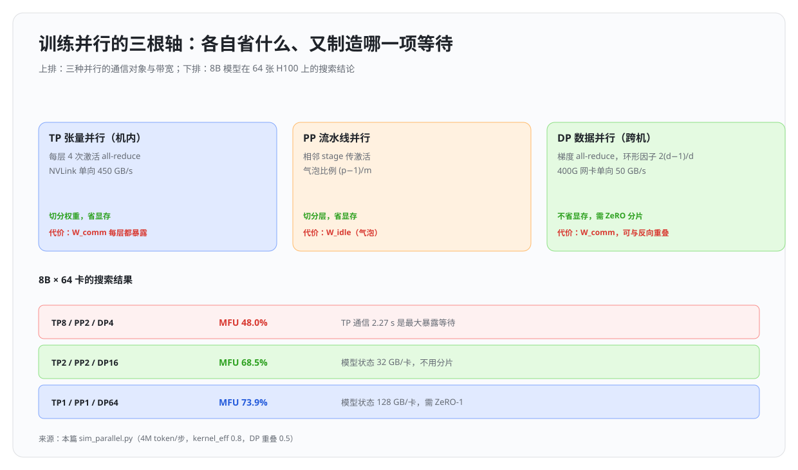
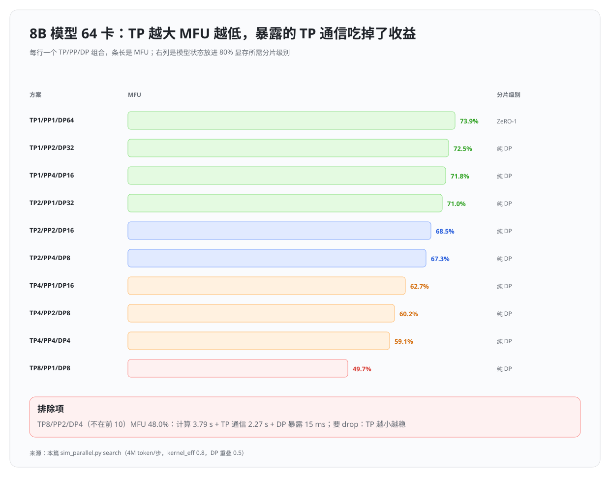
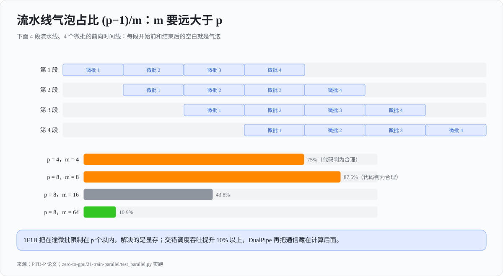
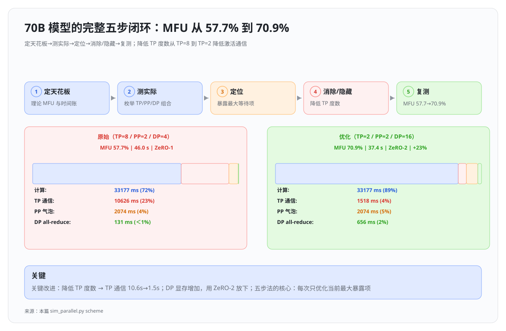
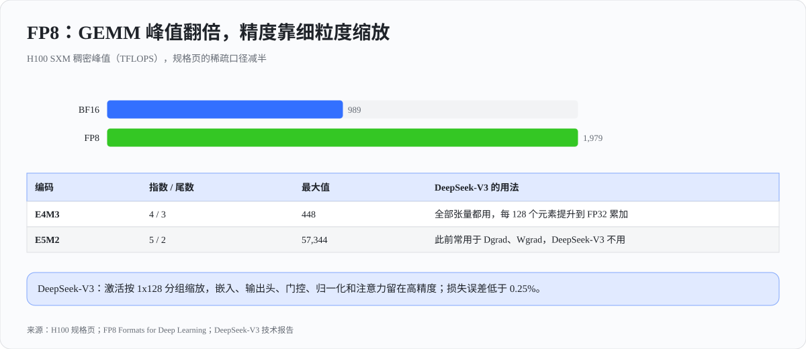
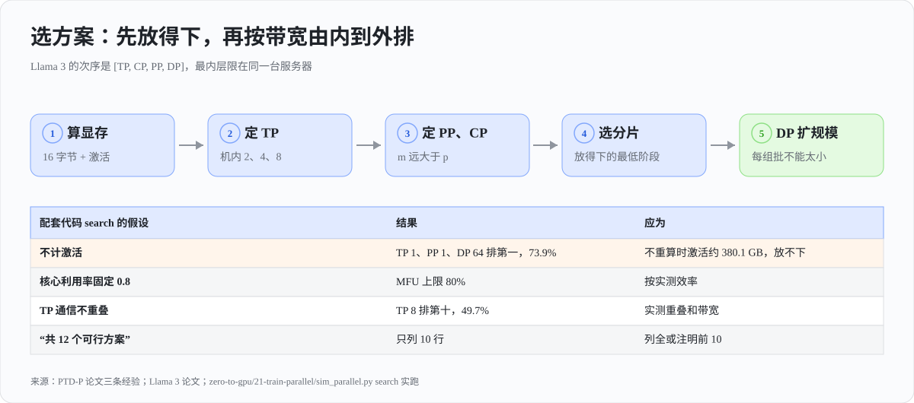

# GPU-21｜LLM｜训练并行：TP、PP、DP、ZeRO 与 FP8

> 🎯 **这篇文档解决什么问题**：模型大到一张卡放不下、算不完时，要切到几百上千张卡上。切法不同，每张卡等的东西就不同：张量并行每层等 all-reduce，流水线并行等气泡，数据并行等梯度规约，分片多出参数收集。本篇按 ZeRO、Megatron、Llama 3 和 DeepSeek-V3 的公开数据，算清显存账和等待账，给出选并行度的顺序，并说明 FP8 怎样缩短计算本身。

**使用方式**：第 1 章把一步训练拆开。第 2、3 章算显存。第 4 到 7 章逐一讲分片、张量并行、流水线并行和沿序列维的切分。第 8 章讲 FP8，第 9 章讲选方案，第 10 章给清单和自测。

**代码**：zero-to-gpu/21-train-parallel/ 下的 sim_memory.py、sim_parallel.py、test_parallel.py 只需 Python 标准库。显存口径、激活估计、TP 通信模型和方案搜索有误，第 10 章逐条说明。

<b>🧭 主线位置</b>：GPU-00（[GPU-00｜索引｜从 0 开始 GPU 优化：路线、章节与练习](./README.md)）建立了时间账 T = T_compute + W_mem + W_host + W_comm + W_idle。GPU-18（[GPU-18｜集群｜NCCL：算法、协议与挂死排查](./18-nccl.md)）讲集合通信本身，GPU-20（[GPU-20｜集群｜可靠性与可观测：故障、静默错误与 checkpoint](./20-reliability.md)）讲作业层面的故障和恢复。本篇讲训练作业内部：并行切分决定了 W_comm 里有多少 TP 和 DP 通信、W_idle 里有多少流水线气泡，FP8 缩短的是 T_compute。专家并行的 all-to-all 交给 GPU-22（[GPU-22｜LLM｜MoE 与专家并行：all-to-all 与负载均衡](./22-moe-ep.md)）。

## 导读 · 先给结论

- <b>不同切法付不同的等待。</b>Llama 3 405B 用 TP 8、PP 16、DP 64 到 128 训练，MFU 38% 到 43%（第 1 章）。[[1]](https://arxiv.org/pdf/2407.21783)
- <b>模型状态每参数 16 字节。</b>8B 模型需要 128 GB，纯数据并行放不下 80 GB 的卡（第 2 章）。[[2]](https://arxiv.org/pdf/1910.02054)
- <b>激活常常比模型状态还大。</b>序列 8192 时 8B 规模 32 层不重算约 380.1 GB，序列并行加选择性重算约降到五分之一（第 3 章）。[[3]](https://arxiv.org/pdf/2205.05198)
- <b>ZeRO 前两个阶段几乎白拿。</b>显存降到约四分之一和八分之一，通信不变；全分片再多 50% 通信（第 4 章）。[[2]](https://arxiv.org/pdf/1910.02054)
- <b>TP 留在机内，PP 气泡看 (p−1)/m。</b>TP 每层两次前向、两次反向 all-reduce；p = 8、m = 64 时气泡 10.9%（第 5、6 章）。[[4]](https://arxiv.org/pdf/1909.08053)[[5]](https://arxiv.org/pdf/2104.04473)
- <b>FP8 让 GEMM 峰值翻倍，精度要管。</b>DeepSeek-V3 用细粒度缩放和高精度累加，损失误差低于 0.25%（第 8 章）。[[6]](https://arxiv.org/pdf/2412.19437)
- <b>选方案按带宽由内到外排。</b>[TP, CP, PP, DP]，解析模型只用来排除，最终靠实测（第 9 章）。[[1]](https://arxiv.org/pdf/2407.21783)[[5]](https://arxiv.org/pdf/2104.04473)

<b>📎 与系列其他文档的分工</b>：GPU-06（[GPU-06｜硬件｜Tensor Core 与低精度：从 mma 到 FP8 和 FP4](./06-tensor-core.md)）讲 Tensor Core 和 FP8 等低精度格式。GPU-13（[GPU-13｜单机｜NVLink 与 NVSwitch](./13-nvlink.md)）讲 NVLink 和 NVSwitch。GPU-14（[GPU-14｜单机｜性能分析与 Profiling](./14-profiling.md)）讲 Nsight 时间线怎样读。GPU-18（[GPU-18｜集群｜NCCL：算法、协议与挂死排查](./18-nccl.md)）讲 NCCL 的算法、带宽和重叠。GPU-22（[GPU-22｜LLM｜MoE 与专家并行：all-to-all 与负载均衡](./22-moe-ep.md)）讲 MoE 和专家并行。

## 第 1 章 · 并行切分决定每张卡在等什么

模型大到一张卡放不下、算不完时，就要切到多张卡上。切法不同，每张卡等待的东西也不同：张量并行在每一层等 all-reduce，流水线并行在流水线两端等气泡，数据并行在每一步末尾等梯度规约，分片会多出参数的 all-gather。本章先给出一步训练的时间怎样拆，再用 Llama 3 和 Megatron 的公开配置说明这些切法在实践中怎样组合。

### 四种切法各自付什么

Llama 3 把四种切法组合在一起，称为 4D 并行[[1]](https://arxiv.org/pdf/2407.21783)：张量并行 TP 把单个权重张量切成几块放到不同卡上[[1]](https://arxiv.org/pdf/2407.21783)，流水线并行 PP 按层把模型纵向切成若干阶段，上下文并行 CP 把输入序列切段，数据并行 DP 让每组卡处理不同的数据。放回时间账 T = T_compute + W_mem + W_host + W_comm + W_idle，各种切法付出的代价落在不同的项上：

- **TP**：每层前向两次、反向两次 all-reduce（第 5 章），记在 W_comm，频繁而且在关键路径上。
- **PP**：流水线填充和排空时的气泡（第 6 章），记在 W_idle；阶段之间的激活传输较小。
- **DP**：每一步末尾的梯度规约，可以和反向重叠（GPU-18，[GPU-18｜集群｜NCCL：算法、协议与挂死排查](./18-nccl.md)）。
- **ZeRO 和 FSDP 分片**：省显存，代价是参数的额外收集（第 4 章）。
- **CP**：长序列时切序列，代价是注意力的跨卡通信（第 7 章）。

### 公开配置给出的量级

Llama 3 405B 预训练的三个阶段用了三组配置[[1]](https://arxiv.org/pdf/2407.21783)：8,192 卡时 TP 8、PP 16、DP 64，每卡 430 TFLOPs，BF16 MFU 43%；16,384 卡时 DP 增加到 128，每卡 400 TFLOPs，MFU 41%；长上下文阶段把序列加到 131,072，CP 16、DP 8，每卡 380 TFLOPs，MFU 38%。三组的卡数正好是各并行度的乘积：8 × 16 × 64 = 8192，8 × 16 × 128 = 16384，8 × 16 × 16 × 8 = 16384。总体 MFU 在 38% 到 43% 之间[[1]](https://arxiv.org/pdf/2407.21783)。更早的 Megatron PTD-P 在 3072 张 A100 上训练 1 万亿参数模型，总吞吐 502 PFLOP/s，每卡达到理论峰值的 52%[[5]](https://arxiv.org/pdf/2104.04473)，每卡 163 TFLOP/s[[5]](https://arxiv.org/pdf/2104.04473)。

这些数字说明，上万卡的训练里一半以上的峰值算力没有变成有效计算；最好的配置是按各自的代价把几种并行组合起来：TP 留在机内，PP 跨机，DP 扩规模。后面各章逐项解释为什么。

配套代码 zero-to-gpu/21-train-parallel/ 有 sim_memory.py、sim_parallel.py 和 test_parallel.py 三个文件。sim_parallel.py 原先用了 Python 3.12 才支持的 f-string 写法[[7]](https://docs.python.org/3/whatsnew/3.12.html)，公开仓库已改掉，在 Python 3.9.6 上也能跑；两个脚本的显存口径也不一致，第 2、3 章说明。

按五步闭环看并行：

- **定天花板**：每卡峰值乘以卡数，H100 的稠密 BF16 是 989 TFLOPS（GPU-06，[GPU-06｜硬件｜Tensor Core 与低精度：从 mma 到 FP8 和 FP4](./06-tensor-core.md)）。
- **测实际**：每步时间和 MFU。
- **定位等待**：在 nsys 时间线上分出 TP 通信、气泡、DP 规约和计算。
- **消除或隐藏**：调整各并行度和微批数，重叠通信。
- **复测**：MFU 和显存一起看。

一个常见的误区是只按“放得下”选并行度。现象是模型放下了，MFU 只有二十几。原因是不同的切法在不同的地方付等待，只满足显存会选到通信最重的组合。改法是先列出每种切法的显存和通信代价，再在放得下的组合里比时间。

> 🔑 **本章要点**：TP 每层等 all-reduce，PP 等气泡，DP 等梯度规约，分片多出参数收集，CP 付注意力的跨卡通信。Llama 3 用 TP 8、PP 16、DP 64 到 128，长序列时加 CP 16，MFU 38% 到 43%；Megatron PTD-P 在 3072 卡上每卡达到峰值的 52%。这一章是五步闭环的“定天花板”：先分清每种切法把时间付在哪里。

## 第 2 章 · 模型状态：每个参数 16 字节

训练时显存里放两类东西：模型状态和激活。模型状态包括参数、梯度和优化器状态，大小只和参数量有关；激活和序列长度、批大小有关，第 3 章讲。本章按 ZeRO 论文的口径算模型状态，说明为什么 8B 的模型在 80 GB 的卡上用纯数据并行放不下，并指出配套代码在这里的口径错误。

### 16 字节从哪里来

混合精度训练时，前向和反向用 16 位的参数和梯度，各占 2 字节。Adam 优化器还要保存 32 位的参数副本、动量和方差，各 4 字节[[2]](https://arxiv.org/pdf/1910.02054)。ZeRO 论文把优化器状态的倍数记为 K，混合精度 Adam 的 K 是 12，合计 2Ψ + 2Ψ + KΨ = 16Ψ 字节，Ψ 是参数量[[2]](https://arxiv.org/pdf/1910.02054)。论文举的例子是 15 亿参数的 GPT-2，模型状态至少要 24 GB[[2]](https://arxiv.org/pdf/1910.02054)；7.5B 的模型用标准数据并行，每卡要 120 GB[[2]](https://arxiv.org/pdf/1910.02054)。

按同样的口径，8B 的模型状态是 16 × 8 = 128 GB，超过 H100 的 80 GB。纯数据并行每张卡都放一份完整的模型状态，所以 8B 的模型不能用纯数据并行训练，必须分片（第 4 章）或者用 TP、PP 把模型切小。

### 配套代码的口径

sim_memory.py 把优化器状态算成每参数 8 字节，只算了动量和方差，漏了 32 位的参数副本。于是 8B 模型的模型状态成了 96 GB，ZeRO-3 在 64 卡上每卡 1.50 GB；按 16 字节应是 128 GB 和 2.0 GB。test_parallel.py 的第一个测试声称验证 ZeRO 论文的数字，用 7.5B 算出纯数据并行每卡 90 GB、ZeRO-3 每卡 1.41 GB，而论文的数字是 120 GB 和 1.9 GB[[2]](https://arxiv.org/pdf/1910.02054)，测试照样通过。sim_parallel.py 用的是正确的 16 字节，第六个测试里纯数据并行是 128.0 GB，两个文件互相矛盾。第 10 章列为练习。

按五步闭环算模型状态：

- **定天花板**：每卡显存减去激活和运行时开销，剩下的才能放模型状态。
- **测实际**：torch.cuda.memory.max_memory_allocated 返回张量占用的峰值显存[[8]](https://docs.pytorch.org/docs/2.15/generated/torch.cuda.memory.max_memory_allocated.html)，在优化器第一步之后读一次，此时优化器状态已经分配。
- **定位等待**：显存不够时，先分清是模型状态还是激活。
- **消除或隐藏**：模型状态大就分片或加 TP、PP（第 4、5、6 章）。
- **复测**：分片以后再读一次峰值显存。

一个常见的误区是只算参数本身。现象是 8B 模型按 16 GB 估，觉得一张 80 GB 的卡绰绰有余，开训就显存不足。原因是参数只占模型状态的八分之一，梯度和 Adam 状态还要 14 字节每参数。改法是按 16 字节每参数估算，再加上激活。

> 🔑 **本章要点**：混合精度 Adam 的模型状态是每参数 16 字节：16 位参数和梯度各 2 字节，32 位参数副本、动量、方差各 4 字节。8B 模型需要 128 GB，纯数据并行放不下 H100。配套代码 sim_memory.py 漏了参数副本，算成 96 GB，测试也没对上 ZeRO 论文的 120 GB。这一章是五步闭环的“定天花板”：先算清显存的硬下限。

## 第 3 章 · 激活显存往往比模型状态还大

模型状态和序列长度无关，激活却随序列长度、批大小和层数线性增长，长序列时还有一项按序列长度的平方增长。很多时候真正放不下的是激活。本章用 Korthikanti 等人的公式算一个 8B 规模的例子，说明序列并行和选择性重算怎样把激活降下来，以及配套代码的激活估计差了多少。

### 每层激活 sbh(34 + 5as/h)

对 GPT 结构的 Transformer，16 位训练时每层要保存的激活是 sbh(34 + 5as/h) 字节[[3]](https://arxiv.org/pdf/2205.05198)，s 是序列长度，b 是微批大小，h 是隐层维度，a 是注意力头数。第一项来自线性层、层归一化和激活函数的输入，第二项 5as/h 来自注意力的分数矩阵，随序列长度平方增长。

代入一个 8B 规模的形状：s = 8192，b = 1，h = 4096，a = 32，32 层。sbh = 8192 × 4096 = 33554432，5as/h = 5 × 32 × 8192 ÷ 4096 = 320，所以每层 33554432 × 354 字节，约 11.88 GB，32 层约 380.1 GB。这是不做任何重算、不切分时一个微批的激活，比 128 GB 的模型状态还大得多。这个公式按标准多头注意力和 4h 的 MLP 推导，换成分组查询注意力或其他 MLP 宽度时数值会变，量级不变。

### 序列并行和选择性重算

张量并行能切开权重，但层归一化和 dropout 这些操作在 TP 组里是重复的。把它们沿序列维切开，就是序列并行；和张量并行一起用，每层激活变成原来的 1/t，t 是 TP 度[[3]](https://arxiv.org/pdf/2205.05198)。注意力分数矩阵那一项占的显存大、重新计算却便宜，选择性重算只重算这一部分，激活降到 34sbhL/t[[3]](https://arxiv.org/pdf/2205.05198)。上面的例子里，选择性重算后 32 层是 34 × 33554432 × 32 字节，约 36.5 GB，再按 TP 8 切开约 4.56 GB。

论文的结论是，两者合用让激活显存降到约五分之一，同时把全量重算带来的执行时间开销减少 90% 以上[[3]](https://arxiv.org/pdf/2205.05198)。一个 22B 模型的实测里，全量重算让每层时间多出 39%，选择性重算只多 7%[[3]](https://arxiv.org/pdf/2205.05198)；选择性重算增加的 FLOPs 在 GPT-3 和 MT-NLG 上只有 2.7% 和 1.6%[[3]](https://arxiv.org/pdf/2205.05198)。在 2240 张 A100 上训练 530B 模型，MFU 达到 54.2%，比全量重算的 42.1% 快 29%[[3]](https://arxiv.org/pdf/2205.05198)。

配套代码 sim_memory.py 把激活估为 s × h × L × 2 字节，上面的例子只有 2.15 GB，比不重算的 380.1 GB 小两个数量级，也比选择性重算后的 36.5 GB 小一个数量级。sim_parallel.py 的方案搜索则完全不计激活。第 10 章列为练习。

按五步闭环管激活：

- **定天花板**：用 sbh(34 + 5as/h) 乘层数估算一个微批的激活。
- **测实际**：对比只前向和完整一步的峰值显存。
- **定位等待**：重算让反向变慢，记在 T_compute 里。
- **消除或隐藏**：先开序列并行和选择性重算，不够再全量重算或减小微批。
- **复测**：显存和步时间一起看。

一个常见的误区是显存不够就直接开全量重算。现象是放下了，步时间多出三四成。原因是全量重算把整个前向再算一遍。改法是先用序列并行和选择性重算，只重算注意力里显存大、计算少的部分。

> 🔑 **本章要点**：每层激活是 sbh(34 + 5as/h) 字节，8B 规模、序列 8192 时 32 层约 380.1 GB，远大于 128 GB 的模型状态。序列并行加选择性重算降到 34sbhL/t，激活约降到五分之一，重算开销减少 90% 以上。配套代码把激活估成 2.15 GB，方案搜索不计激活。这一章是五步闭环的“定位等待”：先确认显存卡在激活还是模型状态。

## 第 4 章 · ZeRO 和 FSDP：用通信换显存

纯数据并行的每张卡都放一份完整的模型状态，64 张卡就有 64 份相同的优化器状态。ZeRO 的出发点是把这些冗余拆掉，让每张卡只存自己那一份，需要时再从别的卡收集。省下的是显存，多出来的是通信。本章算清这笔交换，并说明 PyTorch FSDP 和 Llama 3 在实践里怎样取舍。

### 三个阶段各省多少、各多付多少

标准数据并行每步用 all-reduce 规约梯度，实现上是一次 reduce-scatter 加一次 all-gather，每步的数据移动是 2Ψ[[2]](https://arxiv.org/pdf/1910.02054)。ZeRO 分三个阶段[[2]](https://arxiv.org/pdf/1910.02054)：

- <b>分片优化器状态（Pos）</b>：显存降到约四分之一，通信量和数据并行相同。
- <b>再分片梯度（Pos+g）</b>：显存降到约八分之一，通信量仍和数据并行相同。
- <b>再分片参数（Pos+g+p）</b>：显存随数据并行度线性下降，64 卡时降 64 倍[[2]](https://arxiv.org/pdf/1910.02054)；代价是前向和反向都要先 all-gather 参数，总通信变成 3Ψ，是基线的 1.5x[[2]](https://arxiv.org/pdf/1910.02054)，也就是多 50%[[2]](https://arxiv.org/pdf/1910.02054)。

论文给出的 7.5B 模型在 64 卡上的每卡模型状态：标准数据并行 120 GB，Pos 31.4 GB，Pos+g 16.6 GB，Pos+g+p 1.9 GB[[2]](https://arxiv.org/pdf/1910.02054)，表中写作 1.88[[2]](https://arxiv.org/pdf/1910.02054)。前两个阶段几乎是白拿的，第三个阶段才开始用通信换显存。按同样的口径算 8B 模型在 64 卡上：ZeRO-1 每卡 (4 + 12/64) × 8 ≈ 33.5 GB，ZeRO-2 约 17.8 GB，ZeRO-3 是 128 ÷ 64 = 2.0 GB。

### FSDP 和 Llama 3 的取舍

PyTorch FSDP 用分片因子统一了这几种做法：分片因子为 1 就是普通数据并行，等于总卡数就是全分片，介于两者之间是混合分片[[9]](https://arxiv.org/pdf/2304.11277)。全分片显存最低，通信最多，按带宽最优的环算法比 DDP 多 1.5x[[9]](https://arxiv.org/pdf/2304.11277)。FSDP 论文报告的结果是性能和 DDP 相当，同时能训练大得多的模型[[9]](https://arxiv.org/pdf/2304.11277)。和张量并行一起用时，论文的做法是把阻塞后续计算的 TP 通信留在机内的高带宽链路上，让 FSDP 的通信走机间[[9]](https://arxiv.org/pdf/2304.11277)。

Llama 3 用 FSDP 分片优化器状态和梯度，但前向之后不把参数重新分片，以免反向时再做一次 all-gather[[1]](https://arxiv.org/pdf/2407.21783)。这相当于在 ZeRO-2 和 ZeRO-3 之间选了一个点：多占一些参数显存，少一次参数收集。它说明分片的阶段不是越高越好，要看显存还差多少、通信能不能藏住。

配套代码的两个文件在这里给出不同的数字：sim_memory.py 的 ZeRO-3 每卡 1.50 GB 用的是 12 字节口径；sim_parallel.py 的方案表在 TP 8、PP 2、DP 4 下给出纯 DP 8.0 GB、ZeRO-1 3.5 GB、ZeRO-2 2.8 GB、ZeRO-3 2.0 GB，用的是 16 字节口径，和本章一致。

按五步闭环用分片：

- **定天花板**：数据并行的通信量是每步 2Ψ，全分片是 3Ψ。
- **测实际**：nsys 里看 all-gather 和 reduce-scatter 有多少没有和计算重叠。
- **定位等待**：参数 all-gather 暴露出来就记在 W_comm。
- **消除或隐藏**：先用 ZeRO-1 或 ZeRO-2，显存仍不够再全分片；全分片时用预取和混合分片把收集留在机内。
- **复测**：每卡显存和步时间一起比较。

一个常见的误区是一上来就开 ZeRO-3。现象是显存宽裕，步时间却变长。原因是全分片每步多 50% 的通信，批小或机间带宽不够时藏不住。改法是从低阶段开始，只有放不下时才升级，并优先在机内做分片。

> 🔑 **本章要点**：ZeRO 的前两个阶段把显存降到约四分之一和八分之一，通信不变；第三个阶段显存随卡数线性下降，通信多 50%。7.5B 模型在 64 卡上每卡从 120 GB 降到 31.4、16.6、1.9 GB。Llama 3 分片优化器和梯度，前向后不重分片参数，少一次 all-gather。这一章是五步闭环的“消除或隐藏”：用通信换显存之前先算清多付多少。

## 第 5 章 · 张量并行：每层都等一次 all-reduce

张量并行把一层内的矩阵乘法切到几张卡上，每张卡只存和算一部分权重。它不需要像流水线那样等气泡，代价是每一层都要同步一次部分结果，而且这次同步在关键路径上，算完一层要等它结束才能往下走。所以张量并行的效率几乎完全取决于卡间带宽。

### Megatron 的切法和通信量

Megatron-LM 把 MLP 的第一个矩阵按列切、第二个按行切，注意力按头切，这样每个 Transformer 层只需要前向两次、反向两次 all-reduce[[4]](https://arxiv.org/pdf/1909.08053)。用这种切法，论文在 512 张卡上训练 8.3B 模型，每组 8 卡做模型并行，整体达到 15.1 PFLOP/s，扩展效率 76%[[4]](https://arxiv.org/pdf/1909.08053)。

每次 all-reduce 的数据是这一层的激活，大小是 b × s × h × 2 字节。序列 8192、隐层 4096 时约 0.067 GB。环形 all-reduce 每张卡要收发 2(t−1)/t 倍的数据，t = 8 时是 1.75 倍。H100 的 NVLink 总带宽 900 GB/s[[10]](https://developer.nvidia.com/blog/nvidia-hopper-architecture-in-depth/)，单向 450 GB/s。配套代码的第三个测试按这些参数算出 32 层共 15.0 GB、33.4 ms，这个量级在机内是可以接受的。

### 为什么 TP 留在机内

PTD-P 论文的第一条结论是：张量并行一般只用到单机的卡数，超出之后用流水线并行跨机[[5]](https://arxiv.org/pdf/2104.04473)；在较慢的机间链路上做张量并行，开销可能大到不可行[[5]](https://arxiv.org/pdf/2104.04473)。FSDP 论文的做法相同，把阻塞计算的 TP 通信留在机内[[9]](https://arxiv.org/pdf/2304.11277)。原因是 TP 每层都要同步，机间带宽比 NVLink 低得多，每层都走机间的 all-reduce 会直接拉长关键路径。Llama 3 的三组配置 TP 都是 8[[1]](https://arxiv.org/pdf/2407.21783)，正好是一台机器的卡数。

配套代码在这里有两套互相矛盾的模型。sim_parallel.py 按激活算通信，每层 4 次 all-reduce，TP 8、PP 2、DP 4 的方案里 TP 通信 2271.86 ms，计算 3791.71 ms，通信相当于计算的 59.9%，而且完全不和计算重叠；它用的隐层维 4564 是由 N ≈ 12LH² 反推的，比真实的 4096 大。sim_memory.py 的 comm 子命令则按权重算，每层 6 次，打印“每层 0.75 GB”，再把 32 层总计写成 192.00 GB，而 0.75 × 32 = 24 GB，两行数字自相矛盾。第 10 章列为练习。

按五步闭环看张量并行：

- **定天花板**：每层每次 all-reduce 是 b × s × h × 2 字节，乘以 2(t−1)/t 除以链路带宽。
- **测实际**：nsys 里看每层的 all-reduce 时间和它前后的 GEMM。
- **定位等待**：TP 通信在关键路径上，记在 W_comm。
- **消除或隐藏**：TP 限制在 NVLink 域内；开序列并行把 all-reduce 拆成 reduce-scatter 和 all-gather（第 7 章）。
- **复测**：改 TP 度后比较步时间和 MFU。

一个常见的误区是显存不够就加大 TP 度。现象是 TP 从 8 加到 16 后跨了机，步时间成倍增长。原因是每层的 all-reduce 改走机间网络。改法是 TP 不超过单机卡数，显存不够时加流水线并行或分片。

> 🔑 **本章要点**：张量并行每层前向两次、反向两次 all-reduce，数据量是这一层的激活，在关键路径上。Megatron 用 8 卡 TP 在 512 卡上达到 76% 的扩展效率；PTD-P 和 FSDP 都把 TP 留在机内，Llama 3 的 TP 都是 8。配套代码两套 TP 通信模型互相矛盾。这一章是五步闭环的“定位等待”：TP 的等待由卡间带宽决定。

## 第 6 章 · 流水线并行：气泡是 (p−1)/m

流水线并行按层把模型切成 p 段，放在不同的卡上，激活从前一段传到后一段。段之间只传激活，通信量小，适合跨机。代价是时间上的：第一段开始算时后面几段在等，最后一段算完时前面几段又在等，这两段空闲就是气泡。本章给出气泡的公式，说明 1F1B 和交错调度怎样处理气泡与显存的矛盾，并指出配套测试的判断标准错在哪里。

### 气泡公式和显存的矛盾

一个批切成 m 个微批，流水线有 p 段，填充和排空的气泡时间是 (p−1)(t_f + t_b)，理想计算时间是 m(t_f + t_b)，所以气泡占比是 (p−1)/m[[5]](https://arxiv.org/pdf/2104.04473)。要让气泡小，就需要 m 远大于 p；但 m 很大时，GPipe 那种先全部前向再全部反向的调度要把 m 个微批的激活都存着，显存很高[[5]](https://arxiv.org/pdf/2104.04473)。

PipeDream-Flush 的 1F1B 调度解决了显存一侧：热身阶段之后每段做一次前向接一次反向，在途的微批不超过 p 个[[5]](https://arxiv.org/pdf/2104.04473)，所以 m 远大于 p 时比 GPipe 省得多[[5]](https://arxiv.org/pdf/2104.04473)。气泡大小不变，仍是 (p−1)/m。交错调度让每张卡负责几段不相邻的层，把气泡再缩小，吞吐提升 10% 以上，显存和原来相当[[5]](https://arxiv.org/pdf/2104.04473)，前提是微批数为流水线度的整数倍[[5]](https://arxiv.org/pdf/2104.04473)。DeepSeek-V3 的 DualPipe 进一步减少气泡，并把大部分通信藏在计算后面[[6]](https://arxiv.org/pdf/2412.19437)。

### 配套测试把 75% 判为合理

按公式算几个点：p = 4、m = 4 时气泡 75%；p = 8、m = 8 时 87.5%；p = 8、m = 16 时 43.8%；p = 8、m = 64 时降到 10.9%。test_parallel.py 的第二个测试只检查 0 ≤ 气泡 &lt; 1，于是把 75% 和 87.5% 都打印成“合理范围”。气泡 87.5% 意味着每步的大部分时间流水线在空转，作为训练配置是不可接受的。sim_parallel.py 默认取 m = 8p，PP 2 时是 16 个微批、气泡 6.2%，PP 4 时 32 个微批、气泡 9.4%；这个默认值合理，但它没有检查 m 个微批的批大小是否真的可行。

按五步闭环看流水线：

- **定天花板**：气泡占比 (p−1)/m，交错调度再按每卡段数缩小。
- **测实际**：nsys 里看每段第一次前向之前和最后一次反向之后的空闲。
- **定位等待**：气泡记在 W_idle。
- **消除或隐藏**：在批大小允许的范围内加大 m，用 1F1B 控制显存，用交错调度或 DualPipe 再缩小气泡。
- **复测**：气泡和峰值显存一起看。

一个常见的误区是固定全局批大小，再把流水线度加大。现象是 PP 从 4 加到 16 后 MFU 反而下降。原因是全局批不变时每条流水线的 m 变小，(p−1)/m 迅速增大。改法是加 PP 的同时检查 m，必要时降低 DP 度让每条流水线分到更多微批。

> 🔑 **本章要点**：流水线气泡占比是 (p−1)/m，要 m 远大于 p；1F1B 把在途微批限制在 p 个以内，交错调度再提升 10% 以上，DualPipe 进一步把通信藏住。p = 8、m = 64 时气泡 10.9%，m = 8 时 87.5%。配套测试把 75% 和 87.5% 判为合理。这一章是五步闭环的“消除或隐藏”：气泡只能靠加大 m 或改调度来缩小。

## 第 7 章 · 序列并行和上下文并行：长序列的激活怎么切

前面几种切法切的是权重、层和数据，激活里随序列长度增长的部分没有被切开。序列从 8192 拉到 131,072 时，单层的激活会从十几 GB 涨到几 TB，TP 和 PP 都救不了。本章讲两种沿序列维的切法：序列并行切的是 TP 组内重复的那部分激活，上下文并行切的是整条序列。

### 序列并行：和 TP 搭配，不加通信

张量并行切开了线性层，但层归一化和 dropout 在 TP 组的每张卡上都完整地算一遍、存一份。序列并行把这些操作沿序列维切开，进入张量并行区之前 all-gather，离开时 reduce-scatter[[3]](https://arxiv.org/pdf/2205.05198)。环形 all-reduce 本来就由一次 reduce-scatter 加一次 all-gather 组成[[3]](https://arxiv.org/pdf/2205.05198)，所以序列并行和张量并行合用时通信带宽不变，不引入额外通信[[3]](https://arxiv.org/pdf/2205.05198)，每层激活却除以 TP 度[[3]](https://arxiv.org/pdf/2205.05198)。这也是第 3 章里 34sbhL/t 中那个 t 的来源。

注意力分数那一项还有另一条路。FlashAttention 不为反向保存中间的注意力矩阵[[11]](https://arxiv.org/pdf/2205.14135)，显存随序列长度线性增长[[11]](https://arxiv.org/pdf/2205.14135)。按 8B 的形状算序列 131,072：5as/h = 5 × 32 × 131072 ÷ 4096 = 5120，远大于 34，每层激活约 2767 GB；去掉注意力分数项后每层仍有约 18.3 GB，还要再切。

### 上下文并行：Llama 3 的长序列阶段

上下文并行把输入序列切成段，每组卡处理一段，用来缓解超长序列的显存瓶颈[[1]](https://arxiv.org/pdf/2407.21783)。Llama 3 用它把训练序列推到 128K[[1]](https://arxiv.org/pdf/2407.21783)，序列切成 2×CP 块，每个 CP rank 拿两块，一前一后，平衡因果掩码带来的计算量差异。它的实现先 all-gather 全部的 K 和 V，再算本地 Q 那一段的注意力[[1]](https://arxiv.org/pdf/2407.21783)。这次 all-gather 暴露在关键路径上[[1]](https://arxiv.org/pdf/2407.21783)，Llama 3 仍然这样做，理由是注意力计算是序列长度的平方，all-gather 只是线性，前者大一个量级以上[[1]](https://arxiv.org/pdf/2407.21783)，而且 GQA 让 K 和 V 比 Q 小。

长上下文阶段的配置是 TP 8、CP 16、PP 16、DP 8，共 8 × 16 × 16 × 8 = 16384 张卡，序列 131,072，每卡 380 TFLOPs，MFU 38%[[1]](https://arxiv.org/pdf/2407.21783)；CP 16 时每组卡分到的序列是 131072 ÷ 16 = 8192，回到了短序列阶段的长度。和短序列阶段的 41% 相比低了 3 个点，其中有 CP 的 all-gather，也有更长序列下注意力计算的变化，论文没有单独拆分。Llama 3 把并行维度按 [TP, CP, PP, DP] 由内到外排列，CP 排在 TP 之后、PP 之前[[1]](https://arxiv.org/pdf/2407.21783)。

配套代码的方案搜索不计激活，也没有 CP 这一维，序列加长时给出的方案和短序列一样。

按五步闭环看长序列：

- **定天花板**：按 sbh(34 + 5as/h) 算每层激活，看注意力项占多少。
- **测实际**：在目标序列长度上测峰值显存和步时间。
- **定位等待**：CP 的 K/V all-gather 记在 W_comm。
- **消除或隐藏**：先用 FlashAttention 去掉注意力分数项，开序列并行，仍放不下再加 CP。
- **复测**：MFU 和峰值显存一起看。

一个常见的误区是长序列时只加 TP 度。现象是 TP 跨了机，激活还是放不下。原因是 TP 加 SP 只把激活除以 t，序列增长 16 倍时这远远不够。改法是保持 TP 在机内，沿序列维加 CP。

> 🔑 **本章要点**：序列并行把 TP 组内重复的激活沿序列维切开，通信量不变，激活除以 TP 度。序列 131,072 时注意力分数项让每层激活达到约 2767 GB，FlashAttention 去掉这一项后仍有约 18.3 GB。Llama 3 用 CP 16 把序列切成每组 8192，MFU 从 41% 降到 38%。这一章是五步闭环的“消除或隐藏”：长序列的激活沿序列维切。

## 第 8 章 · FP8：算力翻倍，精度要管

前面几章都在减少等待，FP8 换了个方向：直接把计算本身变快。H100 的 FP8 Tensor Core 峰值是 BF16 的两倍，激活用 FP8 存还能省显存。代价是精度：8 位浮点的范围和精度都很有限，需要缩放因子把数值移进可表示区间，有些算子必须留在高精度。本章说明 FP8 的两种编码、DeepSeek-V3 的做法，以及在时间账上该怎么记。

### 两种编码和缩放

FP8 有两种编码：E4M3 是 4 位指数加 3 位尾数，E5M2 是 5 位指数加 2 位尾数[[12]](https://arxiv.org/pdf/2209.05433)。E4M3 最大能表示 448，E5M2 最大 57,344[[12]](https://arxiv.org/pdf/2209.05433)；E4M3 不表示无穷，以此换取更大的范围[[12]](https://arxiv.org/pdf/2209.05433)。高精度数值转成 FP8 之前要乘一个缩放因子，把它移进可表示的范围[[12]](https://arxiv.org/pdf/2209.05433)，有些网络需要每个张量单独的缩放因子[[12]](https://arxiv.org/pdf/2209.05433)。论文在图像和语言任务上验证，FP8 训练的效果和 16 位训练相当，超参数不变[[12]](https://arxiv.org/pdf/2209.05433)。

H100 SXM 规格页写的 BF16 1,979 TFLOPS 和 FP8 3,958 TFLOPS 是稀疏口径[[13]](https://www.nvidia.com/en-us/data-center/h100/)，稠密值各减半，分别是 989 和 1,979 TFLOPS。也就是说，同样的 GEMM 换成 FP8，峰值翻倍。

### DeepSeek-V3 怎样做 FP8 训练

按 DeepSeek-V3 论文自己的说法，它首次在超大规模模型上验证了 FP8 训练的可行性和效果[[6]](https://arxiv.org/pdf/2412.19437)。它的做法可以归成四条：

- **GEMM 用 FP8**：前向 Fprop、激活梯度 Dgrad、权重梯度 Wgrad 三类矩阵乘都用 FP8[[6]](https://arxiv.org/pdf/2412.19437)，输入是 FP8，输出是 BF16 或 FP32[[6]](https://arxiv.org/pdf/2412.19437)；Wgrad 用 FP8 还让激活能以 FP8 存给反向，显著省显存[[6]](https://arxiv.org/pdf/2412.19437)。
- **敏感模块留在高精度**：嵌入、输出头、MoE 门控、归一化和注意力算子不用 FP8[[6]](https://arxiv.org/pdf/2412.19437)。
- **细粒度量化**：低精度训练常被激活、权重、梯度里的离群值卡住[[6]](https://arxiv.org/pdf/2412.19437)，所以激活按 1×Nc 的 tile、权重按 Nc×Nc 的 block 分组缩放[[6]](https://arxiv.org/pdf/2412.19437)，激活前向是 1x128，反向是 128x1[[6]](https://arxiv.org/pdf/2412.19437)。分组小了，一个离群值只影响一小块。
- **全部用 E4M3，定期提升累加精度**：此前常见的做法是前向用 E4M3、反向用 E5M2[[6]](https://arxiv.org/pdf/2412.19437)，DeepSeek-V3 所有张量都用 E4M3[[6]](https://arxiv.org/pdf/2412.19437)，每 128 个元素把部分和提升到 CUDA Core 上用 FP32 累加[[6]](https://arxiv.org/pdf/2412.19437)。

结果是 FP8 训练的模型相对 BF16 基线的损失误差一直低于 0.25%[[6]](https://arxiv.org/pdf/2412.19437)，完整训练用了 2.788M H800 GPU 小时[[6]](https://arxiv.org/pdf/2412.19437)。

配套代码没有任何 FP8 的模拟，sim_parallel.py 的计算时间只按 BF16 峰值算。标题里的 FP8 在代码里没有对应内容，第 10 章列为练习。

按五步闭环用 FP8：

- **定天花板**：FP8 稠密峰值是 BF16 的两倍，但只对 GEMM 有效。
- **测实际**：先测 GEMM 在整步时间里占多少，再测切到 FP8 后的步时间和损失曲线。
- **定位等待**：量化和反量化的额外 kernel 记在 T_compute 里。
- **消除或隐藏**：细粒度缩放加高精度累加，敏感模块留在 BF16。
- **复测**：步时间和损失误差同时看，损失偏差超出预期就回退。

一个常见的误区是按峰值翻倍估算 FP8 的收益。现象是切到 FP8 后步时间的下降远小于一半。原因是只有 GEMM 变快，注意力、归一化、通信和气泡都不变，还多了量化的开销。改法是先用 profiler 算出 GEMM 的占比，再按这个占比估算收益。

> 🔑 **本章要点**：FP8 有 E4M3 和 E5M2 两种编码，最大值 448 和 57,344，需要缩放因子。H100 的 FP8 稠密峰值 1,979 TFLOPS，是 BF16 的两倍。DeepSeek-V3 的三类 GEMM 都用 FP8，敏感模块留高精度，激活按 1x128 分组缩放，全部用 E4M3、每 128 个元素提升累加精度，损失误差低于 0.25%。配套代码没有 FP8。这一章是五步闭环的“消除或隐藏”：缩短的是 T_compute 本身。

## 第 9 章 · 选方案：先放得下，再按带宽由内到外排

前面各章分别算了每种切法的显存和等待，本章把它们合起来，回答给定模型和集群时并行度怎么定。PTD-P 论文发现，TP 和 PP 的组合选得不好，即使机间带宽很高，吞吐也可能低 2 倍[[5]](https://arxiv.org/pdf/2104.04473)；不同并行方式之间的影响不是简单相加的[[5]](https://arxiv.org/pdf/2104.04473)。所以选方案不能凭感觉，要按顺序排除。

### 三条经验和一个排列次序

PTD-P 给出三条经验：

- **TP 用到单机卡数为止**：张量并行一般只用到一台服务器的卡数，更大的模型再用流水线并行跨机[[5]](https://arxiv.org/pdf/2104.04473)。
- **TP × PP 让模型放得下，DP 用来扩规模**：模型并行的总度数只要让参数和中间数据放进显存就够，再往上扩用数据并行[[5]](https://arxiv.org/pdf/2104.04473)。
- **微批大小要调**：最优微批取决于模型的吞吐和显存特征，以及流水线度 p、数据并行度 d 和全局批 B[[5]](https://arxiv.org/pdf/2104.04473)。

Llama 3 把这几条写成了一个排列次序：并行维度按 [TP, CP, PP, DP] 由内到外排列，针对网络通信优化[[1]](https://arxiv.org/pdf/2407.21783)。最内层要求最高带宽和最低延迟，通常限制在同一台服务器内[[1]](https://arxiv.org/pdf/2407.21783)；最外层的 PP 和 DP 可能走多跳网络，延迟可达数十微秒[[1]](https://arxiv.org/pdf/2407.21783)。也就是说，通信越频繁、越在关键路径上的切法，越要放在带宽越高的链路上。

### 按这个次序走一遍

给定模型和卡数，按下面的顺序定并行度：

- **算显存**：模型状态按每参数 16 字节（第 2 章），激活按 sbh(34 + 5as/h) 乘层数（第 3 章），先开序列并行和选择性重算。
- **定 TP**：激活或模型状态放不下时，TP 在机内加到 2、4、8。
- **定 PP 和 CP**：仍放不下就加 PP，选 PP 时保证 m 远大于 p；序列很长时加 CP。
- **选分片阶段**：剩余的模型状态用 ZeRO-1 或 ZeRO-2 分掉，必要时全分片。
- **DP 扩规模**：剩下的卡都给 DP，注意每个 DP 组分到的批不能太小。

最后一条在 Llama 3 上能看到：从 8,192 卡扩到 16,384 卡时，DP 从 64 加到 128，全局批不变，每个 DP 组的批从 32 降到 16，MFU 从 43% 降到 41%[[1]](https://arxiv.org/pdf/2407.21783)。按每卡 400 TFLOPs 除以 989 算是 40.4%，和表里的 41% 差不到一个点，推测是峰值或 FLOPs 的计数口径略有不同。

配套代码的 search 子命令在 64 卡、8B、序列 8192 上把 TP 1、PP 1、DP 64 排在首位，MFU 73.9%，标注只需 ZeRO-1，而 TP 8、PP 1 排在第十，49.7%。这个排序和上面的经验相反，原因有三个：它不计激活，第 3 章算过这个形状不重算时 32 层激活约 380.1 GB，TP 1 根本放不下；核心利用率固定为 0.8，所以 MFU 的上限就是 80%；DP 带宽固定为 50 GB/s，TP 通信按串行不重叠计算。它打印“共 12 个可行方案”，表里只列了 10 行。第 10 章列为练习。

按五步闭环选方案：

- **定天花板**：卡数乘以每卡峰值，再按显存列出所有放得下的组合。
- **测实际**：挑前几个组合各跑几十步，读步时间和峰值显存。
- **定位等待**：在 nsys 上把每步分成计算、TP 通信、气泡、DP 暴露。
- **消除或隐藏**：最大的那项等待决定下一步调哪个并行度。
- **复测**：每次只改一个并行度。

一个常见的误区是完全相信解析模型的排名。现象是模型推荐的配置一跑就显存不足，或者 MFU 远低于估计。原因是解析模型漏了激活、把效率当常数、假设通信不重叠。改法是只用解析模型排除明显不可行的组合，最后的选择靠实测几十步。

> 🔑 **本章要点**：PTD-P 的三条经验：TP 用到单机卡数为止，TP × PP 让模型放得下，DP 扩规模，微批要调；次优的 TP 和 PP 组合吞吐可能低 2 倍。Llama 3 按 [TP, CP, PP, DP] 由内到外排列，DP 从 64 加到 128 时每组批变小，MFU 从 43% 降到 41%。配套代码不计激活，把纯 DP 64 排第一。这一章是五步闭环的“测实际”：解析模型只排除，最终靠实测。

## 第 10 章 · 上线前核对清单与自测

前九章沿着每张卡在等什么展开：第 1 章把一步训练拆成计算、TP 通信、气泡和 DP 规约，第 2、3 章算模型状态和激活的显存，第 4 章讲 ZeRO 和 FSDP，第 5、6、7 章分别讲张量并行、流水线并行和沿序列维的切分，第 8 章讲 FP8，第 9 章把它们排成一个选方案的顺序。本章把这些压成一张核对清单，再列出配套代码的问题作为练习，最后给出自测题。

### 📌 核对清单

| 检查项 | 怎样查 | 通过的标志 |
|---|---|---|
| 模型状态按 16 字节算 | 参数量乘 16，和每卡显存比较（第 2 章） | 估算和优化器第一步后的实测峰值相符 |
| 激活有估算 | sbh(34 + 5as/h) 乘层数（第 3 章） | 知道不重算时的激活量和重算后的量 |
| 选择性重算已开 | 检查框架的重算配置（第 3 章） | 只重算注意力部分，步时间开销在个位数百分比 |
| 分片阶段合适 | 对比 ZeRO 各阶段的显存和步时间（第 4 章） | 选的是放得下的最低阶段 |
| TP 不跨机 | TP 度和每机卡数比较（第 5 章） | TP 度不超过每机卡数 |
| 气泡可控 | 算 (p−1)/m，并在 nsys 上看（第 6 章） | m 远大于 p，气泡在一成左右或更低 |
| 长序列有 CP | 目标序列长度下测峰值显存（第 7 章） | 开 FlashAttention 和 SP 后仍放不下时才加 CP |
| FP8 收益有估算 | profiler 统计 GEMM 占比（第 8 章） | 估算收益按 GEMM 占比，不按峰值翻倍 |
| FP8 精度有监控 | 和 BF16 基线比较损失曲线（第 8 章） | 偏差在预期范围内，敏感模块留在高精度 |
| 方案经实测 | 前几个候选各跑几十步（第 9 章） | 选定方案的步时间和显存是实测值 |

### 代码练习：配套代码的问题

zero-to-gpu/21-train-parallel/ 的 sim_memory.py 在 Python 3.9.6 上能跑；sim_parallel.py 第 217 行原先在 f-string 的花括号里又用了双引号，这种写法 Python 3.12 才支持[[7]](https://docs.python.org/3/whatsnew/3.12.html)；公开仓库已改成单引号，sim_parallel.py 和 test_parallel.py 在 3.9.6 上都能跑，6 个测试全部通过，但下面几处与事实或自身描述不符，适合作为练习：

- **优化器状态少算 4 字节**：sim_memory.py 把优化器状态写成每参数 8 字节，漏了 32 位参数副本，8B 模型算成 96 GB；sim_parallel.py 用的是 16 字节，两个文件互相矛盾（第 2 章）。练习：改成 12 字节，让 8B 模型状态变成 128 GB。
- **测试没对上论文还通过**：第一个测试声称验证 ZeRO 论文，用 7.5B 算出纯 DP 90 GB、ZeRO-3 1.41 GB，论文是 120 GB 和 1.9 GB，测试只检查是否放得下（第 2 章）。练习：把论文数字写成断言。
- **激活估计小两个数量级**：sim_memory.py 用 s × h × L × 2，8B、序列 8192 时是 2.15 GB，按 sbh(34 + 5as/h) 是约 380.1 GB（第 3 章）。练习：换成论文公式，加选择性重算和 TP 的开关。
- **两套 TP 通信模型**：sim_parallel.py 按激活算每层 4 次 all-reduce；sim_memory.py 按权重算每层 6 次，打印每层 0.75 GB 却把 32 层总计写成 192.00 GB（第 5 章）。练习：统一成按激活计算。
- **气泡 87.5% 被判为合理**：第二个测试只检查气泡小于 100%（第 6 章）。练习：把阈值改成和 m 远大于 p 一致，例如要求 m 至少是 p 的四倍。
- **方案搜索不计激活**：search 把 TP 1、PP 1、DP 64 排在首位，MFU 73.9%；核心利用率固定 0.8，DP 带宽固定 50 GB/s，隐层维由 12LH² 反推成 4564；打印“共 12 个可行方案”却只列 10 行（第 9 章）。练习：加入第 3 章的激活估计，把放不下的方案剔除后再排序。
- **标题有 FP8，代码没有**：两个模拟器都只按 BF16 峰值算（第 8 章）。练习：加一个 GEMM 占比参数，估算 FP8 的步时间。

### 自测题

1. 混合精度 Adam 每个参数要多少字节的模型状态？各部分是什么？8B 模型为什么不能在 80 GB 的卡上用纯数据并行？
2. 每层激活 sbh(34 + 5as/h) 里，哪一项随序列长度平方增长？序列并行和选择性重算各消掉了哪一部分？
3. ZeRO 三个阶段各省多少显存？哪个阶段开始增加通信，增加多少？
4. 为什么张量并行一般不跨机？Llama 3 的并行维度是怎样由内到外排列的？
5. 流水线有 8 段、16 个微批时气泡占多少？1F1B 解决的是气泡还是显存？
6. H100 的 FP8 稠密峰值是 BF16 的几倍？为什么切到 FP8 后整步时间通常达不到这个倍数？

**下一步**：本篇的模型都是稠密模型，每个 token 经过全部参数。MoE 模型每个 token 只经过少数专家，专家要分到不同的卡上，于是多出一种按 token 路由的 all-to-all 通信。GPU-22（[GPU-22｜LLM｜MoE 与专家并行：all-to-all 与负载均衡](./22-moe-ep.md)）讲 MoE 和专家并行。

## 参考文献

按正文首次引用顺序编号，资料截至 2026 年 11 月中。

[1] Llama Team, AI @ Meta. The Llama 3 Herd of Models. arXiv 2407.21783 (2024) [arxiv.org/pdf/2407.21783](https://arxiv.org/pdf/2407.21783)

[2] Rajbhandari et al. ZeRO: Memory Optimizations Toward Training Trillion Parameter Models. arXiv 1910.02054 [arxiv.org/pdf/1910.02054](https://arxiv.org/pdf/1910.02054)

[3] Korthikanti et al. Reducing Activation Recomputation in Large Transformer Models. arXiv 2205.05198 [arxiv.org/pdf/2205.05198](https://arxiv.org/pdf/2205.05198)

[4] Shoeybi et al. Megatron-LM: Training Multi-Billion Parameter Language Models Using Model Parallelism. arXiv 1909.08053 [arxiv.org/pdf/1909.08053](https://arxiv.org/pdf/1909.08053)

[5] Narayanan et al. Efficient Large-Scale Language Model Training on GPU Clusters Using Megatron-LM. arXiv 2104.04473 [arxiv.org/pdf/2104.04473](https://arxiv.org/pdf/2104.04473)

[6] DeepSeek-AI. DeepSeek-V3 Technical Report. arXiv 2412.19437 [arxiv.org/pdf/2412.19437](https://arxiv.org/pdf/2412.19437)

[7] Python Documentation. What's New In Python 3.12（PEP 701：f-string 语法形式化） [docs.python.org/3/whatsnew/3.12.html](https://docs.python.org/3/whatsnew/3.12.html)

[8] PyTorch 2.15 Documentation. torch.cuda.memory.max_memory_allocated [docs.pytorch.org/docs/2.15/generated/torch.cuda.memory.max_memory_allocated.html](https://docs.pytorch.org/docs/2.15/generated/torch.cuda.memory.max_memory_allocated.html)

[9] Zhao et al. PyTorch FSDP: Experiences on Scaling Fully Sharded Data Parallel. VLDB 2023 [arxiv.org/pdf/2304.11277](https://arxiv.org/pdf/2304.11277)

[10] NVIDIA Technical Blog. NVIDIA Hopper Architecture In-Depth (2022) [developer.nvidia.com/blog/nvidia-hopper-architecture-in-depth/](https://developer.nvidia.com/blog/nvidia-hopper-architecture-in-depth/)

[11] Dao et al. FlashAttention: Fast and Memory-Efficient Exact Attention with IO-Awareness. NeurIPS 2022 [arxiv.org/pdf/2205.14135](https://arxiv.org/pdf/2205.14135)

[12] Micikevicius et al. FP8 Formats for Deep Learning. arXiv 2209.05433 [arxiv.org/pdf/2209.05433](https://arxiv.org/pdf/2209.05433)

[13] NVIDIA. H100 Tensor Core GPU 产品页 [www.nvidia.com/en-us/data-center/h100/](https://www.nvidia.com/en-us/data-center/h100/)

---

[在 Colab 里跑本章 CPU 练习](https://colab.research.google.com/github/zyaochen/zero-to-gpu/blob/main/colab/21-train-parallel.ipynb) · 上一章：[GPU-20｜集群｜可靠性与可观测：故障、静默错误与 checkpoint](./20-reliability.md) · [目录](./README.md) · 下一章：[GPU-22｜LLM｜MoE 与专家并行：all-to-all 与负载均衡](./22-moe-ep.md)
