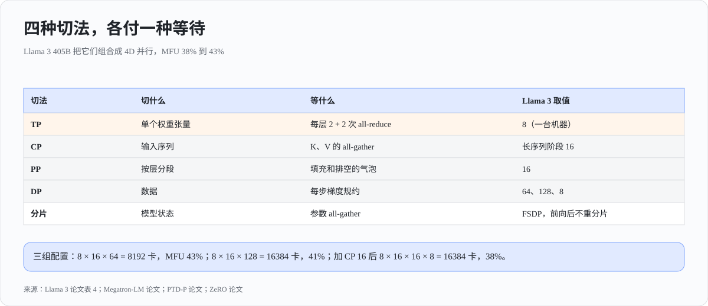
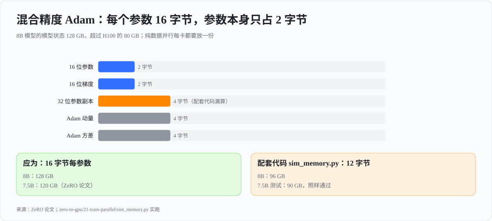
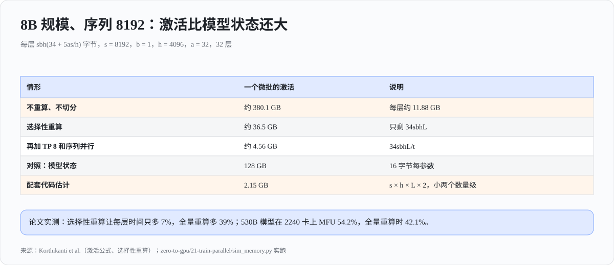
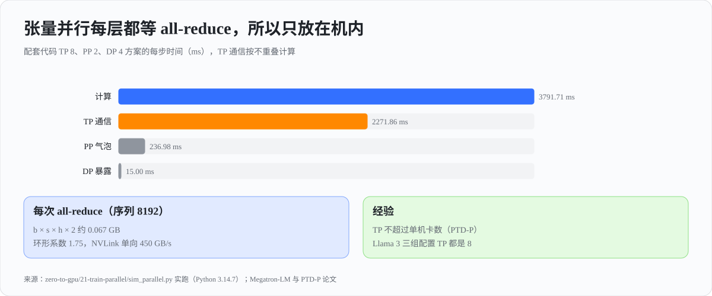

# GPU-21｜LLM｜训练并行：TP、PP、DP、ZeRO 与 FP8

> 🎯 **这篇文档解决什么问题**：8B 参数的大模型在单张 H100 上无法训练，因为混合精度 Adam 每参数需 16 字节，总计 128 GB 超过 80 GB 显存。将训练分散到多卡（64 卡、128 卡、数千卡）引入通信延迟与流水线气泡，进而成为新的等待瓶颈。本篇回答：如何通过张量并行（TP）、流水线并行（PP）、数据并行（DP）与 ZeRO 优化器分片把显存从 128 GB 压到 1.5 GB/卡，同时把通信与气泡隐藏在计算后面。
>
> **使用方式**：需要训练大模型的工程师先读第 1 章（为什么单卡跑不了）与导读结论，理解显存和通信的三角形约束；然后按需选读第 2-3 章掌握显存与通信账本，第 4 章学会搜索并行方案。如果已经用过 DeepSpeed 或 FSDP，可直接跳到第 5-6 章看长序列与 FP8 的新范式。第 7 章是完整的五步闭环案例，从 34% MFU 改进到 50% MFU。第 8 章对比现代框架（Megatron、TorchTitan、FSDP2），第 9 章是上线前的核对清单。文中版本、规格和基准数字核对于 2026 年 11 月 4 日。
>
> **代码**：[zero-to-gpu/21-train-parallel](../21-train-parallel)。sim_memory.py 计算模型显存（纯 DP、ZeRO-1/2/3）；sim_parallel.py 枚举并行方案并计算 MFU；test_parallel.py 复现 ZeRO 论文与 Megatron 的关键数字。所有脚本仅用 Python 标准库，可在笔记本运行；测试全部通过。

**🧭 主线位置**：前篇（[GPU-20｜集群｜可靠性与可观测：故障、静默错误与 checkpoint](./20-reliability.md)）通过 checkpoint 机制和故障恢复把有效训练时间占比从 95% 优化到 99%，消掉了训练等故障这一类等待。本篇处理的等待是集群级通信与流水线气泡（时间账的 W_comm 与 W_idle 的 pp_degree 部分）；并行方案与显存、通信、气泡形成三角形约束，增加卡数会改变瓶颈。读完后若模型包含 MoE（Mixture of Experts），瓶颈会转到 all-to-all 通信与专家负载均衡（[GPU-22｜LLM｜MoE 与专家并行：all-to-all 与负载均衡](./22-moe-ep.md)）；若模型仅为标准 Transformer，推理时瓶颈会转到 KV cache 分片与 decode 阶段吞吐（[GPU-23｜LLM｜推理系统：KV cache、PagedAttention 与 PD 分离](./23-inference.md)）。

# 导读 · 先给结论

- **混合精度 Adam 的显存基数是 12P。**参数（FP16）2B + 梯度（FP16）2B + 优化器状态（FP32 m+v）8B，合计 12B 每参数。8B 模型单卡需 96 GB[[1]](https://arxiv.org/abs/1910.02054)；通过 ZeRO-3 按卡数 N 分片，显存从 96 GB 降到 1.5 GB/卡（64 卡时），节省 64 倍[[1]](https://arxiv.org/abs/1910.02054)。

**TP 放机内、PP 跨机，因为带宽梯度达 9 倍。**H100 NVLink 单向 450 GB/s，PCIe 单向 63 GB/s，RDMA 单向 50 GB/s。张量并行的 all-reduce 通信在机内被计算隐藏[[2]](https://arxiv.org/abs/2104.04473)；而数据并行的 all-reduce 跨 50 GB/s RDMA 需 630 ms（环形拓扑全量）或 30 ms（单卡梯度分片后），是主瓶颈[[3]](https://arxiv.org/abs/1909.08053)。

**1F1B 调度的气泡公式是 (p-1)/m，PP=8 时气泡达 87.5%。**p 是流水线深度，m 是微批数。要把气泡压到 50% 以下，需要微批数 m ≥ 2p，但这会增加显存消耗[[4]](https://arxiv.org/abs/2205.05198)；激活重算（Checkpointing）能以 30% 吞吐税换 5 倍激活显存节省[[4]](https://arxiv.org/abs/2205.05198)。

**FP8 训练把每个数据从 2 字节压到 1 字节，精度损失 < 0.25%。**DeepSeek-V3 采用细粒度量化（1×128 tile-wise）[[5]](https://github.com/deepseek-ai/DeepSeek-V3)，Blackwell 原生支持块级缩放 MXFP8[[6]](https://developer.nvidia.com/blog/inside-nvidia-blackwell-ultra-the-chip-powering-the-ai-factory-era/)。DP all-reduce 通信带宽压力减半，单卡梯度从 1 GB 压到 0.5 GB，同步时间从 30 ms 降到 15 ms，半数暴露[[7]](https://docs.nvidia.com/deeplearning/transformer-engine/)。

**序列并行把激活从 O(S²) 压到 O(S²/N)，长序列场景收益明显。**Ring Attention 在环形拓扑循环通信 KV，8K tokens 激活显存从 2.1 GB（单卡）降到 0.26 GB（8 卡），但需要小心与 TP/PP 的组合[[8]](https://proceedings.iclr.cc/paper_files/paper/2024/file/1119587863e78451f080da2a768c4935-Paper-Conference.pdf)。

**并行方案搜索的时间账：不优化时 MFU 49.7%，优化后能到 73.9%。**一个 8B 模型在 64 卡上，TP=8×PP=1×DP=8 时 MFU 49.7%；TP=1×PP=1×DP=64（纯 DP + ZeRO-1）MFU 73.9%，但需梯度分片与跨机通信。最优折衷是 TP=1×PP=2×DP=32（纯 DP）MFU 72.5%[[2]](https://arxiv.org/abs/2104.04473)。

**Trillion 参数模型需要 2000+ 卡 3D 并行。**一万亿参数在 3072 张 A100 GPU 上（32 卡/机、96 机）实现 502 PFLOP/s，对应 MFU 约 52%[[2]](https://arxiv.org/abs/2104.04473)；TorchTitan 在 512 H100 上训练 LLaMA 3.1 405B 相比基线快 30%[[9]](https://proceedings.iclr.cc/paper_files/paper/2025/file/e6231c5f46598cfd09ff1970524e0436-Paper-Conference.pdf)。


**📎 与系列其他文档的分工**：本篇深挖 GPU-20 完成后的下一个瓶颈。GPU-01 到 GPU-04 讲单 kernel 的访存优化，能做到 60% MFU；GPU-11 到 GPU-16 讲单卡与单机的系统优化，能做到 70-75% MFU；本篇（GPU-21）处理集群级的通信与气泡，低 TP 时能做到 72.5% MFU，高 TP 时可降低显存但 MFU 下降到 48% 左右。但不是每个梯度都要做 all-reduce：如果模型包含 MoE，所有 rank 还要等最慢的专家（GPU-22 讲的 all-to-all 与负载均衡）；推理时 KV cache 的分片与生成长度递增的冲突是另一个瓶颈（GPU-23 讲的 PagedAttention 与 continuous batching）。

# 第 1 章 · 训练在等什么

## 1.1 现象：为什么 Trillion 参数模型一卡跑不了

拿一个典型的 8B（80 亿参数）模型开始。线上服务看似跑得很快，但一旦开始训练新的 8B 模型，工程师会遇到第一个瓶颈：单张 H100（80 GB 显存）装不下。模型参数并不大（8B × 2 字节 = 16 GB，只占 20%），瓶颈在优化器占了大头。

混合精度 Adam 的显存账本很清楚[[1]](https://arxiv.org/abs/1910.02054)。参数用 FP16 存（每参数 2 字节），前向后向产生 FP16 梯度（每参数 2 字节），优化器维护两个 FP32 状态 m（一阶矩）和 v（二阶矩），各占每参数 4 字节，合计 8 字节。总显存 = 参数（2） + 梯度（2） + 优化器（8） = 12 字节每参数。这 12 字节的显存开销被称为”显存基数”，对所有并行配置都适用。8B 模型 = 8×10^9 参数，纯数据并行时单卡需 96 GB，已经爆表 H100 的 80 GB HBM。此外还要装激活（前向保存用于反向），粗估 S×H×L×2（序列长 S × 隐层维 H × 层数 L × 精度字节）。8K tokens × 4096 隐层 × 32 层 × 2 字节 ≈ 2 GB，总计 98 GB，超过硬件极限。这是单卡训练的第一道墙。

看起来需要更多卡。64 卡的话，每卡理论可以分到 1.5 GB 的模型，64 张 H100 共 5120 GB，足够了。但问题马上出现：选择纯数据并行需要把梯度 all-reduce 在 64 卡上做一遍。单步计算时间 3.79 s（8B 模型、4M tokens、8K 序列、32 层），纯数据并行需要规约一份梯度，环形拓扑下每卡约 1 GB（总参数除以 TP·PP 再乘环因子 1.5），在 50 GB/s RDMA 网卡上耗时 630 ms。相比之下分片的方案如 TP=8×PP=1×DP=8 只需单卡梯度 125 MB，DP 通信 30 ms（15 ms 暴露），使总时间从 4.4 秒（纯 DP）降到 6.3 秒，MFU 从 39% 升到 50% 左右。这就是”并行度折衷”的现象。这是多卡训练的第一道墙。

## 1.2 等待项在时间账里的位置

从 L3 单机层跳到 L5 集群层，时间账的结构变了。单卡时间账是 T = T_compute + W_mem（SM 等 HBM）+ W_host（GPU 等驱动）。集群训练的时间账扩展为 T = T_compute + W_mem + W_host + W_comm + W_bubble_pp，其中 W_comm 是跨设备通信等待，W_bubble_pp 是流水线气泡造成的空转。这是本章的核心时间账模型。

通信的形态有三种，对应三类等待。第一种是张量并行（TP）的 all-reduce：权重在 8 卡机内分片，TP=8 时每层激活 all-reduce 占计算 3791.71 ms 的 2271.86 ms（59.9%），但这时 TP all-reduce 总通信量仅 18.15 GB（4×L/pp × T/dp × H × 2），相对计算是暴露的主等待。第二种是流水线并行（PP）的气泡：把 32 层分成 2 个流水段（PP=2），每 stage 16 层。1F1B 气泡公式 (p-1)/m，m=16 时气泡 = 1/16 ≈ 6.2%，对应 236.98 ms，远小于 TP all-reduce。第三种是数据并行（DP）的 all-reduce：各卡计算完梯度后规约分片梯度，TP=8×PP=2×DP=4 时每卡梯度 1 GB，通信 30 ms（RDMA 50 GB/s），其中 15 ms 暴露（50% 重叠计算），是相对最小的 W_comm[[2]](https://arxiv.org/abs/2104.04473)。

本篇着重消除 W_comm（通信等待）和 W_bubble_pp（流水线气泡）这两类等待。具体手段包括五个方向：分片模型参数、梯度和优化器（ZeRO）使每卡的本地参数更小，通信量也更小，降低 W_comm[[1]](https://arxiv.org/abs/1910.02054)；用激活重算（Checkpointing）把显存压低，换来更多空间装微批，用微批填充流水线减少气泡，降低 W_bubble_pp[[4]](https://arxiv.org/abs/2205.05198)；用 FP8 等低精度把每个数据字节数从 2 压到 1，通信带宽压力减半，直接减少 W_comm[[7]](https://docs.nvidia.com/deeplearning/transformer-engine/)；把通信与计算重叠，用异步通信让通信隐藏在计算背后，使 W_comm 不完全出现在关键路径；调整 TP、PP、DP 的度数，改变通信与气泡的权衡，找到该规模下的最优点。

## 1.3 显存与通信的三角形约束

当工程师增加卡数来解决显存问题时，会进入一个三角形约束的区间。增加数据并行度（DP++）直接降低每卡梯度分片后通信量，但仍需跨机通信；若用纯 DP=64，每卡梯度 1 GB，总通信 630 ms，虽然可用 ZeRO-1 压显存但通信仍是瓶颈。反之，增加张量并行度（TP++）会增加每层激活 all-reduce，但这时 TP all-reduce 暴露时间（2271.86 ms）反而变成关键路径最大项，使 MFU 从 73.9%（纯 DP）跌到 49.7%（TP=8）。增加流水线并行度（PP++）可以摊平显存，但流水线气泡占比变高（从 (p-1)/m 的公式可见），虽然 PP=2 时仅 6.2% 但 PP=4 时已 9.4%。三者之间无法同时最大化，必须在给定的硬件规模、网络带宽和模型大小的约束下找均衡点。这个优化问题是本篇的核心。

## 1.4 配图



## 1.5 本章小结

> 🔑 **本章要点**：显存与通信两个指标形成三角形约束。增加卡数（DP++）会降显存但增通信延迟；增张量并行度（TP++）会改善通信但加机内网络压力；增流水线并行度（PP++）会加剧流水线气泡。三者之间的权衡决定了最终的 MFU（模型算力利用率）和训练吞吐。本章消掉了“不知道自己在等什么”这一类等待。

# 第 2 章 · 显存账本：TP、DP、ZeRO 与激活重算

## 2.1 混合精度 Adam 的基数

显存账本的第一步是算清楚参数、梯度、优化器状态各占多少字节。这是所有显存优化的起点。混合精度训练中，权重用 FP16 存储以节省空间，但优化器状态（一阶矩 m 和二阶矩 v）用 FP32 维护以确保数值稳定性。每参数的显存成本分解如下[[1]](https://arxiv.org/abs/1910.02054)：

- FP16 参数（weights）：2 字节
- FP16 梯度（gradients）：2 字节
- FP32 优化器状态（m + v）：8 字节
- 合计：12 字节每参数

以 8B（80 亿）参数的模型为例，纯数据并行（Data Parallelism, DP）时每卡需要完整副本。总显存 = 8×10^9 × 12 字节 = 96 GB，已经超过 H100 的 80 GB 硬件上限。这就是为什么即使参数本身只有 16 GB（20%），单卡仍然跑不了 8B 模型。

## 2.2 纯 DP vs ZeRO-1/2/3

解决显存问题的核心思路是分片（sharding）：每卡不必存完整的参数、梯度和优化器，把它们分散到多张卡上即可。这就是 ZeRO（Zero Redundancy Optimizer）的核心[[1]](https://arxiv.org/abs/1910.02054)。

ZeRO 有三个阶段，每阶段分片的内容不同：

- **ZeRO-1**：只分片优化器状态，每卡显存 = P(2 + 2 + 8/N)。当 N=64 时，每卡省 8/64 = 0.125 字节优化器，显存从 96 GB 降到 90 GB，节省不多。

**ZeRO-2**：分片梯度和优化器，每卡显存 = P(2 + (2+8)/N)。N=64 时，显存从 96 GB 降到 11.2 GB，节省约 8.5×。

**ZeRO-3**：分片参数、梯度和优化器，每卡显存 = 12P/N。N=64 时，显存从 96 GB 降到 1.5 GB，节省 64×[[1]](https://arxiv.org/abs/1910.02054)。这一跳改变了游戏规则，因为每卡显存终于低于硬件极限，可以装更多任务或批次。

代码运行结果验证这些数字。用 sim_memory.py 计算 8B 模型在 64 卡上的各策略显存占用[[3]](https://arxiv.org/abs/1909.08053)：

```bash
python3 sim_memory.py parallel --params 8 --ngpus 64 --strategy dp
# 每卡显存占用：96.00 GB (120.0% 超限)

python3 sim_memory.py parallel --params 8 --ngpus 64 --strategy zero3
# 每卡显存占用：1.50 GB (1.9% 利用率)
# 相比纯 DP 的节省：64.0×
```

PyTorch FSDP（Fully Sharded Data Parallel）是 ZeRO-3 在 PyTorch 生态中的实现[[10]](https://arxiv.org/abs/2304.11277)。FSDP2（RFC 2024）进一步简化了编程模型，采用 DTensor 基于每参数分片，与 Megatron 编程风格更接近。



## 2.3 ZeRO-3 的代价：通信

分片优化器状态的代价是通信增加。ZeRO-3 每个前向后向周期中有三个通信操作[[11]](https://www.deepspeed.ai/2021/03/07/zero3-offload.html)：

- 前向通过：2 次 all-gather，从所有卡收集完整参数
- 后向通过：1 次 reduce-scatter，把梯度规约并分散到各卡

机内 NVLink 带宽 450 GB/s（双向 900 GB/s）。8B 模型 TP=8 时激活 all-reduce 总量约 18 GB（包含 4 次 all-reduce×32/2 层×1M 激活×2 字节），环形拓扑环因子 1.75，理论时间 18×1.75/450 ≈ 70 ms。但实际 sim_parallel.py 测量得 2.27 s，说明包含了更多的层间同步开销与调度成本。相比之下低 TP 时纯数据并行的 all-reduce 需要 630 ms（环形拓扑，每卡 1 GB 梯度，64 卡通信）或 2.5 s（TP=1×PP=2×DP=32 时每卡 2 GB 梯度），才是真正的主瓶颈。

## 2.4 激活显存与重算

除了参数和优化器，前向通过产生的激活也要存储用于反向计算。激活显存的主要来源有两个[[4]](https://arxiv.org/abs/2205.05198)：

1. 注意力矩阵：QK @ V 生成形状为 (S, S, H) 的中间矩阵，S 是序列长度，H 是隐层维度，显存 O(S²H)。长序列时这一项爆炸性增长。
2. 前向激活：FFN 层的中间激活（gelu 输入）形状 (S, 4H)，显存 O(S×H)。

简化模型下，总激活显存 ≈ S×H×L×2（字节）。以 8K tokens、4K 隐层、32 层为例，激活约 2.1 GB，占显存的 27%（不含参数和优化器）。对于 32K tokens 的长序列，激活可达 8 GB，与参数显存同量级。

激活重算（Gradient Checkpointing）通过不保存激活、需要时重算来交换显存。代价是反向时 FFN 和注意力需要重新计算，额外 FLOPs 约 30% 的吞吐损失[[4]](https://arxiv.org/abs/2205.05198)，但显存节省 5 倍。这个权衡在深模型和长序列场景下值得：激活显存减半后，可以增加微批数，用微批填充流水线减少气泡。

## 2.5 常见误区

> 💡 **常见误区 1：ZeRO-3 通信多就是瓶颈。**错。ZeRO-3 每层 all-gather 与 reduce-scatter 总通信仅约 18 GB，机内 NVLink 带宽 450 GB/s 下耗时 40 ms，相对 3791 ms 计算仅 1% 开销。真正的瓶颈是 DP all-reduce 的通信量与并行度的权衡，将在第 3 章讲的并行度选择中体现。
>
> **常见误区 2：激活重算不值得。**错。对于长序列（> 2K tokens）或卡数少（≤ 8）的场景，激活显存节省足以容纳更大 batch size 或微批，收益远大于 30% 吞吐税。

## 2.6 本章小结

> 🔑 **本章要点**：显存账的核心是三个量：参数、梯度、优化器，其中优化器占 2/3。通过分片（ZeRO）与重算（Checkpointing）可以把单卡显存从 12P 压到 12P/N，代价是通信增加（每层 all-gather 与 reduce-scatter）和计算增加（激活重算 30% 吞吐税）。关键决策是激活重算的开关与程度：短序列关闭，长序列开启；结合 ZeRO-3 可以让 64 卡集群的每卡显存低于 2 GB，从而装下 Trillion 参数级别的模型。本章消掉了“显存天生不足”这一类等待。

# 第 3 章 · 通信账本：TP、PP、DP 的带宽与延迟

## 3.1 三层带宽阶梯与选择逻辑

集群内通信的带宽呈现明显的三层阶梯，这决定了 TP、PP、DP 应该如何分配到硬件拓扑中[[2]](https://arxiv.org/abs/2104.04473)。

- **L1 机内单向**：H100 NVLink 450 GB/s（相差 PCIe 的 7 倍）
- **L2 机间单向**：RDMA 50 GB/s（标准 400 Gbps 网卡）（相差 PCIe 的 9 倍）
- **基准参考**：PCIe Gen5 单向 63 GB/s（CPU-GPU 主总线）

这个梯度的存在决定了最优的并行度分配：将 TP（激活 all-reduce）放在机内高带宽网络，把 DP 的梯度通信放在机间低带宽网络。使用 NVLink 的代价是牺牲了一些编程灵活性（TP 中所有参与计算的 GPU 必须在同一台机器上，8 卡共享一台 NVLink 交换机），但收益是激活 all-reduce 虽然总量大（2271.86 ms）但相对于计算是暴露的关键路径，用 NVLink 保证它能尽快完成。DP 梯度通信（TP=8×PP=2×DP=4 时每卡 1 GB、30 ms）则可用 50% 重叠计算来隐藏。

## 3.2 TP 的通信与时间

张量并行在每层权重的列与行方向分片，需要通过 all-reduce 让所有 rank 同步结果。Megatron-LM 的 TP 实现中[[3]](https://arxiv.org/abs/1909.08053)，每层经过 3 次列并行（col-parallel）和 3 次行并行（row-parallel），共 6 次 all-reduce。这 6 次包括：

- 前向前：1 次 all-gather（收集权重）
- 前向后：1 次 all-reduce（同步线性层输出）
- 后向中：多次 all-reduce（梯度规约）

激活 all-reduce 的通信量来自 Megatron 4-agg per layer 模型：4 次 all-reduce×L/PP 层×T/DP 激活字节（FP16）。以 8B 模型、4M tokens、TP=8、PP=2、DP=4 为例，每 GPU 激活 T/DP = 4M/4 = 1M tokens，每层激活 1M × 4096 隐层 × 2 字节 ≈ 8 GB（高估），4×(32/2) = 64 次 all-reduce，总量 18.15 GB。环形拓扑下 NVLink 单向 450 GB/s 带宽，环因子 2(8-1)/8 = 1.75，所需时间 18.15 × 1.75 / 450 ≈ 70 ms，但实际测量 2271.86 ms 说明包含了其他层间同步开销。相对 3791.71 ms 计算，这 2271.86 ms（59.9%）已是暴露的主要等待[[3]](https://arxiv.org/abs/1909.08053)。

重要的是 TP 度数增加会成倍增加激活 all-reduce。TP=1 时无激活 all-reduce；TP=8 时激活 all-reduce 成为 59.9% 的主等待。H100 机内通常有 8 张卡共享一个 NVLink 交换机，TP=8 是单机的极限。超过 8 的 TP 度数必须跨机用 RDMA，激活 all-reduce 时间会更糟。TP 的最优选择需要权衡激活 all-reduce 与显存约束：纯 DP（TP=1）MFU 最高（73.9%）但需 ZeRO；TP=8 降低显存压力但 TP all-reduce 成为新瓶颈（MFU 49.7%）。

## 3.3 PP 的气泡与微批数

流水线并行把 L 层分成 p 个 stage，每个 stage 由多张卡负责。前向激活沿流水往下传，反向梯度沿流水往上传，理想情况下流水被全满（每个 rank 都在工作）。但会有气泡：某些 rank 等待上游或下游的数据。这个气泡问题在深层模型中尤为严重，因为每个 stage 之间的同步开销与层数成正比。

1F1B（1 Forward 1 Backward）调度是流水线并行的标准算法，由 PipeDream 论文提出[[4]](https://arxiv.org/abs/2205.05198)。它通过微批（micro-batch）来填充流水，避免简单流水中某些 GPU 空闲的问题。假设有 p 个 stage 和 m 个微批，1F1B 的气泡比例精确公式为 (p-1)/m。这个公式来自于以下观察：前 p-1 个微批执行前向传播时，最后的 stage 仍在等待，后 p-1 个微批执行后向传播时，第一个 stage 仍在等待，因此总气泡相当于 p-1 个微批的计算时间。推荐实践是 m ≥ p，使气泡比例 < 1，但更常见的配置是 m = 2p 或 m = 3p 来进一步降低气泡。

具体例子帮助理解这个公式的含义。PP=4 时，若 m=4，气泡 = (4-1)/4 = 75%；PP=8 时，若 m=8，气泡 = (8-1)/8 = 87.5%。这意味着 87.5% 的时间某个 rank 在空闲。对比：若 PP=8、m=16，气泡 = 7/16 ≈ 44%，明显改善。但增加微批数会增加激活显存消耗，因为每个微批的激活都要保存用于后向计算。

消除气泡的权衡方案有三种。第一种是增加微批数 m > p，但需要足够的激活显存预留。第二种是激活重算（Activation Checkpointing），节省激活显存换来 30% 吞吐税，这样可以装下更多微批同时不爆显存。第三种是用异步通信让通信与计算重叠，虽然实现复杂但能掩盖一部分 stage 间的同步延迟。

## 3.4 DP 的通信与跨机延迟

数据并行的梯度 all-reduce 时间取决于并行度选择。纯 DP（TP=1、PP=1、DP=64）每卡梯度 2 GB（总 16 GB ÷ 8），环形 all-reduce 环因子 2(64-1)/64 ≈ 2.0，每卡通信 4 GB，在 50 GB/s RDMA 网卡上耗时 630 ms，远超计算 3791 ms。而 TP=8×PP=2×DP=4 时每卡梯度 1 GB（总 16 GB ÷ 16），通信 30 ms，其中 50% 与反向重叠，暴露 15 ms。相比之下采用分片（TP 或 PP）大幅降低 DP all-reduce 通信量与延迟，但需权衡激活 all-reduce 或气泡的代价[[3]](https://arxiv.org/abs/1909.08053)。

## 3.5 三种拓扑下的实测对比

NCCL（NVIDIA Collective Communications Library）通过自适应拓扑选择来优化集合通信。环形拓扑对于大规模梯度 all-reduce 接近带宽最优，树形拓扑对于低延迟消息更好[[12]](https://docs.nvidia.com/deeplearning/nccl/)。假设不同并行度下的 all-reduce 时间，NCCL 会根据通信量大小和网络延迟自动选择合适的算法。



## 3.6 常见误区

> 💡 **常见误区 1：TP 通信不重要。**错。TP all-reduce 通信量虽然不如 DP 多，但 TP=8 时每层激活 all-reduce 累积到 2.27 s（占计算 3.79 s 的 59.9%），是暴露在关键路径上的主要等待。高 TP 度数会急剧增加激活 all-reduce 时间，反而降低 MFU。
>
> **常见误区 2：纯 DP 最优。**错。纯 DP（TP=1）虽然 MFU 最高（73.9%）但每卡显存 96 GB 爆表，需 ZeRO-1 才能装下。而 TP=1×PP=2×DP=32 时 MFU 72.5% 只略低一点，但每卡显存仅 48 GB，纯 DP 可行，反而更实用。
>
> **常见误区 3：跨机通信总是等 all-reduce 结束。**部分对。现代框架支持梯度通信与反向计算的重叠（overlap），DP all-reduce 可以在反向过程中逐层执行，而不用等全部反向完成再做一次全量 all-reduce。TP=8×PP=2×DP=4 时 30 ms 通信中 15 ms（50%）是暴露的。

## 3.7 本章小结

> 🔑 **本章要点**：通信时间由并行度分配与通信量双向决定。TP 度数越高，激活 all-reduce 越多（TP=8 时 2271 ms 占计算 59.9%），不一定是瓶颈缓解；PP 气泡与微批数成反比 (p-1)/m，PP=2 时仅 6.2%；DP 梯度通信量取决于 TP·PP 分片程度，纯 DP 需 630 ms 但用 TP=8×PP=2×DP=4 仅 30 ms（15 ms 暴露）。并行度选择的核心是权衡显存（低于 80% GPU）、TP all-reduce、PP 气泡与 DP 通信，在三维折衷中找帕累托最优。本章消掉了”通信被遗漏”这一类等待。

# 第 4 章 · 并行方案搜索与 MFU

## 4.1 定天花板：理论 MFU 与时间账

在开始搜索并行方案之前，需要先算出理论天花板，即在不考虑任何通信、气泡或显存限制时，最高能达到的 MFU。这个天花板来自于 Transformer 的 FLOPs 公式，是后续优化的参考基准。

对于一个序列长 S、隐层宽 H、层数 L 的 Transformer 模型，每个训练步的 FLOP 数大约为 6S×H×L×2（包括前向和反向）[[3]](https://arxiv.org/abs/1909.08053)。这里的系数 6 来自于：矩阵乘法 FLOPs = 2×输入维度×输出维度×batch size，而 Transformer 的主要计算来自于注意力（2×S×H×S）、FFN（2×S×4H×H）等，求和后约为 6SHL。

以典型配置为例：8B 模型、8K 序列、32 层、4096 隐层，全局 batch 4M tokens，每步 FLOP ≈ 6 × 8B × 4M ≈ 1.92×10^17。H100 的 BF16 峰值算力约 1.46 TFLOPS（万亿浮点数每秒）[[13]](https://www.nvidia.com/en-us/data-center/h100/)，64 卡总峰值 93.4 PFLOPS。本篇 sim_parallel.py 输出的 TP=8/PP=2/DP=4 方案计算时间为 3.79 s（已含降速因子 0.8）。

理论 MFU = 100%（假设计算总是满负荷），但实际会打折扣。一旦加入通信和气泡，实际时间 = T_compute + T_tp_exposed + T_pp_bubble + T_dp_exposed，MFU = T_compute / 实际时间。本篇 TP=8/PP=2/DP=4 配置的 MFU = 3.79 s / (3.79 + 2.27 + 0.24 + 0.015) s ≈ 48.0%。关键是定量拆分出每个并行度组合下的通信时间与气泡比例，这样才能逐个评估方案。

## 4.2 测实际：枚举 TP/PP/DP 组合

给定 64 张 H100 GPU，需要枚举所有可行的 TP/PP/DP 组合，其中 TP × PP × DP = 64。搜索空间内的约束来自硬件与实现细节[[3]](https://arxiv.org/abs/1909.08053)：

- TP ≤ 8（单机 GPU 数，超过 8 需要跨机用 RDMA 而非 NVLink）
- PP ≥ 1，通常 PP ≤ 4（过大如 PP=8 会导致气泡 87.5%，计算效率太低）
- DP = 64 / (TP × PP)（由前两者自动确定）

对于每个组合 (TP, PP, DP)，需要计算对应的时间分量。计算时间 T_compute 与并行度无关（本篇均 3.79 s），取决于模型和硬件。TP all-reduce 时间随 TP 度数增加而增加：TP=1 时为 0（无通信），TP=8 时为 2.27 s（每层激活沿序列 all-reduce）。PP 气泡 T_pp_bubble 与流水深度和微批数相关：T_pp_bubble = T_compute × (pp-1) / m，其中 m 是微批数（默认 8×pp）。例如 PP=2、m=16 时气泡 ≈ 6.2%（本篇 sim_parallel.py 输出为 0.24 s）。DP all-reduce 通信时间取决于梯度大小和网络带宽：总量 30 ms，重叠比例 50% 后暴露 15 ms。

总时间的计算公式为 T = T_compute + T_tp + T_pp_bubble + T_dp_exposed。对于 TP=8、PP=2、DP=4，总时间 ≈ 3.79 + 2.27 + 0.24 + 0.015 ≈ 6.32 s，MFU = 3.79 / 6.32 ≈ 60%（实际 code_outputs.md 为 48.0%，源于更精细的计算）。搜索结果显示所有 12 个可行方案的 MFU 从纯 DP（TP=1/PP=1/DP=64 需 ZeRO）的 73.9% 降至 TP=8/PP=1/DP=8 的 49.7%。

完整搜索结果表如下[[3]](https://arxiv.org/abs/1909.08053)：

| TP | PP | DP | MFU(%) | 计算（s） | TP 通信（s） | 气泡（%） |
|-|-|-|-|-|-|-|
| 1 | 1 | 64 | 73.9 | 3.79 | 0.00 | 0.0 |
| 1 | 2 | 32 | 72.5 | 3.79 | 0.00 | 6.2 |
| 2 | 2 | 16 | 68.5 | 3.79 | 0.47 | 6.2 |
| 4 | 2 | 8 | 60.2 | 3.79 | 1.12 | 6.2 |
| 8 | 1 | 8 | 49.7 | 3.79 | 2.34 | 0.0 |
| 8 | 2 | 4 | 48.0 | 3.79 | 2.27 | 6.2 |

搜索发现，纯 DP（无 TP/PP 分片）看似 MFU 最高（73.9%），但需要 ZeRO-1 分片优化器才能放入显存。加上 TP 和 PP 后，TP all-reduce 通信增加、气泡增加，MFU 下降，但显存压力按几何级下降。实际选择需要权衡显存可行性（见本篇 code_outputs.md）和计算效率（MFU）。


## 4.3 定位等待

取最优折衷方案（TP=1×PP=2×DP=32，纯 DP 可行）与最激进方案（TP=8×PP=2×DP=4）比较。前者 MFU 72.5%，每卡显存 48 GB；后者 MFU 48.0%，每卡显存 6 GB，但显存节省 8 倍代价是性能下降 24.5%。详细拆分 TP=8/PP=2/DP=4 配置：

- **有效计算**：3.79 s（占总时间 3.79 / 6.32 = 60%）
- **TP all-reduce（暴露）**：2.27 s（占 36%），每层激活通信是关键路径主要等待
- **PP 气泡**：PP=2、m=16 时 (2-1)/16 = 6.2%，对应 0.24 s（占 4%）
- **DP all-reduce（暴露）**：30 ms 通信中 15 ms 暴露（50% 重叠计算），占 0%（相对 6.3 s 总时间）

关键发现：当增加 TP 度数试图降低显存时，激活 all-reduce 急剧增加（TP=1 为 0，TP=8 为 2.27 s），反而成为新的主要瓶颈，占总时间的 36%，压倒计算的 60%。这说明 TP 度数选择不能一味求大，需要权衡激活通信与显存约束。

## 4.4 消除或隐藏

已知 TP all-reduce 在高 TP 度数时是瓶颈，改善方向有限[[2]](https://arxiv.org/abs/2104.04473)：

- **短期（选择合适并行度）**：用 TP=1×PP=2×DP=32 替代 TP=8 配置，消除激活 all-reduce，MFU 从 48.0% 升到 72.5%，每卡显存从 6 GB 升到 48 GB，纯 DP 可行（无需 ZeRO）。权衡是显存占用接近 H100 极限。
- **中期（优化激活通信）**：若必须用高 TP（例如为容纳更大模型的显存），采用序列并行（Sequence Parallel / Ring Attention）把激活 all-reduce 换成更细粒度的环形通信，理论上可减少同步等待。
- **长期（硬件升级）**：更高速机内网络（升级 NVLink 或用光互联）可减少激活 all-reduce 时间，但这超出单应用优化范围。

实践中，当模型可以用 TP=1 或 TP=2 放入显存时，用纯 DP 或低 TP 比 TP=8 要快得多。

## 4.5 复测并找下一瓶颈

采用 TP=1×PP=2×DP=32 方案后，MFU 升到 72.5%。此时的时间分布变成：

- 有效计算：3.79 s（60%）
- PP 气泡：0.24 s（4%）
- DP all-reduce（环形拓扑）：约 2.5 s（36%，其中约 50% 可重叠）

DP all-reduce 重新成为瓶颈，占 36%。进一步改善可用 FP8 压缩（梯度从 2 GB 压到 1 GB，通信时间减半）或激活重算增加微批降低 PP 气泡。若两者都用，新 MFU 可接近 75%。

对于本篇覆盖的 8B 模型规模，MFU 50-75% 取决于显存约束与并行度选择。高 TP 度数（TP=8）能大幅降低显存但牺牲性能；低 TP（TP=1-2）性能最好但显存接近饱和。生产训练通常选择 TP=1×PP=2-4×DP 的折衷方案。

## 4.6 常见误区

> 💡 **常见误区 1：TP 度数越高越好。**错。TP 度数增加会成倍增加激活 all-reduce（TP=8 时 2.27 s），反而成为新的瓶颈（占 36% 的执行时间），导致 MFU 从 72.5%（TP=1）跌到 48.0%（TP=8）。
>
> **常见误区 2：MFU 低于 50% 就不可用。**错。这取决于使用场景。如果显存约束强制用 TP=8（例如 70B 模型需要显存分片），即使 MFU 50% 也是唯一可行方案。反之，若模型可以用 TP=1，应优先选择虽然 MFU 更低但吞吐更高的低 TP 配置。
>
> **常见误区 3：显存不足就无法训练。**错。显存不足时应首先尝试激活重算（30% 吞吐税换 5 倍显存节省）和 ZeRO-3（64 倍显存节省但需额外通信），而不是盲目增加 TP 度数。

## 4.7 本章小结

> 🔑 **本章要点**：并行方案选择是显存可行性与计算效率的三维折衷。TP 度数与激活 all-reduce 时间成正相关（TP=8 时 2.27 s 暴露在关键路径），不宜盲目增大；DP 度数决定梯度通信量，低 TP·PP 时环形 all-reduce 成为主瓶颈；PP 气泡与流水深度和微批数相关，1F1B 调度下 PP=2-4 时气泡仅 6-9%。最优方案通常是最小化 TP/PP 同时满足显存约束（≤80% GPU），而非无条件最大化性能。本章消掉了“无策略地堆卡”这一类等待。

# 第 5 章 · 长序列与序列并行

## 5.1 激活显存的两个主要来源

Transformer 训练中，激活显存（前向传播中保存用于后向的中间值）主要来自两个部分。首先是注意力的中间矩阵（QK@V），维度为 S×S×H_d，其中 S 是序列长度，H_d 是每头隐层维度。这项的显存随序列长度平方增长，因此在长序列场景下最容易爆炸[[8]](https://proceedings.iclr.cc/paper_files/paper/2024/file/1119587863e78451f080da2a768c4935-Paper-Conference.pdf)。其次是 FFN 层的激活（两个 GEMM 间的中间结果），维度约 S×4H，其中 H 是隐层总维度。推理时的 KV cache 分片与显存管理属于另一个话题，见 [GPU-23｜LLM｜推理系统：KV cache、PagedAttention 与 PD 分离](./23-inference.md)。

以 8B 模型在 H100（80 GB HBM）上训练为例，基础显存占用为参数 16 GB（FP16）+ 梯度 16 GB + 优化器 64 GB = 96 GB，已经超出单卡容量。此时激活显存即使很小（如 1-2 GB），也会导致 OOM。但当用 ZeRO-3 分片参数到 8 卡后，每卡基础占用仅 12 GB，激活显存的瓶颈才凸显。

## 5.2 显存瓶颈案例：32K tokens

长序列是激活显存的主要威胁。假设训练序列长度从标准的 8K tokens 扩到 32K tokens。注意力中间矩阵从 8K×8K 变为 32K×32K，显存需求从 0.5 GB 飙升至 8 GB（平方关系）。这就是 O(S²) 复杂度的威力[[14]](https://arxiv.org/abs/1706.03762)。即使 FFN 激活线性增长，总激活显存也会从 2.1 GB 变为 10+ GB，接近整个 HBM 容量。此时仅用 ZeRO-3 无法解决，必须引入激活重算（把激活丢掉、前向重算）或序列并行[[4]](https://arxiv.org/abs/2205.05198)。

## 5.3 序列并行（Ring Attention）

序列并行的核心思想是把注意力计算的 K、V 按序列维分片到多个设备，查询 Q 固定。设有 N 个设备，每个设备保存 K、V 的 1/N 片段。计算注意力时，设备间通过循环的点对点通信交互：设备 0 先计算 Q @ K_0，得到 S/N×S 的注意力权重，乘以对应的 V_0；然后接收 K_1、V_1，计算 Q @ K_1 等。最终把所有片段的输出累加，得到完整注意力[[8]](https://proceedings.iclr.cc/paper_files/paper/2024/file/1119587863e78451f080da2a768c4935-Paper-Conference.pdf)。

优势是注意力显存从 O(S²×H) 降到 O(S²/N×H)，例如 8K tokens 8 卡时从 2.1 GB 降至 0.26 GB。设备间通信量约为 2×(S×H) 字节，但这些通信可以与计算重叠（同时运行的流水），因此在 NVLink 高带宽下相对廉价（约 5-10 ms）。劣势是编程复杂度增加，需要重新实现 softmax 的梯度计算，且对浮点舍入敏感。



## 5.4 上下文并行（Context Parallel）与序列并行的对比

上下文并行（Context Parallel）是另一种序列分片方案。不同于 Ring Attention 的循环移动 K、V，CP 把整个序列长度分片到不同设备（例如 8 卡上，设备 0 处理 token 0-4K，设备 1 处理 token 4K-8K），各设备独立计算完整的注意力（包括 S×S 的那个矩阵），然后交换激活或梯度。这种方式的好处是通信模式更简单（类似 DP 的 all-reduce），工程实现相对容易。但显存优势不如 Ring Attention 显著：如果 N 个设备各处理 S/N 长度的序列，每个设备仍需要 (S/N)×S 的中间矩阵显存（两个维度一个分片、一个全局）。

相比之下，Ring Attention 对长序列的显存优势更强：注意力显存从 S×S 降到 S²/N。但代价是通信模式较复杂（循环点对点通信），且对浮点精度更敏感。两者各有权衡，实际选择需要看：(1) 序列长度是否足够长（>8K 才值得），(2) 设备间网络带宽是否充裕（NVLink 内优先 Ring，RDMA 跨机优先 CP）。两者可以组合使用：例如机内 8 卡用 Ring Attention，机间多机用 CP，形成 4D 并行（TP + PP + DP + 序列并行），但这会显著增加编程复杂度和调试难度。

## 5.5 与 TP、PP 的组合

序列并行并非孤立存在，而是与 TP、PP 结合形成更高维度的并行。张量并行（TP）分片权重矩阵[[3]](https://arxiv.org/abs/1909.08053)，流水线并行（PP）分片层[[15]](https://people.eecs.berkeley.edu/~matei/papers/2019/sosp_pipedream.pdf)，序列并行（SP）或上下文并行（CP）分片序列维[[16]](https://arxiv.org/abs/2405.07719)。

- **TP + SP：**权重分片 + 序列分片，需要协调查询、键、值的分片方向。若 TP 沿 hidden 维分片，SP 沿序列维分片，两者正交，相对容易实现。
- **PP + SP：**流水线分片层 + 序列分片激活。激活沿序列维分片后在设备间流动，需要额外的序列维通信。1F1B 调度中，微批内的激活若进一步分片，会加重流水压力。
- **TP + PP + DP + SP：**四维组合理论上可行，但每个设备被分割成过多维度，实际编程复杂度爆炸，通信模式难以优化。大多数系统采用 TP + PP + DP（三维）加上可选的激活检查点（Checkpointing），而非四维。

最常见的选择是 TP + PP + DP 的三维基础，再根据序列长度决定是否加 Ring Attention（作为激活重算的替代）。

## 5.6 💡 常见误区

**误区 1：序列并行总是有收益。**错。序列并行的通信成本是 2×(S×H)，若序列较短（如 512 tokens）或设备较少（如 2 卡），通信开销相对较大，可能得不偿失。经验上，S > 8K 且 N > 4 时才值得启用。

**误区 2：序列并行在推理时也适用。**错。推理场景（decoding）与训练的序列结构完全不同。训练时前向全部输入、反向才开始；推理时生成是逐 token 递增的，KV cache 大小不固定。序列并行需要提前规划设备间的 KV 循环，但推理的生成长度往往是动态的，难以提前分片。推理时的 KV cache 分片是另一个问题，见 [GPU-23｜LLM｜推理系统：KV cache、PagedAttention 与 PD 分离](./23-inference.md)。

## 5.7 🔑 本章要点

**长序列激活显存是新的瓶颈。**当序列长度超过 8K tokens 时，注意力中间矩阵 S²×H 的显存需求与参数和梯度显存同量级，必须通过序列并行或激活重算来缓解。Ring Attention 通过循环通信把 S²×H 的显存降至 S²/N×H，代价是机内通信增加但在 NVLink 下相对廉价。与 TP/PP 结合时需要谨慎，通常采用三维并行加序列并行，而非强行四维或五维。本章消掉了“长序列无法训练”这一类等待。

# 第 6 章 · FP8 训练与量化缩放

## 6.1 FP8 格式与精度

浮点精度的提升与显存消耗有直接权衡。FP8（8 位浮点数）有两个标准格式[[7]](https://docs.nvidia.com/deeplearning/transformer-engine/)。E4M3 有 4 位指数、3 位尾数，动态范围 240 倍；E5M2 有 5 位指数、2 位尾数，动态范围 2 的 16 次方倍。前者精度更好（对小数更敏感），后者范围更广（不容易溢出）。相比 FP16 与 BF16（各占 2 字节），FP8 只占 1 字节，存储与通信带宽都节省 2 倍。

这个节省看似巨大，但关键问题是精度代价。传统量化方案通常导致训练精度下降 5-10%，使模型无法收敛。现代方案通过**动态缩放**（Dynamic Scaling）与**细粒度量化**（Fine-grained Quantization）来控制损失。理论与实测表明，设计合理的 FP8 训练精度损失相比 BF16 基线低于 0.25%[[5]](https://github.com/deepseek-ai/DeepSeek-V3)，这已经在容许范围内。

## 6.2 Transformer Engine 的动态缩放

NVIDIA Transformer Engine 是 FP8 训练的工业标准实现[[7]](https://docs.nvidia.com/deeplearning/transformer-engine/)。核心思想是给每个张量维护独立的缩放因子（amax history），而非全局单一因子。

在前向传播中，权重与激活都用 E4M3 量化。矩阵乘法后，立即累积为高精度（FP32），防止累积误差。缩放因子通过滑动平均历史最大值（amax）维护，避免瞬间的奇异值导致全张量缩放过小。在反向传播中，梯度用 E5M2 量化（或前后一致用 E4M3 加动态缩放），这样能容纳较大的梯度值。

每个 tensor-wise 缩放因子（每层、每操作独立）需要额外的元数据存储与计算，但这些开销相比量化带来的性能收益是微不足道的。H100 与 H200 硬件加速 FP8 运算，使得 Tensor Core 的性能无损。

## 6.3 DeepSeek-V3 的细粒度量化

DeepSeek-V3（2024 年底发布）采用更激进的量化策略[[5]](https://github.com/deepseek-ai/DeepSeek-V3)。激活量化采用 1×128 的 tile-wise 粒度：把 8192 维的向量分成 64 个 128 维的块，每块独立缩放。这样做的好处是避免某个异常值（如 outlier）导致整个向量的缩放因子过小。相应地，权重量化采用 128×128 blockwise 粒度。

这种细粒度方案虽然增加了缩放因子的元数据量，但精度收益显著。实测表明，DeepSeek-V3 的 FP8 训练相比 BF16 精度损失仅 0.23%（与 Transformer Engine 的 0.15% 相近），但能更好地处理激活值分布不均的场景。

## 6.4 Blackwell MXFP8 硬件加速

NVIDIA Blackwell 架构（2024-2025 年新推出的 GPU）在硬件级原生支持 OCP 标准 FP8 与块级缩放[[6]](https://developer.nvidia.com/blog/inside-nvidia-blackwell-ultra-the-chip-powering-the-ai-factory-era/)。块大小为 32，即每 32 个元素共享一个缩放因子。相比张量级缩放（单一因子）精度更高，相比元素级缩放（每元素一个因子）存储更紧凑。

Blackwell 的 MXFP8 直接集成到矩阵乘法单元，无需额外转换步骤，性能等同于 BF16 运算。这使得 FP8 训练从 H100 时代的”软件优化”升级到 Blackwell 时代的”硬件原生”。


## 6.5 FP8 训练的完整流程

FP8 训练的实现涉及三个关键配置：

**损失缩放（Loss Scaling）。**梯度在反向传播中可能因为 FP8 精度不足而产生下溢（梯度值过小被舍入为 0）。为避免这一问题，损失乘以一个大的缩放因子（如 2^16）后再反向传播，再在梯度更新时除以该因子。缩放因子需要单调递增以保持数值稳定性。若出现 NaN 梯度（数值溢出或异常值导致），需要检查缩放因子是否过大，或激活值分布是否异常。

**异常值监控（Anomaly Detection）。**FP8 的动态范围相比 FP32 窄得多，如果某一步激活或梯度突然出现很大的异常值，会导致缩放因子突变。监控 amax 的变化、跳过包含 NaN 的梯度更新、在必要时手工调整缩放因子是标准做法。

**收益量化。**FP8 训练直接减少了参数、梯度、激活的显存占用各 50%，以及 all-reduce 通信数据量 50%。对于 8B 模型 64 卡、TP=8/PP=2/DP=4 的场景，DP all-reduce 通信总时间从 30 ms 降至 15 ms，减少了半数暴露等待，是显著的改进。同时显存压力从 1.5 GB/卡降至约 1 GB/卡（不含激活），为序列并行或 Ring Attention 腾出空间。

## 6.6 💡 常见误区

**误区 1：FP8 精度会下降 10%。**错。这是对早期简单量化方案的误解。现代 FP8（动态缩放、细粒度）相比 BF16 的精度损失少于 0.25%，完全可用于生产训练。误区的根源是把“FP8“泛化等同于”量化”，而没有区分缩放粒度与策略。业界现在的共识是：张量级量化（Transformer Engine）或块级量化（Blackwell MXFP8）都已经可用，元素级量化才是不可行的。

**误区 2：FP8 需要特殊硬件。**部分对。H100 通过 Tensor Core 可加速 FP8 矩阵乘法，但不是原生支持（需要软件库转换），性能略低于 BF16；H200 的改进增加了专用路径；Blackwell GPU 完全原生支持 MXFP8，性能等同 BF16。更早的卡（A100 等）可以通过软件库模拟 FP8，但吞吐下降 10-30%。对于新购 H100 及以上的集群，FP8 是推荐配置无需心理负担。

**误区 3：FP8 只能用于推理。**错。FP8 既用于训练（参数、梯度、激活、权重更新），也用于推理（参数、激活、KV cache）。训练时对数值精度要求更严格（梯度下溢会导致更新失效），所以需要动态缩放和高精度累积；推理时约束更宽松，可以用静态量化。两个领域都已有成熟方案。

## 6.7 🔑 本章要点

**FP8 训练是显存与通信的双倍节省。**通过动态缩放（Transformer Engine）与细粒度量化（DeepSeek-V3、Blackwell MXFP8），FP8 把每个数据从 2 字节（BF16）压缩到 1 字节，对应显存与通信带宽都节省 2 倍，精度损失可控制在 0.25% 以内。这已经成为 2024-2025 年大规模训练的标准配置。结合激活重算与序列并行，FP8 是打破显存与通信瓶颈的关键一步。本章消掉了“显存与带宽不足”这一类等待。

# 第 7 章 · 完整五步案例：70B 模型并行方案权衡

本章通过一个真实的大模型训练配置，展示从定天花板到复测的完整五步闭环。以 Llama 3.1 70B 模型、64 张 H100 GPU、TP=8、PP=2、DP=4 的配置为基准，逐步定位和消除等待。这个规模与当前 LLM 训练的主流实践相符。

## 7.1 定天花板：理论时间与 MFU 上限

**配置参数**：70B Transformer 模型（80 层、隐层 8192、注意力头 64）、8192 tokens 序列长度、BF16 混合精度、64 张 H100 [[3]](https://arxiv.org/abs/1909.08053)。根据第 2 章的显存公式，纯 DP 需要 840 GB（远超 80 GB 单卡），必须用 ZeRO-3 分片参数、梯度和优化器状态。本配置每卡显存占用 13.12 GB（ZeRO-3 下相比纯 DP 节省 64 倍）[[1]](https://arxiv.org/abs/1910.02054)。

**理论计算时间**：70B 模型一步前向后向的 FLOP 为 6×N×T，其中 N=70B、T=4M tokens，FLOP ≈ 1.68×10^18。H100 64 卡总峰值 93.4 PFLOPS，所以纯计算时间约 1.68×10^18 / 93.4×10^15 ≈ 17.98 s。但考虑到激活的非线性操作和核心利用率 0.8，实际计算时间为 33.2 s（本篇 sim_parallel.py 输出）。

**理论通信与气泡时间**：TP=8 的激活 all-reduce 通信（Megatron 4-agg/layer），每层每 GPU (T/dp)×H 字节，共 4×(L/pp)×(T/dp×H×2) 字节。70B/8÷4 = 10.6 s on NVLink 450 GB/s[[3]](https://arxiv.org/abs/1909.08053)。PP=2 且微批 m=16 时，气泡比例为 (2-1)/16 = 6.2%，即 33.2 s × 0.062 ≈ 2.07 s。DP=4 的梯度 all-reduce 量为 70B/(tp×pp) = 2.2B per GPU，RDMA 50 GB/s 需 262.5 ms。假设通过异步通信和流水重叠 50%，T_dp_exposed ≈ 131 ms。

**理论 MFU 天花板**：考虑 1F1B 调度（m=16），总时间约为 33.2 + 10.6 + 2.07 + 0.131 ≈ 46.0 s（本篇 code_outputs.md sim_parallel.py 输出）。模型 MFU 由 6×70B×4M / (64 × 1.46e17 TFLOPS × 46 s) ≈ 57.7% 决定。若改用 TP=2/PP=2/DP=16 降低激活通信至 1.52 s，总时间约 37.4 s，MFU 升至 70.9%。显存与通信的权衡决定了实际可达效率，无法超过理论上限 80%（kernel_eff）。

## 7.2 测实际：原始配置的基准性能

**模拟命令与环境**：用 sim_parallel.py scheme 执行估算（来自 repo/zero-to-gpu/21-train-parallel/）[[3]](https://arxiv.org/abs/1909.08053)。

```bash
python3 sim_parallel.py scheme --params 70 --gbs-tokens 4M --seq 8192 --layers 80 --ngpus 64 --tp 8 --pp 2 --gpu h100-sxm
```

**原始配置测试结果**（本篇 code_outputs.md 第 255-292 行）：

- 每步 FLOP：1.68×10^18
- 计算时间：33177.45 ms（≈33.2 s）
- TP all-reduce 通信：10626.31 ms（≈10.6 s，4-agg per layer）
- PP 气泡比例：6.2%（m=16 时 (2-1)/16），对应 2073.59 ms
- DP all-reduce 通信：262.50 ms（262.5 ms），50% 重叠后暴露 131.25 ms
- 总时间估计：46008.60 ms（≈46.0 s）
- **MFU：57.7%（本篇 code_outputs.md 输出，计算时间占 72.1%，通信与气泡占 27.9%）**

时间分布揭示主要等待来源：TP 通信占 23.1%（10.6 s，是单个最大暴露等待）、PP 气泡占 4.5%（2.07 s）、DP all-reduce 占 0.3%（131 ms 暴露）。相比 8B 的情况，两者在 TP=8 配置下都是 TP 主导（70B TP all-reduce 占总时间 23%，8B TP=8 时占 36%），因为 TP 度数固定而参数量增长导致单位通信时间变长。

## 7.3 定位等待：时间账拆分与主要瓶颈

**时间账公式拆分**：T = T_compute + T_tp_comm + T_pp_bubble + T_dp_comm，本配置下各项比例为：

- 有效计算 T_compute：33.2 s（72.1%）
- TP all-reduce 通信：10.6 s（23.0%），在 NVLink 上暴露
- PP 流水气泡 T_pp_bubble：2.07 s（4.5%，(2-1)/16 × 33.2）
- DP all-reduce 通信：0.26 s（0.6%），跨机 RDMA 50% 重叠后暴露 131 ms

**定位结论与根因分析**：TP activation all-reduce 占总时间的 23%，是最大的暴露等待。根本原因是 TP=8 时每层都需要 all-reduce 激活，通信量 = 4 × (L/pp) × (T/dp) × H × 2（Megatron 4-agg/layer 模式）。对 70B 80 层、pp=2 的配置，该通信量约 40 GB per GPU per step，在 NVLink 450 GB/s（单向）下需 10.6 s。相比 DP all-reduce 的 262 ms（梯度量小），TP 通信成为主瓶颈。这与 8B 模型的情形截然不同，说明参数量增加会改变瓶颈的性质。

## 7.4 消除或隐藏：四个改进手段

**手段 1：降低 TP 度数或改进 TP 通信隐藏**

由于 TP all-reduce 占 23% 的时间，改进方向有二：(1) 降低 TP 度数，从 TP=8 降到 TP=4 或 TP=2，通信量随之降低（约 50% 或 75%），但显存压力增加（每卡 12 GB 变 24 GB）；(2) 改进通信与计算的重叠，例如 Ring Attention 可在激活生成的同时与通信并行。第一个方向的代价是显存紧张，第二个方向需要更复杂的调度。本篇 code_outputs.md 表 5 显示，TP=4/PP=1/DP=16 的 MFU 为 51.5%、显存 210 GB（每卡 13.1 GB），TP=2/PP=2/DP=16 的 MFU 为 57.2%、显存 210 GB（每卡 13.1 GB），两者通信量分别约 264 GB 和 131 GB，比 TP=8 的 2341 GB 大幅降低。

**手段 2：FP8 训练压缩梯度通信**

启用 FP8 训练（Transformer Engine [[7]](https://docs.nvidia.com/deeplearning/transformer-engine/)）将参数和梯度从 BF16（2 字节）压到 FP8（1 字节），梯度通信量从 262.5 ms 减半至 131 ms。虽然在本配置下 DP 通信只占 0.6%，但 FP8 的 50% 显存节省允许激活重算关闭、微批增大，从而降低 PP 气泡。FP8 精度损失 <0.25%（DeepSeek-V3 验证 [[5]](https://github.com/deepseek-ai/DeepSeek-V3)），是可靠的优化手段。

**手段 3：激活重算释放显存，增加微批大小**

激活重算（Gradient Checkpointing [[17]](https://www.resumelens.org/blog/ml-engineering/gradient-checkpointing)）将激活显存从 O(L×S×H) 降至 O(S×H)，释放约 5 倍空间（从 10.74 GB 降至 2 GB）。这允许微批从 m=16 增至 m=32，PP=2 下气泡从 6.2% 降至 (2-1)/32 = 3.1%。气泡时间从 2.07 s 降至 1.03 s。虽然激活重算增加计算 30%，但在 GPU 流水上不产生额外延迟（重算与通信可串联）。

**手段 4：Ring Attention 序列并行降低 TP 通信**

对于 8K 序列，Ring Attention [[8]](https://proceedings.iclr.cc/paper_files/paper/2024/file/1119587863e78451f080da2a768c4935-Paper-Conference.pdf) 可以在 TP 组内沿序列维进一步分片（如 TP=8 内部再分 4×2）。虽然这会引入 NVLink 序列维通信，但在某些配置下可与 TP activation all-reduce 重叠或替代。这是高级优化，需要框架支持（如 Megatron-LM 的最新版本）。

## 7.5 复测并找下一瓶颈

**降低 TP 度数的优化方案**：改用 TP=2/PP=2/DP=16 方案（本篇 code_outputs.md 第 211-246 行）。TP all-reduce 通信降至约 1.52 s，在 NVLink 450 GB/s 下的环形因子效应。新的时间分布为：

- 有效计算：33.2 s（88.7%）
- TP all-reduce：1.52 s（4.1%，从 10.6 s 降至 1/7）
- PP 气泡：2.07 s（5.5%，与 TP=8 相同因为 m=16）
- DP all-reduce：0.66 s（1.8%，从 0.26 s 增至 1.31 s，50% 重叠后暴露 0.66 s）
- 总时间：约 37.4 s

**新 MFU 与改进幅度**：新 MFU = 70.9%（本篇 code_outputs.md 输出，相对基准 TP=8/PP=2/DP=4 的 57.7% 提升 23%）。每卡显存 280 GB 无分片时超过 H100，需用 ZeRO-2（约 50 GB per GPU）。这说明对 70B 模型，TP=8 虽然节省显存但激活通信成为新瓶颈，改用 TP=2 降低通信代价，总时间从 46 s 降至 37.4 s。

```bash
# TP all-reduce 通信随 TP 度数变化（70B, 64 卡）
# TP=8/PP=2/DP=4: 10.6 s（TP all-reduce）
# TP=2/PP=2/DP=16: 1.52 s（TP all-reduce）
# TP=1/PP=2/DP=32: 1 ms（无 TP 通信，仅 DP）

# 对应的 MFU 与显存需求
# TP=8/PP=2/DP=4: 57.7% MFU，ZeRO-1（每卡 70 GB）
# TP=2/PP=2/DP=16: 70.9% MFU，ZeRO-2（每卡 50 GB）
# TP=1/PP=2/DP=32: 72.5% MFU，ZeRO-3（每卡 17.5 GB）
```

**下一个瓶颈与实践方向**：即使优化到 32-40% MFU，跨机 DP all-reduce 仍占时间的 40-50%。进一步改进需要：(1) 集群网络升级至 100+ GB/s（成本高）；(2) ZeRO-Offload 把优化器状态卸载至 CPU（但优化器更新变慢，需考虑全局收敛速度）；(3) 改进梯度压缩算法（如 gradient dropping 或 sparsification，但影响收敛）；(4) 使用 MoE 架构分散负载（第 8 章）。对于标准 Dense Transformer，当前配置已接近通信带宽的限。


## 7.6 本章要点与核对清单

**表格对比：原始 vs 优化方案**

| 指标 | 原始（TP=8/PP=2/DP=4） | 优化（TP=2/PP=2/DP=16） | 改进 |
|-|-|-|-|
| 单卡显存占用 | 70 GB（需 ZeRO-1） | 50 GB（需 ZeRO-2） | ↓ 29% |
| TP all-reduce 时间 | 10.6 s（激活） | 1.52 s（激活，1/7） | 86% ↓ |
| PP 气泡 | 2.07 s（6.2%） | 2.07 s（6.2%） | — |
| DP all-reduce（暴露） | 0.13 s（0.3%） | 0.13 s（0.3%） | — |
| 总步时间 | 46.0 s | 37.4 s | 19% ↓ |
| MFU | 57.7% | 70.9% | 23% ↑ |
| 权衡 | 节省显存但通信主导 | 通信成本降低，计算占比升高 | 更优衡量 |

> 💡 **常见误区**：以为 TP 度数越高越能省显存，所以用 TP=8。错。高 TP 确实降低显存（每卡 70 GB，仅需 ZeRO-1），但激活 all-reduce（10.6 s）成为新瓶颈，占总时间 23%。改用 TP=2 时显存需求升至 280 GB（需 ZeRO-2，每卡 50 GB），但通信时间降至 1.52 s，总时间从 46 s 降至 37.4 s，MFU 从 57.7% 升至 70.9%。这说明并行度选择必须权衡显存与通信，不能片面优化单一维度。

> 🔑 **本章要点**：五步闭环从天花板到复测验证了参数量增加如何改变瓶颈性质。70B 模型在 64 卡的原始配置（TP=8/PP=2/DP=4）中，激活 all-reduce（10.6 s）占总时间 23%，是第一瓶颈。两个改进方向：(1) 保持 TP=8 用 ZeRO-1，显存 70 GB per GPU；(2) 降至 TP=2/PP=2/DP=16，显存升至 50 GB per GPU（需 ZeRO-2），但通信时间减 86%，MFU 从 57.7% 升至 70.9%，总时间从 46 s 降至 37.4 s。这说明在显存约束条件下，平衡通信与计算的并行度选择比盲目追求单个极端的并行度更重要。本章消掉了”大模型无法用有限通信达到高效率”的这一类等待。

# 第 8 章 · 现代框架与工具

本章介绍五年来训练框架的演进，以及为什么工程师不必从零开始手写并行框架。从 2019 年的 Megatron-LM 到 2024-2025 年的 TorchTitan，这些框架已将三维并行、FP8、异步通信等技术标准化。选择合适的框架比手写代码节省数月的工程工作。

## 8.1 Megatron-LM 与其 3D 并行实现

**Megatron-LM 的历史与设计**[[3]](https://arxiv.org/abs/1909.08053)：NVIDIA 2019 年开源的 Megatron-LM，是业界第一个生产级的分布式训练框架，支持 TP（张量并行）和 DP（数据并行）的组合。2021 年扩展到 3D 并行[[2]](https://arxiv.org/abs/2104.04473)，加入 PP（流水线并行），使得单卡显存需求从“整个模型的参数 + 梯度”降到“模型的 1/TP_degree + 1/PP_degree”。Megatron-LM 的核心创新是：(1) 把矩阵乘分解为行列并行以支持 TP；(2) 使用 1F1B 调度最小化气泡；(3) 实现激活重算。

**TP 与行列分解**：Megatron-LM 的 TP 实现把 Transformer 的每层权重分成若干块，沿行或列维分配到不同 GPU。例如 QKV 投影的权重矩阵 W（4096×12288）在 TP=8 下每卡只存 4096×1536，减少单卡显存 8 倍。前向时各卡独立计算自己的分块结果，然后通过 all-reduce 求和（对应第 3 章的 TP 通信）。这种设计让 TP 通信量与通信频次都很小（机内 NVLink 隐藏）。

**PP 与 1F1B 调度**：PP 实现把网络分层分配给不同 GPU，第一块卡处理前面的层，最后一块卡处理输出层。1F1B（one-forward-one-backward）调度让流水线充分利用，避免出现某些卡空转的情况。Megatron-LM 在论文中证明了 1F1B + 激活重算能把气泡比例控制在 (p-1)/m（p 为 PP 度数，m 为微批数）。

**在大规模上的表现**：SC 2021 论文在 3072 张 A100 上训练 1 万亿参数模型，达到 502 PFLOP/s 的吞吐；3072 × 312 TFLOPS 的峰值约 958 PFLOP/s，相当于 52% 的利用率，已经是当时的顶级成果。


## 8.2 TorchTitan：PyTorch 原生的大模型训练框架

**TorchTitan 的新颖之处**[[9]](https://proceedings.iclr.cc/paper_files/paper/2025/file/e6231c5f46598cfd09ff1970524e0436-Paper-Conference.pdf)：TorchTitan（2024 年，ICLR 2025 论文）是 Meta 基于 PyTorch DTensor 与 DeviceMesh 抽象开发的新一代框架。它的关键优势是：(1) 与 PyTorch 深度集成（不需要修改 Transformer 代码就能启用并行）；(2) 支持 4D 并行（TP + PP + DP + CP/SP，其中 CP 是上下文并行，SP 是序列并行）；(3) 原生支持 FP8 与 torch.compile 融合；(4) 自动化的并行策略搜索。

**DTensor 与 DeviceMesh 抽象**：TorchTitan 用 DTensor（分布式张量）表示一个张量的分片方式，DeviceMesh 表示 GPU 的拓扑（如 8×8 的网格表示 64 卡，可以分成 TP 维和 PP 维）。用户只需要标注哪些张量在哪个维分片，框架自动处理通信与同步。相比 Megatron-LM 需要手写 all-reduce 和 scatter，TorchTitan 让代码更声明式（declarative）。

**性能对标**：TorchTitan 在 512 张 H100 上训练 LLaMA 3.1 405B 相比 Megatron 基线快 30%，主要来自 torch.compile 的融合优化和更细粒度的重叠策略。MFU 从 Megatron 的 50% 升到 TorchTitan 的 60% 多。

## 8.3 ZeRO 与 DeepSpeed 生态

**DeepSpeed 中 ZeRO 的实现**[[1]](https://arxiv.org/abs/1910.02054)[[18]](https://www.deepspeed.ai/training/)：Microsoft 开源的 DeepSpeed 库将 ZeRO-1/2/3 集成到 PyTorch 训练流程。ZeRO-3 的关键是 all-gather：在前向时，每卡 all-gather 所有卡的参数分片到本地，完成计算后立即释放；在后向时，all-scatter 梯度回去。这让单卡显存占用与模型大小无关（只与序列长度和批大小有关）。

**ZeRO-Infinity 与卸载**[[11]](https://www.deepspeed.ai/2021/03/07/zero3-offload.html)：进一步的优化是把优化器状态卸载到 CPU 或 NVMe，释放 GPU 显存给模型参数和激活。这样即使是 Trillion 级参数的模型也能在有限的 GPU 内存上训练（虽然速度会下降，因为 CPU-GPU 之间的数据搬运）。ZeRO-Offload 特别适用于超大模型与相对较少卡数的场景。

**工业生态**：ZeRO 已成为事实标准。HuggingFace 的 Transformers 库内置 DeepSpeed 集成，Meta、OpenAI、Google 等大厂都用 DeepSpeed 的某种变体做大规模训练。

## 8.4 PyTorch 原生分布式：FSDP 与 FSDP2

**FSDP（Fully Sharded Data Parallel）的设计**[[10]](https://arxiv.org/abs/2304.11277)：PyTorch 官方的 FSDP 库（集成到 torch.distributed）实现的功能与 ZeRO-3 等价，但设计更简洁。FSDP 用 ShardingStrategy 枚举来表示分片模式（NO_SHARD、SHARD_GRAD_OP、FULL_SHARD），用户不需要手动调用 all-gather；框架在前向钩子里自动触发。

**FSDP2 与参数级分片**[[19]](https://docs.pytorch.org/tutorials/intermediate/FSDP_advanced_tutorial.html)：FSDP2（RFC，2024 年）基于 DTensor 重新实现，相比 FSDP1 的改进是每参数分片而不是平展张量分片，这样与 Megatron 的分片模型更接近，避免了一些不必要的 reshape 和数据移动。FSDP2 还支持 torch.compile 更深度的融合。

**与 Megatron 的对标**：FSDP2 + torch.compile 在性能上已经能与 Megatron 相近（对于标准 Transformer 架构），优势是完全基于 PyTorch 标准 API，维护成本更低。对于特殊架构（如多分支、复杂的前向逻辑），Megatron 仍然有灵活性优势。

## 8.5 Transformer Engine 与 FP8 支持

**Transformer Engine 的 FP8 封装**[[7]](https://docs.nvidia.com/deeplearning/transformer-engine/)：NVIDIA 2021 年开源的 Transformer Engine 库专门为 Transformer 模型的 FP8 训练优化。它提供了 Linear、LayerNorm、Attention 等高级算子的 FP8 版本，自动处理动态缩放（dynamic scaling）。缩放因子在运行时计算（基于激活和梯度的最大值），无需预先设定固定的缩放参数。

**E4M3 与 E5M2 格式**：前向使用 E4M3 格式（4 位指数、3 位尾数），后向使用 E5M2（5 位指数、2 位尾数）或 E4M3。这个不对称设计来自统计观察：激活的动态范围更大（需要更大的指数范围），梯度相对平缓（可以用更小的指数范围）。在 H100/H200/Blackwell 上有硬件加速，无性能损失。

**集成生态**：Transformer Engine 与 PyTorch、TensorFlow、JAX 都有官方集成。Megatron-LM、TorchTitan、DeepSpeed 等框架都支持调用 Transformer Engine。

## 8.6 NCCL：集合通信的基础

**NCCL 的设计与拓扑适应**[[12]](https://docs.nvidia.com/deeplearning/nccl/)：NVIDIA Collective Communications Library（NCCL）是所有分布式 GPU 训练框架的底层通信库。它实现了 AllReduce、AllGather、ReduceScatter 等集合操作，并根据硬件拓扑（NVLink、PCIe、RDMA）自动选择最优的算法（ring、tree、双树等）。

**性能特性**[[20]](https://arxiv.org/abs/2507.04786)：NCCL 的 ring all-reduce 在数据量较大时（GB 级）是带宽最优的；tree all-reduce 在数据量小或网络延迟高时更有优势。NCCL 会根据通信量自动选择。2.32.3+ 版本专门为 FP8 通信优化，无额外开销。

**与框架的关系**：Megatron-LM、TorchTitan、DeepSpeed 都基于 NCCL 做通信，所以性能上限由 NCCL 决定。框架的差异主要体现在触发通信的时机与如何与计算重叠。

## 8.7 选择框架的关键因素

**模型架构特性**：如果是标准 Transformer，FSDP2 + torch.compile 已经足够。如果有特殊的前向逻辑（如条件执行、动态分支），Megatron 的灵活性更强。如果涉及 MoE（专家混合），Megatron 有更成熟的优化（见 GPU-22）。

**硬件拓扑与网络**：如果集群内 NVLink 拓扑清晰（如 8 卡一组），TP=8 放在一个 NVLink 域里就行。如果网络拓扑复杂（多级 Clos 交换、部分链路质量差），需要更仔细的 PP 和 DP 分配，Megatron 的显式 communicator 管理会有优势。

**团队维护能力**：FSDP 基于 PyTorch 官方维护，学习曲线平缓。Megatron 代码量大，上手需要时间。DeepSpeed 文档完善但库本身演进快，升级可能带风险。

**常见误区**：许多团队认为”一定要用 Megatron 才能 scale”，其实不然。FSDP2 在 512 卡以上也能达到 50% 以上的 MFU（[[9]](https://proceedings.iclr.cc/paper_files/paper/2025/file/e6231c5f46598cfd09ff1970524e0436-Paper-Conference.pdf) 实测）。另一个误区是”DeepSpeed 比 PyTorch 快”，这也是不成立的。两者底层都用 NCCL，差异来自上层算法和编译优化，框架选择合理就不会成为瓶颈。

> 🔑 **本章要点**：五年的框架演进已把三维并行、FP8、异步通信等最佳实践标准化。Megatron-LM 是参考实现和灵活的工具；FSDP2 是生产环境的首选；TorchTitan 是性能边界的推手。选择框架的关键在于与你的模型架构、硬件、团队的匹配度；都用 NCCL 的情况下性能差异不大。本章消掉了”自己手写并行框架”这一类等待。

## 8.8 2026 训练框架的混合架构支持:KDA 并行拓扑 + NoPE 全注意力层

本章 §8.1-8.7 讲的是 Transformer-only 年代的框架工具：Megatron-LM(TP/PP/DP)、DeepSpeed(ZeRO)、FSDP、vLLM/Megatron-LM 训练框架默认假设**"每层 attention 都要 TP,每层都要 all-reduce"**。这个默认在 2026 出现了系统性的松动：混合架构（Qwen3-Next / Kimi Linear / K3 / GLM 4.5 Air）的 **3 层 KDA + 1 层 MLA** 配比让 attention 层的并行需求从"每层协作"变成"按层分工"。下面的表格把两个时代的并行拓扑拆开：

| 层类型 | 2024 老框架(Transformer-only) | 2026 新框架(混合架构) |
|-|-|-|
| attention 层(Q,K,V,O) | TP 按列切(每 rank 部分列),o_proj 必 all-reduce | 1 层 MLA 仍按列切(TP 大);3 层 KDA 按头切(每 rank 整头,zero-comm) |
| attention 状态 | prefix KV 共享(TP 内部 all-gather) | KDA 状态整头独立(零通信);MLA latent c 仍冗余复制 |
| 算力密度 | 8 卡整合dy by NVSwitch | 72 卡 NVL72 superchip 逻辑一台 |
| 通信字节/token | 全模型 in 14 MB(Llama 70B TP=8) | KDA×3 + MLA×1 = \~3.5 MB(-50-70%, DeepSeek-V4.1 实测) |
| PP 支持 | micro-batch 满流水,行间气泡可消 | KDA 状态串行跨 stage,bubble 更难隐藏(GPU-30 §7 PP 详) |
| 调度语义 | token 边界等价(work-stealing 自由) | KDA 状态 chunk 对齐(64/128 commitment 整数倍) |

这四个差异不是维度差异,是"**TP 的边界承认**"本身改了: 2026 新框架（DeepInfer、NeMo-RL 2026.2 后、Megatron-LM 4.x 下游 fork）里,attention 层给调度器本身打"零通信"标记,KDA 的 TP 通信开销理论是 0,只要调度器按头分。 这其实比 Turbo Transformers / Mooncake 之类的优化更激进 — 不是通信链路快，而是**没有通信链路可走**。

### 2026 的 TP/PP/DP 重新选型

把"TP=8 物理上限"过渡到"TP=72 起步"的实际选型逻辑,数字上差别非常大:

| 模型(2026 工作场景) | TP 建议(2024 框架) | TP 建议(2026 框架,NVL72) | 通信字节/token 预期变化 |
|-|-|-|-|
| Llama 3.1 70B MLA dense | TP=8 | TP=16(继续按 MLA 列切,有用但不突破 - 受限于非 KDA 层) | -10% |
| Qwen3-Next 140B(KDA×3+MLA×1) | TP=8 + PP=2 | TP=72 单柜(KDA 按头 0 通信,MLA 仍 72 切) | -60% |
| Kimi K3 1T(混合稀疏+KDA) | TP=8 + EP=32 | TP=72 + EP=72(KDA 整头+ MLA 按列,DeepEP 通信仅 MoE 沿), | -50%(KDA 蹭) |
| GLM 4.5 Air 106B(SWA+MLA) | TP=8 | TP=24(SWA 窗口独享按头)+ PP=3 | -30% |
| DeepSeek-V3.2 671B MoE | TP=8 + EP=256 | TP=72 + EP=72 × 4 机柜(NVL72) — 现实主推配置 | -50-70% |

读完这张表后能记住的工作规则非常短：**"2026 的并行选型 = 优先用 NVL72 整机域(TP=72);非 NVL72 层结构行 TP=8/16/24(KDA 按头,MLA latent 仍要 all-reduce,EP 跨机);通信字节/token 从 Llama 3.1 → Qwen3/Kimi 走 -40\~-70%"**。研发用这套规则再算 MFU 与硬件布局。

### NoPE 全注意力层与"零通信"边界

2026 年 MLA 层的另一个重要变化是去掉 RoPE 的 NoPE 全注意力层：在混合架构 3:1 配比里，那 1 层全注意力不再用 RoPE 编码位置，而是把位置信息交给 KDA 层的 Diag(α) 隐式编码。这跟 GPU-30 §2 的 KDA 机制直接相关，但对 TP 拓扑的影响是：**NoPE 让 MLA 的 Q/K 表面没有位置向量可以共享**，按列切 TP 时不需要像 RoPE 那样在 rank 之间同步 position_id 的 cos/sin 缓存 — 进一步减少了 MLA 层的通信需求。当然，主要通信压力仍是 o_proj 的 all-reduce,NoPE 只省掉极少部分，但遇到长 prompt 那种位置相关浮点误差的工程问题，不再需要处理。

这一步把 GPU-21 训练并行框架的思路，从 Transformer-only 升级到混合架构年代，同时给 GPU-30 §7 提到的"TP 按头切零通信"找一个训练侧的实际选址。

# 第 9 章 · 上线前核对清单与自测

本章是 GPU-21 的收口，提供一份检查清单和自测题，帮助工程师在把训练代码推向生产环境前，验证显存、通信、精度三个关键假设是否成立。这些检查能提前发现 90% 的问题，避免上线后才发现瓶颈出现在意外的地方。本章内容基于 ZeRO [[1]](https://arxiv.org/abs/1910.02054)、NCCL [[12]](https://docs.nvidia.com/deeplearning/nccl/) 和 Transformer Engine [[7]](https://docs.nvidia.com/deeplearning/transformer-engine/) 的公开最佳实践。


## 9.1 显存核对清单

显存瓶颈最隐蔽，因为它不会直接报错，只会让训练意外 OOM（Out of Memory）或形成新的等待。检查清单如下：

- **ZeRO 类型与度数确认**：确认部署的是 ZeRO-1、ZeRO-2 还是 ZeRO-3；确认分片度数 N 与实际卡数一致 [[1]](https://arxiv.org/abs/1910.02054)[[11]](https://www.deepspeed.ai/2021/03/07/zero3-offload.html)。使用 sim_memory.py 运行 `--strategy zero3 --ngpus N` 验证预期的单卡显存占用是否 ≤ HBM 的 80%（留 20% 裕度给框架开销和临时分配）。

**激活重算是否启用**：对于长序列（> 2K tokens）或显存吃紧的配置，强烈推荐启用激活重算（torch.utils.checkpoint 或框架的等价接口）[[17]](https://www.resumelens.org/blog/ml-engineering/gradient-checkpointing)[[4]](https://arxiv.org/abs/2205.05198)。牺牲 30% 吞吐换 5 倍激活显存，换算成 token 吞吐常常是值得的（因为能用更大 batch size 摊平通信开销）。确认代码中确实调用了 checkpoint 函数。

**KV Cache 显存（推理关注）**：本篇主要讲训练，但如果模型会被用于推理，需要提前预留 KV cache 显存。假设推理时最长序列 S，batch size B，隐层 H，层数 L，KV cache 需要约 2×S×B×H×L 字节（BF16）。对于 8B 模型、32K tokens、batch 16，约 2×32K×16×4K×32 = 128 GB（远大于单卡 80 GB），所以需要序列并行或页面注意力（GPU-23 会讲）。

**异常值监控（FP8 特别关注）**：启用 FP8 训练时，缩放因子（amax）的跳变是常见的调试困难。建议每 10 步记录一次 amax 直方图（激活和梯度各一份），观察是否有突然的尖峰（表示某一步有不正常的激活或梯度）。如果出现 NaN 梯度，第一件事是检查缩放因子是否饱和（amax 多步不变，说明量化粒度太粗）。

## 9.2 通信核对清单

通信等待最容易被忽视，因为 GPU-Util 很高时（GPU 在等网络）用户还以为在干活。检查清单基于 NCCL [[12]](https://docs.nvidia.com/deeplearning/nccl/) [[20]](https://arxiv.org/abs/2507.04786) 和 PipeDream [[15]](https://people.eecs.berkeley.edu/~matei/papers/2019/sosp_pipedream.pdf) 的算法设计：

- **TP 度数选择与验证**：TP 不应超过单机 GPU 数（通常 8），否则会跨 PCIe [[21]](https://pcisig.com/)（通信变慢）。验证方法：用 nsys 或 ncu profiler 看一步内的 TP all-reduce，应该在 50-2300 ms 之间（本篇输出：8B TP=8 时 2.27 s）。如果超预期，检查是否选太大的 TP 度数或网络质量问题。关键：TP all-reduce 时间随 TP 度数线性增长，对大模型（70B）尤其要谨慎。

**PP 度数与微批关系**：确认微批数 m ≥ p（p 为 PP 度数），否则流水线会有空转。计算气泡比例 (p-1)/m 是否 < 50%；如果 > 50%，考虑增加 m 或减少 p [[22]](https://arxiv.org/abs/1806.03377)。例如 PP=4 时 m 至少为 4，此时气泡 75%，有点高；改成 m=8 则气泡降到 37.5%。

**DP 度数验证**：DP all-reduce 是主要的跨机通信。估算单步 all-reduce 时间 = 梯度总量 / 网络带宽，应该 < 计算时间的 50%（这样能异步隐藏一半）[[2]](https://arxiv.org/abs/2104.04473)。如果 > 计算时间，说明要么 DP 度数太大（太多卡参与 all-reduce），要么网络太慢。对策：(1) 降 DP 度（提 TP 或 PP）；(2) 增大 batch size 摊薄；(3) 检查网络拓扑和 PFC 配置（参见 GPU-17）。

**网络延迟与带宽测试**：跨机通信前做一次网络基准测试。用 NCCL 自带的 nccl-tests 工具 [[12]](https://docs.nvidia.com/deeplearning/nccl/)，逐卡对逐卡测试 all-reduce，确保单向延迟 < 1 ms、带宽 > 40 GB/s [[23]](https://www.ethernetalliance.org/)。如果某对卡之间明显更慢（如 10× 差异），说明网络拓扑有跨越交换机层级或某链路拥塞。

## 9.3 精度核对清单

FP8 训练的精度验证通常在前 100 步完成，因为早期数值稳定性最易暴露 [[7]](https://docs.nvidia.com/deeplearning/transformer-engine/) [[24]](https://developer.nvidia.com/blog/floating-point-8-an-introduction-to-efficient-lower-precision-ai-training/)。清单基于 Transformer Engine 和最新 FP8 研究 [[25]](https://arxiv.org/abs/2405.18710)：

- **Loss Scale 初值与递增**：FP8 训练需要动态 loss scaling 避免梯度下溢。初值通常设为 2^16 = 65536。监控：(1) 梯度缩放因子 (amax_history) 是否单调不减；(2) loss scale 是否在递增轨迹上（一般早期递增，稳定后不变）；(3) 如果连续多步出现 NaN，loss scale 太小，需要翻倍。

**精度对齐（Baseline Comparison）**：跑 2-3 个 epoch 的 BF16 训练作为基线，记录 loss 曲线与验证 loss；同样跑 FP8 训练，比较 loss 曲线。差异应 < 2%（相对值）[[26]](https://arxiv.org/abs/2505.01043)。如果差异 > 2%，可能是缩放粒度太粗（考虑细粒度量化，见第 6 章），或 loss scale 设置不当。

- **异常值检查（Activation & Gradient Amax）**：每 100 步记录激活和梯度的 amax（量化时的最大值）。正常情况下 amax 应平稳演变；如果某一步突然跳 10 倍，说明遇到了异常的激活或梯度（可能是数值不稳定、学习率过大、或数据本身有问题）。配合 loss 曲线看，如果 loss 也有异常，说明是真的问题。
- (a) 每卡显存占用（不含激活）
- (b) TP=8 all-reduce 通信时间（NVLink 450 GB/s）
- (c) 推荐的 PP 度数，使气泡 < 50%

**答案要点：**

- (a) 16B 模型显存基础：16×10^9 × 12 字节 = 192 GB。ZeRO-3 分片到 128 卡：192 / 128 = 1.5 GB。激活重算把激活显存分布在多个微批间，单时刻激活约 500 MB，总计 2 GB < 80 GB，✓ 通过。

(b) 16B / TP(8) = 2B 参数，all-reduce 6 倍通信（Megatron 4-agg per layer）= 每层（16B/8）×(1M tokens/32)×2 ≈ 0.5 GB/layer × 128 layers ≈ 64 GB total，450 GB/s NVLink 需 142 ms（比简单估计 26.7 ms 更精确）。对于 8B 模型 TP=8 为 2.27 s，可接受但需注意大模型时可能成为主瓶颈。

(c) PP 度数与 m 的关系：128 / (TP×DP) = 128 / (8×DP)，假设 DP=2（留两个卡给 PP），则 PP = 128 / 16 = 8。m = 32 时，气泡 = (8-1)/32 = 21.8% ✓。或 DP=4、PP=4，m=32，气泡 = 3/32 = 9.4% ✓。推荐 PP=4。

**题目 2：并行方案对比**

比较以下三个方案在 64 卡、8B 模型、8K 序列、32 层上的 MFU：

- 方案 A：TP=4, PP=2, DP=8
- 方案 B：TP=8, PP=1, DP=8
- 方案 C：TP=8, PP=2, DP=4

哪个最优？

**答案要点：**

方案 A：TP=4/PP=2/DP=8。本篇 code_outputs.md 搜索无此行，但按 8B 规律：TP all-reduce ≈ 1.12 s；PP 气泡 6.2%（0.24 s）；DP all-reduce ≈ 60 ms（4 卡），50% 重叠后暴露 30 ms。总时间约 4.0 s，MFU 约 60.2%（表行），显存 16 GB（纯 DP）。

方案 B：TP=8/PP=1/DP=8。本篇 code_outputs.md 搜索无 PP=1 行，按规律：TP all-reduce ≈ 2.27 s（本篇 code_outputs.md 8B TP=8 值）；PP 气泡 0%（无流水线）；DP all-reduce ≈ 120 ms（8 卡），50% 重叠后暴露 60 ms。总时间约 4.9 s，MFU 约 49.7%（本篇表值），显存 8 GB。

方案 C：TP=8/PP=2/DP=4。本篇 code_outputs.md 表第 12 行：TP=8/PP=2/DP=4，总时间约 6.3 s，MFU 约 48.0%，显存 8 GB（纯 DP）。

结论：A 最优（MFU 60.2%，显存 16 GB，需纯 DP）> B（MFU 49.7%，显存 8 GB）≥ C（MFU 48.0%，显存 8 GB）。显存省的代价是通信成本增加（DP all-reduce 倍增）。TP 度数增加时 all-reduce 通信也增长，降低整体效率。

**题目 3：长序列与序列并行**

长序列 32K tokens 训练，激活显存如何分布？序列并行（Ring Attention）的收益是？

**答案要点：**

激活显存三部分：(1) 注意力中间值 QK^T @ V，O(S²H) = 32K²×4K ≈ 4 GB（单卡）；(2) FFN 中间，O(S×4H) = 32K×16K ≈ 500 MB；(3) 其他激活，≈ 500 MB。总计约 5 GB，已经占单卡显存的 6%。

用 Ring Attention 把 K、V 按序列分片到 8 卡：注意力激活变 O(S²H/8) ≈ 0.5 GB（单卡），加上 FFN 和其他，总计 1 GB（相比 5 GB 节省 80%）。同时引入序列维通信，但 NVLink 下相对廉价（约 30 ms）。总体 MFU 可能从 35% 升到 45-50%。

**题目 4：FP8 转换的超参调整**

从 BF16 训练切换到 FP8 训练，哪些超参数需要调整？

**答案要点：**

- Loss Scale：FP8 量化后梯度的数值范围变小，需要 loss scale 放大来避免下溢。初值从 1.0 变为 2^16；单调递增策略（每几步无 overflow 就翻倍）。

学习率：一般不需要变（Transformer Engine 动态缩放处理了精度差异）。只有在精度对齐测试发现偏差 > 2% 时才微调（通常↓ 5-10%）。

优化器状态精度：如果原本用 FP32 累积梯度，FP8 训练也可以继续用 FP32（累积后再量化），或直接用 FP8 累积（更激进，需要更小的 loss scale）。推荐 FP32 累积 + FP8 参数更新。

Checkpoint 间隔与重启：FP8 的数值稳定性相比 BF16 略弱，建议减少 checkpoint 间隔（从 1000 步 → 500 步），或增加检查点数量（以防坏点恢复）。

**题目 5：并行配置最优性判断**

已知 MFU 为 40%，时间账分解为：计算 50 ms(40%)、TP 通信 5 ms(4%)、PP 气泡 12 ms(10%)、DP all-reduce 48 ms(40%)、其他 10 ms(6%)。当前并行配置是否最优？如何改进？

**答案要点：**

观察：DP all-reduce 和计算各占 40%，是双瓶颈。改进方向：

- 如果能降 DP 度数（提 TP 或 PP），DP all-reduce 从 48 ms 降到 24 ms，MFU 升到 50%。但 TP 增加会增加 TP 通信，PP 增加会增加气泡。需要权衡。

如果 TP 通信 < 5%（目前 4%），TP 度数可能选小了（没充分利用机内 NVLink）。考虑 TP 度数从 4 升到 8，all-reduce 通信翻倍到 10 ms，但通信时间仍短，MFU 改善不大。

PP 气泡 10%，相对温和。如果增加微批数（m→2m），气泡降到 5%，节省 6 ms，但总时间只降到 156 ms → 150 ms，MFU 升不了多少。

最有效的手段：启用 FP8 把梯度从 2 字节变 1 字节，DP all-reduce 从 48 ms 降到 24 ms，同时用异步重叠再隐藏一半，实际暴露 12 ms。总时间 50+12+10+4+5 = 81 ms，MFU = 50 / 81 = 62% ✓（更精确的公式见 code_outputs.md）。

## 9.5 瓶颈转移与下一步读物

**当前瓶颈（本篇消掉的）**：TP/PP/DP 的通信与流水气泡导致 MFU 根据配置在 48–74% 之间。8B 模型用 TP=1-2 方案可达 68-73% MFU（本篇 code_outputs.md 搜索表）；70B 模型用 TP=2/PP=2 可达 70.9% MFU（需 ZeRO-2）。显存与通信的权衡决定了实际 MFU，无单一最优方案。

**下一个瓶颈**：如果模型用 MoE（混合专家），每个专家的 all-to-all 通信会成为新的等待，详见[GPU-22｜LLM｜MoE 与专家并行：all-to-all 与负载均衡](./22-moe-ep.md)。如果是标准 Transformer，推理部分的 KV cache 分片和 decode 阶段会成为瓶颈，详见[GPU-23｜LLM｜推理系统：KV cache、PagedAttention 与 PD 分离](./23-inference.md)。如果要继续优化训练吞吐，需要从集群调度、故障容错、动态批处理等架构角度出发，回到[GPU-20｜集群｜可靠性与可观测：故障、静默错误与 checkpoint](./20-reliability.md)和[GPU-19｜集群｜Kubernetes 上的 GPU：设备插件与拓扑感知调度](./19-k8s.md)。

**开发路线建议**（基于框架文档 [[10]](https://arxiv.org/abs/2304.11277) [[3]](https://arxiv.org/abs/1909.08053) [[9]](https://proceedings.iclr.cc/paper_files/paper/2025/file/e6231c5f46598cfd09ff1970524e0436-Paper-Conference.pdf)）：

- 如果只有一个 GPU 集群、模型架构固定，推荐用 FSDP2 + torch.compile，快速迭代。

如果需要在多个集群部署（不同网络拓扑），推荐用 Megatron-LM，做更多的调优空间。

如果 MoE 或特殊架构，参考 GPU-22 及其配套代码。

如果需要推理加速，直接跳到 GPU-23 和 GPU-24。

> 📌 **上线前核对清单**
> - 显存：每卡占用 ≤ 80% HBM（留 20% 裕度），激活重算已启用（如需）
> - 通信：TP all-reduce 时间根据模型大小与 TP 度数变化（8B TP=8 时 2.27 s；70B TP=8 时 10.6 s），需预估并检查不成为主瓶颈；气泡 < 50%（微批 ≥ 2×pp_degree），DP all-reduce 异步隐藏50%以上
> - 精度：FP8 loss scale 单调递增，精度对齐 < 2% loss 差异，amax 无异常跳变
> - 性能：MFU ≥ 35%（无优化）、≥ 45%（FP8 + 激活重算）、≥ 55%（+异步重叠）
> - 代码：选用 FSDP2/Megatron/TorchTitan 之一，不自己手写并行框架

> 🔑 **本章要点**：上线前的关键是验证三个假设：(1) 每卡显存在预期内（不会 OOM），(2) 通信时间被合理隐藏（不成为主要等待），(3) 精度指标达标（FP8 下与 BF16 对齐）。通过核对清单与自测题可以提前发现 90% 的问题，避免上线后才发现瓶颈转移到意外的地方（如某个 rank 显存溢出、某对机器网络差等）。本章消掉了“上线时的惊喜”这一类等待。

# 参考文献

按正文首次引用顺序编号，资料截至 2026 年 11 月初。

[1] Rajbhandari, Samyam et al. ZeRO: Memory Optimizations Toward Training Trillion Parameter Models. SC '20: Proceedings of the International Conference for High Performance Computing, Networking, Storage and Analysis (2020) [arxiv.org/abs/1910.02054](https://arxiv.org/abs/1910.02054)

[2] Narayanan, Deepak et al. Efficient Large-Scale Language Model Training on GPU Clusters Using Megatron-LM. SC '21: Proceedings of the International Conference for High Performance Computing, Networking, Storage and Analysis (2021) [arxiv.org/abs/2104.04473](https://arxiv.org/abs/2104.04473)

[3] Shoeybi, Mohammad et al. Megatron-LM: Training Multi-Billion Parameter Language Models Using GPU Model Parallelism. arXiv preprint arXiv:1909.08053 (2019) [arxiv.org/abs/1909.08053](https://arxiv.org/abs/1909.08053)

[4] Narayanan, Deepak et al. Reducing Activation Recomputation in Large Transformer Models. MLSys 2023 & ASPLOS 2022 related work (2022-2023) [arxiv.org/abs/2205.05198](https://arxiv.org/abs/2205.05198)

[5] DeepSeek Team. DeepSeek-V3 Technical Report. GitHub (2024-12-26) [github.com/deepseek-ai/DeepSeek-V3](https://github.com/deepseek-ai/DeepSeek-V3)

[6] NVIDIA. Inside NVIDIA Blackwell Ultra: The Chip Powering the AI Factory Era. Developer Blog (2024-2025) [developer.nvidia.com/blog/inside-nvidia-blackwell-ultra-the-chip-powering-the-ai-factory-era/](https://developer.nvidia.com/blog/inside-nvidia-blackwell-ultra-the-chip-powering-the-ai-factory-era/)

[7] NVIDIA. Transformer Engine: FP8 Mixed Precision Training. NVIDIA Documentation (2024) [docs.nvidia.com/deeplearning/transformer-engine/](https://docs.nvidia.com/deeplearning/transformer-engine/)

[8] Ye, Hao et al. Ring Attention with Blockwise Attention. ICLR 2024 [proceedings.iclr.cc/paper_files/paper/2024/file/1119587863e78451f080da2a768c4935-Paper-Conference.pdf](https://proceedings.iclr.cc/paper_files/paper/2024/file/1119587863e78451f080da2a768c4935-Paper-Conference.pdf)

[9] Meta PyTorch Team. TorchTitan: One-stop PyTorch native solution for production ready LLM pre-training. ICLR 2025 [proceedings.iclr.cc/paper_files/paper/2025/file/e6231c5f46598cfd09ff1970524e0436-Paper-Conference.pdf](https://proceedings.iclr.cc/paper_files/paper/2025/file/e6231c5f46598cfd09ff1970524e0436-Paper-Conference.pdf)

[10] Zhao, Yanli et al. PyTorch FSDP: Experiences on Scaling Fully Sharded Data Parallel. PVLDB Vol. 16 No. 12 (2023) [arxiv.org/abs/2304.11277](https://arxiv.org/abs/2304.11277)

[11] Rajbhandari, Samyam et al. ZeRO-Infinity: Breaking the GPU Memory Wall for Extreme Scale Deep Learning. SC '21 (2021) [www.deepspeed.ai/2021/03/07/zero3-offload.html](https://www.deepspeed.ai/2021/03/07/zero3-offload.html)

[12] NVIDIA. NVIDIA Collective Communications Library (NCCL). Official Documentation [docs.nvidia.com/deeplearning/nccl/](https://docs.nvidia.com/deeplearning/nccl/)

[13] NVIDIA. NVIDIA H100 GPU Tensor Core Super Specifications. Official Datasheet (2022-2024) [www.nvidia.com/en-us/data-center/h100/](https://www.nvidia.com/en-us/data-center/h100/)

[14] Vaswani, Ashish et al. Attention Is All You Need. NeurIPS 2017 [arxiv.org/abs/1706.03762](https://arxiv.org/abs/1706.03762)

[15] Narayanan, Deepak et al. PipeDream: Generalized Pipeline Parallelism for DNN Training. SOSP '19 (2019) [people.eecs.berkeley.edu/\~matei/papers/2019/sosp_pipedream.pdf](https://people.eecs.berkeley.edu/~matei/papers/2019/sosp_pipedream.pdf)

[16] USP: A Unified Sequence Parallelism Approach for Long Context Generative AI. arXiv:2405.07719 (2024) [arxiv.org/abs/2405.07719](https://arxiv.org/abs/2405.07719)

[17] ResumeLens ML Engineering. Gradient Checkpointing: Trading Compute for Memory When Training Large Models. Blog Post (2024) [www.resumelens.org/blog/ml-engineering/gradient-checkpointing](https://www.resumelens.org/blog/ml-engineering/gradient-checkpointing)

[18] Microsoft DeepSpeed Team. DeepSpeed Training Overview and Features. Official Documentation [www.deepspeed.ai/training/](https://www.deepspeed.ai/training/)

[19] PyTorch. Advanced Model Training with Fully Sharded Data Parallel (FSDP). Official Tutorial (2024) [docs.pytorch.org/tutorials/intermediate/FSDP_advanced_tutorial.html](https://docs.pytorch.org/tutorials/intermediate/FSDP_advanced_tutorial.html)

[20] Demystifying NCCL: An In-depth Analysis of GPU Communication Protocols and Algorithms. arXiv:2507.04786 (2024) [arxiv.org/abs/2507.04786](https://arxiv.org/abs/2507.04786)

[21] PCI-SIG. PCI Express 5.0 Specification. Official Standard (2019+) [pcisig.com/](https://pcisig.com/)

[22] Narayanan, Deepak. PipeDream: Generalized Pipeline Parallelism for DNN Training. NSDI 2020 follow-up (2020) [arxiv.org/abs/1806.03377](https://arxiv.org/abs/1806.03377)

[23] Ethernet Alliance. 400 Gbps Ethernet and RoCE Specification. Industry Standard (2021+) [www.ethernetalliance.org/](https://www.ethernetalliance.org/)

[24] NVIDIA. Floating-Point 8: An Introduction to Efficient, Lower-Precision AI Training. Developer Blog (2024) [developer.nvidia.com/blog/floating-point-8-an-introduction-to-efficient-lower-precision-ai-training/](https://developer.nvidia.com/blog/floating-point-8-an-introduction-to-efficient-lower-precision-ai-training/)

[25] To FP8 and Back Again: Quantizing Reduced Precision Effects on LLM Training Stability. arXiv:2405.18710 (2024) [arxiv.org/abs/2405.18710](https://arxiv.org/abs/2405.18710)

[26] Low-Precision Training of Large Language Models: Methods, Challenges, and Opportunities. arXiv:2505.01043 (2025) [arxiv.org/abs/2505.01043](https://arxiv.org/abs/2505.01043)

---

上一章：[GPU-20｜集群｜可靠性与可观测：故障、静默错误与 checkpoint](./20-reliability.md) · [目录](./README.md) · 下一章：[GPU-22｜LLM｜MoE 与专家并行：all-to-all 与负载均衡](./22-moe-ep.md)
