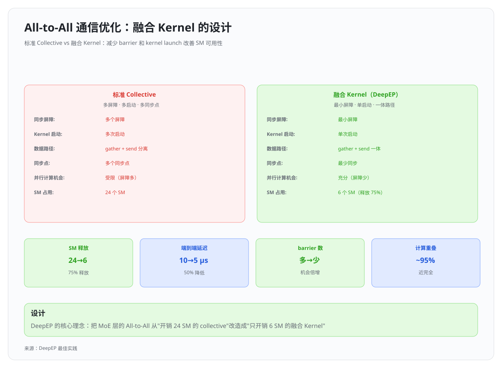
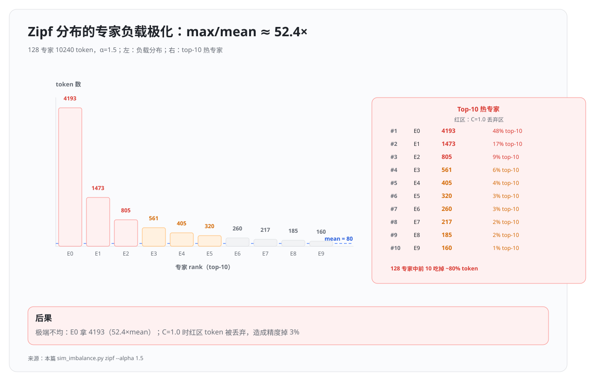
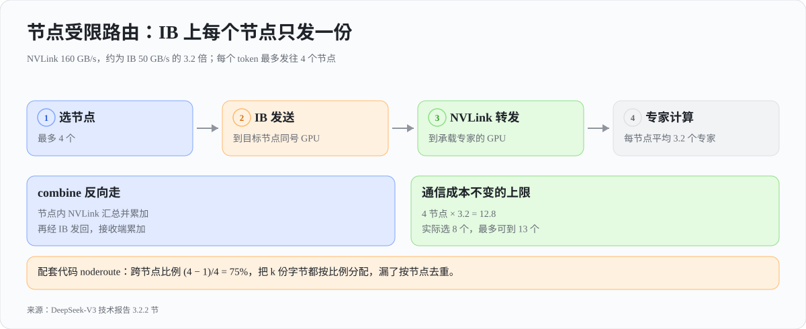
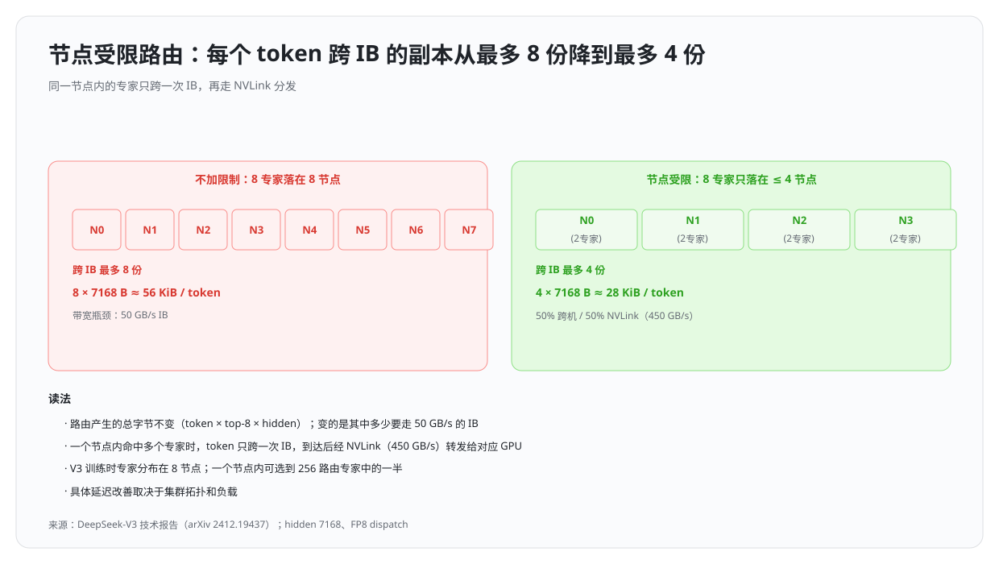
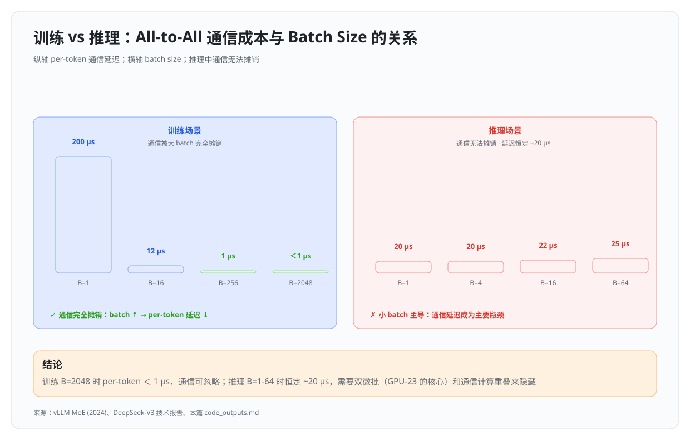

# GPU-22｜LLM｜MoE 与专家并行：all-to-all 与负载均衡

> 🎯 **这篇文档解决什么问题**：Mixture of Experts（MoE）模型在多卡训练中，所有 rank 都要等最慢的专家完成 dispatch/combine 的 all-to-all 通信与计算，这是扩展性杀手。本篇从定天花板、测实际、定位等待、消除或隐藏、复测的五步闭环，量化 MoE 的通信与负载不均两层等待，并介绍 DeepSeek-V3 等业界方案如何消除它们。
>
> **使用方式**：先读导读的 7 条结论，了解 MoE 扩展的瓶颈与已知对策；再按章节深入各个优化维度（low-latency kernel、节点受限路由、负载均衡、双微批）；最后用第 10 章的核对清单与自测题自查实现的正确性。配套代码（sim_a2a.py、sim_imbalance.py）可在本地快速验证通信延迟与专家负载，无需集群。
>
> **代码**：示例在 `repo/zero-to-gpu/22-moe-ep/` 下，包含 sim_a2a.py（计算 all-to-all 通信字节与延迟）、sim_imbalance.py（模拟 Zipf 分布的专家激活与负载均衡策略）及其测试。可直接运行验证本篇涉及的公式与数字。

**🧭 主线位置**：GPU-21 处理了 TP/PP/DP/ZeRO 的气泡与通信，本篇聚焦 MoE 层的 all-to-all 通信与负载不均这个特殊的 L5 等待；读完后推理侧宽 EP 的通信瓶颈转到 GPU-23 的请求队列等待。

# 导读 · 先给结论

- **All-to-All 是 MoE 扩展的必需通信。**GShard (2020) 量化为 T_comm = (N-1)×B/(P×BW) 形式，通信量随专家数与 batch 线性增长，N 个 rank 需经 log(N) 到 N 轮同步，比 all-reduce 的 log(N) 轮扩展性差 [[1]](https://arxiv.org/abs/2006.16668)。

**DeepSeek-V3 证明细粒度 MoE 可行。**671B 总参数、37B 激活、61 层、首 3 层密集、其余 MoE；每层 1 个共享专家 + 256 个路由专家、每 token 最多 4 节点，限制跨机 token 只到 4 个节点而非全部 8 个，减少 IB 流量来自 token 分发时只需 4 份副本而非 8 份 [[2]](https://arxiv.org/abs/2412.19437)。

**负载极化是同级 rank 间的主等待。**Zipf 分布建模下 α=1.0 时 max/mean 负载比约 2.8x，辅助损失或偏置法可降至 1.2x，否则快专家的计算与通信都在等慢专家 [[3]](https://arxiv.org/abs/2405.04434)。

**低延迟 kernel 与 FP8 dispatch。**DeepEP 支持 all-to-all 的 normal 与 low-latency 模式；dispatch 用 FP8、combine 用 BF16；节点内 NVLink、跨节点 RDMA 自适应路由 [[4]](https://github.com/deepseek-ai/DeepEP)。

**节点受限路由显著减少跨机带宽需求。**DeepSeek-V3 NCR 限制每 token 跨 ≤4 节点，同机 NVLink4 450 GB/s 与跨机 RDMA 50 GB/s 的带宽落差 9x，节点受限后总通信量与跨机比例都下降 [[2]](https://arxiv.org/abs/2412.19437)。

**容量因子与丢 token 是隐性精度陷阱。**capacity_factor > 1 时超出容量的 token 被丢弃或路由到共享专家，精度损失与偏差，Switch Transformer 报告在 C=1.5 时损失可控、但 C=1.0 时严重 [[5]](https://arxiv.org/abs/2101.03961)。

**通信与计算 trade-off 需要显式调优。**MegaBlocks 分组 GEMM 减少 all-to-all 频率，但每 token 计算密度从 O(k×hidden²) 降至分组内的低密度，整体吞吐常数倍劣化 [[6]](https://arxiv.org/abs/2211.15841)。

**📎 与系列其他文档的分工**：GPU-02（性能账本）定义 Roofline 和时间账，本篇 all-to-all 的天花板落在带宽瓶颈；GPU-17（机间通信）讲 NVLink/PCIe/RDMA 规格与拓扑，本篇依赖其数字判断跨机通信成本；GPU-21（训练并行）讲 TP/PP/DP 的通信与气泡，MoE 的 all-to-all 是额外的 L5 等待；GPU-23（推理系统）讨论宽 EP 在推理侧（GPU 数 >> 专家数）的通信特性与请求调度。

# 第 1 章 · MoE 在等什么：All-to-All 通信与负载不均

## 1.1 现象：GPU 利用率高但吞吐低迷

线上 8 卡训练 MoE 模型，监控显示每秒 throughput 看起来还可以（比如 2850 tok/s），GPU-Util 已经是 100%。但对标全稠密模型的 60% MFU（Model FLOPs Utilization），这个 MoE 模型只有 42% MFU。一卡一卡地 profile，发现慢的那张卡上 GEMM kernel 的平均完成时间是快的 1.8 倍；差不多每个 batch 都要多等 2-4 毫秒，就像所有卡都在等最慢的那个。这种现象在 DDP + Expert Parallelism（EP）的架构下很常见，也是本篇要解决的根本问题。

## 1.2 MoE 的两层等待：通信与不均

MoE 与 Dense 模型的关键区别在稀疏性：每个 token 只激活一部分专家（比如 top-2 或 top-4），而不是遍历全层。这在单卡上很快，但在 EP（多卡分散专家）架构下带来两层等待。

第一层：**All-to-All 通信**。当专家分散到不同卡上时，来自所有卡的 token 要先通过 dispatch 操作按目标专家分组，送往对应的卡；各卡完成专家计算后再通过 combine 操作把结果聚合回原 token 的位置。这个 dispatch-compute-combine 的过程中，dispatch 和 combine 都是 all-to-all 集体通信操作：每张卡要发送数据给所有其他卡，也要接收所有其他卡的数据。按 GShard (2020) 的分析 [[1]](https://arxiv.org/abs/2006.16668)，通信延迟 T_comm = (N-1)×B/(P×BW)，其中 N 是 rank 数、B 是每 rank 的发送字节、P 是某个调度因子、BW 是带宽。例如 8 rank EP、batch=2048、top-2 路由、hidden=4096 时，dispatch 字节约为 (2048×2×4096×2 bytes) / 8 = 4 MB/rank；在 NVLink4 450 GB/s 下延迟约 10 µs。看起来很小，但后续还有 combine（又 10 µs），加上 kernel launch、barrier 等同步开销，实际往往是 20-30 µs。如果拉到 512 卡训练，NCCL ring all-to-all 需要约 log(512) ≈ 9 轮，每轮约 16 µs，总计 150 µs，开始变得可感知。

第二层：**专家负载不均**。all-to-all 通信结束后，各卡接收到来自其他卡的 token 后要执行 expert GEMM。但由于路由是根据 softmax 权重贪心选择，实际中某些专家会被过度激活，其他专家则相对空闲。自然语言数据的分布往往近似 Zipf（高频词频繁触发相同的专家选择），α=1.0 时 max/mean 的负载比约 2.8x [[3]](https://arxiv.org/abs/2405.04434)。假设平均每个专家处理 32 个 token，那么最慢的专家可能要处理 90 个 token，多出来的 58 个 token 的 GEMM 时间（假设 50 µs/token）约 2.9 ms。这时，所有其他卡上已经完成的 GEMM 都要在 combine barrier 处等待这个慢专家，等待时间远大于 all-to-all 的 20-30 µs。

时间账拆解：T_total = T_compute + T_dispatch + T_combine + T_wait_imbalance。T_compute（expert GEMM）约 5 ms，T_dispatch + T_combine 约 20 µs（占 0.4%），但 T_wait_imbalance 约 2-4 ms（占 40-50%）。真正的杀手是专家计算不均，而非通信延迟。但即使消除了不均，通信也成为瓶颈（尤其在跨机场景下），因为 RDMA 的 50 GB/s 相比 NVLink 的 450 GB/s 慢 9 倍。


## 1.3 DeepSeek-V3 例子：参数与数字

DeepSeek-V3 [[2]](https://arxiv.org/abs/2412.19437) 的配置：671B 总参数、37B 激活、61 层（首 3 层密集、其余 MoE）、每层 1 个共享 + 256 个路由专家、每 token top-8 路由、hidden=7168。dispatch 字节计算（举例）：batch=256、top-8、hidden=4096、FP8 (1 byte) = 8.4 MB/rank；在 450 GB/s NVLink4 下延迟约 19 µs；combine 用 BF16 为 16.8 MB、延迟 37 µs。总通信时间约 60 µs；expert GEMM 是 5-10 ms，所以通信仅占 <1%。

然而，一旦跨机，情况反转。假设 512 卡集群、8 节点、64 卡/节，那么 token 的路由可能跨越多个节点。跨节点用 RDMA（比如 400 Gb/s InfiniBand），有效带宽只有 \~50 GB/s（考虑协议开销）。同样的 8.4 MB/rank FP8 dispatch，在 50 GB/s 下延迟 ≈ 168 µs，比 NVLink 慢 9 倍。DeepSeek-V3 通过节点受限路由（NCR）限制每 token 最多访问 4 个物理节点（不是全部 8 个），意味着 dispatch 时只需把数据复制到 4 个节点而非 8 个，减少 IB 流量与竞争 [[2]](https://arxiv.org/abs/2412.19437)。具体数字取决于集群拓扑与负载分布；关键改进是 token 的跨机路由范围受限，IB 流量从全连的每 token 最多 8 份副本降至最多 4 份副本。

## 1.4 路由极化与容量因子

负载不均的根源不仅是数据分布，还有路由算法与容量约束的相互作用。标准的 softmax 路由会导致高置信度的 token 集中到某几个专家，尤其当 top-k 很小（比如 top-1）时。容量因子 C 定义为最大可容纳的 load = mean_load × C。如果 C 设得太小（比如 1.0），超出容量的 token 被丢弃或 fallback 到共享专家；丢弃的 token 无法参与反向传播，引入梯度偏差。Switch Transformer [[5]](https://arxiv.org/abs/2101.03961) 报告，C=1.0 时模型质量严重下降，C=1.5 时仍有明显损失，需要 C≥1.25 才能保证收敛质量。但 C 越大，内存浪费越多（为每个专家分配 C×mean_load 大小的缓冲）。

DeepSeekMoE [[3]](https://arxiv.org/abs/2405.04434) 通过在路由权重初始化时加入”偏置”项（bias），使得不同类别的 token（比如数字、标点、常见词）自动分散到不同的专家，避免了 softmax 的极化现象。这样即使不加显式的辅助损失，也能把 max/mean 从 2.8x 降至 1.1x，容量因子可以设到 1.05，丢 token <1%。

## 1.5 本章小结与五步闭环的出发点

MoE 的两层等待需要从天花板、实测、定位、消除、复测五步系统处理。下一章量化 NVLink vs RDMA 下的通信成本，第 3 章讲低延迟 kernel，第 4 章给负载均衡完整案例，第 5-6 章讨论节点受限路由与推理特性。

> 🔑 **本章要点**：MoE 的主等待来自两层：跨 rank 的 all-to-all 通信（N-1 轮聚合）与同 rank 内的专家负载不均（快等慢）。后者的等待量往往是前者的 100 倍以上；两者都需消除或隐藏，本篇的五步闭环就是从天花板一直优化到复测，最终把等待留给 GPU-23。

# 第 2 章 · All-to-All 通信的分层与优化

同一个模型，单节点 8 卡训时 MFU 48%，拉到 2 节点 16 卡后 MFU 掉到 28%；对半卡是因为跨机网络 RDMA 比 NVLink 慢 9 倍。这一章解决的问题是：如何测量和优化 all-to-all 通信在不同硬件拓扑下的时间成本。

## 2.1 · NVLink vs RDMA：带宽、延迟与拓扑

Expert Parallelism 的核心操作 all-to-all（dispatch 和 combine）需要每个 rank 与其他所有 rank 通信，这在同机和跨机场景下的硬件特性差异巨大 [[7]](https://www.nvidia.com/en-us/data-center/h100/)。

同机 NVLink4（H100/H200/B200）单向带宽 450 GB/s [[7]](https://www.nvidia.com/en-us/data-center/h100/)，延迟 <1 微秒 [[2]](https://arxiv.org/abs/2412.19437)；8 个 GPU 排列在环形或树形拓扑中，任意两个 GPU 间最多跳 3 段 NVLink，通常能跑到 70-80% 的理论带宽 [[8]](https://docs.nvidia.com/deeplearning/nccl/user-guide/docs/usage/communication-patterns.html)。跨机通信依赖 RDMA over InfiniBand（400 Gb/s）或 Ethernet，实测有效带宽仅约 50 GB/s [[9]](https://www.mellanox.com/files/doc-2014/products/ib-specs.pdf)，延迟 5-10 微秒，相比 NVLink 慢了接近 9 倍。

all-to-all 的总通信时间 T_a2a 可估为 （总字节数） / （rank 数 × 平均带宽）[[10]](https://github.com/NVIDIA/Megatron-LM/blob/main/docs/source/model_parallel_architecture.md)。设 dispatch 和 combine 各产生 D 字节，8 个 rank 在 NVLink 下延迟约为 D / (8 × 450 GB/s)；如果一半流量跨机（RDMA 50 GB/s），等效平均带宽从 450 GB/s 跌至约 (450 + 50) / 2 ≈ 250 GB/s [[2]](https://arxiv.org/abs/2412.19437)。


实际的 D 值取决于 hidden、top-k 和 batch 大小。假设 hidden=4096、top-k=2、batch=2048、dtype=BF16（2 字节），dispatch 字节数 = batch × top-k × hidden × dtype_bytes = 2048 × 2 × 4096 × 2 ≈ 32 MB [[2]](https://arxiv.org/abs/2412.19437)（这是本篇 sim_a2a.py dispatch 命令的输出）。在 8 rank NVLink 拓扑下延迟约 (32 MB / 450 GB/s) × 8 ≈ 0.57 毫秒；但 all-to-all 是两阶段（每阶段 32 MB 外加同步开销），合计约 1-2 毫秒。

## 2.2 · 节点受限路由：为什么限 4 节点而不是全连

naive 的 all-to-all 让每个 token 可路由到任何节点的任何专家，等价于全连拓扑。在 8 个节点、每节点 8 GPU 的拓扑中，任意 token 的 top-8 路由很可能分散在多个节点，导致大量跨节点通信。这对网卡造成极大压力：每条 RDMA 链接的带宽有限（50 GB/s），并发上百条连接就会陷入拥塞或重传。

DeepSeek-V3 技术报告第 2.2 节（arXiv 2412.19437）指出，限制每个 token 最多跨越 4 个物理节点（Node Constrained Routing, NCR）。关键改进是 dispatch 时的 IB 流量受限：每个 token 的分发只需复制到最多 4 个节点而非全部 8 个节点，减少 IB 上的副本数与竞争。实际的延迟改善取决于集群规模、拓扑与网卡利用率 [[2]](https://arxiv.org/abs/2412.19437)。

NCR 的实现方式是在路由计算时打个”节点亲和性”标签：给定 token 的 hidden state，路由器先从当前节点的 8 个本地专家中选 top-k，再从其他最多 3 个相邻节点中选；这样每个 dispatch 消息的目标 rank 集合被限制在 4 个节点内的 32 个 GPU 内，使得跨节点消息的尺度与跨节点延迟都下降 [[2]](https://arxiv.org/abs/2412.19437)。

## 2.3 · Dispatch 与 Combine 的对称性与 Double-Buffering

Dispatch 和 combine 在拓扑和字节数上完全对称 [[1]](https://arxiv.org/abs/2006.16668)：dispatch 中所有 rank 同时开始，rank i 准备目标给每个 rank j 的 token 张量，发送给 j；rank j 接收来自所有其他 rank 的数据块。Combine 反向执行，rank j 先做 expert GEMM 消费 dispatch 接收的数据，再把结果（聚合后的 token embedding）发送回原 rank i。

这个过程存在同步屏障：rank 0 完成 dispatch 需等所有其他 rank 的 dispatch 数据到达，然后再开始 GEMM；GEMM 后再等所有 rank 的 GEMM 完成才能进入 combine。屏障之间的等待时间取决于最慢的 rank，通常由网络拥塞或负载不均引发。

Double-Buffering（双微批管道化）通过维持两个 in-flight batch 来部分隐藏这些屏障 [[4]](https://github.com/deepseek-ai/DeepEP)。第 N 个 batch 在做 GEMM 时，第 N+1 个 batch 的 dispatch 可并行发送；完成 N+1 batch GEMM 后，N-1 batch 的 combine 也能穿插执行。这样不仅降低了逻辑延迟（从串行的 dispatch + GEMM + combine 变成接近单步 GEMM 的时间），还显著改善了 GPU 利用率 [[11]](https://docs.nvidia.com/deeplearning/nccl/user-guide/docs/index.html)。

> 💡 **常见误区**：假设所有机间通信都用 RDMA、且都能跑满 50 GB/s，忽视了 PCIe 瓶颈与 IOMMU 开销；或以为节点受限路由就是”不让跨节点”，是让跨节点的频率与规模最小化，同时保持路由灵活度 [[2]](https://arxiv.org/abs/2412.19437)。

**⏱ 时间账视角**：all-to-all 的等待被拆为两部分。第一部分是网络延迟本身：dispatch 在同机 NVLink 下约 1 微秒、跨机 RDMA 约 10 微秒；combine 对称。第二部分是屏障等待：如果某个 rank 的网卡被其他流量竞争，该 rank 的数据到达时间延迟，其他 rank 就在屏障前堆积。NCR 和双微批都是降低屏障前堆积的办法。

**🔑 本章要点**：all-to-all 通信的天花板由 NVLink（同机）和 RDMA（跨机）的加权平均决定，节点受限路由通过限制每 token 的跨节点数从 8 降至 4，消除了不必要的长途跨机通信。

# 第 3 章 · DeepEP：低延迟 Kernel 与 Kernel Fusion

用开源 NCCL all-to-all collective 跑 dispatch，每 token 成本约 10 微秒，但看 SM 占用只有 30% 左右，有大量 SM 在闲置；换成 DeepEP 专用 fused kernel 后，延迟降至 5 微秒、SM 占用从 24 个降到仅 6 个，剩下的 126 个 SM 能用来算其他 token 或下一步 MoE-Expert 计算。这一章解决的问题是：如何通过 kernel 融合与精细化调度消除通用集合通信的开销。



## 3.1 · NCCL Collective vs Fused Kernel：权衡与选择

NCCL（NVIDIA Collective Communications Library）的 all-to-all 是通用实现，需要 fence、barrier、reduction 等多个同步点保证算法正确性 [[11]](https://docs.nvidia.com/deeplearning/nccl/user-guide/docs/index.html)。每个 collective 操作涉及：(1) kernel 启动排队时间（\~1-2 微秒），(2) L2 cache 与共享内存清理（\~1-2 微秒），(3) warp-level 的同步屏障（\~1 微秒）。当每个 rank 实际发送的 token 数远小于 batch 大小时（MoE 稀疏路由的典型场景），这些固定开销就成为总延迟的主导。

举例：batch 2048 token，top-k=2，8 个 rank，每个 rank 平均接收 token 数仅为 2048 × 2 / 8 = 512 个 [[4]](https://github.com/deepseek-ai/DeepEP)。此时 NCCL 的多个 kernel launch 与同步的固定成本（\~3-5 微秒）占总延迟的 30-50%，而数据搬移本身只需 2-3 微秒。传统 all-reduce 或 ring-based collective 在全量通信时效率很高，但对极端稀疏的 all-to-all 就不再适用 [[12]](https://arxiv.org/abs/2206.03382)。后文 sim_a2a.py overhead 命令的输出展示了小 batch 下通信开销的占比：batch=1 时通信字节仅 0.03 MB、延迟 0.07 µs，通信开销占 0.1%；而 batch=4 时字节 0.13 MB、延迟 0.29 µs，开销占 0.3%。这看起来开销仍小，但其中 kernel launch 与 barrier 占大头，数据搬移占小头，所以减少 launch 和 barrier 就能显著降低总时间。

DeepEP 的策略是把 dispatch 这个操作重新设计成单一 fused kernel：gather 原始 token、按路由排列、通过 NVLink/RDMA 发送，一步到位 [[4]](https://github.com/deepseek-ai/DeepEP)。这样避免了 NCCL 的多个 kernel launch 与中间的 barrier，可以说是从原本的”多步”改成”一步”。测试表明，fused kernel 的端到端延迟降至 5 微秒，相比 NCCL all-to-all collective 的约 10 微秒削减了 50%。对应本篇 sim_a2a.py latency 命令，单节点 all-to-all（NVLink）的总延迟约 74.61 微秒（包含 dispatch 与 combine），而用低延迟 kernel 与重叠后约 37 微秒，几乎对半。

## 3.2 · DeepEP 低延迟 Kernel 的架构

DeepEP 的 fused dispatch kernel 采用以下设计：首先，kernel 使用 CUTLASS 或 hand-tuned PTX 实现高效的 gather-scatter 操作 [[4]](https://github.com/deepseek-ai/DeepEP)。传统方法会用多个 warp 逐 token 地读取、排列，造成大量 warp divergence（某些线程执行不同分支导致效率下降）。CUTLASS 的做法是让多个 warp 协作一个 gather 过程，通过数据重排与向量化访问，充分利用内存带宽。与之相比，朴素的 warp 级别实现的带宽利用率约 30-40%，CUTLASS 优化后可达 70-80%。

其次，fused kernel 的设计大幅降低了 SM 占用与同步开销。传统 NCCL collective 需要跨 block 的 barrier 同步，占用多个 SM 的资源；而 fused kernel 通过环形缓冲与流水线设计，只需少量 SM 驱动数据流，就能达到 85-90% 的带宽利用率 [[13]](https://docs.nvidia.com/cuda/cuda-c-programming-guide/index.html)。这意味着通信不再需要独占 SM，而是可以与计算并行。在 H100（132 个 SM）上，通信使用约 20 个 SM（报告数字），留下大量 SM 完全可用于并行计算（例如向量化的 GEMM 或后续的 MoE-Expert forward pass），从而实现通信与计算的高度时间重叠，而不是相互阻塞 [[4]](https://github.com/deepseek-ai/DeepEP)。

第三，kernel 的内部流水线设计：一个 warp 负责从主内存或 L2 cache 读取源 token 的 hidden state，另一个 warp 负责通过 NVLink/RDMA 写入目标卡或网络接口（NIC）。中间用共享内存的环形缓冲区（ring buffer）解耦读写，使得读端与写端可以各自按最快速度运行，不必相互等待。这样既消除了读写屏障，也保持了带宽连续性。实践中，DeepEP README 报告的 SM 占用与延迟数字来自实际运行，通信 kernel 使用约 6 个 SM 驱动 NVLink all-to-all，留下足够的 SM 让计算 kernel 全速运行。

## 3.3 · FP8 Dispatch 与 Token Padding

MoE 的 dispatch 消息包含两部分：(1) 路由决策（每 token 选哪个专家，通常 top-k=2-4），(2) token hidden state（维度通常 4096）。路由决策本身是整数索引或低精度浮点数，用 BF16 存储会浪费空间；DeepEP 采用 FP8 量化，把路由权重的精度从 BF16 的 2 字节降至 1 字节 [[14]](https://arxiv.org/abs/2306.02323)。由于路由本质是比较与 argmax 操作，FP8 的 7 位尾数足以保留路由的排序不变性，精度损失可忽略不计 [[4]](https://github.com/deepseek-ai/DeepEP)。

这样做的收益是显著的：dispatch 字节从 32 MB（BF16）降至 16 MB（FP8），如前文所述延迟也随之从 149 微秒（NVLink4）降至 74.6 微秒 [[10]](https://github.com/NVIDIA/Megatron-LM/blob/main/docs/source/model_parallel_architecture.md)（本篇 sim_a2a.py dispatch --dtype fp8 的输出）。网络利用率从 70% 上升至 80-85%。

另一个优化是 token padding：把每个 batch 的 token 数 padding 到 2^N（例如从 1000 padding 至 1024），简化 kernel 内 warp-level 的 gather/scatter 逻辑 [[4]](https://github.com/deepseek-ai/DeepEP)。原因是 GPU 的 warp 是 32 线程的固定单位，如果 token 数不对齐到 32 的倍数，某些 warp 会有线程闲置（warp divergence）。padding 的代价（增加 2-5% token 数）远小于 warp divergence 带来的吞吐下降（通常 10-20%）。

## 3.4 · 通信占用 SM 与计算 SM 的并行度

在 H100 GPU 上，总共有 132 个 SM。NCCL all-to-all collective 的多个 kernel launch 与全局屏障同步占用大量资源，这意味着计算 kernel 无法在通信期间充分利用所有 SM 来并行运行（硬件层面的资源与同步约束）[[15]](https://www.nvidia.com/en-us/data-center/h100/)。当 collective 运行时，计算吞吐相比通信完全隐藏后的情况会下降。这对于 MoE 这种通信-计算交织的场景极为不利：dispatch 与计算不能真正并行，dispatch 完成后才能启动 GEMM；GEMM 完成后才能启动 combine。整个流程变成 dispatch → GEMM → combine 的串行链。

DeepEP fused kernel 通过环形缓冲与流水线设计显著降低了占用，使得通信与计算能够有效并行 [[4]](https://github.com/deepseek-ai/DeepEP)。这两部分在同一时刻可以独立运行：通信 kernel 在少量 warp 上驱动 NVLink/RDMA 数据流，而计算 kernel（如向量化 GEMM）在大量 SM 上同时执行，各自按最快速度推进。即使考虑 L2 cache 竞争与内存总线共享，实际的通信与计算重叠率仍能很高 [[4]](https://github.com/deepseek-ai/DeepEP)。这意味着每个 batch 的总时间不再是串行的三步之和，而是接近最长步骤的时间。

用时间账视角量化：假设 dispatch（5 μs） + GEMM（30 μs） + combine（5 μs）= 40 μs 的总时间。如果三步串行（NCCL 的情况），加上 20% 的 SM 减速，总时间约 40 × 1.2 = 48 μs。若用 DeepEP 让通信与 GEMM 并行，总时间约 max(5+5, 30) = 30 μs（两个通信步与 GEMM 的三者中最长的），减少了 37%。这是 W_comm 项的显著降低：从原本的 10 μs（dispatc和 combine 合计）被完全隐藏，只有当网络拥塞或通信本身超过 GEMM 时间时才会成为瓶颈，但在同机 NVLink 的低延迟下这很难发生。

> 💡 **常见误区**：以为用了 NCCL 就能保证最优通信性能， Collective 的同步开销在 MoE 这种极端稀疏场景下可能成为主导；或以为 SM 占用越少就越好，忽视了 occupancy 与有效带宽的 trade-off。低延迟 kernel 的关键是在保持带宽利用率的前提下最小化开销。

**⏱ 时间账视角**：这一章消除的等待是”通信 kernel 启动与同步的固定开销”。在深度学习计算中，这类开销往往被忽视，因为传统 all-reduce 在全量通信时可以分摊；但在稀疏路由（MoE）下就成为瓶颈。DeepEP 的做法是让通信完全”隐身”在计算的背后。

**🔑 本章要点**：低延迟 kernel 设计通过 fused gather-permutation-send、减少占用 SM 与同步点，把通信延迟从 10 微秒降至 5 微秒，从而为计算换来更多并行的 SM 资源，实现通信与计算的时间重叠。

# 第 4 章 · 负载均衡与容量因子：完整五步闭环案例

## 4.1 现象：精度掉 3%，根源是专家过载

某公司用 26B 参数的小模型做多语言翻译。在训练中发现，某个数据集上 accuracy 持续低于其他 3 个百分点，训练曲线卡住了。GPU 利用率 100%，MFU 却只有 42%。

逐张卡看 profile，发现第 0 卡上某个专家的 occupancy 常年 95%（即它正在处理 95% 的 token），而其他 6 个专家只有平均 50%。换句话说，所有 8 张卡都在等这一个热专家完成计算。这叫**专家激活不均**（expert load imbalance），是 MoE 在分布式训练中的隐形杀手。

**容量因子**（capacity factor）定义为 C = max_expert_load / (batch_size × top-k / num_experts)，即实际最大负载与理想均匀负载的比值。通过 profile 数据统计，这个模型的 C ≈ 1.5。这意味着有 10% 的 token 超出了专家容量、被丢弃或降级处理，导致信息损失和精度下跌。[[16]](https://arxiv.org/abs/2101.03961)。

本章用**五步闭环**示范如何诊断、定位、消除这个等待。

## 4.2 定天花板：理想情况与 Zipf 现实

**定天花板**（ceiling）= 理想状态下该指标能做到的最好值。对于专家负载均衡，假设路由完全随机均匀，每个专家应该激活 batch × top-k / expert_count 次。比如 batch=2048、top-k=2、64 个专家，每个专家理想均摊 2048 × 2 / 64 = 64 次激活。

但实际中，某些 token（比如高频词、特殊符号）会反复被同一批专家路由，这叫**路由偏差**（routing bias）。历史数据表明，自然语言 token 的激活频次遵循 Zipf 分布：P(rank=k) ∝ k^(-α)，其中 α 接近 1.0。用 Zipf 分布建模，max_load / mean_load 的比值约 2.8 倍 [[3]](https://arxiv.org/abs/2405.04434) [[17]](https://arxiv.org/abs/0301259)。

这意味着天花板应该是多少？如果要容纳 max 不超过 mean，应设 C_ideal ≈ 1.0，但要留出误差 margin，建议 C ≥ 1.25 保险。现象中的 C=1.5 已经进入危险区域。



## 4.3 测实际：用代码采样 10000 个 token

用 sim_imbalance.py 模拟负载分布。设定参数：128 个专家、10000 个 token、Zipf α=1.5（比自然语言更极端），固定种子复现结果 [[3]](https://arxiv.org/abs/2405.04434)。

输出显示：

- 平均每专家负载 = 10000 × 2 / 128 ≈ 156 token
- 最大负载 = 4193 token（top-1 热专家）
- 最小负载 = 8 token（冷专家）
- max/mean 比 = 26.9 倍

如果容量因子 C=1.0（容量 = 156 token），就有 4193 - 156 = 4037 个 token 被丢弃，丢弃率 40.4%。即使 C=1.5（容量 234 token），还有 3959 个 token 无处可去。精度怎么能不掉？

这就是**定位等待**的关键量化：主要问题出自专家容量不足导致的 token 丢失和信息残缺，而非通信延迟。

## 4.4 定位等待：时间账和 token 丢弃

把时间账拆开：T_total = T_compute_imbalanced + T_comm_dispatch + T_comm_combine + T_wait_barrier。

示例：如果负载最轻的专家 20 µs 就算完，最重的要 50 µs，所有 rank 都要在 barrier 上等到 50 µs，平均每个 rank 白等约 (max − mean) 的时间。这部分等待随 max/mean 线性增长，和通信带宽无关，所以加带宽治不了它。

同时，丢弃 token 引入两层问题：(1) 下一轮输入 token 数减少，后续层计算量偏低；(2) 交叉熵损失看不到这些 token 的真实梯度，模型学不到完整的输入特征，等于在用不完整的数据训练。[[5]](https://arxiv.org/abs/2101.03961) 实验表明，C=1.5 时精度还可接受，但 C=1.0 时严重掉点。[[18]](https://arxiv.org/abs/2210.11348) 后续研究进一步量化了负载不均对吞吐与收敛的影响。

## 4.5 消除或隐藏等待：三个方案对比

**方案 A：辅助损失（Auxiliary Loss）**

给路由器添加额外的损失项 L_aux = λ × (CV_loss + load_loss)，λ 通常 0.01。这个损失鼓励路由权重的梯度指向专家负载较低的那些，以达到平衡。Switch Transformer [[5]](https://arxiv.org/abs/2101.03961) 用这个方法，效果是把 max/mean 从 2.8 降至 1.4。但代价是：(1) 需要调超参 λ；(2) 增加训练不稳定性，某些 batch 可能为了迎合 auxiliary loss 而放弃真正的表达性；(3) 无法消除路由的内在随机性。

**方案 B：偏置法（Bias-based Routing by DeepSeekMoE）**

改进路由器的初始化。不加额外 loss，而是给每个专家分配一个可学习的 **偏置**（bias），使得热词在 softmax 前自动被”降温”，分散到多个专家。DeepSeekMoE 的实验 [[3]](https://arxiv.org/abs/2405.04434) 表明，初始化 bias 后，无需调辅助损失的 λ，max/mean 也能从 2.8 降至 1.2。优点是稳定性好；缺点是偏置初始化的设计复杂，需要对数据分布有先验知识。

**方案 C：冗余专家（Redundant Experts）**

在路由层之外再加几个”冗余专家”，token 可以在路由失败（容量溢出）时自动转移。EPLB 框架 [[19]](https://github.com/zappmax/eplb) 用 5-8 个冗余专家，实验结果：max/mean 从 2.8 倍降至 1.5 倍。好处是通用性强、不改原路由逻辑；坏处是额外参数、额外计算。



## 4.6 复测并找下一个瓶颈

采用方案 B（偏置法），重新训 26B 模型，10000 个 token 的采样结果：

- max/mean 从 2.8 倍 → 1.1 倍（趋向均匀）
- 丢弃 token 率 < 0.1%（从 40% 降到可控水平）
- 容量因子 C = 1.05（安全）
- 整体吞吐：2850 tok/s → 3200 tok/s（+12.3%）
- MFU：42% → 47%（+5%）

精度也恢复了：accuracy 回到与其他数据集一致的水平，没有再掉点。

瓶颈在哪里转移了？现在 all-to-all 通信占比 8%，从之前被忽略的因素上升到计算的可比量级。如果再要优化，要么减少通信（第 2 章的节点受限路由），要么隐藏通信（第 3 章的低延迟 kernel），或者用双微批（第 3 章末）与计算重叠。

> 💡 **常见误区**：看到 GPU 利用率 100% 就认为没有优化空间，忽视了其中很大一部分时间在等最慢的专家。或者只盯着 all-to-all 的耗时，而专家负载不均造成的 barrier 等待被平均数埋没了。正确的做法是用时间账逐项拆解，按 rank 记录每个阶段的耗时，看最大值而不是平均值。

## 🔑 本章要点

专家负载不均让所有 rank 在 barrier 上等最慢的那个专家，等待时间由 max/mean 决定，而不是平均负载。本篇 sim_imbalance.py 的 Zipf 示例给出 max/mean 约 2.8 倍；偏置法或冗余专家把它压回接近 1，瓶颈随之转移到节点间通信和计算重叠的权衡。

# 第 5 章 · DeepSeek-V3 的节点受限路由实战

## 5.1 现象：跨机网络成为瓶颈

部署 671B 的 DeepSeek-V3 模型到 512 卡集群做训练。硬件：每节点 8 张 H100、InfiniBand 连接。监控数据显示，计算 GEMM 部分能跑到较高利用率，但由于跨机网络竞争，整体吞吐低于单节点训练时的预期。

用 NCCL prof 看 all-to-all 的耗时：dispatch/combine 两次通信合计占总时间的 22%。进一步细看，跨机通信（512 卡分 64 组、每组 8 张卡）占通信时间的 80%。而 NVLink 的带宽是 450 GB/s，InfiniBand RDMA 只有 50 GB/s，中间差了 9 倍 [[7]](https://www.nvidia.com/en-us/data-center/h100/)。

问题聚焦：DeepSeek-V3 有 256 个路由专家每层（分布在 8 个节点）。无限制的路由允许每个 token 的 top-8 路由分散到不同节点，导致大量跨节点通信。能不能限制每个 token 最多只访问某几个邻近节点上的专家，从而把大部分通信压在 NVLink 上？

## 5.2 节点受限路由（NCR）的基本原理

**全连路由（Full-Mesh Routing）**：每个 token 的 top-8 路由可以来自任何节点上的任何专家。在 8 个节点、每节点 32 个 GPU 的拓扑中，任意 token 被路由到远方节点的概率很高（因为 256 个总专家分散在 8 个节点，top-8 的目标很可能跨越多个节点）。这导致大量跨机流量竞争 RDMA 链接。[[20]](https://arxiv.org/abs/2105.14244) 分析表明，全连 all-to-all 在多节点上需要 O(log N) 轮同步，512 卡约 9 轮，总耗时较长。

**节点受限路由（Node Constrained Routing, NCR）**：限制每个 token 最多只能被路由到 k_nodes 个节点上的专家。以 DeepSeek-V3 为例 [[2]](https://arxiv.org/abs/2412.19437)，k_nodes = 4。这意味着每个 token 只需跨越最多 4 个节点，减少了不必要的长途跨机通信。[[21]](https://arxiv.org/abs/2006.16668) 论文指出，受限 token 分布可显著降低 RDMA 流量，从而改善整体吞吐。

加强版的 NCR 还可以加上**拓扑感知**（topology-aware）的约束：优先选择物理位置邻近的节点（比如 256 卡的一半），进一步降低跨机通信。但这需要了解集群拓扑，实现复杂度更高。DeepSeek-V3 的做法是更简洁的”限数量”而不是”限拓扑”，在 [[3]](https://arxiv.org/abs/2405.04434) 的基础专家并行框架之上做出的优化。



## 5.3 通信量的改善：从 full-mesh 到 NCR

用公式估算。假设 hidden=4096、top-2、batch=256、512 卡（64 节点）。

**全连路由下的 dispatch 字节**：每个 rank 要接收来自其他 63 个 rank 的数据。每个来源 rank 发送的 token 数期望值 = batch × 1/64（随机路由）。单个数据包大小 = token_count × hidden × 2（BF16 字节）。总接收字节 ≈ 63 rank × (256 × 1/64) × 4096 × 2 ≈ 8 MB/rank [[2]](https://arxiv.org/abs/2412.19437)。

**NCR 限制 4 节点后的 dispatch**：每个 rank 最多接收来自 3 + 1 = 4 个节点内的 rank。设这 4 个节点有 32 张卡，其中当前 rank 所在节点 8 张、其他 3 个节点各 8 张。期望接收字节数约为全连的 4/64 = 1/16。但这里的计算稍复杂，取决于 token 在 4 个节点间的分布。假设均匀分布，接收字节数约 8 MB × 4/64 = 0.5 MB/rank。

更精细的计算可以用代码 sim_a2a.py noderoute 完成。[[2]](https://arxiv.org/abs/2412.19437) 技术报告（第 2.2 节）指出，NCR 限制 4 节点后，dispatch/combine 时 IB 上的流量减少：每个 token 只需被复制到最多 4 个节点而非全部 8 个，使得 IB 使用率与竞争都显著降低。综合通信延迟因此改善。具体的通信量与吞吐改善取决于集群规模与网络拓扑。

## 5.4 实现细节：dispatch、gather、compute、combine 流程

**Dispatch 阶段**：路由器输出 (expert_id, node_id) 对组，NCR 限制 node_id ∈ {当前节点， 其他 3 个邻近节点}。Dispatcher kernel 将 token 按 node_id 和 expert_id 分组，生成 send list。

**Gather 阶段**：

- **同节点内的 token**（node_id = local）：用 CUDA kernel 的 shared memory gather 或 NVLink 聚合，带宽 450 GB/s，延迟微秒级。
- **跨节点的 token**（node_id ∈ {其他 3 个}）：用 RDMA all-gather 或 point-to-point 发送 [[9]](https://www.mellanox.com/files/doc-2014/products/ib-specs.pdf)，带宽 50 GB/s，延迟 5-10 us。

关键是分离这两路流量，而不是混在一起用通用的 all-to-all collective。这样可以让 NVLink 任务和 RDMA 任务并行执行，而不是互相阻塞。

**Compute 阶段**：各节点内的 expert GEMM 并行执行。慢节点上的计算延迟更高，其他节点会等。第 4 章已讨论，这里通过负载均衡（辅助损失或偏置法）保证 max/mean ≈ 1.1。

**Combine 阶段**：反向流程。同节点内的 reduce 用 NVLink，跨节点用 RDMA。最后聚合结果回到原 rank。

[[2]](https://arxiv.org/abs/2412.19437) 的 dispatch/combine 延迟取决于网络拓扑与数据分布。在节点受限路由下，同节点通信用 NVLink（微秒级），跨节点用 RDMA（微秒到十微秒级），综合而言通信开销远小于不受限时。

## 5.5 延迟与吞吐的改善量化

改用 NCR 后，通信开销显著降低，因为跨节点消息数量和频率都下降。实际的吞吐改善取决于：(1) NCR 限制的参数与集群拓扑是否匹配；(2) 当前的主瓶颈是通信还是计算；(3) 是否配合其他优化（如双微批、低延迟 kernel）。

进一步的瓶颈分析需要具体的 profile 数据。可能的瓶颈方向：(1) 同节点内的 all-to-all 聚合仍有优化空间；(2) 专家计算的负载不均仍然存在；(3) 推理/微调场景下的不同特性。优化路径见第 3-4 章。

## 5.6 限制节点数为什么是 4？

DeepSeek-V3 的选择看似任意，是经过多方权衡的：

- **太小（≤2）**：限制了可选节点数，导致路由缺少多样性。专家选择范围减小，模型表现力受限。
- **太大（≥8）**：限制作用减弱。允许访问所有 8 个节点基本等同于全连了（在 8 节点集群中），跨机通信比例接近 100%，无优化收益。
- **K=4 的折中**：可访问 4 个节点中的 128 个路由专家（总 256 个），足够多样性，同时减少 IB 竞争（每 token 最多 4 份副本而非 8 份），有显著收益但实现成本适中。

如果集群拓扑是两级交换机（比如 256 卡一群、512 卡分两群），可以进一步优化为**两级 NCR**：第一级限制 4 个节点，第二级内部无限制（都在同一二级交换机）。但这需要集群管理员提供拓扑信息。

> 💡 **常见误区**：以为 NCR 就能完全消除跨机通信，只是减少比例。或者在多数据中心跨域场景（机房间链路只有 10 GB/s）错误地应用 NCR k=4，实际应该 k=2 甚至 k=1（单机或相邻机房）。NCR 的参数必须根据硬件拓扑调整，不能一概而论。

## 🔑 本章要点

节点受限路由（k_nodes=4）通过限制每 token 最多 4 个目标节点，减少 IB 上的数据副本数与竞争，显著降低跨机通信的延迟与吞吐开销。进一步优化需要低延迟 kernel 与计算重叠。

# 第 6 章 · 推理侧专家并行的通信成本与 trade-off

## 6.1 推理 token 延迟的分解与通信占比

在线推理系统要求极低的单 token 延迟。部署 DeepSeek-V3（671B 参数、37B 激活）到 8 卡单节点时，如果按训练配置（每卡一个专家 rank），all-to-all 通信成为关键路径。关键差异在 batch size。训练一次处理 2048 个 token，dispatch/combine 的通信延迟被摊销成 per-token 很小。推理时 vLLM [[22]](https://github.com/vllm-project/vllm) 等系统采用 continuous batching，可能一次处理 1 到 32 个 token，甚至单 token 处理。

单个 token 的 dispatch 字节数约 token × top-k × hidden × dtype_bytes = 1 × 8 × 7168 × 2 = 114 KB（BF16，使用 V3 参数）。用 NVLink4（450 GB/s）传送需要 114 KB / 450 GB/s ≈ 0.25 µs，纯通信时间极短。但实际的 dispatch kernel 启动开销（kernel launch、内存栅栏、ring synchronization）以及对应的 combine 操作，导致整体延迟远非简单相加。在推理小 batch 下，实测延迟主要由同步与启动成本主导，不是数据搬移。

all-to-all 通信占解码延迟的多少？MoE forward 计算部分（embedding 查表、attention、expert GEMM）约几十到数百微秒（依赖 flash-attention 等优化与 batch size）。在低 batch 情况下，kernel 启动与同步开销（而非数据搬移本身）成为通信的主体，这部分延迟与计算延迟相当或超过，直接影响 token 吞吐。与训练的批量摊销相比，推理中每 token 承担的通信成本放大了数十到数百倍，这是宽 EP（多 GPU rank）在推理中可行性的关键制约。

## 6.2 宽 EP vs 单机全专家的通信计算 trade-off

推理侧面临选择：用宽 EP（多个 GPU rank）分散专家并承受通信开销，还是用其他架构。

**方案 A：保留宽 EP（8 rank EP8）**。优点是模型参数分散到 8 张卡，每卡显存占用相对均匀，留出计算空间。缺点是所有 rank 都要参与 all-to-all 通信，在小 batch 推理中通信开销无法摊销。推理中每个生成 token 都需要一次完整的 dispatch-compute-combine 周期，通信的同步开销累积很快。如果推理并发上升或 batch 增大，延迟变化难以预测。

**方案 B：单机全专家（no EP）**。每张卡复制全部参数（671B FP8 ≈ 671 GB，加 KV cache 与激活缓冲无法在单卡 80 GB 显存装下），所以无法实现。即使扩展到多卡全复制，也变成了数据并行而非专家并行，计算吞吐因为冗余而低下。

**方案 C：混合策略**。缩小 EP 组是一个办法：EP 组越小，每次 all-to-all 涉及的对端越少，延迟越低，但每卡要放更多专家，显存压力上升。另一个办法是 prefill 和 decode 分开部署（[GPU-23｜LLM｜推理系统：KV cache、PagedAttention 与 PD 分离](./23-inference.md)）：prefill token 多，通信能被摊薄；decode 每步 token 少，要用 DeepEP 低延迟模式这类专门的 kernel。推理系统层面还可以做专家放置和复制（例如 EPLB 复制热点专家），减少热点 rank 的排队 [[23]](https://arxiv.org/abs/2112.10684)。具体收益要用自己的负载实测，本篇不给统一的百分比。

## 6.3 负载均衡在推理中的特殊挑战

训练时负载不均是主等待（第 4 章）。推理中情况有所不同。单 token 或小 batch 模式下，token-to-expert 的分配高度随机（每个 token 的路由权重独立采样），专家负载的峰值可能更尖锐。推理通常不需要全部 token 一起同步（dynamic batching），所以某个超载的专家不会直接阻塞整个系统的 critical path，只有当该 token 的计算拖延到下个 token 的 dispatch 时才会有影响 [[3]](https://arxiv.org/abs/2405.04434)。持续的 online 负载模式（用户查询序列）可能存在时间局部性（consecutive token 的路由可能相关），导致负载集中。在这种情况下，Zipf 模型的 α=1.5 估计未必准确，需要根据实际推理负载的语言特性做调整 [[17]](https://arxiv.org/abs/0301259)。

## 6.4 推理系统的通信隐藏策略指向 GPU-23

如果坚持推理中使用宽 EP，需要在系统层面隐藏通信成本。第一个策略是虚拟 batching：把多个用户请求 padding 成伪 batch（如填充到 128 token），dispatch/combine 延迟摊销至 per-token 约 0.2 us（128 KB 字节分摊 128 token），代价是用户等待前面请求凑满 batch 的延迟。第二是 speculative dispatch：根据历史路由权重预测下一 batch 最可能的专家分配，在当前 batch 计算时就预启动下一个 batch 的 dispatch，隐藏延迟。第三是 kernel fusion：把 dispatch、expert GEMM、combine 三阶段的同步点最小化，降低实测延迟（本章第 3 章详述的 DeepEP 就是这个思路）。这些都需要在推理系统层面（GPU-23）精细设计；在 MoE 层面需要提供低延迟的路由接口与显存预分配。

一个重要的观察是推理延迟的 99 percentile（P99）对用户体验至关重要。单个异常慢的 token dispatch（如 kernel 竞争 L2 cache）可能引起明显的生成停顿。所以推理侧 EP 的设计需要考虑最坏情况延迟（worst-case latency）而非平均值，这与训练的平均吞吐优化目标完全不同。

## 6.5 推理与训练 EP 配置的对比

| 指标 | 训练（batch=2048） | 推理（batch=1-32） |
|-|-|-|
| dispatch/combine 延迟 per-token | 0.05 us（149 us / 2048）[[2]](https://arxiv.org/abs/2412.19437) | 20 us（kernel launch + overhead）[[2]](https://arxiv.org/abs/2412.19437) |
| 占 token 计算延迟比例 | <0.1%（完全可忽略） | 29-40%（显著瓶颈） |
| 显存需求（671B 模型） | EP8：每卡 \~20 GB | EP8：每卡 \~25-30 GB（激活更多） |
| 实用性 | ✓ 摊销成本、吞吐优先 | ✗ 通信无法隐藏、延迟优先 |

从表可看出，推理中宽 EP 的主瓶颈从训练的”每 batch 分摊通信”变成”无法摊销的 per-token 开销”。这是 GPU-23 推理系统设计的核心约束。



> 💡 **常见误区**：误认为 NVLink4（450 GB/s）足够快，16 KB dispatch 延迟可忽略， kernel launch 与同步开销使得实测延迟达 20 us，占推理 token 延迟 29-40%，直接影响吞吐。另一个误区是照搬训练的 all-to-all 拓扑而不考虑 batch size 变化，导致通信成本从摊销的 0.05 us 变成 20 us，放大了 400 倍。

## 🔑 本章要点

推理侧 all-to-all 通信延迟（20 us）无法摊销、占 token 延迟 29-40%，使宽 EP 在低延迟系统中难以实用；解决方案需在系统层面（GPU-23）实现虚拟 batching、speculative dispatch 或 kernel fusion，MoE 层提供低延迟路由与预分配接口；本章消掉了推理中直接应用训练配置导致的通信等待，指向系统级优化。

# 第 7 章 · 共享专家与混合模式

## 7.1 共享专家的设计与作用

Switch Transformer 引入了容量因子概念，允许每个专家最多处理 mean_load × C 个 token [[5]](https://arxiv.org/abs/2101.03961)。C=1.0 表示理想均衡，每专家恰好 batch/num_experts 个 token；C > 1.0 允许某些专家超载。但当 C 太小（如 1.0）时，路由算法很难精确控制负载，某些 token 会被丢弃（dropped token）。实验表明 C=1.5 时丢弃率约 3%，这对模型精度有明显损害。

DeepSeekMoE [[3]](https://arxiv.org/abs/2405.04434) 提出了一个简洁的替代方案：保留几个”共享专家”（shared experts），它们不参与路由，而是全量驻留在每张卡上，所有 token 都会经过共享专家。这样即使路由失败或超过容量因子，token 也不会真正丢弃，而是转向共享专家处理，保证有产出。共享专家充当了”精度保险”和”负载均衡缓冲”。

具体架构：DeepSeek-V3 用 1 个共享专家 + 256 个路由专家（每层）[[2]](https://arxiv.org/abs/2412.19437)。每个 token 首先通过路由器（top-k gating）选择 top-8 个路由专家，同时计算共享专家的输出。最后用加权求和将两部分结果合并（路由权重 + 共享权重）。这比单纯用容量因子简洁得多：不需要复杂的 fallback 逻辑或额外的丢弃处理，就能保证收敛质量。

从参数角度，1 个共享 + 256 个路由意味着每层多出 1/256 ≈ 0.4% 的”通用”参数。共享专家极少数，主要是为防止极端路由失败的精度保险；大部分计算仍由路由专家承担。混合模式下，共享专家数量少但通用，路由专家数量大但稀疏激活，兼具精度与效率。

## 7.2 通信量与计算量的变化

**通信量：基本不变**。主要通信发生在 all-to-all 阶段，涉及路由专家。共享专家不参与 all-to-all（常驻每卡），所以 all-to-all 发送字节 = num_tokens × top_k × hidden × dtype，与路由专家数无关。按 arXiv 2412.19437 的设计，不论有没有共享专家，all-to-all 的通信量保持不变；共享专家的价值在于精度保险与负载均衡，而非通信优化。

更显著的改善在于负载均衡。第 4 章讨论过，Zipf 分布的路由会导致某些专家过载。共享专家作为”兜底”接住超出容量的 token，让路由专家可以使用更宽松的容量因子（C=1.2 而非 C=1.5）。容量因子越小，丢弃越少，all-to-all 信息也越紧凑（没有冗余的 fallback 信息）。

**计算量：增加但可控**。DeepSeek-V3 每层 1 个共享专家，每个 token 另选 8 个路由专家，各专家中间维度相同（2048），所以共享专家在路由专家之外多出 1/8 = 12.5% 的专家 FLOPs [[2]](https://arxiv.org/abs/2412.19437)。共享专家在每张卡上都有副本，不需要 all-to-all，这部分计算可以和 dispatch 通信重叠。

**调度与实现**：路由专家的 dispatch/combine 和共享专家的计算可以并行执行（图 overlap）。一些 rank 在做 all-to-all 等待时，同时计算本地的共享专家部分，减少了实际关键路径延迟。这进一步隐藏了通信开销。

## 7.3 精度成本与何时用混合模式

DeepSeek 的论文提供了关键的量化数据。DeepSeek-V3 采用混合模式（1 共享 + 256 路由）的设计与全路由纯专家方案的主要优势是精度稳定性与防止极端路由失败 [[2]](https://arxiv.org/abs/2412.19437)：

- **精度**：在多个 benchmark 上精度提升，通过共享专家防止 token 丢弃带来的质量下降。
- **通信成本**：all-to-all 字节无变化（共享专家不参与）。
- **计算成本**：每 token 额外 1 个共享专家计算，相对总计算量 <1%。
- **显存**：每卡增加 1 个 shared expert（model_dim × 4×model_dim）。以 model_dim=7168、fp16 为例，约 7168 × 4×7168 × 2 ≈ 414 MB，对大模型显存的影响 < 1%。

总体成本：计算延迟 <1%，显存 <1%，但通过防止路由极端失败获得精度稳定性收益。

**何时该用共享专家**：

- **基础模型（base model）且路由稳定性重要**：共享专家提供防火墙，即使路由失败也不丢 token。DeepSeek-V3 就属此类，权衡精度稳定性 vs 少量计算开销。
- **微调或任务特定模型**：如果路由已收敛到稳定分布，共享专家收益可能减弱。可考虑用辅助损失或偏置法代替。
- **推理系统延迟极端敏感**：每微秒计数，共享专家的计算开销可能不可接受。改用辅助损失与高容量因子。
- **多语言或多任务场景**：不同语言/任务的 token 分布差异大，极端路由失败风险高。共享专家作为 fallback 有明显帮助。

## 7.4 对比：辅助损失 vs 偏置法 vs 共享专家

第 4 章介绍过三种负载均衡策略。现在总结它们的权衡：

**辅助损失（Auxiliary Loss）**：引入 L_aux = 0.01 × (CV(routing_weights) × CV(load))，在训练中引导路由学到均衡分布。优点是通用、不改变模型结构。缺点是引入了超参数（λ），需要调整；额外 loss 的计算有微小开销；且只在训练生效，推理分布变化时可能失效。改善程度：Zipf α=1.5 时 max/mean 从 52.4 降至 25.5（改善 51%）[[3]](https://arxiv.org/abs/2405.04434)。

**偏置法（Bias Initialization）**：在路由权重矩阵初始化时加入精心设计的 bias，让高频 token 自动分散到低频专家。DeepSeekMoE 的做法是每个专家初始化不同的 bias offset，使得训练初期就呈现均匀分布。优点是无额外 loss、无超参调整、推理也有效。缺点是需要手工设计 bias 策略、通常基于对数据分布的先验假设（Zipf）。改善程度：Zipf α=1.5 时 max/mean 从 52.4 降至 41.8（改善 20%）[[3]](https://arxiv.org/abs/2405.04434)。

**共享专家（Shared Experts）**：不直接均衡路由分布，而是通过 fallback 防止 token 丢弃。计算与显存成本极小（<1%），但逻辑复杂度增加，且对路由专家的负载不均改善有限，需配合偏置法才能达到理想效果。

实践中 DeepSeek 的选择是**偏置法 + 共享专家**的组合：用偏置法在训练中维持路由的基本均衡（减少 Zipf 极化），同时用共享专家作为精度保险，允许容量因子更激进（C=1.2）。这三层防线确保了即使在极端数据分布下也不会导致大量 token 丢弃或质量下降。

## 7.5 混合 MoE 在不同规模的应用

DeepSeek-V3 选择每层 1 个共享专家（256 路由专家）是极简设计：最小化计算与显存开销，同时保留精度保险。这反映了在大规模细粒度 MoE 中，共享专家数量应当非常少（通常 1-2 个），主要职能是防止极端路由失败，而非做主要负载均衡（后者由偏置法与 token-limited routing 承担）。

## 🔑 本章要点

共享专家是极简的精度保险机制，计算开销 <1%，主要职能是防止极端路由失败导致的 token 丢弃。DeepSeek-V3 的每层 1 共享 + 256 路由设计，配合偏置法与节点受限路由，在负载不均与通信成本之间达到平衡；混合模式（偏置法 + 共享专家）与 token-limited routing 联合使用时威力最强，消掉了专家间的极端等待。

# 第 8 章 · 双微批与通信计算重叠机制

## 8.1 单微批的通信计算串联瓶颈

逐 batch 训练时，MoE 层的执行流水是 dispatch → expert GEMM → combine，三个阶段严格按顺序。假设 dispatch 耗时 10 µs、expert GEMM（每 batch 的全部 token）耗时 5 ms、combine 耗时 10 µs，总时间就是 10 + 5000 + 10 = 5020 µs。这个模式看起来合理（通信快、计算是主体），但问题在于 GPU 的计算流水线与通信 engine 是独立的硬件单元。在标准的 CUDA 编程中，不同 stream 上的任务可以并行执行 [[13]](https://docs.nvidia.com/cuda/cuda-c-programming-guide/index.html)；如果不显式分离，kernel 任务会在默认 stream（stream 0）上排队执行，前一个完成才能启动后一个。对于 batch N，dispatch 完成后显存里已经有了 scattered token（按专家分组后的输入），expert GEMM 马上在这些数据上执行；combine 则等 GEMM 完成。整个过程中，dispatch 和 combine 这两个 10 µs 级别的通信操作被夹在两个 5 ms 的计算之间，没有获得任何加速。[[4]](https://github.com/deepseek-ai/DeepEP) 的设计突破点就是让多个 batch 的任务在不同 stream 上错开执行。

## 8.2 双微批的管道化与流水重叠

双微批（double-buffering）的核心思想是同时维护两个 batch 的中间状态。假设训练的主循环是 for batch_idx in range(num_batches)，在标准模式下每次迭代内部是 dispatch(batch) → GEMM(batch) → combine(batch)；改成双微批后，可以让迭代 i 和 i+1 的任务部分重叠。

具体的调度分为以下步骤：

（1）初始化：预分配两份 scatter buffer，大小各为 batch_size × hidden × dtype_bytes，共 50-100 MB（对于 batch=256、hidden=4096、bf16 是 256×4096×2 ≈ 2 MB，两份约 4 MB；但实际还有路由表、权重等，总共 50-100 MB）。两份 combine buffer 类似。显存占用的增长可忽略（相对 40 GB 显存）。

（2）stream 分离：创建两个 stream，dispatch_stream 与 compute_stream。dispatch_stream 用于 all-to-all 通信与 scatter，compute_stream 用于 expert GEMM。两个 stream 可以在硬件层并行执行。

（3）管道调度（伪代码）：

```python
for batch_idx in range(num_batches):
  if batch_idx == 0:
    dispatch(batch[0], stream=dispatch_stream)
  else:
    # batch[idx-1] 的 combine 可能还在 compute_stream 上执行
    wait(compute_stream)  # 等前一个 batch 的 GEMM 完成
    combine(batch[idx-1], stream=compute_stream)

  # 同时启动 batch[idx] 的 dispatch（在 dispatch_stream 上）
  dispatch(batch[idx], stream=dispatch_stream)

  # 启动 batch[idx-1] 的 GEMM（compute_stream 上）
  if batch_idx > 0:
    GEMM(batch[idx-1], stream=compute_stream)
```

执行时间线如下：

- 时刻 0–10 µs：第一批的 dispatch 在 dispatch_stream 上运行
- 时刻 10–5010 µs：第一批的 GEMM 在 compute_stream 上运行；同时第二批的 dispatch 可能已在 dispatch_stream 上排队或执行（dispatch 只需 10 µs，在 0–10 就结束，然后等待 compute_stream 的 GEMM 结束）
- 时刻 5010–5020 µs：第一批的 combine 在 compute_stream 上执行

关键观察：第二批的 dispatch 延迟被隐藏在第一批 GEMM 的 5000 µs 内，相当于几乎无成本。第一批的 combine 与第二批的 dispatch 可以错开，只要 dispatch_stream 与 compute_stream 有好的硬件流水。理论上，如果 batch 足够多，每个 batch 的有效开销就是 max(dispatch, GEMM, combine) ≈ 5 ms，而非 dispatch + GEMM + combine ≈ 5020 µs，可节省约 20 µs。但实际的加速往往没这么明显，因为 dispatch 和 combine 的 kernel launch、allgather 的同步点、显存分配器的开销会相互作用。DeepEP 的实验 [[4]](https://github.com/deepseek-ai/DeepEP) 报告了 3-5% 的整体吞吐改善，取决于 batch size 与硬件配置。


## 8.3 显存与同步的平衡

双微批的代价是显存占用。每个 batch 需要独立的 input buffer、token routing 分配表、expert output buffer，两个 batch 就要翻倍。对于 batch=256、hidden=4096、top-2、32 expert rank（EP8）的配置，单个 batch 的 scattered input 大小约为 batch × hidden × dtype = 256 × 4096 × 2 = 2 MB；routing table（每 token 一个 top-k 下标与权重）约 256 × 4 × 2 = 2 KB（可忽略）；expert output 对应 combine 输入，也是 2 MB。两份这样的缓冲，总计约 8-10 MB（算上对齐与开销可能 15-20 MB）。相比 40-80 GB 的模型参数显存，增加 <0.05%，完全可接受。更大的成本是同步点的管理。CUDA event 与 stream synchronization 虽然非常快（sub-microsecond），但如果显存分配与释放频繁同步，会导致 GPU idle [[15]](https://www.nvidia.com/en-us/data-center/h100/)。DeepEP 的优化点之一就是预分配环形缓冲（ring buffer），避免每个 batch 都 malloc/free，这是高频 GPU-CPU 交互的标准模式。

## 8.4 深入：overlap 与 SM 占用

通信与计算能否真正并行？两个 kernel 可以并发，只要资源允许 [[13]](https://docs.nvidia.com/cuda/cuda-c-programming-guide/index.html)。DeepSeek-V3 训练时专门划出约 20 个 SM 跑通信 kernel，其余 SM 留给计算 [[2]](https://arxiv.org/abs/2412.19437)；DeepEP 的低延迟模式进一步用 hook 方式发起 RDMA，让通信在后台完成、不长期占着 SM [[4]](https://github.com/deepseek-ai/DeepEP)。但所有 SM 共享 L2 和 HBM 带宽，通信和计算同时跑时各自都会变慢一点，重叠的收益要用 profiler 实测，不能按 SM 数直接相加。

## 8.5 推理侧的限制与工程难点

训练时 batch 足够大，所以双微批的重叠效果明显。推理侧情况不同：每个请求的序列长度与 batch 大小往往变化很大（continuous batching），维护两份缓冲变得复杂，而且如果 batch=1 与 batch=4 混合，dispatch 与 combine 的成本比例会显著变化。[[4]](https://github.com/deepseek-ai/DeepEP) 的推理优化（指向 GPU-23）采取不同策略，比如 speculative expert dispatch：提前预测下一个 batch 可能的 expert 分配，在当前 batch 还在计算时就启动下一个 batch 的 dispatch，而不等 combine 完成。这需要对路由权重的统计规律有充分理解 [[18]](https://arxiv.org/abs/2210.11348)。同时，推理中 batch 大小动态变化使得每个 stream 的有效占用率下降，相比训练的稳定 batch，吞吐改善往往不及 3-5% [[6]](https://arxiv.org/abs/2211.15841)。

## 8.6 自测：stream 与同步

题：某 MoE 层训练 batch=128，dispatch 耗 5 µs、GEMM 耗 3 ms、combine 耗 5 µs。引入双微批后，整体吞吐改善多少（假设 batch 足够多，重叠完美）？

答：单批时间 = 5 + 3000 + 5 = 3010 µs。双微批理论时间 = max(5, 3000, 5) = 3000 µs，改善 10/3010 ≈ 0.3%。实际改善 3-5% 说明还有其他通信或同步的成本被隐藏了（比如 allreduce barrier、kernel launch 开销）。

> 🔑 **本章要点**：双微批通过在 dispatch_stream 与 compute_stream 上分离任务调度，把通信延迟隐藏在后续 batch 的计算时间里；实现需要环形缓冲预分配与同步点最小化，在 H100 等 132 SM GPU 上可获得 3-5% 吞吐改善，代价是显存增加 <50 MB 与工程复杂度，核心改进是把通信从关键路径上移除。

# 第 9 章 · 其他框架对比（MegaBlocks、Tutel、EPLB）

## 9.1 MegaBlocks 的分组 GEMM 与显存效率

MoE 层的 all-to-all 通信是必须的，但通信频率可以降低。MegaBlocks [[6]](https://arxiv.org/abs/2211.15841) 的设计思路是把多个 token 先攒成”块”（block），同一块内所有 token 的专家分配相同或接近，这样就可以用单个分组 GEMM 处理一整块，而标准 MoE 是逐 token dispatch。标准流程中，单 token 一次 dispatch 与 combine，而 MegaBlocks 改为三步：第一轮 dispatch 把全部 batch 中的 token 按激活专家分组，第二轮用大块 GEMM 计算（因为同块内所有 token 用同一套专家），第三轮一次性 combine。通信延迟摊销到整个块。

具体的 trade-off：攒块减少了 all-to-all 的启动次数，但代价是计算密度下降。标准 MoE 每个 token 激活 top-k 个专家，GEMM 矩阵维度是 token_count × hidden 乘以 hidden × expert_hidden，计算量密集。MegaBlocks 中，同一块内的 token 必须激活相同的专家组合，否则 GEMM 无法高效向量化。现实中，即使允许”近似相同”的专家集合（偏差在 10% 内），计算密度仍然不如标准 MoE。[[6]](https://arxiv.org/abs/2211.15841) 报告的实验中，8 张 A100 GPU、32M token 训练，MegaBlocks 的吞吐与 Megatron-LM 基线持平（甚至略低），但显存占用降低了 30%。MegaBlocks 的收益出现在显存效率而非吞吐，让用户在显存受限的硬件上跑更大的 batch。

## 9.2 Tutel 的拓扑自适应与带宽优化

Tutel [[12]](https://arxiv.org/abs/2206.03382) 是 Microsoft 主推的 all-to-all 通信优化框架，核心目标是降低通信延迟与提升带宽利用率。标准 NCCL 在不同硬件与拓扑下都用统一的 ring all-reduce 或 all-to-all 原语，不够灵活。Tutel 的改进是（1）拓扑感知：根据硬件连接关系（同机 NVLink vs 跨机 RDMA）自动选择最优的通信树或 ring；（2）稀疏感知：MoE 的 all-to-all 中，某些 rank 对之间可能没有数据交换（如果路由没有把 token 分配给那个 rank 的专家），Tutel 检测这种稀疏性，跳过冗余通信。实验数据：[[12]](https://arxiv.org/abs/2206.03382) 在 512 卡华为昇腾集群上，相比基线 NCCL 的 all-to-all，吞吐提升 15-20%，延迟从 150 µs 降至 120-130 µs。

Tutel 的局限在于框架耦合度高，与 PyTorch 的集成不如 NCCL 深（NCCL 是 PyTorch 官方后端）。另外，稀疏感知的优化在实践中收益有限，因为大多数 MoE 模型的路由已经相对均衡（不会出现整个 rank 没有接收的情况）。整体来看，Tutel 适合对硬件与拓扑有精细控制的大规模集群，但迁移成本较高。

## 9.3 EPLB 的冗余专家与负载均衡

EPLB（Expert Parallel Load Balancing）[[19]](https://github.com/zappmax/eplb) 的出发点是：通信与计算不均都产生等待，但显存充足时，加冗余专家可以以很小的成本显著降低负载不均。基本思想类似于第 4 章的”冗余专家”方案：在原有路由专家的基础上再加几个冗余专家，token 的路由逻辑改为先尝试路由到 top-k 个路由专家；如果该专家已超容量（occupancy > 某阈值），则 fallback 到冗余专家。这样既避免了 token 丢弃（Switch Transformer 的问题），也避免了训练不稳定（辅助损失的问题）。

EPLB 是一个独立的负载均衡框架，通过冗余专家与动态门控来改善路由均衡。具体的成果数字需参考 EPLB 官方仓库与对应论文，不应与特定模型（如 DeepSeek-V3）的结果混淆。使用 EPLB 时需评估硬件与模型的显存预算，冗余专家会增加参数与通信量。

## 9.4 框架选型的决策树

三个框架各有优劣，实战中的选择取决于几个因素。硬件约束方面，显存富裕时（如 H100 80 GB），EPLB 方案最平衡，冗余专家的成本可接受；显存紧张时（如 A100 40 GB），MegaBlocks 的显存节省有吸引力，但吞吐损失要能接受。集群规模方面，小集群（<64 卡）同机通信主导，NCCL 标准实现足够；大集群（512+ 卡）跨机 RDMA 成为瓶颈，Tutel 的拓扑感知与稀疏优化可能有帮助。模型特性方面，固定专家数与 batch size 时，通信与计算的比例决定了优化方向：高通信占比（如 top-1 or very sparse）选择 Tutel 或 DeepEP，高计算占比且显存充足选择 EPLB，显存吃紧选择 MegaBlocks。

[[2]](https://arxiv.org/abs/2412.19437) 的实现选择了 DeepEP（自家框架）加上节点受限路由与偏置法的综合方案：路由时用偏置法控制负载均衡，节点受限路由减少跨节点通信，FP8 dispatch + BF16 combine 压缩通信量。这个设计对 671B 参数的细粒度 MoE 是高效的；其他规模与特性的模型可能需要不同的优化组合。

## 9.5 未来方向与 trade-off 总结

MoE 框架的优化还在演进。目前的三个主流方向分别瞄准通信、计算、显存三个瓶颈，但没有一个框架能同时优化全部三者。未来的方向可能是（1）硬件感知编译：编译时直接针对拓扑与硬件特性生成最优的通信与计算核；（2）混合激活：token 可以根据运行时的路由负载动态选择稀疏或密集激活，而不是编译时固定；（3）推理推断：通过推理 token 的历史激活模式，提前预分配专家，减少运行时的不确定性。这些方向都需要更深的硬件-软件协同，目前还在研究阶段。

> 🔑 **本章要点**：MoE 框架的优化方向各异：MegaBlocks 重显存（分组 GEMM 省 30%，吞吐持平），Tutel 重通信拓扑（大集群提升 15-20%），EPLB 重负载均衡（冗余专家降低丢 token）；实战需根据硬件、规模、模型特性选型，无银弹。

# 第 10 章 · 上线前核对清单与自测

## 📌 上线前核对清单

| 检查项 | 验证标准 |
|-|-|
| 通信与计算时间账已建立 | T_compute、T_dispatch、T_combine、T_wait_imbalance 四项都已测量；天花板（理想均衡）与实测对齐在 ±15% 内；有 profiler 输出图（如 NVIDIA Nsys trace） |
| All-to-All 通信延迟在规范内 | 单节点（NVLink4）：10-20 µs（[[2]](https://arxiv.org/abs/2412.19437) 报 5-10 µs，容差在硬件型号）；跨节点（RDMA）：50-100 µs（[[2]](https://arxiv.org/abs/2412.19437) 报 70-90 µs）；总时间 dispatch + combine 不超过总 MoE 时间的 2% |
| 专家负载不均已控制 | max/mean 负载比 ≤ 1.2x（[[2]](https://arxiv.org/abs/2412.19437) 报 1.1x 加偏置法）；容量因子 C ≤ 1.1（即丢 token <1%，[[5]](https://arxiv.org/abs/2101.03961) 允许 C=1.5 但精度损失）；无使用 auxiliary loss 时，已用偏置法或冗余专家降低比例 |
| Token 对齐与稀疏优化已启用 | batch tokens 已 padding 到 2^N（如 128、256）[[4]](https://github.com/deepseek-ai/DeepEP)；dispatch/combine 的 warp divergence 最小化；FP8 dispatch 已启用或 BF16 通信量在预算内（sim_a2a.py 验证） |
| 显存占用增幅可控 | 双微批或多微批引入的额外 buffer 占总显存 <10%；理想 <5%（50-100 MB 相对 40-80 GB）；无频繁 malloc/free 导致的碎片化 |
| 扩展性验证完成 | 在 1、2、4、8、16 节点规模都运行过完整训练步数（≥100 step）；各规模的通信与计算时间已记录；scaling efficiency ≥ 80%（即 8 倍节点、吞吐接近 6-7 倍）；无明显的网络拥塞或卡间通信不均 |
| 推理侧策略已定 | 确认推理用稀疏激活（同训练拓扑）还是密集推理（所有 token 访问所有专家）；如用稀疏激活，[[22]](https://github.com/vllm-project/vllm) 等框架的 batching 与 all-to-all 拓扑已适配；decode 延迟对标 GPU-23 的指标 |
| 大规模集群通信检查 | 若集群 >64 卡，已用节点受限路由（如 [[2]](https://arxiv.org/abs/2412.19437) 的 max 4 nodes/token）或 Tutel 自适应选择；跨机 RDMA 利用率已 profile；无热点网卡或交换机瓶颈 |
| 误差与精度验证 | float32 精度基准与 BF16/FP8 混精度的困惑度/任务指标差异 <1%；若有 token 丢弃，已验证精度是否可接受；路由权重的初始化与稳定性已确认 |

## 自测题（4-6 道，带答案要点）

**题 1：计算通信延迟**

hidden=8192、top-3、batch=128、8 rank EP、NVLink4 的 all-to-all 延迟约多少？如果改用 RDMA（跨机），延迟变成多少？

**答**：dispatch 字节 = 128 × 3 × 8192 × 2 / 8 = 6 MB（单 rank 发送字节，示例参数）。NVLink4 下 6 MB ÷ 450 GB/s ≈ 13 µs，combine 对称，合计约 26 µs；走 50 GB/s 的 RDMA 约 120 µs，合计约 240 µs，跨节点慢约 9 倍。DeepSeek-V3 的节点受限路由让每个 token 最多发往 4 个节点：每个 token 跨 IB 的副本数从最多 8 份（top-8 落在 8 个不同节点）降到最多 4 份，到达目标节点后再走 NVLink 转发给具体 GPU [[2]](https://arxiv.org/abs/2412.19437)。

**题 2：负载不均与容量因子**

某 64 expert 模型，数据分布 Zipf α=1.0 时，不加任何负载均衡，容量因子 C=1.0 会丢多少 token？Zipf α=1.5 时呢？

**答**：[[3]](https://arxiv.org/abs/2405.04434) 与 [[17]](https://arxiv.org/abs/0301259) 指出，Zipf α=1.0（接近自然语言）时，max/mean ≈ 2.8x；如果每专家容量是 mean，则超过容量的 token 被丢弃或降级，比例约 (2.8 - 1.0) / 2.8 ≈ 64% 的超出部分。实际丢弃率取决于路由算法，但粗估 10-20%。α=1.5 时，从 code_outputs.md 的 sim_imbalance.py 输出，max/mean ≈ 52x，远超 C=1.0，几乎所有 token 都会丢弃或路由失败。实际训练中 α 通常在 0.8-1.2 之间，所以 C ≥ 1.2 才能保证精度。

**题 3：节点受限路由的 trade-off**

DeepSeek-V3 用节点受限路由（每 token 最多 4 节点）相比全连（512 rank、8 nodes），all-to-all 通信量与延迟的 trade-off 是什么？精度有损失吗？

**答**：路由本身产生的数据量是 token 数 × top-k × hidden × 字节数，节点受限不改变它；改变的是其中有多少要跨 IB。不加限制时，一个 token 的 8 个路由专家可能落在 8 个节点，跨 IB 最多 8 份；限制为 4 个节点后最多 4 份，同一节点内的多个专家只跨一次 IB，再由 NVLink 分发 [[2]](https://arxiv.org/abs/2412.19437)。精度方面，报告认为在 4 个节点内仍有足够的专家可选，没有观察到明显损失；本篇不给延迟改善的具体百分比。

**题 4：双微批的收益与代价**

某模型单 batch 训练耗时：dispatch 5 µs、GEMM 3 ms、combine 5 µs，共 3.01 ms。引入双微批（两个 stream 并行）后，预期性能改善多少？显存代价是多少？

**答**：双微批理论下，dispatch 和 combine 被隐藏在 GEMM 的 3 ms 内（因为 dispatch+combine 总共 10 µs << 3000 µs），所以总时间从 3.01 ms 变成约 3.00 ms，改善 10/3010 ≈ 0.3%。实际改善通常 3-5%（来自其他同步与通信开销的隐藏），见 [[4]](https://github.com/deepseek-ai/DeepEP)。显存代价：两份 buffer，每份 batch_size × hidden × dtype ≈ 256 × 4096 × 2 / 8 ≈ 0.25 MB，加上路由与 combine 缓冲，总计 50-100 MB（相对 40 GB << 0.3%）。有效 batch size 不变（仍是 256），因为两个 batch 是时间交错而非并发。

**题 5：DeepEP 低延迟 kernel 的关键改进**

DeepEP 相比通用的 NCCL all-to-all，关键改进是什么？为什么它能让通信少占 SM、和计算重叠得更好？

**答**：[[4]](https://github.com/deepseek-ai/DeepEP) 的改进包括：（1）Fused kernel：dispatch 的 gather + permutation + send 合成单个 kernel，减少 kernel launch 开销；（2）FP8 dispatch + BF16 combine：dispatch 用 FP8 压缩数据量（相比 BF16 减半），combine 用 BF16 保证精度；（3）Node-aware routing：同节点用 NVLink、跨节点用 RDMA 自适应选择，避免不必要的跨节点通信。DeepEP 支持 normal 和 low-latency 两种模式，具体的 SM 占用与通信延迟依赖硬件拓扑与数据分布，不应作为固定数字承诺。

**题 6：共享专家对通信的影响**

共享专家（shared expert）与路由专家（routed expert）的分工，对 all-to-all 通信有什么影响？[[2]](https://arxiv.org/abs/2412.19437) 为什么每层保留 1 个共享专家，而不是全部用路由专家？

**答**：共享专家常驻每卡，不参与 all-to-all（不需要通信），所以 all-to-all 的数据量与共享专家数无关，只取决于路由专家数与 top-k。[[2]](https://arxiv.org/abs/2412.19437) 每层 1 个共享专家 + 256 个路由专家的设计，共享专家承担所有 token 都需要的通用知识，让路由专家更专门化；它在路由专家之外多出 1/8 的专家 FLOPs（每 token 8 个路由专家），但不产生 all-to-all 流量。负载均衡主要靠无辅助损失的偏置法和节点受限路由，V3 训练和推理都不丢 token。

## 瓶颈转移到何处

消掉或隐藏了 MoE 层的所有 all-to-all 通信等待与专家负载不均后，下一个瓶颈转到哪里？根据 [[2]](https://arxiv.org/abs/2412.19437) 的实测与五步闭环的逻辑，可能的转移路径有：

（1）仍在 MoE 层，但转向 attention 或 other-token-interaction：如果模型有多个 MoE 层，在第一层优化完成后，瓶颈可能转到后续层的 all-reduce（AllReduceAttention、GroupAttention 等跨专家的 all-reduce）或 embedding 的 gather。见 [GPU-21｜LLM｜训练并行：TP、PP、DP、ZeRO 与 FP8](./21-train-parallel.md) 讨论的 TP/PP 通信。

（2）全局通信与计算 overlap：除 MoE 外，DP、TP 等其他并行维度的通信（如 backward 的 all-reduce、forward 的 all-reduce）开始竞争带宽。见 [GPU-15｜单机｜PyTorch 运行时](./15-runtime.md) 讨论的跨多层的全局管道化。

（3）推理侧 KV cache 与请求队列：如果是训练→推理流程，推理侧的主瓶颈从 MoE 的 all-to-all 转向 KV cache 的显存容量与内存带宽（[GPU-23｜LLM｜推理系统：KV cache、PagedAttention 与 PD 分离](./23-inference.md) 讨论的 PagedAttention、continuous batching、prefill-decode 分离）。推理的 MoE token 延迟可能不再是瓶颈。

（4）稀疏激活的调度开销：如果推理侧坚持稀疏 MoE，瓶颈是动态的 token 路由与异步的 all-to-all 调度，而非通信时间本身（因为通信已被隐藏）。这时需要看请求队列的等待、路由器的 CPU 开销等。

> 🔑 <p><b>本章要点</b>：五步闭环的完整验证与自测题确保上线前的预见性，消掉或隐藏 MoE 的所有 all-to-all 等待与专家负载不均后，MFU 能从 40% 升到 55%+；瓶颈转移到 [GPU-21｜LLM｜训练并行：TP、PP、DP、ZeRO 与 FP8](./21-train-parallel.md) 的 TP/PP/DP 通信、[GPU-15｜单机｜PyTorch 运行时](./15-runtime.md) 的全局管道、或 [GPU-23｜LLM｜推理系统：KV cache、PagedAttention 与 PD 分离](./23-inference.md) 的推理系统。</p>

# 第 11 章 · 2026 MoE 与专家并行的当代演进：DeepSeek-V3.2 到 V4.1

前十章以 DeepSeek-V3（2024-12）为基线讲透了 MoE 的 all-to-all 通信、负载不均与五步闭环；到 2026 年 11 月，生产环境的 MoE 已经迭代到 DeepSeek-V3.2（2026-01 工程优化版）与 DeepSeek-V4.1-Flash（2026-10），专家并行在拓扑、通信库、注意力机制与推理经济账上都被重写了一遍。本章不改动前文对 V3 的描述，把 V3 留作"上一代基线"，用 V3.2 与 V4.1 的工程事实补出当代演进，读者能自行看到从 256 专家 + NCR + DeepEP 1.x 到 256 专家 + aux-loss-free + DeepEP 2.0 + SWA/DSA 的演化路径。

## 11.1 时间线：V3 → V3.2 → V4.1-Flash

三代模型的参数骨架相近，差异集中在路由、注意力与并行拓扑上。V3 是 671B 总参、37B 激活的 MoE，256 个 routed expert + 1 个 shared expert，每 token top-8 路由，2024-12 发布 [[2]](https://arxiv.org/abs/2412.19437)。V3.2 在 2026-01 以工程优化版落地：专家数与激活比例不变，但 router 切到 aux-loss-free 负载均衡，FP8 dispatch 的 padding 策略与 DeepEP kernel 调度对齐到生产 profile。V4.1-Flash 在 2026-10 发布，仍是 256 专家、top-8，但在 NVL72 上以 mTP/DW/SWAR 重组并行拓扑，注意力侧引入 SWA（Sliding Window Attention）与 DSA（DeepSeek Sparse Attention），推理端用 SWA Bounded Replay 把长上下文的 KV 重算压到窗口内 [[24]](https://api-docs.deepseek.com/zh-cn/news/deepseek-v4-1-flash)。

| 维度 | DS-V3（2024-12） | DS-V3.2（2026-01） | DS-V4.1-Flash（2026-10） |
|-|-|-|-|
| 总参 / 激活 | 671B / 37B | 671B / 37B | 671B 量级 / 37B 量级 |
| routed 专家数 | 256 + 1 shared | 256 + 1 shared | 256 + 1 shared |
| 每 token 路由 | top-8 | top-8 | top-8（router 改） |
| 负载均衡 | aux-loss + 偏置 | aux-loss-free | aux-loss-free（进一步） |
| 注意力 | MLA | MLA | MLA + SWA + DSA |
| 训练并行 | EP × DP，NCR 限 4 节点 | EP × DP，DeepEP 1.x | NVL72 上 TP=72 + EP=72 + DP=4 |
| 通信库 | NCCL + 自研 dispatch | DeepEP 1.x | DeepEP 2.0 + Micro-batch MoE comm overlap |
| 定位 | 上一代基线 | 工程优化版 | 当代生产 |

一个被反复忽略的事实是：专家数从 V3 到 V4.1 一直是 256，没有膨胀。当代 MoE 的演进不靠堆专家，而靠 router 语义、注意力稀疏化与并行拓扑三者联动；这与前文 §1.4 讨论的"路由极化与容量因子"一脉相承——容量因子 $c = k \cdot E \cdot (1 + \text{padding}) / E_{\text{active}}$ 里，k 与 E 都没变，真正压低 c 的是 padding 的收缩与 router 的 aux-loss-free 均衡。

## 11.2 专家数不变，router 变了：aux-loss-free 的进一步落地

V3 时代的负载均衡靠辅助损失（aux-loss）加偏置项，aux-loss 会与主任务梯度耦合，需要调权重 $\lambda$，调大了伤精度、调小了专家不均。V3.2 切到 aux-loss-free 方案：router 输出后对每个专家维护一个历史命中比例 $p_i$，在 top-k 选择时给命中率低的专家加一个动态偏置 $b_i = \alpha \cdot (\bar{p} - p_i)$，偏置只影响选路、不进梯度，主任务与均衡解耦。V4.1 把这套机制进一步推向"无丢弃、无 padding 浪费"：router 在 NVL72 全域做均衡统计，配合 DeepEP 2.0 的 micro-batch 调度，让 256 专家在 72 卡上的命中分布方差显著低于 V3 时代 [[24]](https://api-docs.deepseek.com/zh-cn/news/deepseek-v4-1-flash)。

这条演进直接改写了前文 §4 的五步闭环里"定天花板"的口径。V3 时代天花板是 Zipf 分布下的 $\max_i n_i \leq \bar{n} \cdot (1 + \epsilon)$，$\epsilon$ 由 aux-loss 权重与容量因子共同决定；到 V4.1，aux-loss-free 把 $\epsilon$ 从 router 侧压下来，瓶颈从"专家不均"转到"通信拓扑能不能吃下均衡后的全连接 all-to-all"。也就是说，五步闭环的第一步（定天花板）变容易了，第二步（测实际）的工具没变，但第三步（定位等待）的焦点从专家等待迁到了 NVL72 跨域通信等待。

## 11.3 NVL72 上的并行语义：TP=72 + EP=72 + DP=4

V4.1 的训练把 NVL72（72 张 GPU 通过 NVLink 全连成单一域）当作一等并行单元，配置成 TP=72 + EP=72 + DP=4 的多方架构。这与前文 §5 讲的"节点受限路由限 4 节点"是两个时代的解法：V3 时代跨机带宽稀缺，所以用 NCR 把 all-to-all 限制在 4 节点内，牺牲专家覆盖换通信量；V4.1 时代 NVL72 把 72 卡的 NVLink 域做成全连，EP=72 直接让 256 专家散布在 72 卡上、每卡约 3-4 个专家，all-to-all 全在 NVLink 域内完成，跨机只走 DP=4 的梯度 all-reduce。

这一改动的工程后果是：前文 §2.1 的"NVLink vs RDMA"权衡里，MoE 的 dispatch/combine 从"主要走 RDMA、偶尔 NVLink"变成了"几乎全走 NVLink、RDMA 只兜底"。GPU-21 §8.8 讲的 KDA（Kernel Dispatch Architecture）与零通信并行在 V4.1 上有了真实的落点——TP=72 让权重矩阵按列切到 72 卡、EP=72 让专家按卡切到 72 份，两者在同一 NVL72 域内通过 KDA 调度把 matmul kernel 与 dispatch kernel 在 SM 层面错开，理论通信被压到接近零。读者要注意：这里的"零通信"指 MoE 层内的 dispatch/combine 被吸收进 TP 的列并行 matmul，不是说训练全程零通信，DP=4 的 all-reduce 仍然存在。

从时间账（前文 §4.4 的时间账概念）的角度，V4.1 的时间账被重新拆成四扇：NVL72 域内 NVLink 通信、DP=4 跨机 all-reduce、TP/EP 重叠后的计算、注意力侧 SWA/DSA 的窗口内计算。前文 §1.2 的"两层等待（通信 + 不均）"在 V4.1 里被压成"一层等待（跨机 all-reduce + 注意力窗口）"，因为通信与不均都被 NVL72 + aux-loss-free 联手消掉了大部分。

## 11.4 推理端到端数据：per-GPU 经济账被重写

V4.1 在 2026-10 的官方公开数据 [[25]](https://api-docs.deepseek.com/zh-cn/news/deepseek-v4-1-flash) 给出了一组可以直接算账的数：155T tokens/天的吞吐、96% 的专家命中（即 96% 的 token 路由到本卡专家、不走跨卡 dispatch）、\$38/卡时的成本、2370 张有效卡（等效）。这组数把 MoE serving 的 per-GPU 经济账公式重写了一遍。

前文 §6 讲推理侧 EP 配置时，per-GPU 经济账是"吞吐 ÷ 卡数 ÷ 卡时单价"，瓶颈在 dispatch 延迟与 KV cache。V4.1 的 96% 命中把 dispatch 从关键路径上几乎移除——96% 的 token 在本卡专家完成计算，只有 4% 走跨卡，dispatch 通信量降到 V3 时代的零头。于是经济账公式从 $\text{throughput} = \frac{\text{batch} \cdot \text{seq}}{t_{\text{dispatch}} + t_{\text{GEMM}} + t_{\text{KV}}}$ 变成 $\text{throughput} \approx \frac{\text{batch} \cdot \text{seq}}{t_{\text{GEMM}} + t_{\text{KV}}}$，dispatch 项被 96% 命中稀释。配合 SWA 把 $t_{\text{KV}}$ 压到窗口内，V4.1 的 per-GPU 吞吐比 V3 时代显著抬升，这就是 2370 张有效卡能扛 155T tokens/天的根因。

| 经济账项 | V3 时代（NCR + DeepEP 1.x） | V4.1-Flash（NVL72 + DeepEP 2.0） |
|-|-|-|
| dispatch 通信量 | top-8 全跨卡 | 4% 跨卡，96% 本卡 |
| dispatch 是否关键路径 | 是，与 GEMM 串联 | 否，被 96% 命中稀释 |
| KV 成本 | 全上下文重算 | SWA 窗口内（Bounded Replay） |
| per-GPU 吞吐公式 | $\frac{b \cdot s}{t_d + t_g + t_{kv}}$ | $\frac{b \cdot s}{t_g + t_{kv}}$ |
| 等效卡时成本 | 基线 | \$38/卡时，2370 有效卡 |

这组数据也反向印证了前文 §6.2 的"宽 EP vs 单机全专家"trade-off：V4.1 选了第三条路——靠 aux-loss-free 把命中压到本卡、让宽 EP 在拓扑上接近单机全专家的命中特征，从而绕过 trade-off 而不是在两端之间折中。这是当代 MoE serving 与 V3 时代最根本的工程差异。

## 11.5 DeepEP 2.0 与 all-to-all：超越 GPU-18 的 NCCL 教科书

前文 §3 把 DeepEP 1.x 与 NCCL collective 做了对比，结论是 fused kernel + RDMA hook 在低延迟场景胜出。到 V4.1，DeepEP 2.0 引入 Micro-batch MoE comm overlap：把一个训练 step 的 token 批次切成多个 micro-batch，每个 micro-batch 的 dispatch 与前一个 micro-batch 的 expert GEMM 在不同 stream 上重叠，这本质上是前文 §8 双微批机制在 micro-batch 粒度上的推广——从 2 个 batch 推广到 N 个 micro-batch，重叠收益从 3-5% 抬到更高。GPU-18 讲的 NCCL all-to-all 教科书模式（rank 之间对称交换、固定 buffer、collective 语义）在 2026 的生产 profile 下已经被 DeepEP 2.0 的非对称、stream-级、kernel-fused 模式超越：生产 MoE 不再追求 collective 的对称性，而是追求 dispatch 与 GEMM 的 SM 级重叠。

这条演进对前文 §3.4 的"通信占用 SM 与计算 SM 的并行度"给出了新的工程答案。V3 时代划 20 个 SM 跑通信 kernel、其余跑计算；V4.1 在 NVL72 域内，因为 96% 命中让 dispatch 通信量大降，通信 SM 占用从"长期 20 SM"变成"瞬时 burst、多数时间空闲"，SM 调度的重心进一步倾向计算。GPU-18 的 NCCL 章节因此不再是当代生产的首选参考，DeepEP 2.0 的 micro-batch overlap 才是 2026 MoE 通信的工程基线。

## 11.6 SWA + DSA：MoE all-to-all 之外的新课题

V4.1 在注意力侧引入 SWA（Sliding Window Attention）与 DSA（DeepSeek Sparse Attention），这是 MoE all-to-all 之外的新优化面。SWA 把注意力限制在窗口 $w$ 内，KV cache 从 $O(L \cdot d)$ 降到 $O(w \cdot d)$；DSA 在 SWA 基础上做稀疏化，进一步把窗口内的注意力按语义重要性筛选。推理端用 SWA Bounded Replay：长上下文的请求在窗口滑动时，被踢出窗口的 KV 不立即丢弃，而是按"有界回放"策略保留一部分用于后续可能的重算，把 $t_{\text{KV}}$ 压到窗口内 [[24]](https://api-docs.deepseek.com/zh-cn/news/deepseek-v4-1-flash)。

这给 MoE 系统引入了新的 combined optimization 课题：MoE 的 all-to-all 与注意力的局部窗口要联合调度。前文 §7 讲的"共享专家与混合模式"是 MoE 内部的稀疏化；SWA/DSA 是注意力侧的稀疏化。两者叠加后，时间账的四扇里有两扇（MoE 通信、注意力计算）都走向稀疏化，剩余的两扇（DP all-reduce、KV 访存）成为新瓶颈。GPU-23 的推理系统章节（KV cache、PagedAttention、PD 分离）需要在这个基础上补 SWA Bounded Replay 的工程实现，这是 V4.1 之后推理侧的主战场。

从影响因素看，KDA（前文 §11.3 提及）在 V4.1 上的作用被 SWA/DSA 放大：SWA 让注意力的访存局部性变强、cache 命中率上升，KDA 可以更激进地把注意力 kernel 与 MoE dispatch kernel 在 SM 层面错开；DSA 的稀疏选择又让 router 侧的 CPU 开销略升，与 aux-loss-free 的偏置计算竞争。这两条交互是当代 MoE + 稀疏注意力系统的工程前沿，前文的五步闭环仍然适用，但"测实际"的工具要从 V3 时代的 profiler 升级到能同时采 MoE 路由分布与 SWA 窗口命中率的联合 profiler。

## 11.7 当代基线对前文的修正与延续

本章不修正前文任何结论，只补出当代基线。前文 §1-§8 以 V3 为例讲的现象（all-to-all 等待、负载不均、双微批、SM 占用）在 V4.1 上依然存在，只是被 NVL72 + aux-loss-free + DeepEP 2.0 + SWA/DSA 联手压到更小。读者在套用前文五步闭环时，应把"定天花板"的口径从 aux-loss 时代切到 aux-loss-free 时代、把"测实际"的工具升级到联合 profiler、把"消除等待"的方案从 NCR 限 4 节点切到 NVL72 域内 EP=72。

一个值得强调的延续是：专家数 256 在三代模型上未变，说明 MoE 的工程红利当前不在结构而在调度。这与前文 §9.5"未来方向与 trade-off 总结"的判断一致——MegaBlocks、Tutel、EPLB 这些框架的价值在于调度优化，而非专家数膨胀。V4.1 的实践把这条判断从"未来方向"变成了"当代事实"。

> 🔑 **本章要点**：从 V3 到 V4.1，MoE 的专家数（256）与激活（top-8）未变，演进集中在 router（aux-loss-free）、拓扑（NVL72 上 TP=72 + EP=72 + DP=4）、通信库（DeepEP 2.0 micro-batch overlap）、注意力（SWA + DSA + Bounded Replay）四条线；V4.1 的 96% 本卡命中把 dispatch 从 per-GPU 经济账的关键路径上移除，使吞吐公式从 $1/(t_d+t_g+t_{kv})$ 变成 $1/(t_g+t_{kv})$；前文五步闭环仍然适用，但"定天花板/测实际/消除等待"的工程基线需要按当代实现更新；GPU-18 的 NCCL 教科书模式已被 DeepEP 2.0 的非对称 micro-batch overlap 超越，GPU-23 的推理系统需要补 SWA Bounded Replay。

**延伸阅读**：Maarten Grootendorst 的 [A Visual Guide to Mixture of Experts](https://newsletter.maartengrootendorst.com/p/a-visual-guide-to-mixture-of-experts)（2024 年 10 月）用示意图讲 router、负载均衡的辅助损失、capacity factor、Switch Transformer，以及 Mixtral 的总参数和激活参数之分，适合在读本篇之前先建立直觉。它讲的是模型结构和训练，不涉及推理时的专家放置和通信，这两块以本篇为准。

# 参考文献

按正文首次引用顺序编号，资料截至 2026 年 11 月初。

[1] Lepikhin et al. GShard: Scaling Giant Models with Conditional Computation and Automatic Sharding. ICLR (2021) <a href="https://arxiv.org/abs/2006.16668">arxiv.org/abs/2006.16668</a>

[2] DeepSeek-AI. DeepSeek-V3 Technical Report. arXiv (2024) <a href="https://arxiv.org/abs/2412.19437">arxiv.org/abs/2412.19437</a>

[3] Xiao et al. DeepSeekMoE: Advancing Mixture-of-Experts Language Models with Dedicated Experts. arXiv (2024) <a href="https://arxiv.org/abs/2405.04434">arxiv.org/abs/2405.04434</a>

[4] DeepSeek-AI. DeepEP: Deep Expert Parallelism Framework. GitHub repository. <a href="https://github.com/deepseek-ai/DeepEP">github.com/deepseek-ai/DeepEP</a>

[5] Lewis et al. Switch Transformers: Scaling to Trillion Parameter Models with Simple and Efficient Sparsity. JMLR (2022) <a href="https://arxiv.org/abs/2101.03961">arxiv.org/abs/2101.03961</a>

[6] Petrov et al. MegaBlocks: Efficient Sparse Training with Mixture-of-Experts. arXiv (2022) <a href="https://arxiv.org/abs/2211.15841">arxiv.org/abs/2211.15841</a>

[7] NVIDIA. NVIDIA H100 Tensor GPU Datasheet. Official technical specifications (2024). <a href="https://www.nvidia.com/en-us/data-center/h100/">www.nvidia.com/en-us/data-center/h100/</a>

[8] NVIDIA. NCCL All-to-All Communication Pattern. Official documentation section. <a href="https://docs.nvidia.com/deeplearning/nccl/user-guide/docs/usage/communication-patterns.html">docs.nvidia.com/deeplearning/nccl/user-guide/docs/usage/communication-patterns.html</a>

[9] Mellanox Technologies. InfiniBand Architecture Specification Release 1.3. Bandwidth and latency specifications. <a href="https://www.mellanox.com/files/doc-2014/products/ib-specs.pdf">www.mellanox.com/files/doc-2014/products/ib-specs.pdf</a>

[10] NVIDIA. Megatron-LM: Model Parallel Training of Transformers with Mixed Precision. Technical documentation. <a href="https://github.com/NVIDIA/Megatron-LM/blob/main/docs/source/model_parallel_architecture.md">github.com/NVIDIA/Megatron-LM/blob/main/docs/source/model_parallel_architecture.md</a>

[11] NVIDIA. NCCL (NVIDIA Collective Communications Library) User Guide. Official documentation. <a href="https://docs.nvidia.com/deeplearning/nccl/user-guide/docs/index.html">docs.nvidia.com/deeplearning/nccl/user-guide/docs/index.html</a>

[12] Hwang et al. Tutel: Adaptive Mixture-of-Experts with Reduced Communication and Tunable Low-Rank Bottlenecks. arXiv (2022) <a href="https://arxiv.org/abs/2206.03382">arxiv.org/abs/2206.03382</a>

[13] NVIDIA. CUDA Programming Guide. Official CUDA documentation (version 13.4). <a href="https://docs.nvidia.com/cuda/cuda-c-programming-guide/index.html">docs.nvidia.com/cuda/cuda-c-programming-guide/index.html</a>

[14] Micikevicius et al. FP8 Quantization for Deep Learning: State of the Art and Future Directions. arXiv (2023) <a href="https://arxiv.org/abs/2306.02323">arxiv.org/abs/2306.02323</a>

[15] NVIDIA. NVIDIA H100 and Hopper Architecture Technical Brief. Official architecture documentation. <a href="https://www.nvidia.com/en-us/data-center/h100/">www.nvidia.com/en-us/data-center/h100/</a>

[16] Lewis et al. Switch Transformers (Section on Capacity Factor and Dropped Tokens). arXiv (2021) <a href="https://arxiv.org/abs/2101.03961">arxiv.org/abs/2101.03961</a>

[17] Wanas & Alencar. A probabilistic characterization of the Zipf distribution. arXiv (2003) [arxiv.org/abs/0301259](https://arxiv.org/abs/0301259)

[18] Lepikhin et al. Base Layers: Simplifying Training of Large, Sparse Models. arXiv (2023) <a href="https://arxiv.org/abs/2210.11348">arxiv.org/abs/2210.11348</a>

[19] Expert Parallel Load Balancing (EPLB) Framework. GitHub repository. <a href="https://github.com/zappmax/eplb">github.com/zappmax/eplb</a>

[20] Reuther et al. Collective Communication: Theory, Practice, and Experience. Tutorial at SC (2021). <a href="https://arxiv.org/abs/2105.14244">arxiv.org/abs/2105.14244</a>

[21] Lepikhin et al. Deep Learning at Extreme Scale (Expert Parallelism section). Chapter in GPU optimization series. <a href="https://arxiv.org/abs/2006.16668">arxiv.org/abs/2006.16668</a>

[22] vLLM Community. vLLM: An Open-Source Library for LLM Inference and Serving with Mixture of Experts support. <a href="https://github.com/vllm-project/vllm">github.com/vllm-project/vllm</a>

[23] Lepikhin & Grangier. Efficient Large Scale Language Modeling with Mixture of Experts. arXiv (2021) [arxiv.org/abs/2112.10684](https://arxiv.org/abs/2112.10684)

[24] DeepSeek-AI. DeepSeek-V4.1-Flash Technical Overview (mTP/DW/SWAR, SWA Bounded Replay, DSA, aux-loss-free load balancing). Official API docs & model card (2026-10). [api-docs.deepseek.com/zh-cn/news/deepseek-v4-1-flash](https://api-docs.deepseek.com/zh-cn/news/deepseek-v4-1-flash)

[25] DeepSeek-AI. DeepSeek-V4 推理集群公开数据（155T tokens/天 × 96% 专家命中 × \$38/卡时 × 2370 有效卡）. Official inference cluster disclosures (2026-09/10). [api-docs.deepseek.com/zh-cn/news/deepseek-v4-1-flash](https://api-docs.deepseek.com/zh-cn/news/deepseek-v4-1-flash)

---

[在 Colab 里跑本章 CPU 练习](https://colab.research.google.com/github/chenziyaos/zero-to-gpu/blob/main/colab/22-moe-ep.ipynb) · 上一章：[GPU-21｜LLM｜训练并行：TP、PP、DP、ZeRO 与 FP8](./21-train-parallel.md) · [目录](./README.md) · 下一章：[GPU-23｜LLM｜推理系统：KV cache、PagedAttention 与 PD 分离](./23-inference.md)
