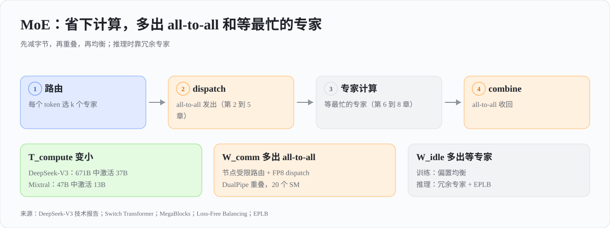
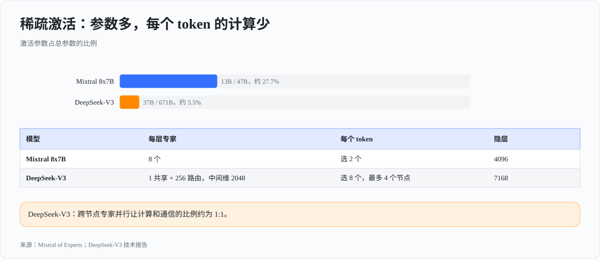
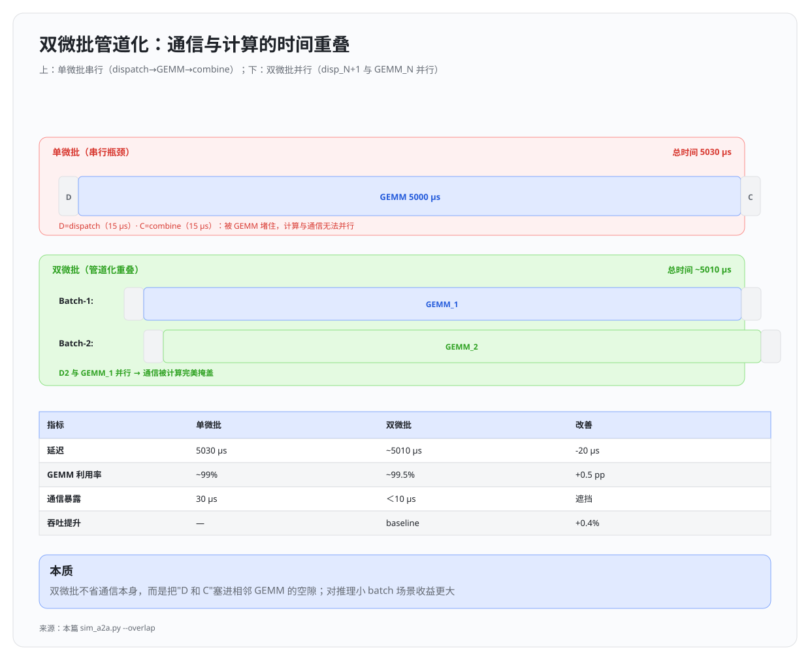
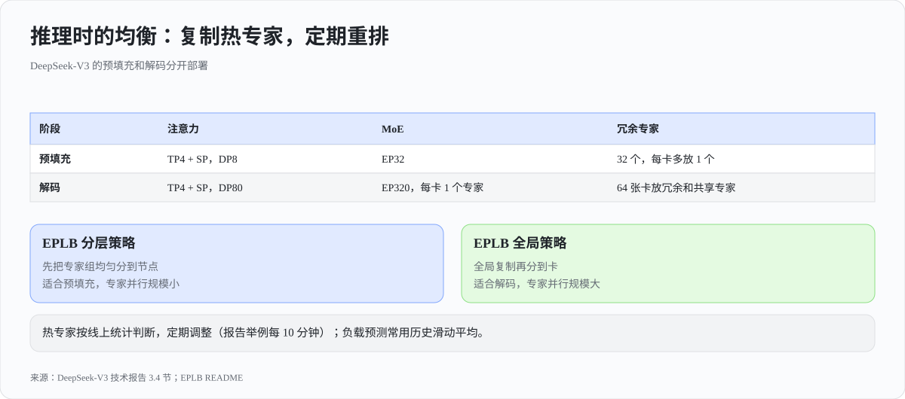
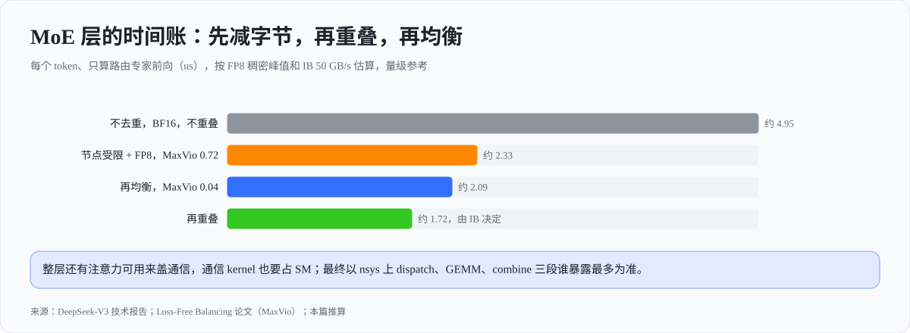

# GPU-22｜LLM｜MoE 与专家并行：all-to-all 与负载均衡

> 🎯 **这篇文档解决什么问题**：MoE 模型每个 token 只经过少数专家，计算省下来了，却多出两种等待：token 要经 all-to-all 发到专家所在的卡再收回来，所有卡还要等分到 token 最多的那个专家。本篇按 DeepSeek-V3、Switch Transformer、MegaBlocks 和 Loss-Free Balancing 的公开数据，算清 all-to-all 的字节和计算通信比，说明节点受限路由、重叠、训练时的均衡和推理时的冗余专家各解决哪一项。

**使用方式**：第 1 章讲 MoE 多出的两种等待。第 2 到 5 章讲 all-to-all：字节、计算通信比、节点受限路由、重叠。第 6 到 8 章讲负载不均：后果、训练时的均衡、推理时的冗余专家。第 9 章把各项放进一本账，第 10 章给清单和自测。

**代码**：zero-to-gpu/22-moe-ep/ 下的 sim_a2a.py、sim_imbalance.py 及两个测试只需 Python 标准库。延迟模型、单位、测试里的模型规格、负载模型和均衡策略有误，第 10 章逐条说明。

<b>🧭 主线位置</b>：GPU-00（[GPU-00｜索引｜从 0 开始 GPU 优化：路线、章节与练习](./README.md)）建立了时间账 T = T_compute + W_mem + W_host + W_comm + W_idle。GPU-21（[GPU-21｜LLM｜训练并行：TP、PP、DP、ZeRO 与 FP8](./21-train-parallel.md)）讲稠密模型的并行切分。本篇讲 MoE：稀疏激活缩小了 T_compute，all-to-all 加进 W_comm，等最忙的专家加进 W_idle。模型训好以后的推理服务交给 GPU-23（[GPU-23｜LLM｜推理系统：KV cache、PagedAttention 与 PD 分离](./23-inference.md)）。

## 导读 · 先给结论

- <b>MoE 省计算，多两种等待。</b>DeepSeek-V3 激活 671B 中的 37B，跨节点专家并行让计算通信比约 1:1（第 1 章）。[[1]](https://arxiv.org/pdf/2412.19437)
- <b>all-to-all 按 k 份算字节。</b>DeepSeek-V3 不去重时每个 token 每层 BF16 dispatch 114688 字节，Mixtral 是 16384 字节（第 2 章）。[[1]](https://arxiv.org/pdf/2412.19437)[[2]](https://arxiv.org/pdf/2401.04088)
- <b>细粒度专家受通信限制。</b>每个 IB 字节约 8192 FLOPs，不到 FP8 峰值与 IB 带宽之比的四分之一（第 3 章）。[[1]](https://arxiv.org/pdf/2412.19437)[[3]](https://www.nvidia.com/en-us/data-center/h100/)
- <b>节点受限路由把字节挪到 NVLink。</b>每个 token 最多 4 个节点，IB 上每节点一份，再经 NVLink 分发（第 4 章）。[[1]](https://arxiv.org/pdf/2412.19437)
- <b>通信只能藏。</b>DualPipe 双向重叠，20 个 SM 打满 IB 和 NVLink（第 5 章）。[[1]](https://arxiv.org/pdf/2412.19437)[[4]](https://github.com/deepseek-ai/DeepEP)
- <b>均衡用偏置，不用大辅助损失。</b>MaxVio 0.72 对应专家层效率上限 58.1%，0.04 对应 96.2%（第 7 章）。[[5]](https://arxiv.org/pdf/2408.15664)[[6]](https://arxiv.org/pdf/2101.03961)
- <b>推理靠冗余专家和定期重排。</b>DeepSeek-V3 预填充 32 个冗余专家，热专家按线上统计定期调整（第 8 章）。[[1]](https://arxiv.org/pdf/2412.19437)[[7]](https://github.com/deepseek-ai/EPLB)

<b>📎 与系列其他文档的分工</b>：GPU-13（[GPU-13｜单机｜NVLink 与 NVSwitch](./13-nvlink.md)）讲机内 NVLink。GPU-17（[GPU-17｜集群｜RDMA 网络：InfiniBand、RoCE 与拥塞控制](./17-rdma.md)）讲 IB 和 RDMA 网络。GPU-18（[GPU-18｜集群｜NCCL：算法、协议与挂死排查](./18-nccl.md)）讲 NCCL 的集合通信与重叠。GPU-21（[GPU-21｜LLM｜训练并行：TP、PP、DP、ZeRO 与 FP8](./21-train-parallel.md)）讲 TP、PP、DP 和 FP8 训练。GPU-23（[GPU-23｜LLM｜推理系统：KV cache、PagedAttention 与 PD 分离](./23-inference.md)）讲推理服务。

## 第 1 章 · MoE 省下计算，多出两种等待

稠密模型的每个 token 经过全部参数。混合专家模型（MoE）把 FFN 换成多个专家，每个 token 只交给其中几个，于是总参数可以很大，每个 token 的计算却只跟激活的那部分有关。省下的计算不是白来的：专家分散在不同的卡上，token 要先发过去、算完再收回来，这是一次 all-to-all；各个专家分到的 token 数不一样，所有卡都要等最忙的那个专家算完。本章先说明 MoE 的结构，再把这两种等待放进时间账。

### 稀疏激活：参数多，计算少

公开的两个例子：

- **Mixtral 8x7B**：每层 8 个 FFN 专家，每个 token 由路由器选 2 个[[2]](https://arxiv.org/pdf/2401.04088)；总共 47B 参数，每个 token 只用 13B[[2]](https://arxiv.org/pdf/2401.04088)，激活比例约 27.7%。
- **DeepSeek-V3**：总参数 671B，每个 token 激活 37B[[1]](https://arxiv.org/pdf/2412.19437)，约 5.5%。除前三层外的 FFN 都换成 MoE 层，每层 1 个共享专家加 256 个路由专家，每个专家的中间维 2048[[1]](https://arxiv.org/pdf/2412.19437)；每个 token 激活 8 个路由专家，并保证最多发往 4 个节点[[1]](https://arxiv.org/pdf/2412.19437)。

DeepSeek-V3 的专家又多又小，来自 DeepSeekMoE 的两条设计：把专家切细，从更多的小专家里激活更多个[[8]](https://arxiv.org/pdf/2401.06066)；再隔离出始终激活的共享专家，吸收各种上下文共有的知识[[8]](https://arxiv.org/pdf/2401.06066)。更早的 GShard 用 top-2 门控[[9]](https://arxiv.org/pdf/2006.16668)，把机器翻译模型扩到 600B 以上[[9]](https://arxiv.org/pdf/2006.16668)，在 2048 个 TPU v3 上训练 4 天[[9]](https://arxiv.org/pdf/2006.16668)。

### 两种新的等待

放回时间账 T = T_compute + W_mem + W_host + W_comm + W_idle，MoE 带来的变化是：

- **T_compute 变小**：每个 token 只算激活的专家。
- **W_comm 多出 all-to-all**：dispatch 把 token 发给专家所在的卡，combine 把结果收回来，每个 MoE 层前向各一次，反向再各一次（第 2 到 5 章）。
- **W_idle 多出等最忙的专家**：一个 MoE 层的时间由分到 token 最多的那张卡决定，其他卡空等（第 6 到 8 章）。

这两项在大规模训练里并不小。DeepSeek-V3 的报告写道，跨节点专家并行带来的通信让计算和通信的比例约为 1:1[[1]](https://arxiv.org/pdf/2412.19437)。Mixtral 的论文也承认，路由机制和更多的显存加载会带来额外开销[[2]](https://arxiv.org/pdf/2401.04088)，服务时的显存按 47B 的稀疏参数量算[[2]](https://arxiv.org/pdf/2401.04088)。

配套代码 zero-to-gpu/22-moe-ep/ 有 sim_a2a.py 和 sim_imbalance.py 两个模拟器及各自的测试，在 Python 3.9.6 上能跑，7 个测试全部通过。但通信模型把所有 rank 的字节除以一条链路的带宽，负载模型让每个 token 只去一个专家，均衡策略是拍出来的公式，第 2、6、7 章和第 10 章逐条说明。

按五步闭环看 MoE：

- **定天花板**：按激活参数算每个 token 的 FLOPs，按 top-k 和隐层维算每层的 all-to-all 字节。
- **测实际**：步时间、每层 all-to-all 时间、每个专家分到的 token 数。
- **定位等待**：all-to-all 记在 W_comm，等最忙的专家记在 W_idle。
- **消除或隐藏**：节点受限路由、通信与计算重叠、负载均衡、冗余专家。
- **复测**：MaxVio 和步时间一起看。

一个常见的误区是按激活参数估算 MoE 的训练速度。现象是 37B 激活的 MoE 比 37B 的稠密模型慢得多。原因是激活参数只决定 T_compute，all-to-all 和负载不均没有算进去。改法是把这两项单独估算，加到时间账里。

> 🔑 **本章要点**：MoE 每个 token 只经过少数专家，DeepSeek-V3 激活 671B 中的 37B，Mixtral 激活 47B 中的 13B。代价是每层前向、反向各两次 all-to-all，以及所有卡等最忙的专家；DeepSeek-V3 的跨节点专家并行让计算通信比约 1:1。这一章是五步闭环的“定天花板”：MoE 的时间账要加上 all-to-all 和负载不均两项。

## 第 2 章 · all-to-all 的字节账：每个 token 发 k 份

MoE 层的通信量不取决于参数量，取决于 token 数、每个 token 选几个专家和隐层维。本章算清 dispatch 和 combine 每次要搬多少字节，用 DeepSeek-V3 和 Mixtral 的真实形状代入，并指出配套代码在单位和带宽上的错误。

### dispatch 和 combine

一个 MoE 层的前向分四步：路由器给每个 token 打分并选出 top-k 个专家；dispatch 把 token 的隐层向量发到这些专家所在的卡；专家在各自的卡上算 FFN；combine 把 k 份输出发回 token 原来的卡，按门控值加权求和。dispatch 和 combine 都是 all-to-all：每张卡同时给其他所有卡发数据，也从其他所有卡收数据。NCCL 既有 AlltoAll 集合操作，也能用成组的点对点收发拼出 all-to-all[[10]](https://docs.nvidia.com/deeplearning/nccl/user-guide/docs/usage/p2p.html)。

不做任何去重时，每个 token 每层 dispatch 要发 k 份 h 维向量，combine 要收回 k 份。按 DeepSeek-V3 的形状，隐层 7168[[1]](https://arxiv.org/pdf/2412.19437)、每个 token 8 个专家[[1]](https://arxiv.org/pdf/2412.19437)，BF16 下 dispatch 是 8 × 7168 × 2 = 114688 字节，dispatch 加 combine 是 229376 字节，每层前向各一次，61 层[[1]](https://arxiv.org/pdf/2412.19437)里除前三层都是 MoE 层。Mixtral 隐层 4096、top-2[[2]](https://arxiv.org/pdf/2401.04088)，dispatch 每个 token 是 2 × 4096 × 2 = 16384 字节，只有 DeepSeek-V3 的七分之一。专家越细、k 越大，all-to-all 越重。

### DeepSeek-V3 怎样把字节减下来

DeepSeek-V3 用了两个办法。第一个是低精度通信：通信带宽是 MoE 训练的关键瓶颈[[1]](https://arxiv.org/pdf/2412.19437)，所以 dispatch 之前把激活量化成 FP8[[1]](https://arxiv.org/pdf/2412.19437)，字节减半；combine 保留 BF16，保证关键环节的精度[[1]](https://arxiv.org/pdf/2412.19437)。第二个是节点受限路由（第 4 章）：一个 token 最多发往 4 个节点，在每个节点上只经 IB 发一份，到了节点内再经 NVLink 分发[[1]](https://arxiv.org/pdf/2412.19437)；combine 时先在节点内经 NVLink 汇总累加，再经 IB 发回[[1]](https://arxiv.org/pdf/2412.19437)。于是每个 token 每层走 IB 的字节最多是 FP8 dispatch 4 × 7168 = 28672 字节加 BF16 combine 4 × 7168 × 2 = 57344 字节，共 86016 字节。

配套代码 sim_a2a.py 的 dispatch 子命令按 k 份不去重计算，形状 7168、top-8、4096 个 token、EP 64 时 dispatch 是 4096 × 8 × (7168 × 2 + 4) = 469893120 字节，打印成“448.12 MB”，实际是除以 1024² 的 MiB，十进制约 469.9 MB。它的延迟把 dispatch 加 combine 的全部字节除以一条 NVLink 的单向带宽 450 GB/s（H100 NVLink 总带宽 900GB/s[[3]](https://www.nvidia.com/en-us/data-center/h100/)的一半），得到 2088.41 us。这里有两处错：这些字节由所有 rank 共同发送，应该除以每卡带宽再看每卡分到多少；EP 64 跨 8 个节点，大部分字节走的是 IB，不是 NVLink。README 里 dispatch 示例的“NVLink4 延迟 0.00 us”和实跑的 2.33 us 也对不上。

按五步闭环算 all-to-all：

- **定天花板**：每个 token 每层的字节是 k × h × 每元素字节，节点受限后按节点数算 IB 份数。
- **测实际**：nsys 里看 dispatch 和 combine kernel 的时长，再用字节数除以时长得到有效带宽。
- **定位等待**：看 IB 和 NVLink 哪一边先到上限。
- **消除或隐藏**：FP8 dispatch、节点内去重转发（第 4 章）、与计算重叠（第 5 章）。
- **复测**：有效带宽和每层时间一起看。

一个常见的误区是把 all-to-all 的总字节除以一条链路的带宽。现象是估出来的时间和实测差一个数量级以上，方向还不固定。原因是 all-to-all 由所有卡并行收发，瓶颈在每张卡的网卡和每个节点的出口。改法是按每卡发送的字节除以每卡的 IB 带宽，节点内部分单独按 NVLink 算。

> 🔑 **本章要点**：不去重时每个 token 每层 dispatch 发 k 份 h 维向量，DeepSeek-V3 是 BF16 下 114688 字节，Mixtral 是 16384 字节。DeepSeek-V3 用 FP8 dispatch 和节点受限路由，把每个 token 每层走 IB 的字节压到最多 86016。配套代码把总字节除以一条 NVLink 带宽，单位也把 MiB 写成 MB。这一章是五步闭环的“定天花板”：先算清每张卡要搬多少字节。

## 第 3 章 · 计算通信比：细粒度专家为什么受通信限制

第 2 章算了字节，本章把它和计算放在一起比。一个 token 在专家上做的计算量是固定的，传过去的字节也是固定的，两者之比决定了这一层是算得慢还是传得慢。DeepSeek-V3 这种又多又小的专家，比值偏向通信一侧。

### 每个 IB 字节对应多少 FLOPs

DeepSeek-V3 每个路由专家按 SwiGLU 结构有 gate_proj、up_proj、down_proj 三个 7168 × 2048 量级的矩阵，中间维 2048[[1]](https://arxiv.org/pdf/2412.19437)。一个 token 经过一个专家的前向是 2 × 3 × 7168 × 2048 = 88080384 FLOPs，8 个专家合计 704643072 FLOPs。第 2 章算出这个 token 每层走 IB 最多 86016 字节，所以每个 IB 字节对应约 8192 FLOPs。

拿硬件比一比。H100 的 FP8 Tensor Core 在规格页上是 3,958 TFLOPS，带星号的是稀疏口径[[3]](https://www.nvidia.com/en-us/data-center/h100/)，稠密是 1,979；DeepSeek-V3 报告的 IB 带宽是每卡 50 GB/s[[1]](https://arxiv.org/pdf/2412.19437)。两者相除，FP8 稠密峰值下每传 1 字节要配约 39580 FLOPs 才能让计算和通信等长。8192 不到 39580 的四分之一，说明只看路由专家的前向，这一层受通信限制：每个 token 的 IB 传输约 1.72 us，FP8 峰值下的计算只要约 0.356 us，传输是计算的 4.8 倍左右。这里按 H100 SXM 的规格估算，DeepSeek-V3 实际用的是 H800[[1]](https://arxiv.org/pdf/2412.19437)，计算也达不到峰值，所以只作量级参考。

### 为什么还能训练

上面只算了专家 FFN。一层里还有注意力、共享专家、反向，DeepSeek-V3 的报告给出的整体计算通信比约 1:1[[1]](https://arxiv.org/pdf/2412.19437)。1:1 意味着如果通信不和计算重叠，步时间几乎翻倍；如果完全重叠，通信几乎不占时间。所以 DeepSeek-V3 的训练框架围绕重叠设计：DualPipe 把前向和反向的计算与通信阶段交错重叠[[1]](https://arxiv.org/pdf/2412.19437)，dispatch 和 combine 的 kernel 与计算流并行[[1]](https://arxiv.org/pdf/2412.19437)。报告的说法是，只要保持计算通信比不变，模型继续扩大时仍能跨节点使用细粒度专家，all-to-all 的开销接近零[[1]](https://arxiv.org/pdf/2412.19437)。

配套代码 sim_a2a.py 的 overhead 子命令给出的通信占比在 batch 从 16 到 121 时一直是 0.7%，因为它把计算时间写死成 max(100, batch × 10) 微秒，和专家大小、GPU 算力都无关。这个占比不能用来判断 MoE 层是否受通信限制。

按五步闭环看计算通信比：

- **定天花板**：每个 token 的专家 FLOPs 除以它的 IB 字节，和峰值算力除以 IB 带宽比较。
- **测实际**：在 nsys 上分别量专家 GEMM 和 all-to-all 的时长。
- **定位等待**：两者没有重叠的部分就是暴露的 W_comm。
- **消除或隐藏**：用另一个微批的计算去盖住这一个微批的通信。
- **复测**：重叠后每层时间应接近两者中较长的那个。

一个常见的误区是认为专家越细越省。现象是专家数翻倍、每个专家变小后，FLOPs 没变，步时间却变长。原因是每个 token 选的专家多了，字节跟着涨，每字节的 FLOPs 下降，通信成了瓶颈。改法是先算每个 IB 字节对应的 FLOPs，确认重叠能盖住通信，再决定专家粒度。

> 🔑 **本章要点**：DeepSeek-V3 每个 token 在 8 个路由专家上前向约 704643072 FLOPs，每层走 IB 最多 86016 字节，每字节约 8192 FLOPs，不到 FP8 峰值与 IB 带宽之比 39580 的四分之一。只看专家 FFN，传输是计算的 4.8 倍左右；整层算下来约 1:1，所以必须重叠。这一章是五步闭环的“定位等待”：先确认 MoE 层是算得慢还是传得慢。

## 第 4 章 · 节点受限路由：让 token 少走 IB

机内 NVLink 和机间 IB 的带宽差好几倍，all-to-all 的字节却不分机内机外。DeepSeek-V3 的办法是在路由时就限制一个 token 能去几个节点，再让节点内的转发走 NVLink。这样 IB 上的字节按节点数算，不按专家数算。本章说明这种路由怎样和网络拓扑配合，以及配套代码的跨节点比例为什么算错了。

### 按节点去重，再在节点内分发

DeepSeek-V3 的训练集群里，节点间用 IB 全互联，节点内用 NVLink；NVLink 带宽 160 GB/s，约为 IB 50 GB/s 的 3.2 倍[[1]](https://arxiv.org/pdf/2412.19437)。为了利用这个差距，每个 token 最多发往 4 个节点，减少 IB 流量[[1]](https://arxiv.org/pdf/2412.19437)。路由决定之后，token 先经 IB 发到每个目标节点上同一个节内编号的 GPU，到达后立即经 NVLink 转发给真正承载目标专家的 GPU，不被后到的 token 阻塞[[1]](https://arxiv.org/pdf/2412.19437)。combine 反过来：先在节点内经 NVLink 发送，在转发卡上累加后经 IB 发回，再在接收端累加[[1]](https://arxiv.org/pdf/2412.19437)。

这样一来，IB 上每个 token 最多 4 份，NVLink 上再分发给节点内的若干专家。报告算的平衡点是：IB 和 NVLink 完全重叠时，每个 token 在每个节点上平均可以选 3.2 个专家而不给 NVLink 增加额外开销[[1]](https://arxiv.org/pdf/2412.19437)；实际只选 8 个，但最多可以扩到 13 个（4 × 3.2 = 12.8）而通信成本不变[[1]](https://arxiv.org/pdf/2412.19437)。按第 2 章的算法，每个 token 每层走 IB 的字节从不去重的 BF16 229376 降到 86016，约 37.5%，其中 FP8 dispatch 贡献一半，节点去重贡献另一半。

### 路由怎样选节点

节点受限要在选专家之前先选节点。DeepSeek-V3 按每个节点上专家亲和分数最高的几项之和选出 M 个节点，再在这些节点的专家里取 top-k，训练时 M 取 4[[1]](https://arxiv.org/pdf/2412.19437)。这种约束让框架几乎可以做到计算与通信完全重叠[[1]](https://arxiv.org/pdf/2412.19437)。

配套代码 sim_a2a.py 的 noderoute 子命令在 4 个节点、M = 4 时给出跨节点比例 (4 − 1)/4 = 75%，然后把 dispatch 的全部 k 份字节按这个比例分到 IB 和 NVLink 上。它漏了节点受限路由真正省字节的地方：同一个节点上的多个专家只经 IB 发一份。它还把 IB 和 NVLink 的时间取最大值，相当于假设两边完全重叠。

按五步闭环看路由与拓扑：

- **定天花板**：IB 字节按目标节点数算，NVLink 字节按节点内专家数算，各自除以带宽。
- **测实际**：统计每个 token 实际去了几个节点，以及每层 IB 和 NVLink 的发送量。
- **定位等待**：IB 时间明显长于 NVLink 时说明节点数限制太松。
- **消除或隐藏**：收紧 M，或按带宽比调整每节点的专家数。
- **复测**：IB 和 NVLink 的时间应接近，且都能被计算盖住。

一个常见的误区是只按专家数估算跨机流量。现象是估算的 IB 流量是实测的两倍多。原因是节点受限路由在每个节点只发一份，再由节点内转发。改法是统计每个 token 触达的节点数，按节点数而不是专家数算 IB 字节。

> 🔑 **本章要点**：DeepSeek-V3 的 NVLink 是 IB 的 3.2 倍，所以每个 token 最多发往 4 个节点，经 IB 每节点只发一份，到节点内再经 NVLink 分发；combine 先在节点内汇总再走 IB。每个 token 每节点平均可选 3.2 个专家，最多 13 个而通信成本不变。配套代码按专家数分配跨节点字节，漏掉了去重。这一章是五步闭环的“消除或隐藏”：用路由约束把字节挪到快的链路上。

## 第 5 章 · 重叠和通信库：把 all-to-all 藏到计算后面

第 3 章算出细粒度 MoE 的计算通信比约 1:1，通信不藏起来，步时间几乎翻倍。本章讲 DeepSeek-V3 怎样把 all-to-all 藏起来：用 DualPipe 让两个方向的微批互相盖住，用专门的通信 kernel 只占少量 SM，再配一套不用张量并行的并行方案。

### DualPipe 和 20 个 SM

DeepSeek-V3 在 2048 张 H800 上训练[[1]](https://arxiv.org/pdf/2412.19437)，并行方案是 16 路流水线并行、跨 8 个节点的 64 路专家并行，加 ZeRO-1 数据并行[[1]](https://arxiv.org/pdf/2412.19437)；每层的路由专家均匀部署在这 8 个节点的 64 张卡上[[1]](https://arxiv.org/pdf/2412.19437)，256 ÷ 64，每卡 4 个路由专家。它没有用张量并行，省掉了 TP 的通信。

重叠靠两层机制。DualPipe 让前向和反向的计算与通信阶段互相重叠[[1]](https://arxiv.org/pdf/2412.19437)：一个微批在做 all-to-all 时，另一个方向的微批在做注意力或专家计算。通信 kernel 本身也要占 SM，DeepSeek-V3 用 warp 专门化把 20 个 SM 分成 10 个通信通道[[1]](https://arxiv.org/pdf/2412.19437)，dispatch 时 IB 发送、IB 到 NVLink 的转发、NVLink 接收各由不同的 warp 负责，20 个 SM 就足以打满 IB 和 NVLink 的带宽[[1]](https://arxiv.org/pdf/2412.19437)。dispatch 和 combine 的 kernel 与计算流并行执行[[1]](https://arxiv.org/pdf/2412.19437)。

### DeepEP

DeepSeek 开源的 DeepEP 是这套通信的实现：它为 MoE 的 dispatch 和 combine 提供高吞吐和低延迟两类专家并行 all-to-all kernel，包含 FP8 dispatch[[4]](https://github.com/deepseek-ai/DeepEP)；机内走 NVLink，机间走 RDMA[[4]](https://github.com/deepseek-ai/DeepEP)，要求 Hopper 或更新的 GPU[[4]](https://github.com/deepseek-ai/DeepEP)。它的 README 写明 dispatch 和 combine 需要占用 GPU 的 SM，不支持零 SM 的 RDMA 专家并行[[4]](https://github.com/deepseek-ai/DeepEP)；节点内转发和直接发送两种模式都保留[[4]](https://github.com/deepseek-ai/DeepEP)。用这类库时要记住：通信占了 SM，同时运行的 GEMM 能用的 SM 就少了，重叠不是免费的。

配套代码 sim_a2a.py 的 latency 子命令有一个 --overlap 选项，固定假设 80% 的通信被重叠，有效延迟直接乘 0.2。这个系数没有出处，也不随计算量变化，不能代替实测。

按五步闭环做重叠：

- **定天花板**：重叠后每层时间的下限是计算和通信中较长的那个。
- **测实际**：nsys 里看 all-to-all kernel 和 GEMM kernel 是否在时间线上并行。
- **定位等待**：GEMM 等 all-to-all 结束才开始的那一段就是暴露的通信。
- **消除或隐藏**：双向微批交错，通信 kernel 只占够用的 SM。
- **复测**：比较通信占用的 SM 数和 GEMM 变慢的幅度。

一个常见的误区是给通信 kernel 分很多 SM，以为越多越快。现象是 all-to-all 变快了，步时间没变甚至变长。原因是通信已经打满了网卡，多出来的 SM 只是从 GEMM 那里抢走的。改法是按带宽算够用的 SM 数，DeepSeek-V3 的经验是 20 个。

> 🔑 **本章要点**：DeepSeek-V3 用 PP16、跨 8 节点的 EP64 和 ZeRO-1，不用张量并行；DualPipe 让两个方向的微批互相盖住通信，20 个 SM 分成 10 个通道就能打满 IB 和 NVLink。DeepEP 提供这套 dispatch 和 combine kernel，但它们要占 SM。配套代码的重叠系数 0.8 没有出处。这一章是五步闭环的“消除或隐藏”：all-to-all 只能藏，不能消。

## 第 6 章 · 负载不均：所有卡等最忙的专家

all-to-all 是同步的：combine 要等所有专家都算完才能开始。如果某个专家分到的 token 是平均的两倍，它所在的卡就要算两倍的时间，其他卡在这段时间里空等。专家并行的效率上限因此是平均负载除以最大负载。本章说明负载不均的两种后果，以及容量因子、丢 token 和块稀疏 kernel 这几种处理方式。

### 两种后果：浪费算力和路由坍塌

不均衡的专家负载会导致路由坍塌，也会在专家并行时降低计算效率[[1]](https://arxiv.org/pdf/2412.19437)。路由坍塌是训练动力学的问题：少数专家被选得多，学得更好，于是被选得更多，其他专家得不到训练。计算效率是系统的问题：每层的时间由最忙的那张卡决定。这两种后果都会随训练变化，所以负载不能只在开训前检查一次。

早期的做法是给每个专家设容量。Switch Transformer 的专家容量是每批 token 数除以专家数，再乘一个容量因子[[6]](https://arxiv.org/pdf/2101.03961)；GShard 同样把容量设为 O(N/E)[[9]](https://arxiv.org/pdf/2006.16668)。容量因子大于 1 时留出缓冲，容纳不完全均衡的情况[[6]](https://arxiv.org/pdf/2101.03961)；超出容量的 token 被丢弃，跳过这一层的计算，经残差连接直接传到下一层[[6]](https://arxiv.org/pdf/2101.03961)。容量因子设大了会浪费计算和显存[[6]](https://arxiv.org/pdf/2101.03961)。Switch 的实验里丢弃的 token 通常不到 1%[[6]](https://arxiv.org/pdf/2101.03961)。

### 不丢 token 的做法

MegaBlocks 指出，固定容量迫使人在丢 token 和用 padding 浪费计算、显存之间二选一[[11]](https://arxiv.org/pdf/2211.15841)。它把 MoE 计算改写成块稀疏运算，每个专家算多少 token 就算多少，从不丢 token[[11]](https://arxiv.org/pdf/2211.15841)，端到端训练比 Tutel 快至多 40%[[11]](https://arxiv.org/pdf/2211.15841)；相对 Tutel 用 padding 避免丢 token 的做法，三个规模的模型分别快 1.38×、2.0× 和 4.35×[[11]](https://arxiv.org/pdf/2211.15841)。DeepSeek-V3 靠负载均衡策略（第 7 章）在整个训练中保持均衡，不丢任何 token[[1]](https://arxiv.org/pdf/2412.19437)。不丢 token 不等于不等待：块稀疏省掉的是 padding，最忙的专家仍然决定这一层的时间。

配套代码 sim_imbalance.py 用 Zipf 分布模拟专家负载：128 个专家、10240 个 token、α = 1.5 时，最忙的专家分到 4193 个，平均 80 个，max/mean 是 52.41，专家层效率上限只有 1.9%。这个场景有三个问题。每个 token 只分给一个专家，--top-k 参数只用于显示；α = 1.5 来自代码注释里的“常见互联网流量分布”，没有任何 MoE 训练的实测依据；输出里的“bottleneck”是最大负载除以专家数，4193 ÷ 128 = 32.758，这个比值没有物理意义。热专家表头还漏了 f 前缀，原样打印出“top {top_n}”。

按五步闭环看负载：

- **定天花板**：专家层效率上限是平均负载除以最大负载。
- **测实际**：每层每个专家、每张卡分到的 token 数，按步记录。
- **定位等待**：各卡专家 GEMM 结束时刻的差就是等待。
- **消除或隐藏**：训练时用均衡策略（第 7 章），推理时用冗余专家（第 8 章）。
- **复测**：MaxVio 和每层时间一起看。

一个常见的误区是只看全局平均负载。现象是整个训练的专家负载统计很均匀，每步却总有几张卡慢。原因是均衡是按整个数据集算的，单个批次里仍可能集中在少数专家。改法是按步、按卡统计最大负载，用批次级的 MaxVio 判断。

> 🔑 **本章要点**：专家并行的效率上限是平均负载除以最大负载，所有卡都等最忙的专家；不均衡还会让路由坍塌。Switch 和 GShard 用容量因子丢弃溢出 token，MegaBlocks 用块稀疏 kernel 不丢 token，比 Tutel 快至多 40%。配套代码让每个 token 只去一个专家，α 没有依据。这一章是五步闭环的“定位等待”：MoE 的 W_idle 来自最忙的专家。

## 第 7 章 · 训练时的均衡：辅助损失和无辅助损失的偏置

训练时的负载均衡要在两件事之间取舍：负载越均匀，系统效率越高；但为了均匀去改路由，又可能伤害模型质量。本章比较两种做法：Switch Transformer 以来常用的辅助损失，以及 DeepSeek-V3 用的无辅助损失偏置，并用一个指标把均衡程度换算成效率上限。

### 辅助损失和它的副作用

辅助损失在主损失之外加一项，按每个专家实际分到的 token 比例和路由概率计算，路由越均匀这一项越小[[6]](https://arxiv.org/pdf/2101.03961)。Switch Transformer 取系数 α = 10−2[[6]](https://arxiv.org/pdf/2101.03961)，并在 10−1 到 10−5 之间按 10 倍扫过[[6]](https://arxiv.org/pdf/2101.03961)。问题在于取值两难：辅助损失大了会给训练引入不可忽略的干扰梯度，损害模型性能[[5]](https://arxiv.org/pdf/2408.15664)；小了又会出现路由坍塌[[5]](https://arxiv.org/pdf/2408.15664)。

无辅助损失的做法在 top-K 路由之前给每个专家的路由分数加一个偏置，并按这个专家最近的负载动态更新[[5]](https://arxiv.org/pdf/2408.15664)。DeepSeek-V3 的具体做法是：每个专家一个偏置 b_i，加到亲和分数上决定 top-K[[1]](https://arxiv.org/pdf/2412.19437)；偏置只用于选专家，乘到 FFN 输出上的门控值仍来自原始分数[[1]](https://arxiv.org/pdf/2412.19437)；每步结束时，过载专家的偏置减 γ，欠载的加 γ[[1]](https://arxiv.org/pdf/2412.19437)。γ 在前 14.3T token 取 0.001，最后 500B token 取 0[[1]](https://arxiv.org/pdf/2412.19437)。它另外保留一个系数只有 0.0001 的序列级平衡损失，只为防止单个序列里极端不均衡[[1]](https://arxiv.org/pdf/2412.19437)。消融实验里，无辅助损失的策略在多数基准上比纯辅助损失更好[[1]](https://arxiv.org/pdf/2412.19437)。

### 把均衡程度换算成效率

Loss-Free Balancing 的论文定义了 MaxVio：最大专家负载减去完全均衡时的期望负载，再除以期望负载[[5]](https://arxiv.org/pdf/2408.15664)。最忙的专家是平均的 1 + MaxVio 倍，所以专家层的效率上限是 1/(1 + MaxVio)。论文在 1B 和 3B 模型上报告[[5]](https://arxiv.org/pdf/2408.15664)：辅助损失控制时全局 MaxVio 是 0.72 和 0.52，无辅助损失时都是 0.04，困惑度也略低。按 1B 的数字算，0.72 对应效率上限 58.1%，0.04 对应 96.2%。论文的验证规模最多 3B 参数、200B token[[5]](https://arxiv.org/pdf/2408.15664)，更大规模的效果要看 DeepSeek-V3 这类报告。

配套代码 sim_imbalance.py 的 rebalance 子命令给出“辅助损失改善 51.4%、偏置调整 20.2%、冗余专家 84.9%”，三个数都不是模拟训练得到的：辅助损失是把 max/mean 乘以 （1 − 最大偏差 × 0.01），偏置调整是把最热专家的负载连续减 5%，冗余专家是一个溢出平摊公式。test_imbalance.py 只检查输出里有没有这几个策略名，还会打印一行“Debug:”。第 10 章列为练习。

按五步闭环做训练均衡：

- **定天花板**：用 1/(1 + MaxVio) 换算效率上限。
- **测实际**：按步记录全局和批次级 MaxVio。
- **定位等待**：MaxVio 高的层对应步时间里最长的专家 GEMM。
- **消除或隐藏**：用偏置调整均衡，只保留很小的序列级损失兜底。
- **复测**：MaxVio 和验证损失一起看，均衡不能以质量下降为代价。

一个常见的误区是负载不均时加大辅助损失系数。现象是 MaxVio 降了，验证损失变差。原因是辅助损失的梯度和语言模型目标冲突。改法是改用偏置调整，它不产生梯度，只改变路由。

> 🔑 **本章要点**：辅助损失的系数两难：大了引入干扰梯度，小了路由坍塌。DeepSeek-V3 给每个专家加只用于路由的偏置，每步按负载加减 γ = 0.001，另保留 0.0001 的序列级损失。MaxVio 换算效率上限为 1/(1 + MaxVio)，0.72 对应 58.1%，0.04 对应 96.2%。配套代码的三种策略都是拍出来的公式。这一章是五步闭环的“消除或隐藏”：训练时从路由上消除不均。

## 第 8 章 · 推理时的均衡：冗余专家和 EPLB

推理和训练不同：模型权重固定，路由不能再调；请求的分布随时间变化，热门专家也跟着变。推理时能调的只有专家放在哪里、放几份。本章讲 DeepSeek-V3 的部署方式和开源的 EPLB 负载均衡器。

### DeepSeek-V3 的部署

DeepSeek-V3 推理时把预填充和解码分开部署：

- **预填充**：注意力用 TP4 加序列并行，配 DP8[[1]](https://arxiv.org/pdf/2412.19437)；MoE 用 EP32，让每个专家分到足够大的批，提高计算效率[[1]](https://arxiv.org/pdf/2412.19437)。
- **解码**：最小部署单元是 40 个节点、320 张卡[[1]](https://arxiv.org/pdf/2412.19437)；注意力 TP4 加序列并行、DP80，MoE 用 EP320[[1]](https://arxiv.org/pdf/2412.19437)，每卡只放一个专家，其中 64 张卡负责冗余专家和共享专家[[1]](https://arxiv.org/pdf/2412.19437)；dispatch 和 combine 直接经 IB 点对点传输[[1]](https://arxiv.org/pdf/2412.19437)。

两个阶段都用冗余专家：复制高负载的专家，多放几份[[1]](https://arxiv.org/pdf/2412.19437)。哪些专家负载高，按线上统计判断，并定期调整，例如每 10 分钟一次[[1]](https://arxiv.org/pdf/2412.19437)。预填充阶段设 32 个冗余专家[[1]](https://arxiv.org/pdf/2412.19437)，每张卡除了原来的 8 个专家再多放 1 个[[1]](https://arxiv.org/pdf/2412.19437)。

### EPLB 怎样摆放

EPLB 是 DeepSeek 开源的专家并行负载均衡器，做法是复制重负载专家，再用启发式把复制后的专家打包到各张卡上，让各卡负载均衡[[7]](https://github.com/deepseek-ai/EPLB)。它有两种策略[[7]](https://github.com/deepseek-ai/EPLB)：

- **分层策略**：先把专家组均匀打包到节点，保证节点间均衡[[7]](https://github.com/deepseek-ai/EPLB)，再在节点内复制专家并分到卡上；适合专家并行规模较小的预填充。
- **全局策略**：不管专家组，全局复制专家再分到卡上，适合专家并行规模较大的解码[[7]](https://github.com/deepseek-ai/EPLB)。

它的 README 示例是两层 MoE，每层 12 个专家，再加 4 个冗余，共 16 个副本放到 2 个节点、每节点 4 张卡上[[7]](https://github.com/deepseek-ai/EPLB)。EPLB 只负责摆放，专家负载怎么预测不在它的范围里，常用的方法是历史统计的滑动平均[[7]](https://github.com/deepseek-ai/EPLB)。

配套代码的冗余专家模型把所有超出平均的负载平摊给 8 个冗余专家，算出 max/mean 从 52.41 降到 7.901。真实的冗余专家是复制具体的热专家，一个专家的负载最多分给它的几份副本，平摊假设高估了效果。

按五步闭环做推理均衡：

- **定天花板**：每卡专家负载的最大值除以平均值。
- **测实际**：线上按时间窗统计每个专家的 token 数。
- **定位等待**：解码时最忙的卡决定每一步的延迟。
- **消除或隐藏**：按统计复制热专家，用 EPLB 重新摆放，定期更新。
- **复测**：调整后看各卡负载和尾延迟。

一个常见的误区是冗余专家一次摆好就不再动。现象是上线几天后某些卡的负载又明显偏高。原因是请求分布在变，热门专家也在变。改法是按固定周期重新统计和摆放，DeepSeek-V3 的例子是每 10 分钟。

> 🔑 **本章要点**：推理时路由固定，只能调专家的摆放。DeepSeek-V3 预填充用 EP32 和 32 个冗余专家，解码用 40 节点 320 卡的 EP320，热专家按线上统计定期调整。EPLB 有分层和全局两种摆放策略，负载预测靠历史滑动平均。配套代码把溢出负载平摊给冗余专家，高估了效果。这一章是五步闭环的“消除或隐藏”：推理时用复制和摆放消除不均。

## 第 9 章 · MoE 层的时间账：先减字节，再重叠，再均衡

前面几章分别处理了字节、拓扑、重叠和负载，本章把它们放进同一本账，看各项对一个 MoE 层的时间各有多大影响，从而决定先改什么。账按每个 token 摊算，只算路由专家的前向，用 DeepSeek-V3 的形状和第 3 章的估算口径：FP8 稠密峰值下专家计算约 0.356 us，IB 按每卡 50 GB/s[[1]](https://arxiv.org/pdf/2412.19437)。它是量级上的排序，不是实测值。

### 四种情形

- **不去重、BF16、不重叠**：最坏情况下 8 个专家在 8 个节点上，每个 token 走 IB 229376 字节，约 4.59 us，加上计算约 4.95 us。
- **节点受限 + FP8 dispatch，不重叠，负载不均**：IB 降到 86016 字节、约 1.72 us（第 2、4 章）；按 MaxVio 0.72[[5]](https://arxiv.org/pdf/2408.15664)，最忙专家的计算拉长到 0.612 us，合计约 2.33 us。
- **再做负载均衡**：MaxVio 降到 0.04[[5]](https://arxiv.org/pdf/2408.15664)，计算约 0.370 us，合计约 2.09 us。
- **再把通信和计算重叠**：时间取两者较长的一项，约 1.72 us，由 IB 决定。

按这本账，第一步减字节的收益最大，从约 4.95 us 降到约 2.33 us；均衡在通信不重叠时只省约 0.24 us；重叠之后，剩下的就是 IB 时间。这和 DeepSeek-V3 的做法顺序一致：先用节点受限路由和 FP8 通信减字节[[1]](https://arxiv.org/pdf/2412.19437)，再用 DualPipe 和专用 kernel 把通信藏到计算后面[[1]](https://arxiv.org/pdf/2412.19437)，用偏置维持均衡[[1]](https://arxiv.org/pdf/2412.19437)。

### 账本没算进去的

这本账只看路由专家前向。整层还有注意力和共享专家的计算可以用来盖通信，所以 DeepSeek-V3 报告的整体计算通信比是 1:1[[1]](https://arxiv.org/pdf/2412.19437)，比这里只看专家时的通信占比低。反过来，通信 kernel 要占 SM（第 5 章），GEMM 达不到峰值，负载不均的影响在计算被拉长后会比这里大。真正决定优先级的仍是实测：在 nsys 上把一个 MoE 层拆成 dispatch、专家 GEMM、combine 三段，看哪一段暴露得最多。

排查一个慢的 MoE 训练，可以按顺序问四个问题：

- **字节对不对**：每层 dispatch 的实际字节和 k × h × 精度 × 节点数的估算是否一致，FP8 dispatch 是否生效。
- **链路对不对**：IB 和 NVLink 的有效带宽各是多少，节点受限路由是否生效。
- **藏住没有**：all-to-all kernel 和 GEMM 在时间线上是否并行。
- **均不均**：每层的 MaxVio，以及各卡专家 GEMM 结束时刻的差。

按五步闭环用这本账：

- **定天花板**：按形状算每个 token 的字节和 FLOPs。
- **测实际**：nsys 拆出一层的三段。
- **定位等待**：暴露最多的一段就是下一步要改的。
- **消除或隐藏**：按减字节、重叠、均衡的顺序。
- **复测**：每次只改一项。

一个常见的误区是 MoE 慢就先调负载均衡。现象是 MaxVio 降下来了，步时间几乎没变。原因是这一层的瓶颈是 IB 上的字节，计算本来就被通信盖住或远短于通信。改法是先看 all-to-all 暴露了多少，字节和重叠解决之后再调均衡。

> 🔑 **本章要点**：按每 token 摊算路由专家前向：不去重、不重叠约 4.95 us，节点受限加 FP8 后约 2.33 us，再均衡约 2.09 us，再重叠约 1.72 us，由 IB 决定。顺序是先减字节，再重叠，再均衡，和 DeepSeek-V3 的做法一致；最终以 nsys 上暴露最多的一段为准。这一章是五步闭环的“定位等待”：先找出 MoE 层暴露最多的那一段。

## 第 10 章 · 上线前核对清单与自测

前九章沿着 MoE 多出来的两种等待展开：第 1 章说明稀疏激活和两种等待，第 2 到 5 章处理 all-to-all，依次是字节、计算通信比、节点受限路由和重叠；第 6 到 8 章处理负载不均，依次是后果、训练时的均衡和推理时的摆放；第 9 章把各项放进同一本账。本章把它们压成一张核对清单，再列出配套代码的问题作为练习，最后给出自测题。

### 📌 核对清单

| 检查项 | 怎样查 | 通过的标志 |
|---|---|---|
| all-to-all 字节有估算 | k × h × 每元素字节，按节点数算 IB 份数（第 2 章） | 估算和实测发送量一致 |
| 知道受谁限制 | 每个 IB 字节对应的 FLOPs 和硬件平衡点比较（第 3 章） | 知道这一层受通信还是计算限制 |
| 节点受限路由生效 | 统计每个 token 触达的节点数（第 4 章） | 不超过设定的 M |
| FP8 dispatch 生效 | 看 dispatch 缓冲区的数据类型和字节（第 2 章） | dispatch 字节是 BF16 的一半 |
| 通信被重叠 | nsys 上 all-to-all 和 GEMM 是否并行（第 5 章） | 暴露的通信占每层时间的小部分 |
| 通信 SM 数合适 | 改 SM 数，比较 all-to-all 和 GEMM 时间（第 5 章） | 再加 SM 时通信不再变快 |
| 负载有监控 | 每步每层记录 MaxVio（第 6、7 章） | 批次级 MaxVio 稳定在低位 |
| 均衡不伤质量 | 对比均衡策略前后的验证损失（第 7 章） | MaxVio 下降，损失不升 |
| 推理有冗余专家 | 按时间窗统计热专家（第 8 章） | 定期重新摆放，各卡负载接近 |
| 优化按账本排序 | nsys 拆出 dispatch、GEMM、combine（第 9 章） | 先改暴露最多的一段 |

### 代码练习：配套代码的问题

zero-to-gpu/22-moe-ep/ 的 sim_a2a.py、sim_imbalance.py 只用 Python 标准库，README 写 Python 3.10 以上，在 Python 3.9.6 上也能跑，两个测试文件共 7 个测试全部通过。下面几处与事实或自身描述不符，适合作为练习：

- **延迟把总字节除以一条链路**：dispatch 和 latency 子命令把所有 rank 的 dispatch 加 combine 字节除以 450 GB/s，形状 7168、top-8、EP 64 时得到 2088.41 us；EP 64 跨 8 个节点，大部分字节走 IB（第 2 章）。练习：按每卡发送字节除以每卡带宽，机内机外分开算。
- **单位写错**：除以 1024² 却标“MB”，448.12 实际是 MiB，十进制约 469.9 MB（第 2 章）。README 里 dispatch 示例的延迟写 0.00 us，实跑是 2.33 us。
- **测试注释里的 DeepSeek-V3 规格不对**：test_a2a.py 写“每 token top-2”“隐层宽度推测 4096 或更大”，报告写的是每 token 8 个专家、隐层 7168（第 2 章）。
- **通信占比的计算时间是写死的**：overhead 子命令假设计算时间是 max(100, batch × 10) 微秒，所以占比一直是 0.7%（第 3 章）。练习：按专家形状算 FLOPs，再除以 GPU 算力。
- **节点受限路由没有去重**：noderoute 按 (M − 1)/节点数算跨节点比例，再把 k 份字节都按这个比例分配，漏了每个节点只经 IB 发一份（第 4 章）。
- **重叠系数没有出处**：--overlap 固定按 80% 重叠（第 5 章）。
- **负载模型过于简化**：每个 token 只分给一个专家，α = 1.5 没有 MoE 实测依据，“bottleneck”等于最大负载除以专家数，没有物理意义；表头漏了 f 前缀（第 6 章）。
- **均衡策略是拍出来的公式**：辅助损失、偏置调整、冗余专家三个数都不来自训练模拟，测试只检查输出里有策略名（第 7、8 章）。练习：按 DeepSeek-V3 的偏置更新规则写一个逐步模拟，每步按负载加减 γ，观察 MaxVio 怎样收敛。

### 自测题

1. DeepSeek-V3 每个 token 激活多少参数、几个路由专家？MoE 比同等激活参数的稠密模型多出哪两种等待？
2. 不去重时每个 token 每层 dispatch 要发多少字节？DeepSeek-V3 用哪两个办法减少 IB 上的字节？
3. 每个 IB 字节对应的 FLOPs 怎样算？为什么细粒度专家容易受通信限制？
4. 节点受限路由为什么能在不增加通信的前提下让每个 token 选更多专家？
5. 辅助损失为什么难调？无辅助损失的偏置怎样更新，为什么不影响门控值？
6. MaxVio 是 0.72 时专家层的效率上限是多少？推理时为什么要定期重新摆放冗余专家？

**下一步**：训练讲完了。模型训好以后要上线服务，推理的瓶颈换成了 KV cache 的显存、解码阶段的带宽和请求的调度。GPU-23（[GPU-23｜LLM｜推理系统：KV cache、PagedAttention 与 PD 分离](./23-inference.md)）讲推理系统：KV cache、PagedAttention 和预填充与解码分离。

**延伸阅读**：Maarten Grootendorst 的 [A Visual Guide to Mixture of Experts](https://newsletter.maartengrootendorst.com/p/a-visual-guide-to-mixture-of-experts)（2024 年 10 月）用示意图讲 router、负载均衡的辅助损失、capacity factor、Switch Transformer，以及 Mixtral 的总参数和激活参数之分，适合在读本篇之前先建立直觉。它讲的是模型结构和训练，不涉及推理时的专家放置和通信，这两块以本篇为准。

## 参考文献

按正文首次引用顺序编号，资料截至 2026 年 11 月中。

[1] DeepSeek-AI. DeepSeek-V3 Technical Report. arXiv 2412.19437 [arxiv.org/pdf/2412.19437](https://arxiv.org/pdf/2412.19437)

[2] Jiang et al. Mixtral of Experts. arXiv 2401.04088 [arxiv.org/pdf/2401.04088](https://arxiv.org/pdf/2401.04088)

[3] NVIDIA H100 Tensor Core GPU 产品页 [www.nvidia.com/en-us/data-center/h100/](https://www.nvidia.com/en-us/data-center/h100/)

[4] DeepSeek-AI. DeepEP（GitHub README） [github.com/deepseek-ai/DeepEP](https://github.com/deepseek-ai/DeepEP)

[5] Wang et al. Auxiliary-Loss-Free Load Balancing Strategy for Mixture-of-Experts. arXiv 2408.15664 [arxiv.org/pdf/2408.15664](https://arxiv.org/pdf/2408.15664)

[6] Fedus, Zoph, Shazeer. Switch Transformers: Scaling to Trillion Parameter Models with Simple and Efficient Sparsity. JMLR 2022 [arxiv.org/pdf/2101.03961](https://arxiv.org/pdf/2101.03961)

[7] DeepSeek-AI. EPLB: Expert Parallelism Load Balancer（GitHub README） [github.com/deepseek-ai/EPLB](https://github.com/deepseek-ai/EPLB)

[8] Dai et al. DeepSeekMoE: Towards Ultimate Expert Specialization in Mixture-of-Experts Language Models. arXiv 2401.06066 [arxiv.org/pdf/2401.06066](https://arxiv.org/pdf/2401.06066)

[9] Lepikhin et al. GShard: Scaling Giant Models with Conditional Computation and Automatic Sharding. ICLR 2021 [arxiv.org/pdf/2006.16668](https://arxiv.org/pdf/2006.16668)

[10] NVIDIA NCCL User Guide. Point-to-point communication [docs.nvidia.com/deeplearning/nccl/user-guide/docs/usage/p2p.html](https://docs.nvidia.com/deeplearning/nccl/user-guide/docs/usage/p2p.html)

[11] Gale et al. MegaBlocks: Efficient Sparse Training with Mixture-of-Experts. MLSys 2023 [arxiv.org/pdf/2211.15841](https://arxiv.org/pdf/2211.15841)

---

[在 Colab 里跑本章 CPU 练习](https://colab.research.google.com/github/zyaochen/zero-to-gpu/blob/main/colab/22-moe-ep.ipynb) · 上一章：[GPU-21｜LLM｜训练并行：TP、PP、DP、ZeRO 与 FP8](./21-train-parallel.md) · [目录](./README.md) · 下一章：[GPU-23｜LLM｜推理系统：KV cache、PagedAttention 与 PD 分离](./23-inference.md)
