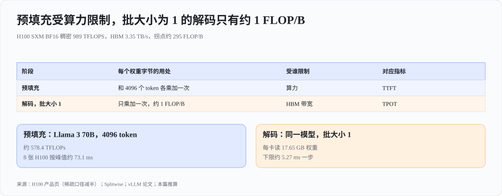
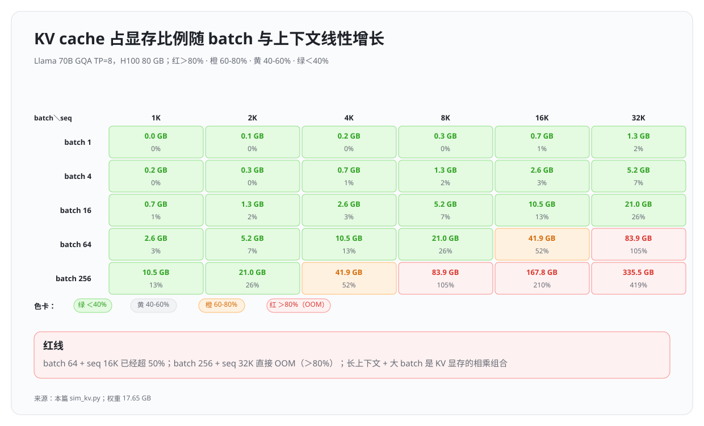
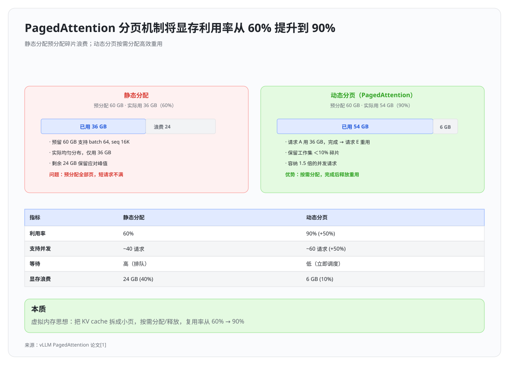
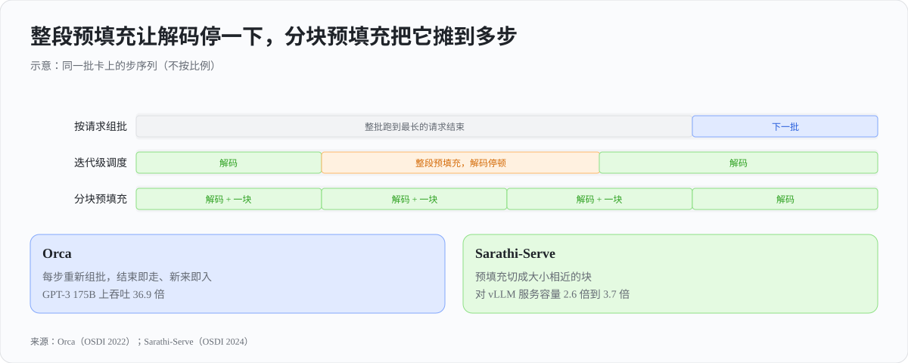
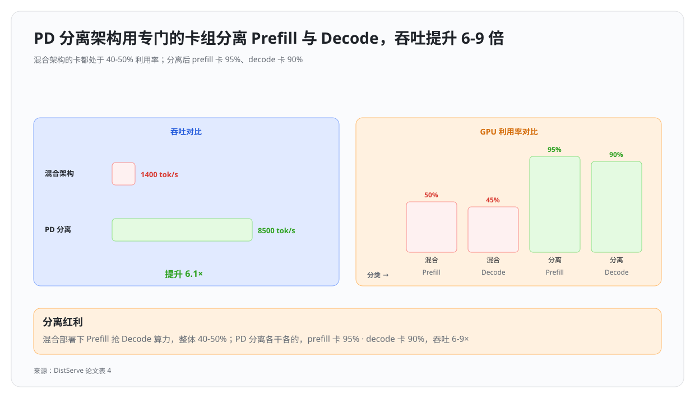
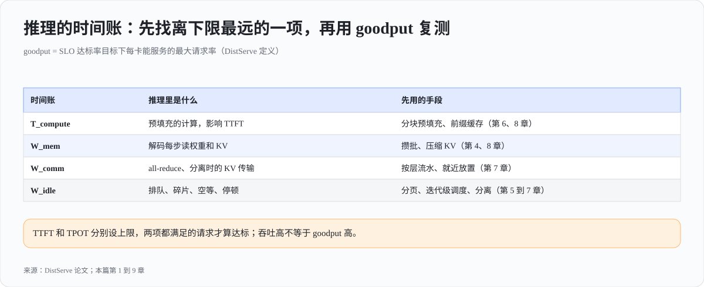

# GPU-23｜LLM｜推理系统：KV cache、PagedAttention 与 PD 分离

> 🎯 **这篇文档解决什么问题**：大模型上线后，瓶颈从训练时的算力和通信换成了 KV cache 的显存、解码阶段的带宽和请求的调度。本篇以 Llama 3 70B 跑在 8 张 H100 SXM 上为例，算清 KV 有多大、显存能装多少并发、每步解码要多久，再按 vLLM、Orca、Sarathi-Serve、DistServe、Splitwise、Mooncake 等论文的公开数据，说明分页、连续批处理、分块预填充、预填充与解码分离、KV 压缩与复用各解决哪一项等待。

**使用方式**：第 1 章分清推理的两段。第 2 到 4 章算账：KV 的字节、显存容量和并发、解码时间。第 5 到 8 章讲手段：分页、调度、分离、压缩与复用。第 9 章用 goodput 把各项放进一本账，第 10 章给清单和自测。

**代码**：zero-to-gpu/23-inference/ 下的 sim_kv.py、sim_decode.py、sim_pd.py 和 test_kv.py 只需 Python 标准库。并发数、容量检查、MHA 基准、预填充时间、KV 传输带宽和 goodput 的算法有误，第 10 章逐条说明。

<b>🧭 主线位置</b>：GPU-00（[GPU-00｜索引｜从 0 开始 GPU 优化：路线、章节与练习](./README.md)）建立了时间账 T = T_compute + W_mem + W_host + W_comm + W_idle。GPU-22（[GPU-22｜LLM｜MoE 与专家并行：all-to-all 与负载均衡](./22-moe-ep.md)）讲完 MoE 训练。本篇讲推理服务：预填充主要是 T_compute，解码主要是 W_mem，KV 传输和张量并行进 W_comm，排队、碎片和停顿进 W_idle。最后一篇 GPU-24（[GPU-24｜LLM｜综合：从选卡到上线](./24-capstone.md)）把全系列串成从选卡到上线的流程。

## 导读 · 先给结论

- <b>推理分两段。</b>预填充受算力限制，对应 TTFT；解码受带宽限制，对应 TPOT（第 1 章）。[[1]](https://arxiv.org/pdf/2311.18677)[[2]](https://arxiv.org/pdf/2401.09670)
- <b>KV 按公式算。</b>Llama 3 70B 每个 token 327680 字节，一个 16384 token 的请求 5368.7 MB（第 2 章）。[[3]](https://arxiv.org/pdf/2407.21783)
- <b>显存决定并发。</b>70B 在 8 张 H100 上，每卡剩 59.70 GB 给 KV，16384 token 时最多 88 个请求（第 3 章）。[[4]](https://www.nvidia.com/en-us/data-center/h100/)
- <b>攒批摊薄权重，摊不薄 KV。</b>88 个请求在 2048 token 时每步约 7.47 ms，在 16384 token 时约 22.90 ms（第 4 章）。[[4]](https://www.nvidia.com/en-us/data-center/h100/)
- <b>分页把浪费压到一个块。</b>连续预留时只有 20.4% 到 38.2% 的 KV 显存存实际 token，vLLM 吞吐提升 2 到 4 倍（第 5 章）。[[5]](https://arxiv.org/pdf/2309.06180)
- <b>调度和分离去掉干扰。</b>分块预填充让解码不停顿；分离部署时 70B 的 4096 token 请求每卡传 KV 约 3.36 ms（第 6、7 章）。[[6]](https://arxiv.org/pdf/2403.02310)[[2]](https://arxiv.org/pdf/2401.09670)
- <b>按 goodput 验收。</b>TTFT 和 TPOT 分别设上限，以达标率目标下的请求率为准（第 9 章）。[[2]](https://arxiv.org/pdf/2401.09670)

<b>📎 与系列其他文档的分工</b>：GPU-02（[GPU-02｜硬件｜性能账本：Roofline、算术强度与三类瓶颈](./02-ledger.md)）讲 Roofline 和算术强度。GPU-08（[GPU-08｜硬件｜注意力内核](./08-attention.md)）讲注意力内核。GPU-10（[GPU-10｜系统｜显存管理](./10-memory-mgmt.md)）讲显存管理。GPU-21（[GPU-21｜LLM｜训练并行：TP、PP、DP、ZeRO 与 FP8](./21-train-parallel.md)）讲张量并行。GPU-25（[GPU-25｜LLM｜投机解码：αK 与 MTP / EAGLE 谱系](./25-speculative.md)）讲投机解码，GPU-26（[GPU-26｜系统｜CXL：一致性互连与 KV offload 工程化](./26-cxl.md)）讲用 CXL 卸载 KV。

## 第 1 章 · 推理分两段：预填充受算力限制，解码受带宽限制

训练时每一步都处理整批 token，卡上的瓶颈相对单一。推理把一个请求拆成两段：预填充一次处理整段提示词，算出第一个输出 token，同时把每层的 K 和 V 存进 KV cache；解码每一步只为每个请求生成一个 token，却要把全部权重和这个请求的 KV cache 读一遍。Splitwise 把两段概括成计算密集的提示词阶段和访存密集的生成阶段[[1]](https://arxiv.org/pdf/2311.18677)。两段等的东西不一样，后面所有优化都从这一点出发。

### 两段各对应一个延迟指标

用户感受到的延迟也分两段。DistServe 把预填充对应到首 token 时间 TTFT，把解码对应到每个输出 token 的时间 TPOT[[2]](https://arxiv.org/pdf/2401.09670)。聊天类应用看重 TTFT，用户在等第一个字出来；长文生成和代码补全看重 TPOT，它决定文字吐出来的速度。一个请求的总延迟约等于 TTFT 加上输出 token 数乘以 TPOT，两项的瓶颈不同，优化手段也不同。

放回时间账 T = T_compute + W_mem + W_host + W_comm + W_idle：预填充的时间主要是 T_compute，解码的时间主要是 W_mem。张量并行切开的模型每层还要做 all-reduce，这部分进 W_comm；请求排队、等显存、被别的请求的预填充挡住，都进 W_idle。

### 解码为什么受带宽限制

vLLM 论文指出，逐个 token 的顺序生成让工作负载受访存限制，用不满 GPU 的算力[[5]](https://arxiv.org/pdf/2309.06180)；解码阶段的主要操作是矩阵向量乘，占了单个请求延迟的大部分[[5]](https://arxiv.org/pdf/2309.06180)。算一下就明白：批大小为 1 时，每个 BF16 权重读进来是 2 字节，只参与一次乘加，也就是 2 FLOPs，算术强度约 1 FLOP/B。H100 SXM 的 BF16 Tensor Core 在规格页上是 1,979 TFLOPS，带星号的是稀疏口径[[4]](https://www.nvidia.com/en-us/data-center/h100/)，稠密是 989；HBM 带宽 3.35 TB/s[[4]](https://www.nvidia.com/en-us/data-center/h100/)。两者之比约 295 FLOP/B，也就是 Roofline 的拐点（GPU-02，[GPU-02｜硬件｜性能账本：Roofline、算术强度与三类瓶颈](./02-ledger.md)）。批大小为 1 的解码离拐点差两个数量级，算力几乎全在空等数据。

预填充正好相反。一段 4096 个 token 的提示词，每个权重读进来要和 4096 个 token 各做一次乘加，算术强度远高于拐点。Llama 3 70B 有 70.6B 参数（按配套代码 config 输出），一段 4096 个 token 的预填充约需 2 × 70.6B × 4096 ≈ 578.4 TFLOPs，8 张 H100 按稠密峰值算也要约 73.1 ms。这是理想下限，实际利用率达不到峰值。

按五步闭环看推理的两段：

- **定天花板**：预填充按 FLOPs 除以峰值算力，解码按每步字节除以 HBM 带宽。
- **测实际**：分别记录 TTFT 和 TPOT 的分布，不只看平均吞吐。
- **定位等待**：TTFT 偏高看预填充算力和排队，TPOT 偏高看每步读了多少字节。
- **消除或隐藏**：解码靠攒批摊薄权重字节，预填充靠分块或分离减少对解码的干扰。
- **复测**：在目标 SLO 下看满足要求的请求率，见第 9 章。

一个常见的误区是拿训练的经验看推理，以为 GPU 利用率低就是算子写得差。现象是解码时 SM 利用率很低，换更快的 GEMM 内核也没有改善。原因是解码的时间花在读权重和 KV 上，算力本来就用不满。改法是先算每步要读的字节，按 HBM 带宽估出 TPOT 下限，再决定是攒批、压缩 KV 还是加卡。

> 🔑 **本章要点**：预填充一次处理整段提示词，受算力限制，对应 TTFT；解码每步每个请求只出一个 token，要读全部权重和 KV，受 HBM 带宽限制，对应 TPOT。H100 SXM 的 BF16 拐点约 295 FLOP/B，批大小为 1 的解码只有约 1 FLOP/B。这一章是五步闭环的“定天花板”：先分清每一段受谁限制。

## 第 2 章 · KV cache 的账：每个 token 每层存一份 K 和 V

第 1 章说解码每步要读 KV cache，本章先算它有多大。注意力要用到前面所有 token 的 K 和 V，推理时不重算，算一次就存下来，这份缓存就是 KV cache。它随上下文长度线性增长，每个请求一份，不能在请求之间摊薄，所以推理的显存和带宽账都绕不开它。

### 公式和三个模型的数

每个 token 的 KV 字节等于 2（K 和 V）× 层数 × KV 头数 × 每头维度 × 每元素字节。vLLM 论文用 OPT-13B 举例：2 × 5120（隐层宽度）× 40（层数）× 2（FP16 字节），每个 token 约 800 KB，一个请求可达 1.6 GB[[5]](https://arxiv.org/pdf/2309.06180)。OPT-13B 每层 K 和 V 的头数与查询头数相同，所以公式里直接用隐层宽度。

Llama 3 用了分组查询注意力 GQA，KV 头比查询头少。论文表 3 给出 70B 是 80 层、隐层 8192、64 个注意力头、8 个 KV 头，8B 是 32 层、隐层 4096、32 个头、8 个 KV 头[[3]](https://arxiv.org/pdf/2407.21783)。每头维度都是 128。代入公式，70B 每个 token 的 KV 是 2 × 80 × 8 × 128 × 2 = 327680 字节，8B 是 131072 字节，和配套代码 config 子命令的输出一致。70B 的一个 4096 token 请求要 1342.2 MB，16384 token 要 5368.7 MB。

| 模型 | 每个 token 的 KV | 一个 16384 token 请求 |
|---|---|---|
| OPT-13B，FP16 | 819200 字节（论文写约 800 KB） | 论文只给出一个请求可达 1.6 GB |
| Llama 3 8B，BF16 | 131072 字节 | 2147.5 MB |
| Llama 3 70B，BF16 | 327680 字节 | 5368.7 MB |

### GQA 省了多少

如果 70B 的 64 个头都各自存 K 和 V，每个 token 的 KV 是 2 × 80 × 64 × 128 × 2 = 2621440 字节，是 GQA 的 8 倍，一个 16384 token 的请求要 42949.7 MB，一张 80 GB 的卡放不下两个。GQA 让 8 个查询头共用一组 K 和 V，KV cache 直接缩小到八分之一。第 8 章再讲 GQA 的取舍和更激进的压缩。

有两点容易算错。每头维度是隐层宽度除以查询头数，不是除以 KV 头数。公式要乘层数，每层都有自己的 K 和 V。配套代码的 compare 子命令在 MHA 基准上漏乘了层数，结果把 GQA 算成了比 MHA 还大，第 10 章细说。

按五步闭环看 KV cache 的账：

- **定天花板**：用公式算每个 token 的 KV 字节，再乘目标上下文长度。
- **测实际**：读推理框架启动日志里 KV cache 的块数和每块大小。
- **定位等待**：每步要读的 KV 字节与权重字节相比，哪个大。
- **消除或隐藏**：GQA、MLA、KV 量化缩小每个 token 的字节。
- **复测**：日志里的 KV 容量应和公式一致。

一个常见的误区是按参数量估显存，忘了 KV。现象是模型权重放得下，一上长上下文就 OOM，或者并发数远低于预期。原因是 KV cache 随上下文线性增长，70B 一个 16384 token 的请求就有 5368.7 MB。改法是部署前按公式算出目标上下文下每个请求的 KV 字节，和权重一起列进显存账。

> 🔑 **本章要点**：每个 token 的 KV 字节 = 2 × 层数 × KV 头数 × 每头维度 × 每元素字节。Llama 3 70B 是 327680 字节，16384 token 的请求要 5368.7 MB；GQA 用 8 个 KV 头，比 64 个头各存一份小 8 倍。这一章是五步闭环的“定天花板”：KV 的字节决定了显存能装多少请求、每步要读多少数据。

## 第 3 章 · 显存容量决定并发上限

第 2 章算出每个请求的 KV 有多大，本章把它放进一张卡的显存里。解码要靠攒批摊薄权重字节，批能攒多大，先看显存装得下多少个请求的 KV。显存不够时请求只能排队，这段时间记进 W_idle。

### 一张卡的显存账

vLLM 论文给过一个例子：13B 模型跑在 40 GB 的 A100 上，约 65% 的显存给了权重，近 30% 用来存请求的动态状态[[5]](https://arxiv.org/pdf/2309.06180)，也就是 KV cache。论文的结论是，即使把能用的显存全给 KV，也只能容纳几十个请求[[5]](https://arxiv.org/pdf/2309.06180)。

换成 Llama 3 70B 和 H100 SXM 再算一遍。BF16 权重 70.6B × 2 = 141.20 GB，一张 80 GB 的卡[[4]](https://www.nvidia.com/en-us/data-center/h100/)放不下，按张量并行 8 卡切开，每卡 17.65 GB。配套代码 capacity 子命令按权重的 20% 粗估激活，每卡 2.65 GB，剩下 59.70 GB 给 KV。张量并行把 8 个 KV 头分到 8 张卡，每张卡只存一个 KV 头，每个 token 每卡 40960 字节，一个 16384 token 的请求每卡 671.1 MB。59.70 GB 除以 671.1 MB 约 88.96，最多 88 个请求同时解码。上下文缩到 2048 token，每卡 83.9 MB，按同样算法可以装约 711.6 个。

### 代码的并发数小了 8 倍

配套代码的 capacity 子命令在 16384 token 时输出最大并发 11，2048 token 时输出 88，都是上面算出来的八分之一。原因是它用整个模型的 KV（每个请求 5368.7 MB）去除单卡的可用显存，没有除以张量并行度。反过来，decode 的 latency 和 roofline 子命令又直接按批大小 256、16384 token 算时延，每卡 KV 要 171.8 GB，是 80 GB 显存的两倍多，根本放不下，代码也不检查。读代码的输出时要先核对容量：批大小不能超过显存装得下的请求数。

容量账还有一个前提：KV 一点不浪费。第 5 章会看到，按最大长度连续预留的做法下，只有 20.4% 到 38.2% 的 KV 显存存的是实际 token[[5]](https://arxiv.org/pdf/2309.06180)，88 个请求的容量实际只能用上一小半。

按五步闭环看容量：

- **定天花板**：（HBM − 每卡权重 − 激活） ÷ 每个请求每卡的 KV 字节。
- **测实际**：看推理框架实际分到的 KV 块数和同时运行的请求数。
- **定位等待**：排队的请求是在等显存还是在等算力。
- **消除或隐藏**：减少碎片（第 5 章）、压缩 KV（第 8 章）或加卡。
- **复测**：同时运行的请求数应接近容量上限。

一个常见的误区是把张量并行当成只切权重。现象是按单卡显存除以整个请求的 KV 估出的并发偏小，或者按单卡算时忘了 KV 也被切开。原因是张量并行按头切注意力，KV 头也跟着分到各卡。改法是 KV 字节按每卡的 KV 头数算，KV 头数少于并行度时还要注意 KV 会在卡间重复存。

> 🔑 **本章要点**：Llama 3 70B 在 8 张 H100 上，每卡扣掉 17.65 GB 权重和 2.65 GB 激活，剩 59.70 GB 给 KV；16384 token 的请求每卡 671.1 MB，最多 88 个并发。配套代码少除了张量并行度，并发数小了 8 倍，另一处又按放不下的批大小算时延。这一章是五步闭环的“定天花板”：显存决定了解码能攒多大的批。

## 第 4 章 · 解码的时间账：每步把权重和 KV 各读一遍

第 3 章定了批最多能攒多大，本章算攒批能换来多少吞吐。解码每一步，每张卡要把自己那份权重读一遍，再把批里每个请求的 KV 读一遍。读完这些字节的时间就是 TPOT 的下限，再加上张量并行的 all-reduce。GQA 论文也把自回归解码的瓶颈归到加载 K 和 V 的显存带宽上[[7]](https://arxiv.org/pdf/2305.13245)。

### 攒批摊薄的是权重，摊不薄 KV

仍以 Llama 3 70B、8 张 H100 SXM 为例，HBM 带宽按 3.35 TB/s[[4]](https://www.nvidia.com/en-us/data-center/h100/)。

- **批大小 1**：只读每卡 17.65 GB 权重，下限 17.65 ÷ 3.35 ≈ 5.27 ms。配套代码 latency 子命令在 2048 token、批大小 1 时给出 6.574 ms，多出的是 KV 和 all-reduce。
- **批大小 88，2048 token**：KV 每卡 7.38 GB，加权重共 25.03 GB，每步约 7.47 ms，8 卡每秒约 11780 个 token。
- **批大小 88，16384 token**：KV 每卡 59.06 GB，加权重共 76.71 GB，每步约 22.90 ms，8 卡每秒约 3843 个 token。

上下文短时，攒批几乎不增加每步的字节，88 个请求共用一次权重读取，吞吐随批大小近似线性上升。上下文长时，KV 字节压过权重，88 个请求各读各的 KV，每步时间跟着批大小上涨，吞吐只剩短上下文时的三分之一左右。权重被所有请求共用，KV 只被自己的请求用，所以攒批摊薄的是前者。

### 拐点在哪里

同样的结论也能从算术强度看。权重部分的强度随批大小上升，批大小到几百时接近 295 FLOP/B 的拐点；注意力部分每个请求只用自己的 KV，GQA 下一组 K 和 V 被 8 个查询头共用，强度停在个位数，和批大小无关。配套代码 roofline 子命令按批大小 256、16384 token 算出整体强度 31.10 FLOP/B，低于拐点 295.22，判断受带宽限制，结论方向对；但这个配置每卡 KV 要 171.80 GB，第 3 章已说明放不下。

代码的 scaling 子命令还把 70B 按单卡（TP=1）扫描，141.2 GB 权重放进 80 GB 的卡，没有任何提示。用这些数做容量规划前，要先过一遍第 3 章的容量账。

按五步闭环看解码时间：

- **定天花板**：（每卡权重 + 批内每卡 KV） ÷ HBM 带宽，得到 TPOT 下限。
- **测实际**：在 nsys 上量一步解码的时长，和下限比较。
- **定位等待**：实测比下限多出的部分，拆成 all-reduce、kernel 启动和调度开销。
- **消除或隐藏**：短上下文攒大批；长上下文压缩 KV，或用 CUDA Graph 减少启动开销（GPU-15，[GPU-15｜单机｜PyTorch 运行时](./15-runtime.md)）。
- **复测**：TPOT 应接近字节除以带宽的下限。

一个常见的误区是认为批越大吞吐越高。现象是长上下文下把批从 64 加到 256，吞吐只涨三成多，TPOT 却涨到近 3 倍，还可能 OOM；配套代码 latency 子命令在 16384 token 时就是这样，TPOT 从 19.374 ms 涨到 57.848 ms，吞吐从 3303.5 只涨到 4425.4 token/s。原因是长上下文时每步的字节以 KV 为主，KV 不随批摊薄。改法是按上下文长度分别算出每步字节，在 TPOT 目标内选批大小，长上下文的请求单独限并发。

> 🔑 **本章要点**：TPOT 下限 =（每卡权重 + 批内每卡 KV）÷ HBM 带宽。70B 在 8 张 H100 上，批大小 1 约 5.27 ms；88 个 2048 token 请求约 7.47 ms，88 个 16384 token 请求约 22.90 ms。攒批摊薄权重，摊不薄 KV。这一章是五步闭环的“测实际”：先有下限，才知道实测差在哪里。

## 第 5 章 · PagedAttention：按块分配，把浪费压到一个块以内

第 3 章的容量账假设 KV 一点不浪费。早期的推理系统做不到：一个请求最终会生成多少 token 事先不知道，只能按最大长度预留一段连续显存。预留了没用上的部分、长度对不齐留下的空隙、请求之间的碎片，都占着显存却不存数据。PagedAttention 借用操作系统分页的办法解决这个问题。

### 浪费有多大

vLLM 论文测量的结果是，既有系统里只有 20.4% 到 38.2% 的 KV cache 显存存的是实际的 token 状态[[5]](https://arxiv.org/pdf/2309.06180)。代回第 3 章的例子，59.70 GB 本来能放 88 个 16384 token 的请求，按这个利用率只够放 17.95 到 33.62 个请求的实际数据，其余显存被预留和碎片占着。并发上不去，解码就攒不起批，第 4 章的权重摊薄也就无从谈起。

### 分页怎样做

vLLM 把每个请求的 KV 切成固定大小的块，每块存若干个 token 的 K 和 V。块管理器为每个请求维护一张块表[[5]](https://arxiv.org/pdf/2309.06180)，把逻辑上连续的块映射到物理上分散的块。逻辑块和物理块分开以后，KV 可以随生成动态增长，不必按所有位置提前预留[[5]](https://arxiv.org/pdf/2309.06180)。一个请求的浪费只会出现在最后一个没填满的块里[[5]](https://arxiv.org/pdf/2309.06180)。

分页还带来共享。并行采样或 beam search 时多个输出序列共用同一段提示词，它们的块表可以指向同一组物理块，有序列要改写某块时才在块级复制一份[[5]](https://arxiv.org/pdf/2309.06180)。块大小是一个取舍：块越大，注意力内核并行度越好，但最后一块的浪费也越多[[5]](https://arxiv.org/pdf/2309.06180)。

效果上，vLLM 做到了 KV 显存近乎零浪费，并支持请求内和请求间共享 KV[[5]](https://arxiv.org/pdf/2309.06180)；在相同延迟下，吞吐比 FasterTransformer 和 Orca 高 2 到 4 倍[[5]](https://arxiv.org/pdf/2309.06180)，序列越长、模型越大、解码算法越复杂，提升越明显[[5]](https://arxiv.org/pdf/2309.06180)。代价是注意力内核要按块表间接寻址，内核实现见 GPU-08（[GPU-08｜硬件｜注意力内核](./08-attention.md)）。

按五步闭环看 KV 分配：

- **定天花板**：第 3 章算出的并发上限，是零浪费时的值。
- **测实际**：统计 KV 显存里实际 token 占用的比例。
- **定位等待**：请求排队时空闲块有多少，判断是碎片还是真不够。
- **消除或隐藏**：按块分配、按需增长，共享提示词的块。
- **复测**：同时运行的请求数应接近容量上限。

一个常见的误区是按平均输出长度预留 KV。现象是平时正常，偶尔遇到长输出的请求时要么被截断，要么挤掉其他请求。原因是连续预留必须在开始时定长度，猜短了不够用，猜长了浪费。改法是按块分配，让 KV 随生成增长，显存不够时由调度器决定抢占哪个请求。

> 🔑 **本章要点**：按最大长度连续预留时，只有 20.4% 到 38.2% 的 KV 显存存的是实际 token。PagedAttention 用块表把逻辑块映射到物理块，浪费限制在一个块以内，还能按块共享和写时复制，相同延迟下吞吐提升 2 到 4 倍。这一章是五步闭环的“消除或隐藏”：把碎片占掉的并发拿回来。

## 第 6 章 · 连续批处理与分块预填充：让解码不被打断

显存腾出来以后，还要有调度器把它用满。请求到达的时间和输出的长度都不一样，按请求组批会让卡空等；按每一步组批又会让新来的预填充挡住正在解码的请求。本章讲两步改进：Orca 的迭代级调度和 Sarathi-Serve 的分块预填充。

### 从按请求组批到按迭代组批

按请求组批时，一批里先结束的请求不能提前返回，新到的请求要等整批结束[[8]](https://www.usenix.org/system/files/osdi22-yu.pdf)。批里最长的那个请求决定了所有人的时间，短请求跟着空转，这段时间记进 W_idle。Orca 提出迭代级调度，每一步解码后重新决定这一批包含哪些请求[[8]](https://www.usenix.org/system/files/osdi22-yu.pdf)：结束的立即退出，新来的立即加入。不同请求的长度不同，Orca 用选择性批处理，只对一部分操作做批处理[[8]](https://www.usenix.org/system/files/osdi22-yu.pdf)，矩阵乘照常合批，注意力按请求分开算。论文在 GPT-3 175B 上评测[[8]](https://www.usenix.org/system/files/osdi22-yu.pdf)，相同延迟下吞吐是 FasterTransformer 的 36.9 倍[[8]](https://www.usenix.org/system/files/osdi22-yu.pdf)。

### 预填充插进来，解码就停一下

迭代级调度把新请求的预填充放进某一步里。第 1 章算过，70B 一段 4096 token 的预填充在 8 张 H100 上按峰值也要约 73.1 ms，是一步解码的好几倍。这一步里正在解码的请求都要等它算完，TPOT 突然跳高。Sarathi-Serve 在 vLLM 上观察到持续数秒的生成停顿[[6]](https://arxiv.org/pdf/2403.02310)。

Sarathi-Serve 的做法是分块预填充：把一个预填充切成大小相近的块，每一步只放一块，和正在解码的请求合成一批，加入新请求时不暂停已有的解码[[6]](https://arxiv.org/pdf/2403.02310)。每一步处理的 token 数有一个预算，论文中 LLaMA2-70B 在四张 A100 上用的预算是 512[[6]](https://arxiv.org/pdf/2403.02310)。解码请求本身受带宽限制，算力有富余，塞进一块预填充几乎不增加这一步的时间，相当于用解码时空着的算力做预填充。相对 vLLM，Mistral-7B 在单张 A100 上服务容量提高 2.6 倍，Yi-34B 在两张 A100 上至多提高 3.7 倍[[6]](https://arxiv.org/pdf/2403.02310)。

分块的代价在 TTFT 上：一段提示词要分几步才算完，首 token 来得晚一些。预算定大，预填充快但解码步变长；定小，TPOT 稳但 TTFT 变长。预算要按 TTFT 和 TPOT 两个 SLO 一起定。

按五步闭环看调度：

- **定天花板**：一步解码的时间下限（第 4 章）和一块预填充增加的时间。
- **测实际**：看 TPOT 的分布，尤其是尾部的尖峰。
- **定位等待**：尖峰和新请求的预填充是否同时出现。
- **消除或隐藏**：迭代级调度去掉空等，分块预填充把预填充摊到多步。
- **复测**：TPOT 的尾部应收窄，TTFT 仍在目标内。

一个常见的误区是只看 TPOT 的平均值。现象是平均 TPOT 很好，用户却抱怨输出时不时卡住。原因是每来一个长提示词，这一步解码就被拖长，平均值把尖峰抹平了。改法是看 TPOT 的高分位数，开启分块预填充，并按 SLO 调每步的 token 预算。

> 🔑 **本章要点**：Orca 的迭代级调度让请求随到随进、结束即走，GPT-3 175B 上相同延迟吞吐是 FasterTransformer 的 36.9 倍。整段预填充插进来会让解码停顿，Sarathi-Serve 把预填充切块，和解码合批，用解码空着的算力做预填充。这一章是五步闭环的“消除或隐藏”：去掉批里的空等和预填充造成的停顿。

## 第 7 章 · 预填充与解码分离：用一次 KV 传输换掉两段互相干扰

分块预填充让两段共用一批卡时少互相干扰，但干扰还在，两段也只能用同一套并行方案。另一条路是把预填充和解码放到不同的卡上：预填充实例算完提示词，把 KV 传给解码实例，之后各干各的。代价是多了一次 KV 传输，记进 W_comm。

### 为什么要分开

DistServe 指出，把两段放在一起并合批，既带来强烈的预填充与解码干扰，也把两段的资源分配和并行方案绑在了一起[[2]](https://arxiv.org/pdf/2401.09670)。预填充受算力限制，适合较高的张量并行度来压 TTFT；解码受带宽限制，更需要大批和大显存。分开以后各自选卡数和并行方式。DistServe 报告，在超过 90% 的请求满足延迟约束的条件下，能服务的请求率是当时最好系统的 7.4 倍，或者 SLO 收紧到 12.6 倍[[2]](https://arxiv.org/pdf/2401.09670)。

Splitwise 从成本角度看同一件事：生成阶段用不上最新 GPU 的算力，可以跑在功耗和成本更低的卡上[[1]](https://arxiv.org/pdf/2311.18677)。按论文的设计，集群吞吐至多提高 1.4 倍、成本低 20%，或者在相同功耗和成本下吞吐提高 2.35 倍[[1]](https://arxiv.org/pdf/2311.18677)。Mooncake 是 Kimi 背后的服务平台，采用以 KVCache 为中心的分离架构，预填充集群和解码集群分开[[9]](https://arxiv.org/pdf/2407.00079)；论文报告在部分模拟场景下吞吐至多提升 525%，在真实负载下多处理 75% 的请求[[9]](https://arxiv.org/pdf/2407.00079)。

### KV 传输要多久

分离是否划算，取决于传 KV 的时间和预填充本身比起来有多长。DistServe 测得，即使是 OPT-175B，KV 传输也只占总延迟的 0.1% 不到[[2]](https://arxiv.org/pdf/2401.09670)，超过 95% 的请求传输延迟小于 30 ms[[2]](https://arxiv.org/pdf/2401.09670)；解码实例按需从预填充实例拉取 KV[[2]](https://arxiv.org/pdf/2401.09670)。

用本篇的例子估一下量级。70B 一个 4096 token 的请求 KV 是 1342.2 MB，张量并行 8 卡时每卡 167.8 MB。假设每张卡配一块 400 Gb/s 的网卡（ConnectX-7 最高 400 Gb/s[[10]](https://www.nvidia.com/content/dam/en-zz/Solutions/networking/ethernet-adapters/connectx-7-datasheet-Final.pdf)），合 50 GB/s，每卡传完约 3.36 ms，约为这个请求预填充峰值时间 73.1 ms 的 4.6%。如果两段在同一台机器内，经 NVLink 传，H100 的 NVLink 总带宽 900 GB/s[[4]](https://www.nvidia.com/en-us/data-center/h100/)，按单向一半 450 GB/s 算约 0.37 ms。这是带宽打满时的下限，没算协议开销和排队；传输可以按层流水，和预填充的后续层重叠。

配套代码 kv_transfer 子命令把 TPOT 写成输出 token 数除以 1000，得到 0.10 ms，再用整批 KV 除以它，算出每卡需要 429496.7 GB/s 的带宽。KV 只在预填充结束后传一次，和 TPOT 无关，这个带宽需求没有意义。pd_split 子命令的预填充吞吐也错了，第 10 章细说。

按五步闭环看分离：

- **定天花板**：每个请求每卡的 KV 字节除以链路带宽，和预填充时间比较。
- **测实际**：记录每个请求从预填充结束到解码开始的间隔。
- **定位等待**：间隔里是传输、排队还是等解码实例的显存。
- **消除或隐藏**：按层流水传输，按带宽就近放置两类实例，调两类实例的卡数比例。
- **复测**：TTFT 和 TPOT 各自满足 SLO 的比例都应上升。

一个常见的误区是认为分离一定更好。现象是请求率不高、提示词很短时，分离后延迟反而变长，卡也闲着。原因是干扰本来就不严重，多出的传输和两类实例的比例失衡吃掉了收益。改法是先看共置时 TPOT 尾部是否被预填充拖长；只有干扰明显、两段的并行需求不同或者想用不同型号的卡时，才拆开，并按负载调两类实例的比例。

> 🔑 **本章要点**：预填充与解码分开部署，消除两段的干扰，各自选并行方案和卡型；DistServe 报告请求率 7.4 倍或 SLO 收紧 12.6 倍。代价是一次 KV 传输：70B 的 4096 token 请求每卡 167.8 MB，经 50 GB/s 约 3.36 ms，是预填充时间的零头。这一章是五步闭环的“消除或隐藏”：用一次传输换掉持续的干扰。

## 第 8 章 · 压缩与复用：每个 token 的 KV 更小，算过的前缀不再重算

前几章都在给定的 KV 大小下想办法：分页减少浪费，调度用满显存，分离消除干扰。本章从源头缩小 KV：模型结构上让每个 token 存得更少，服务层面让多个请求共用同一段前缀的 KV，存不下的挪到更便宜的存储层。KV 小了，第 3 章的并发上限和第 4 章每步要读的字节一起改善。

### 结构上压缩：GQA 和 MLA

GQA 用介于 1 和查询头数之间的 KV 头数[[7]](https://arxiv.org/pdf/2305.13245)，几个查询头共用一组 K 和 V。论文报告，从多头注意力检查点继续训练得到的 GQA 模型，质量接近多头注意力，速度接近只有一组 KV 的 MQA[[7]](https://arxiv.org/pdf/2305.13245)。Llama 3 的 70B 用 8 个 KV 头[[3]](https://arxiv.org/pdf/2407.21783)，第 2 章算过，每个 token 的 KV 从 2621440 字节降到 327680 字节，一个 16384 token 的请求从 42949.7 MB 降到 5368.7 MB。

DeepSeek-V2 用多头潜在注意力 MLA[[11]](https://arxiv.org/pdf/2405.04434)，不存每个头的 K 和 V，而是存一个低维的压缩向量，计算时再还原。论文报告，和 DeepSeek 67B 相比，KV cache 减少 93.3%，最大生成吞吐提升到 5.76 倍[[11]](https://arxiv.org/pdf/2405.04434)。这两个数是和另一个模型比的，模型结构也不同，不能直接套到 Llama 上。

KV 还可以量化成 8 位或 4 位存，字节按比例减少。精度影响和模型、任务有关，要在自己的评测集上测。

### 服务上复用：前缀缓存和分层存储

很多请求共享同一段前缀，比如系统提示词[[12]](https://arxiv.org/pdf/2312.07104)。这段前缀的 KV 算一次就可以给所有请求用，省下的是预填充的计算和 KV 的显存。SGLang 用 RadixAttention 在多次调用之间复用 KV[[12]](https://arxiv.org/pdf/2312.07104)，按前缀树组织缓存的 KV，新请求先查最长的公共前缀；论文报告吞吐至多提高 6.4 倍[[12]](https://arxiv.org/pdf/2312.07104)。第 5 章的块表也支持在请求内和请求间共享 KV[[5]](https://arxiv.org/pdf/2309.06180)。

显存装不下的 KV 可以挪到更便宜的存储层。Mooncake 利用 GPU 集群里没用满的 CPU、内存和 SSD，组成一个分离的 KVCache 缓存[[9]](https://arxiv.org/pdf/2407.00079)。命中缓存的请求不用重算前缀，代价是从下层读回 KV 的时间，要和重算的时间比较后再决定放在哪一层。

按五步闭环看压缩与复用：

- **定天花板**：换算压缩后每个 token 的 KV 字节，重算并发上限和 TPOT 下限。
- **测实际**：统计前缀缓存的命中率和命中的 token 数。
- **定位等待**：TTFT 里有多少时间在重算已经算过的前缀。
- **消除或隐藏**：选 KV 头更少的模型，开前缀缓存，KV 量化，冷的 KV 下沉到内存或 SSD。
- **复测**：TTFT 下降，并发上限上升，评测指标不降。

一个常见的误区是开了前缀缓存就以为一定有收益。现象是命中率很低，TTFT 没变，显存还被缓存占掉一块。原因是请求的公共前缀短，或者每个请求的系统提示词里带了时间戳、用户名这类每次都变的内容，前缀一变就全不命中。改法是把固定内容放在提示词最前面，变的内容放后面，再按命中率决定缓存的容量。

> 🔑 **本章要点**：GQA 让 Llama 3 70B 的 KV 比多头注意力小 8 倍；DeepSeek-V2 的 MLA 比 DeepSeek 67B 的 KV 少 93.3%。前缀缓存让共享前缀只算一次，SGLang 报告吞吐至多提高 6.4 倍；Mooncake 把 KV 放到 CPU、内存和 SSD 组成的缓存里。这一章是五步闭环的“消除或隐藏”：从源头减少要存、要读、要算的 KV。

## 第 9 章 · 用 goodput 记账：满足 SLO 的请求才算数

前八章各自改善一项：容量、带宽、碎片、调度、干扰、KV 大小。上线时要用一个数把它们合起来比较，这个数不能是吞吐。吞吐可以靠无限攒批做高，TPOT 却会超标，用户感受不到。DistServe 用 goodput 衡量：在 SLO 达标率目标下，每张卡能服务的最大请求率[[2]](https://arxiv.org/pdf/2401.09670)。

### goodput 怎样算

DistServe 的定义里，SLO 分 TTFT 和 TPOT 两项，各自设上限；一个请求两项都满足才算达标；达标请求的比例要达到目标，比如 90%[[2]](https://arxiv.org/pdf/2401.09670)。在这个约束下逐步加大请求率，能撑住的最大请求率除以卡数就是每卡 goodput。

拿第 4 章的数看 goodput 和吞吐的区别。70B 在 8 张 H100 上，88 个 16384 token 的请求一起解码，每步约 22.90 ms，吞吐约每秒 3843 个 token。如果 TPOT 的 SLO 比 22.90 ms 还紧，这个批就不达标，要么减小批，要么缩短上下文，要么压缩 KV；吞吐数字再好看，goodput 也是零。反过来，同一批请求如果都是 2048 token，每步约 7.47 ms，只要 TPOT 的 SLO 宽于这个值，88 个请求都能达标，显存还能再多装几百个。

配套代码 goodput 子命令把 TTFT 加 100 倍 TPOT 算成总延迟 1956.7 ms，再和 50 到 1000 ms 的单个 SLO 比较，所以每一档都判为超标。这既不是 DistServe 的定义，也和 SLO 的常见写法不符：TTFT 和 TPOT 应分别设上限。

### 把等待放回时间账

一个请求的延迟可以按本系列的时间账拆开：

- **T_compute**：预填充的计算，按 FLOPs 除以算力估，影响 TTFT（第 1 章）。
- **W_mem**：解码每步读权重和 KV，按字节除以带宽估，决定 TPOT 的下限（第 2、4 章）。
- **W_comm**：张量并行的 all-reduce，分离部署时的 KV 传输（第 7 章）。
- **W_idle**：显存不够时排队，碎片占掉的容量，按请求组批时的空等，预填充插进来造成的停顿（第 3、5、6 章）。

调优的顺序跟着账走：先算 TTFT 和 TPOT 的下限，再测实际分布，看哪一项离下限最远；W_idle 大就先改调度和分配，W_mem 大就攒批或压缩 KV，预填充干扰大就分块或分离。每改一项都回到 goodput 上复测。

按五步闭环看上线评估：

- **定天花板**：按目标上下文长度算 TTFT 和 TPOT 的下限。
- **测实际**：按真实请求分布压测，记录两项延迟的分位数。
- **定位等待**：把超标请求的时间拆进时间账的各项。
- **消除或隐藏**：按占比最大的一项选第 3 到 8 章的手段。
- **复测**：goodput 上升，不只是吞吐上升。

一个常见的误区是用离线吞吐基准选方案。现象是压测时吞吐最高的配置，上线后用户投诉首字慢、输出卡。原因是离线基准一次把所有请求灌进去，只看总 token 数，不看每个请求的 TTFT 和 TPOT。改法是按线上的到达分布和长度分布压测，以 goodput 为准选配置。

> 🔑 **本章要点**：goodput 是在 SLO 达标率目标下，每卡能服务的最大请求率；TTFT 和 TPOT 分别设上限，两项都满足才算达标。延迟拆进时间账：预填充是 T_compute，解码是 W_mem，all-reduce 和 KV 传输是 W_comm，排队、碎片和停顿是 W_idle。这一章是五步闭环的“复测”：用 goodput 判断每一项改动是否真的有用。

## 第 10 章 · 上线前核对清单与自测

前九章沿着推理的两段展开：第 1 章分清预填充受算力限制、解码受带宽限制；第 2 到 4 章算 KV 的字节、显存容量和解码时间；第 5 到 8 章依次处理碎片、调度、干扰和 KV 大小；第 9 章用 goodput 把它们放进一本账。本章把这些压成一张核对清单，再列出配套代码的问题作为练习，最后给出自测题。

### 📌 核对清单

| 检查项 | 怎样查 | 通过的标志 |
|---|---|---|
| KV 账算清 | 按公式算每个 token 的 KV 字节，乘目标上下文（第 2 章） | 和框架日志里的 KV 容量一致 |
| 并发上限已知 | （HBM − 每卡权重 − 激活） ÷ 每请求每卡 KV（第 3 章） | 最大批大小不超过这个数 |
| TPOT 有下限 | （每卡权重 + 批内每卡 KV） ÷ HBM 带宽（第 4 章） | 实测 TPOT 接近下限 |
| KV 按块分配 | 看 KV 显存里实际 token 的占比（第 5 章） | 浪费只在每个请求的最后一块 |
| 迭代级调度 | 请求结束后是否立即退出、新请求立即加入（第 6 章） | 没有请求在批里空等 |
| 预填充不拖解码 | 看 TPOT 高分位与新请求到达是否同时出现（第 6 章） | 分块后 TPOT 尾部收窄 |
| 分离有依据 | 共置时预填充干扰的程度，KV 传输时间（第 7 章） | 传输远小于预填充时间 |
| KV 已压缩 | KV 头数、MLA、KV 量化的精度评测（第 8 章） | 字节减少，评测指标不降 |
| 前缀缓存有效 | 命中率和命中的 token 数（第 8 章） | TTFT 随命中下降 |
| 按 goodput 验收 | TTFT、TPOT 分别设上限，按线上分布压测（第 9 章） | 达标率目标下的请求率上升 |

### 代码练习：配套代码的问题

zero-to-gpu/23-inference/ 下的 sim_kv.py、sim_decode.py、sim_pd.py 只用 Python 标准库，README 没写版本要求，在 Python 3.9.6 上能跑，test_kv.py 的 7 个测试全部通过。下面几处与事实或自身描述不符，适合作为练习：

- **并发数少除了张量并行度**：sim_kv.py 的 capacity 子命令用整个模型的 KV 去除单卡可用显存，70B、TP 8 在 16384 token 时输出 11，正确值约 88，小了 8 倍（第 3 章）。练习：KV 按每卡的 KV 头数算。
- **不检查容量**：sim_decode.py 的 latency、roofline、compare 都按批大小 256、16384 token 算，70B 每卡 KV 要 171.8 GB，超过 80 GB；scaling 把 70B 按 TP=1 扫描，141.2 GB 权重放进一张卡，KV 占比一列全是 0.0%（第 3、4 章）。README 把这些数当作预期输出引用。练习：批大小超过容量时报错。
- **MHA 基准漏乘层数**：sim_kv.py 的 compare 子命令算 MHA 基准时没有乘 80 层，得到 536.9 MB，于是 GQA 的 5368.7 MB 显示成“0.1x、−900%”；正确的 MHA 基准是 42949.7 MB，GQA 省了八分之七（第 2、8 章）。
- **预填充按带宽算时间**：sim_pd.py 的 prefill_roofline 判断预填充受算力限制，处理时间却用字节除以 HBM 带宽，得到 18.1 ms；256 个 4096 token 的请求按 8 卡峰值算也要约 18.7 s，差了约三个数量级（第 1 章）。pd_split 由此得出每卡每秒 57966147.8 个 token 的预填充吞吐。
- **KV 传输带宽按 TPOT 算**：kv_transfer 把 TPOT 写成输出 token 数除以 1000，再算出 429496.7 GB/s 的带宽需求；KV 只在预填充结束后传一次（第 7 章）。
- **goodput 定义不对**：goodput 子命令拿 TTFT 加 100 倍 TPOT 的 1956.7 ms 和单个 SLO 比较，每一档都超标；DistServe 的定义是 TTFT、TPOT 分别设上限，按达标率求最大请求率（第 9 章）。
- **测试注释与论文不符**：test_kv.py 的 OPT-13B 测试按 FP32 算出 1638400 字节，注释猜论文的 800 KB 只算了 K 或 V；论文按 FP16 算的是完整的 K 和 V，2 × 5120 × 40 × 2 = 819200 字节（第 2 章）。另一个测试的注释说 vLLM 论文表 2 给出“显存利用率高 5-20 倍”，论文里没有这个数，测试也没有断言，实跑输出约 0.4 倍。

### 自测题

1. 预填充和解码各受什么限制？各对应哪个延迟指标？
2. Llama 3 70B 每个 token 的 KV 是多少字节？如果 64 个头都各存 K 和 V 呢？
3. 70B 在 8 张 H100 SXM 上，16384 token 的请求最多能并发多少个？怎样算？
4. 为什么攒批能摊薄权重字节，摊不薄 KV 字节？长上下文时怎样选批大小？
5. PagedAttention 怎样把浪费限制在一个块以内？块大小怎样取舍？
6. 分块预填充和预填充解码分离各解决什么问题？KV 传输的时间该和什么比较？

**下一步**：从 GPU-01 的硬件到这里的推理服务，各篇分别处理时间账里的一项。最后一篇 GPU-24（[GPU-24｜LLM｜综合：从选卡到上线](./24-capstone.md)）把它们串起来，从选卡、估算、验收一路走到上线。

## 参考文献

按正文首次引用顺序编号，资料截至 2026 年 11 月中。

[1] Patel et al. Splitwise: Efficient Generative LLM Inference Using Phase Splitting. ISCA 2024 [arxiv.org/pdf/2311.18677](https://arxiv.org/pdf/2311.18677)

[2] Zhong et al. DistServe: Disaggregating Prefill and Decoding for Goodput-optimized Large Language Model Serving. OSDI 2024 [arxiv.org/pdf/2401.09670](https://arxiv.org/pdf/2401.09670)

[3] Llama Team, AI @ Meta. The Llama 3 Herd of Models. arXiv 2407.21783 [arxiv.org/pdf/2407.21783](https://arxiv.org/pdf/2407.21783)

[4] NVIDIA H100 Tensor Core GPU 产品页 [www.nvidia.com/en-us/data-center/h100/](https://www.nvidia.com/en-us/data-center/h100/)

[5] Kwon et al. Efficient Memory Management for Large Language Model Serving with PagedAttention. SOSP 2023 [arxiv.org/pdf/2309.06180](https://arxiv.org/pdf/2309.06180)

[6] Agrawal et al. Taming Throughput-Latency Tradeoff in LLM Inference with Sarathi-Serve. OSDI 2024 [arxiv.org/pdf/2403.02310](https://arxiv.org/pdf/2403.02310)

[7] Ainslie et al. GQA: Training Generalized Multi-Query Transformer Models from Multi-Head Checkpoints. EMNLP 2023 [arxiv.org/pdf/2305.13245](https://arxiv.org/pdf/2305.13245)

[8] Yu et al. Orca: A Distributed Serving System for Transformer-Based Generative Models. OSDI 2022 [www.usenix.org/system/files/osdi22-yu.pdf](https://www.usenix.org/system/files/osdi22-yu.pdf)

[9] Qin et al. Mooncake: A KVCache-centric Disaggregated Architecture for LLM Serving. arXiv 2407.00079 [arxiv.org/pdf/2407.00079](https://arxiv.org/pdf/2407.00079)

[10] NVIDIA. ConnectX-7 Datasheet [www.nvidia.com/content/dam/en-zz/Solutions/networking/ethernet-adapters/connectx-7-datasheet-Final.pdf](https://www.nvidia.com/content/dam/en-zz/Solutions/networking/ethernet-adapters/connectx-7-datasheet-Final.pdf)

[11] DeepSeek-AI. DeepSeek-V2: A Strong, Economical, and Efficient Mixture-of-Experts Language Model. arXiv 2405.04434 [arxiv.org/pdf/2405.04434](https://arxiv.org/pdf/2405.04434)

[12] Zheng et al. SGLang: Efficient Execution of Structured Language Model Programs. NeurIPS 2024 [arxiv.org/pdf/2312.07104](https://arxiv.org/pdf/2312.07104)

---

[在 Colab 里跑本章 CPU 练习](https://colab.research.google.com/github/chenziyaos/zero-to-gpu/blob/main/colab/23-inference.ipynb) · 上一章：[GPU-22｜LLM｜MoE 与专家并行：all-to-all 与负载均衡](./22-moe-ep.md) · [目录](./README.md) · 下一章：[GPU-24｜LLM｜综合：从选卡到上线](./24-capstone.md)
