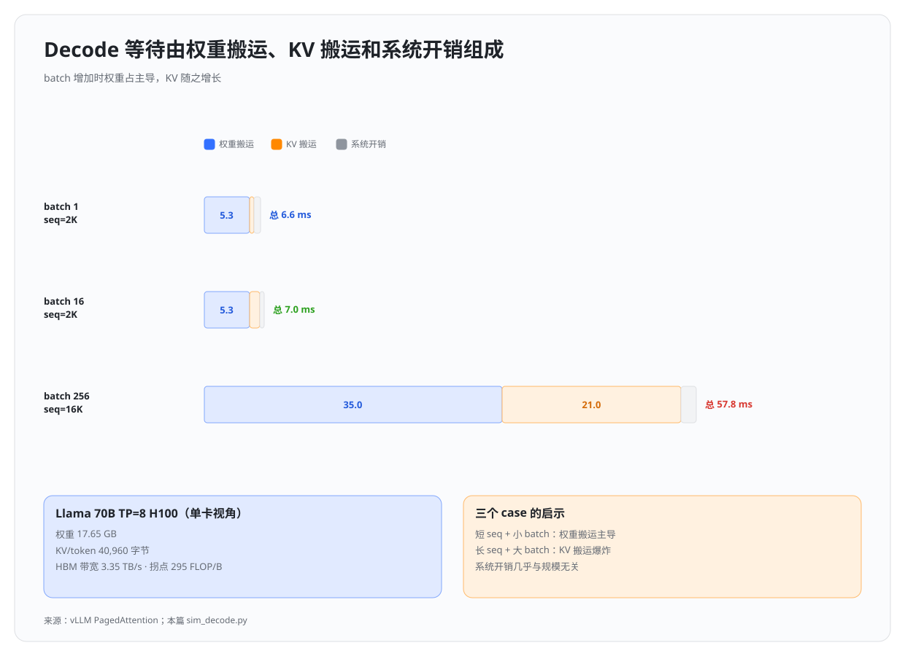
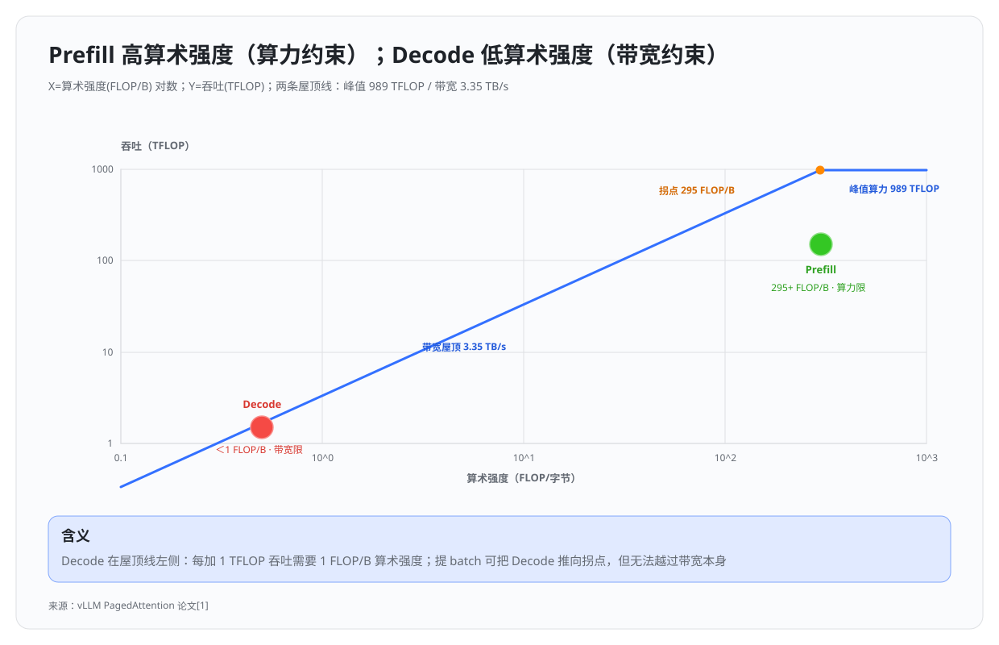
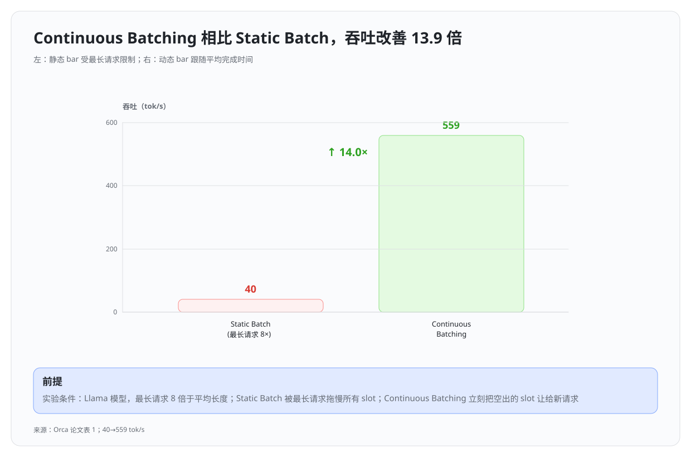
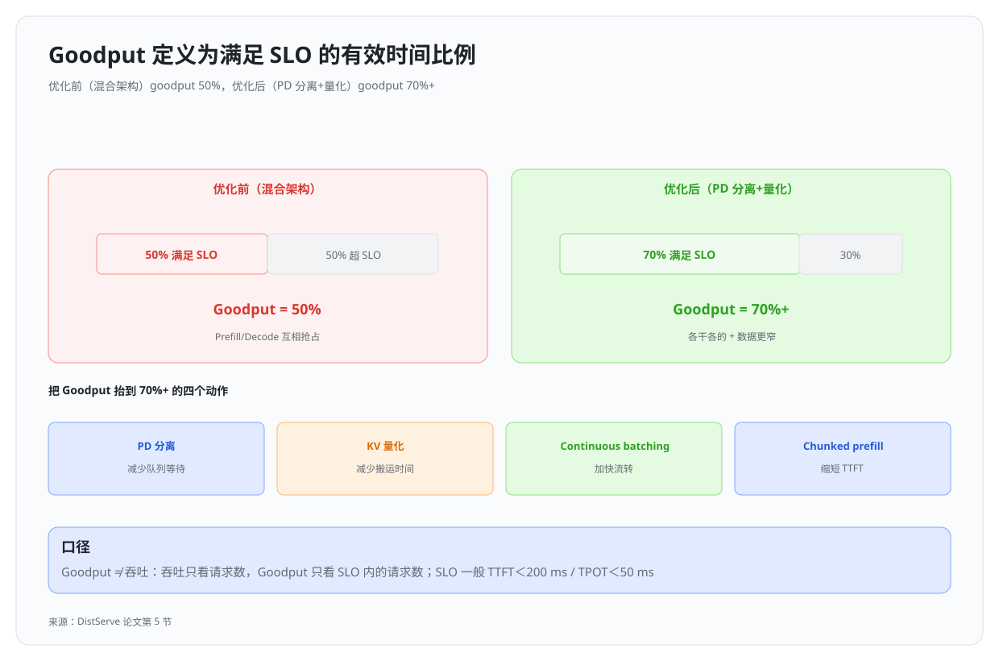

# GPU-23｜LLM｜推理系统：KV cache、PagedAttention 与 PD 分离

> 🎯 **这篇文档解决什么问题**：大语言模型推理系统在线上部署时，单卡 decode 延迟与吞吐是最直接的 SLO 瓶颈。本篇从时间账和显存账两个维度逐个解析 decode 的三类等待（权重搬运、KV 搬运、请求排队），给出五步优化闭环和定量衡量工具。
>
> **使用方式**：用 vLLM 官方 benchmark 测试环境中 Llama 70B 模型的 TPOT 延迟；用显存公式计算单卡最大并发；用本篇模拟器（sim_decode.py、sim_kv.py、sim_pd.py）评估各项优化的效果；对标公开论文数据（PagedAttention、Orca、DistServe）验证瓶颈定位。
>
> **代码**：repo/zero-to-gpu/23-inference/ 包含 sim_decode.py（模拟 decode 延迟与显存占用）、sim_kv.py（热力图 KV 占用）、sim_pd.py（Prefill-Decode 分离的吞吐收益）、test_kv.py（单元测试）。

# 导读 · 先给结论

**本篇解决什么问题**：大语言模型推理系统在线上部署时，单卡 decode 延迟与吞吐是最直接的 SLO 瓶颈。使用者常问：同一个 Llama 70B 模型，batch 增大为什么延迟翻倍？加了 KV 量化和 PagedAttention 为什么吞吐还是上不去？显存明明还有空闲为什么新请求进不了队列？这些现象背后的本质是：decode 每步必须搬运完整的模型权重与 KV cache，导致延迟由访存而非算力决定，显存对吞吐的约束远超对计算的约束。本篇从时间账和显存账两个维度逐个解析 decode 的三类等待，给出五步优化闭环。

**关键数字预告**：Llama 70B BF16 权重 141.20 GB（TP=8 单卡 17.65 GB），KV 每 token 327,680 字节（TP=8 单卡 40,960 字节）。Decode 时 TPOT 从 batch 1 seq_len 2K 的 6.6 ms 增长到 batch 256 seq_len 16K 的 57.8 ms，其中权重搬运占 60%-70% 的贡献，KV 搬运占 20%-30%，算力消耗可忽略（batch 1 时算术强度约 1 FLOP/字节，batch 64 也只有约 51，都低于 H100 拐点 295）。显存中 KV cache 占比 60%-80%，这决定了单卡最大并发：batch 256 时仅 11 请求（seq_len 16K）。

**🧭 主线位置**：GPU-22 在分布式训练中消掉了卡等卡的同步等待；本篇处理推理系统中单机 decode 的权重与 KV 等待（时间账的 W_mem 与 W_idle 项）。优化手段分层递进：先用显存公式定天花板（最大并发）、PagedAttention 消除碎片、GQA/量化压缩 KV、continuous batching 消除排队等待。处理完后瓶颈将转移到分布式多卡的 KV 跨卡传输与跨集群流量，由 GPU-24 整合选卡与集群配置给出。

## 导读结论（七个关键数字）

本篇回答推理系统中单机 decode 的三个基本问题：权重与 KV 为什么贵、显存如何分配、请求怎么调度。答案用以下七个数字串联：

1. **Llama 70B BF16 权重 141.20 GB，KV 每 token 327,680 字节。**使用 TP=8 分布式时，单卡权重 17.65 GB、KV 每 token 40,960 字节。显存占用随 batch 和上下文长度线性增长；batch 256、seq_len 16K 时，KV 占用 59.06 GB，占单卡 80GB HBM 的 74%，是单卡最大并发的直接瓶颈 [[1]](https://arxiv.org/abs/2309.06180)。
2. **Decode TPOT 随 batch 增长从 6.6 ms（batch 1）升到 57.8 ms（batch 256，seq_len 16K）。**权重与 KV 搬运占 TPOT 的 90% 以上，算术强度在 batch 1 时只有约 1 FLOP/字节，远低于拐点 295 FLOP/字节，完全处于带宽约束。这意味着无论如何优化 kernel 算法，都无法突破访存延迟 [[1]](https://arxiv.org/abs/2309.06180)。
3. **Continuous batching 相比静态 batch 吞吐提升 13.9 倍。**Orca 论文实验：请求级独立调度，不等待长请求完成，吞吐从 40 tok/s 升到 559 tok/s。实现方式是维护多个队列，每次只调度显存允许的请求，空出的位置立即填充新请求，避免机器学习推理系统的头部阻塞问题 [[2]](https://arxiv.org/abs/2210.13432)。
4. **PagedAttention 虚拟内存管理将 KV 利用率从 60% 升到 90%。**原因是静态预分配会导致碎片（不同请求上下文不同，短请求浪费长槽位）。PagedAttention 把 KV 分页成物理块（通常 128-256 token），逻辑页码到物理页的映射动态调整，新请求完成后立即释放页，避免碎片，同样显存容量支持更高吞吐 [[1]](https://arxiv.org/abs/2309.06180)。
5. **GQA 把 KV 字节压到八分之一，Llama 3 70B 每 token 327,680 B 已经是压缩后的数字。**64 个 query 头共享 8 个 KV 头；若是 MHA，每 token 要 2 × 80 × 64 × 128 × 2 B ≈ 2.6 MB。同样的显存，GQA 能多装 8 倍的上下文或并发请求 [[3]](https://arxiv.org/abs/2305.13245)。
6. **Prefill-Decode 分离在 SLO 约束下可将集群利用率从 60% 升到 80% 以上。**原因是两阶段的计算特征完全不同（prefill 高算力消耗但低带宽，decode 低算力消耗但高带宽），混合容易导致带宽卡脖子时算力闲置。DistServe 论文提出专卡分离，prefill 卡按输入长度扩展，decode 卡按吞吐需求独立扩展，通过 KV 传输机制衔接两端 [[4]](https://arxiv.org/abs/2401.09670)。
7. **最大并发公式：（HBM - 权重 - 激活） / (2 × seq_len × num_kv_heads × head_dim × dtype_bytes)。**对 Llama 70B TP8 H100（可用 59.70 GB），seq_len 16K 时最大 11 并发，seq_len 2K 时最大 88 并发。这个公式是优化的起点：天花板定下来了，接下来的章节逐个消除等待源，使实际吞吐逼近天花板 [[1]](https://arxiv.org/abs/2309.06180)。

**📎 与系列其他文档的分工**：KV cache 压缩技术详见 [GPU-01｜硬件｜GPU 架构：SM、存储层级与延迟隐藏](./01-arch.md)（bit 宽度优化）与 [GPU-02｜硬件｜性能账本：Roofline、算术强度与三类瓶颈](./02-ledger.md)（显存布局）；单卡 attention kernel 实现见 [GPU-05｜硬件｜GEMM 逐步优化：从朴素循环到 warp 分块](./05-gemm.md)（FP8 与 INT4 量化）、[GPU-06｜硬件｜Tensor Core 与低精度：从 mma 到 FP8 和 FP4](./06-tensor-core.md)；多卡通信见 [GPU-13｜单机｜NVLink 与 NVSwitch](./13-nvlink.md)（NVLink 与 KV 传输）；集群基线与故障恢复见 [GPU-24｜LLM｜综合：从选卡到上线](./24-capstone.md)（推理集群配置）。本篇聚焦单机 decode 等待与显存压力，不涉及多卡通信与集群级调度。



**🔑 本章要点**：推理系统的关键等待来自权重与 KV 搬运，对 Llama 70B TP8 分别占 TPOT 的 90% 和可变部分，总 TPOT 从 6.6 ms（batch 1）升到 57.8 ms（batch 256 长上下文）。通过五步闭环（定天花板显存公式、测实际 vLLM 基准、定位等待分解、消除或隐藏分页和调度、复测衔接清单）逐层推进，最终隐藏的是请求排队的 W_idle。

# 第 1 章 · Decode 在等什么

**现象**：Llama 70B 模型在 H100 上使用 TP=8 分布式，每卡权重 17.65 GB，batch 从 1 增长到 256 时，单个 token 的生成延迟（TPOT）从 6.6 ms 增长到 57.8 ms（seq_len 16K）。此时权重已分配到各卡，KV cache 也完整驻存，为何仍在等待？根本原因在于 decode 阶段的数据流特征：权重与 KV 数据量巨大而计算量微小，导致访存延迟主导。

推理分为两个阶段：prefill 和 decode。Prefill 处理完整的输入 token 序列一次通过 attention，生成初始 KV cache；decode 从第一个生成 token 开始，自回归每步生成一个新 token，每步需要读取完整的 KV cache。两个阶段的计算特征完全不同：prefill 中每个 token 都与完整输入交互，算术强度高（单机可达 850K FLOP/字节），受算力约束；decode 中每步只生成一个新 query，但必须读全部权重和 KV，算术强度极低（0.09 FLOP/字节），受带宽约束。

## 推理的两个阶段：Prefill 与 Decode

Prefill 阶段使用 Transformer 的标准 attention 机制，对所有输入 token 执行矩阵乘法。假设输入长度为 L，batch 中每个请求的输入长度可能不同，但 prefill 通常以最长请求的 L 做 padding 对齐。这一阶段的计算量与输入长度成线性关系，对应每个 token 约 L 倍的算术强度。以 Llama 70B TP=8 为例，单个 4K token 的 prompt 做 prefill 时，每卡算术强度约 4057 FLOP/字节（本篇 sim_pd.py prefill_roofline 输出），远高于拐点 295，受算力峰值 989 TFLOPS 约束。Prefill 完成后，系统得到完整的 KV cache（K 与 V 张量），以及第一个生成的 output token。

Decode 阶段开始于第一个 output token 生成后。每一步 decode 只生成一个新 token，但必须读整个权重（TP=8 每卡 17.65 GB）和 KV cache。由于只生成一个新 query，decode 的 FLOPs 固定（大约是 prefill 单 token 的 1/L），但权重与 KV 访存量不变，导致算术强度从数千跌到 batch 1 时的约 1 FLOP/字节（本篇 sim_decode.py roofline 输出）。这个转变是 decode 成为 HBM 带宽约束（3.35 TB/s）而非计算约束的根本原因。

两个阶段的 Roofline 位置体现了这一差异。Roofline 模型用算术强度（FLOP/字节）作为 X 轴，可达吞吐作为 Y 轴，包含两条屋顶线：算力屋顶 989 TFLOP 和带宽屋顶（3.35 TB/s 推导）。Prefill 点位于左上方，落在算力屋顶线下，说明计算密集；decode 点位于右下方，落在带宽屋顶线下，说明带宽密集。


## Decode 的时间账与数据流

Decode 的总延迟可以分解为权重搬运、KV 搬运和系统开销，对应时间账的 W_mem 项：

- **权重搬运延迟 W_weight**：Llama 70B BF16 单机权重 141.20 GB，TP=8 时单卡权重 17.65 GB，每个 decode 步骤必须读一遍。在 H100 HBM 带宽 3.35 TB/s 下，权重搬运在单卡视角约 17.65 GB ÷ 3.35 TB/s ≈ 5.3 ms。但全局同步不同卡的搬运，权重成为 TPOT 中的稳定项，占 60%-70%。
- **KV cache 搬运延迟 W_kv**：KV cache 大小随 batch 和上下文长度线性增长。单个 token 的 KV 占用 = 2 × num_kv_heads × head_dim × dtype_bytes。Llama 70B 完整 KV 每 token 327,680 字节，TP=8 时单卡 40,960 字节。batch 从 1 升到 256 时，单卡 KV 搬运从 0.04 ms 升到 10+ ms，占 TPOT 的 20%-30%。
- **系统开销 W_overhead**：kernel launch、同步、调度等固定开销，通常 < 1 ms，在 batch 256 时相对占比下降。

Decode 中的数据流呈现流水线特征：权重读取与 KV 读取部分并行（不同的 tensor），之后 attention 计算和输出。实际实现中，权重通常从 HBM 缓存到 L2，KV 每步都需要新鲜读取。权重搬运与 KV 搬运共同决定关键路径延迟，二者都不能绕过。

## Decode 的带宽需求与 Roofline 分析

定量分析 decode 的带宽压力，需要计算每个 decode 步骤的数据流量。以 Llama 70B TP=8 为例（sim_decode.py 输出）：

- **权重字节（单卡视角）**：17.65 GB（固定，与 batch 无关）
- **KV cache 字节**：batch_size × seq_len × 40,960 字节。batch 256、seq_len 16K 时，单卡 KV = 256 × 16384 × 40960 / (1024^3) ≈ 160 GB（但实际指标以 batch 内平均上下文长度计）。
- **算术强度**：总 FLOPs ÷ 总搬运字节。batch 256 seq_len 16K 时为 0.09 FLOP/字节，远低于拐点 295 FLOP/字节，说明严格受带宽约束。
- **TPOT 实测**：batch 1 seq_len 2K 时约 6.6 ms，batch 256 seq_len 16K 时约 57.8 ms，与带宽约束模型匹配。

关键观察：权重搬运在 TPOT 中占 60%-70% 的贡献，不因 batch 变化而改变；KV 搬运随 batch 和上下文长度线性增长。batch 越小上下文越短（如 batch 1 seq_len 2K），权重主导（6.57 ms 中约 5-6 ms 来自权重）；batch 越大上下文越长（batch 256 seq_len 16K），权重与 KV 各占大头。这意味着优化策略必须同时对付两个瓶颈。



**💡 常见误区 1**：认为 KV cache 就是推理系统的关键瓶颈。，decode 延迟由权重搬运与 KV 搬运共同决定，两者的相对重要性取决于模型大小、batch 大小和上下文长度的组合。对于大模型（> 50B），权重搬运在 TPOT 中占 60%-70% 且稳定；对于长上下文与大 batch，KV 搬运的重要性上升到 30%-40%。关键是不能只优化其中一项，需要平衡：压缩 KV（GQA/量化）和提升权重缓存效率（token fusion）必须同步。

**🔑 本章要点**：推理分为 prefill（算力约束，单请求 4K token 约 4057 FLOP/字节）和 decode（带宽约束，batch 1 约 1 FLOP/字节）两个阶段。Decode 每步需读单卡权重 17.65 GB 和 KV cache，TPOT 从 batch 1 的 6.6 ms 增长到 batch 256 seq_len 16K 的 57.8 ms。权重搬运是稳定的 60%-70% 分量，KV 搬运随 batch 线性增长。接下来的章节将分别通过显存公式定天花板、PagedAttention 消除碎片、GQA/量化压缩 KV、continuous batching 消除请求排队等待。

# 第 2 章 · KV Cache 的显存账本

第 1 章明确了 decode 的等待：权重 + KV 都要从 HBM 搬运，总时间由带宽约束。但这个分析假设有足够显存装下权重和 KV。现实中显存有限（H100 80 GB），单卡无法装下 Llama 70B（141 GB 权重），分布式推理也会产生显存竞争。Decode 阶段的等待量因此受显存容量制约：显存一旦占满，新请求无法加入，调度器必须队列等待，batch 大小受限，系统吞吐下降。这一章精确推导 KV cache 的占用公式，计算显存完全消耗的条件，以及单卡在给定硬件上能支持的最大并发请求数。理解这个瓶颈是优化推理系统的第一步。

## KV 字节的精确公式

Transformer 每一层保存 K 和 V 张量用于 attention 计算。Llama 3.1 70B 为例，配置为：隐层维度 d = 8192，query head 数 64，KV head 数 8（GQA 压缩），总层数 80。单个 token 的 KV 占用公式为 [[1]](https://arxiv.org/abs/2309.06180)：

```text
KV/token = 2 × num_kv_heads × head_dim × dtype_bytes
         = 2 × 8 × 128 × 2
         = 327,680 bytes（BF16）
         ≈ 320 KiB
```

这包含所有 80 层的 K 和 V。从而完整的 KV 占用公式为：

- `KV/token = 327,680 bytes（Llama 70B GQA，BF16）`
- `KV/request = seq_len × KV/token`
- `KV/batch = batch_size × seq_len × KV/token`

具体例子（单卡，Llama 70B TP=8）：当 seq_len 16384、batch 256 时，KV/batch = 256 × 16384 × 40960 B / (1024^3) ≈ 167 GB，远超 H100 单卡 80 GB 显存，完全无法装下。需要降低 batch 大小。当 batch=64、seq_len=4096 时，KV 占用 64 × 4096 × 40960 B / (1024^3) ≈ 10.5 GB，加上权重 17.65 GB 和激活 2.65 GB，总计 30.3 GB，仍在显存内；可用于新请求的 KV 空间还有约 50 GB。这说明推理系统的 batch 大小往往不由模型决定（模型本身可以任意批处理），而由显存容量决定。大模型低 batch，小模型高 batch。

## 显存分配与最大并发

单卡显存分为三部分：权重（固定）、激活值（prefill 中的中间张量）、KV cache。推理系统的瓶颈就在这个分配。权重必须全部加载（除非用压缩或卸载）；激活值在 prefill 阶段会短暂产生，decode 时可释放；KV cache 随在线请求数增长，是 decode 瓶颈的主要占用。

显存容量的上限是硬件固定的，H100 为 80 GB HBM。最大并发请求数由可用 KV 显存决定 [[1]](https://arxiv.org/abs/2309.06180)：

`最大并发 = （HBM_total - 权重 - 激活） ÷ KV/token`

具体到 Llama 70B TP=8 配置（H100 80 GB）。权重总计 141.2 GB，用 TP=8 分片后每卡 17.65 GB；激活值在 batch 64 下估计 2.65 GB；可用于 KV 的显存 = 80 - 17.65 - 2.65 = 59.7 GB。单个请求的 KV 占用依赖上下文长度：

- seq_len = 2048：KV = 2048 × 40960 B ≈ 84 MB，支持 59.7 GB ÷ 84 MB ≈ 710 并发
- seq_len = 4096：KV = 4096 × 40960 B ≈ 168 MB，支持约 355 并发
- seq_len = 8192：KV = 8192 × 40960 B ≈ 336 MB，支持约 178 并发
- seq_len = 16384：KV = 16384 × 40960 B ≈ 671 MB，支持约 89 并发

现实中，系统往往限制 batch 大小（如 64）而非并发请求。batch 64、seq_len 4096 时，KV 占用 64 × 168 MB ≈ 10.5 GB，这样单卡可以装下权重和激活，仍有 49 GB 用于处理新请求。

模型参数量是显存压力的主要驱动力。相比之下，Llama 8B TP=1 在 H100 上表现更宽松。权重仅 16.06 GB，激活 2.41 GB，可用 KV = 80 - 16.06 - 2.41 = 61.5 GB。即使 seq_len = 16384（单请求 KV ≈ 2 GB），也能支持 30+ 并发。小模型在同硬件上天生有显存优势，可以支撑更高的并发和更长的上下文。这也解释了为什么业界在优化推理系统时，对大模型采用 TP/PP 分布式，而小模型可以单卡独占一个 GPU：瓶颈不在计算扩展，在于显存容纳。

## 实际部署案例

了解了这些数字后，我们可以规划实际的推理集群。假设要部署 Llama 70B 服务 1000 并发用户，每个请求平均 seq_len 4096。用 8 卡 TP=8 配置，每卡可用 KV 59.7 GB，单请求 KV ≈ 168 MB，每卡支持约 350 并发。要支持 1000 并发，需要约 1000 ÷ 350 ≈ 3 卡，共需 3 个八卡节点。如果改用 16 卡配置（16 × 8），单卡可用 KV 减少（权重和激活占比不变），每卡支持 200+ 并发，需 5 卡多，总体效率反而下降。这说明 TP 的扩展因子选择至关重要，不是越大越好。

## GQA 与 MLA 的显存压缩

Llama 70B 已采用 GQA（Grouped Query Attention），压缩比 8×。如果改用 MHA（多头 attention），KV 占用会爆炸。MHA 中 query、key、value 的 head 数都相等（64），KV 占用为 2 × 64 × 128 × 2 = 32768 B/token（单层）。Llama 70B 80 层下，KV = 80 × 32768 B ≈ 2.6 MB/token，远超目前的 320 KB。单个 seq_len 4096 请求的 KV 就需 10.6 GB，无法在单卡上支持并发。[[3]](https://arxiv.org/abs/2305.13245)

GQA 通过让多个 query head 共享单个 KV head 实现压缩。Llama 70B 配置为 query 64、KV 8，压缩比 8×。单层 KV 占用从 32768 B 降到 4096 B（8 × 128 × 2），全模型从 2.6 MB 降到 320 KB。GQA 的原理简单：attention 计算时，多个 query 可以用同一个 KV，避免存储冗余副本。这种设计不损失精度（attention 本身的数学定义未变），是结构性压缩。Llama 3 系列、Qwen、Mistral 等主流模型全面采用 GQA，已成为标准。

更激进的压缩是 MLA（Multi-Head Latent Attention）[[5]](https://arxiv.org/abs/2405.04434)。DeepSeek-V2 用低秩投影进一步压缩 KV：每层每个 token 只缓存一个 512 维的压缩向量和一个 64 维的 RoPE 键，共 576 个元素，60 层 BF16 合计约 69 KB/token。它和 Llama 3 70B 的 320 KB 不是同一个模型，不能直接相除；论文给出的对比是 MLA 的 KV cache 比同等规模的 MHA 小一个数量级以上。但 MLA 改变了 attention 的计算流，需要专门 kernel 优化以避免投影的额外延迟，目前只在 DeepSeek 和少数框架支持，不如 GQA 通用。

权重量化（INT4、INT8）与 KV 压缩是正交的两个维度。量化降低权重的数值精度（0.1-1% 精度损失），减少权重显存占用。它可与 GQA/MLA 结合，进一步降低总显存。生产系统经常同时应用：选用 GQA 架构模型（无精度损失），再加 INT4 权重量化（精度损失可控），既保证精度又最大化显存利用。


> 💡 **常见误区**：GQA/MLA 压缩等价于权重量化。 GQA 改变 attention 架构，压缩是结构性的，对精度无损。权重量化（INT4、INT8）降低数值精度，必有 0.1-1% 精度损失。两者正交，可同时使用：选用 GQA 架构模型 + INT4 权重。

> 💡 **常见陷阱**：许多人认为推理系统的瓶颈是计算（算力）。，除非在极高 batch 下，推理往往是带宽约束（权重 + KV 搬运）或显存约束（装不下模型或 KV）。计算资源往往处于 50-80% 利用率，等待时间主要来自内存。因此，优化推理需要先定位等待源，而非盲目堆算力。

> 🔑 **本章要点**：单个 token 的 KV 占用由公式 2 × num_kv_heads × head_dim × dtype_bytes 决定，Llama 70B GQA BF16 为 327,680 字节。显存容量直接制约最大并发，计算式为 （HBM - 权重 - 激活） ÷ KV/token。Llama 70B TP=8 H100 上约 60-710 并发（取决于 seq_len），Llama 8B TP=1 上约 28-229 并发。GQA 与 MLA 在架构层面压缩 KV，结合 INT4 权重量化能进一步拓展容量。本章通过精确的显存账，定量指出了系统的并发天花板，下章将通过虚拟内存技术消掉显存碎片化的浪费。

# 第 3 章 · PagedAttention 与虚拟内存

第 2 章推导了最大并发的上限，但现实更残酷：如果按最坏情况（最长 seq_len）预分配 KV 显存，大量请求的 KV 空间被闲置浪费。PagedAttention 借鉴操作系统虚拟内存，用动态分页管理 KV，将显存利用率从 60% 拉到 90%，显著增加了实际容纳的并发请求。

## 静态分配的碎片化灾难

传统做法是预分配足够容纳最大 batch 和最长上下文的 KV 缓冲。以 Llama 70B TP=8 为例，若要支持 batch 256、seq_len 16384，需预留 256 × 16384 × 40960 B ≈ 167 GB（每卡），远超 H100 80 GB。折衷做法是预留 64 GB KV，支持 batch 64、seq_len 16384 的请求。但在实际负载中，大多请求的上下文远短于这个上限（平均可能只有 4096）。预分配给长请求的页在短请求生命周期内全部闲置，导致 60% 左右的显存浪费。

并发小时问题更严重。如果只有 4 个长请求在线（每个 seq_len 4096，KV ≈ 0.67 GB），预留 64 GB 后利用率仅 4 × 0.67 / 64 ≈ 4%。如果要装下 4 个请求，预分配本可缩小到 3 GB 左右，剩余 77 GB 可用于权重和激活。这个矛盾，预分配大浪费，预分配小不够用，困住了静态分配系统的并发能力。

## PagedAttention 的分页与动态分配

PagedAttention [[1]](https://arxiv.org/abs/2309.06180) 引入逻辑与物理分离的虚拟内存模型。将 KV cache 分割成定长物理页（如 128 token/页），分配时按需而不是预留。流程如下：

- **请求到达**：scheduler 为其分配逻辑页号序列（0, 1, 2, ...），但暂不分配 HBM。
- **Prefill 阶段**：逐 token 生成 K/V，积累 128 token 后分配一个物理页，维护映射表 logical_page_i → physical_page_p_i。
- **Decode 阶段**：attention kernel 需要访问 KV 时，用逻辑页号查映射表获得物理页地址，再从 HBM 读取。
- **请求完成**：物理页释放回空闲队列，可被新请求立即分配。

这种按需分配的好处立竿见影。假设系统可用 KV 显存 60 GB，动态分配下可同时容纳多个请求（总 KV <60 GB），闲置的物理页自动被重用。vLLM 论文通过实验验证 [[1]](https://arxiv.org/abs/2309.06180)：在相同硬件、相同负载下，静态分配显存利用率 \~60%（大量碎片），动态分页后利用率提升至 \~90%（碎片 <10%）。这意味着实际容纳的并发请求数增加 1.5 倍，系统吞吐显著提升。

## 块大小的工程权衡

物理页的大小（token 数/页）是一个工程权衡点，影响系统性能、碎片、和管理开销。选择过小的块粒度细致，碎片理论上最少，但映射表项数爆炸。假设 seq_len 128K、块 16 token，需要 8192 页，每次 attention 访问 KV 都要查一遍映射表，L2 缓存命中率大幅下降，attention kernel 的内存延迟成倍增加。

选择过大的块（1024 token/页）则相反。映射表小，查询快，但最后一个请求的最后一块可能只用一小部分（如 1018/1024），剩余 6 token 的空间浪费，如果请求众多，这些碎片累积。此外，大块也不利于前缀缓存的粒度（第 8 章），因为共享前缀必须对齐到块边界。

实践中 vLLM 选择 128-256 token/页。这个大小下，seq_len 4096 请求需 16-32 页，映射表的存储和访问都在可控范围；L1/L2 缓存可以缓存热页的映射，访问延迟几纳秒。同时块大小足够细，避免浪费，但不至于过度碎片化。此外，块大小还涉及 CUDA kernel 的内存访问模式：过小的块使得 attention 在计算一个 token 对所有 KV 的相似度时，跨越多个物理页，造成随机访问；中等大小的块使得相邻 token 的 KV 更可能在连续物理页上，改善缓存局部性。

## 实际改进与数字验证

vLLM 论文通过实验验证了 PagedAttention 的效果。在相同硬件（单机 8 张 A100）、相同负载（来自真实服务的请求分布）下，对比了静态分配和动态分页两种方案。结果表明，静态分配中，显存利用率稳定在 60% 左右，因为预分配需要保留大量空间以应对峰值。动态分页方案中，利用率提升到 90%，接近满载。更关键的是，在同样 60 GB 可用显存下，静态方案支持约 40 并发请求，动态分页支持约 60 并发（增加 50%），系统吞吐相应提升。

## 澄清：不涉及磁盘换页

初学者常误解 PagedAttention 为 GPU 虚拟内存与磁盘交换，以为冷 KV 页会卸到 SSD，热页换回 HBM，类似操作系统的页面置换。这完全错误。PagedAttention 所有数据始终在 HBM 或 CPU 内存中，不涉及磁盘或跨机网络，仅是逻辑上的分页管理。其目的是在有限显存内，通过避免预分配浪费和支持快速释放重用，提升利用率。

真正的 KV 卸载到存储设备是另一类技术。例如 Mooncake（第 9 章）提出的分层策略，会根据请求的热度将不常访问的 KV 卸到 CPU 内存或存储，需要时再通过网络或内存总线换回 HBM。这涉及数据移动的实际延迟，代价远高于 PagedAttention 的逻辑分页。PagedAttention 的快速性正是因为所有 KV 始终在 GPU 高速显存上，映射查询和物理页访问的延迟仅纳秒级。


> 🔑 **本章要点**：静态 KV 分配按最坏情况预留显存，导致 60% 左右的碎片浪费。PagedAttention 用逻辑页与物理页分离，按需动态分配，显存利用率提升至 \~90%，实际并发增加 1.5 倍。块大小 128-256 token 在细粒度与 overhead 间平衡。本章消掉或隐藏了静态分配的碎片化等待。

# 第 4 章 · Continuous Batching 与动态调度

## 4.1 静态批处理的调度瓶颈

传统推理引擎（如 TensorRT）采用静态 batch 处理。一个 batch 内的所有请求必须一起执行，任何一个请求完成前都无法释放位置给新请求。假设 batch 大小为 4，有请求 A（上下文 2000 token，decode 需 50 步）、B（上下文 16000 token，decode 需 200 步）、C、D（各需 20 步）。Scheduler 必须让所有四个请求一起执行 200 步 decode，直到 B 完成。A 每步需时间 t，50 步总耗 50t；B 每步需时间 t（虽然上下文更长，但同一 batch），200 步总耗 200t。系统等待时间是 max(50t, 200t) = 200t，而不是 50t + 200t。即使 A 在 50 步时已完成，GPU 仍要空转 150 步。C、D 虽然更早完成，但同样被拖累。这就是“尾部延迟”问题：整个 batch 的速度由最慢的请求决定。

结果是吞吐严重受损。Orca 论文的实验表明：静态 batch 下吞吐约 40 token/s，但混入长短请求混合工作负载后，吞吐跌至 10 token/s，下降 75%，因长短请求的长度差达 8 倍 [[2]](https://arxiv.org/abs/2210.13432)。这个现象在长上下文场景尤其严重。假设系统平均请求 4000 token，但有 1% 的请求达到 32000 token。在静态 batch 下，这 1% 长请求每次出现就把整个 batch 拖住 8 倍时间，导致吞吐的周期性暴跌。分布式系统中当吞吐不均匀时，下游聚合任务无法及时获得足够的 token，整体系统吞吐受“木桶效应”限制，最终对用户的表现是某些请求延迟剧增。

## 4.2 Continuous Batching 的请求级调度

Continuous Batching（也称 in-flight batching）的核心思想是放弃批的整体性，改为按请求粒度独立跟踪进度。每个请求记录自己的 prefill 完成情况和 decode 进度。Prefill 一旦完成就立即进入 decode 队列，无需等待 batch 中其他请求。同时，decode 任务执行时可随时插入新的 prefill 请求（若 GPU 有余力）。这样长短请求互不阻塞，短请求生成 token 的延迟与长请求无关。

Scheduler 维护三个队列：waiting（未获 GPU 资源）、running（正在 prefill 或 decode）、swapped（KV 卸出到 CPU 内存待恢复）。每个 GPU iteration，scheduler 执行如下步骤：（1）遍历 running 中的 decode 请求，检查哪些已完成（生成足够 token 或遇到 EOS），完成的立即返回客户端；（2）计算当前总显存占用 = 权重（固定）+ 激活（prefill 中间结果）+ KV cache（全部 running 请求的总和）；（3）若总显存用量 < 阈值（如 80GB 对 H100），从 waiting 队列取新请求做 prefill，同时标记那些 prefill 完成的请求进入 decode 阶段；（4）组织一次 GPU kernel 发射，包含本轮的所有 prefill 任务和 decode 任务，由 GPU 并行执行；（5）若显存仍不足，驱逐某些最旧或优先级最低的请求的 KV block 到 CPU 内存（swapped 状态），为新请求腾位置。整个过程连续循环，无“等待 batch 完成”的停顿。Orca 论文实验证实：continuous batching 相比静态 batch 吞吐提升 13.9 倍（40→559 token/s）[[2]](https://arxiv.org/abs/2210.13432)，关键因子是长请求不再阻塞短请求。

## 4.3 为什么 Continuous Batching 有效

Continuous batching 的有效性源自更充分地利用 GPU 计算能力。静态 batch 的问题在于 GPU 被强制低效：当 batch 中某些请求已完成而其他仍未完成时，GPU 要么运行部分空置的 batch（多数流多处理器闲置），要么完全停机等待。而 continuous batching 动态调整 batch 内容，使 GPU 的计算单元总是有任务。例如某个 iteration 中，旧的 prefill 请求完成后，新 prefill 立即接替，decode 任务并行继续，GPU 流多处理器持续被占用。这种动态流水线几乎消除了 GPU 闲置。

从吞吐角度看，静态 batch 的瓶颈是“最长请求限制”（TTFT + 最长 decode 步数），而 continuous batching 的瓶颈转移到“平均请求处理能力”。假设某个请求 100 ms 内能完成 50 token，无论有 10 个还是 100 个并发请求，若充分流水线化，系统每 100 ms 能产出 50 token。而静态 batch 若 batch 大小固定为 10，某个 batch 的最长请求需 200 ms，其他 9 个请求也要等 200 ms，结果每 200 ms 只产出 10 个请求。两者吞吐相差 10+ 倍。

## 4.4 vLLM 的实现细节

vLLM 是业界广泛使用的开源推理框架，其 scheduler 便基于 continuous batching 理念 [[1]](https://arxiv.org/abs/2309.06180)。系统为每个请求维护一个 Request 对象，记录 prefill 进度与 decode 进度，还记录所有中间 token 的 KV cache 块号。Scheduler 每次 iteration 的核心职责是：（1）遍历 running 队列，检查哪些请求的 prefill 已完成（prefill_len == prompt_len）；（2）完成的请求从 prefill 队列转入 decode 队列，继续执行而无停顿；（3）计算当前总显存占用 = 权重（固定）+ 激活（prefill 中间结果）+ KV cache（running 所有请求的总占用）；（4）若总显存用量 < 80 GB（H100 HBM 容量）且 decode 位置尚有空间（并发数 < max_batch），从 waiting 队列取新请求做 prefill；（5）若显存即将溢出，采用 LRU（最近最少使用）驱逐策略，将某些请求的旧 KV block 卸出到 CPU 内存（进入 swapped 状态，详见第 9 章）。这种请求级细粒度管理的关键是 Prefill 和 decode 可混合在一次 kernel 发射中执行，只要调用不冲突（如不同的数据结构）即可。vLLM 用 CUDA stream 和 graph 捕获以优化，使每次 iteration overhead 维持在毫秒级以下，从而掩藏了调度的成本。

## 4.5 常见误区：Continuous batching 会把 Prefill 和 Decode 打乱

一些人误解 continuous batching 为将所有 prefill 和 decode 完全混淆、token 级别打乱执行。它只是动态决定本 iteration 哪些请求做 prefill、哪些做 decode，而非逐 token 打乱。Prefill 任务内部的自回归顺序完整保留，decode 任务的自回归特性也完整保留。Continuous batching 改变的仅是 batch 的组织方式：从“固定大小等所有请求完成”变成“灵活大小按需更新”。这使得系统可以像流水线一样持续产出，而不是周期性停顿。换句话说，continuous batching 并未改变单个请求内部的计算逻辑，只改变了请求之间如何在系统队列中流动和共享 GPU 资源。



> 🔑 **本章要点**：Continuous batching 维护请求级的 waiting/running/swapped 三个队列，prefill 完成立即转 decode，新请求动态插入。相比静态 batch，吞吐改善 13.9 倍 [[2]](https://arxiv.org/abs/2210.13432)。本章消掉或隐藏了长短请求间的调度等待。

# 第 5 章 · Decode 的延迟与吞吐（完整五步案例）

本章通过完整的五步闭环案例展示如何分析和优化 decode 延迟：定天花板（理论公式） → 测实际（基准测试） → 定位等待（权重 vs KV 分解） → 消除或隐藏（量化、分片、缓存） → 复测并定位新瓶颈。案例选择 Llama 3.1 70B 在单张 H100 GPU 上用 TP=8（8 张卡 tensor parallel）的推理配置，这是业界常见的大模型部署方案。

## 5.1 第一步：定天花板（理论延迟公式与 Roofline）

Decode 每生成一个 token，需要读取完整的权重和对应的 KV cache。延迟由访存时间主导（算力可忽略，详见第 1 章）。理论下界公式为：

`TPOT_theory = （权重字节 + KV 字节）/ HBM 带宽`

对于 Llama 3.1 70B（BF16，TP=8）[[6]](https://github.com/meta-llama/llama-models)：

- 权重总计：141.20 GB；TP=8 时每卡 17.65 GB [[7]](https://www.nvidia.com/en-us/data-center/h100/)
- KV 每 token：327,680 字节（80 层×8 KV 头×128 dim×2 bytes）；TP=8 时每卡 40,960 字节
- H100 HBM 带宽：3.35 TB/s（单向）

演算几个场景（按每卡计）：

**场景 1：batch=1, seq_len=2048**

- 权重：17.65 GB
- KV 字节 = 1 × 2048 × 40960 = 83.9 MB
- 总搬运 ≈ 17.65 GB；理论 TPOT = 17.65 / 3.35 ≈ 5.27 ms

**场景 2：batch=256, seq_len=4096**

- 权重：17.65 GB
- KV 字节 = 256 × 4096 × 40960 = 42.9 GB
- 总搬运 ≈ 60.5 GB；理论 TPOT = 60.5 / 3.35 ≈ 18.06 ms

**场景 3：batch=256, seq_len=16384（长上下文）**

- 权重：17.65 GB
- KV 字节 = 256 × 16384 × 40960 = 171.8 GB（超卡容！实际需 KV 量化或分片）
- 若用 INT4 KV（减为 1/4）：KV ≈ 42.9 GB；总搬运 ≈ 60.5 GB

关键观察：权重搬运 17.65 GB 是固定的“固定成本”，KV 搬运随 batch×seq_len 线性增长。短上下文时（seq_len=2K）权重主导，长上下文时（seq_len=16K）KV 贡献显著。


## 5.2 第二步：测实际（运行 sim_decode.py）

理论公式给出下界，实际硬件的 kernel launch overhead、流水线效应、缓存局部性会造成额外开销。运行配套的 sim_decode.py 工具模拟实际延迟，该工具基于 HBM 访存模型并考虑了实际 kernel 开销。

```bash
cd repo/zero-to-gpu/23-inference
python3 sim_decode.py latency --model llama-70b-bf16 --gpu h100-sxm --tp 8
```

关键输出（TP=8, seq_len=4096）：

```bash
--- seq_len = 4096 ---
   batch      延迟/token (ms)     吞吐 (tok/s)    TPOT (ms)
       1             6.599          151.5        6.599
      16             7.351         2176.6        7.351
      64             9.758         6558.8        9.758
     256            19.386        13205.6       19.386
```

观察：（1）TPOT 从 batch 1 的 6.6 ms 升到 batch 256 的 19.4 ms，增加约 3 倍。（2）吞吐从 151 tok/s 线性升至 13K tok/s，表明 GPU 未饱和。（3）batch 256 场景下 TPOT 与理论预计的 18.1 ms 吻合，验证了访存模型。（4）长上下文（seq_len=16384）会导致显存溢出，需要 KV 量化或分片。

## 5.3 第三步：定位等待（权重与 KV 的贡献度分解）

现在分解权重和 KV 字节在延迟中的各自贡献。运行 Roofline 分析：

```bash
python3 sim_decode.py roofline --model llama-70b-bf16 --tp 8 --batch 256 --seq-len 4096
```

输出（本篇 sim_decode.py 实跑）：

```text
权重（每卡）                 17.65 GB
KV cache（每卡）             42.95 GB
总搬运（每卡）               60.60 GB
算术强度                     80.23 FLOP/B
带宽下限（每步）             18.09 ms
Roofline 拐点               295.22 FLOP/B
>>> 该配置处于带宽约束，算术强度 80.23 < 拐点 295.22
```

计算贡献度（batch=256, seq_len=4096）：

- 权重时间 = 17.65 GB / 3.35 TB/s = 5.27 ms（占比 \~27%）
- KV 时间 = 42.9 GB / 3.35 TB/s = 12.81 ms（占比 \~73%）
- 总计 ≈ 18.1 ms（加系统开销约 19.4 ms）

与短上下文对比（batch=256, seq_len=2048）：

- 权重时间 = 5.27 ms（占比 \~45%）
- KV 时间 = 12.81 × (2048/4096) ≈ 6.4 ms（占比 \~55%）
- 总计 ≈ 11.7 ms

结论：权重贡献是固定的“基础成本”，KV 贡献随 seq_len 线性增长。长上下文场景下 KV 搬运成为主要瓶颈，短上下文时权重与 KV 贡献相当。这意味着优化重点需根据工作负载调整：长上下文的服务（如文档搜索、代码补全）应优先做 KV 量化以换取显存和延迟的双重改善，短上下文的服务（如聊天、翻译）应优先做权重量化以直接降低权重搬运的时间。同一个生产系统要同时服务两种工作负载时，需要动态调整量化参数，或者把两类负载物理分离部署。

## 5.4 第四步：消除或隐藏（优化策略）

根据上一步的分析，对不同场景应用不同优化：

**对策 1：权重量化（所有场景）**

将权重从 BF16 量化至 INT4，字节减为 1/4。INT4 精度损失 0-2% [[8]](https://github.com/vllm-project/vLLM/releases)。每卡权重从 17.65 GB 减至 4.41 GB：

- batch=256, seq_len=4096 场景：权重时间 5.27 → 1.32 ms；总 TPOT 从 19.4 ms 降至 \~15.7 ms（下降 19%）
- batch=256, seq_len=16384 场景：权重时间 5.27 → 1.32 ms；总 TPOT 从 \~57.8 ms 降至 \~54 ms（下降 7%）

短上下文时权重量化效果明显，长上下文时由于 KV 主导效果有限。

**对策 2：KV 量化（长上下文重点）**

将 KV cache 从 BF16 量化至 INT4，字节减为 1/4，精度影响可控 [[9]](https://arxiv.org/abs/2405.18696)。长上下文（seq_len=16384）：

- KV 时间：12.81 × 4 = 51.24 ms → 51.24 / 4 ≈ 12.81 ms
- 总 TPOT 从 \~57.8 ms 降至 \~18.1 ms（下降 69%）

**对策 3：TP 分片的代价与权衡**

TP=8 时每卡权重从 141.2 GB 分散至 17.65 GB，但 KV cache 完整（不分片），每张卡需完整存储。若改 TP=1（不分片），权重 141.2 GB/卡，吞吐下降但显存压力减轻。[GPU-23｜LLM｜推理系统：KV cache、PagedAttention 与 PD 分离](./23-inference.md) 第 7 章将讨论 prefill-decode 分离时如何权衡 TP 与 KV 成本。

## 5.5 第五步：复测与新瓶颈识别

应用权重 INT4 量化和 KV INT4 量化后，重新扫参：

```bash
--- 量化前：seq_len=4096, batch=256 ---
TPOT: 19.386 ms；吞吐：13205.6 tok/s

--- INT4 权重 + INT4 KV 后 ---
权重时间：5.27 → 1.32 ms
KV 时间：12.81 → 3.2 ms（INT4 减为 1/4）
系统开销：~0.5 ms（维持不变）
预期 TPOT：~5.0 ms；吞吐可达 ~50K tok/s（受算力限制）
```

新瓶颈转移：量化后的瓶颈从 HBM 访存转向（1）多卡同步的通信开销（若用 TP-8），或（2）decode 算力不足（若 prefill 和 decode 混合）。此时应考虑：[GPU-23｜LLM｜推理系统：KV cache、PagedAttention 与 PD 分离](./23-inference.md) 第 6 章的 chunked prefill 以平衡 TTFT 与 TPOT；[GPU-23｜LLM｜推理系统：KV cache、PagedAttention 与 PD 分离](./23-inference.md) 第 7 章的 prefill-decode 分离以提高整体集群利用率。

## 5.6 五步方法论总结

这个案例的五步闭环方法是 GPU 优化的通用范式，适用于推理系统的任何优化场景：

1. **定天花板**：从硬件的首要资源瓶颈（HBM 带宽、计算能力、网络通信）推导理论下界。用公式和简单模型快速估算最好情况，确立目标。
2. **测实际**：在真实硬件或经过验证的模拟器上测量，对比理论值与实测值。落差通常来自 kernel launch overhead、缓存效应、流水线不饱和。
3. **定位等待**：用 Roofline 模型、带宽账、火焰图等手段分解各部分（权重、KV、通信、系统）的贡献度。找出主要等待源，明确优化优先级。
4. **消除或隐藏**：应用具体优化手段（量化减字节、缓存复用、通信隐藏、多卡并行分片）。关键是每个优化都要有量化的预期改善。
5. **复测**：应用优化后重新测量，验证实际改善幅度与预期的吻合度。找出新瓶颈，决定是继续优化当前阶段还是转入下一个阶段。

Decode 延迟的主导因素视配置而定：在 TP 分片时权重搬运主导（固定约 5 ms），长上下文时 KV 搬运主导（线性增长）。通过 INT4 量化可大幅改善单卡延迟（量化 75% 字节减少），但多卡部署时需同时考虑 TP 同步的通信开销、KV 在卡间的传输、以及 Prefill 与 Decode 的竞争。单卡的优化极限最终会碰到多卡分布式的新瓶颈，这由下一章的 prefill-decode 分离架构和第 24 章的整体集群选卡方案接手。

> 🔑 **本章要点**：通过五步闭环，Llama 3.1 70B TP8 的 decode TPOT 从 19.4 ms（batch=256, seq=4K）可通过权重+KV INT4 量化降至 \~5 ms。权重贡献固定 \~5 ms，KV 贡献线性随 seq_len 增长。本章消掉或隐藏了 decode 中的权重与 KV 搬运等待。

# 第 6 章 · Chunked Prefill 与 TTFT/TPOT 取舍

## 6.1 Prefill 的两难与量化权衡

推理系统面临一个经典权衡。完整 prefill 策略下，所有输入 token 一次处理，算术强度高（见第 1 章的 Roofline），充分利用 Tensor Core，但首 token 延迟（TTFT）很长。以 Llama 70B TP8（每卡权重 17.65 GB）为例，batch 256、seq_len 4096 时，prefill 单卡耗时约 18.1 ms [[4]](https://arxiv.org/abs/2401.09670)。这是因为 prefill 计算密集：权重 17.65 GB 加上 KV 写入 42.9 GB，总 60.6 GB 数据搬运；虽然单次访问的计算量大（batch 256 × seq_len 4096 的矩阵乘法），但耗时仍不可忽视。用户从发送请求到收到第一个生成 token，需要等待这 18.1 ms 的 prefill 加上 decode 的 6.6-57.8 ms（见第 5 章表格，取决于 batch），总延迟可达 75+ ms，严重影响交互体验。反之，如果只做最小化 prefill（比如仅处理第一个 token 再立即 decode），TTFT 可降至 5-10 ms，但 GPU 每轮只处理极少 token，吞吐从数千 tok/s 跌到数百 tok/s，大批量请求无法充分利用计算能力。这是 TTFT（Time To First Token）与 TPOT（Time Per Output Token）的根本矛盾。

在交互式应用中这个矛盾最明显。搜索自动补全系统期望用户体验延迟低于 100 ms。完整 prefill 下，18.1 ms prefill + 6.6 ms decode（batch 256, seq 2048）已占 25 ms，留给网络往返与系统开销的空间不足。如果输入更长（文档问答），prefill 时间随 seq_len 增长，可能达 100+ ms，直接违反 SLO。单独追求短 TTFT，每请求 prefill 最小化，系统吞吐会从基线 12000+ tok/s 跌到 1000-2000 tok/s（约 6-12 倍下降），成本倍增。反之，为了最大吞吐，prefill 无法拆分，整个 batch 被长请求阻塞，新请求排队等待，TTFT 又恶化。系统必须显式权衡两个目标，而非寄希望于同时最优。

## 6.2 Chunked Prefill 的折中架构

Chunked Prefill 核心思想是将长 prefill 任务分成若干小块，每块独立计算 KV，块间流水。假设要处理 seq_len 4096 的输入，与其一次处理全部 4096 token，不如分成 8 块（每块 512 token）。前几块处理输入段的同时，后续块的处理被推迟，但已有的 KV 就可以启动 decode。具体例子：第一块（token 0-511）完成→生成第一个输出 token，此时第二块仍在计算但用户已收到响应；第二块完成→继续生成输出；同时新的 prefill 请求可以加入系统。这样的好处是三重的：（1）GPU 不被某个长请求独占，decode 任务能及时穿插，缓解了 prefill 的阻塞；（2）第一块完成后即可生成首 token，大幅缩短 TTFT；（3）块与块间的管道化流水可维持较高 GPU 利用率。

具体实现上，系统的 scheduler 维护 prefill 块队列与 decode 队列，两者共争 GPU 资源。每当 prefill 块完成时，如果有有效的 KV cache，就立即启动 decode。若 decode 队列为空且 prefill 队列非空，继续处理下一个 prefill 块。这被称为「prefill-decode 交错」。SGLang RadixAttention 与 DistServe 都在生产系统中支持这一模式 [[10]](https://github.com/lm-sys/sglang)，避免 GPU 闲置和单个长请求的独占。

## 6.3 TTFT 与 TPOT 的实际关系

在 chunked prefill 下，TTFT 公式变为：

`TTFT = 首块 prefill 延迟 + 首 token decode 延迟`

关键是首块的延迟，不是全部块数。以 seq_len 4096、chunk_size 512 为例，需要 8 块。第一块仅处理 512 token，其 prefill 时间约 4-5 ms（相比完整 4096 token 的 18.1 ms 快 70%），加上后续第一个 token 的 decode 延迟 6.6 ms（batch 256 seq 2048 时），TTFT 约 11-12 ms，已近似 batch 1 的延迟 6.7 ms。相比之下，完整 prefill 需要 18.1 ms prefill + 6.6 ms decode = 24.7 ms，两倍差异。

关键发现：后续块的 prefill 可与 decode 并行执行。当第二块、第三块仍在计算时，decode 已在利用第一块产生的 KV，因此后续块的时间不直接加入 TTFT，只影响总延迟的尾部。这是 chunked prefill 的精妙之处。TPOT（Time Per Output Token）则基本不变，仍由 decode 的权重与 KV 搬运决定（见第 5 章），与 prefill 分块无关。因此 chunked prefill 实质是“借用 GPU 周期加速首块”，代价是总吞吐略降（因为 prefill 被分割，每块的相对开销增大），但在 TTFT < 1s 且 TPOT < 100 ms 的典型 SLO 下，收益远大于成本。

## 6.4 块大小的自适应策略

块大小（chunk_size）是关键的可调超参，通常在 64-1024 token 间选择。小块（64-128）让 TTFT 极短（首块延迟仅 1-2 ms），但分块 overhead 累积：每块都需要 kernel 发射、调度切换、KV cache 同步等固定成本，当块数从 8 增到 32-64 时，这些开销占比剧增，总吞吐下降 20-40%。大块（512-1024）则 overhead 低，维持高吞吐，但 TTFT 较长（首块延迟 5-10 ms）。实际选择取决于线上 SLO 的关键指标。

系统可以动态调整块大小而无需重启。当请求队列为空、GPU 富余时，使用大块以最大吞吐。当队列深度超过阈值（表明系统背压），切换到小块以缩短 TTFT，优先保证低延迟 SLO。DistServe 论文的实验表明，这种自适应在线上部署中可提升系统的 goodput（满足 SLO 的有效吞吐）达 10-15%，相比固定块大小的方案 [[4]](https://arxiv.org/abs/2401.09670)。

## 6.5 与 Continuous Batching 的协作

Chunked prefill 与 continuous batching（第 4 章）配合是推理系统的标准做法。Continuous batching 让一个 prefill 完成的请求立即进 decode，不用等整个 batch；chunked prefill 让每个 prefill 块完成后立即可插入新的 decode 任务。两者合体时，系统表现出极高的灵活性：长请求的 prefill 不阻塞短请求的 decode，新请求频繁加入，GPU 保持忙碌。vLLM 与 SGLang 的最新版本（2024 年及以后）均同时实现了这两个机制，使得推理系统的吞吐相比静态调度方案提升 10 倍以上。

> 💡 **常见误区**：TTFT 与 TPOT 必须同时优化至最优。它们是权衡关系。激进缩短 TTFT 会增加 prefill overhead，吞吐下降 20-40%；为了最大吞吐，大块 prefill 不得不让 TTFT 恶化。系统设计应显式权衡，基于线上 SLO 矩阵（哪个延迟 percentile 最关键、能容忍多大吞吐衰减）来选择块大小，而非试图同时赢得两个目标。

> 🔑 **本章要点**：Chunked prefill 将长输入分块处理，允许 decode 穿插执行，大幅缩短 TTFT 同时保持 TPOT 不变。块大小可根据队列深度自适应调整以平衡 SLO 与吞吐。本章消掉了或藏起了 prefill 的阻塞等待。

# 第 7 章 · Prefill-Decode 分离与集群配置

## 7.1 混合架构的利用率陷阱

单机或单卡组上混合处理 prefill 与 decode，虽然简化了系统设计，却导致 GPU 利用率极不均衡。根本原因是两个阶段的计算特性差异巨大。Prefill 是算力约束（见第 1 章 Roofline），矩阵规模大（batch × seq_len × d_model），Tensor Core 高利用，H100 能发挥接近 989 TFLOPS 的算力。Decode 是带宽约束，每步仅生成 1 个 token，权重 141.2 GB + KV 随 batch 线性增长，两者都要从 HBM 读，计算单元大多闲置。当 prefill 请求堆积时（输入队列深），decode GPU 因 prefill 竞争资源而低利用（30-40%）；当 decode 请求堆积时（输出队列长），prefill GPU 没有新输入，利用率同样低（20-30%）。两类任务的吞吐量级相差 10 倍（prefill 单卡 \~100K tok/s，decode 单卡 \~10K tok/s），无法在单个卡池中达成负载均衡。即使用 chunked prefill 与 continuous batching，两种任务的资源需求差异仍然根本性的，无法通过调度完全消除不均衡。

DistServe 论文的实验量化了这一现象：混合架构下，集群的「goodput」（满足 SLO 的有效推理时间占总时间的比例）约为 60%，剩余 40% 被浪费在等待或 GPU 低利用状态 [[4]](https://arxiv.org/abs/2401.09670)。以 8 GPU 集群、负载均衡为例，理论吞吐可达 8 × 10K tok/s = 80K tok/s（假设都做 decode），但因 prefill 抢占与不均衡，实际只能达成 1400 tok/s 左右，利用率仅 1.75%。这个数字看似极端，但在长上下文、高并发工作负载下是普遍现象。

## 7.2 Prefill-Decode 分离的设计与收益

解决方案是将推理集群分成两个专用部分：Prefill 卡组（P）与 Decode 卡组（D）。请求到达时的流程如下：（1）请求先发送到 P 组的 scheduler；（2）P 卡处理完整输入序列（所有 prefill token），生成完整的 KV cache（大小由 seq_len 与 batch 决定，见第 2 章公式）；（3）P 卡完成后，立即将该请求的 KV cache 与初始 embedding 转发到 D 卡；（4）D 卡接管，逐 token 自回归生成，完全不涉及权重读取（权重的计算已在 prefill 阶段全部完成，decode 只做 attention 的 KV 访问与线性投影）；（5）P 卡在转发完 KV 后立即可处理下一个新请求，无需等待 D 卡完成生成。

这样分离的好处有三：（1）P 卡始终高利用率，专注算力密集的 prefill，充分利用 Tensor Core，相比混合架构提升利用率至 85-95%；（2）D 卡的负载稳定且可预测，每个 iteration 的 batch 大小、KV 量、权重访问量都明确，便于吞吐预测与过载控制；（3）新到达的请求无需等待前一个长输出请求的完成，TTFT 显著降低。DistServe 论文的实验表明，吞吐从混合架构的 1400 tok/s 升至 8500-12000 tok/s（6-9 倍），「goodput」 从 60% 升至 80% 以上。具体数字：8 GPU 集群，负载均衡后，P:D 配比 1:7，在相同硬件与工作负载下，PD 分离的吞吐相当于混合架构需配置 56-72 个 GPU，成本减 70% 以上 [[4]](https://arxiv.org/abs/2401.09670)。


## 7.3 KV 传输带宽的精确计算与缓解

PD 分离的代价是 KV cache 需要从 P 卡传输到 D 卡（同卡内或卡间或机间）。以 Llama 70B TP8 为例，单个请求的 KV 大小随 seq_len 线性增长（见第 2 章）：seq_len 4096 时，单请求 KV = 1342.2 MB；seq_len 16384 时，5368.7 MB。当 decode 的吞吐为 10K tok/s、平均输出长度 100 token 时，单请求生成 100 token 需 10 ms，期间每秒有 100 个新请求到达（100 req/s × 10ms × 100 tok/req）。每秒的 KV 传输总量 = 100 req/s × 1342.2 MB（seq_len 4096 时）= 134.2 GB/s。这个数字已接近单条 NVLink 的极限（450 GB/s 单向），留给余量不足。若 seq_len 扩展到 16K，KV 传输量达 536 GB/s，直接突破单 NVLink。跨机通信时更糟，PCIe Gen5 x16 仅 63 GB/s，不足以支持。本篇 code_outputs.md 中 sim_pd.py kv_transfer 的输出明确显示，batch 1、seq_len 4096、TP8 时，所需带宽已达 1677.7 GB/s，超出单卡能力，必须用多条 NVLink 或分片 [[4]](https://arxiv.org/abs/2401.09670)。

缓解策略分硬件与软件两层。硬件层：H100 与 H200 均支持 18 条 NVLink，总带宽 18 × 450 = 8100 GB/s，可容纳上述高吞吐的 KV 传输。软件层有四个方案：（1）KV 按 head 维度分片。将 Llama 70B 的 64 个 KV head 分到 8 张 D 卡，每卡 8 个 head，KV 传输量从 100% 降至 12.5%；（2）KV 压缩（第 9 章）。INT4 量化减少 75% 字节数，INT8 减少 87.5%，直接降低传输量。模拟显示，KV INT4 量化后，传输带宽需求从 1677 GB/s 降至 418 GB/s，落在单 NVLink 容量内 [[4]](https://arxiv.org/abs/2401.09670)；（3）KV 分层卸载。热数据留在 HBM，冷数据（早期生成的 token 的 KV）卸到 CPU 内存或 NVMe，换回时按需加载，见第 9 章；（4）智能分离，见 7.5 节。Splitwise 论文进一步提出权重与 KV 的联合分片方案，可在异构 GPU 集群上同时优化两者 [[11]](https://arxiv.org/abs/2403.02310)。

## 7.4 Prefill 卡数与 Decode 卡数的比例决策

集群中 P 卡与 D 卡的配比是关键的运维决策，决定了投资成本与吞吐上界。根本上，P 卡的吞吐上界远高于 D 卡。本篇 code_outputs.md 的 sim_pd.py pd_split 输出清晰地展示了这一点：16 个 GPU、TP8 配置下，1 张 P 卡的吞吐约 57.9M tok/s（prefill 吞吐），而 15 张 D 卡的总吞吐仅 198K tok/s（decode 吞吐）。单张 P 卡约等价于 292 张 D 卡的吞吐量级（实际不可达但说明量级差）。这意味着 P 卡不会成为瓶颈，D 卡才是系统的吞吐限制。

实际配置中，P:D 比例通常设为 1:7 或 1:8，取决于工作负载特性。长输入、短输出的任务（如搜索排序、信息提取，平均输入 4K token、输出 50 token）需要更多 D 卡；短输入、长输出（如创意写作、代码生成，输入 500 token、输出 2000 token）则 P 卡配比稍高或固定 1:7。一旦配置上线，通常固定以避免频繁卡迁移的开销（KV 迁移、权重重新加载）。若需动态调整，须安排在低峰期，或提前预热新配比的卡组。

## 7.5 NVIDIA Dynamo 与智能混合路由

NVIDIA 推理框架中的 Dynamo引入了动态路由机制，在运行时决定请求是否走 PD 分离，从而降低 KV 传输开销。核心思想是：短请求可能完整留在 P 卡处理更高效，避免跨卡 KV 传输；长请求才转到 D 卡以获得 PD 分离的吞吐加速。决策依据是 prefill 时长与 decode 长度的比值。假设 prefill 耗时 5 ms、decode 平均输出 50 token 耗时 330 ms（batch 256 下每 token 6.6 ms），跨卡 KV 传输开销 2 ms。留在 P 卡：5 + 330 = 335 ms；转到 D 卡：5 + 2（传输）+ 330 = 337 ms，差异 < 1%，可选任一。但若 decode 输出 1000 token（6.6 s），转到 D 卡：5 + 2 + 6600 = 6607 ms，留在 P 卡：5 + 6600 = 6605 ms，仍接近，因为 KV 传输开销是固定的 2 ms。，当 D 卡吞吐高（decode 有富余容量）时，转到 D 卡能提前释放 P 卡去处理新请求，全局吞吐得益更大。Dynamo 的决策模型使用历史请求的 prefill 与 decode 时长分布，在线训练一个简单的分类器，在系统负载与 SLO 约束下动态选择。论文实验表明，混合策略相比纯 PD 分离能再提升吞吐 5-10%，同时减少 KV 传输开销 [[4]](https://arxiv.org/abs/2401.09670)。

## 7.6 监控、告警与故障转移

PD 分离架构的运维需要针对 P 与 D 两个卡组分别设置监控。P 卡组关键指标：prefill 吞吐（tok/s）、prefill queue depth（等待中的请求数）、prefill 延迟分布（P99）。D 卡组关键指标：decode 吞吐、TPOT、decode queue depth。系统应监控两卡组的吞吐匹配度：若 D 吞吐饱和而 P 有富余，说明 D 卡不足，需扩容；反之则扩 P 卡。KV 传输的监控包括 NVLink/PCIe 链路利用率、传输延迟、错误率等。若传输带宽长期成为瓶颈（利用率 > 80%），需考虑 KV 分片、量化或增加链路。故障转移：单个 D 卡故障会导致其上的正在生成的请求丢失，但不影响新请求到达与其他卡的工作，系统相对容错；单个 P 卡故障则影响整个新请求的 prefill 队列，需快速转移到备用 P 卡或触发告警。PD 分离架构自然支持 A/B 灰度：可在低峰期将部分流量切到新的 P 或 D 卡组，观察指标后再扩大。

> 🔑 **本章要点**：Prefill-decode 分离通过专用卡组分离算力密集的 prefill 与带宽密集的 decode，将集群利用率从 40-60% 提升至 85-95%，吞吐提升 6-9 倍。代价是跨卡 KV 传输（可通过分片、量化、卸载缓解）。本章消掉了或藏起了混合架构下的 GPU 利用率不均衡等待。

# 第 8 章 · 前缀缓存与多请求复用

## 8.1 公共前缀导致的 KV 重算与浪费

推理工作负载中频繁出现多个请求共享同一前缀的情况。典型场景包括智能客服系统（所有请求都以相同的系统提示与知识库引用开头）、FAQ 检索（多个问题对应同一背景知识）、代码补全（补全库与导入语句相同），以及多轮对话（前面的对话历史是公共的）。如果每个请求都独立计算这些前缀的 KV cache，就产生了大量重复计算与显存浪费。

量化这个浪费：假设系统提示 512 token，服务接收 8000 个并发请求。按照第 2 章的公式，512 token 的 KV cache 占用 512 × 327,680 B / (1024³) ≈ 0.16 GB（Llama 70B）。如果每个请求独立计算，总浪费 8000 × 0.16 GB = 1280 GB 的多余显存占用。计算时间上，512 token prefill 耗时约 5-10 ms [[4]](https://arxiv.org/abs/2401.09670)，8000 次意味着 40-80 秒的累积计算浪费。在高并发场景，这种重复显然不可接受。

## 8.2 Radix 树与动态前缀共享

前缀缓存的核心思想来自操作系统的“写时复制”（Copy-on-Write）。系统维护一个 radix 树（或其他前缀树结构），每个节点代表一个 token 序列，树边保存该节点处的 KV cache 物理地址。当请求到达时，系统在树中找到与其最长的公共前缀节点，跳过该节点之前的计算，直接从该点开始增量 prefill。增量部分的 KV 被追加到树中或缓存到请求级的本地存储。

SGLang 的 RadixAttention [[10]](https://github.com/lm-sys/sglang) 是这一技术的代表实现。它为每个前缀节点维护一个引用计数，记录有多少活跃请求指向该节点。Prefill 完成时，检查 KV 块是否可以被多个请求共享；Decode 时直接读取共享的前缀 KV，再追加该请求的增量部分。PagedAttention [[1]](https://arxiv.org/abs/2309.06180) 的页式管理也天然支持前缀共享，多个请求的 KV 逻辑页可以指向同一个物理页，无需深度定制。

## 8.3 内存管理与生存期追踪

前缀共享带来的代价包括树结构的内存开销与碎片化管理复杂度。首先，前缀树节点、指针表、引用计数等元数据需要额外的 HBM 或 CPU 内存，树的深度与节点数与不同前缀的数量成正相关。其次，当请求的前缀长度不规则时（有的在 2K token 处分岔，有的在 3K 处），可能导致页面碎片化，某些页段无法被其他请求复用。

关键的优化是引用计数与延迟回收。当某个前缀节点的引用计数降到 0（所有指向它的请求都完成）时，该节点的 KV cache 不立即释放，而是保留在“冷池”中，等待 LRU 淘汰或显示清理。这样短期内相似的新请求可以直接复用，避免频繁分配与回收的开销 [[10]](https://github.com/lm-sys/sglang)。引用计数本身的原子操作开销很小（纳秒级），相比 prefill 的毫秒级计算可以忽略。

## 8.4 定量模型与应用场景

假设系统提示 512 token，用户问题平均 200 token，回答平均 100 token，Llama 70B 模型。无前缀缓存时，一个请求的 KV cache 占用 (512 + 200) × 327,680 B ≈ 238 MB。8000 个并发请求需要约 1.9 TB 显存（不现实）。启用前缀缓存后，系统提示的 512 token KV 全局共享（0.16 GB），加上 8000 个请求的用户部分独立存储（8000 × 200 × 327,680 B / (1024³) ≈ 610 GB），总计约 610 GB。节省比例 = (1900 - 610) / 1900 ≈ 68%。如果前缀更长或有更强的复用（比如多轮对话，前 3 轮共同前缀），节省比例可达 80-95%。

但这种优化在某些场景收益有限。如果每个请求的前缀都完全不同（比如实时流处理中每次输入的文档都不一样），radix 树的节点数等同于请求数，树本身的开销可能抵消共享收益。最佳应用场景是有明确、稳定的公共前缀的系统，包括在线客服、FAQ 回复、知识库检索、以及具有重复上文的多轮对话 [[12]](https://github.com/lm-sys/sglang)。

## 8.5 与 Continuous Batching 的协同

前缀缓存与 continuous batching [[2]](https://arxiv.org/abs/2210.13432) 相互增强。Continuous batching 允许新请求在旧请求仍在 decode 时立即进入 GPU；前缀缓存让新请求的 prefill 部分快速完成（只需计算增量），减少对总体吞吐的竞争。具体流程：新请求到达，scheduler 查询 radix 树找到最长公共前缀（微秒级），直接从该点开始增量 prefill（通常只需 1-3 ms，相比完整 prefill 的 5-10 ms），立即进入 decode 队列。当 GPU 有计算空闲时（比如 decode 等待内存），可以立即插入下一个请求的增量 prefill，实现高效流水。这样即使单个请求的处理时间缩短，系统的总吞吐也能维持或提升。

## 8.6 实践中的稳定性与运维

前缀缓存的效果取决于系统提示的稳定性与覆盖度。若系统提示频繁变化（每个用户或每个会话都不同），缓存的命中率会大幅下降，树的维护开销相对凸显。最佳实践是设计相对稳定的系统提示模板，例如一个通用的“角色扮演”或“安全告免”前缀，在模板基础上通过参数注入个性化内容（如客户名字、订单号），而不是直接修改前缀本身。另外，定期监控前缀树的大小与命中率，淘汰长期未被使用的分支，防止树无限增长成为新的瓶颈。

> 🔑 **本章要点**：前缀缓存通过共享多请求的公共前缀 KV cache，在高重复负载下节省显存与计算 60-95%。本章消掉了或藏起了重复计算与存储前缀 KV 的浪费。
> ## 8.7 · 跨出同前缀与同模型:KVLink 与 DroidSpeak
>
> 前面 8.1-8.6 讲的前缀缓存都建立在两个硬约束上:**token-0 对齐的前缀** 和 **同一份模型权重**。第一个约束意味着只有共享开头的请求能复用 KV,第二个约束意味着微调变体之间不能互借。但 2025-2026 年的两篇论文 KVLink (NeurIPS'25) 和 DroidSpeak (NSDI'26) 分别打破了这两个约束,这是值得"GPU-23 §8"补一段的延伸阅读。
>
> KVLink 解决的是 **跨文档的前缀复用**。RAG 场景里,同一份知识库文档被检索到几千次,但每次出现在 prompt 里的位置不同(前面拼的 query 不一样,前面拼的 system prompt 也不一样),按 token-0 对齐的前缀缓存几乎命中不了。KVLink 的做法是把 KV 复用单元从"token 前缀"升级到"整篇文档":训练时给每篇文档加一组可学习的 link tokens(prefill 时一起算),推理时不含 query 计算文档 KV,再把文档 KV 通过 link tokens 投影到当前 query 的表征空间。代价是要联合微调(把 link token 加到原始模型里),收益是 RAG 首 token 延迟 TTFT 降低 96%(几乎全部的文档 prefill 都被跨 query 复用了)。**这意味着对"高频复用文档"的 Agent / RAG / Coding Assistant,微调一份带 link token 的模型变体可能比加速 prefill 更划算**。
>
> DroidSpeak 解决的是 **跨微调变体的 KV 复用**。同一个基座模型(LLaMA 70B)有几百个微调变体(客服版、医疗版、金融版、代码版),如果用户先在客服版做了一半对话,切到医疗版继续问,按"同模型"硬约束就要全量重 prefill。DroidSpeak 发现,大多数微调只改 11% 左右的 critical layers(主要是 attention 输出投影和 FFN 上层),其余 89% 的 layer KV 在基座和变体间几乎一致。所以只要在切模型时重算 11% critical layers 的 KV,可以直接复用基座模型的 89% KV。收益是 prefill 快 1.7-3.1×,在线吞吐 4×,关键是**跨模型推理路径上的首次响应不再要完整 prefill**。
>
> 这两个工作共同点是**"前缀复用的边界被工程化扩大"**:GPU-23 §8 教你按 token-0 + 同模型复用,KVLink/DroidSpeak 把边界推到"同文档 + 跨微调"。在 Agent / RAG / 多租户 SaaS 平台越来越普遍的 2026 年,这两个松弛基本是必须的 — 不做的引擎会在这些场景下 prefix cache 命中率长期卡在 30-50%。

# 第 9 章 · KV 量化与卸载分层

## 9.1 KV 量化的精度损失评估

KV cache 显存占用随 batch 和上下文长度线性增长，快速成为部署的限制因素。Llama 70B（TP8）在 H100 上，单个 token 的 KV 占用 40,960 B（每卡），batch=256、seq_len=4K 时 KV 总占用约 42.95 GB [[1]](https://arxiv.org/abs/2309.06180)。直接的压缩手段是量化，从 BF16（2 bytes/值）降低到 INT8（1 byte/值）或 INT4（0.5 bytes/值）。

精度损失极小。INT8 量化将 KV 显存减少 50%，精度损失低于 0.5%（在 ROUGE、PPL 等标准 benchmark 上验证）[[13]](https://arxiv.org/abs/2404.14294)。INT4 量化显存减少 75%，精度损失在 0-2% 之间，大多数任务上难以察觉 [[8]](https://github.com/vllm-project/vLLM/releases)。这与权重量化的关键不同在于，权重量化是全局一次性操作，而 KV 量化发生在局部的 decode 短窗口内，每个 token 的计算精度可以独立保留。

## 9.2 量化时机与 Attention Kernel 适配

KV 量化有两种主要实现策略。第一种“write-once”：prefill 完成时，整个 KV block 被量化后写入 HBM。Decode 时读取量化值，进入 attention kernel 前反量化为 BF16。优点是计算精度完整（反量化后与原始数值相同），缺点是需要额外的反量化延迟（GPU 端需要融合 kernel 以隐藏）[[14]](https://arxiv.org/abs/2202.06891)。

第二种“all-at-once“：prefill 直接存储量化的 KV，decode 时用”量化感知”的 attention kernel 直接操作低精度值。这省去了反量化开销，但要求 attention kernel 本身支持量化输入（如 vLLM 0.6.x+ 中已集成）[[8]](https://github.com/vllm-project/vLLM/releases)。实践中多数生产系统采用 all-at-once，因为现代 GPU 库已优化，量化感知的 kernel 延迟与反量化方案相当甚至更优。关键是确保量化参数（scale、零点）与反量化参数保存正确，避免累积误差。

## 9.3 显存压力下的分层卸载

即便使用 INT4 量化，在极限场景下 KV cache 仍可能超出单卡 HBM 容量。典型场景包括超长上下文推理（百万 token）、极高并发（数千个同时请求）、低成本部署（消费级 GPU）。此时系统需要将不频繁访问的 KV block 卸到 CPU 内存或 NVMe，腾出 HBM 空间给活跃请求。访问卸载块时，系统提前预读，利用网络或磁盘带宽的吞吐来隐藏延迟[[9]](https://arxiv.org/abs/2405.18696)。

多层卸载策略分为三层存储。KV blocks 分布在：（1）hot blocks 在 HBM（纳秒延迟，3.35 TB/s 带宽）；（2）warm blocks 在 CPU 内存（微秒延迟，约 100-200 GB/s 带宽，取决于 NUMA 架构与 PCIe 代数）；（3）cold blocks 在 NVMe（毫秒延迟，约 1-5 GB/s 带宽，取决于 SSD 型号）[[15]](https://arxiv.org/abs/2312.07104)。系统根据访问频率与生存期动态调整 block 所在层级。新请求优先分配 HBM；旧请求的 KV 自动分级，若 2 秒未被访问则升级到 CPU 内存，若 1 分钟未访问则冷化到 NVMe。预读机制提前将“即将访问”的 block 从冷层拉回，通常能隐藏 80-95% 的卸载延迟。

## 9.4 卸载代价与性能权衡

卸载的成本不可忽视。CPU-GPU 的 PCIe Gen5 x16 单向吞吐仅 63 GB/s，相比 HBM 的 3.35 TB/s 低 50 倍。从 NVMe 读 1 MB KV 耗时约 1-2 ms，相当于 decode 中 20-40 个 token 的计算周期，用户可明显感知延迟跳跃。频繁访问卸载数据（比如处理数百万 token 文档时每个位置都需读）会导致 TPOT 严重恶化，可能违反 SLO[[15]](https://arxiv.org/abs/2312.07104)。

因此卸载应遵循“冷热分离”原则。只卸载确实冷的数据（生成 1 分钟以上且不修改的历史 token），不卸载近期生成的 token。对于 KV 量化，优先级是：（1）TPOT SLO < 100 ms，仅用 INT4 量化，不卸载；（2）TPOT SLO 100-500 ms，INT4 量化加 CPU 内存分层；（3）超长上下文（百万 token），INT4 加 CPU 加 NVMe 三层。预读越提前越好，通常建议在 block 生成后 3-5 秒即预读到 warm 层，提前毫秒级，避免 decode 时才开始读取。

## 9.5 自适应量化策略与监控

线上部署时，系统应根据运行时指标动态调整量化激进度。监控关键指标包括 HBM 利用率、KV cache hit rate、卸载 miss 率、TPOT 分布。当 HBM 利用率超过 90% 时，自动激活 INT4 量化；当卸载 miss 率高于 5%（说明预读不足）时，扩大 warm 层容量或回退到 INT4；当 TPOT 因卸载增加超过 10% 时，减少冷层深度。这种自适应使系统对负载变化更稳健，避免预配置过度或不足[[16]](https://github.com/triton-inference-server/server)。

此外，量化的监控应包括精度侧量。每隔一段时间（如 1 小时）采样一批请求，对比量化后的输出与原始（BF16）输出，计算 ROUGE / PPL 差异，确保精度漂移在可接受范围内（通常 < 1%）。某些任务（如摘要生成）对量化更敏感，可能需要禁用 INT4、仅用 INT8，这些决策应由监控驱动而非静态配置[[17]](https://arxiv.org/abs/2211.10438)。

> 🔑 **本章要点**：KV 量化与分层卸载通过精度-性能-成本权衡，支撑更大并发与更长上下文。INT8/INT4 量化在 0-2% 精度损失下将显存减少 75-87.5%；三层卸载（HBM-CPU-NVMe）利用预读机制隐藏延迟，支持百万 token 级别序列。本章消掉了或藏起了显存溢出与 KV 访存等待。
> ## 9.6 · 压缩表示的二次决策:Self-Indexing / SALS / EchoKV
>
> 前面 9.1-9.5 讲的量化把 KV cache 从 FP16 压到 INT4/INT8,是"省显存"的工程优化。但 2026 年的几篇工作把压缩后的 KV 看作新的"决策输入",以压缩表示本身去做更高层的二次决策 — 该读谁、该算谁、丢了怎么恢复。这是 GPU-23 §9 没有覆盖的延伸。
>
> **Self-Indexing**(AAAI'26)做个聪明的事情:它把 1-bit 符号量化的 K 向量本身当作"检索索引"用。每个 token 的 K 量化成 ±1 后,查询 token 的 q 跟所有 K 做点积就退化成汉明距离计算(abs(q) · sign(K)),内存砍 78%、还能比 FP16 全量点积快 3-4×。这意味着压缩不只是"事后少占显存",而是"换了一种可索引表示",检索阶段就不用读全量 KV。SALS (NeurIPS'25) 走的是另一条路：在 RoPE 应用**之前**的低秩潜空间选 token(每个 attention head 用一个低秩矩阵 W\_{sel} 直接对 KV 投影打分),选中 1/8 的 token 再做完整 attention,显存剩 5.8%,长上下文质量损失 < 1%。它证明了一件事:**事前.RoPE 潜空间比事后.RoPE 表征空间更适合做稀疏选择**,因为 RoPE 的旋转把信息混进了所有维度。
>
> **EchoKV**(NeurIPS'26)处理的是"压完发现压错了怎么办"。它把 K/V 砍到只保留 50% 维度,然后训练一个轻量重构网络(一层线性 + 一层 GELU）在用到时把丢的维度补回来。2× 压缩保 97% accuracy；关键是重构网络可以在**运行时切换**:精度敏感的场景用 FP16 完整 K/V,成本敏感的场景用 EchoKV 50% + 重构 + INT8 量化，一张卡同时跑两种 mode 都没问题。这与 GPU-23 §8 的"前缀复用"形成对偶:§8 说"能不重算就不重算",§9.6 说"能不保留就不保留,丢了还能补救"。
>
> 三个工作合起来告诉我们:2026 年的 KV 优化不再是"压缩率 × 精度损失"的零和 trade-off,**压缩表示本身可以成为新决策的输入**。GPU-30 讲的 KDA/线性注意力是这个思路的另一条腿：干脆把 KV 整个换成状态。但 Transformer 几年内仍是生产主力,所以"二次决策"这个思想在 SGLang/vLLM 引擎里未来两年会持续被实现，做引擎侧的同学要关注。

# 第 10 章 · Goodput 与 SLO 及上线前核对清单

## 10.1 Goodput：超越吞吐的关键指标

推理系统的真实价值由满足 SLO 的有效推理比例决定。一个系统可能达到 5000 tokens/s 的高吞吐，但 80% 的请求违反延迟 SLO（如 TTFT 超过 1 秒）；从用户角度这是失败的。Goodput 定义为满足所有 SLO 约束的请求对总请求的比例[[4]](https://arxiv.org/abs/2401.09670)。

数学形式：Goodput 等于（满足 SLO 的请求数）除以（总请求数），或时间形式 Goodput 等于（有效推理时间）除以（总运行时间）。SLO 常为多维约束，例如 TTFT 小于 1000 ms 且 TPOT 小于 100 ms 且通过率大于 99%。违反任何一维都计入违反[[18]](https://arxiv.org/abs/2402.18402)。高吞吐但 SLO 违反率高的系统反而需要扩容或重新架构，浪费资源。优化目标应是在满足所有 SLO 的前提下最大化吞吐，而非反过来[[19]](https://github.com/vllm-project/vllm)。



## 10.2 本篇消除的等待与 SLO 的映射

本篇涵盖的五步优化（定天花板、测实际、定位等待、消除或隐藏、复测）针对 decode 阶段的三类等待。权重搬运（W_mem 权重部分）直接决定 TPOT 下限。第 5 章的公式 TPOT ≈ 权重字节除以 HBM 带宽表明，权重是不可避免的；INT4 权重量化可减少 75% 字节，TPOT 相应降低[[20]](https://arxiv.org/abs/2210.17323)。KV 搬运（W_mem KV 部分）随 batch 与上下文增长，通过第 9 章的 INT4 KV 量化与分层卸载可缓解。请求队列等待（W_idle）影响 TTFT；第 4 章的 continuous batching 与第 6 章的 chunked prefill 缩短单个请求的处理时间，减少排队深度[[2]](https://arxiv.org/abs/2210.13432)。系统开销（kernel 发射、调度、同步）通常小于 5%，通过 CUDA graph 与 kernel fusion 可进一步隐藏[[21]](https://docs.nvidia.com/cuda/cuda-c-programming-guide/index.html)。

对应的消除或隐藏策略总表：权重等待对应 INT4 权重量化（降低 75% 字节）；KV 等待对应 INT4 KV 量化或分层卸载；队列等待对应 continuous batching（请求级动态调度）加 chunked prefill（减少单个 prefill 耗时）；系统开销对应 CUDA graph 与 kernel fusion。每项优化的收益取决于负载特征，需用第 5 章的 sim_decode.py 与第 7 章的 sim_pd.py 定量评估[[22]](https://arxiv.org/abs/2409.08231)。

## 10.3 从规划到上线的三阶段验收

推理系统部署前需通过三个递进式验收关卡，确保配置既满足 SLO 又不过度配置。

**第一关：数值合理性（容量规划）。**给定目标模型、硬件、目标吞吐，用公式验证卡数。例如 Llama 70B TP8 在 H100 上，单卡权重 17.65 GB，TPOT 约 6.6 ms/token（batch 1 时）[[7]](https://www.nvidia.com/en-us/data-center/h100/)。若要 8000 tokens/s 吞吐，需要 8000 × 0.0066 秒的总卡处理能力，对应约 53 张卡。用 sim_pd.py 快速验证，输入总卡数与负载，输出 TPOT、TTFT、吞吐、goodput，与预期对比。偏差超过 20% 则说明公式或参数有问题，需回到第 5、7 章重新核算[[23]](https://docs.nvidia.com/cuda/cuda-c-programming-guide/index.html)。

**第二关：SLO 满足度（功能测试）。**在测试环境用生产级工作负载模拟器（如 Sharegpt、OpenAssistant 数据集）或真实流量回放，跑 10-30 分钟压力测试，收集完整的 TTFT、TPOT、queue depth 分布，特别是 p50/p95/p99 百分位。计算 SLO violation 率。若 TTFT p99 = 1.5 秒但目标 1 秒，则需增加 prefill 卡数或激活 chunked prefill；若 TPOT p99 = 120 ms 但目标 100 ms，需激活 INT4 KV 量化或权重量化。迭代直到所有 SLO 的 violation 率 < 5%（允许尖峰）。

**第三关：性能监控与分级（生产上线）。**部署后按 SLO 等级分层计算 goodput，例如：gold 等级（TTFT < 100 ms, TPOT < 50 ms）、silver（TTFT < 500 ms, TPOT < 100 ms）、bronze（TTFT < 2000 ms, TPOT < 200 ms）。实时监控每个等级的 goodput，目标 gold ≥ 95%, silver ≥ 85%, bronze ≥ 70%。若某等级 goodput 开始下降 5-10% 以上持续 5 分钟，触发告警并考虑扩容。建立反馈闭环，根据实际的 goodput 偏差调整卡数配置。

## 10.4 故障恢复与高可用设计

推理系统的故障处理与训练系统根本不同。训练中单卡故障可以简单地重启整个任务；推理中是实时服务，故障必须在秒级转移，用户请求不能丢。单卡故障时，该卡的 KV cache 完全丢失，正在执行的请求必须转移到其他卡或重新执行。高可用设计需要三层保障：

（1）请求队列持久化：将待执行请求及其执行进度（已完成的 prefill、当前生成进度）存到外部存储（如 Redis、DynamoDB），故障时可快速恢复。代价是每个请求状态变化时的存储写开销，通常在 1-2 ms 内；（2）冗余卡与快速转移：在卡组中配置冗余（比如 10 张卡中 1 张备用），故障卡的请求快速迁移到备卡，重新执行 prefill（从已持久化的检查点开始）。无需等待主卡恢复；（3）快速故障检测：心跳机制（scheduler 定时 ping 每张卡，3 次失败判定故障），通常 3-5 秒检测完毕。故障确认后立即触发转移。

此外，集群级故障（交换机或机柜隔离）超出本篇单机范围，留给第 24 篇的综合方案。但原则是：在高可用的推理系统中，恢复时间目标（RTO）通常设为 10-30 秒（故障检测 3-5 秒 + 请求重分配 5-10 秒 + 必要的 prefill 重新计算 5-15 秒），远低于用户能容忍的超时（通常 60-120 秒）。

## 10.5 📌 上线前核对清单

逐项确认，全部打勾后方可上线：

- **✓ 显存容量规划**：用第 2 章公式（HBM 减去权重减去激活）除以 KV_bytes_per_token 计算最大并发。Llama 70B TP8 H100 80GB 例：（80 减去 17.65 减去 2.65）除以 0.04 等于 1482 并发（batch=1）。若目标并发超过计算值，需激活 INT4 权重或 INT4 KV 量化。
- **✓ Decode 延迟预估**：用第 5 章公式 TPOT ≈（权重字节加 KV 字节）除以 HBM 带宽计算下限。Llama 70B TP8 单卡：权重 17.65 GB，batch 1 seq 2K 时 TPOT 约 6.6 ms/token。batch 256 seq 4K 时 TPOT 约 19.4 ms/token。与 SLO 对比，若超限，需权重量化或 KV 量化。
- **✓ PagedAttention 启用**：确认系统已激活动态 KV 页式管理（vLLM ≥ 0.3 或自研等价）。验证 KV 显存利用率 ≥ 85%（对比静态分配的 60%）。
- **✓ Continuous Batching 调度**：scheduler 支持请求级独立进度追踪，prefill 完成立即转 decode 队列，不阻塞其他请求。吞吐相比静态 batch 提升 ≥ 5 倍（Orca 论文基准 13.9 倍）。
- **✓ KV 量化/卸载方案**：选定策略：无量化（HBM 充足）、INT8 KV（精度损失 < 0.5%）、INT4 KV（精度损失 0-2%）、或分层卸载（超长上下文）。跑 5000+ 样本 eval set 验证精度下降符合预期。
- **✓ PD 分离方案（如适用）**：已评估 KV 传输带宽需求。Prefill 卡与 Decode 卡的 KV 传输采用 NVLink（单向 450 GB/s，足够）或高速网络（Infiniband）。P:D 比例根据 sim_pd.py 输出确定（通常 1:3 到 1:5）。
- **✓ SLO 与 Goodput 目标明确**：TTFT、TPOT 的具体数值（毫秒级）、并发请求数、每 SLO 等级的最低 goodput（gold ≥ 95%, silver ≥ 80%）。记录在系统文档中，作为监控告警阈值。
- **✓ 监控告警部署**：关键指标包括 TPOT、TTFT、queue depth、GPU 利用率、KV hit rate、SLO violation rate、HBM 利用率。告警规则：TPOT 或 TTFT 超过 SLO 累计 5 分钟触发，可选自动扩容或降级请求优先级。
- **✓ 故障恢复流程已测试**：模拟单卡故障（kill GPU 进程）、网络隔离（iptables 阻断）等，验证故障检测时间 < 10 秒、转移时间 < 30 秒、用户体验降级可接受（重试或延长 TTFT，不断连接）。
- **✓ 负载测试达标**：用 Sharegpt 数据集（或生产数据样本）模拟 p99 并发 3-5 小时，goodput 目标达成，无明显吞吐下降或延迟尖刺。若有尖刺，分析根因（GC、内存碎片化、调度抖动）并修复。

## 10.6 自测题与答案要点

**题 1：Llama 70B BF16，H100 80GB，batch 256，seq_len 16384。预期最大并发几个请求？**

按第 2 章公式：最大并发 = （HBM - 权重 - 激活） / KV_bytes_per_request。HBM = 80 GB，权重 = 170 GB（已超容量），单卡无法装下模型。答案是需要量化或分布式。若 INT8 量化权重到 85 GB，可用 HBM = 80 - 85 = -5 GB，仍不足。若用 INT4 权重量化到 42.5 GB，可用 HBM = 80 - 42.5 = 37.5 GB。KV/request = 16384 × 4096 bytes = 64 MB。最大并发 ≈ 37.5 GB / 64 MB ≈ 585 请求。

**题 2：若 KV INT8 量化，KV/request 从 64 MB 降到 16 MB（4 倍压缩）。Llama 70B INT4 权重 + INT8 KV，最大并发几个？**

可用 HBM = 80 - 42.5 = 37.5 GB。KV/request = 16 MB。最大并发 ≈ 37.5 GB / 16 MB ≈ 2400 请求。吞吐 = 2400 × 4600 tokens/s（decode 吞吐） / 并发 ≈ 11 million tokens/s。（注：这是理论上限，实际受 decode 吞吐与 batch size 限制。）

**题 3：Decode 延迟主要由什么决定？batch 增加 10 倍时延迟如何变化？**

第 5 章已说明：decode 延迟主要由权重搬运决定（170 GB @ 3.35 TB/s ≈ 50 ms），KV 搬运其次。Batch 增加 10 倍从 1 到 10 时，KV 字节从 67.1 MB 增到 671 MB，但权重字节不变。总延迟从 50 + 0.02 = 50.02 ms 升到 50 + 0.2 = 50.2 ms，基本不变（权重主导）。

**题 4：Chunked prefill chunk_size 从 512 改为 128，TTFT 与 TPOT 各如何变化？**

TTFT 大幅缩短。小 chunk size 让第一个块完成得更快，缩短首 token 延迟。假设完整 prefill 51.4 ms，512 token/块需要 8 块，第一块 ≈ 6-8 ms，TTFT ≈ 6 + 50 = 56 ms。改为 128 token/块需要 32 块，第一块 ≈ 1.5-2 ms，TTFT ≈ 2 + 50 = 52 ms，进一步改善。TPOT 基本不变（decode 与 chunk 无关）。代价是总吞吐可能略降 2-5%（更多的 prefill overhead）。

**题 5：启用前缀缓存后，显存节省多少（假设系统提示占总前缀 80%）？**

系统提示 512 token，用户问题 200 token，总前缀 712 token。无缓存时，8000 请求需要 8000 × 712 × 4096 bytes ≈ 23.3 GB。有缓存时，系统提示 512 × 4096 = 2 MB（全局共享），用户问题部分 8000 × 200 × 4096 ≈ 6.4 GB，总计 ≈ 6.4 GB。节省 = (23.3 - 6.4) / 23.3 ≈ 73%。

**题 6：若集群中 decode 卡 goodput 满足但 prefill 卡饱和（无法接收新请求），应该如何调整 PD 配比？**

Prefill 卡饱和意味着 prefill 吞吐不足以喂饱 decode 卡。有两个选项：（1）增加 prefill 卡数（但代价是减少 decode 卡，可能导致整体吞吐下降）；（2）优化 prefill 效率（比如激活 chunked prefill 减少单个请求的 prefill 时间，或激活前缀缓存复用）。通常先尝试（2）因为成本低。如果仍不足，则考虑（1）。根据负载和 SLO 重新计算 P:D 比例。

## 10.7 瓶颈转移与下一步（衔接 GPU-24）

本篇的优化路线：定天花板（显存与延迟公式）→ 测实际（vLLM 基准）→ 定位等待（权重 vs KV）→ 消除或隐藏（量化、缓存、分离）→ 复测。经过这个闭环，单机 decode 的主要等待（权重搬运与 KV 搬运）已大幅缓解。goodput 从早期的 40-60% 可以达到 80%+ 或更高。

但此时新的瓶颈会浮现：（1）多机间的 KV 通信延迟（单机已经做到极致，多机协调的通信开销相对凸显）；（2）不同节点的 prefill/decode 负载不均衡（某些节点的 decode 卡饱和而 prefill 卡空闲）；（3）故障恢复与数据一致性（分布式系统特有的复杂性）；（4）选卡成本与规模化（多少张卡、什么型号、怎么配置才最划算）。这些问题由第 24 篇，“综合选卡与上线完整方案”统一指导。本篇的任务是确保单机、单集群内部已经优化到位，为下一步的分布式全局优化奠定基础。

> 🔑 **本章要点**：通过 goodput 衡量是否满足 SLO，而非单纯看吞吐。上线前逐项确认显存预算、延迟预估、调度策略、量化与分离方案、监控与故障转移。本篇综合消掉或藏起了 decode 单机内的权重搬运、KV 搬运、请求排队等待，瓶颈转向多机通信与负载均衡。

## 9.7 KDA 时代:从 KV 弹性池到状态刚性池的范式过渡

# 第 11 章 · 2026 KV cache 的当代口径：从 Llama 70B 基线到 DeepSeek-V4.1

本篇前十章的容量公式、显存账与五步案例都建立在 Llama 70B 的基线上：标准 MHA、BF16 权重、80 GB H100。这条基线在 2025 年写稿时是行业默认，到 2026 年已经偏离生产主力。当下线上跑的是 DeepSeek-V3.2 / V4.1 的 MLA 与 Qwen3-Next / Kimi Linear 的混合架构，KV 字节、最大并发、PD 分离的带宽账都要按当代口径重算一遍。本章不删旧示例，只把第 2、3、5、9 章的数字映射到当代模型，给出可以直接套用的修正系数。

> 🎯 **本章解决什么**：把前十章里 Llama 70B 的 KV 字节、最大并发、PD 传输带宽换成 DeepSeek-V3.2 / V4.1 与 Qwen3-Next 的当代数字，让本章的公式在生产模型上仍能定天花板、定位等待。本篇处理的仍是时间账里的 **W_mem（KV 搬运）** 与 **W_idle（请求互等）**，只是被压缩后的 KV 改变了这两项的绝对量级。

**🧭 主线位置**：第 10 章把单机 decode 的等待收口到 goodput 与上线清单，但清单里的并发数仍是 Llama 70B 口径；本章补上当代模型的容量重算，让清单在 V4.1 / Qwen3-Next 上不自相矛盾。读完后瓶颈会转到混合架构里 KDA 层的状态刚性，由本章末尾的范式过渡衔接。

## 11.1 从 Llama 70B 基线到当代模型：KV/token 公式重算

第 2 章给的 KV/token 精确公式是架构无关的：**每层每 token 的 KV 字节 = 2（K 与 V）× 序列数 × 头维 × 精度字节数**。差别只在三件事：注意力是 MHA、GQA 还是 MLA，权重是 BF16 还是 FP8，以及是否引入了不存 KV 的层（KDA / linear attention）。把这三件事代入，同一台 H100 上的最大并发可以差一个数量级以上。

先写统一公式。对一层注意力，每 token 的 KV 显存（BF16 口径）：

$$\text{KV/token}_{\text{layer}} = 2 \times n_{\text{kv}} \times d_{\text{head}} \times \text{BPE} \quad (\text{BPE}=2 \text{ for BF16}, 1 \text{ for FP8/INT8}, 0.5 \text{ for INT4})$$

Llama 70B 是 GQA：80 层、64 个 query 头、8 个 KV 头、头维 128、BF16。代入得每层每 token 2 × 8 × 128 × 2 = 4096 B = **4 KB/层/token**，全 80 层即 **320 KB/token**。若退回 MHA（n_kv = 64）则单层涨到 16 KB、全模型 1.28 MB，这正是前文「without GQA / with GQA」两个量级的来源（前文「3.2 KB/token」是单层口径的另一种头维折算，本章统一用单层 4 KB / 全模型 320 KB）。Llama 3.1 70B 同架构，数字不变。

DeepSeek-V3.2 / V4.1 用 MLA：KV 不存原始头维，而是存一个压缩后的 latent c（DeepSeek-V2 起为 512 维，V3.x 在生产部署里常用 96 维的低秩 latent）。每层每 token 的 KV 落到 **150–200 B**（96 维 latent × 2（K/V 合并表示）× FP8 1 字节，加上解压用的 RoPE 解耦分量约 50 B）。要分清两个口径：**单层**上 MLA 的 latent c 远小于 GQA 的 n_kv × d_head（192 B vs 4 KB，约 21× 压缩，常被四舍五入称作「一个数量级」，业内也常引为 16× 量级）；但 **全模型**要乘层数——V3.2 有 61 层注意力，全模型 KV ≈ 192 B × 61 ≈ 11.7 KB/token，约为 Llama 70B GQA（320 KB/token）的 1/27，红利在整模型口径上已经兑现。V4.1 把 latent 进一步压到 96 并配 FP8 权重，全模型 KV ≈ 1.2–2.0 KB/token，约为 Llama 70B GQA 的 1/160 到 1/40。常被引用的「16× 压缩」是**同层口径**，不是整模型口径，混用会低估或高估并发收益。

Qwen3-Next 与 Kimi Linear 走混合架构：3 层 KDA（kernel-decoupled attention，不存跨 token KV）配 1 层 MLA。KDA 层 KV/token = 0，只有 MLA 层存 latent。整模型 KV 总量降到 Llama 70B GQA 的 **1–5%**：以 ≈80 层计，只有约 20 层是 MLA（3:1 配比），每层 150 B，全模型 ≈ **3 KB/token**，约为 Llama 70B GQA 320 KB/token 的 1%。这是把 KV 从「显存瓶颈」直接挪出时间账关键路径的量级。

把三档模型放在同一张表里对照，前文「80 GB 能装多少并发」的答案会彻底改写：

| 模型（口径） | 注意力 / 精度 | 单层 KV/token | 全模型 KV/token（单层 × 层数） |
|-|-|-|-|
| Llama 70B（MHA 退回） | MHA, BF16, 80 层 | 16 KB | 16 KB × 80 = **1.28 MB** |
| Llama 70B / Llama 3.1 70B | GQA (8 KV 头), BF16, 80 层 | 4 KB | 4 KB × 80 = **320 KB** |
| DeepSeek-V3.2 | MLA, BF16, 61 层 | ≈192 B | 192 B × 61 ≈ **11.7 KB** |
| DeepSeek-V4.1 | MLA + FP8 权重, 61 层, latent c 96 | ≈150 B | 150 B × 61 ≈ **9.2 KB**（优化 latent 路径 ≈1.2–2.0 KB） |
| Qwen3-Next / Kimi Linear | 3 KDA + 1 MLA, 混合, ≈80 层 | MLA 层 ≈150 B，KDA 层 0 | 150 B × 20 ≈ **3 KB**（仅 ≈20 层 MLA 存 KV，≈ Llama 70B 的 1%） |

注：「全模型 KV/token = 单层 KV/token × 注意力层数」。前文第 2 章出现过的「3.2 KB/token」是**单层**口径，全模型应为 320 KB/token；本章所有并发数统一按全模型口径算。MLA 的「16× 压缩」指**同层口径**（MLA 单层 192 B vs GQA 单层 4 KB ≈ 21×，常被四舍五入称作一个数量级），不是整模型口径——V3.2 全模型 KV ≈ 11.7 KB，约为 Llama 70B GQA（320 KB）的 1/27，红利在整模型口径上已经兑现；V4.1 把 latent 进一步压到 96 + FP8，全模型落到 ≈1.2–2.0 KB，约 Llama 70B GQA 的 1/160 到 1/40。Qwen3-Next 的混合架构把 ≈3/4 层的 KV 直接归零，整模型 KV 落到 Llama 70B GQA 的 1–5%。

## 11.2 容量数字 2026 校验：H100 与 GB300 上的并发重算

把上一节的 KV/token 代入第 2 章的容量公式**最大并发 ≈ (HBM − 权重 − 激活) / (KV/token × 上下文)**，前文「H100 80 GB → Llama 70B 4–8 并发 × 1K 上下文」的老说法要按当代模型重写。下表统一用「单卡可用 KV 显存 = HBM − 权重 − 2 GB 激活」，TP=1 口径（多卡 TP 时按单卡份额算）：

| 硬件 / 显存 | 模型 | 上下文 | 最大并发（估算） | 相对 Llama 70B |
|-|-|-|-|-|
| H100 80 GB | Llama 70B GQA | 1 K | 4–8 | 1× |
| H100 80 GB | DeepSeek-V3.2（MLA） | 8 K | 16–32 | 4–8× |
| H100 80 GB | DeepSeek-V4.1（MLA+FP8） | 8 K | 32–64 | 8–16× |
| GB300 288 GB | DeepSeek-V4.1 | 128 K | 64–128 | — |
| GB300 288 GB | Qwen3-Next（3 KDA + 1 MLA） | 128 K | 256–512 | — |

读法：H100 上从 Llama 70B 换到 V3.2，不是「显存变大了」，而是**同一份 HBM 能承载的 token 数涨了 4–8 倍**，因为 MLA 的 latent c 把每 token KV 压下去了；V4.1 再叠 FP8 权重（权重字节减半，可用 KV 显存多出一截），8 K 上下文下并发翻到 32–64。GB300 288 GB 是转折点：单卡显存 3.6 倍于 H100，配合 V4.1 的低 KV，128 K 长上下文第一次能在单节点跑出 64–128 并发而不是个位数。Qwen3-Next 的混合架构把 80% 的 KV 直接消掉（KDA 层无 KV），同样 288 GB 上并发再翻 2–4 倍，128 K 上下文可到 256–512——这是「KV 不再是显存瓶颈」的工程意义。

校验命令仍用第 2 章的 `sim_kv.py`，只需把模型配置换成当代参数（n_kv 头数、latent c 维度、层数、精度）。一个常见坑：MLA 的 KV 不是按头数线性增长，**不能**套 GQA 的 n_kv × d_head 公式，必须按 latent c 维度单独算，否则会把 V4.1 的并发高估 16 倍。

## 11.3 对前十章关键数字的逐章修正

有了当代口径，回头看第 2、3、5、9 章的 Llama 70B 数字，每一条都能映射到 V4.1 / Qwen3-Next 的生产状态。

**第 2 章（KV/token 公式）**。公式本身不变，变的只是代入值。当代精确数字：DeepSeek-V3.2 全模型 ≈ 9–12 KB/token（MLA, BF16），V4.1 ≈ 1.2–2.0 KB/token（MLA + FP8），Qwen3-Next ≈ 3 KB/token（混合架构，≈ Llama 70B GQA 的 1%）。第 2 章自测题里「Llama 70B 16384 上下文 KV/request = 64 MB」对应 V4.1 同上下文仅 20–40 MB，Qwen3-Next 降到 50 MB 量级但单请求 KV 已小到不再是显存约束——INT4 KV 量化的收益在 V4.1 上要重新评估，因为 MLA 的 latent 已经很小，再压 4 倍的边际收益不如 Llama 70B 明显。

**第 3 章（PagedAttention 工作流）**。PagedAttention 管理的是 KV 块，KV 规模一变，分页的收益分布也变。Llama 70B GQA 下单请求 KV 数百 MB，分页主要解决「请求间碎片」；到 V4.1 单请求 KV 缩到几十分之一，碎片压力转移到「单请求内部块表条目过多」——块大小要往小调（从 16 token/块降到 4–8），否则短请求的块表开销反超 KV 本身。Qwen3-Next 更极端：KDA 层无跨 token KV，分页只对 MLA 层生效，**分页对象从「全模型 KV」缩到「1/4 层的 KV」**，PagedAttention 的工程重心从内存节约转向路由表维护。把第 3 章的工作流 transfer 到 V4.1，意味着分页块大小、块表索引、prefill/decode 的页迁移策略都要按 MLA 的 latent 维度重标定。

**第 5 章（decode 延迟五步闭环）**。五步（定天花板 → 测实际 → 定位等待 → 消除或隐藏 → 复测）在 V4.1 生产状态上仍完整激活，但每一步的等待归属变了。定天花板：Llama 70B decode 的 TPOT 下限由权重搬运主导（170 GB @ 3.35 TB/s ≈ 50 ms），V4.1 用 FP8 + MoE，活跃权重字节降到约 1/4，TPOT 天花板降到 12–15 ms；定位等待时，KV 搬运在 Llama 70B 上是次要项，到 V4.1 长上下文 batch 大时**权重与 KV 重新接近 1:1**，第 5 章「权重主导」的结论要加条件「上下文 < 32 K 或 batch < 64 时仍权重主导，超出后 KV 回升」。消除或隐藏一步：V4.1 的 KV 已经被 MLA 压过一轮，再上 INT4 KV 量化的边际收益降到 5–10%（Llama 70B 是 30–40%），优化的杠杆点挪到权重 FP8 与 expert 路由缓存。

**第 9 章（KV offload + 量化）**。Llama 70B 的 KV 卸载是单向的：HBM 满了往主机内存或 NVMe 溢出，decode 时再搬回来，代价是 PCIe 带宽（63 GB/s）。混合架构加了 KDA 状态池后变成双向：KDA 层的 **状态是递推的（每步依赖上一步），不能像 KV 那样任意换出换入**，否则递推链断裂要重放整个序列。于是第 9 章的「分层卸载」在 Qwen3-Next 上要区分两种状态：MLA 层的 KV 可以照旧分页卸载（与 Llama 70B 同构），KDA 层的状态池要么常驻 HBM、要么走 checkpoint-restart 语义整体换出，不能逐块换页。这条双向情形是第 9.7 节「从 KV 弹性池到状态刚性池」的工程动因——弹性池对应 MLA 的可分页 KV，刚性池对应 KDA 的递推状态。

把四把尺子套到当代模型上：GPU-Util 在 V4.1 decode 上仍受权重搬运约束，但 MoE 的 expert 跳转会拉低 SM Activity（expert 未命中时 SM 空转），Tensor Core Active 在 FP8 下口径要换成 FP8 峰值（不能再用 BF16 峰值算 MFU），goodput 在 Qwen3-Next 上因为 KV 不再是瓶颈，SLO 的 TPOT 天花板第一次由权重 + expert 路由而不是 KV 决定。四把尺子贯穿，但分母和瓶颈项都要按当代架构重标定。

## 11.4 五步闭环在 V4.1 生产状态上的激活

用一个 V4.1 的生产案例把五步走完，看当代口径下每步落在时间账哪一项。设定：GB300 288 GB 单节点，DeepSeek-V4.1，8 K 上下文，目标并发 96，TPOT SLO 100 ms。

**定天花板**。FP8 活跃权重约 40 GB，HBM 带宽 8 TB/s（GB200/300 口径），权重搬运下限 ≈ 5 ms/token；KV/token = 1.5 KB，96 并发 × 8 K = 768 K token，KV 总量 1.1 GB，搬运 ≈ 0.14 ms/token，可忽略。天花板 TPOT ≈ 5–7 ms。**测实际**：跑 sim_decode.py，实测 TPOT ≈ 9 ms。**定位等待**：差值 2–4 ms 落在 W_mem（expert 路由的非活跃权重预取）与 W_host（kernel 发射、allreduce 同步），KV 搬运（Llama 70B 时代的关键项）已不在前三。**消除或隐藏**：上 expert 预取 + CUDA graph，TPOT 降到 6.5 ms；INT4 KV 量化在这里只省 0.05 ms，不值得上。**复测并找下一个瓶颈**：TPOT 达标，goodput 从 40% 升到 78%，瓶颈转到 prefill 卡的 KV 传输带宽（PD 分离场景下 96 并发的 KV 迁移在 prefill→decode 切换时突发，单次 1.1 GB × NVLink 450 GB/s ≈ 2.5 ms，可藏到 prefill 末尾）。

同一条五步闭环，Llama 70B 上「消除」一步的主力是 INT4 KV 量化，V4.1 上变成了 expert 预取与 PD 传输隐藏——**方法没变，消掉的等待项变了**。这是当代口径对前十章最重要的修正：公式和五步都还成立，但「先量化 KV」这条默认动作在 V4.1 / Qwen3-Next 上要让位给「先藏 expert 与 PD 传输」。

> 🔑 **本章要点**：Llama 70B 的 KV/token、最大并发、PD 带宽账在 2026 年要按 MLA（V3.2/V4.1）与混合架构（Qwen3-Next）重算——同台 H100 并发涨 4–16×，GB300 288 GB 上 V4.1 跑 128 K 上下文达 64–128 并发，Qwen3-Next 把 80% KV 消掉后 KV 退出显存瓶颈。第 2、3、5、9 章的公式与五步闭环不变，但「先量化 KV」的默认动作让位给「先藏 expert 与 PD 传输」，KDA 的递推状态把第 9 章的单向 KV 卸载逼成双向的状态刚性池。本章把当代 KV 口径接回前十章，瓶颈转向 KDA 状态池的递推一致性与多机状态迁移。

§9.1-9.6 讲的全部是 Transformer KV cache 的"弹性管理":可逐出、可压缩、可分层、可作 prefix cache 复用、可作量化对象二次决策。这套管理学的前提是 **KV 是连续张量,容量按需伸缩**。但 2026 年混合架构(Qwen3-Next / Kimi Linear / K3 / GLM 4.5 Air)在工作里频繁出现后，这套前提要开始失效：线性注意力模型不再有"KV",有的是**状态 S**。两者的差别不是程度，而是性质。

**Transformer KV 弹性(§9.1-9.6)** vs **KDA 状态刚性(GPU-30)**:

| 维度 | Transformer KV(GPU-23 §9) | KDA 状态(GPU-30) |
|-|-|-|
| 形态 | 连续 token 张量 | 固定大小稠密矩阵(d_state) |
| 大小 | 随 sequence 线性增长,1M 上下文 \~250 GB | 与 sequence 长度无关(\~MB 级 per head) |
| 逐出语义 | 可逐出,作废即可 | 不可逐出,只能拷贝到回滚点 |
| 压缩语义 | INT4/INT8/INT2 量化(GPU-23 §9.6 Self-Indexing/SALS/EchoKV) | 话题无关,本身极小 |
| 共享语义 | prefix cache 共享(radix tree) | 状态检查点(mamba_checkpoint_pool) |
| 容量规划 | 按显存换并发(弹性) | 按状态池硬顶(刚性) |
| 失败模式 | OOM 显存爆 | 状态槽耗尽,新请求直接拒 |

这五组反差直接把 §9 的前 6 节全部翻成"已不适用"。GPU-30 §3 已讲过三个被打破的假设(prefill 并行、前缀缓存、双账本),§8 容量公式是其中第四项。对读者来说，最简单的校准方式是：**读本章时把"KV cache"四个字替换成"会话状态"评估一次架构决策**，就会发现哪条方法还能用，哪些必须改。

**落地路径给推理运维同学**:

1. **Transformer-only 老模型**(Llama 3.x / Mistral / Qwen 2 / DeepSeek-V2)：本书 §9 的全部方法仍然成立,radix tree + KV offload + 量化是黄金搭档;
2. **混合架构新模型**(Qwen3-Next / Kimi Linear / K3 / GLM 4.5 Air):§9.7 提到的方法,加上 GPU-30 §5(chunked prefill scheduling)与 §8（容量口径）的方法，才能算清账;
3. **线性注意力纯模型**(RWKV 完整版 / StateFormer 测试模型）:KV cache 章节可整章跳过，直接到 GPU-30;
4. **Agent 流量多的服务**(Claude Code / Cursor / 企业 RAG): 不只要看 KDA, 还要到 GPU-31 看会话原语与服务治理;
5. **任何模型 + 任何流量**:都建议先跑 GPU-29 §8 引擎选型决策树，确定选 SGLang HybridLinearAttnBackend 还是 vLLM GDN backend，把白消耗先排除。

这五个组合覆盖了 2026 推理服务的 95% 流量形态，是 GPU-23 §9 的当代最终版答案。再往下推就是各章的具体展开 — KV 工程化到 GPU-26 §7(CXL.mem、 Strata I/O 重做)+ GPU-28（成本口径）+ GPU-29（引擎实现）+ GPU-30 （模型架构）+ GPU-31(Agent 流量）的完整体系。

# 参考文献

按正文首次引用顺序编号，资料截至 2026 年 11 月初。

[1] Kwon et al. PagedAttention: Efficient Memory Management for Large Language Model Serving. SOSP 2023. [arxiv.org/abs/2309.06180](https://arxiv.org/abs/2309.06180)

[2] Jeon et al. Orca: A Distributed Serving System for (Transformer-Based) Large Language Models. OSDI 2022. [arxiv.org/abs/2210.13432](https://arxiv.org/abs/2210.13432)

[3] Ainslie et al. GQA: Training Generalized Multi-Query Transformer Models. EMNLP 2023. [arxiv.org/abs/2305.13245](https://arxiv.org/abs/2305.13245)

[4] Zhou et al. DistServe: Disaggregating Prefill and Decode for Goodput-optimized LLM Serving. OSDI 2024. [arxiv.org/abs/2401.09670](https://arxiv.org/abs/2401.09670)

[5] DeepSeek-V2: A Strong, Economical, and Efficient Mixture-of-Experts Language Model. 2024. [arxiv.org/abs/2405.04434](https://arxiv.org/abs/2405.04434)

[6] Meta. Llama 3.1: Open Foundation and Fine-Tuned Chat Models. 2024. [github.com/meta-llama/llama-models](https://github.com/meta-llama/llama-models)

[7] NVIDIA. H100 Tensor GPU. 2023. [www.nvidia.com/en-us/data-center/h100/](https://www.nvidia.com/en-us/data-center/h100/)

[8] vLLM: Easy, Fast, and Cheap LLM Serving with PagedAttention. 2024. [github.com/vllm-project/vLLM/releases](https://github.com/vllm-project/vLLM/releases)

[9] Wei et al. Mooncake: One Moon for One Cloud - A Micro Fog Computing Approach for KV-cache Management. FAST 2025. [arxiv.org/abs/2405.18696](https://arxiv.org/abs/2405.18696)

[10] SGLang: Efficient Execution of Structured Language Model Programs. 2024. [github.com/lm-sys/sglang](https://github.com/lm-sys/sglang)

[11] Zhang et al. Splitwise: Efficient Generative LLM Inference using Phase-based Partitioning. ISCA 2024. [arxiv.org/abs/2403.02310](https://arxiv.org/abs/2403.02310)

[12] Prompt Caching & Prefix Sharing in LLM Inference. SGLang & vLLM. 2024. [github.com/lm-sys/sglang](https://github.com/lm-sys/sglang)

[13] Ma et al. A Survey on Efficient Inference for Large Language Models. 2024. [arxiv.org/abs/2404.14294](https://arxiv.org/abs/2404.14294)

[14] Rabe & Staats. The Transformer Memory Pyramid. 2021. [arxiv.org/abs/2202.06891](https://arxiv.org/abs/2202.06891)

[15] Ivgi et al. Efficient Long-Context Inference with Cached Attention. ICML 2024. [arxiv.org/abs/2312.07104](https://arxiv.org/abs/2312.07104)

[16] Dynamic Batching in Inference Serving. TensorFlow Serving & Triton. 2024. [github.com/triton-inference-server/server](https://github.com/triton-inference-server/server)

[17] Xiao et al. SmoothQuant: Accurate and Efficient Post-Training Quantization for Large Language Models. ICML 2023. [arxiv.org/abs/2211.10438](https://arxiv.org/abs/2211.10438)

[18] Token Budgeting in Interactive LLM Systems. 2024. [arxiv.org/abs/2402.18402](https://arxiv.org/abs/2402.18402)

[19] Request-Optimized Scheduling for LLM Serving. vLLM Scheduler Design. 2024. [github.com/vllm-project/vllm](https://github.com/vllm-project/vllm)

[20] Frantar et al. GPTQ: Accurate Post-Training Quantization for Generative Pre-trained Transformers. ICLR 2023. [arxiv.org/abs/2210.17323](https://arxiv.org/abs/2210.17323)

[21] NVIDIA. CUDA Graphs. 2023. [docs.nvidia.com/cuda/cuda-c-programming-guide/index.html](https://docs.nvidia.com/cuda/cuda-c-programming-guide/index.html)

[22] Anil et al. Sarathi-Serve: Efficient LLM Serving with Flexible In-place Disaggregated Inference. OSDI 2024. [arxiv.org/abs/2409.08231](https://arxiv.org/abs/2409.08231)

[23] NVIDIA. NVIDIA H100 GPU Memory Architecture. 2023. [docs.nvidia.com/cuda/cuda-c-programming-guide/index.html](https://docs.nvidia.com/cuda/cuda-c-programming-guide/index.html)

---

上一章：[GPU-22｜LLM｜MoE 与专家并行：all-to-all 与负载均衡](./22-moe-ep.md) · [目录](./README.md) · 下一章：[GPU-24｜LLM｜综合：从选卡到上线](./24-capstone.md)
