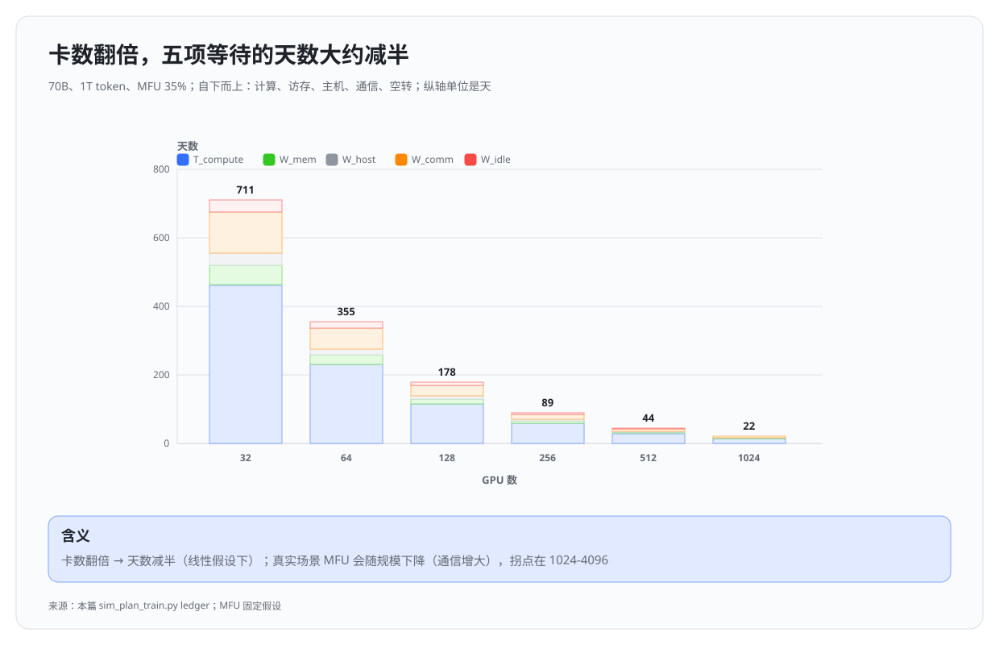
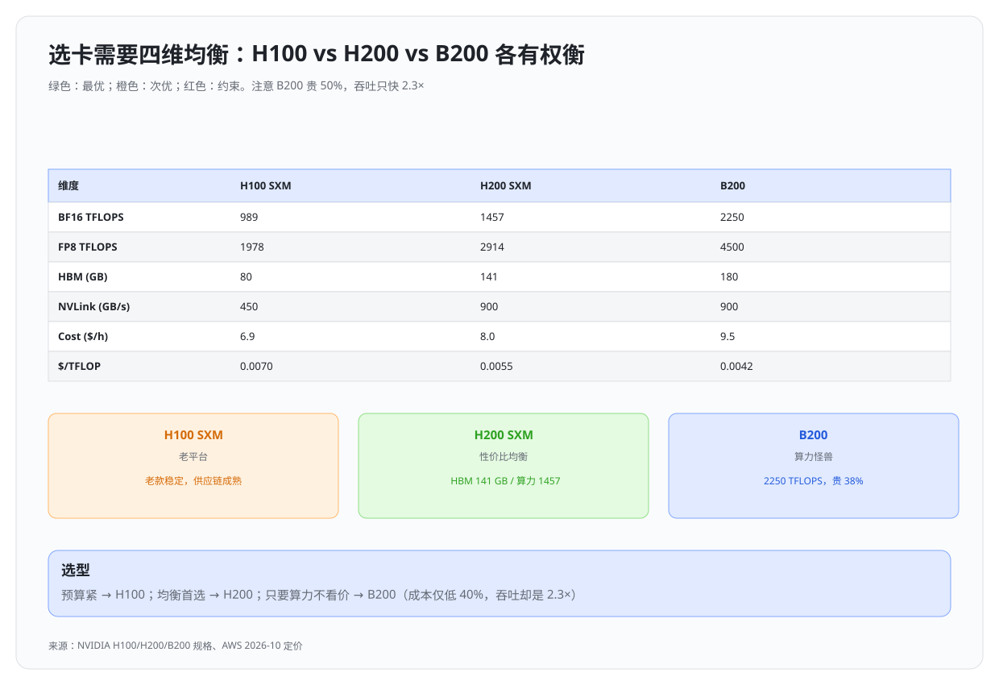
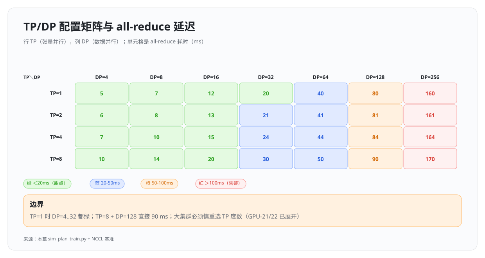
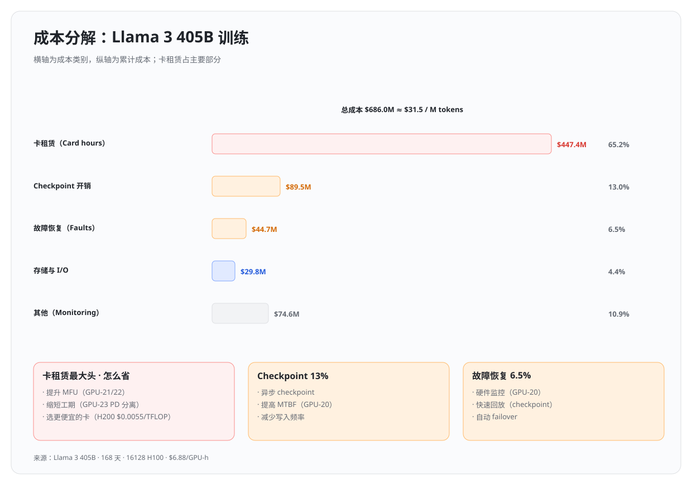
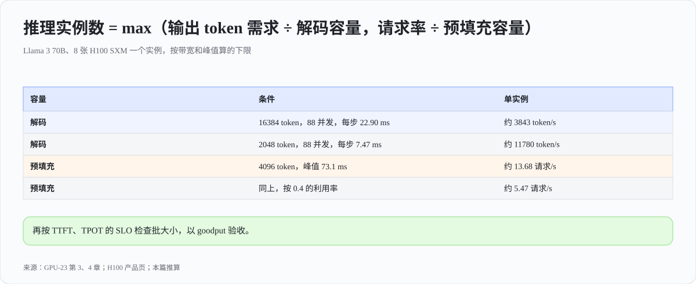
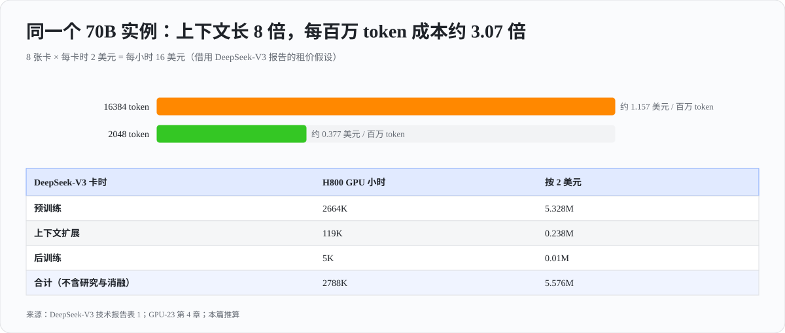
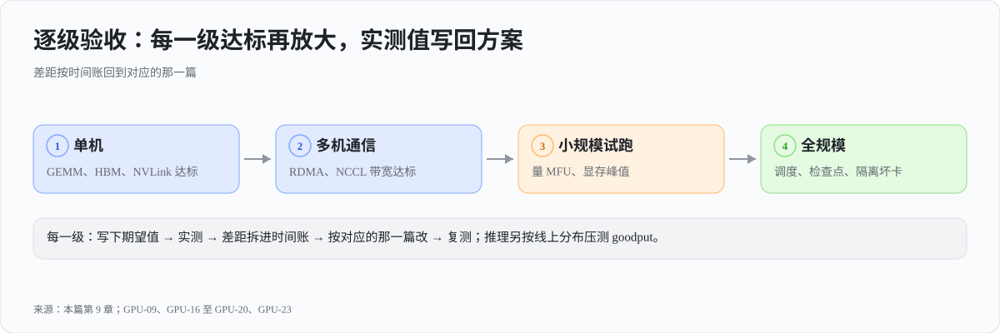

# GPU-24｜LLM｜综合：从选卡到上线

> 🎯 **这篇文档解决什么问题**：要上一个大模型训练或推理项目时，需要回答几个具体的数：要多少张卡，训练要跑多少天，推理要几个实例，花多少钱，上线前怎样验收。本篇把前 23 篇的知识按这个顺序串起来，用一个 70B 训练例子和一个 Llama 3 70B 推理例子算一遍，再用 Llama 3 405B 和 DeepSeek-V3 的公开数据校准，说明每个数从哪里来、口径是什么。

**使用方式**：第 1 章列出方案要回答的三个问题。第 2 到 6 章是训练：显存、工期、校准、切分、故障与检查点。第 7 章是推理的实例数，第 8 章是成本，第 9 章是逐级验收，第 10 章给清单和自测。

**代码**：zero-to-gpu/24-capstone/ 下的 sim_plan_train.py、sim_plan_infer.py、sim_calibrate.py 和 test_capstone.py 只需 Python 标准库。检查点开销、时间账的比例、推理计划的常数、校准表的数据和 README 的示例有误，第 10 章逐条说明。

<b>🧭 主线位置</b>：GPU-00（[GPU-00｜索引｜从 0 开始 GPU 优化：路线、章节与练习](./README.md)）建立了时间账 T = T_compute + W_mem + W_host + W_comm + W_idle。GPU-23（[GPU-23｜LLM｜推理系统：KV cache、PagedAttention 与 PD 分离](./23-inference.md)）讲完推理系统。本篇是前 23 篇的综合：用时间账给一个方案定天花板、找等待、逐级验收。之后的 GPU-25（[GPU-25｜LLM｜投机解码：αK 与 MTP / EAGLE 谱系](./25-speculative.md)）起转向专题，先讲投机解码。

## 导读 · 先给结论

- <b>先过显存。</b>训练每参数 16 字节，70B 光状态就要 1120 GB；推理权重 141.2 GB，还要给 KV 留空间（第 2 章）。[[1]](https://arxiv.org/pdf/1910.02054)[[2]](https://www.nvidia.com/en-us/data-center/h100/)
- <b>工期看 MFU。</b>6NT ÷（卡数 × 稠密峰值 × MFU）；公开 MFU 在 38% 到 55.2% 之间，70B、1T token、512 张 H100 约 24.81 到 28.07 天（第 3 章）。[[3]](https://arxiv.org/pdf/2407.21783)[[4]](https://arxiv.org/pdf/2402.15627)
- <b>校准先对口径。</b>Llama 3.1 405B 按模型卡卡时反推 MFU 34.5%，DeepSeek-V3 按 BF16 和 FP8 峰值分别是 34.6% 和 17.3%（第 4 章）。[[5]](https://huggingface.co/meta-llama/Llama-3.1-405B)[[6]](https://arxiv.org/pdf/2412.19437)
- <b>张量并行不出机。</b>Llama 3 405B 三个阶段都是 TP 8、PP 16，卡数翻倍只加数据并行（第 5 章）。[[3]](https://arxiv.org/pdf/2407.21783)
- <b>故障进工期。</b>Llama 3 在 54 天里有 419 次意外中断，约 3.09 小时一次，有效训练时间仍在 90% 以上（第 6 章）。[[3]](https://arxiv.org/pdf/2407.21783)
- <b>推理按两个容量定实例数。</b>70B 的 8 卡实例在 16384 token 时每秒约 3843 个 token，每百万 token 约 1.157 美元（第 7、8 章）。[[6]](https://arxiv.org/pdf/2412.19437)
- <b>逐级验收。</b>单机、多机通信、小规模、全规模，推理以 goodput 验收（第 9 章）。[[7]](https://arxiv.org/pdf/2401.09670)

<b>📎 与系列其他文档的分工</b>：GPU-02（[GPU-02｜硬件｜性能账本：Roofline、算术强度与三类瓶颈](./02-ledger.md)）讲 Roofline。GPU-16（[GPU-16｜单机｜单机验收与调优](./16-node-burnin.md)）讲单机验收。GPU-18（[GPU-18｜集群｜NCCL：算法、协议与挂死排查](./18-nccl.md)）讲 NCCL。GPU-20（[GPU-20｜集群｜可靠性与可观测：故障、静默错误与 checkpoint](./20-reliability.md)）讲可靠性和检查点。GPU-21（[GPU-21｜LLM｜训练并行：TP、PP、DP、ZeRO 与 FP8](./21-train-parallel.md)）讲训练并行。GPU-23（[GPU-23｜LLM｜推理系统：KV cache、PagedAttention 与 PD 分离](./23-inference.md)）讲推理系统。本篇只做串联和估算，细节回到各篇。

## 第 1 章 · 一个方案先回答三个问题：装得下吗、算多久、在等什么

前 23 篇各管时间账里的一项：硬件和内核管 T_compute 与 W_mem，驱动、PCIe 和运行时管 W_host，NVLink、RDMA 和 NCCL 管 W_comm，调度和可靠性管 W_idle。真到要上一个训练或推理项目时，这些知识要按顺序用起来：先算显存装不装得下，再算 FLOPs 和要跑多久，然后按时间账找卡在等什么，最后用公开数据和实测校准。本篇把这条路走一遍。

### 三个问题各对应一本账

- **装得下吗**：训练按每个参数的状态字节算，推理按权重加 KV cache 算。装不下，就决定了最少要切几份（第 2 章）。
- **算多久**：训练按 6 × 参数量 × token 数算 FLOPs，除以卡数、峰值和 MFU（第 3 章）；推理按预填充的 FLOPs 和解码每步的字节算（第 7 章）。MFU 和实际吞吐要拿公开数据校准（第 4 章）。
- **在等什么**：实际时间和下限的差距，按 T = T_compute + W_mem + W_host + W_comm + W_idle 拆开，每一项都有对应的那一篇（第 9 章）。

故障和检查点不在 FLOPs 里，却直接进工期（第 6 章）；卡时乘单价就是成本（第 8 章）。这几本账连起来，就是从选卡到上线的一张表。

### 本篇用的两个例子

训练用一个 70B 稠密模型、1T token、512 张 H100 SXM，和配套代码的默认参数一致，方便对照代码的输出。推理用 Llama 3 70B 跑在 8 张 H100 SXM 上，KV、并发和解码时间沿用 GPU-23（[GPU-23｜LLM｜推理系统：KV cache、PagedAttention 与 PD 分离](./23-inference.md)）的算法。校准用两个公开数据点：Llama 3 405B 和 DeepSeek-V3，前者是稠密模型[[3]](https://arxiv.org/pdf/2407.21783)，后者是激活 37B 的 MoE 模型[[6]](https://arxiv.org/pdf/2412.19437)。

按五步闭环看一个方案：

- **定天花板**：按显存定最少的卡数和切分，按峰值算出工期和 TPOT 的下限。
- **测实际**：小规模试跑，量 MFU、TTFT 和 TPOT。
- **定位等待**：把实测和下限的差距拆进时间账。
- **消除或隐藏**：按占比最大的一项回到对应的那一篇找手段。
- **复测**：用改进后的实测值更新方案，再定卡数和工期。

一个常见的误区是按峰值 TFLOPS 选卡、按卡数报工期。现象是方案报上去的天数，实际跑下来要多出一截，推理的卡数也对不上。原因是峰值只是天花板，MFU、故障、检查点和解码的带宽限制都没算进去。改法是每个数都按本篇的几本账算一遍，并写明用的是哪个 MFU、哪个口径。

> 🔑 **本章要点**：一个训练或推理方案先回答三个问题：显存装得下吗，按 FLOPs 和 MFU 要算多久，实际时间在等什么。故障、检查点和单价把工期变成卡时和成本。这一章是五步闭环的“定天花板”：先把三个问题列成三本账。

## 第 2 章 · 选卡先过显存：训练按每参数 16 字节，推理按权重加 KV

选卡时最先碰到的硬约束是显存。算力不够只是跑得慢，显存不够就跑不起来，或者必须切到更多卡上，切分又带来通信。所以先算装不装得下，再比带宽和算力。

### 训练：每个参数 16 字节

ZeRO 论文给出了混合精度 Adam 的显存账：FP16 参数 2 字节、FP16 梯度 2 字节，优化器状态（FP32 参数副本、动量、方差）12 字节，合计每个参数 16 字节[[1]](https://arxiv.org/pdf/1910.02054)。70B 的模型光这些状态就是 70 × 16 = 1120 GB，还没算激活。一张 H100 SXM 有 80 GB[[2]](https://www.nvidia.com/en-us/data-center/h100/)，只放状态就要 14 张卡。所以 70B 的训练从一开始就必须切分，切法见第 5 章，激活的算法见 GPU-21（[GPU-21｜LLM｜训练并行：TP、PP、DP、ZeRO 与 FP8](./21-train-parallel.md)）。

### 推理：权重加 KV

推理不需要梯度和优化器状态，BF16 权重每个参数 2 字节。Llama 3 70B 有 70.6B 参数，权重 141.2 GB，至少两张卡。但两张卡只够放权重，KV cache 没有地方放。GPU-23 第 3 章算过：张量并行 8 卡时，每卡权重 17.65 GB，扣掉激活后剩 59.70 GB 给 KV，一个 16384 token 的请求每卡 671.1 MB，最多 88 个并发。卡数定少了，并发上不去，解码攒不起批，每张卡的吞吐也就低。

### 再比带宽和算力

显存过关以后，看负载受谁限制。H100 SXM 的 BF16 Tensor Core 规格页写的是 1,979 TFLOPS，带星号的是稀疏口径[[2]](https://www.nvidia.com/en-us/data-center/h100/)，稠密是 989；HBM 带宽 3.35 TB/s，NVLink 900 GB/s[[2]](https://www.nvidia.com/en-us/data-center/h100/)。训练和预填充受算力限制，看稠密 TFLOPS；解码受带宽限制，看 HBM 带宽和容量；张量并行和专家并行的通信看 NVLink 和网卡。拿规格页比卡时，先确认是稠密还是稀疏口径，否则算力会差一倍。

按五步闭环看选卡：

- **定天花板**：训练按 16 字节每参数加激活，推理按权重加目标并发的 KV，算出最少卡数。
- **测实际**：在一台机器上用目标模型试跑，读框架报告的显存占用。
- **定位等待**：显存刚好够时，看是否因为碎片或激活峰值而 OOM。
- **消除或隐藏**：ZeRO 切优化器状态，激活重算，推理时压缩 KV。
- **复测**：峰值显存留出余量，并发数达到目标。

一个常见的误区是按“权重放得下”选推理卡数。现象是两张卡放下了 70B 权重，并发却只有个位数，吞吐很低。原因是 KV 没有地方放，批攒不起来，解码的权重字节摊不薄。改法是按目标上下文和并发算出 KV 总量，和权重一起决定卡数和张量并行度。

> 🔑 **本章要点**：训练的模型状态是每参数 16 字节，70B 要 1120 GB，光状态就要 14 张 80 GB 的卡；推理的权重是每参数 2 字节，70B 要 141.2 GB，还要给 KV 留出空间，8 卡时每卡 59.70 GB 给 KV。这一章是五步闭环的“定天花板”：显存决定最少的卡数和切分。

## 第 3 章 · 工期 = 6NT ÷（卡数 × 稠密峰值 × MFU）

显存定了最少的卡数，工期由计算量和实际算力决定。稠密 Transformer 训练每个 token 的前向加反向约 6 × 参数量次浮点运算，总量是 6NT。实际算力是卡数乘稠密峰值再乘 MFU。三个数里，6NT 和峰值都是确定的，MFU 是最大的不确定项。

### 6NT 和公开数据对得上

Llama 3 405B 在 15.6T token 上预训练[[3]](https://arxiv.org/pdf/2407.21783)，6 × 405B × 15.6T ≈ 3.7908e25 FLOPs，论文给出的预训练计算量是 3.8 × 10^25 FLOPs[[3]](https://arxiv.org/pdf/2407.21783)，两者一致。6NT 没有算注意力里和序列长度平方相关的部分，上下文很长时会偏小，作为量级估算够用。

### MFU 取多少

MFU 是实际用于模型计算的 FLOPs 除以峰值。公开数据给出的范围：Llama 3 405B 在 8K 到 16K 张 H100 上，各阶段 BF16 MFU 为 38% 到 43%[[3]](https://arxiv.org/pdf/2407.21783)；MegaScale 在 12,288 张卡上训练 175B 模型达到 55.2%，比 Megatron-LM 高 1.34 倍[[4]](https://arxiv.org/pdf/2402.15627)。这些都是做过大量优化的结果，新搭的集群和代码一开始往往达不到。

代入本篇的训练例子：70B 模型、1T token，6NT = 4.2e23 FLOPs；512 张 H100 SXM，每张稠密 989 TFLOPS[[2]](https://www.nvidia.com/en-us/data-center/h100/)。MFU 取 43% 时纯计算约 22.33 天，取 38% 时约 25.26 天。再按 Llama 3 报告的有效训练时间 90% 以上[[3]](https://arxiv.org/pdf/2407.21783)折算，工期约 24.81 到 28.07 天，卡时约 304817 到 344925。

配套代码 plan 子命令默认 MFU 50%，算出纯计算 19.20 天，再加 9.60 天检查点和 8% 的故障系数，总共 31.10 天。检查点这一项不管保存间隔设多少都是计算时间的一半，第 6 章细说。

按五步闭环看工期：

- **定天花板**：6NT ÷（卡数 × 稠密峰值），得到 MFU 为 100% 时的天数。
- **测实际**：小规模试跑，从每步时间反推 MFU。
- **定位等待**：MFU 低于公开参考值时，用 profiler 拆出通信、数据加载和气泡。
- **消除或隐藏**：重叠通信、调整并行切分（第 5 章）。
- **复测**：用实测 MFU 重算工期。

一个常见的误区是直接拿一个好看的 MFU 排期。现象是按 50% 排的工期，实际 MFU 只有三十几，工期拖长三成以上。原因是 MFU 取决于模型形状、并行方式、网络和软件版本，别人的数不能直接搬。改法是用公开数据定范围，用自己的试跑定取值，方案里写出上下两档的工期。

> 🔑 **本章要点**：工期 = 6NT ÷（卡数 × 稠密峰值 × MFU），再除以有效训练时间的比例。Llama 3 405B 的 6NT 约 3.7908e25，和论文的 3.8 × 10^25 一致；公开的 MFU 在 38% 到 55.2% 之间。70B、1T token、512 张 H100 的工期约 24.81 到 28.07 天。这一章是五步闭环的“定天花板”：工期的下限由 FLOPs 和峰值决定，MFU 决定离下限多远。

## 第 4 章 · 用公开数据校准：同一个 MFU 有好几种口径

第 3 章说 MFU 要拿公开数据校准。校准时最容易出错的是口径：用的是哪种精度的峰值，分母是整个训练的卡时还是某一阶段的稳态，FLOPs 有没有算注意力。口径不同，同一次训练能算出差一倍的 MFU。本章用两个公开数据点走一遍。

### Llama 3 405B：整体卡时反推 34.5%

Llama 3.1 405B 的模型卡给出训练用了 30.84M 个 H100 GPU 小时[[5]](https://huggingface.co/meta-llama/Llama-3.1-405B)，并说明这是训练该模型所需的全部 GPU 时间[[5]](https://huggingface.co/meta-llama/Llama-3.1-405B)。用 6NT ≈ 3.7908e25 除以 30.84M 小时和每卡 989 TFLOPS，反推出的 MFU 是 34.5%，低于论文表 4 的 38% 到 43%[[3]](https://arxiv.org/pdf/2407.21783)。

差别来自分母。表 4 是各阶段稳态时的 MFU，8,192 卡时每卡 430 TFLOPS、MFU 43%，16,384 卡时每卡 400 TFLOPS、MFU 41%，长上下文阶段每卡 380 TFLOPS、MFU 38%[[3]](https://arxiv.org/pdf/2407.21783)。按每卡 400 TFLOPS 算，纯预训练只需约 26.32M 卡时，是模型卡总数的 85.4%。剩下的部分包括长上下文阶段的较低效率、故障和维护中断，以及模型卡卡时里包含的其他训练环节；模型卡没有拆分各项，这里不再细分。

### DeepSeek-V3：精度口径差一倍

DeepSeek-V3 总参数 671B，每个 token 激活 37B[[6]](https://arxiv.org/pdf/2412.19437)，预训练 14.8T token 用了 2.664M 个 H800 GPU 小时[[6]](https://arxiv.org/pdf/2412.19437)；报告也换了个说法：每万亿 token 需要 180K 个 H800 GPU 小时，在 2048 张 H800 上约 3.7 天[[6]](https://arxiv.org/pdf/2412.19437)。按激活参数算 6NT ≈ 3.2856e24 FLOPs。配套代码按与 H100 SXM 相同的 BF16 稠密 989 TFLOPS 计 H800 的峰值，反推的 MFU 是 34.6%；但 DeepSeek-V3 用的是 FP8 混合精度训练[[6]](https://arxiv.org/pdf/2412.19437)，按 FP8 稠密峰值 1,979 TFLOPS 算，MFU 只有 17.3%。6NT 对 MoE 也只是近似，没有算注意力和路由。

两个 34.5% 左右的数字看起来一致，含义却不同：Llama 3 的数是 BF16 训练、整体卡时；DeepSeek-V3 的数是 FP8 训练按 BF16 峰值算的。拿别人的 MFU 来排期，先把口径对齐。

### 配套代码的校准表

sim_calibrate.py 的 list 子命令给两个模型都算出 34.5%。Llama 3 那一行用 16128 张卡和 79.75 天，代码注释说出自模型卡，但模型卡只给卡时，论文写的是至多 16K 张 H100[[3]](https://arxiv.org/pdf/2407.21783)，表 4 用的是 8,192 和 16,384；30.84M 小时除以 16128 张卡再除以 24，是 79.68 天，也对不上 79.75。README 的示例命令 verify llama3-405b 匹配不到模型名，示例输出写 168.0 天、15.36T token、估算 93.4 天，和代码实际输出的 79.8 天、15.60T、89.1 天都不一样。

按五步闭环看校准：

- **定天花板**：写清用的是哪种精度的稠密峰值。
- **测实际**：区分稳态每步吞吐和整体卡时。
- **定位等待**：两者的差距就是故障、维护和阶段切换的开销。
- **消除或隐藏**：稳态 MFU 低改并行和通信，整体卡时高改可靠性（第 6 章）。
- **复测**：校准后的 MFU 写明口径，再用于排期。

一个常见的误区是看到别人的 MFU 比自己高，就认为自己的系统有问题。现象是自己按 BF16 峰值算出四成，对方报五成以上，查了很久找不到差距。原因可能只是口径不同：对方算了注意力的 FLOPs，或者只报稳态阶段。改法是先对齐 FLOPs 公式、峰值口径和时间分母，再比较。

> 🔑 **本章要点**：Llama 3.1 405B 用模型卡的 30.84M 卡时反推 MFU 是 34.5%，论文表 4 的稳态 MFU 是 38% 到 43%，差在分母；DeepSeek-V3 按 BF16 峰值算 34.6%，按 FP8 峰值算 17.3%，差在精度。配套代码的校准表卡数和天数没有出处，README 的示例与实际输出不符。这一章是五步闭环的“测实际”：校准之前先对齐口径。

## 第 5 章 · 训练方案：机内张量并行，跨机流水线并行和数据并行

第 2 章算出 70B 的模型状态要 1120 GB，必须切开；第 3 章的 MFU 又取决于切法带来的通信和气泡。切分的顺序按带宽从高到低排：通信最频繁的张量并行放在机内的 NVLink 上，流水线并行和数据并行跨机，长上下文再加上下文并行。各种并行的细节在 GPU-21（[GPU-21｜LLM｜训练并行：TP、PP、DP、ZeRO 与 FP8](./21-train-parallel.md)），本章只讲怎样定一个起点。

### Llama 3 405B 的切法

Llama 3 论文表 4 列出了 405B 预训练各阶段的配置[[3]](https://arxiv.org/pdf/2407.21783)：

| 卡数 | TP / CP / PP / DP，序列长度 | 每卡 TFLOPS | BF16 MFU |
|---|---|---|---|
| 8,192 | 8 / 1 / 16 / 64，8,192 | 430 | 43% |
| 16,384 | 8 / 1 / 16 / 128，8,192 | 400 | 41% |
| 16,384 | 8 / 16 / 16 / 8，131,072 | 380 | 38% |

三行的张量并行都是 8，正好是一台机器的卡数；流水线并行都是 16；卡数翻倍时只加数据并行，MFU 从 43% 降到 41%；长上下文阶段加了 16 路上下文并行，数据并行相应减少，MFU 再降到 38%。规律是：张量并行不出机，流水线并行按显存定，剩下的卡给数据并行。

### 70B、512 张卡的起点

按同样的顺序给本篇的训练例子定一个起点。张量并行取 8，每卡的模型状态从 1120 GB 降到 140 GB，仍然超过 80 GB；再加 4 路流水线并行，8 × 4 = 32 张卡放一份模型，每卡状态 35 GB，给激活留出空间；512 ÷ 32 = 16 路数据并行。优化器状态还可以按 ZeRO 在数据并行组内再切一次，进一步降低显存，代价是多一些通信。这是一个需要实测的起点，不是最优解。

每种并行带来的等待各不相同：张量并行每层都有 all-reduce，必须走 NVLink；流水线并行有气泡，比例约为（流水线级数 − 1）÷ 微批数，要靠多切微批压下去；数据并行的梯度同步可以和反向重叠。哪一项是瓶颈，要在 profiler 上看。

按五步闭环看并行方案：

- **定天花板**：按显存定最小的模型并行度，剩下的给数据并行。
- **测实际**：小规模跑通后量每步时间和 MFU。
- **定位等待**：在 nsys 上看 all-reduce、流水线气泡和梯度同步各占多少（GPU-14，[GPU-14｜单机｜性能分析与 Profiling](./14-profiling.md)）。
- **消除或隐藏**：增加微批数压气泡，重叠梯度同步，调整 TP 和 PP 的比例。
- **复测**：MFU 接近公开参考值的范围。

一个常见的误区是为了省显存把张量并行开到跨机。现象是显存够了，每步时间却成倍增加。原因是张量并行每层都要 all-reduce，跨机后走的是比 NVLink 慢得多的网络。改法是张量并行限制在机内，显存不够时加流水线并行或 ZeRO，长序列加上下文并行。

> 🔑 **本章要点**：并行切分按带宽从高到低排，张量并行不出机，流水线并行按显存定，剩下的卡给数据并行。Llama 3 405B 三个阶段都是 TP 8、PP 16，MFU 38% 到 43%。70B、512 张卡可以从 TP 8 × PP 4 × DP 16 起步，每卡状态 35 GB。这一章是五步闭环的“消除或隐藏”：用切分方式决定通信走哪条链路。

## 第 6 章 · 故障和检查点进工期：按中断间隔定保存频率

第 3 章的工期只算了计算。规模上了几千张卡，中断就成了常态：每次中断要从上一个检查点恢复，丢掉中间的进度，再加上重启的时间。这些都记进时间账的 W_idle。排期时要先估中断有多频繁，再定检查点间隔。

### Llama 3 的中断数据

Llama 3 405B 预训练期间，在一个 54 天的观察窗口里共发生 466 次作业中断[[3]](https://arxiv.org/pdf/2407.21783)，其中 47 次是计划内的维护[[3]](https://arxiv.org/pdf/2407.21783)，其余 419 次是意外中断[[3]](https://arxiv.org/pdf/2407.21783)，占九成。意外中断里约 78% 归因于确认或疑似的硬件问题[[3]](https://arxiv.org/pdf/2407.21783)，GPU 问题是最大的一类，占 58.7%[[3]](https://arxiv.org/pdf/2407.21783)。固件和内核升级这类自动维护，也让训练至少每天中断一次[[3]](https://arxiv.org/pdf/2407.21783)。

419 次除以 54 天，平均每天约 7.76 次，也就是约 3.09 小时一次意外中断。即便如此，Llama 3 仍然做到了 90% 以上的有效训练时间[[3]](https://arxiv.org/pdf/2407.21783)，靠的是自动检测、快速重启和频繁保存。论文还观察到，由于白天气温较高影响 GPU 的动态调频，吞吐有 1% 到 2% 的昼夜波动[[3]](https://arxiv.org/pdf/2407.21783)。

### 检查点的开销怎样算

检查点的开销有两部分。保存本身的开销：同步保存时训练要停下来等写完，每次停的时间除以保存间隔就是这部分的比例。中断时丢掉的进度：平均丢半个保存间隔，再加上重新拉起作业、加载检查点的时间，乘以中断次数。间隔越短，丢的进度越少，保存的次数越多；两者相加有一个最低点。异步保存把写盘移出关键路径，能把第一部分压得很小，细节见 GPU-20（[GPU-20｜集群｜可靠性与可观测：故障、静默错误与 checkpoint](./20-reliability.md)）。

配套代码把检查点开销算成每次保存占半个间隔，无论间隔是 24 小时还是 1 小时，结果都是纯计算时间的 50%，所以 plan 子命令在 70B 的例子里加了 9.60 天；故障系数固定 1.08，和中断频率无关。ledger 子命令把 W_mem、W_host、W_comm 分别写死成 MFU 损失的 30%、总时间的 5% 和 2%，再整体缩放到总时间，这几个比例都没有测量依据。

按五步闭环看可靠性：

- **定天花板**：按集群的历史中断间隔和每次恢复时间，估出有效训练时间的比例。
- **测实际**：记录每次中断的原因、发现时间和恢复时间。
- **定位等待**：W_idle 里是保存、丢进度还是重启占得多。
- **消除或隐藏**：异步保存，缩短保存间隔，自动隔离坏卡后快速重启。
- **复测**：有效训练时间达到目标比例。

一个常见的误区是按单卡的故障率估整个作业。现象是单张卡几个月才坏一次，几千张卡的作业却每几个小时就断一次。原因是同步训练里任何一张卡出问题，整个作业都要停，中断频率随卡数线性增长。改法是按作业的总卡数估中断间隔，并把保存间隔定在中断间隔的一小部分。

> 🔑 **本章要点**：Llama 3 405B 在 54 天里有 466 次中断，419 次是意外，约 78% 与硬件有关，平均约 3.09 小时一次，有效训练时间仍在 90% 以上。检查点的开销等于保存停顿加上中断时丢掉的进度和重启时间。配套代码把它固定成计算时间的一半。这一章是五步闭环的“定位等待”：把故障和保存放进 W_idle 里算清。

## 第 7 章 · 推理方案：从请求量倒推实例数

训练排的是工期，推理排的是实例数。一个推理实例是能独立服务请求的一组卡，比如 Llama 3 70B 用 8 张 H100 做张量并行。实例数取决于两个容量：解码每秒能出多少 token，预填充每秒能接多少个请求；两者都要在 TTFT 和 TPOT 的 SLO 之内算。

### 一个实例的两个容量

解码容量沿用 GPU-23（[GPU-23｜LLM｜推理系统：KV cache、PagedAttention 与 PD 分离](./23-inference.md)）第 3、4 章的算法。8 卡实例每卡 59.70 GB 给 KV，16384 token 的上下文最多 88 个并发；88 个请求一起解码，每步约 22.90 ms，每秒约 3843 个 token。上下文缩到 2048 token 时，同样 88 个并发每步约 7.47 ms，每秒约 11780 个 token。这都是按 HBM 带宽算的下限，没算 all-reduce 和调度开销。

预填充容量按 FLOPs 算。一个 4096 token 的提示词约 578.4 TFLOPs，8 卡按稠密峰值约 73.1 ms，一个实例每秒最多接约 13.68 个这样的请求；按 0.4 的实际利用率算只有约 5.47 个。预填充和解码共用一个实例时，两者还会互相干扰，分块预填充或者分离部署见 GPU-23 第 6、7 章。

### 倒推实例数

实例数取两个需求里大的那个：每秒要输出的 token 数除以单实例的解码容量，每秒到达的请求数除以单实例的预填充容量。再按 SLO 检查：如果 TPOT 的上限比 22.90 ms 还紧，长上下文时就不能把批攒到 88，单实例的解码容量要按降下来的批大小重算。最后留出峰值余量。验收时用 goodput，也就是在 SLO 达标率目标下每卡能服务的最大请求率[[7]](https://arxiv.org/pdf/2401.09670)，不用平均吞吐。

### 配套代码的推理计划

sim_plan_infer.py 的几处算法和实际差得很远：70B 每个 token 的 KV 按参数量线性外推成 0.04 MB，实际是 327680 字节，约 0.3277 MB，差了 8.2 倍；8B 模型显示为 0.00 MB。解码吞吐按 HBM 带宽除以每 token 400 字节算，得到每卡每秒 8375000000 个 token，完全没算权重。预填充写死成每毫秒 50 个 token，和模型大小无关。--batch、--ttft-ms、--tpot-ms 都不参与计算，所以 70B 和 8B、批大小 128 和 8，算出来都是 4 张卡。calibrate 子命令里“估算的 TPOT”直接等于输入的目标值，误差永远是 0。

按五步闭环看推理容量：

- **定天花板**：按显存算并发上限，按带宽算 TPOT 下限，按算力算预填充时间。
- **测实际**：用线上的长度分布压测单个实例。
- **定位等待**：TTFT 超标看预填充和排队，TPOT 超标看批大小和上下文长度。
- **消除或隐藏**：分页、分块预填充、分离部署、压缩 KV（GPU-23）。
- **复测**：单实例 goodput 达到目标后再乘实例数。

一个常见的误区是按平均上下文长度算实例数。现象是平均 2048 token 时算出的实例数够用，少数长请求一来，TPOT 就超标，显存也不够。原因是解码时间和显存都随批内的 KV 总量变化，长请求占的 KV 是短请求的好几倍。改法是按长度分布的高分位数算容量，或者把长请求路由到单独的实例。

> 🔑 **本章要点**：推理实例数取解码和预填充两个需求里大的那个。Llama 3 70B 的 8 卡实例，16384 token 时解码约每秒 3843 个 token，2048 token 时约 11780 个；4096 token 的预填充峰值下每秒约 13.68 个请求。配套代码的 KV、解码吞吐和预填充速度都没有依据，参数也不参与计算。这一章是五步闭环的“定天花板”：先有单实例的容量，才能倒推实例数。

## 第 8 章 · 成本：训练按卡时乘单价，推理按每百万 token 算

工期和实例数定了，成本就是卡时乘单价。单价随采购方式、合同和地区差别很大，本章不给建议价，只用一个公开的假设价格示范算法：DeepSeek-V3 报告按每张 H800 每小时 2 美元估算训练成本[[6]](https://arxiv.org/pdf/2412.19437)。换成自己的价格，按同样的公式重算即可。

### 训练成本

DeepSeek-V3 报告的表 1 把训练卡时分成三段：预训练 2664K、上下文扩展 119K、后训练 5K，合计 2788K 个 H800 GPU 小时，按 2 美元每小时分别是 5.328M、0.238M 和 0.01M 美元，合计 5.576M 美元[[6]](https://arxiv.org/pdf/2412.19437)。报告特别说明，这个数只包括正式训练，不包括此前的研究和消融实验[[6]](https://arxiv.org/pdf/2412.19437)。做预算时，试错、消融和失败重跑往往比正式训练还多，要单独列。

本篇的 70B 训练例子，按第 3 章算出的 304817 到 344925 卡时，借用同样的 2 美元假设，正式训练约 609634 到 689850 美元。配套代码默认按每卡时 12 美元算，代码里没有给出出处。

### 推理成本：上下文长度决定一大半

推理按每百万输出 token 的成本比较。8 卡实例按 2 美元每卡时是每小时 16 美元。16384 token 上下文时每秒约 3843 个 token，每小时约 13.83M 个，每百万 token 约 1.157 美元；2048 token 时每秒约 11780 个，每小时约 42.41M 个，每百万 token 约 0.377 美元。同一个模型、同一组卡，上下文长 8 倍，单位成本约是 3.07 倍，差别全部来自解码时要读的 KV。

配套代码的推理计划算出每百万 token 0.07 美元，用的是第 7 章说的每卡每秒 8375000000 个 token 的解码吞吐，这个成本没有参考意义。

按五步闭环看成本：

- **定天花板**：卡时 × 单价，推理按单实例吞吐折算每百万 token 成本。
- **测实际**：按账单和实测吞吐算真实单价。
- **定位等待**：成本高出预算的部分，对应时间账里哪一项等待。
- **消除或隐藏**：训练提高 MFU 和有效训练时间，推理压缩 KV、提高并发和命中率。
- **复测**：每百万 token 成本随优化下降。

一个常见的误区是只按训练的正式运行做预算。现象是预算按正式训练的卡时批下来，项目做到一半卡时就不够了。原因是正式训练之前的小规模实验、超参搜索、消融和失败重跑都要卡时，DeepSeek-V3 报告的成本也明确把这些排除在外。改法是预算分成正式训练和研发试错两部分，后者按历史项目的比例估。

> 🔑 **本章要点**：成本 = 卡时 × 单价。DeepSeek-V3 正式训练 2788K 卡时，按 2 美元假设约 5.576M 美元，不含研究和消融。推理的单位成本由每卡吞吐决定，70B 在 16384 token 时每百万 token 约 1.157 美元，2048 token 时约 0.377 美元。这一章是五步闭环的“复测”：用成本检验每一项优化是否值得。

## 第 9 章 · 上线前按五步闭环验收：每一项等待回到对应的那一篇

前八章给出了方案的几本账：显存、工期、校准、切分、故障、推理容量和成本。这些都是估算，上线前要用实测验证。验收的顺序跟着五步闭环走，从一台机器开始，逐步放大到全集群；每一步发现的等待，都按时间账回到系列里对应的那一篇。

### 从单机到集群的验收顺序

- **单机**：驱动、CUDA 版本兼容，GPU 健康检查，单卡 GEMM 和 HBM 带宽接近规格，机内 NVLink 带宽达标（GPU-09，[GPU-09｜系统｜驱动、CUDA 兼容与 Xid](./09-driver.md)；GPU-16，[GPU-16｜单机｜单机验收与调优](./16-node-burnin.md)）。
- **多机通信**：RDMA 链路和 NCCL 的 all-reduce 带宽在目标规模下达标，没有慢节点（GPU-17，[GPU-17｜集群｜RDMA 网络：InfiniBand、RoCE 与拥塞控制](./17-rdma.md)；GPU-18，[GPU-18｜集群｜NCCL：算法、协议与挂死排查](./18-nccl.md)）。
- **小规模试跑**：用目标模型和并行方案跑几百步，量每步时间、MFU 和显存峰值，和第 3、5 章的估算比较。
- **全规模**：确认调度、检查点保存和恢复、自动隔离坏卡都可用（GPU-19，[GPU-19｜集群｜Kubernetes 上的 GPU：设备插件与拓扑感知调度](./19-k8s.md)；GPU-20，[GPU-20｜集群｜可靠性与可观测：故障、静默错误与 checkpoint](./20-reliability.md)）。
- **推理压测**：按线上的到达率和长度分布压测单个实例，以 goodput 验收（GPU-23，[GPU-23｜LLM｜推理系统：KV cache、PagedAttention 与 PD 分离](./23-inference.md)）。

### 差距按时间账回到对应的那一篇

实测和估算有差距时，按时间账拆开，每一项都有对应的文档：

| 时间账 | 常见现象 | 回到哪一篇 |
|---|---|---|
| T_compute | GEMM 达不到峰值，低精度没用上 | GPU-05 GEMM，GPU-06 Tensor Core |
| W_mem | 访存密集算子慢，解码 TPOT 高 | GPU-04 访存，GPU-08 注意力，GPU-23 推理 |
| W_host | kernel 之间有空隙，CPU 同步，数据加载慢 | GPU-11 PCIe 与 NUMA，GPU-15 PyTorch 运行时 |
| W_comm | all-reduce、all-to-all 暴露在关键路径上 | GPU-13 NVLink，GPU-18 NCCL，GPU-21、GPU-22 并行 |
| W_idle | 排队、流水线气泡、负载不均、故障重启 | GPU-19 调度，GPU-20 可靠性，GPU-22 均衡 |

每一次修正都把实测值写回方案：用实测 MFU 重算工期，用实测 TPOT 和并发重算实例数，用实际中断间隔重定检查点间隔。配套代码 sim_plan_infer.py 的 calibrate 子命令只是把输入的实际值和估算值并排列出来，估算的 TPOT 又直接等于目标值，起不到校准作用。

按五步闭环看验收：

- **定天花板**：每一级验收前写下期望值和出处。
- **测实际**：从单机到全规模，每一级都量同样的指标。
- **定位等待**：差距拆进时间账，找到对应的那一篇。
- **消除或隐藏**：按那一篇的手段改，一次只改一处。
- **复测**：改完回到同一级重测，通过后再放大。

一个常见的误区是直接上全规模，出了问题再排查。现象是几千张卡的作业跑不起来，或者 MFU 很低，却定位不到原因，每次重试都要排队。原因是单机、通信和小规模的问题叠在一起，在全规模下很难分开。改法是按单机、多机通信、小规模、全规模的顺序逐级验收，每一级的指标达标后再放大。

> 🔑 **本章要点**：上线前从单机、多机通信、小规模试跑到全规模逐级验收，推理以 goodput 验收。实测和估算的差距按时间账拆开，T_compute、W_mem、W_host、W_comm、W_idle 各有对应的文档。实测值要写回方案，重算工期、实例数和检查点间隔。这一章是五步闭环的“复测”：方案靠逐级实测落地。

## 第 10 章 · 方案核对清单与自测

前九章把一个训练或推理方案拆成几本账：第 2 章过显存，第 3、4 章算工期并校准 MFU，第 5 章定切分，第 6 章把故障和检查点算进工期，第 7 章倒推推理实例数，第 8 章算成本，第 9 章逐级验收。本章把这些压成一张核对清单，再列出配套代码的问题作为练习，最后给出自测题。

### 📌 核对清单

| 检查项 | 怎样查 | 通过的标志 |
|---|---|---|
| 显存过关 | 训练按每参数 16 字节加激活，推理按权重加目标并发的 KV（第 2 章） | 最少卡数和切分有依据 |
| 工期有上下两档 | 6NT ÷（卡数 × 稠密峰值 × MFU），再除以有效训练时间比例（第 3 章） | MFU 取值有公开参考和试跑数据 |
| 口径对齐 | 峰值精度、时间分母、FLOPs 公式（第 4 章） | 和公开数据比较时口径一致 |
| 并行切分合理 | 张量并行不出机，流水线按显存定（第 5 章） | MFU 在参考范围内 |
| 故障进工期 | 按历史中断间隔估有效训练时间（第 6 章） | 检查点间隔远小于中断间隔 |
| 推理容量算清 | 单实例解码和预填充两个容量（第 7 章） | 实例数满足两项需求和 SLO |
| 成本分两部分 | 正式训练和研发试错分开列（第 8 章） | 预算覆盖试错和重跑 |
| 推理单价已知 | 单实例吞吐折算每百万 token 成本（第 8 章） | 按长度分布算，不按平均 |
| 逐级验收 | 单机、多机通信、小规模、全规模（第 9 章） | 每一级指标达标后再放大 |
| 实测写回方案 | 用实测 MFU、TPOT、中断间隔重算（第 9 章） | 方案里的数都有出处 |

### 代码练习：配套代码的问题

zero-to-gpu/24-capstone/ 下的 sim_plan_train.py、sim_plan_infer.py、sim_calibrate.py 只用 Python 标准库，README 没写 Python 版本要求，在 Python 3.9.6 上能跑，test_capstone.py 的 10 个测试全部通过。下面几处与事实或自身描述不符，适合作为练习：

- **检查点开销固定为一半**：sim_plan_train.py 按每次保存占半个间隔算，间隔取 24 小时和 1 小时结果相同，都是纯计算时间的 50%；故障系数固定 1.08（第 3、6 章）。练习：按保存停顿 ÷ 间隔加上中断次数 ×（半个间隔 + 重启时间）重写。
- **时间账的比例是写死的**：ledger 子命令把 W_mem、W_host、W_comm 写成 MFU 损失的 30%、总时间的 5% 和 2%，再整体缩放，T_compute 也被放大（第 6 章）。deficit 子命令标成“MFU gap”的一行打印的是 MFU 50% 时的全部计算时间 19.20 天，差距本身是 9.60 天。
- **token 数不能带小数**：parse_size 用 int 解析，--tokens 15.6t 直接抛 ValueError，Llama 3 的 15.6T 输不进去（第 3 章）。
- **推理计划的三个常数没有依据**：70B 的 KV 每 token 0.04 MB（实际约 0.3277 MB），解码每卡每秒 8375000000 个 token，预填充每毫秒 50 个 token；--batch、--ttft-ms、--tpot-ms 不参与计算，70B 和 8B 都算出 4 张卡（第 7 章）。练习：按 GPU-23 的 KV 和 TPOT 公式重写。
- **校准表的数没有出处**：sim_calibrate.py 的 Llama 3 用 16128 张卡和 79.75 天，模型卡只给 30.84M 卡时；DeepSeek-V3 是 FP8 训练，却按 BF16 峰值反推 MFU（第 4 章）。verify 默认检查点开销 50%。
- **README 与代码不符**：示例命令 verify llama3-405b 匹配不到模型名；示例输出的 168.0 天、15.36T、93.4 天与实际输出不同（第 4 章）。sim_plan_infer.py 的文档字符串把 Orca 写成 2402.07714、Sarathi-Serve 写成 2503.01234，编号都不对，正确出处见参考文献[[8]](https://www.usenix.org/system/files/osdi22-yu.pdf)[[9]](https://arxiv.org/pdf/2403.02310)。
- **测试是循环论证**：test_calibrate_estimates_close_to_llama3 先用报告的卡时反推 MFU，再用这个 MFU 估天数和报告比，误差必然接近 0；test_train_deficit_is_percentage 的注释说检查点开销约 10%，代码实际是 50%（第 4、6 章）。

### 自测题

1. 70B 模型训练时的模型状态要多少显存？推理时权重要多少？为什么推理的卡数不能只按权重定？
2. 工期公式里哪一项最不确定？公开数据给出的 MFU 范围是多少？
3. 为什么 Llama 3.1 405B 用模型卡卡时反推的 MFU 低于论文表 4？DeepSeek-V3 的 MFU 为什么按不同峰值会差一倍？
4. Llama 3 405B 三个预训练阶段的 TP、PP 各是多少？卡数翻倍时改的是哪一维？
5. 检查点的开销由哪几部分组成？中断间隔约 3.09 小时时，保存间隔应怎样定？
6. 一个 70B 推理实例的解码容量和预填充容量各怎样算？上下文从 2048 变成 16384，每百万 token 成本怎样变？

**下一步**：到这里，系列从硬件、系统、单机、集群走到了训练和推理的完整方案。后面的文档转向几个专题，GPU-25（[GPU-25｜LLM｜投机解码：αK 与 MTP / EAGLE 谱系](./25-speculative.md)）先讲投机解码：用一个小模型或多 token 预测，在不改变输出分布的前提下降低解码的 TPOT。

## 参考文献

按正文首次引用顺序编号，资料截至 2026 年 11 月中。

[1] Rajbhandari et al. ZeRO: Memory Optimizations Toward Training Trillion Parameter Models. arXiv 1910.02054 [arxiv.org/pdf/1910.02054](https://arxiv.org/pdf/1910.02054)

[2] NVIDIA H100 Tensor Core GPU 产品页 [www.nvidia.com/en-us/data-center/h100/](https://www.nvidia.com/en-us/data-center/h100/)

[3] Llama Team, AI @ Meta. The Llama 3 Herd of Models. arXiv 2407.21783 (2024) [arxiv.org/pdf/2407.21783](https://arxiv.org/pdf/2407.21783)

[4] Jiang et al. MegaScale: Scaling Large Language Model Training to More Than 10,000 GPUs. NSDI 2024, arXiv 2402.15627 [arxiv.org/pdf/2402.15627](https://arxiv.org/pdf/2402.15627)

[5] Meta. Llama 3.1 405B 模型卡（Hugging Face） [huggingface.co/meta-llama/Llama-3.1-405B](https://huggingface.co/meta-llama/Llama-3.1-405B)

[6] DeepSeek-AI. DeepSeek-V3 Technical Report. arXiv 2412.19437 [arxiv.org/pdf/2412.19437](https://arxiv.org/pdf/2412.19437)

[7] Zhong et al. DistServe: Disaggregating Prefill and Decoding for Goodput-optimized Large Language Model Serving. OSDI 2024 [arxiv.org/pdf/2401.09670](https://arxiv.org/pdf/2401.09670)

[8] Yu et al. Orca: A Distributed Serving System for Transformer-Based Generative Models. OSDI 2022 [www.usenix.org/system/files/osdi22-yu.pdf](https://www.usenix.org/system/files/osdi22-yu.pdf)

[9] Agrawal et al. Taming Throughput-Latency Tradeoff in LLM Inference with Sarathi-Serve. OSDI 2024 [arxiv.org/pdf/2403.02310](https://arxiv.org/pdf/2403.02310)

---

[在 Colab 里跑本章 CPU 练习](https://colab.research.google.com/github/zyaochen/zero-to-gpu/blob/main/colab/24-capstone.ipynb) · 上一章：[GPU-23｜LLM｜推理系统：KV cache、PagedAttention 与 PD 分离](./23-inference.md) · [目录](./README.md) · 下一章：[GPU-25｜LLM｜投机解码：αK 与 MTP / EAGLE 谱系](./25-speculative.md)
