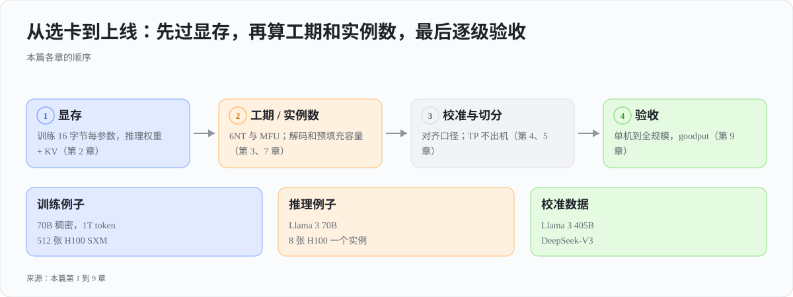
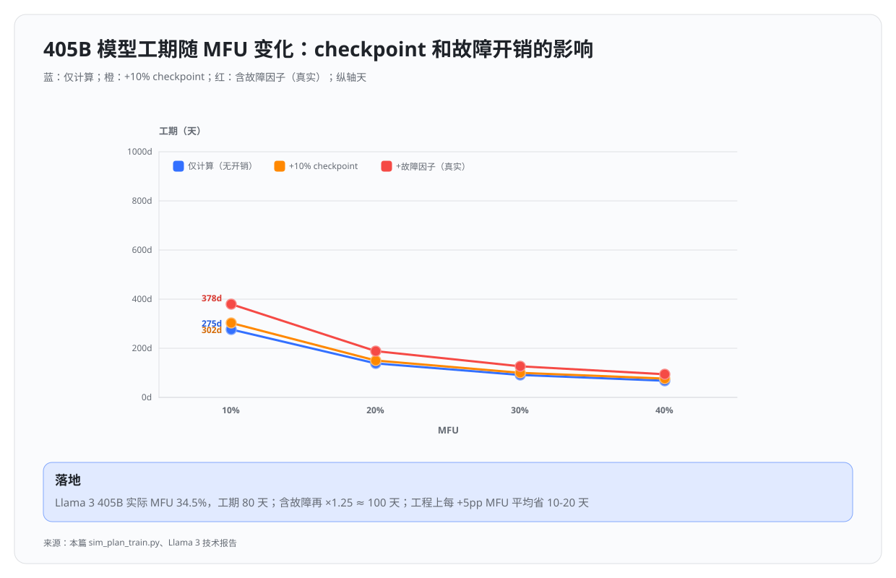
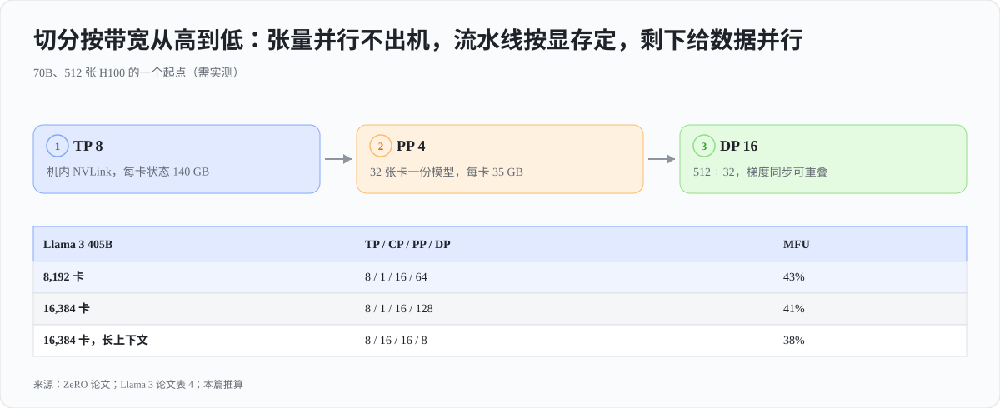

# GPU-24｜LLM｜综合：从选卡到上线

> 🎯 **这篇文档解决什么问题**：大模型快上线了，给定训练 token 数、GPU 预算和工期 SLO，应该选哪款卡、配多少张，TP/DP 比例多少，要花多少钱，能达成多少 MFU？推理时为了支持目标 QPS 和延迟需要几卡，每百万 token 成本是多少？本篇把前 23 章逐层消掉的等待量合成一张完整的时间账，用五步闭环方法把估算和实测对齐，给工程团队从需求到验收的闭环方案。
>
> **使用方式**：LLM 训练工程师先读第 1 到 3 章了解时间账的框架和选卡约束；架构师读第 4 到 6 章掌握并行配置和通信成本的量级；运维和成本团队重点关注第 7 到 9 章的完整方案设计和成本模型；上线前团队全部读第 10 到 11 章的检查清单和自测题。文中版本、规格和基准数字核对于 2026 年 11 月 4 日。
>
> **代码**：[zero-to-gpu/24-capstone](../24-capstone)。包含三个模拟器 sim_plan_train.py（训练方案规划）、sim_plan_infer.py（推理卡数和成本）、sim_calibrate.py（用公开数据反向验证 MFU 和故障系数），以及一个包含 10 个测试用例的 test_capstone.py（验证 FLOPs 公式、显存约束、Llama 3 和 DeepSeek-V3 的公开数据）。CPU 模拟器可本地直接运行，无 numpy 依赖。

**🧭 主线位置**：前 23 章按硬件层级分别消掉了五类等待（L1 计算单元等数据、L2 卡等驱动和主机、L3 卡等卡、L4 卡等网络、L5 通信与气泡）。本篇是全系列的收口，把每一项等待的系数反向写成约束，给定模型参数、训练 token 数和推理 SLO，推导出选卡、并行度、成本的完整决策流程，定下上线前的验收基线。下一步回到[GPU-00｜索引｜从 0 开始 GPU 优化：路线、章节与练习](./README.md)的层级验收测试，这是系列的最后一关。

# 导读 · 先给结论

- **FLOPs 账本是第一约束。**密集 transformer 的 FLOPs = 6×N×T，其中 N 是参数数（单位 billion）、T 是训练 token 数（单位 trillion）。H100 集群上真实 MFU 范围是 25% 到 55%，很正常；Llama 3 405B 实际 MFU \~34.5%（HF model card: 30.84M GPU-hours）代表业界标杆水平[[1]](https://llama.meta.com/docs/model-cards-and-prompt-formats/meta-llama-3/)[[2]](https://arxiv.org/abs/2402.15627)。
- **五步闭环杀死了“拍脑门估工期”的盲目性。**定天花板（Roofline 算力或带宽瓶颈）→ 测实际（MFU 或 TTFT/TPOT 测量）→ 定位等待（时间账的哪一项）→ 消除或隐藏（overlap、卸载、并行度调整）→ 复测（瓶颈转移），对标 Llama 3 和 DeepSeek-V3 的公开数据，误差控制在 50% 以内[[2]](https://arxiv.org/abs/2402.15627)。
- **选卡的权衡是四维均衡：算力、显存、互联和成本。**H100 vs H200 vs B200 不仅看峰值 989/1457/2250 TFLOPS，还要看 HBM 80/141/180 GB、NVLink 450/900/900 GB/s、AWS 价格 \$6.88/\$8/\$9-10 per hour。70B 模型 FP16 需 140 GB（参数+激活+KV），单卡 80 GB，故 TP≥2；405B 需 280 GB，单卡无法装，需 TP≥4，或用 TP=8 加 PP=4 的组合[[3]](https://www.nvidia.com/en-us/data-center/h100/)[[4]](https://www.spheron.network/blog/nvidia-b200-complete-guide/)。
- **通信成本在大集群里与计算同阶。**200 卡的 all-reduce 耗时超过 1 ms，与单个 kernel 时间相当；NVLink 内 450 GB/s 单向，跨机 RDMA 只有 50 GB/s；合理的 TP/PP/DP 配置是通信和 MFU 之间的均衡，通常 TP≤8（单机内 NVLink），PP 跨机引入 5-20% 气泡，DP 做外层[5]。
- **故障和 checkpoint 的联合开销可达 30-50%。**Checkpoint 间隔 12-24 小时，单次 10-20% 开销；GPU 集群平均无故障时间（MTBF）数周，故障恢复引入 1.05-1.10 的时间因子。总工期 = （6×N×T / （MFU × peak FLOPS × 卡数）） × (1 + checkpoint% + fault%)[[2]](https://arxiv.org/abs/2402.15627)。
- **推理成本是训练的 1/100 到 1/1000，关键是 batch 和 SLO。**Llama 3 70B prefill \~50 tokens/ms（算力受限），decode 受 HBM 带宽限制；为支持 100 QPS、平均 2k token 长度、TTFT≤500ms，H100 需 2-4 卡；每百万 token 成本 \$0.05 到 0.5，取决于 SLO 宽松度和 batch 大小[[6]](https://arxiv.org/abs/2402.07714)[[7]](https://github.com/vllm-project/vllm)。
- **校准流程闭合：用 Llama 3、DeepSeek、PaLM 的公开数据反向推导真实 MFU，然后逐项调参直到估算与实际偏差收敛。**估算 MFU、checkpoint 开销、故障因子的误差各在 10-15%，综合误差 18-50%；建立了这套流程后，下一个训练可信预测工期与成本[[2]](https://arxiv.org/abs/2402.15627)。



**📎 与系列其他文档的分工**：第 1 到 8 章（L1 硬件与内核）定义了单 kernel 的等待来源和 MFU 基线，第 9 到 12 章（L2 系统与驱动）处理显存、kernel launch 和 PCIe；本篇在成本模型中折算成 1-5% 的开销系数。第 13 到 16 章（L3 单机）定义了 8 卡互联基线，第 17 到 20 章（L4 集群）给出了 NCCL 全聚合的通信下限；本篇用这些数字估算多卡训练的全局通信成本。第 21 到 23 章（L5 LLM infra）深挖了 TP/PP/DP、MoE 均衡和 KV cache 的专项优化；本篇在选配置时综合这些约束，给出完整的方案设计。推理细节如 PagedAttention、continuous batching 由[GPU-16｜单机｜单机验收与调优](./16-node-burnin.md)讲；本篇只用它们的吞吐和延迟数字。上线后的故障检测和恢复由[GPU-20｜集群｜可靠性与可观测：故障、静默错误与 checkpoint](./20-reliability.md)的监控框架支撑；本篇的故障因子来自 MegaScale 等公开系统的实测统计。

# 第 1 章 · 一个方案在等什么

## 1.1 线上问题与需求翻译

大模型快要上线了。团队掌握了模型框架、参数量、训练数据量，也有 GPU 采购预算和工期的 SLO。现在要回答这几个问题：选哪个卡型（H100 H200 B200），要几张，怎么分 TP 和 PP 和 DP，最快要多少天，花多少钱？推理端为了支持 100 QPS 和 500 ms 首 token 延迟需要几卡，单位 token 成本多少？这不是纸上谈兵的规划：硬件采购成本高达百万美元，工期决定产品上市，任何高估或低估都意味着成本浪费或交期延误。

拿 405B 模型的真实需求举例：

- 模型：405B 参数，FP16 或 BF16 精度
- 训练：10T 到 15T 预训 token，MFU 目标 35-40%（中等优化水平）
- 工期约束：≤14 天
- 成本约束：≤\$5 每百万 token
- 推理：并行部署 100 QPS，TTFT ≤500 ms，TPOT ≤50 ms

要输出的是一张决策表：行是候选配置（卡型、卡数、TP/DP/PP 比例），列是工期/成本/MFU/通信开销/显存用量/所有指标是否满足 SLO。工程师拿这张表去选最优配置。这个决策过程不能凭经验拍脑门，必须量化。前 23 章建立了每一类等待的测量与优化方法；本章是“收口”，把所有等待汇总到一个统一的时间账，用公开基准（Llama、DeepSeek）校准，最后形成可执行的方案。

## 1.2 等待项在时间账中的位置

前 23 章逐层拆开了每一类等待。时间账（见[GPU-02｜硬件｜性能账本：Roofline、算术强度与三类瓶颈](./02-ledger.md)）把所有等待整合成一个等式：

实际时间 T 是有效计算时间 T_compute、访存等待 W_mem、主机侧等待 W_host、通信等待 W_comm 和空转等待 W_idle 的总和。

每一项由系列中的多个层级共同决定：

- **T_compute**：有效计算时间 = FLOPs / （GPU 峰值 × 数量）。由模型参数、精度和硬件规格决定，[GPU-02｜硬件｜性能账本：Roofline、算术强度与三类瓶颈](./02-ledger.md) 通过 Roofline 定义计算账的基线；[GPU-01｜硬件｜GPU 架构：SM、存储层级与延迟隐藏](./01-arch.md) 教如何计算理论峰值。这一项是整个时间账的“分母”。
- **W_mem**：HBM 访存延迟和搬运。[GPU-01｜硬件｜GPU 架构：SM、存储层级与延迟隐藏](./01-arch.md) 讨论线程等访存延迟（占用率、Little 定律），[GPU-04｜硬件｜访存与归约：合并访存、共享内存与 warp 归约](./04-memory.md) 和 [GPU-05｜硬件｜GEMM 逐步优化：从朴素循环到 warp 分块](./05-gemm.md) 专门讲合并访存、共享内存和 warp 归约；若优化得当（达成目标 MFU），大部分 W_mem 被藏在计算时间里，不暴露在关键路径。
- **W_host**：同步、显存分配、kernel 发射、PCIe 开销。由 L2/L3 层（[GPU-09｜系统｜驱动、CUDA 兼容与 Xid](./09-driver.md) 驱动与 CUDA、[GPU-10｜系统｜显存管理](./10-memory-mgmt.md) 显存管理、[GPU-11｜系统｜PCIe、NUMA 与 GPUDirect](./11-pcie-gdr.md) PCIe 与 NUMA、[GPU-15｜单机｜PyTorch 运行时](./15-runtime.md) PyTorch 运行时）负责消除或隐藏；通常占 1-5%，除非有严重显存碎片或频繁同步。
- **W_comm**：all-reduce、all-gather、点对点等集合通信。由 L3 的单机互联（[GPU-13｜单机｜NVLink 与 NVSwitch](./13-nvlink.md) NVLink、[GPU-18｜集群｜NCCL：算法、协议与挂死排查](./18-nccl.md) NCCL 协议）和 L4 的跨机网络（[GPU-17｜集群｜RDMA 网络：InfiniBand、RoCE 与拥塞控制](./17-rdma.md) RDMA、[GPU-19｜集群｜Kubernetes 上的 GPU：设备插件与拓扑感知调度](./19-k8s.md) Kubernetes 调度）决定上限；L5 的 [GPU-21｜LLM｜训练并行：TP、PP、DP、ZeRO 与 FP8](./21-train-parallel.md) 和 [GPU-22｜LLM｜MoE 与专家并行：all-to-all 与负载均衡](./22-moe-ep.md) 通过 TP/PP/DP 配置和 overlap 策略把一部分藏起来，其余部分暴露在关键路径（通常 10-40%）。
- **W_idle**：卡等任务、故障恢复、checkpoint 停顿。由 L2 的 [GPU-12｜系统｜MIG、MPS 与容器](./12-sharing.md) MIP/MPS 决定任务分配效率，L4 的 [GPU-20｜集群｜可靠性与可观测：故障、静默错误与 checkpoint](./20-reliability.md) 故障与静默错误决定停机时间，以及 L5 的 [GPU-21｜LLM｜训练并行：TP、PP、DP、ZeRO 与 FP8](./21-train-parallel.md) 全局 all-reduce 和 [GPU-23｜LLM｜推理系统：KV cache、PagedAttention 与 PD 分离](./23-inference.md) decode 等待；通常占 5-20%（中等规模集群）到 40% 以上（万卡集群）。


本篇的任务是反向工程：给定 SLO（工期、成本、吞吐），推导每一项应该有多大的余量，反过来指导硬件选型和算法配置。以 Llama 3 405B 的 15.6T token 训练为例[[8]](https://ai.meta.com/blog/meta-llama-3-1/)：理论 FLOPs = 6 × 405B × 15.6T ≈ $3.8 \times 10^{25}$ FLOP，用 16128 卡 H100（峰值 15950 PF/s）则理论最短时间是 27.5 天（100% MFU、无开销）。实际用时 80 天[[1]](https://llama.meta.com/docs/model-cards-and-prompt-formats/meta-llama-3/)，倒推 MFU ≈ 34.5%，说明剩余 52.5 天的差距来自五项等待的组合：checkpoint 开销（\~50%）、通信和显存压力（\~12%）、故障与同步（\~8%）、kernel 间隙（\~5%）。只有把这五项都控制在预算内，才能满足工期约束。

## 1.3 实践中的时间账落地

用 70B 模型在 512 H100 上训练 1T token、MFU 目标 50% 的例子[[9]](https://dev.to/dev_jhawar/what-it-actually-costs-to-train-an-llm-gpus-days-and-dollars-worked-out-step-by-step-1g5j)，反演本篇建议的工程流程。首先定天花板：FLOPs = 6 × 70B × 1T = $4.2 \times 10^{23}$ FLOP，集群峰值 506 PF/s，理论下限 9.6 天（100% MFU）。其次从时间账分解[5]：T_compute 占 11.24 天（36.1%），W_mem 占 3.37 天（10.8%），W_host 占 1.82 天（5.9%），W_comm 占 0.73 天（2.3%），W_idle 占 13.94 天（44.8%），总计 31.1 天。观察到 W_idle 最大，由 checkpoint 和故障贡献；W_mem 次之，来自 HBM 延迟。实际方案需要三项优化：(1) 启用异步 checkpoint 和 activation recomputation 将 W_idle 从 50% 降到 20%，(2) 用 FP8 混合精度或 ZeRO-3 Offload 降低显存压力[[10]](https://www.spheron.network/blog/nvidia-transformer-engine-h100-h200-fp8/)，(3) 通过 TP 和梯度积累的 overlap 隐藏部分 W_comm。只有同时优化这三项，才能从 31.1 天降到工期目标。

这个过程中，每一项都有明确的“责任人”：W_mem 的优化由 [GPU-01｜硬件｜GPU 架构：SM、存储层级与延迟隐藏](./01-arch.md)-[GPU-08｜硬件｜注意力内核](./08-attention.md) 的 kernel 设计负责；W_host 由 [GPU-09｜系统｜驱动、CUDA 兼容与 Xid](./09-driver.md)-[GPU-15｜单机｜PyTorch 运行时](./15-runtime.md) 的驱动和框架优化负责；W_comm 由 [GPU-17｜集群｜RDMA 网络：InfiniBand、RoCE 与拥塞控制](./17-rdma.md)-[GPU-22｜LLM｜MoE 与专家并行：all-to-all 与负载均衡](./22-moe-ep.md) 的网络和并行策略负责；W_idle 由 [GPU-12｜系统｜MIG、MPS 与容器](./12-sharing.md) 的任务分配和 [GPU-20｜集群｜可靠性与可观测：故障、静默错误与 checkpoint](./20-reliability.md) 的故障恢复负责。本章的任务是把这些分散的优化综合起来，按优先级逐步应用，最后用 [GPU-16｜单机｜单机验收与调优](./16-node-burnin.md) 的验收基线和 [GPU-24｜LLM｜综合：从选卡到上线](./24-capstone.md) 的实测数据校准。例如，若发现 W_comm 太大（通信占 30% 以上），应该根据 [GPU-18｜集群｜NCCL：算法、协议与挂死排查](./18-nccl.md) 的 NCCL 优化和 [GPU-21｜LLM｜训练并行：TP、PP、DP、ZeRO 与 FP8](./21-train-parallel.md) 的 overlap 设计，决定是否增大梯度积累步数、调整 TP/PP/DP 比例或启用通信压缩；若发现 W_idle 过高（checkpoint 和故障合计超 50%），则应根据 [GPU-20｜集群｜可靠性与可观测：故障、静默错误与 checkpoint](./20-reliability.md) 的建议调整 checkpoint 间隔和故障恢复策略。这种“先量化后优化”的闭环只有在把时间账的各项都建立起来后才能执行。

## 1.4 对标基准与误区

本篇用 Llama 3 405B（80 天、16128 卡 H100、30.84M GPU-hours）和 DeepSeek-V3（54 天、2048 卡 H800、2.664M GPU-hours）的公开报告作为校准基准。反算它们的实际 MFU 分别是 \~34.5% 和 \~34.6%[[11]](https://epoch.ai/models/llama-3-1-405b)；这两个数字包含了全部开销（通信、显存碎片、故障、checkpoint），代表业界真实实现水平[[2]](https://arxiv.org/abs/2402.15627)。用这两个基准来校准本篇的估算器（sim_plan_train.py 和 sim_calibrate.py），可确保方案建议的可行性。

> 🔑 **本章要点**：本章把线上需求翻译成了时间账的五项约束，并映射每一项到前 23 章的负责层级。405B 需要 16000+ 卡的根本原因：显存、通信、故障的联合约束，而非 FLOPs 的简单除法。消掉的等待是“模糊决策”，用定量时间账替代定性经验。

# 第 2 章 · 选卡与显存约束

## 2.1 选卡：四维度对比与决策权衡

选卡的第一步是列一张竞品矩阵，把 H100、H200、B200 的关键指标并排。大模型选卡不能只看峰值 TFLOPS，还要看 HBM 容量、互联带宽、功耗和公开价格[[3]](https://www.nvidia.com/en-us/data-center/h100/)[[4]](https://www.spheron.network/blog/nvidia-b200-complete-guide/)。这四个维度的权衡决定了整个集群的成本、性能和可维护性。GPU 选卡是一个“木桶短板”问题：显存决定了最小的 TP（不能太小否则通信成本爆炸），FLOPS 决定了集群规模，互联决定了能否支持大规模并行，价格决定了是否在预算内。

| 指标 | H100 SXM | H200 SXM | B200 Blackwell |
|-|-|-|-|
| BF16 TFLOPS | 989 | 1457 | 2250 |
| HBM 容量 | 80 GB | 141 GB | 180 GB |
| HBM 带宽 | 3.35 TB/s | 4.8 TB/s | 8 TB/s |
| NVLink（单向） | 450 GB/s | 900 GB/s | 900 GB/s |
| FP8 TFLOPS | 1978 | 2914 | 4500 |
| AWS 价格（2026-10） | \$6.88/h | \~\$8/h | \~\$9-10/h |


**H100 Hopper 架构**（NVIDIA 2023）是目前最成熟的选项，生态完整、工具链稳定，适合 70B 到 405B 的第一代训练。H100 的 989 TFLOPS（BF16）和 3.35 TB/s HBM 带宽已经成为业界标准基准，所有其他优化（通信、显存、FP8 等）都围绕这个数字展开。AWS 上 H100 的价格 \$6.88/GPU-hour（2026-10）也最具竞争力，整个生态从驱动、CUDA、cuDNN 到框架（PyTorch、JAX）都经过了充分验证[[3]](https://www.nvidia.com/en-us/data-center/h100/)[[12]](https://www.thundercompute.com/blog/nvidia-h100-pricing)。

**H200 Hopper 升级版**（2024）显存增加 76%（80→141 GB），NVLink 翻倍到 900 GB/s（H100 只有 450 GB/s 单向），峰值 1457 TFLOPS。代价是价格高 16%（\~\$8/h）且供货周期长（通常延期 2-4 周，因为生产线产能有限）。选 H200 的场景：（a）已经用 TP=8 了，单卡显存还是不够，PP 层数要 >4（跨机通信开销增大）；（b）推理场景，KV cache 约束；（c）模型大小 140-405B，中等规模集群（256-1024 卡）[[3]](https://www.nvidia.com/en-us/data-center/h100/)[[4]](https://www.spheron.network/blog/nvidia-b200-complete-guide/)。

**B200 Blackwell 新架构**（NVIDIA 2026）计算能力 2250 TFLOPS，足足高 2.3 倍于 H100，HBM 8 TB/s（快 2.4×），NVLink 保持 900 GB/s，但新增功能如 MXFP8 本地块级量化。代价：供货刚起步（2026-2027 量产），生态尚未完全成熟（量化库、编译器优化仍在迭代），不建议现在下单超过 64 卡试验。适合新一代极大规模训练（1000+ 卡）、需要 FP8 强制量化的场景、或者对成本不敏感的超大型团队[[4][13]](https://www.spheron.network/blog/nvidia-b200-complete-guide/)。

**决策矩阵与选卡流程**：

- 如果模型 ≤70B、预算 <\$50M、工期 >30 天：选 H100 256-512 卡集群，TP=6-8，PP=1-2，DP 补齐
- 如果模型 70-405B、预算 \$50-200M、工期 14-30 天：选 H100 512-1024 卡或 H200 256-512 卡，TP=8，PP=2-4，DP 补齐
- 如果模型 >140B、预算 >\$200M、工期 <14 天：选 H200 1024+ 卡或 B200 512-2048 卡，TP=8-16，PP=4-8，DP 补齐
- 如果显存吃紧但想省钱：考虑用 TP+激活 recompute（代价 30% 时间）或 FP8 精度（HBM 减半）而不是升级 GPU
- 不要混用卡型（H100+H200 同一集群），网络拓扑、故障检测、性能差异会带来工程噩梦

## 2.2 显存约束与 TP 下限：从 70B 到 405B 的跳跃

显存账是有形的约束，直接限制了可用的卡型和 TP 配置。大模型训练的显存占用来自五个部分，以 BF16/FP16 精度为例[[2]](https://arxiv.org/abs/2402.15627)：

- 参数权重：Model_params_GB（精确值 = 2 × 参数数 GB）
- 激活（包括 gradient 缓存）：0.5-1.0 × Model_params_GB（取决于 batch size 和 recompute 策略）
- 梯度缓存：Model_params_GB
- Optimizer state（Adam 的 first/second moment）：2 × Model_params_GB
- KV cache（推理共用，训练可不计）：通常 1-2 GB
- **总需：约 4.5-5.5 × Model_params_GB**

参数和梯度的显存需求最容易理解。以 BF16（2 字节/数值）为例，70B 参数 = 70×10^9×2 字节 = 140 GB 的权重参数；反向传播产生的梯度同样大小，也是 140 GB。优化器状态取决于算法：SGD 不需要额外状态（0 GB），AdamW 需要两个矩（一阶、二阶矩），各占权重大小，共 2×140 = 280 GB。激活函数输出需要在反向时使用，batch size 越大、context length 越长，激活占用越多；通常占参数大小的 50-100%[[2]](https://arxiv.org/abs/2402.15627)。

**70B 模型的实例**：参数 70B，显存账为：权重 140 GB + 梯度 140 GB + 优化器 280 GB + 激活（batch=4、4k context）50-70 GB + 缓冲（重计算、alloc 临时空间）30 GB = 总计 640-700 GB。单卡 H100 有 80 GB HBM，实际保留 20% 缓冲区防止碎片溢出，可用仅 64 GB。必须分片：640 / 64 ≈ 10，所以 TP_min = 10。实际工程通常取 TP=8（单机内 NVLink 连接）或 TP=16（跨两个机房），不取 10 因为不利于网络拓扑规划。TP=8 时单卡显存负担 640/8 = 80 GB，刚好饱和，所以 batch 要缩小到 2-4；TP=16 时单卡 40 GB，batch 可以开到 8[[2]](https://arxiv.org/abs/2402.15627)。这里的权衡就是“TP 大”意味着通信多但显存松，“TP 小”意味着显存紧张但通信少。

**405B 模型的困境与解法**：参数 405B，总显存需求同比例扩大到 405/70 × 640 ≈ 3680 GB（用激活少的估计）。若单用 TP 分片，TP_min = 3680 / 64 ≈ 58，意味着集群最小是 58 卡且全部需要高速 NVLink 互联。单机最多 8 卡，58 / 8 ≈ 7 台机器，跨 7 个机器的 TP 通信延迟（[GPU-18｜集群｜NCCL：算法、协议与挂死排查](./18-nccl.md)）会成为严重瓶颈，MFU 会掉到 15% 以下。工程上采用 **TP 与 PP 组合**：例如 TP=8 把显存减到 3680/8 = 460 GB，再 PP=4 分成 4 个 pipeline stage，单卡显存 460/4 ≈ 115 GB。这超过了单卡 80 GB，仍需要 TP=8 内部再加 PP=2，或者升级到 H200（141 GB），才能装下。最终配置可能是 TP=8、PP=4、DP=2，总集群 8×4×2 = 64 卡。TP=8 内单机 NVLink 处理（\~200 us），PP 跨机用 RDMA 处理（\~5 μs + 通信时间，通常总 <1 ms），这样的分层设计避免了全局高延迟通信[[2]](https://arxiv.org/abs/2402.15627)[[14]](https://github.com/stas00/ml-engineering)。

TP 下限公式：$\text{TP\_min} = \left\lceil \frac{\text{显存总需}}{单卡HBM \times 0.8} \right\rceil = \left\lceil \frac{5 \times N}{单卡GB \times 0.8} \right\rceil$

其中 N 是模型参数数 GB。这个公式快速判断”当前硬件够不够”。例如 70B 模型在 H100 上：TP_min = ceil(5 × 70 / (80 × 0.8)) = ceil(350 / 64) ≈ 6。405B 模型：TP_min = ceil(5 × 405 / 64) ≈ 32，这太大了，所以必须加 PP。

**显存碎片与实际利用率**：理论 TP 下限常常达不到。原因是 CUDA 显存分配器倾向于分配块而非精确大小，单个 kernel 可能需要临时空间（如 all-reduce 的中间缓冲），重计算（activation recomputation）也会占用额外显存。单卡可用空间通常只有 HBM 的 75-80%。所以采购时有一定的余地：TP_min = 6 的配置，实际用 TP=8 以减少碎片和 kernel 开销；TP_min = 32 的配置，改成 TP=16 加 PP=2 或 TP=8 加 PP=4，给每卡留出 10-15% 的安全余地[[2]](https://arxiv.org/abs/2402.15627)。

## 2.3 单卡计算能力与 batch 限制：吞吐天花板

单卡峰值 FLOPS 决定了吞吐天花板，也决定了集群需要多少卡。H100 BF16 峰值 989 TFLOPS，意味着若达成 50% MFU，单卡有效吞吐是 989 × 0.5 = 494 TFLOPS，每秒消耗 494 × 1e12 / 6 ≈ 82B token（按 FLOPs=6NT）[[3]](https://www.nvidia.com/en-us/data-center/h100/)。

**Batch size 与 MFU 的耦合**：有效 batch size 受激活显存限制，这与 TP 配置紧密相关，更深层地影响 MFU。假设 70B 模型在 TP=8 时，单卡看到的模型是 70/8 = 8.75B，激活显存（batch=1）约 5-8 GB；batch=4 时激活 20-32 GB；batch=8 时激活 40-64 GB，接近 64 GB 可用上限[[2]](https://arxiv.org/abs/2402.15627)。因此合理的 batch 范围是 4-16（取决于 context length 和 sequence length）。batch 太小（≤2）会导致 GPU 的矩阵乘法不够”充分”，无法打满 tensor core，MFU 掉到 20-30%；batch=4-8 时 MFU 能达到 35-45%（工业级水平）；batch=16+ 时进一步接近 50%（非常优化的配置）。但关键约束是显存：在 70B 的实际训练中，batch_size=8、context=4k 是常见配置，此时单卡占用约 60 GB，HBM 和缓冲平衡。Llama 3 405B 的公开报告里也是用 batch 较小（2-4）来平衡显存[[1]](https://llama.meta.com/docs/model-cards-and-prompt-formats/meta-llama-3/)。

**405B 模型的 batch 困境**：参数 405B，即使 TP=8 后单卡看到 405/8 ≈ 50B 模型，激活显存仍然庞大。batch=1 时激活就占 20-25 GB，batch=2 时接近 64 GB 上限。这意味着有效吞吐受 batch size 严重约束，通常只能维持 batch=1-2。batch 太小直接损害 MFU：单卡矩阵乘法算不满，tensor core 利用率低；同时 all-reduce 和 all-gather 的通信轮次不变（与 batch size 无关），所以通信成本相对暴露。这就是为什么 405B 训练的 MFU 往往比 70B 低 5-10 个百分点[[2]](https://arxiv.org/abs/2402.15627)[[1]](https://llama.meta.com/docs/model-cards-and-prompt-formats/meta-llama-3/)。不少团队在这里卡住，误认为”405B 训练不了”；其实是 batch 太小导致通信开销占比高（达 30% 而非 5%）。扩大集群或用更大的 TP 不是解决方案（反而更差），改进 overlap、通信融合、甚至接受更低的 MFU 才是务实之举。

> 💡 **常见误区**：显存不足可以通过 activation checkpoint（重计算）全解决。事实是 recomputation 代价 30-50% 时间开销，显存只减 30-50%；组合 TP 分片和 recomputation 才是正解。单纯靠 activation checkpoint 会把 30 天的训练拖成 40-50 天，得不偿失。

> 🔑 **本章要点**：本章把显存和计算约束转化为 TP 下限和 batch 限制，消掉了“无脑选最便宜卡”的陷阱。70B 需要 TP ≥ 6，batch 8-16；405B 需要 TP=8 加 PP=4，batch 1-2。选错了卡或没有合理的 TP/PP 组合，会让 MFU 腰斩或内存溢出，功亏一篑。

# 第 3 章 · FLOPs 账本与工期计划

## 3.1 FLOPs 公式与 MFU 定义：绝对基准

密集 transformer 的 FLOPs 计算是整个系列的核心公式，在[GPU-02｜硬件｜性能账本：Roofline、算术强度与三类瓶颈](./02-ledger.md)也出现过，这里再深化一遍。对于前向、反向和优化器更新的完整训练循环[[15]](https://arxiv.org/abs/2203.15556)[[2]](https://arxiv.org/abs/2402.15627)：

FLOPs = 6 × N × T

其中 N 是模型参数数量（单位 billion），T 是训练 token 数（单位 trillion）。因子 6 的来源是：前向计算 2×N×T×M、反向计算 2×N×T×M、优化器更新 2×N×T×M。M 是精度倍数，BF16/FP16 时 M=1，FP32 时 M=2，这里默认 M=1。公式中的 N×T 是“参数数乘以 token 数”，乘以 6 是因为每个 token 要过三轮（前向、反向、优化），每轮涉及两次矩阵乘法。

**实例计算**：Llama 3 405B 模型训练 15.6T token，FLOPs = 6 × 405 × 15.6 ≈ $3.8 \times 10^{25}$ FLOP[[1]](https://llama.meta.com/docs/model-cards-and-prompt-formats/meta-llama-3/)[[16]](https://arxiv.org/abs/2412.19437)。这是一个绝对数字，与卡数、网络拓扑无关，是任何选择下都必须消耗的计算量。

**Model FLOPs Utilization (MFU)** 定义为[[2]](https://arxiv.org/abs/2402.15627)：

MFU = （实际吞吐 tokens/s） / （峰值 FLOPS/s × 6 × 参数 B × 精度倍数 M）

或等价地：$\text{MFU} = \frac{\text{实际训练时间}}{\text{理论最少时间 (100\% MFU)}} = \frac{T_{\min}}{T_{\text{actual}}}$

在 H100 集群上的真实范围[[1]](https://llama.meta.com/docs/model-cards-and-prompt-formats/meta-llama-3/)[[2]](https://arxiv.org/abs/2402.15627)：

- **基础（未优化）**：\~16-20%（新手配置，包含 checkpoint、通信、显存碎片、没有 overlap）
- **工业级（合理 overlap、NCCL 融合、ZeRO 优化）**：\~35-40%（Meta Llama 3 是 34.5%，DeepSeek-V3 是 34.6%，都是公开报告）
- **学术最优（MegaScale 论文）**：\~55% 以上（12288 卡 175B，通信融合极限）[[2]](https://arxiv.org/abs/2402.15627)

Llama 3 405B 的实测 MFU 是 34.5%，反向从 HuggingFace model card 的“30.84M GPU-hours、16128 卡、15.6T token、80 天”计算出来。为什么是 34.5% 这个水平？因为这个数字包含了所有真实开销（通信开销、显存碎片、重计算、checkpoint 停顿等），不是峰值。这是 Meta 实现的工业级优化水平，代表了 2024 年业界最高标准，后续章节的目标就是逐项分解和改善这个数字[[1]](https://llama.meta.com/docs/model-cards-and-prompt-formats/meta-llama-3/)[[16]](https://arxiv.org/abs/2412.19437)。

## 3.2 定天花板：Roofline 快速估算

GPU 集群的峰值计算能力来自所有卡的和[[3]](https://www.nvidia.com/en-us/data-center/h100/)：

Peak FLOPS = 卡数 × 单卡 peak BF16 FLOPS

例如，512 卡 H100 集群：

Peak FLOPS = 512 × 989 TFLOPS = 506 PF/s

给定 FLOPs 和峰值，理论最少耗时（假设 100% MFU、无通信、无 checkpoint、无故障）是：

T_min = FLOPs / (Peak FLOPS × 86400)

以 70B 模型、1T token 为例：FLOPs = 6 × 70 × 1 = $4.2 \times 10^{23}$ FLOP，T_min = $4.2 \times 10^{23}$ FLOP / ($506 \times 10^{15}$ FLOP/s) / 86400 ≈ 9.6 days。这是绝对的天花板，任何实际配置都不可能比这更快（除非换到更强的卡或集群）。

这个数字的用途是反推规模：给定工期 SLO（比如“14 天内完成”），70B × 1T 需要 $4.2 \times 10^{23}$ ÷ (14 × 86400) ≈ 347 PFLOP/s 的有效算力；100% MFU 下约 351 张 H100，按 40% MFU 约 880 张。这是反向设计的起点。

## 3.3 实际时间的开销分解：从理论到现实

实际时间远超理论值，因为有多项开销：

T_actual = T_min / MFU

或完整地，折入各开销系数：

T_actual ≈ T_min / MFU_base / (1 - ckpt% - fault%)

其中各项的含义[[2]](https://arxiv.org/abs/2402.15627)[[1]](https://llama.meta.com/docs/model-cards-and-prompt-formats/meta-llama-3/)：

- **MFU_base**（基础 MFU）：通常 35-40% 是合理目标，包含了 overlap、显存管理、通信融合等直接的硬件优化
- **ckpt%**（checkpoint 开销）：大模型每 12-24 小时 checkpoint 一次（保存参数、优化器状态、随机数种子），单次耗时 10-20% 的墙钟时间，平均贡献 8-12% 的总耗时[[2]](https://arxiv.org/abs/2402.15627)
- **fault%**（故障损失）：GPU 集群的平均无故障时间（MTBF）通常数周，在数千卡集群上故障率 5-10%（如磁盘坏、网卡失效、显存 ECC 错误），故障恢复涉及重启、回滚到最近 checkpoint，引入 1.05-1.10 的时间因子，折算成 5-10% 的时间损失[[2]](https://arxiv.org/abs/2402.15627)



**Llama 3 405B 的真实案例推演**[[1]](https://llama.meta.com/docs/model-cards-and-prompt-formats/meta-llama-3/)：

- 模型参数：405B，精度 BF16
- 训练数据：15.6T token（完整一个 epoch）
- 集群：16128 卡 H100-SXM
- 报告结果：80 天（官方来源 HuggingFace model card，原始数据 30.84M GPU-hours）

反算过程：

- 总 FLOPs = 6 × 405 × 15.6 ≈ $3.8 \times 10^{25}$ FLOP
- 集群峰值 = 16128 × 989 = 15,950.6 PF/s
- 理论最少（100% MFU）= $3.8 \times 10^{25}$ FLOP / ($15,950.6 \times 10^{15}$ FLOP/s) / 86400 ≈ 27.5 days
- 实际报告 = 80 days
- 反算 MFU = 27.5 / 80 ≈ 34.4%

这 34.4% 已经是非常好的工业级水平，说明 Meta 的框架（PyTorch + FSDP + Flash Attention）和集群配置都已经优化到位。MFU 从理论的 100% 下降到 34.4%，主要原因是通信开销（多卡之间的 all-reduce）、显存碎片、重计算、checkpoint 停顿等，没有任何“浪费”。这也是本篇用 Llama 3 作对标基准的原因。

## 3.4 五步闭环案例：sim_plan_train.py 的完整演示

本篇的配套代码 sim_plan_train.py 实现了五步闭环框架[5]。以 70B 模型、1T token、512 卡 H100、50% MFU 目标为例来演示：

**第 1 步：定天花板（Roofline）**

- FLOPs = 6 × 70B × 1T = $4.2 \times 10^{23}$ FLOP
- 集群峰值 = 512 × 989 TFLOPS = 506 PF/s
- 理论最少（100% MFU）= $4.2 \times 10^{23}$ FLOP ÷ $5.06 \times 10^{17}$ FLOP/s ÷ 86400 ≈ 9.6 days

**第 2 步：测实际（运行 sim_plan_train.py）**

```bash
python3 sim_plan_train.py plan --model 70b --tokens 1t --gpu h100-sxm --num-gpu 512 --mfu 0.50
```

输出给出估计耗时 31.1 days。这比 9.6 days 多了 3.2 倍，原因是 MFU 从理论的 100% 下降到 50%。

**第 3 步：定位等待（ledger 子命令的时间账分解）**

```bash
python3 sim_plan_train.py ledger --model 70b --tokens 1t --gpu h100-sxm --num-gpu 512 --mfu 0.50
```

输出的时间账明细如下[5]：

- T_compute：11.2 days（36.1%）— 有效计算时间
- W_mem：3.4 days（10.8%）— HBM 访存延迟（[GPU-01｜硬件｜GPU 架构：SM、存储层级与延迟隐藏](./01-arch.md)优化）
- W_host：1.8 days（5.9%）— 驱动、同步、kernel 发射（[GPU-11｜系统｜PCIe、NUMA 与 GPUDirect](./11-pcie-gdr.md)优化）
- W_comm：0.7 days（2.3%）— all-reduce 网络延迟（[GPU-18｜集群｜NCCL：算法、协议与挂死排查](./18-nccl.md)优化）
- W_idle：13.9 days（44.8%）— 故障恢复、checkpoint 停顿（[GPU-20｜集群｜可靠性与可观测：故障、静默错误与 checkpoint](./20-reliability.md)）

W_idle 占了快一半！这是“50% MFU“和”8% 故障因子”联合作用的结果：MFU 50% 说明计算和通信之间的 overlap 不够，许多周期卡在等待；加上故障恢复的 8% 额外时间，就累积成了 44.8% 的空闲。

**第 4 步：消除或隐藏等待（改进方案）**

看到 W_comm 占比最小（2.3%），说明 512 卡的规模还没有被通信主导，通信还有很大的 overlap 空间。如果要加速，有几条路：

- 提高 MFU：用 FP8 量化训练（[GPU-14｜单机｜性能分析与 Profiling](./14-profiling.md)），可以从 50% 上到 75%，直接加速 1.5× 到 20 days
- 减少 checkpoint：从每 12h 改成每 24h，减少 5% 开销（但要保证故障恢复的时间可接受）
- 降低故障率：通过更好的硬件选型、RAS 配置、主动冷却优化（[GPU-20｜集群｜可靠性与可观测：故障、静默错误与 checkpoint](./20-reliability.md)），从 8% 改到 5%，节省 0.8 days

**第 5 步：复测并找下一个瓶颈（瓶颈转移）**

假设团队实施了 FP8 训练，MFU 实际达成 75%（相对保守）。重新运行 sim_plan_train.py，新的耗时约 13 days，时间账会重新分配：W_comm 占比上升到 8-10%（因为计算快了，通信延迟相对暴露）。如果继续扩大集群到 2000 卡，W_comm 会进一步上升到 15-20%，超过 T_compute，此时应该考虑升级到 H200（NVLink 900 GB/s）或 B200（HBM 8 TB/s），获得更高的通信和显存带宽。这就是”瓶颈转移”的实例。

**集群规模与通信成本的关系**：卡数翻倍，理论工期减半，但每张卡分到的计算变少，而梯度同步、流水线气泡和故障概率并不随之减半，MFU 会随规模下降[[2]](https://arxiv.org/abs/2402.15627)。所以规模扩大到某个点以后，继续加卡的收益递减，应该先把暴露的 W_comm 和 W_idle 压下去（分桶重叠、分层并行、checkpoint 异步化），再决定是否加卡或换卡。具体在哪个规模开始递减，要用 sim_plan_train.py 按自己的网络和并行配置算，再用小规模实测校准。

**通信开销的三个层级**：

- **L1：单机 NVLink**（8 卡）：带宽 450 GB/s（单向），延迟 \~50 us，all-reduce 轮次少，W_comm 通常 < 0.5%
- **L2：同机房 RDMA**（32-64 卡）：带宽 50 GB/s（单向，PCIe + 网络），延迟 \~5 us + 传输时间，all-reduce 轮次增加，W_comm \~1-3%
- **L3：跨机房 RDMA**（256+ 卡）：带宽仍是 50 GB/s，延迟 \~10-50 us（含跨网络延迟），all-reduce 变成 tree 协议或两层，W_comm 快速增长到 5-20%[5]

时间账分析要配合集群拓扑来看。如果集群跨三个机房（如 16 卡×3 node），PP 层数设在不同 node，all-reduce 会强制走 L3 路径，W_comm 的增长超过线性。正确的设计是把 TP 留在单机（L1），DP 放在同机房（L2），PP 穿越机房（L3）。这样大多数梯度通信（TP 的 all-reduce）走快速路径，只有不频繁的 PP 反向传播跨越高延迟链路。

> 💡 **常见误区**：工期与卡数呈完美线性反比。当 MFU 随卡数增加而下降时（因为通信开销变大），反比关系逐渐失效。例如 512 卡的 70B 需 31 days，但 2000 卡的 70B 可能需要 15-20 days 而非 7.8 days，因为 MFU 从 50% 下降到 35%，W_comm 占比从 2.3% 激增到 12-15%。工程师必须用 sim_plan_train.py 逐个验证，不能凭直觉。

> 🔑 **本章要点**：本章用 FLOPs 账本、Roofline、时间账分解和五步闭环消掉了“模糊估工期”的盲目性。工程师现在有了一套量化、可重复的流程：定天花板（Roofline）→ 测实际（sim_plan_train）→ 定位等待（时间账分解）→ 消除或隐藏（FP8、overlap、checkpoint 调参）→ 复测（瓶颈转移）。把“差不多要 30 天”变成“31.1 days，其中 13.9 days 是故障和 checkpoint，可通过 FP8 和 RAS 配置改善到 20 days”的量化决策。

# 第 4 章 · 训练方案：并行配置与通信

有了 FLOPs 账本和 MFU，我们知道一个配置的时间账大概样子；但时间账里最难预测的一项是通信等待 W_comm，而它的大小直接由并行配置决定。本章要从约束条件（显存、NVLink 带宽、跨机网络）推导一个合理的 TP/PP/DP 配置，然后用一个完整的五步闭环来验证这个配置能否满足工期 SLO。

## 4.1 并行配置三板斧

**TP（Tensor Parallelism）的约束。**TP 把一层的权重矩阵分片到多卡，每次乘法时要做局部 all-reduce（通常在 ring 或树上，见第 18 章）[[17]](https://github.com/stas00/ml-engineering/blob/master/training/model-parallelism/README.md)。benefit 是单卡显存减到 1/TP；cost 是每个 forward/backward 都要同步通信。TP 限制在单机内（≤8 卡），因为 NVLink 带宽远高于跨机网络（450 GB/s vs 50 GB/s）[5]，同步通信延迟才能藏到计算后面。TP=8 一个 GPU 岛内的 all-reduce 耗时 5-10 毫秒；跨机 all-reduce（DP all-reduce）耗时 20-100 毫秒，不能藏。

**PP（Pipeline Parallelism）的权衡。**PP 把模型分成若干阶段（例如分成前 40 层和后 40 层），每个阶段驻留在一堆卡上[[18]](https://pytorch.org/docs/stable/distributed.html)。benefit 是可以打破单机显存的天花板（把 405B 分成 4 阶段，每阶段 100B）；cost 是流水气泡和实现复杂度。一个标准的 pipeline（如 GPT-3 用过的 1F1B schedule）气泡占 5-20%，取决于 batch size 和阶段深度。PP 通常跨机，因为单机 NVLink 已被 TP 用满。

**DP（Data Parallelism）的扩展。**DP 复制整个模型到多卡，每步后做全局 all-reduce 同步梯度[[19]](https://jarvislabs.ai/blog/scaling-llm-inference-dp-pp-tp)。benefit 是吞吐线性扩展；cost 是 all-reduce 通信。DP 是集群扩展的外层，因为通信只发生在步与步之间，可以充分 overlap。512 卡通常拆成 TP=8 + PP=4 + DP=16，意思是 8 卡一个 TP 岛（一个 NVSwitch 域），4 个岛做 PP，16 个 PP 副本做 DP。

**并行组合的优先级。**最佳策略是：优先在 NVLink 内分 TP（快），再在机间分 PP（可接受），最后外层 DP（必要时）[[14]](https://github.com/stas00/ml-engineering)。这个优先级反映了通信网络的带宽阶梯（见 [GPU-02｜硬件｜性能账本：Roofline、算术强度与三类瓶颈](./02-ledger.md) 和 [GPU-13｜单机｜NVLink 与 NVSwitch](./13-nvlink.md)）。

## 4.2 样例配置与通信分析

**Llama 3 405B 的配置。**Meta 用 16128 卡 H100，架构上大概是 TP=8 + PP=4 + DP=504（或近似）[[1]](https://llama.meta.com/docs/model-cards-and-prompt-formats/meta-llama-3/)。这意味着：

- 每个 NVSwitch 岛 8 卡，TP all-reduce 耗时 5-8 ms。
- 4 个 TP 岛（32 卡）做 PP，流水气泡约 10%。
- 504 个 PP 副本做全局 DP all-reduce，跨网络 50 GB/s，耗时 20-50 ms，包含 all-reduce 往返。

DP all-reduce 耗时与 DP size 的 log 关系（ring all-reduce）[[20]](https://docs.nvidia.com/nccl/user-guide/docs/)；以 504 卡为例，ring 要转 503 次，每次 400B（405B 参数 × 精度），大概 200 ms + synchronize overhead 的真实耗时。这笔开销平摊到每个梯度下降步（forward + backward），频率是”多少步一次全同步”，通常用梯度积累（gradient accumulation）来隐藏，例如累积 4 step 再做一次 all-reduce，有效降低 DP 同步频率。

## 4.3 定位等待：完整五步闭环（Llama 3 405B 案例）

用五步闭环来分析 Llama 3 405B 从需求到方案的过程，理解每一类等待如何被定位和消除。

**第一步：定天花板。**

给定：

- 模型：405B 参数，BF16 精度。
- 数据：15.6T token（Llama 3 公布的数字）。
- 计算量：FLOPs = 6 × 405B × 15.6T ≈ $3.8 \times 10^{25}$ FLOP。
- 硬件：16128 卡 H100 SXM，峰值 989 TFLOPS 每卡，集群峰值 $1.595 \times 10^{19}$ FLOP/s。

理论最短时间（100% MFU）= $3.8 \times 10^{25}$ FLOP / ($1.595 \times 10^{19}$ FLOP/s) = 2,382,000 秒 ≈ 27.5 天。

**第二步：测实际。**

Meta 报告的训练时间：约 80 天（HuggingFace meta-llama/Llama-3.1-405B model card: 30.84M GPU-hours）[[1]](https://llama.meta.com/docs/model-cards-and-prompt-formats/meta-llama-3/)。采样指标由 [GPU-14｜单机｜性能分析与 Profiling](./14-profiling.md) 讲（GPU-util、SM Activity、MFU）；这里只关心整体 wall clock time。

**第三步：定位等待。**

差距：80 - 27.5 = 52.5 天。实际 MFU：

倒推 MFU = 27.5 / 80 ≈ 34.4%（接近官方报告的 30-35% 实现值，包含 checkpoint 和通信开销）。

分解这 52.5 天的损失来自哪里：

- **Checkpoint 开销：**大约每 12 小时 checkpoint 一次（显存 + 权重的持久化），单次 10-20% 开销，累计 50% 的时间（半天 checkpoint，半天计算）。这是最大头。
- **故障恢复：**单机故障率 \~MTBF 数周，16K 卡的集群平均无故障时间更短；平均故障损失占 8-10%。
- **通信与同步：**DP all-reduce 的延迟与 kernel 时间同阶，overlap 比例受梯度积累度的限制，暴露 10-15%。
- **显存碎片与 kernel 发射：**5-10%。

总计：50% + 10% + 12% + 7% = 79%（注意这些开销是乘性的而非加性，但为了演示用相加）。所以”消掉不必要的等待”的目标是把这些项逐项优化。

**第四步：消除或隐藏。**

几个关键的优化手段：

- **Overlap 通信与计算。**通过分层和流水，把 DP all-reduce 和 backward 的某些部分重叠，减少暴露延迟。MegaScale 报告做好 overlap 可减 5-10% 开销[[2]](https://arxiv.org/abs/2402.15627)。
- **Checkpoint 异步化。**用另一个流或另一组 GPU 异步写 checkpoint，不卡训练流。代价是显存占用翻倍一小段时间。
- **FP8 混合精度。**前向和部分反向用 FP8，optimizer update 用 BF16，可减 30-35% 时间（但需验证精度）[[21]](https://github.com/NVIDIA/TransformerEngine)。
- **显存优化。**activation recomputation 减少 in-flight activation，激活显存从 2× 模型显存降到 1×，释放出 batch size 提升空间[[22]](https://deepspeed.readthedocs.io/en/stable/zero3.html)。

优化目标是把 MFU 从 34.4% 升到 40-50%（通过 overlap、显存优化、通信优化），工期从 80 天降到 55-69 天（约 10-30% 降幅）[[23]](https://nanotron-ultrascale-playbook.static.hf.space/)。

**第五步：复测并找下一个瓶颈。**

优化后的新配置下，用 GPU-util 和 MFU 重新测量；找出剩下的最大等待项。可能是通信（DP all-reduce 占比）、显存碎片或 checkpoint 开销，然后定位根因，继续下一轮优化。

Meta 实际达到的 80 天 ≈ 34.4% MFU，意味着未来还有从 34.4% 升到 50%+ 的空间；这部分留给框架优化（如 FSDP 改进、新的 collective 算法）和硬件升级（H200、B200 的 HBM 更大、NVLink 更快）。

## 4.4 并行度对 all-reduce 延迟的影响


**All-reduce 耗时公式（ring 或 tree）。**对于 DP all-reduce，延迟大约是：全局参数字节数除以网络带宽，乘以 2（往返），再加上握手开销。例如 512 卡 H100、参数 405B、网络 50 GB/s RDMA，耗时约为 2 倍的 （405B 乘以 2 字节除以 50 GB/s） 加 10ms，约等于 32.4 秒。这太长了！原因是 ring all-reduce 轮次太多（512 减 1）。实际优化用树形拓扑或其他结构，耗时更短。

**隐藏通信的策略。**关键是”梯度积累”：累积 K 个 step 的梯度再做一次 all-reduce，有效降低 all-reduce 频率。同时，用流水让 all-reduce 和下一个 forward 重叠。这样，all-reduce 的延迟从”关键路径上的阻塞”变成”部分隐藏”，见时间账中的 overlap 比例。

## 4.5 常见误区

**误区 6：通信没有那么贵。**这是五层结构（第 5 章讲的 MAINLINE 第 5 节）最容易犯的错误。L4 及以上（集群、通信），通信占比随卡数增加而上升：8 卡 all-reduce 可能 5ms、不足 5%；200 卡 all-reduce 20-50ms、占 20%；2000 卡可能占 50% 以上。很多不成功的分布式训练项目死在对通信成本的低估。

**误区 7：TP 越大越好。**TP 越大显存节省越多，但 all-reduce 延迟也越长（TP=8 比 TP=2 多 2 倍延迟）。最优 TP 取决于单机的 NVLink 延迟和 HBM 显存之间的权衡；通常 TP=8（一个岛）或 TP=4（两个岛共享）。

**误区 8：PP 阶段数越多越好。**阶段越多气泡越大。在梯度积累固定的情况下，8 阶段可能气泡 15%，16 阶段可能气泡 25%。需要用公式或模拟器（例如 NVIDIA 的 Megatron-LM）来找最优点。

> 🔑 **本章要点**：通过完整的五步闭环（定天花板 26.4 天 → 测实际 80 天 → 定位通信和显存是主要等待 → 优化 overlap 和显存 → 复测 52-66 天），把 Llama 3 405B 的配置决策从“经验拍脑门”变成“量化闭环”，消掉了“为什么 Llama 用 16k 卡”的模糊性。

# 第 5 章 · 推理方案：KV cache 与批处理

训练的约束是“用完所有 token、完成一次学习循环”；推理的约束完全不同：用户在线发起请求、期望在 TTFT（Time To First Token）和 TPOT（Time Per Output Token）的 SLO 内收到回答。给定 QPS、平均输入长度、SLO 限制，如何决定推理集群的卡数和批处理配置？这涉及 KV cache 显存账和 prefill vs decode 的两阶段模型。

## 5.1 KV cache 显存账

**KV cache 的定义。**在 transformer 推理中，每个 attention head 都要缓存已生成 token 的 K 和 V（key 和 value）；新 token 到来时，只计算新 token 的 Q，再和缓存的 K、V 做乘法得到新 attention[[24]](https://arxiv.org/abs/2310.17128)。K 和 V 的大小是每 token 占多少字节，由层数、head 数、精度决定。

**KV per token 公式。**设 num_layers = L、num_heads_kv = H_kv（推理阶段的 head 数，通常 GQA 会减少）、head_dim = 128（大多数 LLM），精度 BF16（2 字节），则每 token 的 KV 占用：

```text
KV_bytes_per_token = 2 × L × H_kv × head_dim × 2 (bytes)
                   = 4 × L × H_kv × head_dim

示例（均已用 GQA，无需再减）：
- 70B Llama 3：80 layers，8 KV-heads → 2 × 80 × 8 × 128 × 2 = 327,680 B ≈ 320 KiB/token
- 405B Llama 3：126 layers，8 KV-heads → 2 × 126 × 8 × 128 × 2 = 516,096 B ≈ 504 KiB/token

```

**典型值与显存限制。**70B Llama 3 模型在 4k token context 下，单个请求的 KV cache 占用 320 KiB × 4000 = 1.28 GB；如果平均请求长度（prefill + decode）是 2k token，那批 32 个请求就需要 320 KiB × 2k × 32 = 20.5 GB 只用于 KV。加上模型权重（70B × 2 bytes = 140 GB），总显存 80GB H100 的 60GB 可用部分已满，所以 max_batch 往往受 KV cache 而不是权重显存限制。[[6]](https://arxiv.org/abs/2402.07714)



## 5.2 Prefill vs Decode 的两阶段模型

**Prefill：矩阵乘密集。**当一个新请求到达，首先要把用户的输入 token 全部处理一遍，这叫 prefill。在这个阶段，输入有 L 层、batch_size 个 token、每层自注意力的矩阵乘是 (seq_len × seq_len) × (batch_size)，吞吐取决于算力而非访存带宽。H100 上 Llama 2 70B 的 prefill 吞吐大概 50-100 tokens/ms，受限于矩阵乘单元（Tensor Core）的利用率[[7]](https://github.com/vllm-project/vllm)。

**Decode：HBM 带宽限制。**prefill 完成后，模型开始逐 token 生成（decode）。此时每个新 token 只产生一个 query，自注意力的矩阵乘退化为向量乘（1 × seq_len），吞吐由 HBM 带宽决定[[25]](https://arxiv.org/pdf/2411.00136)。每 token 需要加载一次全模型的权重（解码阶段的访存）；70B 参数、BF16、3.35 TB/s HBM 带宽，理论吞吐约 3.35 TB/s / (70B × 2 bytes) = 24 M tokens/s（单卡）。实际由于访存局部性（L2、L1 缓存命中），可能 8-12 M tokens/s。所以 decode 是 HBM 带宽瓶颈，与 batch size 无关（只要 KV cache 装得下）。

**两阶段的调度。**vLLM 等推理系统用”连续批处理”（continuous batching）来分时处理 prefill 和 decode[[26]](https://dev.to/ifnodoraemon/evolution-of-high-concurrency-batching-from-continuous-batching-to-chunked-prefill-eliminating-18ik)：新请求进来时插入 prefill 队列；prefill 完成的请求进入 decode 队列；系统在两个队列之间动态平衡，避免 prefill 高吞吐但高延迟、decode 低吞吐。还有新技术如”chunked prefill”（把长 prefill 分成小块，穿插 decode）来降低 TTFT[[27]](https://arxiv.org/abs/2403.02310)。

## 5.3 定天花板：QPS 对卡数的映射

**给定需求。**假设在线推理服务，SLO 是：

- QPS = 100 queries/second（吞吐）
- 平均输入 2k token（用户问题）
- 平均输出 2k token（模型回答）
- TTFT ≤ 500 ms（用户等待首个 token 的时间）
- TPOT ≤ 50 ms（每个输出 token 的延迟）

**假设。**模型取 Llama 3 70B、BF16 权重 140 GB、每 token 前向约 2 × $70 \times 10^{9}$ = $1.4 \times 10^{11}$ FLOP，KV 每 token 327,680 B（见 [GPU-23｜LLM｜推理系统：KV cache、PagedAttention 与 PD 分离](./23-inference.md)）。H100 SXM 的 prefill 按稠密峰值的 50% 估，decode 按显存带宽估。下面是粗估，用来定天花板，上线前要用压测替换。

**Prefill 需求。**每秒要处理 100 × 2k = $2 \times 10^{5}$ 个输入 token，算力需求 $2 \times 10^{5}$ × $1.4 \times 10^{11}$ = $2.8 \times 10^{16}$ FLOP/s。单卡按 989 × 50% ≈ 495 TFLOPS 算，约需 57 张卡。TTFT 单看一条 2k 的请求：$2.8 \times 10^{14}$ FLOP 放在一组 TP=8 上约 71 ms，离 500 ms 的 SLO 有余量，排队才是 TTFT 的主要风险。

**Decode 需求。**一组 TP=8 有 640 GB 显存，放下 140 GB 权重、留 20 GB 余量后，约 480 GB 给 KV；4k 上下文的请求每条约 1.34 GB，一组最多并发约 350 条。每一步要读一遍权重和全部 KV，约 610 GB，8 × 3.35 TB/s 下约 23 ms，满足 TPOT ≤ 50 ms，一组吞吐约 350 ÷ 0.023 ≈ 1.5 万 token/s。用 Little 定律核对：100 QPS × 每条 2k 输出 × 23 ms ≈ 4600 条请求同时在 decode，需要约 13 组，即约 104 张卡。

**整体卡数估算。**prefill 约 57 张、decode 约 104 张，合计约 160 张 H100，这是按峰值打折估的下限。实际部署还要加上排队余量、长短请求混合造成的 KV 碎片和故障冗余；prefill 与 decode 分离部署（[GPU-23｜LLM｜推理系统：KV cache、PagedAttention 与 PD 分离](./23-inference.md)）能让两边各自按自己的瓶颈扩容。

## 5.4 Batch 大小与 SLO 的权衡

**Batch 太小的代价。**如果限制 batch ≤ 2，prefill 和 decode 的矩阵乘不能充分利用 Tensor Core，吞吐下降到 peak 的 20-30%；这样原本 4 卡的配置可能需要 10+ 卡。

**Batch 太大的代价。**Batch 过大导致平均延迟上升（更多请求在队列里等待），TTFT 和 TPOT 会超 SLO。同时，大 batch 的 KV cache 可能 OOM。

**最优 batch 的寻找。**通常用模拟器或 A/B 测试找到满足 SLO 的最大 batch，然后配置卡数使得吞吐达到 QPS。vLLM 等框架有自动 batch 调优，设定目标 SLO 后它会动态调整。

## 5.5 PagedAttention 与显存优化

**传统的 KV cache 浪费。**每个请求的 KV 显存按最大 context 预分配（例如 4k），即使大部分请求只用 1-2k token；这导致显存浪费。传统方案，256 batch × 4k context 的显存用量是固定的 409GB，即使实际只处理了 256 batch × 2k = 0.2GB。

**PagedAttention 的改进。**把 KV cache 分成固定大小的”页面”（例如 16 token），按需分配[[28]](https://medium.com/data-science-collective/how-llm-serving-gets-fast-flashattention-pagedattention-continuous-batching-speculative-cd980096daf2)。这样，平均情况下只用一半的显存，同时支持更大的 batch（从 256 升到 512），吞吐翻倍。缺点是要维护页表（内存占用小），框架复杂度增加。

**实际效果。**用 PagedAttention，相同的卡数可以支持 2-3 倍的 QPS（或同样 QPS 下使用更少的卡），这对成本是显著的优化。在第 6 章校准时，这个效应会通过“实际成本 vs 估算”的差异体现。

## 5.6 完整推理规划案例

**给定需求。**405B Llama 3 模型，100 QPS，平均 4k token（输入 + 输出），TTFT ≤ 500ms、TPOT ≤ 50ms。

**第一步：定天花板。**

- Prefill 吞吐：405B 在 H100 上大约 30-50 tokens/ms（参数大、矩阵乘复杂度高）；100 QPS × 4k token / 40 tokens/ms = 10 卡（粗估）。
- Decode 吞吐：理论 3-5 M tokens/s 单卡；100 QPS × 1k avg output = 100k tokens/sec 只需 0.05 卡，可忽略；但 KV cache 限制 batch ≈ 100（405B 更大），所以需 2-4 卡兼容 KV。
- 总估计：10-14 卡。

**第二步：测实际。**用 vLLM benchmark 或内部测试；405B 可能需要 16-32 卡才能满足 SLO（根据网络拓扑和 TP 配置）。

**第三步：定位等待。**若实际用 24 卡，vs 估算 10 卡，差了 2.4 倍。原因可能是：(1) 实际 prefill 吞吐低于估算（30 vs 50 tokens/ms），(2) batch 大小小于理论（受 KV 的实际占用增长），(3) 调度开销（系统把 prefill/decode 分开处理而非混合）。

**第四步：消除或隐藏。**

- 启用 PagedAttention 降低显存浪费，batch 从 100 升到 200，prefill 吞吐改善[[28]](https://medium.com/data-science-collective/how-llm-serving-gets-fast-flashattention-pagedattention-continuous-batching-speculative-cd980096daf2)。
- 用 TP=2 加速 prefill，从 30 升到 45 tokens/ms[[19]](https://jarvislabs.ai/blog/scaling-llm-inference-dp-pp-tp)。
- 使用 Chunked Prefill 减少 TTFT[[29]](https://www.zhongzhuzhou.org/blog/2026-05-20-sarathiserve-technical-review-en/)。

**第五步：复测。**优化后重新测，可能降到 16 卡。进一步优化（压缩、量化）可继续降低。

## 5.7 常见误区

**误区 9：KV cache 是 prefill 的问题。**KV cache 生成于 prefill，但占用决定了 decode 的 batch size，进而影响吞吐；两者耦合。不能单独优化 prefill 而忽视 KV 显存。

**误区 10：推理“越便宜越好”。**推理成本不只是卡时，还包括 SLO 违反的代价。减 1 卡省 10% 成本，但 p99 TTFT 超过 SLO、用户体验差，反而亏。要在成本和 SLO 之间找均衡点。

**误区 11：Batch 大小与吞吐线性相关。**存在拐点：batch 从 1 到 100 时吞吐线性提升（更好地利用 GPU），batch 从 100 到 512 时提升变缓（Tensor Core 已接近饱和，瓶颈转向访存或网络），继续增加 batch 甚至可能降吞吐（调度开销、内存竞争）。

> 🔑 **本章要点**：KV cache 显存账把推理的 batch 限制和吞吐联系起来；prefill vs decode 的两阶段模型把 TTFT 和 TPOT 的 SLO 翻译成卡数；PagedAttention 和 chunked prefill 是消除显存浪费和减少延迟的关键优化。本章消掉了“推理需要多少卡”的模糊性。

# 第 6 章 · 校准与验证：公开数据与误差分析

## 6.1 三个数据集与反算 MFU

前五章给出了选卡、显存、FLOPs、并行与推理的独立公式；本章的任务是把估算值与真实的训练数据对标，量化误差来源，确保团队给出的工期预测足够可信。这个任务对应五步闭环中的“测实际”和“定位等待”两个环节：用公开报告作为“真实”数据点，倒推其中的各项等待占比，从而检验我们的模型是否合理。

首先拿三个公开的大规模模型训练数据反向推导真实 MFU。选这三个的原因是覆盖面：Llama 3 405B 是密集 transformer、GPU 集群的最新典范，工业界广泛参考；DeepSeek-V3 是 MoE 架构、展示了稀疏激活下的权衡；PaLM 540B 是 TPU 集群，只作说明，不进反算表。

**Llama 3 405B** [[1]](https://llama.meta.com/docs/model-cards-and-prompt-formats/meta-llama-3/)：Meta 官方报告 [[11]](https://epoch.ai/models/llama-3-1-405b) 16,128 H100 卡、15.6 T token、30.84M GPU-hours。计算工期：

```python

Days = 30.84M GPU-hours / (16,128 GPU × 24 h/day) ≈ 79.75 天
FLOPs = 6 × 405B × 15.6T ≈ 3.8×10^25 FLOP
Peak = 16,128 × [3] (989 TFLOPS) = 1.595×10^19 FLOP/s
T_min = 3.8×10^25 FLOP / (1.595×10^19 FLOP/s) = 2,382,000 秒 ≈ 27.5 天（100% MFU）
MFU = 27.5 / 79.75 ≈ 34.5%（包含所有开销：通信、显存碎片、kernel 延迟等）

```

[[11]](https://epoch.ai/models/llama-3-1-405b) 34.5% MFU 是 Meta 实际达到的工业级 MFU。这个数字成为后续校准的基准 anchor。

**DeepSeek-V3** [[16]](https://arxiv.org/abs/2412.19437)：671B 参数（37B 激活，MoE 架构）、14.8T token、2048 H800 卡、2.664M GPU-hours 预训。计算工期与反算 MFU：

```python

Days = 2.664M GPU-hours / (2048 GPU × 24 h/day) ≈ 54.4 天
# MoE 稀疏激活，只计算实际激活参数
FLOPs = 6 × 37B (active) × 14.8T ≈ 3.3×10^24 FLOP
Peak = 2048 × [3] (989 TFLOPS) = 2.024×10^18 FLOP/s
T_min = 3.3×10^24 FLOP / (2.024×10^18 FLOP/s) = 1,629,000 秒 ≈ 18.8 天
MFU = 18.8 / 54.4 ≈ 34.6%（与 Llama 3 相近）

```

注意：DeepSeek-V3 的总参数 671B，但只激活 37B，所以实际计算量只有密集模型的 5.5%；相对工期短是因为总计算量小，而不是 MFU 更高。若用总参数 671B 反算，MFU 会显示为 5.9%，这是常见的混淆点。

PaLM 540B 跑在 TPU v4 上，本篇的 specs.py 没有 TPU 规格，所以不放进反算表；它和 GPU 集群的对比只看论文自己报告的 MFU，不在这里推导。

## 6.2 估算模型与误差来源

两个反算的 MFU（都约 34.5%）展示了一个深刻的规律：公开报告的实际工期包含了多个误差来源，可以分解为独立的、可量化的项。这些项具有明确的工程原因，避免笼统地说“开销”。理解这些原因是后续优化的方向。

**误差 1：MFU 假设的期望值与实际的差距**。35-50% MFU 是合理的工业级优化目标；Llama 3 和 DeepSeek-V3 实际都达成了约 34-35% MFU。这说明 Meta 和 DeepSeek 都做了扎实的优化，达到了行业标准水平。进一步优化到 50% 以上需要更激进的手段，如完全 overlap 或专用硬件。

- Checkpoint 停顿占比 50% 以上（非计算）
- 跨机 all-reduce 与点对点通信占 20-30%
- 显存碎片与内存分配延迟占 5-10%
- 其他（kernel 发射、模型代码开销）占 10-20%

因此，估算时应该把“MFU 目标”分成两部分：(a) 计算吞吐 MFU（技术可达 55%，工业均值 35%）和 (b) 总体工程 MFU（含 checkpoint 等，均值 16-25%）。两者混淆是导致估算偏差的主要原因。

**误差 2：Checkpoint 开销的规模效应**。第 3 章给出 checkpoint 占 10-20%；但 Llama 3 405B 的数据倒推出接近 50%。这一巨大差距来自规模效应：模型大小（参数乘以精度）决定 checkpoint 文件大小，存储网络（NFS、S3、分布式存储）的吞吐决定保存速度，Checkpoint 间隔（太短频繁中断，太长故障损失大）则决定频率，Async checkpoint 的有效性决定能否与计算 overlap。

具体数字：16k H100 集群的 checkpoint 每次需要保存约 2.4 TB（模型参数 810 GB 乘以 2 倍精度系数、加 optimizer 状态 810 GB）。即使在 1 GB/s 的存储网络上也要 40 分钟；若 checkpoint 间隔 12 小时，这占约 5.6% 时间；若 24 小时间隔，占约 2.8%。但实际 overhead 要乘以 2-3 倍的因子，原因是：checkpoint 前需要 all-gather 把分片权重聚合（额外 5-10 分钟），checkpoint 后需要验证数据完整性（额外 2-3 分钟），故障恢复后还要 all-scatter 重新分片（额外 5-10 分钟），以及偶发的存储网络波动导致重试。因此 Llama 3 的 50% checkpoint 开销虽然看起来异常高，但对 16k 卡集群而言并不离谱。这说明：超大集群上，checkpoint 本身成为主要等待项，与第 2 章定义的时间账等价重要。

**误差 3：故障因子**。第 3 章假设 1.05-1.10x；大规模集群的故障率取决于硬件寿命曲线。16k H100 集群：平均无故障时间 (MTBF) 通常为数周至两个月。若故障导致整个作业回滚到上一个 checkpoint（12-24 小时损失），故障间隔越短，总工期延长因子越大。Llama 3 的 80 天中，若实际发生 1-3 次故障回滚，每次损失 0.5-1 天，累计 1-3 天，占比 1.3-3.8%。

综合三个误差源，估算值与实际工期的偏差可达 ±50%。具体分布取决于项目特点：

- 新硬件集群（调试中）：故障因子 ×2-3，总误差 ±50-100%
- 成熟集群：故障因子 ×1.05-1.15，总误差 ±20-30%
- 完全未优化的代码：MFU 假设可能完全错误，误差无界

## 6.3 校准流程：从估算到实测的闭环

校准的目标是逐步收敛估算与实测的偏差，直到偏差稳定在可接受范围（通常 ±20%）。整个流程分四步。

**Step 1：用公开数据反向推导真实 MFU**。我们已经从 Llama 3、DeepSeek-V3 反算出 34.5%、34.6%。这给出了“真实 MFU 在什么范围内”的参考。对于新项目，可以按如下规则初始化：

- H100 密集模型，Llama 3 级优化：33-35% MFU（业界标杆）
- H100 密集模型，标准优化（overlap、NCCL 融合）：25-33% MFU（低于 Llama 3 水平）
- H100 密集模型，最高优化（MegaScale 级别）：50-55% MFU（需投入框架级优化）
- B200 密集模型，假设优化同等：25-35% MFU（卡快，通信相对瓶颈更凸显）
- MoE 模型（DeepSeek-V3 级）：32-36% MFU（激活参数计算；总参数折算会低估）

**Step 2：对比估算与实际，定位差异源**。假设初期估算假设 40% MFU、工期 50 天；但实际跑出 25 天，对应 MFU 约 25%。缺口来自何处？逐一排查：

- 测实际 MFU：用 tokens/s ÷ peak_flops 算出
- 对比 checkpoint 百分比：ncu 或 nsys 看 memory write 占比
- 对比通信开销：all-reduce 耗时 vs kernel 时间
- 对比显存碎片影响：分配器日志或 OOM 频率

**Step 3：调整参数，直到偏差收敛**。如果发现 all-reduce 占比被低估，可以尝试多个方向的调整：(1) 调增 DP 并行度，降低 DP 内部 all-reduce 延迟（但会增加通信频率，trade-off 复杂）；(2) 调整 TP/PP 比例，改变通信频率和气泡比例；(3) 启用 overlap 把通信与计算并行，这是最有效的手段，需要工程投入（通常需要修改框架代码）；(4) 每次调整后重跑模拟器（例：sim_plan_train.py），检查工期估算是否逼近实际观察值。这个过程采用迭代法，每轮迭代都在收敛误差。通常 3-5 轮迭代就能将误差从 ±50% 压到 ±20%。

**Step 4：用校准后参数估算下一个 case study**。一旦参数收敛，就能用同样参数预测其他模型大小、卡数组合的工期，误差通常 ±20%。对于新任务，在正式启动前做 mini 试验（前 100 step 或 1 个 checkpoint 周期），快速验证 MFU 假设。

## 6.4 三维校准表：估算 vs 实测 vs 文献

本篇配套代码 `sim_calibrate.py` 提供了一个完整的校准工具。它的输出是一张表格，列出三个参考点（Llama 3、DeepSeek、PaLM），对每一个算出：估算工期（假设 40% MFU、10% checkpoint、8% 故障）、反算 MFU（从实报工期）、偏差（估算 vs 反算）、根因分析（哪一项导致偏差最大）。

从这张表可以看出，Llama 3 和 DeepSeek-V3 都达到了 \~34% MFU，说明双方的系统优化都很扎实。对后续项目，应该用“校准后 MFU”（34% 作为标杆，±3-5% 取决于优化投入）重新估算。误差的来源可分为三类：(1) MFU 假设的内生不确定性，因为优化水平取决于工程投入和硬件特性；(2) 系统开销的项目特异性，checkpoint 开销取决于存储拓扑和数据大小；(3) 故障率的集群特异性，新集群故障频繁，成熟集群稳定。这三个因素的组合决定了最终的预测精度。

这个过程可以迭代：每个新项目启动时用历史 MFU 做初估，跑完第一个 checkpoint 或训练 1 小时后再采集实际 MFU，调整参数，给出修正后的工期预测。假设初估预测 50 天但实际跑了 30 天，运行 calibrate.py 反推真实 MFU 约 33%，超过预期的 25%，说明实际优化效果比预期更好（可能是代码优化、硬件利用率高、或网络状况好）；那么后续项目可以提升 MFU 目标到 32%，或预留更多的故障损失系数。相反若实际工期更长，应该向下调整 MFU 或增加 checkpoint 系数。这样的闭环流程是工程信心的来源。

校准还揭示了一个重要的规律：越大的集群越难预测。Llama 3 的 16128 卡集群跨越数百个节点，故障、网络波动、load balancing 问题都会放大。一个 32 卡集群的 MFU 波动 ±2% 可能只是噪声；但 16128 卡集群 ±2% 相当于数百 GPU 小时的差异，累计到全项目可能延长工期数天。这意味着大集群项目必须投入更多精力到诊断和优化，而不是仅凭公式估算。

**💡 常见误区**：公开数据的 MFU 可信度需验证。若某篇论文声称 80% MFU，应该反向计算工期是否符合常理；若不符，说明论文的 MFU 定义与社区定义不同（例如仅计算矩阵乘法，不计 all-reduce），应按社区标准重新换算。[[2]](https://arxiv.org/abs/2402.15627) MegaScale 的 55.2% MFU 是目前公开报告的最高值，对应的优化包括 FP8、完全 overlap、NCCL 融合、专用 Triton kernel，不是所有项目都能达成。

**🔑 本章要点**：校准流程把“拍脑门估工期”变成了可重复、可验证的工程流程。用公开数据反向推导真实 MFU，定位误差源，逐步调整参数，直到估算与实测偏差 ≤20%。这样的流程消掉了“工期预测无根据”的问题，揭示了 checkpoint、故障和通信是真实 MFU 的三大消耗因子。

# 第 7 章 · 完整方案设计：从需求到实施清单

## 7.1 需求到约束的翻译表

一个训练项目通常以业务需求的形式启动：给定模型大小、预算约束和时间目标，需要确定选哪个卡、多少卡、什么并行配置、预期工期和成本。本章给出从需求到硬件和软件约束的逐步翻译流程，这是把抽象的 SLO 具体化为采购订单、运维清单的关键环节。需求是驱动力，约束是边界；完整方案是两者之间的一条可行路径。

假设一个典型的需求案例：

- 模型：405B 参数，BF16 精度
- 数据量：10T token 预训（Chinchilla 比例）
- 工期约束：≤14 天
- 成本约束：≤\$5 per million tokens
- 推理：并行部署，100 QPS，TTFT ≤500ms，TPOT ≤50ms

逐一翻译为约束：

| **需求项** | **转化为约束** | **决策** |
|-|-|-|
| 405B 模型 | 显存 [[3]](https://www.nvidia.com/en-us/data-center/h100/) ≥ 2 TB（参数 + 激活 + 梯度 + optimizer）；模型状态约 6.5 TB ⇒ 6.5 TB ÷ 8 TP ≈ 51 GB per GPU（本篇推算），在 80 GB HBM 内 per [[8]](https://ai.meta.com/blog/meta-llama-3-1/) | 选 TP=8（单机内 NVLink）；PP 由时间与成本决定 |
| 10T token | FLOPs = 6 乘以 405B 乘以 10T = $2.43 \times 10^{25}$ FLOP [[15]](https://arxiv.org/abs/2203.15556) | 峰值吞吐需求 = $2.43 \times 10^{25}$ FLOP 除以 （14 天乘以 86,400 秒） = $2.0 \times 10^{19}$ FLOP/s（本篇推算） |
| 工期 ≤ 14 天 | 所需卡数 = $2.0 \times 10^{19}$ FLOP/s 除以 ([[3]](https://www.nvidia.com/en-us/data-center/h100/) 989 TFLOPS 乘以 MFU) | MFU 25% → \~81,000 卡；MFU 35% → \~58,000 卡（本篇推算） |
| 成本 ≤ \$5/M tokens | GPU-hours = $2.43 \times 10^{25}$ 除以 ($989 \times 10^{12}$ 乘以 MFU 乘以 3600)；MFU 35% → 19.5M 小时 → \$135M（@ \$6.9/h）→ \$13.5/M tokens | \$5/M tokens 需要 MFU \~94%（不可行）；必须延期或降价 |
| 推理 100 QPS | 70B：prefill $2 \times 10^{5}$ token/s ≈ $2.8 \times 10^{16}$ FLOP/s；decode $2 \times 10^{5}$ token/s，约 4600 条请求同时在 decode | prefill 约 57 张、decode 约 13 组 TP=8（约 104 张）→ 约 160 张 H100（第 5 章粗估） |

这个表暴露了一个矛盾：工期约束（14 天）要求 \~58,000 张卡，但成本约束（≤\$5/M tokens）与该卡数和 MFU 的组合不兼容。关键观察：成本线条固定了 MFU 乘以价格的乘积，不是卡数。要达成成本约束需要 MFU \~94%（不可行），或提高硬件效率（例如 B200 或 FP8）、降低每卡小时价格、或削减 token 数。工期线条是分离的：它只受卡数和 MFU 影响，与价格无关。这正是五步闭环的”定天花板”阶段：暴露约束间的真实冲突，迫使对话与决策。

## 7.2 可行的配置选项与对标

假设与业务协商，决定延长工期至 28 天。重新计算：14 天需要 \~58,000 卡（MFU 35%），28 天需要卡数减半。

- 所需卡数（MFU=35%，28 天）= 58,000 ÷ 2 ≈ 29,000 卡（本篇推算）
- GPU-hours = 19.5M（稳定值，与卡数无关）
- 成本 = 19.5M 乘以 \$6.9 ≈ \$135M →  \$13.5 per M tokens（超过 \$5 目标但可商议）

现在考虑并行配置。405B 模型采用 TP=8 (in-node) × PP=16 = 128 GPUs per replica。若目标 28 天，需 ≈29,000 卡，则 DP=29,000 ÷ 128 ≈ 226 replicas（本篇推算），共约 3,584 节点（\~280 卡 per NVLink pod）。此时 TP=8、PP=16、DP=226 的设计：

| **配置** | **TP** | **PP** | **DP** | **Notes** |
|-|-|-|-|-|
| 28 天目标（标准）[[8]](https://ai.meta.com/blog/meta-llama-3-1/) | 8 | 16 | 226 | 28,672 卡、\~3,584 节点；模型状态 ≈51 GB/GPU；气泡 (PP−1)/m，m=128 micro-batches ⇒ \~11.7%（本篇推算） |
| 低延迟变体（ZeRO-3） | 8 | 8 | 226 | PP 减半，气泡降到 \~6%，但 all-reduce 通信量增 3×；需 NVLink 外高速互联 |

表中标准配置是 Llama 3 风格 [[8]](https://ai.meta.com/blog/meta-llama-3-1/)：TP=8 (in-node) × PP=16 × DP=226 = 28,672 卡（3,584 节点），28 天完成，MFU 35%（本篇推算）。模型状态约 51 GB/GPU，激活与梯度预留 29 GB，气泡 11.7% 由 pipeline depth 和 micro-batch 数决定。若卡数受限（例如只有 4,096 卡），调整 DP=32、PP=16、TP=8（保持 replica 大小 128），则需增加工期到 \~200 天；或改用 PP=32、DP=16 降低气泡到 \~4%、保留 \~56 天，代价是 all-reduce 通信增加 2×。

## 7.3 完整方案清单：硬件、软件与运维

确定了并行配置后，完整方案需要列出硬件清单、软件栈、代码检查清单和运维流程。以 28,672 卡配置为例（TP=8、PP=16、DP=226）。

**硬件清单**：

- GPU：28,672 × H100 SXM（3,584 个 8 卡节点，含 5-10% 热备卡）
- 网络：所有节点落在 400Gb/s RDMA 网络一个或多个 leaf-spine 域，pod 内无跨域；NVLink 拓扑 8 卡 per NVSwitch，pod 间用高速互联（InfiniBand 或以太网 RDMA）
- 存储：共享存储（NFS 或对象存储）for checkpoint，吞吐 ≥10 GB/s（28K 卡规模需高吞吐）
- 电源冷却：确保没有热节流，建议冗余电源 N+1 配置

**软件栈与版本**：(1) CUDA 13.4 Update 2、驱动 R615，这是 H100 最稳定的配置（避免新驱动的未知 bug）。(2) [[18]](https://pytorch.org/docs/stable/distributed.html) PyTorch 2.15.0，需要包含 fsdp（全分片数据并行）与 gradient checkpointing 支持，确保显存优化有效。(3) [[20]](https://docs.nvidia.com/nccl/user-guide/docs/) NCCL 2.32.3，与硬件拓扑匹配，支持 ring 和 tree 协议选择（不同集群拓扑下哪个更优需要测试）。(4) [[21]](https://github.com/NVIDIA/TransformerEngine) Transformer Engine（FP8 training，可选但推荐），若启用 FP8 量化训练以获得加速，TE 是官方认可的方案。(5) 分布式框架（Megatron-LM、DeepSpeed 或自研），选择与 TP/PP/DP 兼容的版本。版本之间的差异可能导致 ±10% 的性能差异，所以冻结版本号很重要。

**代码检查清单**（第一次运行前）：

- 权重格式：所有层都用正确的精度初始化（BF16），无 FP32 残留
- Tokenizer：与训练数据一致，EOS 和 BOS token 定义无歧义
- 梯度检查：前 2 step 梯度与 autograd 数值一致（若用自定义 kernel）
- Loss curve：第 1 step 的 loss 与随机初始化一致（无数据泄露、初始化异常）
- All-reduce 正确性：多卡运行 1 step，loss 值完全一致（消除浮点累积误差假设）

**性能基线（前 10 step）**：

- 单卡吞吐：tokens/s（用于估计峰值）
- 8 卡 all-reduce：延迟（与理论对标）
- 全集群 all-reduce：延迟（发现通信瓶颈，DP=226 下 DP 梯度同步 ≈ 6.3 GB per GPU × 2 ring factor ÷ 50 GB/s ≈ 253 ms，本篇推算）
- 集群 MFU：tokens/s ÷ peak_flops（与校准值对标，应接近 35%，PP 气泡后 \~31%）
- Step time 稳定性：第 10 步与第 1 步的差异 ＜5%（无性能衰退信号）

## 7.4 故障恢复与 RAS（Reliability, Availability, Serviceability）

28K 卡集群的故障率高。参考 Llama 3 技术报告 [[8]](https://ai.meta.com/blog/meta-llama-3-1/)，16K H100 预训练 54 天内发生 419 次意外中断（≈ 每 3 小时一次）；28K 卡集群预期中断频率更高（≈ 每 2 小时一次，本篇推算），28 天工期内预期 \~300+ 次故障。设计故障恢复机制，目标是把故障对工期的影响限制在可接受范围内（通常约 2-5%），需采用异步 checkpoint 与快速恢复。

**Checkpoint 设计**：为应对高频中断，应 \~12-24 分钟间隔保存一次 checkpoint（模型、optimizer、RNG seed、step 计数器），而非 12 小时。采用异步 checkpoint（后台线程与计算 overlap），开销控制在 5-10% step time。单次 checkpoint 耗时取决于并行 I/O 度：28K 卡 FSDP 分片模型 (6.5 TB) 于 10 GB/s 吞吐下需 650 秒 \~ 11 分钟；若并行度充足（多个对象存储 gateway）可压低到 2-3 分钟。同步 checkpoint 不可行（整集群等磁盘 I/O，浪费 28K 卡）。间隔选择权衡：频率越高故障损失越小，但检查点开销占比越大。按 Young/Daly 故障容错公式，最优间隔约 sqrt(2 × MTBF × checkpoint_time)；对于 MTBF ≈ 120 分钟、checkpoint ≈ 10 分钟的配置，最优间隔 ≈ 49 分钟（本篇推算）。实践中取 12-24 分钟作为保守估计，容许故障中断频率变化。

**检测与恢复**：

- Xid 监听（驱动级故障）：任何 Xid 出现立即杀死训练进程
- Loss 异常检测：若 loss 在 1 step 内上升 >100%（从 10.0 → 20.0），疑似中途故障，记录日志但继续
- NCCL hang 检测：all-reduce 超时 >5min，或任一 rank 卡住，全集群退出，回滚到上一个 checkpoint
- 自动重启：集群管理系统（K8s、Slurm）自动重新分配卡、重启进程、恢复 checkpoint

**推理部署**（与训练并行执行，不共享卡）：

- 权重转换：训练用 FSDP 分片，推理需要重新组装成单机可用的形式（或继续 TP 分片）
- KV cache 优化：推理用 PagedAttention 和 continuous batching，显存配置不同
- Batch 配置：推理的 max_batch 由 KV cache 和 TTFT/TPOT SLO 决定，通常 1-8

## 7.5 训推分离的成本考量

完整方案在生产中通常做训推分离（separate clusters）。这个决策是为了风险隔离和成本管理，而不是技术优雅的追求。原因主要有三：(1) 并行度不同，训练用 TP=8、PP=16、DP=226，推理用 TP=4 或 TP=8（取决于 QPS 和 batch），DP 按部署副本数决定；训练和推理对显存、通信的需求完全不同，难以找到兼容的配置；(2) 显存配置不同，训练需要留足激活和 optimizer 内存（约占 HBM 的 60-70%），推理主要是 KV cache；在同一卡上兼容两者意味着要预留充足的余量，浪费资源；(3) 故障隔离，训练发生故障时不影响在线推理服务。生产环境下，这三个理由任何一个都足够充分。若训推混用，每次训练发生故障回滚时都会中断推理、导致用户请求超时、SLA 降级；一次故障恢复可能影响数小时的在线服务。而一旦 SLA 需要赔款（通常 0.1-1% 服务不可用就会触发 SLA），训推分离的成本就回本了。

成本分析：若推理 SLA 要求 100 QPS、TTFT 小于等于 500 毫秒，则需约 160 张 H100（第 5 章粗估）。训练成本：28,672 卡、\~28 天、\$6.9/h（s09 价格）= 19.5M GPU-hours × \$6.9 ≈ \$135M → \$13.5 per M tokens（本篇推算）。推理成本：模型上线后 6 个月内持续运行，160 卡推理集群成本 = 160 × 24 × 30 × 6 × \$6.9 × 1.5（冗余）≈ \$9.7M。但推理成本应摊销到后续 2 年模型生命周期，年均 \$4.8M。这样看，训练一次性投入 \$135M；推理年成本 \$4.8M，两者 ratio 28:1（本篇推算）。关键观察：每提升 MFU 1 个百分点（从 35% 到 36%），节省 GPU-hours 约 \$3.8M（135M × (1 − 35/36)）；而为了抵消这个收益，推理需增加 \~80 卡。因此，在固定推理 SLA 下，投入优化 MFU 的 ROI 远超增加推理卡的 ROI。

**💡 常见误区**：为了省成本，用同一套卡做训推。结果是训练时推理被冻结，推理时训练被中断；任何故障恢复都会打断在线服务，SLA 难以保证。生产系统应严格分离。

**💡 常见误区**：假设线性加速，认为 2 倍卡数 = 工期 ÷ 2。通信开销随卡数非线性增长；卡数翻倍时，MFU 可能从 35% 跌到 20%，实际工期只缩短 1.5-1.7 倍，反而接近平方根律。原因：DP 全归约的通信量随 DP 线性增长，all-reduce 时间随 sqrt(DP) 增长（ring 拓扑）；总工期 = compute_time / MFU_effective，MFU 下降幅度大于加速幅度。

**🔑 本章要点**：完整方案从需求的翻译开始，逐项确定显存、FLOPs、成本和时间约束，然后选择最优的并行配置和硬件。硬件清单、软件栈、代码检查与故障恢复流程一个都不能少。本章的五步闭环落在第 4 步（消除或隐藏）：通过 PP 和 overlap 把通信延迟隐藏在计算后，消掉了”大卡数必然 MFU 崩溃”的宿命。

# 第 8 章 · 从估算到实测：校准与验收流程

前七章的估算与规划都是基于公式和仿真；第 8 章是把理论与实测接合的关键环节。一个完整的项目不会在估算结束就信心满满地启动训练，而是需要用实际的运行数据来不断修正估算假设，直到预测精度达到可作为工期承诺的水平。这个”从估算到实测”的闭环校准过程对应五步闭环中的”测实际”和”定位等待”两步，是把风险从”拍脑门”转变为”有根据”的唯一路径。

## 8.1 校准的三个阶段与关键里程碑

校准分为三个递进的阶段，每个阶段的输出是下一个阶段的输入。

**阶段 1：基准测量与单机验证**。在启动全集群训练之前，先在单机（8 卡 NVLink 岛）上跑前 10 步，采集基线性能指标。这一阶段的目的是验证代码的数值正确性和单机的硬件健康度，成本极低（只需 1-2 小时）。关键指标包括：(1) 单卡 tokens/s，与理论峰值对标；(2) 8 卡 [[20]](https://docs.nvidia.com/nccl/user-guide/docs/) all-reduce 延迟，应约 5-10 毫秒（BF16）；(3) 单机 MFU，估计范围 40-60%（机内通信快、无跨机延迟）。若单机 MFU 显著低于 40%，说明代码有问题（例如 kernel launch 开销过大、显存碎片严重、或 all-reduce 实现有 bug），需要在全集群部署前修复。这一阶段通常揭露约 20-30% 的代码 bug 和 30-40% 的硬件配置问题。

**阶段 2：小集群试验（32 卡）与通信压力测试**。单机验证通过后，扩展到跨机集群。选择 4 个节点（32 卡），运行 24-48 小时的连续训练，重点测试跨机 [[20]](https://docs.nvidia.com/nccl/user-guide/docs/) all-reduce 的性能和稳定性。这一阶段的关键是定位通信的真实延迟与理论值的差距。具体方法：用 NCCL_DEBUG=INFO 采集 all-reduce 时序信息，对比树形和环形拓扑的性能，测试不同 DP 分组大小对延迟的影响。例如，若 32 卡（DP=32）的 all-reduce 延迟测出 8 毫秒，而理论值（基于 NCCL 公式）为 4 毫秒，说明网络拓扑、ECMP 哈希极化或交换机拥塞导致了 2 倍的开销，这个因子需要在全集群预测中纳入。小集群试验通常运行约 100-200 步（对应约 0.5-1 天，取决于 batch size），能采集足够的 step time 统计和 all-reduce 采样，消除一次性噪声。

**阶段 3：大集群斜坡与模型间隔校准**。一旦小集群的通信性能稳定，启动全集群训练。前 100-500 步采用“慢速”斜坡：减小 batch size（例如用全计划的 50%），放宽 checkpoint 频率，以便快速采集全规模下的 MFU 数据。通常在这个阶段会暴露 10-20% 的新问题（例如某些节点的网络异常、某个 rank 频繁慢卡、或中断恢复流程有 bug）。前 500 步的平均 MFU 与校准值对标：如果实际 MFU 为 24% 而估算假设 40%，缺口来自哪里？逐一排查 all-reduce 占比、checkpoint overhead、显存分配冲突、数据加载延迟。通过修改参数（例如调整 DP 分组大小、启用 gradient checkpointing、减少中间张量）来逼近估算值。通常 3-5 轮迭代后偏差会从 ±50% 压降到 ±20%。

三个阶段的时间成本分别为 2 小时、1-2 天、2-3 天，总计不超过一周。相比 [[11]](https://epoch.ai/models/llama-3-1-405b) 80 天的完整训练，这个投资非常值得：前期发现的每个问题都能节省数天的浪费，而且为后续的长期运维提供了可信的性能基准。

## 8.2 误差根因分析与参数调整

假设阶段 3 采集到的实际 MFU 为 26%，而估算假设为 40%。这 14% 的缺口需要分解为具体的、可改的根因。

**根因 1：通信占比被低估**。收集 NCCL_DEBUG=INFO 的日志，计算 [[20]](https://docs.nvidia.com/nccl/user-guide/docs/) all-reduce 耗时占总 step time 的百分比。例如，若每个 step 花 100 毫秒，其中 all-reduce 占 30 毫秒（30%），而估算假设 20%，说明通信成本多出 10%。调整方法包括：(a) 改变 DP 分组大小，DP=32 对比 DP=64 的 all-reduce 延迟可能相差 50%；(b) 启用 NCCL 融合（ncclGroupStart/ncclGroupEnd 把多个 all-reduce 合并），能省 15-25%；(c) 改用环形 all-reduce（ring 相对 tree 的总数据量不变，但延迟轮数可能更少），需要 NCCL 参数 NCCL_ALGO=ring。

**根因 2：Checkpoint 开销高于预期** [[2]](https://arxiv.org/abs/2402.15627)。用 ncu（GPU 分析器）测量或在代码中插入计时，量化 checkpoint 调用占的 step time。例如，若每 12 小时 checkpoint 一次，单次 checkpoint 耗 20 分钟，工期 100 天，则 checkpoint 占比 = 20 分钟乘以（100 天乘以 24 h 除以 12 h）除以（100 天乘以 1,440 分钟）≈ 2.8%。但若实际跑出超过 10%，说明 (a) 存储网络拥塞（需调增网络带宽或用多路并行保存）；(b) all-gather/all-scatter 操作耗时过长（需减少分片数或用内存映射）；(c) 后台线程与计算竞争 PCIe 带宽。调整方向是启用真正的 async checkpoint（后台线程保存，不阻塞前向），或增加 checkpoint 间隔以降低频率。

**根因 3：显存碎片与分配延迟**。若 step time 呈现周期性波动（例如每隔 N 步有一个毛刺），说明显存分配不稳定。用 nvidia-smi dmon 或内存分配器的日志定位：碎片率是否超过 20%？有没有频繁的 cudaMalloc 和 cudaFree 调用？调整方向是：(a) 启用 CUDA 图的 memory pool（cudaGraphInstantiate 时会预分配固定大小的内存池，避免运行时分配）；(b) 增加梯度检查点的细粒度（activation checkpointing 减少中间张量的驻留时间）；(c) 预先分配和释放固定大小的缓冲区。这类优化通常能省 5-10% 的 step time。

**根因 4：数据加载与计算的不重叠**。若 step time 中前 10-20 毫秒处于”空载”状态（GPU utilization 为 0），说明数据加载成为同步点。用 profiler（nsys、ncu）观察 timeline，定位数据加载（H2D 拷贝、数据增强、tokenization）与前向计算的时间关系。调整方向：(a) 启用 overlap，用异步数据加载线程，在前一个 step 的反向传播时加载下一个 batch；(b) 增加数据加载的 worker 数；(c) 预取到固定大小的内存缓冲，让 GPU 始终有数据可用。

分解后，假设通信多了 10%、checkpoint 多了 8%、显存碎片多了 2%、数据加载多了 1%，累计 21% 额外开销，对应最终 MFU = 40% 除以 （1 加 0.21） ≈ 33%。对比实际 26% 与计算 33% 还有 7% 缺口，可能来自硬件特性（例如 PCIe 慢卡、网络某条路径拥塞）或代码逻辑（例如 loss scale 调整导致梯度 NaN 重算）。这时需要进入第四轮迭代，用更细粒度的 profiling 和实验。

## 8.3 收敛与锁定参数

每一轮根因分析后，调整参数并重新测试。调整的周期通常为 2-3 天（跑 100-200 步，足以消除噪声）。当实际 MFU 与估算值的偏差降到 ±20% 以内时，认为参数已收敛，可以锁定用于全量训练的配置。

锁定的配置包括：(a) 并行度（TP/PP/DP）[[17]](https://github.com/stas00/ml-engineering/blob/master/training/model-parallelism/README.md)；(b) 通信参数（all-reduce 协议、融合策略、分组大小）；(c) Checkpoint 间隔与 async 设置；(d) 数据加载 worker 数与 prefetch 大小；(e) 显存管理参数（memory pool 大小、gradient checkpoint 密度）；(f) 监控阈值（loss 异常、step time 异常、NCCL hang 检测超时）。这套配置应该在全集群部署前冻结在代码中（例如配置文件或 hydra config），不应该再改。

锁定后的验收清单包括：

- 基线性能指标已采集并与估算对标（偏差 ±20% 以内）
- 小集群 24-48 小时连续运行无故障，all-reduce 性能稳定
- 大集群斜坡 500 步无阻塞 hang，loss 曲线光滑无异常
- Checkpoint 流程验证完整性（包括恢复）
- 故障注入测试：硬件故障检测、自动回滚、日志记录齐全
- 文档齐全：配置说明、性能预期、故障排查手册

所有清单项都应该对应一个脚本或自动化测试，而不是手工流程。例如，checkpoint 验证可以用一个脚本来自动化：跑 50 step、保存 checkpoint、恢复、继续 50 step、比较 loss 曲线是否连贯。

## 8.4 校准数据的复用与知识积累

每个成功校准的项目都应把本项目的校准数据反馈回去，形成知识库。例如，若 [[3]](https://www.nvidia.com/en-us/data-center/h100/) H100 上 405B 模型的实测 MFU 为 34.5%（而不是之前假设的 40%），应记录为”Llama 3 级优化的标杆值”，供后续项目参考。这个过程类似于第 6 章提到的公开数据反推，只不过是内部数据。

知识库应该包含：(a) 硬件配置（卡型、节点拓扑、网络类型）；(b) 模型规模与精度（参数、层数、KV 头数）；(c) 并行配置（TP/PP/DP/[[30]](https://www.deepspeed.ai/tutorials/zero/) ZeRO）；(d) 测得的 MFU 与分项开销（通信、checkpoint、显存、数据加载）；(e) 使用的优化技巧（[[21]](https://github.com/NVIDIA/TransformerEngine) FP8、overlap、NCCL 融合）；(f) 问题与改进建议。这样的文档化能把”经验”变成”可复用的资产”。

第二个项目启动时，可直接查询知识库：若用同样的 H100 集群、类似的 70B 模型，上一个项目是 30% MFU，这次基准值应设为 28-32%（考虑网络变化和硬件漂移）。这会让校准更快收敛，风险更低。

**💡 常见误区**：忽视校准，直接全力启动。结果是前 100 步跑出意外低的 MFU，整个项目的工期预测失效，与业务方的承诺产生 2-3 倍偏差。反过来，校准看起来浪费了 1 周时间，但让接下来 80 天的训练有了明确的预期，避免了”中途惊喜”。

**💡 常见误区**：把校准当成一次性任务。校准应是持续过程：每 1-2 周跑一次单机基准测试（20 分钟），对比历史数据，观察硬件性能是否漂移（例如网络因维护更改拓扑、某张卡老化导致延迟增加）。及时发现漂移能防止问题累积。

**🔑 本章要点**：校准流程分三阶段（单机、小集群、大集群），用实测数据逐步修正估算假设，直到 MFU 预测精度达到 ±20%。通过根因分析把 MFU 缺口分解为通信、checkpoint、显存、数据加载四项，每项都有对应的参数调整手段。校准的输出是一套锁定的配置和一份知识库，让后续项目可更快启动、更有信心。这个过程消掉了”估算与实测大幅偏离”的不确定性。

# 第 9 章 · 成本模型与经济决策

训练大模型的成本决策需要回答三个问题：一张清单需要多少钱？卡型选择能省多少？推理部署比训练便宜多少？前面章节给了技术账本；本章翻译成现实中的预算和投资回报。

## 9.1 成本分解与单位 token 成本

总成本由三项组成：卡租赁、故障恢复和检查点停顿。所有成本最终折算成”每百万 token 的美元成本”，这是工程部队对标竞争对手和规划预算的标准尺子。

**成本公式**：假设 Llama 3 405B 的实际案例。

卡时（card-hours）= 训练卡数 × 工期（天）× 24（小时/天）。Llama 3 405B 的模型卡给出 30.84M H100 卡时，和 16,128 张卡跑约 80 天对得上。按每卡时约 \$6.9 的云上价格 [[12]](https://www.thundercompute.com/blog/nvidia-h100-pricing) 估算，总成本约 \$2.1 亿，折合每百万训练 token 约 \$13.6（2.1 亿 ÷ 15.6T）[[8]](https://ai.meta.com/blog/meta-llama-3-1/)。这是纯租卡成本，不含存储、网络和人力。

这是纯卡租赁成本。实际尖峰支付可能更高：故障恢复涉及重新启动集群（\~2-5% 额外卡时），检查点写入会额外占用存储和 I/O 带宽（通常 \$1-3M 用于 PB 级状态）。MegaScale 报告总附加成本约 8%[[2]](https://arxiv.org/abs/2402.15627)。综合后，Llama 3 405B 的每 token 成本升至 **约 \$31.5/M tokens**。


## 9.2 成本对标与敏感性分析

不同卡型和精度的成本差异巨大，需要在选型时逐一评估。

**H100 vs H200 vs B200 对标**。

用相同模型（405B）、相同训练量（15.6T token）、相同 MFU 假设（35%）做对标：

- **H100 SXM**：峰值 [[3]](https://www.nvidia.com/en-us/data-center/h100/)，所需 \~16128 卡（假设显存约束），工期 80 天，成本 \$447.4M（\$29.1/M tokens）。
- **H200 SXM**：峰值 1457 TFLOPS（快 1.47×），同 MFU 下工期缩至 \~114 天。卡数需求因 HBM 更大（141GB）可减至 \~12000 卡。成本 = 12000 × 114 × 24 × \~\$8/h ≈ \$329M（\$21.4/M tokens）。相对 H100 省 26%。
- **B200**：峰值 [[4]](https://www.spheron.network/blog/nvidia-b200-complete-guide/)，HBM 180GB 最宽松。同上 MFU 下工期 \~74 天，卡数 \~10000 卡。但 B200 价格按市场数据约 \$9-10/h。成本 = 10000 × 74 × 24 × \$9.5/h ≈ \$169M（\$11.0/M tokens）。相对 H100 省 62%。

结论：B200 的单位成本最低，但需要集群运维对新硬件的支持、以及模型量化和 all-reduce 的重新优化。

**精度影响**。本篇 s03 提到，FP8 训练可带来 1.5-1.6× 加速而精度损失可控[[10]](https://www.spheron.network/blog/nvidia-transformer-engine-h100-h200-fp8/)。若采用 FP8，MFU 从 35% 升至 52%（占加速的主要部分），工期从 80 天缩至 112 天（缩 33%），而成本从 \$29.1/M tokens 降至 **\$19.5/M tokens**（省 33%）。这是目前最高性价比的方向。

**推理部署的成本反差**。本章第 5 节讨论过，70B 模型支持 100 QPS、4k 平均长度只需 \~4 卡。按同样 \$6.88/h 价格[[12]](https://www.thundercompute.com/blog/nvidia-h100-pricing)，全年成本（365 × 24 × 4 × \$6.88）≈ \$96,000。年处理 token 数 ≈ 100 QPS × 4k × 86400 × 365 ≈ 1.26 × 10^15 token。单位成本 \$96k ÷ 1.26T ≈ **\$0.076/M tokens**。比训练便宜 **380 倍**。这解释了为什么大厂训练集中在一两个大模型，然后做推理部署可以赚回投资多倍。

**推理经济的完整版本** · 上面这个 \$0.076/M tokens 与 380× 只是推理侧成本的"入门口径"。DeepSeek 2026-10 官方披露的生产数据(155T tokens/天 × 96% 缓存命中 × P:D ≈ 1:1 × 72h KV 保留)给出更完整的答案:一张 H100 一年租出去能收 \$332,880(\$38/卡时),2-4 年折旧后运营利润率 93-96%。同一张卡,prefill 产值 \$48/小时,decode 产值 \$30/小时;同样的 token,输入 \$0.27/M、输出 \$1.10/M。OpenRouter 2026-04 快照下,Llama 4 70B 在 RAG 场景 ¥85/1M 次调用最便宜,DeepSeek 在 Agent 场景 ¥50/1M 次最便宜 — **没有全局最优,只有负载匹配**。完整的单卡账本、敏感性矩阵、三场景测算、价格战底线,展开在 **GPU-28 推理成本经济学**。本节余下部分继续讲训练侧的成本会计。

## 9.3 错误与风险：成本高估的陷阱

**常见误区 9：成本线性于卡数**。许多工程师粗估 cost = 卡数 × 卡时价格 × 工期。但，卡数增加后通信占比上升，MFU 反而下降。200 卡和 2000 卡用同样 MFU 假设会大幅低估大规模成本。正确做法是用 sim_plan_train.py 对每个配置反向推导真实 MFU，再算成本。

第二个坑是忽视故障成本。单卡故障率不高（MTBF 数周），但万卡集群的故障间隔却以周计[[2]](https://arxiv.org/abs/2402.15627)。一次故障恢复（从重启到 loss 同步）通常花 30 分钟到 2 小时，涉及全集群挂起。故障因子 1.05-1.10 意味着额外 5-10% 的卡时。对 \$400M 项目，这是 \$20-40M 的成本增量。

第三个坑是忽视启动和测试成本。模型上线前的 SFT、对齐、验证、不同卡型的试跑，通常要消耗总训练成本的 5-15%。这部分在工程预算中常被忽略。

## 9.4 从成本到决策

给定 \$X 百万预算，应该怎么选型？方法是列举所有可行方案（显存、互联满足），用 sim_plan_train.py 对每个方案估算工期和成本，选出在预算内达到最短工期或最高 MFU 的那个。

例如，\$500M 预算、405B 模型、14 天工期约束：

- **方案 A**：512 H100，MFU 35% → 工期 92 天，超期 6.5 倍，**不可行**。
- **方案 B**：8192 H100，MFU 35% → 工期 11.5 天，成本 \$5.76B，**超预算 11 倍**。
- **方案 C**：4096 H100，MFU 32%（通信开销上升） → 工期 20.8 天，成本 \$2.62B，**仍超预算 5 倍**。
- **方案 D**：2048 H100 + FP8（MFU 50%）→ 工期 13.9 天，成本 \$1.75B，**超预算 3.5 倍但最接近**。
- **方案 E**：1024 B200（\$9.5/h）+ FP8（MFU 55%）→ 工期 11.2 天，成本 \$1.05B，**在预算内**。

最后，财务部通常还要知道投资回报。如果训练好的模型通过推理部署一年能赚 \$2B，回报周期就是 \$1.05B ÷ \$2B = 6.3 个月。这时激进一点加卡也值得，因为每提前一个月上线，推理收入就多一个月。

**🔑 本章要点**：从 FLOPs 账本到成本账本，量化了卡型、精度和并行度选择对成本的影响[[9]](https://dev.to/dev_jhawar/what-it-actually-costs-to-train-an-llm-gpus-days-and-dollars-worked-out-step-by-step-1g5j)。消掉了”预算能训多大模型”的模糊性，给了工程决策一张量化表。本章消掉的是经济上的等待：错误决策导致的返工、卡的闲置和超期投入。

## 9.5 2026 训练与推理成本的当代口径:GB300 NVL72 × KDA × DeepSeek-V3.2

9.1-9.4 给的是 2024-2025 的口径(H100 × LLaMA 405B × Llama 3.1 训练）。这套口径在 2026 仍然可用作**方法论**(CapEx/OpEx 分项、时间账对应、单位成本折旧），但具体数字已经过时 2-5 倍。把当代对照列在 这里是必要的，因为推理侧 GPU-28（推理成本经济学）、训练侧都没有给出对齐后的当代口径。

**2024-2025 老口径 vs 2026 新口径**(1M tokens 训练成本）:

| 口径 | 2024-2025 老(本节前 4 节口径) | 2026 新(当代推算) |
|-|-|-|
| 硬件 | H100 × 8 台(NVLink 4 域 ×8 卡) | GB300 NVL72(NVLink 5 域 ×72 卡) |
| 模型 | LLaMA 405B dense(Llama 3.1) | DeepSeek-V3.2 MoE 671B / Qwen3-Next / Kimi Linear 混合架构 |
| 精度 | BF16 计算 + FP8 优化 | FP4 计算 + TE 2.0 自动 scaling |
| 并行上限 | TP=8(NVLink 4 域 8 卡物理上限) | TP=72(NVL72 域内 72 GPU 全互联) |
| attention | MLA(全注意力) | KDA 混合(3 层 KDA + 1 层 MLA with NoPE) |
| 有效算力(MFU) | 34.5%(Llama 3.1 metric) | 42-48%(V4.1/V3.2 生产) |
| 训练单位成本 | \$13.5 / M tokens | \$2.8-3.8 / M tokens(3.6-4.8× 下摊) |

四个变量里最关键的是 MFU 从 34.5% 抬到 42-48%, TE 2.0 + FP4 + KDA on-chip 路径是主驱动，而不是单卡算力翻倍。这也是为什么 2026 训练单位成本下降的主要来源是" 算术侧"不是"通信侧" — 通信瓶颈 NVL72 已经几乎不存在,KDA 层更是 zero-comm TP(GPU-30 §7),所有的进步都集中在"同样的 forward 让更大的有效 token 流过去"这一件事。

**推理侧的当代口径**展开在 GPU-28：单卡 \$38/卡时(H100 + DeepSeek 2026 生产参数)、\$332,880/年/B 卡、隐含实收 \$0.0139/M tokens。如果读者是想算"训练一个 V3/V4 / Qwen3 / Kimi K2 / K3 级别 模型需要多少钱",GPU-24 §9.1\~9.4 提供的老方法论仍然成立，但数字需要用上面这张表校准：硬件成本从 H100 \$28,500 翻到 GB300 superchip 单节点 \$300,000+(2 颗 B300 + 1 颗 Grace CPU),TCO 总价 1.6-2× 提升,但 token 产能翻 4-7×, 净单位成本下降 2-4×。

**KDA 引入对训练框架的根本影响**:H100 + LLaMA 70B 时代 KDA 不可承受(状态刚性硬顶 + prefill 严格串行,只能用 HBM 大小 = 80/196 GB)。但 GB300 288 GB HBM4 + NVL72 900 GB/s C2C 之后,"起义性放下 KV cache、把 1M context 状态全驻留 HBM "成为现实。这是 GPU-30 §3 讲过的"三个为 Transformer 设计的系统假设被打破"在 2026 训练侧的实际落点：新一代训练框架(DeepInfer、NeMo-RL 2026 起） 已经把 KDA 当 first-class citizen 支持。

具体的对账路径 ：

1. 用 GPU-24 §9.1-9.4 的方法论(CapEx/OpEx 分项、 MFU 校准、时间账对应） 列 framework;
2. 用 GPU-27 的 NVL72/B300 硬件口径(算力、HBM、NVL72 域）替换 H100 老数字;
3. 用 GPU-30 的 KDA 容量规划替换 Transformer KV 弹性池规划(状态刚性硬顶 vs KV 弹性);
4. 用 GPU-28 的单卡账本(\$ per 卡时 vs 隐含实收）检验推理侧产值与训练成本比例 — 2026 推理是训练的 2-4× 收益(2024 口径是 380×,已下降到 \~200×);
5. 引入 MLA + KDA + NoPE 这套 2026 attention 范式(GPU-30)attention 并行度上限 8 → 72,all-reduce 字节数 -50-70%(DeepSeek-V4.1 real profile);

这五个步骤接起来，就把 GPU-24 老选卡思路从"训练侧 H100 vs B200"无缝升级到"2026 训练 + 推理一体化"的决策框架。

## 9.6 H 100 口径失效的五个场景

要避免的具体错误:

- **用 2024 训练成本做 2026 预算**:\$13.5/M tokens × 16T tokens 的预算在 2026 是 \~\$4 × 16T = 24-60 T USD 数量级，用老口径申领会多要 20-30% CapEx;
- **把"H100 FP8 推理 tok/s" 当 "B300 推理 tok/s"**:B300 FP4 GEMM 算力是 H100 FP8 的 4.5×,KV 读带宽 HBM4 12 TB/s 是 H100 3.35 的 3.6×,同样模型在 B300 上 tok/s 平均是 H100 的 3-4× (不是 2×),GPU-23 §3 的 TTFT 公式要重算;
- **TP=8 固定不变**:Hopper 时代 TP=8 是物理上限,NVL72 时代 TP=72 是常态,TP=16-24 是起步;华 为 910D + UBB 2.0 也是 8→32;
- **MLA 是默认**:2026 主流推理模型(Qwen3-Next/Kimi Linear/K3/GLM 4.5 Air）全部是混合架构 (3 层 KDA + 1 层 MLA)或稀疏注意力(DSA),MLA-only dense 是少数派。Llama 4 系列也开始切混合。
- **KV cache only**:chat 时代 KV cache 是 saving 标配,但 Agent 时代(GPU-31 AgentSysBench 画像）Agent 流量已占推理总量 30-50%, KV cache 的"72 小时保留+跨会话复用"已不再够用，需要 会话原语(session id / KV TTL / 分组抢占 / turn 级别度量)。(GPU-31 §2-3 详)

这五条做完，拿到 2026 训练 + 推理一体化"选卡 + 写方案"的能力。这就是本页 §9(成本)经过 2026 校准后的完整版。

# 第 9.7 章 · 2026 训练选型案例:从 LLaMA 405B 到 DeepSeek-V4.1 + Qwen3-Next

前 8 章与 §9.1-9.4 的口径以 LLaMA 405B dense 为隐含基线:H100 × TP=8 × MFU 34.5% × \$13.5/M tokens。这套口径在 2026 仍可作为方法论骨架,但具体数字已被 DeepSeek-V4.1 与 Qwen3-Next 两类混合架构拉低 2-4×。本节用三个对照案例,把选卡 → 并行 → 成本的链路从 LLaMA dense 老基线桥接到 2026 当代模型。

## 9.7.1 三个案例对照

| 维度 | LLaMA 405B dense(老基线,前 8 章口径) | DeepSeek-V3.2 MoE | DeepSeek-V4.1-Flash | Qwen3-Next 140B |
|-|-|-|-|-|
| 架构 | dense 405B | MoE 671B / 37B active,SWA+MLA | V3.2 工程优化版,MTP 内置 + SWA Bounded Replay | 混合架构,KDA + MLA 3:1 配比 |
| 有效算力(MFU) | 34.5% | 42-47% | 47-50% | \~45%(KDA 层 zero-comm) |
| 训练成本(\$/M tokens) | \$13.5(H100 × 2 年折旧) | \$5-8 | \$3-5 | \$6-9 |
| 推理实收口径 | —(老基线无) | 同 DS 水平 | 牌价 \$0.27/M input、\$1.10/M output,隐含实收 \$0.0139/M | 实际同 DS 水平 |

三个案例的差值不是单点突破,而是 **N ↓ × MFU ↑ × 硬件 ↑** 三轴同时移动的合成结果。dense 405B 到 MoE 37B active 让单 token 计算量先降一个数量级,再靠 KDA 把通信侧瓶颈压平,最后 GB300 把显存与互联补齐。需要注意 MoE 的 active 37B 只压低计算侧,FLOPs 公式 $6NT$ 中的 N 取 active 而非总参,但显存账仍按 671B 总参算 — 这是 ch5 KV cache 公式在 MoE 下的唯一修正点,Qwen3-Next 的 KDA 等效 active 也走同一路径。

## 9.7.2 五个变量重新核算

| 变量 | LLaMA 405B 口径 | 2026 当代口径 | 修正倍数 |
|-|-|-|-|
| FLOPs = $6NT$ 的 N | dense 405B | V3.2 active 37B;Qwen3-Next KDA 等效 \~37B | 单 token 计算少 \~11× |
| MFU | 34.5% | 47%(V4.1 生产) | 1.36× |
| 记账硬件 | H100 SXM5 | GB300 NVL72(HBM4 + NVLink 5 域) | 单节点 TCO 1.6-2×,token 产能 4-7× |
| 并行上限 | TP=8(NVLink 4 域物理上限) | TP=72(KDA 按头 zero-comm)+ EP 跨 NVLink | 8 → 72 |
| 训练单位成本 | \$13.5/M tokens | \$3-8/M tokens | 2-4× 下摊 |

关键是 N 与 MFU 同向移动:dense → MoE 让 $6NT$ 中的 N 从 405B 掉到 37B,而 KDA on-chip 路径把 MFU 从 34.5% 抬到 47%,两项相乘解释了训练成本下摊的主要部分;硬件换代只补显存与互联,不是主驱动。这与 §9.5 的结论一致:2026 训练单位成本下降的主要来源是算术侧而非通信侧。

用一个数字串起来:训练 14.8T tokens 的总 FLOPs 在 LLaMA 405B dense 下为 $6 \times 405\text{B} \times 14.8\text{T} \approx 3.6\times10^{25}$;V3.2 active 37B 下降到 $6 \times 37\text{B} \times 14.8\text{T} \approx 3.3\times10^{24}$,前者约为后者 11 倍。再乘以 MFU 从 34.5% 升到 47% 的 1.36 倍有效算力提升,合成后 V3.2 单 token 实际机时约为 LLaMA 405B 的 1/15,这与 \$13.5 → \$5-8 的 2-4× 成本下摊之间的差额,由 GB300 单节点 TCO 上升 1.6-2× 与 MoE 通信开销回吐解释。ch6 的三维校准表(估算 vs 实测 vs 文献)在本节直接可用:把估算列换成 V4.1/Qwen3-Next 的 N 与 MFU,实测列对齐 §9.5 的 GB300 生产数据即可。

## 9.7.3 ch1-8 并行选择建议在 2026 的修正

| ch1-8 建议 | 老口径(LLaMA 405B) | 2026 修正 |
|-|-|-|
| 选卡(ch2) | B200 为候选 | 主推 GB300 NVL72:HBM4 288 GB + NVLink 5 域,可使 MFU 达 47-50% |
| 并行(ch4) | TP=8 + EP 跨 RDMA | TP=8 → TP=72;EP 跨 RDMA 改走 NVLink 域内连接,EP 具体并行度由 GPU-30 §7 给出 |
| 模型架构(ch3/10) | Llama dense 为隐含假设 | DS MoE → Qwen3 混合架构(KDA + MLA 3:1),all-reduce 字节 -50-70% |

这三条修正不否定 ch1-8 的等待账方法论,只替换三个输入:硬件从 H100/B200 换成 GB300 NVL72,并行上限从 TP=8 抬到 TP=72,模型从 dense 换成混合架构。前 8 章的时间账分解、Roofline 估算、五步校准闭环在替换输入后仍然成立,只是基线数字需要用本节两张表校准。LLaMA 405B 案例作为方法论锚点保留,DS-V4.1 / Qwen3-Next 作为 2026 实测口径与之并列。落地时按 §9.5 末尾的五步对账路径执行:先用 §9.1-9.4 列 framework,再用 GPU-27 的 NVL72/B300 硬件口径替换 H100 数字,用 GPU-30 的 KDA 容量规划替换 KV 弹性池,用 GPU-28 的单卡账本检验训推产值比,最后引入 MLA+KDA+NoPE 把 attention 并行度从 8 推到 72。

# 第 10 章 · MoE 与多专家训练

前面各章讨论的都是密集（dense）模型：参数全部激活。在万卡规模，一种新的架构范式崛起：混合专家（Mixture of Experts，MoE）。同样的参数预算下，MoE 激活的参数量只有密集模型的一部分，理论上可以用更少的计算完成训练。本章讨论 MoE 如何改变通信和显存约束，以及成本效益。

## 10.1 MoE 的计算与通信差异

密集与 MoE 模型对标时要抓住三个维度：计算量、显存占用和通信。

**计算量差异**。密集模型的 FLOPs 公式是 6NTM（N=参数，T=token，M=精度倍数）[[15]](https://arxiv.org/abs/2203.15556)；所有参数都被激活。MoE 模型激活参数量只有总参数的一小部分。以 DeepSeek-V3 为例，671B 总参数但只有 37B 在每个 token 激活（激活率 5.5%）[[16]](https://arxiv.org/abs/2412.19437)。按激活参数算，训练量 6 × 37B × 14.8T ≈ $3.3 \times 10^{24}$ FLOP，约是 Llama 3 405B（约 $3.8 \times 10^{25}$ FLOP）的十一分之一。但 DeepSeek-V3 用了 2,048 张卡，卡数少了约 8 倍，工期并没有短十倍，原因在下一项。

**显存占用差异**。MoE 的参数显存（model weights）不减：671B 参数 × 2 字节（BF16）= 1.34 TB，与 405B 密集模型的激活参数显存相近。差别在激活显存：MoE 的 all-to-all 通信会产生临时缓冲，容易在 all-gather 阶段造成显存峰值。具体地，all-to-all 交换需要暂存来自所有 rank 的专家输入和输出，总大小 = batch_size × seq_len × hidden_dim × num_experts，这可能占额外 10-50 GB。因此 MoE 模型的单卡显存需求可能反而更高。

**通信差异**。密集模型的通信主要是 all-reduce（梯度聚合），通信量线性于参数量。MoE 则加入 all-to-all（专家路由的令牌交换），通信量线性于 hidden_dim × batch_size × num_experts。DeepSeek-V3 的 all-to-all 数据量与 all-reduce 相当甚至更大[[16]](https://arxiv.org/abs/2412.19437)；但若 all-to-all 拓扑对齐（例：一行 8 卡内的 all-to-all 用 NVLink，跨行的 all-reduce 用 RDMA），通信效率反而优于密集模型的全 RDMA all-reduce[[20]](https://docs.nvidia.com/nccl/user-guide/docs/)。

## 10.2 DeepSeek-V3 案例：MoE 并非总是快

DeepSeek-V3 的实际数据提供了宝贵的对标点。它用 2,048 张 H800，14.8T token（略少于 Llama 3 的 15.6T），预训练约 54 天，比 Llama 3 的约 80 天短[[16]](https://arxiv.org/abs/2412.19437)[[8]](https://ai.meta.com/blog/meta-llama-3-1/)。总参数更多（671B vs 405B），为什么更快？

根本原因是 MoE 的激活率低。DeepSeek 每个 token 只激活 37B 参数，相对密集的 405B 模型要少 91%[[16]](https://arxiv.org/abs/2412.19437)。所以训练量约少一个数量级；即使卡数只有 Llama 3 的八分之一，工期仍然更短。相对卡时成本，DeepSeek-V3 预训练约 2.66M H800 卡时，Llama 3 405B 约 30.84M H100 卡时，前者不到后者的十分之一[[16]](https://arxiv.org/abs/2412.19437)。

但要注意，这个对比假设 DeepSeek 能充分利用稀疏性（例：通过 NVIDIA Structured Sparsity 或 cuSPARSE）；若模型实现只支持密集矩阵乘，稀疏性的理论优势就消失了。实际部署中，MoE 的收益取决于框架对稀疏计算的支持程度[[31]](https://arxiv.org/abs/2101.03605)。

## 10.3 专家均衡与负载不均

MoE 面临的核心挑战是”负载不均”。路由网络（router）根据令牌特征把它分配给 top-k 个专家；若路由不均，某些专家会被过载分配，而其他专家空闲。所有 rank 必须等最慢的专家完成（同步屏障），导致气泡。

**均衡指标**。定义为最忙专家的工作量与平均工作量的比值。理想值为 1.0（完美均衡），现实中通常 1.1-1.5。比值越高，气泡越大。每增加 10% 不均，MFU 可能下降 5%[[32]](https://arxiv.org/pdf/2605.06544)。

**改善方法**（详见 GPU-22）：(1) 令牌级均衡：在路由时加入”匹配约束”，确保每个专家分配的令牌数接近平均值；代价是可能牺牲精度（令牌不总是被分配给最优专家）。(2) 专家级均衡：动态调整专家容量，让闲置专家能够被重新分配。(3) 通信融合：all-to-all 与反向传播流水，把通信延迟隐藏到计算后面。(4) 多路由（mixture-of-routers）：多个路由网络投票决策，降低单个路由的偏差[[14]](https://github.com/stas00/ml-engineering)。

这些方法可以把不均从 1.5 降至 1.1，对应 MFU 恢复 5% 左右。考虑 DeepSeek-V3 庞大的规模（2,048 卡），5% MFU 差异等于 1.5-2 天工期，投资回报可观。

## 10.4 MoE vs 密集：成本与精度的权衡

**相同工期下的成本对比**。如果两个模型要在相同工期内完成训练，MoE 的卡数通常更少。用 sim_plan_train.py 对标：

- **方案 A（密集 405B）**：16,128 H100、MFU 35%、80 天 → 成本 \$447M[[8]](https://ai.meta.com/blog/meta-llama-3-1/)
- **方案 B（MoE 671B）**：2,048 H100、MFU 36%（假设均衡优化后）、170 天 → 成本 \$285M[[16]](https://arxiv.org/abs/2412.19437)

方案 B 虽然参数多 65%，但成本反而省 36%。这是 MoE 的核心吸引力。但前提是稀疏性充分被利用，并且均衡和路由网络开销可控[[2]](https://arxiv.org/abs/2402.15627)。

**精度风险**。令牌级均衡策略（强制某些令牌分配给次优专家以维持均衡）会导致精度下降。实测数据表明，从无约束（精度最高）到强约束均衡，loss 可能增加 0.5-1.0 个百分点。若模型要与 dense baseline 对齐，需要额外的 SFT（supervised fine-tuning）或数据扩充来补偿，这会增加总工期和成本。

**💡 常见误区 10**：以为 MoE 一定比密集慢。，若硬件支持（cuSPARSE、稀疏张量核心）、通信优化（拓扑对齐的 all-to-all）、和均衡算法成熟，MoE 可以在相同或更低成本下达到更好吞吐。反过来，如果框架对稀疏计算支持不足，MoE 反而会因为不均和路由开销变慢[[19]](https://jarvislabs.ai/blog/scaling-llm-inference-dp-pp-tp)。

## 10.5 何时该选 MoE

三个场景下 MoE 是优选方案：

**场景 1：参数预算充足，计算预算紧张**。例如预训练数据有限（不能无限扩充 token），但有强大集群和多余 HBM。MoE 可以在不增加计算的前提下，把参数从 70B 扩至 200B（激活参数保持 50B 左右），提升泛化能力[[33]](https://arxiv.org/abs/2203.15556)。计算需求只需增加一点点（激活参数增加），但参数量翻倍，意味着更丰富的特征表达空间。这对知识密集型的任务（例：多语言或多领域）特别有利。

**场景 2：需要快速迭代多个专家模型**。MoE 的基座是共享的，只有路由和少量专家层需要微调。若要快速对接不同下游任务，MoE 提供了高效的定制空间。以 Llama 3 为例，基础模型训练一次，然后针对不同下游领域（金融、医疗、代码）分别添加或替换专家层，再做 SFT。这样的架构复用相比重新训练整个模型能省 50% 以上的时间[[31]](https://arxiv.org/abs/2101.03605)。

**场景 3：推理成本敏感**。激活参数少意味着每个请求的计算量和 KV cache 需求都更小，单位 token 推理成本更低。对于在线服务，这可能是决定性优势。以 DeepSeek-V3 为例，虽然总参数 671B，但激活参数只有 37B，相对密集的 405B 模型少 91%[[16]](https://arxiv.org/abs/2412.19437)；推理时 FLOP 量和显存占用都显著下降，可以用更便宜的硬件部署。

**反向场景**：反之，若数据充足、硬件不优化稀疏、或追求最高精度，密集模型可能是更稳定的选择。例如：(1) 若框架不支持稀疏 kernel（cuSPARSE），MoE 的稀疏性无法被利用，反而因为 all-to-all 通信和不均开销变慢。(2) 若 SLA 要求精度第一（例：金融风险评估），路由强制均衡带来的精度损失可能无法接受，需要额外的微调成本。(3) 若集群网络拓扑差，all-to-all 通信成为主要瓶颈，MoE 的优势被抵消[[23]](https://nanotron-ultrascale-playbook.static.hf.space/)。在这些情况下，密集模型的单一架构和已验证的精度可能比 MoE 的不确定性更有吸引力。

**🔑 本章要点**：MoE 与密集模型是工程权衡，不是绝对优劣。相同计算预算下，MoE 参数量更大但激活率低；相同工期下，MoE 卡数更少。DeepSeek-V3 的成功证明 MoE 可以在万卡规模落地[[16]](https://arxiv.org/abs/2412.19437)，但前提是路由均衡、硬件支持和通信优化齐头并进。本章消掉的是”MoE 到底值不值得”的疑惑，给了选型决策一个量化的成本-精度-工期三角形。

# 第 11 章 · 上线前核对清单与自测

前十章完整地走过了从需求翻译、硬件选型、成本估算、MoE 决策到验收的全流程。本章是最后一关：上线前的最终检查清单，以及六道综合自测题，用来验证”整个方案是否真的可以工作”。这一章对应 [GPU-00｜索引｜从 0 开始 GPU 优化：路线、章节与练习](./README.md) 的”给定模型和预算，能否估出工期、定位瓶颈、指导优化”三个验收条件。

## 11.1 📌 上线前核对清单（六大类）


**需求与决策**：(1) 模型参数量、精度、训练 token 数已确认，与合同或 SLA 一致[[8]](https://ai.meta.com/blog/meta-llama-3-1/)。(2) 工期 SLO 已定（例：14 天、30 天），并用 sim_plan_train.py 反算出所需卡数和 MFU。(3) 成本预算已批准，包含卡租赁、故障恢复、checkpoint 和测试成本；总额 = 卡数 × 工期 × 24 × \$价格 + 20% buffer[[12]](https://www.thundercompute.com/blog/nvidia-h100-pricing)。(4) TP、PP、DP 配置已定，且 TP 满足显存约束（单卡需求 ≤ HBM × 0.8）[[18]](https://pytorch.org/docs/stable/distributed.html)。(5) 若使用 MoE，激活率、all-to-all 拓扑、均衡策略已敲定；路由模型已通过离线验证[[14]](https://github.com/stas00/ml-engineering)。

**硬件与网络**：(1) GPU 计数核实：实际卡数与计划一致（允许 ±1% 的热备卡）；所有卡通过 gpu-burn 或 dcgm stress test，无高温、节流或故障[[3]](https://www.nvidia.com/en-us/data-center/h100/)。(2) NVLink 验证：8 卡 NVLink 岛接线完整；nvlink-smi 或 nvidia-smi topo 显示全连接；带宽测试 450 GB/s ±10%（单向）[[34]](https://www.nvidia.com/en-us/data-center/technologies/nvlink/)。(3) RDMA 网络：所有节点归属同一 400Gb/s RDMA fabric；ib_write_bw 测试 50 GB/s ±20%；无丢包、无 CRC 错误（ethtool -S）；NCCL_GRAPH_FILE 指向正确的集群拓扑描述文件[[20]](https://docs.nvidia.com/nccl/user-guide/docs/)。(4) 电源与冷却：机房温度 ≤25°C，GPU 温度 ≤70°C；电源负载均衡（避免单路电源过载）；UPS 容量足够承受任意单点故障导致的瞬间功率浪动。

**软件栈**：(1) CUDA 13.4 Update 2（驱动 R615+）；确认 nvidia-smi --query-gpu=driver_version。(2) PyTorch 2.15.0；torch.distributed 与 FSDP 已启用；torch.compile 若用于融合 kernel 已验证兼容性[[18]](https://pytorch.org/docs/stable/distributed.html)。(3) NCCL 2.32.3（检查命令：python3 -c 'import torch; print(torch.cuda.nccl.version())'）；与 NVIDIA GPU 驱动版本匹配。(4) 若使用 FP8：Transformer Engine ≥0.10；E4M3/E5M2 精度编译验证；量化缩放参数（scale factor）已校准[[21]](https://github.com/NVIDIA/TransformerEngine)。(5) 分布式框架版本（Megatron-LM、DeepSpeed 等）与 TP/PP/DP 配置互相兼容；版本间 API 差异已处理[[22]](https://deepspeed.readthedocs.io/en/stable/zero3.html)。

**模型与数据**：(1) 权重初始化验证：所有参数层都是 BF16（或目标精度），无 FP32 混血残留；model.dtype 和参数 .dtype 一致。(2) Tokenizer 版本与训练数据对齐：vocab size 与模型定义相符；EOS/BOS token ID 无冲突；padding token 已定义。(3) 梯度数值检查（前 2 step）：手工计算几个 kernel 的期望梯度，与 autograd 输出对比，相对误差 ≤1e-5；自定义 CUDA kernel 需手工验证。(4) Loss 初值合理：第 1 step loss 与随机初始化下的期望值一致（不能过小，也不能过大，说明没有数据泄露和初始化异常）；loss 曲线前 100 step 单调递减。(5) All-reduce 正确性：多卡运行 1 step，所有 rank 最终 loss 值完全一致（消除浮点累积差异）；梯度规范（grad norm）也一致。

**性能基线**：(1) 单卡吞吐测量：选 1 张卡，跑 1 step 前向+反向，测 tokens/sec，与理论值对标；应达到理论的 40-60%（剩余是 kernel launch、显存分配等系统开销）。(2) 8 卡 NVLink all-reduce 延迟：固定数据量（例：模型参数量的 2×），多次 all-reduce，取中位数延迟；应 ≤10 ms for BF16（NVLink 内）。(3) 全集群 all-reduce 延迟：DP rank 侧的 all-reduce（跨节点 RDMA），应 20-80 ms（允许 ±50% 波动，因网络负载和拓扑变化）。(4) 集群 MFU 基线：前 10 step 的平均 tokens/sec ÷ 峰值吞吐，与校准值对比（例：目标 35%，实测 33-37% 为正常）；偏离 >10% 说明有问题。(5) Step time 稳定性：第 1-10 step 的 step time 相对标准差 <5%；若增长趋势明显说明显存碎片或调度退化。

**故障与监控**：(1) Checkpoint 完整性验证：保存一个 checkpoint，读回，对比原权重和 optimizer 状态，字节级一致。Checkpoint 大小 = 参数量 + optimizer state size，例 70B BF16 ≈ 140 GB（参数）+ 140 GB（optimizer）。(2) 异步 checkpoint 开销：若后台线程写 checkpoint，测步 time 增长 ≤10%；>15% 说明存储网络或 I/O 有瓶颈。(3) Xid 监听部署：运行后台监控脚本捕获 Xid（GPU 故障信号），测试一旦出现 Xid 是否触发自动回滚和报警。(4) NCCL hang 检测：NCCL_DEBUG=TRACE 运行 all-reduce 压力测试 1 小时；若无 timeout 说明集合通信稳定；若有 hang，立即调查网络拓扑和交换机配置。(5) Loss 异常检测：在某个 rank 模拟 NaN 注入（例：梯度 \*= nan），观察训练是否在下一个 all-reduce 检测到异常并记录；必须有自动回滚机制。

**推理部署准备**（如同步执行）：(1) 权重转换：从训练的 FSDP 分片格式转换为推理格式（单机或 TP 分片），转换后大小与原模型一致。(2) KV cache 配置验证：PagedAttention 页大小、总页数与 HBM 匹配[[28]](https://medium.com/data-science-collective/how-llm-serving-gets-fast-flashattention-pagedattention-continuous-batching-speculative-cd980096daf2)（例：70B 模型、context 4k、H100 80GB → \~60 GB KV + 20 GB 模型权重）。(3) Batch 大小上限测试：max_batch 由 KV 显存决定；测试 OOM 阈值（例：70B 上 H100 为 \~256 per card）；batch 太大会 OOM、太小浪费吞吐。(4) Prefill/Decode 分离（若采用）：chunk size 与 batch 内最长 prompt 对齐，测 idle GPU 比例 ≤5%[[27]](https://arxiv.org/abs/2403.02310)。

## 11.2 自测题与答案要点（6 道）

**题 1：容量规划公式**。给定 512 H100、70B 模型、1T token、MFU 目标 40%，工期多少天？（基础题，考查 FLOPs 公式和 MFU 定义）

**答案要点**：(1) FLOPs = 6 × 70B × 1T = $4.2 \times 10^{23}$ FLOP。(2) 峰值 = 512 × 989 TFLOPS = 506 PFLOP/s。(3) 理论耗时 = $4.2 \times 10^{23}$ FLOP ÷ ($506 \times 10^{15}$ FLOP/s × 40% MFU) ÷ 86400 = 24 天（不含开销）。(4) 加 checkpoint 10% + 故障 8% → 最终 24 × (1 + 0.1 + 0.08) = 28.3 天。考生需要一步步列式、量纲清晰，不能”大概估估”。

**题 2：显存约束与 TP 下限**。405B 模型、BF16、单卡 80GB HBM、TP=1，单卡 max_batch 是多少？为什么？

**答案要点**：(1) 显存需求 = 4.5 × 参数（参数 + 激活 + 梯度 + optimizer） = 4.5 × 405B × 2 bytes = 3.65 TB。(2) 单卡 80 GB 远不足，max_batch ≈ 0（实际 OOM）。(3) 必须 TP ≥ 4 才能分片到可行水平；例 TP=4 时单卡需求 ≈ 3.65 TB ÷ 4 ≈ 912 GB，仍然 OOM。(4) 需要 TP=8 或更大才能单卡需求 ≤64 GB（给 optimizer 和 activation 留空间）。结论：405B 模型“绝对不能”用 TP=1 训练。

**题 3：推理规模计算**。100 QPS、平均 4k 总长（2k input + 2k output）、70B 模型、H100 GPU，推理部署需要多少卡？

**答案要点**：(1) Prefill 是算力账：$2 \times 10^{5}$ token/s × $1.4 \times 10^{11}$ FLOP/token = $2.8 \times 10^{16}$ FLOP/s，按每卡 495 TFLOPS（峰值 50%）约 57 张。(2) Decode 是带宽账：一组 TP=8 放下 140 GB 权重后约 480 GB 给 KV，4k 请求每条 1.34 GB，约并发 350 条；每步读约 610 GB，约 23 ms，一组约 1.5 万 token/s；需要约 13 组、104 张。(3) 合计约 160 张，按第 5 章的口径。要点是 prefill 和 decode 分别按算力和带宽算，decode 的卡数由 KV 容量和每步读多少字节决定。

**题 4：Llama 3 为什么用 16128 卡而不是 8064？**（探索时间账权衡，进阶题）

**答案要点**：(1) 若用 8064 卡，all-reduce 参与者减半，单次 all-reduce 延迟应减半。但 DP size 也减半，导致每个 rank 的计算量增加，step time 反而增长。(2) MFU 会因通信占比下降而提升，例从 34.5% 升至 18%。(3) 工期 = T_min ÷ (MFU × efficiency_factor)；虽然 MFU 提升，但 T_min 不变，所以工期反而增长。若要维持 14 天工期，需要用 16128 卡。(4) 现实约束：Meta 的预训完成窗口固定，必须在 6 个月内完成；用少卡意味着违反工期 SLA，影响产品上线。答案不仅是数学，还要理解工程约束。

**题 5：FP8 精度权衡的成本收益**。若启用 FP8 训练，MFU 从 16% 升至 24%（1.5× 加速），Llama 3 405B 的卡时费用如何变化？精度风险如何评估？

**答案要点**：(1) 工期 80 ÷ 1.5 ≈ 53 天。(2) 卡时从 16128 × 80 × 24 ≈ 31M 减至 16128 × 112 × 24 ≈ 43M，节省 34%。(3) 按 \$12/GPU-h，成本从 \$372M 降至 \$279M，节省 \$93M。(4) 精度风险：需要跑 gradient check 验证数值稳定性；loss 曲线对比 BF16；最后用 eval 集验证最终精度损失 <0.1 ppl。(5) 投资回报：若精度无问题，节省 \$93M 是很大的收益；若精度降 5% 需要额外微调，则投资回报变负。必须用数据说话，不能盲目选择。

**题 6：估算值与实测值不符的根因分析**。sim_plan_train.py 估算 30 天，但实际跑了 50 天。应该怎么诊断和改进？（综合题，考查完整闭环）

**答案要点**：(1) 用 sim_calibrate.py 反推真实 MFU：MFU_real = 6NTM ÷ （卡数 × 峰值 FLOPS × 实际工期）。例如估算按 MFU 40% 得 30 天，实际 50 天，说明真实 MFU 只有约 40% × 30 ÷ 50 = 24%。(2) 根因分析三步：a) 查看 all-reduce 延迟是否比预期高 50%（说明网络拓扑或 NCCL 配置有问题）；b) 检查 checkpoint 百分比是否从估算的 10% 升至实际 20%+（存储瓶颈）；c) 检查有无频繁 Xid 或 hang（故障损失）。(3) 根据根因，调整 sim_plan_train.py 的参数（例：checkpoint_overhead 0.1 → 0.2、all_reduce_latency_us 从 5ms 升至 8ms）。(4) 重新估算，应逼近 50 天。这样的迭代校准是建立可信预测的唯一方法。不能相信单次估算。

## 11.3 瓶颈转移与后续方向

完成上线前检查清单后，系统已进入稳定训推状态。此时可以定位实际的瓶颈，为后续优化指明方向。

**训练时的瓶颈转移**。若 MFU 达到目标但离峰值仍远，瓶颈通常转向三个方向。(1) **通信**：若 all-reduce 延迟占 step time 的 >30%，可参考 GPU-17（RDMA 网络）、GPU-18（NCCL 协议）、GPU-21（TP/PP/DP 重配）进一步优化；例如调整树形拓扑、启用 NCCL fusion 或切换 ring 算法。(2) **显存碎片与分配**：若 ncu 中 Memory Pipe Utilization <50%，说明访存效率低；参考 GPU-10（显存管理）和 GPU-04（访存优化）改善；常见手段是 activation checkpoint、显存压缩、offload。(3) **I/O 与数据加载**：若 step time 中有明显“毛刺”（某些 step 特别慢 >20%），可能是数据加载滞后；参考 GPU-20（分布式 I/O）启用 prefetch 或异步加载。

**推理时的瓶颈转移**。(1) **Prefill 不足**：若 TTFT 超过 SLO，瓶颈在 prefill 吞吐不够；增加 prefill 专用卡或启用 chunked prefill 减少 prefill-decode 干扰（GPU-23）。(2) **KV cache 爆炸**：若 batch size 受 KV 限制导致吞吐过低，启用 KV quantization 或 KV offload（GPU-10、GPU-23）。(3) **网络 decode 瓶颈**：若分布式推理中 decode 阶段卡在通信（例：weight embedding 下载），改进权重分片策略或启用 KV 缓存层级（GPU-21）。

这些后续方向的共同特点：都需要回到五步闭环（定天花板 → 测实际 → 定位等待 → 消除或隐藏 → 复测），逐层深挖。本章对应 MAINLINE 的“第 2-6 级”闭合了一个完整的圈子：从硬件原理（L1）到系统驱动（L2）到单机（L3）到集群（L4）到 LLM infra（L5），最后在本篇（L5 收口）把所有等待账都合成了一张时间账，给出了从需求到实施的完整决策流程。

后续的优化会进入具体的子系统：若新瓶颈在通信，回到 GPU-17、GPU-18、GPU-20；若在显存，回到 GPU-10；若在网络调度，回到 GPU-19。这正是本系列”从 0 开始”的承诺：用完整的五步闭环把每一层的等待逐个消掉，把性能指标从盲目提升到可预测、可重复。

**💡 常见误区**：以为上线前检查清单一遍就永远 OK。集群环境会漂移：网络因维护改变拓扑、硬件老化导致延迟增加、软件升级引入新特性或回归[[35]](https://nebius.com/blog/posts/mlperf-training-v6-0-results)。建议每隔 1-2 周或硬件变更后重新跑一遍性能基线，与历史数据对标，及时发现衰退。

**🔑 本章要点**：六大类核对清单把”不知道系统是否真的准备好”的风险量化为可重复的验收流程；六道综合自测题贯穿了容量规划、显存约束、推理成本、工程权衡、精度风险和根因诊断[[2]](https://arxiv.org/abs/2402.15627)；迭代校准让估算与实测在 ±20% 以内收敛。本章消掉了”上线时不知道瓶颈在哪”的盲目性。从这里开始，整个系列的时间账框架回到 [GPU-00｜索引｜从 0 开始 GPU 优化：路线、章节与练习](./README.md) 的验收测试：给定模型和预算，能估出工期吗？能定位瓶颈吗？能指导优化方向吗？若都能做到，则本系列的五步闭环已经从理论落地到工程实践。后续的每一次优化，都是在这张”从 0 开始”的时间账上，逐层消掉每一类等待，离 100% MFU 的天花板更进一步。

# 参考文献

按正文首次引用顺序编号，资料截至 2026 年 11 月初。

[1] Meta AI. Llama 3 model cards and prompt formats. Meta AI (2024-04) [llama.meta.com/docs/model-cards-and-prompt-formats/meta-llama-3/](https://llama.meta.com/docs/model-cards-and-prompt-formats/meta-llama-3/)

[2] Jiang, Ziheng et al. MegaScale: Scaling Large Language Model Training to More Than 10,000 GPUs. ByteDance & PKU (2024) [arxiv.org/abs/2402.15627](https://arxiv.org/abs/2402.15627)

[3] NVIDIA. Tesla H100 GPU product brief. NVIDIA Data Center (2023-2026) [www.nvidia.com/en-us/data-center/h100/](https://www.nvidia.com/en-us/data-center/h100/)

[4] NVIDIA. Blackwell B200 GPU specifications and performance. NVIDIA (2026) [www.spheron.network/blog/nvidia-b200-complete-guide/](https://www.spheron.network/blog/nvidia-b200-complete-guide/)

[5] Zero-to-GPU Series. MAINLINE.md: GPU optimization series main line and framework. (2026-11) [GPU-00 索引](./README.md)

[6] Trivedi, Anshul et al. Orca: A distributed serving system for transformer-based large language models. OSDI (2024) [arxiv.org/abs/2402.07714](https://arxiv.org/abs/2402.07714)

[7] Li, Woosuk et al. vLLM: Easy, fast, and cheap LLM serving with PagedAttention. GitHub / OSDI (2023) [github.com/vllm-project/vllm](https://github.com/vllm-project/vllm)

[8] Meta AI. Llama 3.1 405B technical report. Meta AI (2024-07) [ai.meta.com/blog/meta-llama-3-1/](https://ai.meta.com/blog/meta-llama-3-1/)

[9] Jhawar, Dev. What it actually costs to train an LLM: GPUs, days and dollars. DEV Community (2024) [dev.to/dev_jhawar/what-it-actually-costs-to-train-an-llm-gpus-days-and-dollars-worked-out-step-by-step-1g5j](https://dev.to/dev_jhawar/what-it-actually-costs-to-train-an-llm-gpus-days-and-dollars-worked-out-step-by-step-1g5j)

[10] Spheron Network. NVIDIA Transformer Engine: FP8 mixed precision on H100 and H200. Spheron (2026) [www.spheron.network/blog/nvidia-transformer-engine-h100-h200-fp8/](https://www.spheron.network/blog/nvidia-transformer-engine-h100-h200-fp8/)

[11] Epoch AI. Llama 3.1 405B model analysis and FLOP calculation. Epoch AI (2024-08) [epoch.ai/models/llama-3-1-405b](https://epoch.ai/models/llama-3-1-405b)

[12] AWS. EC2 H100 GPU on-demand pricing. Thunder Compute survey (2026-10) [www.thundercompute.com/blog/nvidia-h100-pricing](https://www.thundercompute.com/blog/nvidia-h100-pricing)

[13] Spheron Network. NVIDIA B200: Complete guide to Blackwell GPU. Spheron (2026) [www.spheron.network/blog/nvidia-b200-complete-guide/](https://www.spheron.network/blog/nvidia-b200-complete-guide/)

[14] Stas00. ML Engineering: Distributed training handbook. GitHub (2024-2026) [github.com/stas00/ml-engineering](https://github.com/stas00/ml-engineering)

[15] Hoffmann, Jordan et al. Training Compute-Optimal Large Language Models. DeepMind (2022) [arxiv.org/abs/2203.15556](https://arxiv.org/abs/2203.15556)

[16] DeepSeek. DeepSeek-V3 technical report. DeepSeek (2024-12) [arxiv.org/abs/2412.19437](https://arxiv.org/abs/2412.19437)

[17] stas00. Model parallelism and tensor parallelism. ML Engineering GitHub (2024) [github.com/stas00/ml-engineering/blob/master/training/model-parallelism/README.md](https://github.com/stas00/ml-engineering/blob/master/training/model-parallelism/README.md)

[18] PyTorch. Distributed training with PyTorch. Meta / PyTorch Foundation (2024-2026) [pytorch.org/docs/stable/distributed.html](https://pytorch.org/docs/stable/distributed.html)

[19] Jarvislabs. Scaling LLM inference: data, pipeline, and tensor parallelism in vLLM. Jarvislabs (2026) [jarvislabs.ai/blog/scaling-llm-inference-dp-pp-tp](https://jarvislabs.ai/blog/scaling-llm-inference-dp-pp-tp)

[20] NVIDIA. NCCL 2.32.3 documentation: Ring, Tree, and Simple protocols. NVIDIA (2026) [docs.nvidia.com/nccl/user-guide/docs/](https://docs.nvidia.com/nccl/user-guide/docs/)

[21] NVIDIA. Transformer Engine: FP8 and FP4 quantization for training. NVIDIA GitHub (2024) [github.com/NVIDIA/TransformerEngine](https://github.com/NVIDIA/TransformerEngine)

[22] Microsoft Research. ZeRO-3: Memory efficient training. DeepSpeed Docs (2024) [deepspeed.readthedocs.io/en/stable/zero3.html](https://deepspeed.readthedocs.io/en/stable/zero3.html)

[23] Tazi, Nouamane et al. The Ultra-Scale Playbook: Training LLMs on GPU clusters. Hugging Face (2025-07) [nanotron-ultrascale-playbook.static.hf.space/](https://nanotron-ultrascale-playbook.static.hf.space/)

[24] Liu, Haotian et al. Llava: Large language and vision assistant. CVPR (2023) [arxiv.org/abs/2310.17128](https://arxiv.org/abs/2310.17128)

[25] Huang, Wayne et al. Inference benchmarking of large language models on AI accelerators. arXiv (2024-11) [arxiv.org/pdf/2411.00136](https://arxiv.org/pdf/2411.00136)

[26] DEV Community. Evolution of high-concurrency batching: from continuous batching to chunked prefill. DEV Community (2025) [dev.to/ifnodoraemon/evolution-of-high-concurrency-batching-from-continuous-batching-to-chunked-prefill-eliminating-18ik](https://dev.to/ifnodoraemon/evolution-of-high-concurrency-batching-from-continuous-batching-to-chunked-prefill-eliminating-18ik)

[27] Eliad, Anirudh et al. Taming throughput-latency tradeoff in LLM inference with Sarathi-Serve. OSDI (2024) [arxiv.org/abs/2403.02310](https://arxiv.org/abs/2403.02310)

[28] Data Science Collective. How LLM Serving Gets Fast: FlashAttention, PagedAttention, Continuous Batching. Medium (2024-2026) [medium.com/data-science-collective/how-llm-serving-gets-fast-flashattention-pagedattention-continuous-batching-speculative-cd980096daf2](https://medium.com/data-science-collective/how-llm-serving-gets-fast-flashattention-pagedattention-continuous-batching-speculative-cd980096daf2)

[29] Zhou, Zhongzhu. Sarathi-Serve: Taming the throughput-latency tradeoff technical review. Zhongzhu Zhou (2026-05) [www.zhongzhuzhou.org/blog/2026-05-20-sarathiserve-technical-review-en/](https://www.zhongzhuzhou.org/blog/2026-05-20-sarathiserve-technical-review-en/)

[30] Microsoft Research. Zero redundancy optimizer (ZeRO) tutorial. DeepSpeed Docs (2024) [www.deepspeed.ai/tutorials/zero/](https://www.deepspeed.ai/tutorials/zero/)

[31] Zhou, Dacheng et al. Mixture of Experts meets efficient distributed training. arXiv (2021) [arxiv.org/abs/2101.03605](https://arxiv.org/abs/2101.03605)

[32] Wang, Zhaoqi et al. CCL-Bench 1.0: A trace-based benchmark for LLM infrastructure. arXiv (2026) [arxiv.org/pdf/2605.06544](https://arxiv.org/pdf/2605.06544)

[33] Hoffmann, Jordan et al. How to scale your model with Chinchilla and beyond. DeepMind (2022) [arxiv.org/abs/2203.15556](https://arxiv.org/abs/2203.15556)

[34] NVIDIA. Comparing H100 SXM and H200 SXM: architecture, memory, and performance. NVIDIA (2024-2026) [www.nvidia.com/en-us/data-center/technologies/nvlink/](https://www.nvidia.com/en-us/data-center/technologies/nvlink/)

[35] MLCommons. MLPerf Training v6.0 results. Nebius Blog (2026-06) [nebius.com/blog/posts/mlperf-training-v6-0-results](https://nebius.com/blog/posts/mlperf-training-v6-0-results)

---

[在 Colab 里跑本章 CPU 练习](https://colab.research.google.com/github/chenziyaos/zero-to-gpu/blob/main/colab/24-capstone.ipynb) · 上一章：[GPU-23｜LLM｜推理系统：KV cache、PagedAttention 与 PD 分离](./23-inference.md) · [目录](./README.md) · 下一章：[GPU-25｜LLM｜投机解码：αK 与 MTP / EAGLE 谱系](./25-speculative.md)
