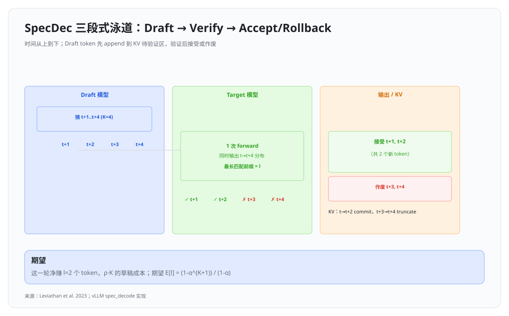
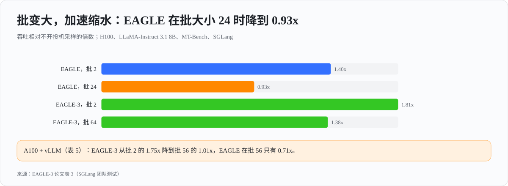
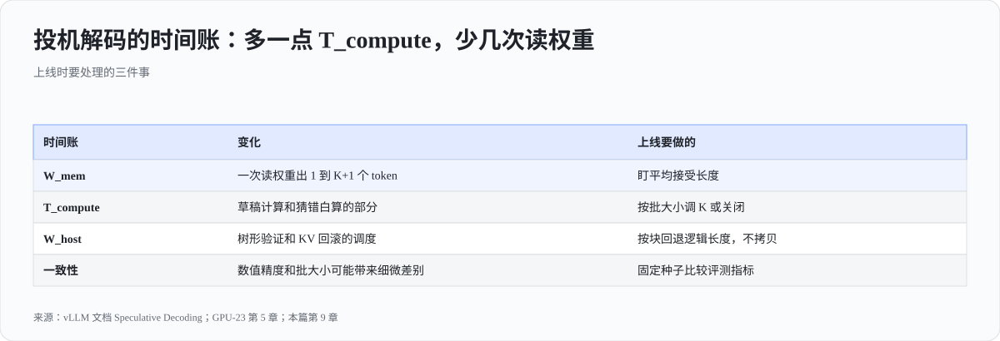

# GPU-25｜LLM｜投机解码：αK 与 MTP / EAGLE 谱系

> 🎯 **这篇文档解决什么问题**：解码每一步要读全部权重，却只为每个请求出一个 token，算力大多空着。投机解码先用便宜的办法猜几个 token，再让大模型一步验证，猜对几个就一次前进几个，输出分布不变。本篇说明接受规则为什么无损，用 αK 公式估收益，比较独立草稿模型、Medusa 和 EAGLE 草稿头、MTP、n-gram 四类草稿，再用 EAGLE-3 论文的实测说明批变大以后收益怎样缩水。

> 💡 **扩展 GPU-23**：GPU-23（[GPU-23｜LLM｜推理系统：KV cache、PagedAttention 与 PD 分离](./23-inference.md)）讲推理系统的内存侧（KV cache、PagedAttention、PD 分离），本篇补算法侧的投机解码。建议先读 GPU-23（[GPU-23｜LLM｜推理系统：KV cache、PagedAttention 与 PD 分离](./23-inference.md)）。

**使用方式**：第 1 章讲为什么能猜。第 2、3 章讲接受规则和收益公式。第 4 到 7 章比较四类草稿。第 8 章讲批大小的影响，第 9 章讲上线，第 10 章给清单和自测。

**代码**：本篇没有配套代码，文中算例由公式推出，第 10 章给出可以自己写的练习。

<b>🧭 主线位置</b>：GPU-00（[GPU-00｜索引｜从 0 开始 GPU 优化：路线、章节与练习](./README.md)）建立了时间账 T = T_compute + W_mem + W_host + W_comm + W_idle。GPU-23（[GPU-23｜LLM｜推理系统：KV cache、PagedAttention 与 PD 分离](./23-inference.md)）说明解码受 HBM 带宽限制，时间主要是 W_mem。本篇用空闲的算力换掉一部分 W_mem：多花一点 T_compute，让一次权重读取产出多个 token。GPU-26（[GPU-26｜系统｜CXL：一致性互连与 KV offload 工程化](./26-cxl.md)）接着讲 KV 太大时怎样借助 CXL 扩展内存。

## 导读 · 先给结论

- <b>解码有算力富余。</b>70B 在 8 张 H100 上批大小 1 时每步读权重约 5.27 ms，算术强度约 1 FLOP/B，离拐点 295 很远（第 1 章）。[[1]](https://arxiv.org/pdf/2309.06180)[[2]](https://www.nvidia.com/en-us/data-center/h100/)
- <b>接受规则无损。</b>按 min(1, p ÷ q) 接受，被拒时从修正分布重采样，输出和大模型同分布（第 2 章）。[[3]](https://arxiv.org/pdf/2211.17192)[[4]](https://arxiv.org/abs/2302.01318)
- <b>收益看 α、K、c。</b>期望前进 (1 − α^(K+1)) ÷ (1 − α) 个 token，再除以 (Kc + 1)（第 3 章）。[[3]](https://arxiv.org/pdf/2211.17192)
- <b>草稿越像越好。</b>EAGLE 在 LLaMA2-Chat 70B 上加速 2.7 到 3.5 倍，EAGLE-3 最高 6.5 倍（第 5 章）。[[5]](https://arxiv.org/pdf/2401.15077)[[6]](https://arxiv.org/pdf/2503.01840)
- <b>MTP 把草稿挪到训练阶段。</b>DeepSeek-V3 第二个 token 接受率 85% 到 90%，解码速度 1.8 倍（第 6 章）。[[7]](https://arxiv.org/pdf/2412.19437)
- <b>无模型草稿只对重复内容有效。</b>n-gram 收益较小，但高峰时不加负载（第 7 章）。[[8]](https://docs.vllm.ai/en/latest/features/speculative_decoding/)
- <b>批大了收益缩水。</b>H100 上 EAGLE 在批大小 24 时降到 0.93x，EAGLE-3 在 64 时仍有 1.38x（第 8 章）。[[6]](https://arxiv.org/pdf/2503.01840)

<b>📎 与系列其他文档的分工</b>：GPU-02（[GPU-02｜硬件｜性能账本：Roofline、算术强度与三类瓶颈](./02-ledger.md)）讲 Roofline 和算术强度。GPU-23（[GPU-23｜LLM｜推理系统：KV cache、PagedAttention 与 PD 分离](./23-inference.md)）讲解码的带宽账、KV 管理和 goodput。GPU-22（[GPU-22｜LLM｜MoE 与专家并行：all-to-all 与负载均衡](./22-moe-ep.md)）讲 DeepSeek-V3 的 MoE 结构。GPU-29（[GPU-29｜LLM｜推理引擎实战：SGLang vs vLLM 选型](./29-engine-choice.md)）比较推理引擎的实现。

## 第 1 章 · 解码为什么能“猜”：带宽限制下算力有富余

GPU-23（[GPU-23｜LLM｜推理系统：KV cache、PagedAttention 与 PD 分离](./23-inference.md)）算过，解码每一步要把全部权重读一遍，却只为每个请求算一个 token，受的是 HBM 带宽限制。读权重的时间是固定的，这一步多算几个 token 几乎不增加时间。投机解码利用的就是这份富余：先用便宜的办法猜出后面几个 token，再让大模型一步把它们全部验证，猜对几个就一次前进几个。

### 一步解码在等什么

vLLM 论文指出，逐 token 的顺序生成让工作负载受访存限制，用不满 GPU 的算力[[1]](https://arxiv.org/pdf/2309.06180)。以 GPU-23 的例子算：Llama 3 70B 按张量并行切到 8 张 H100 SXM 上，每卡 17.65 GB 权重，HBM 带宽 3.35 TB/s[[2]](https://www.nvidia.com/en-us/data-center/h100/)，批大小为 1 时光读权重就要约 5.27 ms。这 5.27 ms 里，每个 BF16 权重读进来是 2 字节，只参与一次乘加，算术强度约 1 FLOP/B。H100 的 BF16 稠密峰值 989 TFLOPS（规格页 1,979 是稀疏口径[[2]](https://www.nvidia.com/en-us/data-center/h100/)），拐点约 295 FLOP/B，算力几乎全在空等。

### 一次验证 K+1 个 token

如果这一步把猜出来的 K 个 token 连同当前位置一起送进模型，权重还是只读一遍，每个权重字节参与 K+1 次乘加。K 取 3 时算术强度约 4 FLOP/B，K 取 7 时约 8 FLOP/B，仍然远低于 295，时间仍由读权重决定。也就是说，在批很小的时候，验证 8 个 token 和生成 1 个 token 花的时间差不多。只要猜得足够准，每一步就能前进好几个 token，TPOT 按比例下降。

放进时间账：投机解码把一部分 W_mem 换成了 T_compute。解码原本是读一次权重出一个 token，现在是读一次权重出好几个 token，多出来的计算本来就在空闲的算力上。代价是猜 token 本身的开销，以及猜错时白算的部分，第 3 章把这些放进一个公式。

按五步闭环看投机解码的前提：

- **定天花板**：算出解码每步读的字节和算术强度，确认离拐点很远。
- **测实际**：在目标批大小下量一步解码的时间，和读权重的下限比较。
- **定位等待**：时间主要花在读权重和 KV 上，说明有算力可借。
- **消除或隐藏**：用投机解码把多个 token 放进同一次读取。
- **复测**：TPOT 下降，输出分布不变。

一个常见的误区是在任何负载下都开投机解码。现象是低峰时 TPOT 明显下降，高峰时吞吐反而变差。原因是批大到一定程度后，解码本身已经接近拐点，算力不再富余，多验证的 token 开始占用真实的计算时间。改法是先按批大小算算术强度，只在富余明显的区间开启，第 8 章给出实测数据。

> 🔑 **本章要点**：解码受 HBM 带宽限制，70B 在 8 张 H100 上批大小 1 时每步光读权重约 5.27 ms，算术强度约 1 FLOP/B，离拐点 295 FLOP/B 很远。一次验证 K+1 个 token 仍只读一遍权重，时间几乎不变。投机解码把空闲的算力用来一次前进多个 token。这一章是五步闭环的“定天花板”：先确认算力确实有富余。

## 第 2 章 · 接受规则：猜错了也不改变输出分布

第 1 章说可以先猜后验。猜出来的 token 来自一个更小、更快的草稿模型，分布和大模型不同；如果直接用它的结果，输出质量就变了。投机解码的关键是一条接受规则：按概率决定收不收草稿 token，被拒时从修正后的分布里重新采样，最终输出和只用大模型逐个采样完全同分布。

### 接受与重新采样

记大模型在某个位置的分布为 p，草稿模型的分布为 q。草稿模型按 q 采样出一个 token x，大模型在验证时算出 p(x)。规则是：如果 q(x) ≤ p(x)，直接接受；否则以 p(x) ÷ q(x) 的概率接受。被拒时，从 p − q 的正部归一化后的分布里重新采样一个 token，然后丢弃这个位置之后的所有草稿 token。Leviathan 等人证明了这样得到的 token 服从 p[[3]](https://arxiv.org/pdf/2211.17192)；Chen 等人同期提出了同样的修正拒绝采样，在不改模型的前提下不损失采样质量[[4]](https://arxiv.org/abs/2302.01318)。

一次验证最少前进 1 个 token（第一个就被拒时，用重新采样的那个），最多前进 K+1 个（K 个全部接受，再加上大模型在最后一个位置顺带算出的下一个 token）[[3]](https://arxiv.org/pdf/2211.17192)。所以投机解码在最坏情况下也不会比逐个生成走得慢，只是多花了草稿和验证的计算。

### 接受率 α 是什么

每个位置被接受的概率取决于两个分布有多接近。Leviathan 等人给出，期望接受率 α 等于 min(p, q) 在所有 token 上求和后的期望[[3]](https://arxiv.org/pdf/2211.17192)。两个分布完全相同时 α 为 1，完全不重叠时为 0。草稿模型越像大模型，α 越高。贪心解码时规则退化为比较两边的最大概率 token 是否相同。

“无损”有一个前提：数值精度。vLLM 文档写明，投机解码的采样在理论上无损，但受硬件数值精度限制[[8]](https://docs.vllm.ai/en/latest/features/speculative_decoding/)；验证时多个 token 一起算，浮点累加顺序和逐个生成不同，输出可能有细微差别。

按五步闭环看接受规则：

- **定天花板**：用 α 衡量草稿和大模型分布的接近程度。
- **测实际**：在真实请求上统计每个位置的接受率。
- **定位等待**：接受率低的位置和场景，就是猜测白费的地方。
- **消除或隐藏**：换更像大模型的草稿，或减少猜测长度。
- **复测**：开关投机解码，比较输出分布和评测指标。

一个常见的误区是把投机解码当成近似加速。现象是团队担心开了以后效果变差，用小流量灰度了很久。原因是没有区分标准的拒绝采样和放宽了接受条件的变体，前者在数值精度内无损，后者确实会改变输出。改法是确认所用实现走的是标准拒绝采样，再用固定随机种子和评测集对比开关前后的结果。

> 🔑 **本章要点**：草稿 token 以 min(1, p ÷ q) 的概率被接受，被拒时从 p − q 的正部重新采样，输出和大模型逐个采样同分布。一次验证前进 1 到 K+1 个 token。接受率 α 等于 min(p, q) 求和的期望。这一章是五步闭环的“定天花板”：α 决定了猜测能带来多少收益。

## 第 3 章 · αK 账：期望前进几个 token，扣掉草稿开销还剩多少

第 2 章给出了接受规则，本章算收益。每一步猜 K 个 token，每个位置的接受概率是 α，一次验证平均能前进几个 token？草稿模型自己也要时间，扣掉以后还剩多少加速？Leviathan 等人给出了两个公式，用它们可以在上线前估出合适的 K。

### 期望前进的 token 数

假设每个位置的接受相互独立、概率都是 α，一次验证前进的 token 数服从截断的几何分布，成功概率 1 − α，上限 K + 1[[3]](https://arxiv.org/pdf/2211.17192)。期望值是 (1 − α^(K+1)) ÷ (1 − α)。K 趋于无穷时，上限是 1 ÷ (1 − α)。

拿 DeepSeek-V3 的数据代入。它的 MTP 模块每步多预测 1 个 token，报告的接受率在 85% 到 90% 之间，解码速度是原来的 1.8 倍[[7]](https://arxiv.org/pdf/2412.19437)。K = 1 时公式给出 1 + α，也就是 1.85 到 1.90 个 token，和 1.8 倍很接近，差的部分是额外模块的开销。如果 α 保持 0.85 不变，K 取 3 时期望 3.19 个，K 取 7 时 4.85 个，上限 6.67 个；α 是 0.90 时分别是 3.44、5.70 和 10.00。

### 扣掉草稿开销

草稿模型跑一次的时间和大模型跑一次的比值记为 c。一步要跑 K 次草稿、一次验证，总时间是 (Kc + 1) 个大模型步。Leviathan 等人的定理 3.8 给出总时间的期望改进倍数[[3]](https://arxiv.org/pdf/2211.17192)，等于期望前进数除以 (Kc + 1)。他们的实验里草稿比大模型小一两个数量级，c 总小于 0.05，经常接近 0[[3]](https://arxiv.org/pdf/2211.17192)。取 c = 0.05、α = 0.85，K = 3 时改进约 2.77 倍，K = 7 时约 3.59 倍；α = 0.90 时分别约 2.99 和 4.22 倍。

两条公式的结论很直接：α 越高，K 越值得加大；c 越大，K 越早到头。实际中 α 不是常数。EAGLE-2 发现草稿 token 的接受率不只取决于位置，还和上下文有关[[9]](https://arxiv.org/pdf/2406.16858)，越往后的位置通常越难猜中，所以按常数 α 算出的长 K 收益会偏乐观。

按五步闭环看 αK：

- **定天花板**：用 1 ÷ (1 − α) 估最多能前进几个 token。
- **测实际**：统计每次验证实际接受的长度分布和草稿耗时比 c。
- **定位等待**：接受长度远低于公式值时，看是哪些位置的接受率掉得快。
- **消除或隐藏**：按实测的 α 和 c 选 K，或按上下文动态调整。
- **复测**：TPOT 下降幅度接近改进倍数。

一个常见的误区是把 K 开得越大越好。现象是 K 从 4 加到 10，接受长度几乎没变，TPOT 反而上升。原因是靠后位置的接受率低，多猜的 token 大多被拒，草稿的开销却按 K 线性增加。改法是按实测接受长度的分布选 K，让最后几个位置的接受概率仍然值回它们的草稿开销。

> 🔑 **本章要点**：一次验证期望前进 (1 − α^(K+1)) ÷ (1 − α) 个 token，再除以 (Kc + 1) 得到时间上的改进倍数。DeepSeek-V3 的 α 为 85% 到 90%，K = 1 时公式给出 1.85 到 1.90，实测 1.8 倍。α 随位置和上下文变化，长 K 的收益要按实测算。这一章是五步闭环的“定天花板”：用 α、K、c 三个数估出加速上限。

## 第 4 章 · 独立草稿模型：最早的做法，c 和 α 要一起看

第 3 章说收益由 α 和 c 决定。最直接的草稿是一个同系列的小模型：和大模型共用词表，单独跑自回归，每步猜一个 token。它不需要改大模型，也不需要额外训练，是投机解码最早的形态。

### 两篇奠基论文的数据

Leviathan 等人在 T5-XXL 上验证了这个方法，相对标准 T5X 实现加速 2 到 3 倍，输出完全相同[[3]](https://arxiv.org/pdf/2211.17192)。他们用的草稿比大模型小一两个数量级，草稿耗时比 c 总小于 0.05[[3]](https://arxiv.org/pdf/2211.17192)。Chen 等人在 70B 参数的 Chinchilla 上做了同样的事，分布式部署下解码加速 2 到 2.5 倍，不损失采样质量，也不改模型[[4]](https://arxiv.org/abs/2302.01318)。

### 独立草稿的取舍

独立草稿模型的好处是即插即用：只要词表一致，任何小模型都能当草稿，大模型一行代码都不用改。坏处有三个。第一个是 α 不容易高，小模型和大模型是分别训练的，分布差距大。第二个是 c 不可忽略：草稿模型也要读自己的权重和 KV，K 步草稿是 K 次串行的小模型解码。第三个是运维成本：要多部署一个模型，多占一份显存和 KV。

放回第 3 章的公式：同样 K = 3，草稿耗时比从 0.05 涨到 0.2 时，分母从 1.15 变成 1.6，收益缩水近三成。所以选草稿模型时，不只看它小，还要看它和大模型的分布有多像；最好在目标任务上直接量 α 和 c，再代入公式。

后来的方法大多在解决独立草稿的这几个问题：把草稿做成大模型身上的几个小头，让它直接复用大模型的特征，提高 α、降低 c（第 5、6 章）；或者干脆不用模型，从上下文里找现成的片段当草稿（第 7 章）。

按五步闭环看独立草稿：

- **定天花板**：用草稿和大模型的参数量之比估 c，用公式估改进上限。
- **测实际**：在目标任务上量 α 和 c。
- **定位等待**：c 高就是草稿太慢，α 低就是草稿不像。
- **消除或隐藏**：换更小或更像的草稿，或者换成草稿头。
- **复测**：TPOT 和接受长度达到预期。

一个常见的误区是选一个很小的草稿模型来压低 c。现象是草稿确实快，接受长度却只有一点几，整体加速不明显。原因是太小的模型和大模型分布差太远，α 掉得比 c 降得快。改法是在两三个候选草稿上分别量 α 和 c，按公式算出的改进倍数选。

> 🔑 **本章要点**：独立草稿模型共用词表、不改大模型。Leviathan 等人在 T5-XXL 上加速 2 到 3 倍且输出相同，Chen 等人在 Chinchilla 上加速 2 到 2.5 倍。它的问题是 α 不易高、c 不可忽略、多一个模型要部署。这一章是五步闭环的“消除或隐藏”：用一个便宜的模型替大模型猜。

## 第 5 章 · 草稿头：Medusa 与 EAGLE 把草稿长在大模型身上

第 4 章的独立草稿有两个短板：和大模型分布不像，自己还要单独跑。草稿头的思路是把草稿做成大模型身上的几个小模块，直接读大模型已经算好的隐藏状态。这样草稿天然更像大模型，α 更高；它只有一两层，c 也更低。

### Medusa：多个解码头加树注意力

Medusa 在大模型最后一层上加几个额外的解码头，每个头负责往后更远的一个位置，并行给出多个候选 token[[10]](https://arxiv.org/pdf/2401.10774)。几个头的候选组合成一棵树，用树注意力在一次前向里同时验证多条候选路径[[10]](https://arxiv.org/pdf/2401.10774)。论文报告，只训练解码头的 Medusa-1 加速 2.2 倍以上且不损失生成质量，和大模型一起微调的 Medusa-2 加速 2.3 到 2.8 倍[[10]](https://arxiv.org/pdf/2401.10774)。

### EAGLE 系列：在特征层做自回归

EAGLE 的出发点是，特征层面的自回归比 token 层面更简单[[5]](https://arxiv.org/pdf/2401.15077)。这里的特征指大模型倒数第二层的输出[[5]](https://arxiv.org/pdf/2401.15077)。草稿头拿这层特征和下一个 token 作为输入，自回归地预测下一个特征，再用大模型的输出头得到 token。在 LLaMA2-Chat 70B 上，EAGLE 的延迟加速 2.7 到 3.5 倍，吞吐翻倍，生成文本的分布不变[[5]](https://arxiv.org/pdf/2401.15077)。

EAGLE-2 发现草稿 token 的接受率还和上下文有关[[9]](https://arxiv.org/pdf/2406.16858)，于是把固定形状的草稿树换成按上下文动态展开的树[[9]](https://arxiv.org/pdf/2406.16858)：草稿模型对哪个分支更有把握，就往哪个分支多展开。加速提高到 3.05 到 4.26 倍，比 EAGLE-1 快 20% 到 40%[[9]](https://arxiv.org/pdf/2406.16858)。EAGLE-3 放弃了特征预测，改成直接预测 token[[6]](https://arxiv.org/pdf/2503.01840)，并通过一种叫 training-time test 的训练方法融合大模型多层的特征[[6]](https://arxiv.org/pdf/2503.01840)。论文报告加速最高 6.5 倍，比 EAGLE-2 再快约 1.4 倍[[6]](https://arxiv.org/pdf/2503.01840)。

这些数字都是批大小很小时的延迟加速。它们依赖第 1 章的前提：算力有富余。批变大以后收益会缩小，第 8 章给出 EAGLE-3 论文里的实测。草稿头还要针对每个目标模型单独训练，换了模型就要重训。

按五步闭环看草稿头：

- **定天花板**：用论文的接受长度和第 3 章的公式估改进上限。
- **测实际**：在目标模型和任务上量平均接受长度。
- **定位等待**：接受长度低时，看草稿头训练数据和线上流量是否一致。
- **消除或隐藏**：用和线上分布相近的数据训练草稿头，打开动态草稿树。
- **复测**：TPOT 下降，评测指标不变。

一个常见的误区是直接拿开源的草稿头用在自己微调过的模型上。现象是接受长度比论文低很多，加速只有一点几倍。原因是草稿头学的是原模型的特征分布，微调后特征变了，草稿就不像了。改法是用微调后的模型重新训练草稿头，训练数据尽量贴近线上流量。

> 🔑 **本章要点**：草稿头读大模型的隐藏状态，α 更高、c 更低。Medusa 用多个解码头加树注意力，加速 2.2 到 2.8 倍；EAGLE 在倒数第二层特征上自回归，LLaMA2-Chat 70B 加速 2.7 到 3.5 倍；EAGLE-2 用动态草稿树，EAGLE-3 改成直接预测 token 并融合多层特征，最高 6.5 倍。这一章是五步闭环的“消除或隐藏”：让草稿更像大模型、更便宜。

## 第 6 章 · MTP：训练时就让模型多预测几个 token

第 5 章的草稿头是模型训完以后再加上去的。多 token 预测（MTP）把这件事挪到了预训练阶段：训练目标里除了下一个 token，还要预测更远的几个 token。训完以后，这些额外的预测模块可以直接当草稿用，不用再单独训练草稿模型。

### Gloeckle 等人：n 个独立的输出头

Gloeckle 等人让模型在训练语料的每个位置同时预测后面 n 个 token，n 个预测并行给出[[11]](https://arxiv.org/pdf/2404.19737)。他们的结论是，多 token 预测不仅提高了样本效率，还让模型能做自投机解码：用 4 个 token 预测训练的模型，推理时最快可达 3 倍，批大小较大时也成立[[11]](https://arxiv.org/pdf/2404.19737)。这里的草稿来自模型自己的额外输出头，验证时用主输出头，所以 α 高、c 很低。

### DeepSeek-V3：顺序 MTP 模块

DeepSeek-V3 的做法和 Gloeckle 等人不同。后者用独立的输出头并行预测多个额外 token[[7]](https://arxiv.org/pdf/2412.19437)，DeepSeek-V3 则按顺序预测额外 token，在每个预测深度都保留完整的因果链[[7]](https://arxiv.org/pdf/2412.19437)。每个 MTP 模块接收上一深度的表示和对应 token 的嵌入，共享主模型的嵌入层和输出头。

报告说明，MTP 主要是为了提升主模型的训练效果，推理时可以直接丢掉 MTP 模块，主模型照常工作[[7]](https://arxiv.org/pdf/2412.19437)；也可以把这些模块拿来做投机解码，进一步降低生成延迟[[7]](https://arxiv.org/pdf/2412.19437)。按报告的评估，第二个 token 的接受率在 85% 到 90% 之间，各类话题都比较稳定，解码速度达到原来的 1.8 倍[[7]](https://arxiv.org/pdf/2412.19437)。第 3 章算过，K = 1、α 为 85% 到 90% 时，公式给出每步 1.85 到 1.90 个 token，和 1.8 倍吻合。

MTP 的门槛在训练侧：模型必须在预训练时就带上 MTP 目标，已经训好的模型没法直接用。对于自己训练基座的团队，它是成本最低的草稿来源；对于只拿开源权重做部署的团队，要看模型发布时是否附带了 MTP 模块。vLLM 的投机解码配置里，mtp 和 draft_model、ngram、eagle3 并列，是一种可选的方法[[8]](https://docs.vllm.ai/en/latest/features/speculative_decoding/)。

按五步闭环看 MTP：

- **定天花板**：用论文给出的第二个 token 接受率代入公式。
- **测实际**：线上统计 MTP 草稿的接受率，按任务类型分开看。
- **定位等待**：接受率明显低于论文值时，看是否是采样温度、任务类型不同。
- **消除或隐藏**：按接受率决定用几层 MTP 模块做草稿。
- **复测**：每秒 token 数接近 1 + α 倍。

一个常见的误区是以为 MTP 模块越多，加速越大。现象是把多层 MTP 都接上做草稿，接受长度只比一层多一点，延迟却增加了。原因是越深的预测越难，接受率逐层下降，而每层模块都要串行跑一次。改法是逐层量接受率，只用收益大于开销的那几层。

> 🔑 **本章要点**：MTP 在预训练时让模型预测多个未来 token。Gloeckle 等人用独立输出头，4 token 预测的模型推理最快 3 倍；DeepSeek-V3 用顺序 MTP 模块保留因果链，第二个 token 接受率 85% 到 90%，解码速度 1.8 倍。MTP 要在训练时就加上。这一章是五步闭环的“消除或隐藏”：把草稿的成本挪到训练阶段。

## 第 7 章 · 不用模型的草稿：n-gram、后缀匹配与 Lookahead

前三章的草稿都要一个模型，哪怕只是几层。还有一类方法完全不用模型：草稿直接从已有的文本里找。代码补全、文档改写、带检索结果的问答，输出里经常大段重复提示词或前文，这时候在上下文里查一下就能猜中很多 token，c 几乎为零。

### 从上下文里查

n-gram 草稿的做法是：拿当前输出末尾的几个 token，在提示词和已生成的文本里找相同的片段，把片段后面紧跟的 token 当作草稿。vLLM 把它叫作 ngram 方法，可以设定匹配窗口的最大和最小长度[[8]](https://docs.vllm.ai/en/latest/features/speculative_decoding/)；同类的还有 suffix 方法，按后缀匹配找草稿[[8]](https://docs.vllm.ai/en/latest/features/speculative_decoding/)。查表的开销相比一次大模型前向可以忽略，所以只要命中，就是净赚。

它的局限也很明显：只有输出确实在重复上下文时才猜得中，开放式的对话和创作几乎没有收益。vLLM 文档的建议是，EAGLE、MTP 和草稿模型这类基于模型的方法降延迟最多；n-gram 和后缀解码收益较小，但在高峰流量时不会增加负载[[8]](https://docs.vllm.ai/en/latest/features/speculative_decoding/)。

### Lookahead：用 Jacobi 迭代自己造草稿

Lookahead Decoding 换了一个角度：把自回归解码看成一个非线性方程组，用不动点 Jacobi 迭代并行求解[[12]](https://arxiv.org/pdf/2402.02057)。迭代过程中会产生很多 n-gram 片段，把它们收集起来当草稿，再用大模型验证。它不需要草稿模型，也不需要额外训练。论文报告在 MT-bench 上最多加速 1.8 倍，在代码补全任务上用多卡扩展可达 4 倍[[12]](https://arxiv.org/pdf/2402.02057)。

这几种方法的共同点是 c 很低、α 随任务变化很大。选型时可以先在线上流量上算一下“输出里有多少片段能在上下文中找到”，这个比例高，就值得先上 n-gram；比例低，就要用草稿头或 MTP。

按五步闭环看无模型草稿：

- **定天花板**：统计输出和上下文的重复程度，估计 n-gram 能命中的比例。
- **测实际**：开启 n-gram 后量平均接受长度。
- **定位等待**：按任务类型分开看，找出命中率高和低的流量。
- **消除或隐藏**：重复多的流量用 n-gram，其余用模型类草稿。
- **复测**：各类流量的 TPOT 都不变差。

一个常见的误区是在所有流量上统一开 n-gram。现象是代码类请求明显变快，闲聊类请求几乎没变，整体收益被平均掉了。原因是 n-gram 只在输出重复上下文时有效。改法是按任务类型路由，或者按每个请求实时的接受率决定是否继续猜。

> 🔑 **本章要点**：n-gram 和后缀匹配从上下文里找草稿，几乎没有开销，只在输出重复前文时有效；vLLM 文档认为它们收益较小但高峰时不加负载。Lookahead 用 Jacobi 迭代自己产生 n-gram，MT-bench 上最多 1.8 倍。这一章是五步闭环的“消除或隐藏”：在重复多的流量上用零成本的草稿。

## 第 8 章 · 批变大以后：算力富余消失，加速跟着缩水

前几章的加速数字大多是批大小为 1 时的延迟。第 1 章说过，投机解码借的是解码时空闲的算力；批变大以后，每个权重字节被更多请求共用，算术强度上升，富余变少。多验证的 token 开始占用真实的计算时间，猜错的部分不再免费。线上服务通常是大批，这一章看实测数据。

### EAGLE-3 论文里的批大小扫描

EAGLE-3 论文给出了两组实测。第一组由 SGLang 团队在 H100 上测，目标模型是 LLaMA-Instruct 3.1 8B，数据集 MT-Bench，基线是不开投机采样的 SGLang[[6]](https://arxiv.org/pdf/2503.01840)：

| 批大小 | 2 | 8 | 16 | 24 | 48 | 64 |
|---|---|---|---|---|---|---|
| EAGLE | 1.40x | 1.23x | 1.02x | 0.93x | 0.88x | 0.99x |
| EAGLE-3 | 1.81x | 1.62x | 1.48x | 1.39x | 1.38x | 1.38x |

表里是吞吐相对基线的倍数[[6]](https://arxiv.org/pdf/2503.01840)。EAGLE 在批大小 16 时已经几乎没有收益，24 时变成 0.93x，比不开还慢；EAGLE-3 的收益也随批大小下降，从 1.81x 降到 64 时的 1.38x[[6]](https://arxiv.org/pdf/2503.01840)。第二组在 A100 上用 vLLM 测，同一个模型，EAGLE-3 从批大小 2 的 1.75x 降到 56 时的 1.01x，EAGLE 在 56 时只有 0.71x[[6]](https://arxiv.org/pdf/2503.01840)。论文也提到，投机采样常被认为在大批时会降低吞吐[[6]](https://arxiv.org/pdf/2503.01840)，这两组数据说明这取决于草稿的接受长度：接受长度越高，能撑住的批越大。

### 按负载开关

线上流量有峰谷。低峰时批小，算力富余多，投机解码的收益最大；高峰时批大，收益变小甚至为负。合理的做法是按当前批大小或排队长度动态调整：批小时开大 K，批大时减小 K 或关掉。vLLM 文档也提到，n-gram 这类方法在高峰时不增加负载[[8]](https://docs.vllm.ai/en/latest/features/speculative_decoding/)，适合作为高峰时的保底选项。

按五步闭环看批大小：

- **定天花板**：按批大小算解码的算术强度，看离拐点还有多远。
- **测实际**：在不同批大小下分别量开关投机解码的吞吐和 TPOT。
- **定位等待**：找出收益变为负的批大小。
- **消除或隐藏**：按负载动态调 K 或开关。
- **复测**：峰谷两段的吞吐都不低于不开时。

一个常见的误区是用批大小 1 的加速比估算整个集群能省多少卡。现象是按 3 倍加速估算缩容，上线后在高峰时吞吐不升反降，只好扩回来。原因是加速比随批大小下降，集群的平均批远大于 1。改法是按线上实际批大小分布测吞吐，用 goodput（GPU-23）评估收益。

> 🔑 **本章要点**：批变大以后解码的算力富余变少，投机解码的收益随之下降。EAGLE-3 论文的实测里，H100 上 EAGLE 在批大小 24 时降到 0.93x，EAGLE-3 在 64 时仍有 1.38x；A100 上 EAGLE-3 在 56 时只剩 1.01x。这一章是五步闭环的“定位等待”：找出收益转负的批大小，按负载开关。

## 第 9 章 · 上线：KV 回滚、接受率监控和一致性校验

前几章讲了怎样选草稿、怎样估收益。真正上线还要处理三件工程上的事：猜错的 token 已经写进了 KV cache，要回滚；接受率随流量变化，要监控；“无损”要用数据验证，不能只靠理论。本章逐一说明，并把投机解码放回时间账。

### KV 回滚

验证一步时，大模型把 K 个草稿 token 和当前位置一起算，每个位置的 K 和 V 都写进了 KV cache。被拒的位置之后的 KV 都作废，下一步要从被接受的最后一个位置继续。在按块分配的 KV 管理里（GPU-23 第 5 章），这只是把请求的逻辑长度退回去，作废的槽位下一步直接覆盖，不需要拷贝。草稿模型或草稿头自己的 KV 也要同步回退。用树形草稿时，验证一次要写多条分支的 KV，只保留被接受的那条路径。

### 监控和校验

上线后最该盯的指标是平均接受长度，按任务类型和批大小分开看。接受长度下降，往往说明线上流量的分布变了，或者模型更新了而草稿没有跟着更新。第 3 章的公式可以把接受长度换算回 α，和上线前的估算对比。

一致性校验要知道哪些差异是正常的。vLLM 文档列出了开关投机解码时输出可能不同的原因：硬件数值精度的差别可能让输出分布有细微变化[[8]](https://docs.vllm.ai/en/latest/features/speculative_decoding/)；批大小变化也可能改变 logprobs 和输出概率[[8]](https://docs.vllm.ai/en/latest/features/speculative_decoding/)。所以校验不宜逐字比较，而是在固定种子下比较评测指标，或者比较 logprobs 的差异是否在数值误差范围内。

### 放回时间账

投机解码改变的是解码的 W_mem：原来读一遍权重出一个 token，现在出 1 到 K+1 个。新增的成本有三项：草稿的计算，记进 T_compute；猜错的 token 白算的部分，也是 T_compute；树形验证和回滚带来的调度开销，记进 W_host。批小时前者远大于后者，收益明显；批大时 T_compute 不再便宜，收益缩小（第 8 章）。

按五步闭环看上线：

- **定天花板**：用实测 α 和 c 算出当前流量下的改进上限。
- **测实际**：线上记录接受长度、TPOT 和吞吐。
- **定位等待**：接受长度下降时看流量和模型版本，收益为负时看批大小。
- **消除或隐藏**：重训草稿、调 K、按负载开关。
- **复测**：在固定种子下比较评测指标，确认输出一致。

一个常见的误区是模型升级时忘了同步草稿。现象是大模型换了新版本，TPOT 反而变差，排查了很久才发现接受长度掉了一半。原因是草稿头或 MTP 模块是按旧模型训练的，新模型的分布变了。改法是把草稿和大模型作为一个整体发布，升级流程里加上接受长度的回归检查。

> 🔑 **本章要点**：猜错的 token 的 KV 要回滚，按块分配时只需退回逻辑长度；线上盯平均接受长度，按任务和批大小分开看；输出一致性在数值精度和批大小影响下允许细微差别。投机解码用 T_compute 换 W_mem。这一章是五步闭环的“复测”：用接受长度和评测指标持续验证收益。

## 第 10 章 · 上线前核对清单与自测

前九章沿着投机解码的收益展开：第 1 章说明解码有算力富余，第 2 章给出不改变输出分布的接受规则，第 3 章用 αK 公式估收益，第 4 到 7 章比较四类草稿，第 8 章看批大小的影响，第 9 章讲上线时的回滚、监控和校验。本章把这些压成一张核对清单，再给出练习和自测题。

### 📌 核对清单

| 检查项 | 怎样查 | 通过的标志 |
|---|---|---|
| 算力确有富余 | 按目标批大小算解码的算术强度（第 1 章） | 离拐点足够远 |
| 走标准拒绝采样 | 确认实现用 min(1, p ÷ q) 接受、被拒重采样（第 2 章） | 理论上无损 |
| K 有依据 | 用实测 α 和 c 代入 αK 公式（第 3 章） | 改进倍数在 K 附近达到最大 |
| 草稿选型 | 独立草稿、草稿头、MTP、n-gram 分别量 α 和 c（第 4 到 7 章） | 选改进倍数最高的 |
| 草稿和模型同版本 | 草稿头或 MTP 与大模型一起训练和发布（第 5、6 章） | 接受长度和上线前一致 |
| 按流量分开 | 统计输出与上下文的重复程度（第 7 章） | 重复多的流量用 n-gram |
| 批大小扫描 | 不同批大小下开关对比吞吐（第 8 章） | 找到收益转负的批大小 |
| 按负载开关 | 批大或排队长时减小 K 或关闭（第 8 章） | 高峰吞吐不低于不开时 |
| KV 回滚正确 | 被拒位置后的 KV 作废，草稿的 KV 同步回退（第 9 章） | 长时间运行没有 KV 泄漏 |
| 一致性校验 | 固定种子比较评测指标和 logprobs（第 9 章） | 差异在数值误差范围内 |

### 练习

本篇没有配套代码。下面几个练习可以用几十行 Python 完成：

- **验证接受规则**：随机生成两个分布 p 和 q，按第 2 章的规则采样一百万次，统计输出的经验分布，和 p 比较。
- **画 αK 曲线**：对 α 取 0.85 和 0.90、c 取 0.05，画出 K 从 1 到 10 的改进倍数，找出最优的 K（第 3 章）。
- **位置相关的 α**：假设第 i 个位置的接受率随 i 递减，重新推导期望前进数，和常数 α 的结果比较（第 3 章）。
- **n-gram 命中率**：拿一批代码补全和闲聊的样本，统计输出里能在上下文中找到的片段比例（第 7 章）。
- **批大小的影响**：按 GPU-23 的解码时间公式，加上验证 K+1 个 token 的计算时间，估算加速比随批大小的变化，和 EAGLE-3 论文的实测比较（第 8 章）。

### 自测题

1. 为什么批小时验证 K+1 个 token 和生成 1 个 token 时间差不多？批大时为什么不成立？
2. 接受规则怎样保证输出和大模型逐个采样同分布？接受率 α 怎样计算？
3. 一次验证期望前进多少个 token？加上草稿开销 c 后的改进倍数是多少？
4. DeepSeek-V3 的 MTP 第二个 token 接受率是多少？用公式算出的每步 token 数和实测 1.8 倍是否一致？
5. Medusa、EAGLE、EAGLE-2、EAGLE-3 各改进了什么？
6. n-gram 草稿适合什么样的流量？EAGLE 在多大的批时收益转负？

**下一步**：投机解码处理的是解码时的 W_mem。KV cache 越来越大以后，显存本身不够用，GPU-26（[GPU-26｜系统｜CXL：一致性互连与 KV offload 工程化](./26-cxl.md)）讲 CXL：用一致性互连把 KV 卸载到更大的内存池。

## 参考文献

按正文首次引用顺序编号，资料截至 2026 年 11 月中。

[1] Kwon et al. Efficient Memory Management for Large Language Model Serving with PagedAttention. SOSP 2023 [arxiv.org/pdf/2309.06180](https://arxiv.org/pdf/2309.06180)

[2] NVIDIA H100 Tensor Core GPU 产品页 [www.nvidia.com/en-us/data-center/h100/](https://www.nvidia.com/en-us/data-center/h100/)

[3] Leviathan, Kalman, Matias. Fast Inference from Transformers via Speculative Decoding. ICML 2023, arXiv 2211.17192 [arxiv.org/pdf/2211.17192](https://arxiv.org/pdf/2211.17192)

[4] Chen et al. Accelerating Large Language Model Decoding with Speculative Sampling. arXiv 2302.01318 [arxiv.org/abs/2302.01318](https://arxiv.org/abs/2302.01318)

[5] Li et al. EAGLE: Speculative Sampling Requires Rethinking Feature Uncertainty. ICML 2024, arXiv 2401.15077 [arxiv.org/pdf/2401.15077](https://arxiv.org/pdf/2401.15077)

[6] Li et al. EAGLE-3: Scaling up Inference Acceleration of Large Language Models via Training-Time Test. arXiv 2503.01840 [arxiv.org/pdf/2503.01840](https://arxiv.org/pdf/2503.01840)

[7] DeepSeek-AI. DeepSeek-V3 Technical Report. arXiv 2412.19437 [arxiv.org/pdf/2412.19437](https://arxiv.org/pdf/2412.19437)

[8] vLLM 文档：Speculative Decoding [docs.vllm.ai/en/latest/features/speculative_decoding/](https://docs.vllm.ai/en/latest/features/speculative_decoding/)

[9] Li et al. EAGLE-2: Faster Inference of Language Models with Dynamic Draft Trees. EMNLP 2024, arXiv 2406.16858 [arxiv.org/pdf/2406.16858](https://arxiv.org/pdf/2406.16858)

[10] Cai et al. Medusa: Simple LLM Inference Acceleration Framework with Multiple Decoding Heads. ICML 2024, arXiv 2401.10774 [arxiv.org/pdf/2401.10774](https://arxiv.org/pdf/2401.10774)

[11] Gloeckle et al. Better &amp; Faster Large Language Models via Multi-token Prediction. ICML 2024, arXiv 2404.19737 [arxiv.org/pdf/2404.19737](https://arxiv.org/pdf/2404.19737)

[12] Fu et al. Break the Sequential Dependency of LLM Inference Using Lookahead Decoding. ICML 2024, arXiv 2402.02057 [arxiv.org/pdf/2402.02057](https://arxiv.org/pdf/2402.02057)

---

上一章：[GPU-24｜LLM｜综合：从选卡到上线](./24-capstone.md) · [目录](./README.md) · 下一章：[GPU-26｜系统｜CXL：一致性互连与 KV offload 工程化](./26-cxl.md)
