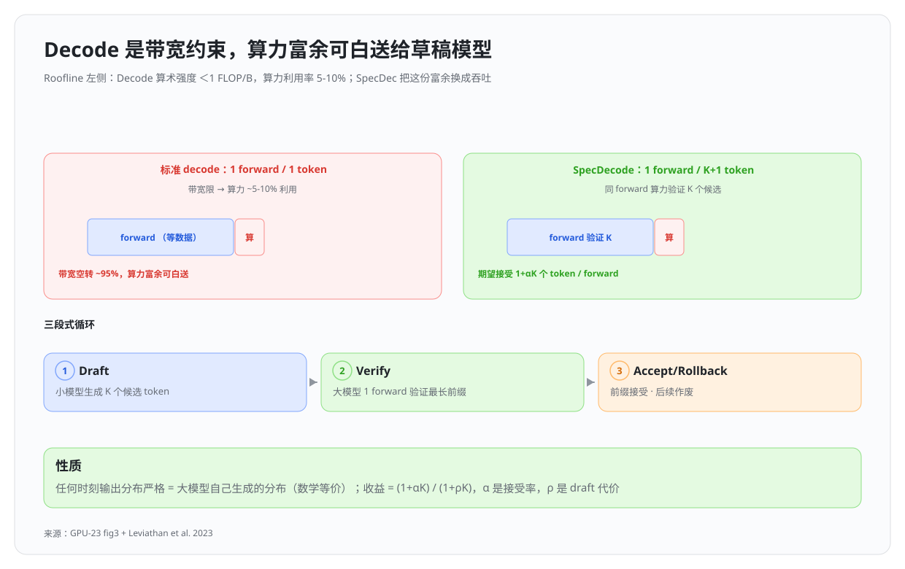
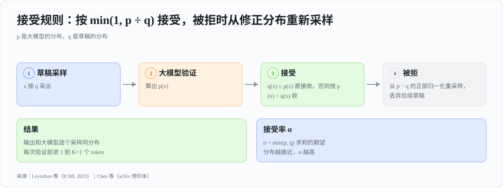
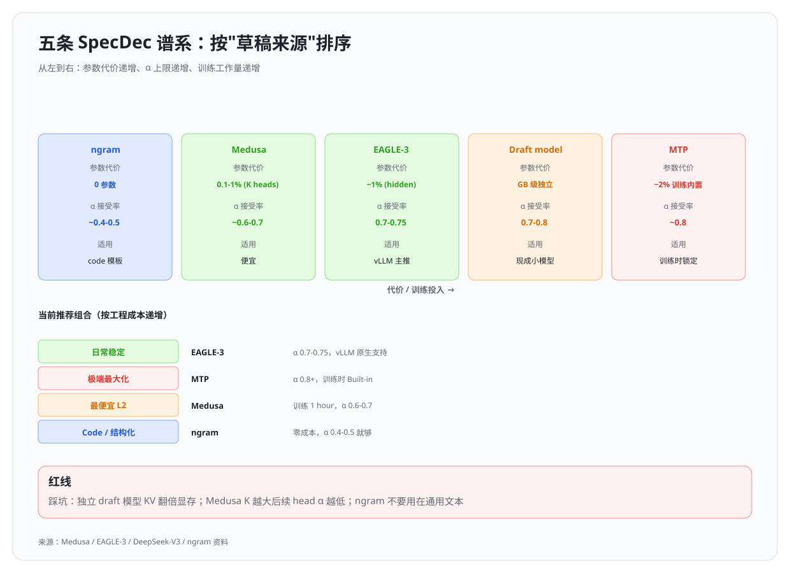
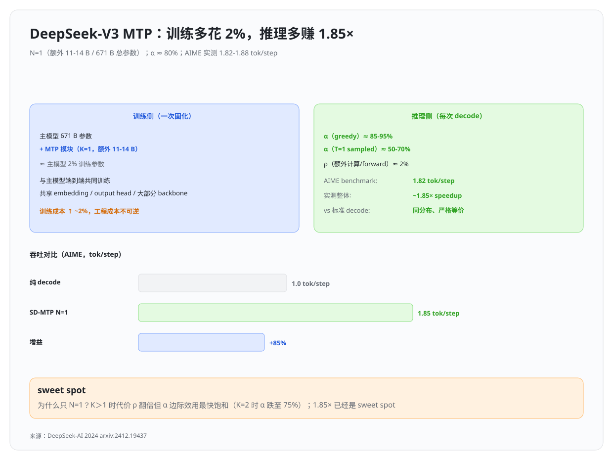
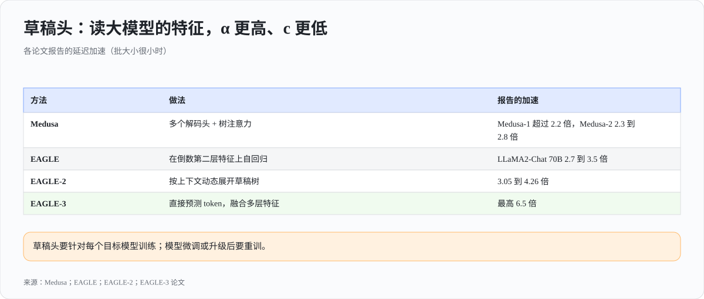
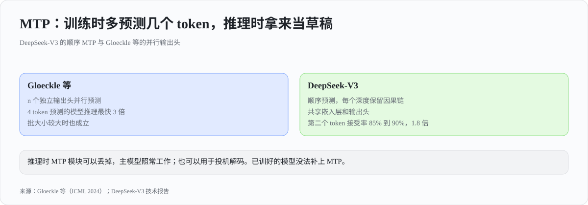
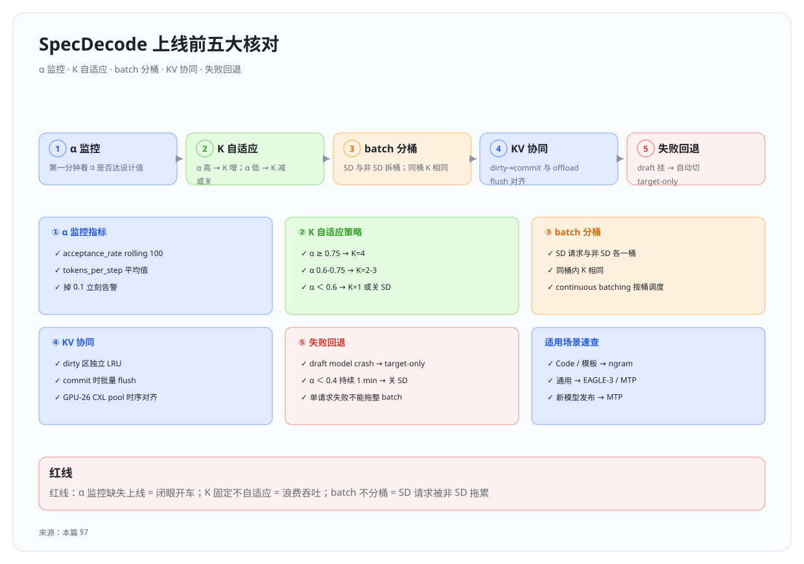

# GPU-25｜LLM｜投机解码：αK 与 MTP / EAGLE 谱系

> 🎯 **这篇文档解决什么问题**：Decode 串行 1 token / forward，是推理吞吐天花板。GPU-23 讲过 KV cache + PD 分离优化的是"内存侧"，本篇补"算法侧"——Speculative Decoding 用一个小草稿模型一次猜 K 个 token，大模型一次 forward 验证最长匹配前缀，*数学期望等价于大模型单独生成*。重点说清楚 αK 接受率公式、ngram/Medusa/EAGLE/Draft/MTP 五条谱系、DeepSeek-V3 MTP 1.8× 工程数据、以及和 PD 分离 / CXL offload 的协同位置。

# 导读 · 先给结论

- **SD 是用算力换延迟**：草稿模型花 ρ·K 代价猜 K 个 token，大模型 1 次 forward 验证；期望吞吐 = (1+αK) / (1+ρK)，仅当 αK > 1+ρK 才赚[[1]](https://arxiv.org/abs/2211.17192)。
- **α 是接受率（draft 与 target 分布一致的概率），K 是草稿长度，ρ = draft 单次代价 / target 单次代价**。α 每降 0.1，加速收益跌一档。
- **五条谱系按代价排序**：ngram(0 参数） → Medusa(0.1%) → EAGLE-3(\~1%) → MTP(2% 内置） → 独立 draft model(GB 级）。代价越低接受率越低[[2]](https://arxiv.org/abs/2404.14283)。
- **DeepSeek-V3 MTP 已上线**：N=1 额外 11-14 B 参数（\~2% of 671 B），α ≈ 80%，AIME 测试 1.82-1.88 tok/step，\~1.85× 加速[[3]](https://arxiv.org/abs/2412.19437)。
- **draft KV 管理是核心工程点**：草稿 token 需要先 append KV 再 verify，失败要 rollback；成功的 token 不能重复计算。
- **SD × PD 分离 × CXL offload 三方协同**：SD 提 decode 吞吐（本篇），PD 分离隔离 prefill 和 decode(GPU-23)，CXL 给 KV 找地方（GPU-26)。三个独立维度的乘积。



# 第 1 章 · Decode 的算力富余

## 1.1 Decode 是带宽约束，不是算力约束

前面 GPU-23 第 1 章画过 decode 的 Roofline，结论很反直觉：decode 的算术强度不到 1 FLOP/B，算力利用率只有 5-10%，tensor core 绝大部分周期在空转，等 HBM 把权重和 KV 搬过来。这意味着**同样花一次 forward 的时间，GPU 手里还攥着一大把没用完的算力**——这部分富余正好可以"白送"给一个猜 token 的小草稿模型。这就是 speculative decoding 能立足的前提：它不抢带宽，只捡算力。

## 1.2 一次 forward 的输出维度

先把一次标准 decode 拆开看：input 1 个 token，过一遍权重，输出 1 个 token——KPU 算出 vocab 分布后取 argmax 或采样。但同一份 forward 其实可以顺手算 K 个位置上的分布，因为 K 个 token 的 query 走的是同一组 weight，只是 query 多了几行。这个性质在 prefill 阶段天然成立（一整段 prompt 本来就是一起算的），但在 decode 阶段反而像个 bug——一次只喂 1 个 token，权重就读一遍，算力大半浪费。直到 speculative decoding 出现，把这个"浪费"反过来变成 feature：既然一次 forward 能算 K 个位置，那就让小模型先猜 K 个，大模型一次验完。

## 1.3 三段式循环

把这三段式画成 fig2 的泳道，一个 cycle 里 draft、verify、accept/rollback 三段接力：

1. **Draft**：小模型（或检索）先用便宜的算力把 K 个候选 token 连续猜出来，这一步花的是原本空转的 tensor core。
2. **Verify**：大模型把这 K 个 token 一次 forward 跑完，拿到 K 个位置上的真实分布，再从左到右取最长一段"draft 与 target 一致"的匹配前缀。
3. **Accept / Rollback**：匹配的前缀接受、写进输出，剩下不匹配的丢弃；下一个 cycle 从断点重新开始 Draft。

关键性质：任何时刻输出分布都严格等于大模型自己生成的分布[[1]](https://arxiv.org/abs/2211.17192)。

## 1.4 Roofline 回顾：算术强度与瓶颈判据

前面 GPU-02 已经把 Roofline 讲得很扎实，本节只做最压缩的回顾，并对接到 decode 的现实。Roofline 模型把 GPU 吞吐上界写成算术强度 I（FLOP/Byte）与 HBM 带宽 BW、峰值算力 Peak_FLOPS 之间的折线：

$$\text{Throughput} = \min(Peak,\ I \times BW)$$

拐点 I\* = Peak_FLOPS / BW。H100 SXM 的 BF16 峰值 989 TFLOPS、HBM 带宽 3.35 TB/s，I\* ≈ 295 FLOP/B。算术强度低于这个值的 kernel 称作 bandwidth-bound，高于称作 compute-bound。训练阶段 GEMM 的算术强度可以做到几百 FLOP/B，通常落在 compute-bound 一侧；而 decode 阶段几乎全部落在带宽一侧，差距悬殊。理解这个拐点是理解"为什么 SD 能用满 decode 算力"的前提——SD 不是凭空加速，是把算术强度从 GEMV 的 2 FLOP/B 提到 GEMM 的几十 FLOP/B，让原本带宽约束的 kernel 跨过拐点进入算力约束区。

## 1.5 Decode 算术强度的精确推导：Llama-2 70B TP=8 实例

把 Llama-2 70B 在 H100 TP=8 上的一次 decode forward 拆开。参数：80 层、64 个 Q head、8 个 KV head（GQA）、head_dim=128、hidden=8192、词表 32000。BF16 精度下模型权重共 70×2 = 140 GB，TP=8 后单卡持有 17.5 GB 权重。单步 decode 一次的访存量近似等于"读一遍全部权重"——即单卡 17.5 GB；KV cache 的增量只有 1 个 token 的 K/V，相对权重访存可忽略（除非上下文已经几万 token 长，那是另一个故事，前面 GPU-23 第 3 章讨论过）。

计算量：单 token 一次 forward 的 FLOPs ≈ 2 × N = 2 × 70B = 1.4×10^11 FLOP（前向仅算一次 matmul 的 2 倍系数，不含反向）。TP=8 下单卡承担 1.75×10^10 FLOP。算术强度 = FLOP / Byte = 1.75×10^10 / 1.75×10^10 = 10 FLOP/B。这个值远远低于 H100 的拐点 295 FLOP/B——也就是说，decode forward 在 H100 上是纯粹的带宽约束，tensor core 99% 的时间在空转。

把这个数字代入 Roofline：单卡理论 decode 吞吐 = I × BW = 10 FLOP/B × 3.35×10^12 B/s = 3.35×10^13 FLOP/s，对应 3.35×10^13 / 1.4×10^11 ≈ 239 token/s 单卡，约 4.2 ms/token。TP=8 整体也是 239 token/s（带宽不随 TP 翻倍，因为每张卡都读自己的权重分片，总带宽虽然 8× 但总 token 产出分散在 8 卡上）。对比 BF16 峰值 989 TFLOPS，按 1.4×10^11 FLOP/token 算，理论 compute-bound 极限是 989×10^12 / 1.4×10^11 ≈ 7×10^6 token/s——比带宽极限高 4 个数量级。这就是"decode 算力富余"的定量刻画：算力天花板和带宽天花板之间差了 4 个数量级，SD 的生存空间就在这个 gap 里。

## 1.6 GEMV vs GEMM：形状决定的算术强度差

prefill 和 decode 用的是同一组权重，做的是同一类 matmul，但形状截然不同。prefill 阶段一个 batch 内 seq_len 个 token 同时过 attention 和 FFN，单层 FFN 的两个 matmul 形状是 (seq_len, hidden) × (hidden, 4·hidden) 和 (seq_len, 4·hidden) × (4·hidden, hidden)，这是标准 GEMM。算术强度 ≈ hidden ≈ 8192 FLOP/B（每个权重 byte 被 seq_len 个 token 复用，分摊到 byte 上的 FLOP 是 seq_len × 2，seq_len 通常 ≥ 512 时算术强度远超拐点）。这个值高于 H100 的拐点 295 FLOP/B，所以 prefill 是 compute-bound，能吃满 tensor core，MFU 可以做到 40-55%。

decode 阶段每个 step 只有 1 个 token（或 batch 内 B 个独立 token，但 B 远小于 seq_len），同一个 FFN matmul 退化成 (1, hidden) × (hidden, 4·hidden)——这是 GEMV（geMv，matrix-vector）。算术强度 = 2 FLOP/B（每个权重 byte 只被 1 个 token 用一次，matmul 读 hidden 个 byte 算 2×hidden 个 FLOP）。这就是 decode 与 prefill 算术强度差 3 个数量级的根因：不是 kernel 写得不好，不是框架没优化，而是问题形状本身决定了权重不能被复用。除非把 batch size 推到几百（continuous batching 做的事），否则 decode 永远是带宽瓶颈。

continuous batching 把多个并发请求的 decode step 合并成一次 GEMM，相当于把 GEMV 升级回 GEMM。但 batch size 受 KV cache 容量限制（前面 GPU-23 第 4 章讲过），实际生产中 decode batch 通常 32-128，算术强度从 2 提到 64-256，仍然在带宽一侧（拐点 295）。也就是说，continuous batching 把 decode 的算力利用率从 1% 提到 30-50%，但仍有 50% 以上的算力富余。这部分富余就是 SD 的生存空间——也是为什么 SD 和 continuous batching 不冲突、可以叠加：continuous batching 把利用率提到 50%，SD 再把剩余 50% 吃掉一半，最终利用率 75%。

## 1.7 算力浪费的量化与 SD 的不可替代性

把上面三节合成一张账。Llama-2 70B TP=8 单卡 decode：带宽极限 239 token/s，compute-bound 极限 7×10^6 token/s，实际 continuous batching 跑出约 80-150 token/s（带宽利用 35-63%），算力利用率约 5-10%。剩余 90% 的 tensor core 周期是空的——这就是"算力富余"的量化。

能不能用别的算法吃掉这部分空算力？列几个候选并逐一排除：

- **larger batch**：受 KV cache 容量限制，70B 4k context 单卡 80 GB HBM 最多放 \~30 条请求，无法靠 batch 推到算力极限；把 context 提到 32k 更糟，KV 把 HBM 吃光，batch 反而缩到个位数。
- **FP8 / INT4 量化**：把权重压到 1 byte 或 0.5 byte，访存量减半或减到 1/4，吞吐翻倍或 4×。但这是带宽侧优化，不消耗算力富余——量化后算力富余反而更多（因为带宽瓶颈缓解了），tensor core 还是空转。
- **FlashAttention-2 / 3**：优化 attention kernel 的访存模式，把 attention 从 bandwidth-bound 推向 compute-bound。但 decode 的主 matmul 是 FFN 的 GEMV，不是 attention；FlashAttention 对 decode 的 GEMV 主 matmul 没有帮助（attention 在 decode 时是 GEMV，但占 decode 总计算的小头）。
- **chunked prefill**：把 prefill 拆块穿插 decode，缓解的是 TTFT（首 token 延迟）不是 decode 算力利用率；它甚至会让 decode 的 batch shape 更碎，略微恶化算力利用率。

只有 SD 把"算力富余"直接换成了"吞吐"。SD 的 draft 阶段调用一个小模型（或共享 backbone 的小头），这部分是 compute-bound 的小 GEMM；verify 阶段把 K 个 token 一次喂给大模型，相当于把 K 次 GEMV 合并成一次 GEMM——K 个 token 的 query 同时过权重，算术强度从 2 提到 2K（每个权重 byte 被 K 个 token 复用）。这是 SD 的本质：把 K 个 decode step 的算术强度从 GEMV 提到 GEMM，用原本空转的 tensor core 算这 K 个位置的分布，再丢掉 K-l 个不匹配的——算力富余被精确地换成了有效吞吐。

所以"SD 是唯一能用满 decode 算力的算法"不是宣传，是 Roofline 推出来的结论：其他算法要么优化带宽侧（不消耗算力富余），要么优化 prefill（不针对 decode），只有 SD 把算力富余直接转换成了 token 产出。这也是为什么 2024 年以后 SD 从论文走到生产（vLLM、SGLang、TensorRT-LLM 都已内置）——它解决的是其他优化都不能解决的维度。理解这一点，才能理解为什么 SD 不是"又一个 trick"，而是 decode 阶段算力账本上的必选项。

> 💡 **常见误区**：以为 decode 慢是因为"模型大"。真相是 decode 慢是因为算术强度低（GEMV 形状），与模型大小无关。70B 和 7B 的 decode 都受同样的带宽律约束，只是权重大小决定了绝对延迟（70B \~140 GB 权重 vs 7B \~14 GB，单卡 decode 延迟差 10×）。SD 的加速比与模型大小无关，只与 α、K、ρ 有关——这是 SD 可以叠加在任意规模模型上的根本原因。

> 🔑 <p><b>本章要点</b>：decode 的算力富余不是"还有点空"，是 4 个数量级的 gap（带宽极限 239 token/s vs 算力极限 7×10^6 token/s）。SD 是唯一能把这个 gap 兑现成吞吐的算法，因为它把 K 个 GEMV 合并成一次 GEMM，算术强度从 2 提到 2K。其他优化（量化、FlashAttention、chunked prefill）都不动这个维度。这是 SD 在推理优化栈中不可替代的位置。</p>

# 第 2 章 · αK 公式与吞吐上界

## 2.1 期望吞吐推导

αK 公式的输入只有三个变量，先把它们定义清楚：

- ρ = draft_model_forward_time / target_model_forward_time，即草稿模型一次 forward 相对目标模型的代价比（通常 0.05-0.2）
- K = 每个 cycle 草稿模型猜的 token 数（1-8）
- α = draft 与 target 在每个位置匹配的概率，也就是分布一致的程度（0.4-0.9）

一轮 cycle 期望接受多少 token？因为 draft 在每个位置是否命中是独立同分布，接受数服从截断在 K 的几何分布，期望为：

$$E[accept] = (1 - α^{K+1}) / (1 - α)$$

一轮 cycle 的总时间也好算：draft 花 K·ρ·T_target，verify 花 T_target，加起来是 T_target·(1 + ρK)。

两者相除就是期望吞吐比：

$$speedup = E[accept] / (1 + ρK) = (1 - α^{K+1}) / ((1 - α)(1 + ρK))$$

所以 SD 到底赚不赚，就看分子 E[accept] 是否大于分母 (1+ρK)——这正是下一节要算的盈亏平衡线。

## 2.2 盈亏平衡线

speedup > 1 当且仅当 E[accept] > 1 + ρK——也就是说，一个 cycle 期望接受超过 1+ρK 个 token 才不亏。给定 α 和 ρ，就能反解出 K 的最优值。fig3 把 αK 公式画成曲线，给出三个 ρ 档位下的 α 阈值线，工程选型时直接查。

## 2.3 实测对照

| 参数组合 | ρ | α | K → speedup |
|-|-|-|-|
| Qwen2-7B draft + 72B target | 0.1 | 0.75 | K=4 → \~2.1× |
| Medusa on LLaMA-2-13B | 0.02 | 0.7 | K=4 → \~2.3× |
| DeepSeek-V3 MTP N=1 | \~0.02 | 0.80 | K=1 → \~1.85× |
| 低 α 反例 | 0.2 | 0.4 | K=5 → breakeven（不赚） |

fig5 给出 DeepSeek-V3 实测的 α 分布直方。

## 2.4 几何分布的完整推导

αK 公式不是经验拟合，是从"逐位置接受概率独立同分布"这个假设严格推出来的。设 draft 与 target 在每个位置匹配的概率为 α，K 个位置独立。一次 cycle 接受 l 个 token 的概率为：l < K 时 P(l) = α^l × (1-α)（前 l 个匹配、第 l+1 个不匹配，cycle 在 reject 处终止）；l = K 时 P(K) = α^K（全部 K 个都匹配，cycle 自然结束，不需要 reject 信号）。

期望接受 token 数：

$$E[\text{accept}] = \sum_{l=0}^{K} l \cdot P(l) = \sum_{l=0}^{K-1} l \cdot \alpha^l (1-\alpha) + K \cdot \alpha^K$$

用等差-等比数列求和封闭形式 sum\_{l=0}^{K-1} l·α^l = α·(1 - K·α^{K-1} + (K-1)·α^K) / (1-α)^2，代入并化简，绝大部分项相消，得到：

$$E[\text{accept}] = \frac{1 - \alpha^{K+1}}{1 - \alpha}$$

这个形式恰好是"截断在 K 的几何分布"的期望——几何分布刻画的正是"持续到首次失败为止的试验次数"。当 K → ∞ 时，α^{K+1} → 0（因为 α < 1），E[accept] → 1/(1-α)，即"理论无截断时的稳态接受数"。例如 α=0.75 时，1/(1-0.75) = 4 token/cycle——意味着如果 K 足够大、ρ 足够小，单 cycle 期望产出 4 token，相当于 4× 加速。这个极限值给出了 SD 加速比的天花板：1/(1-α)，完全由 draft 与 target 的分布一致性决定。

但 K → ∞ 在工程上不可达：cycle 时间 = T_target·(1 + ρK) 也随 K 线性增长。把 E[accept] 和 (1+ρK) 都代入 speedup = E[accept]/(1+ρK)，对 K 求导找极值，得到最优 K\* 满足：

$$\frac{d}{dK}\left[\frac{1 - \alpha^{K+1}}{(1-\alpha)(1+\rho K)}\right] = 0$$

化简后涉及 α^{K+1}·ln α 与 ρ 的超越方程，闭式解用 Lambert W 函数表达，工程上直接数值搜。直觉结论：ρ 越小，K\* 越大；α 越大，K\* 越大。ρ=0.1、α=0.75 时 K\*≈4-5；ρ=0.02、α=0.8 时 K\*≈6-8；ρ=0.2、α=0.5 时 K\*≈2（K=2 就跌回 breakeven）。这个 K\* 不是越大越好——K 远超 K\* 时，ρK 项主导，speedup 反而下降。

## 2.5 α 与 ρ 的实测方法：Qwen2 7B/72B 例子

α 不是论文里报一个数就完事，它是请求级、token 级的统计量。生产中需要在线测量并按租户/任务分桶。具体方法：每个 cycle 记录 (K, l)，其中 l 是这次 verify 接受的 token 数。α 的极大似然估计：当 K 足够大时 α_hat ≈ 1 - 1/mean(l)（几何分布参数估计的封闭形式）；K 较小时用截断几何的 MLE，数值求解。在线实现通常用 EMA（exponential moving average）平滑，窗口 100-1000 cycle。

以 Qwen2-7B 做 draft、Qwen2-72B 做 target 的实测为例（社区 benchmark，BF16、H100×8、TP=8、K=4）：取 1000 条 CTR/coding prompt，每条 draft K=4、verify 一次。统计 l 的分布：l=0 占 8%、l=1 占 18%、l=2 占 28%、l=3 占 26%、l=4 占 20%。mean(l) = 0×0.08 + 1×0.18 + 2×0.28 + 3×0.26 + 4×0.20 = 2.72。代入 α_hat ≈ 2.72/(2.72+1) ≈ 0.73。与论文给的 0.75 量级一致，差距来自采样温度（T=0 greedy 时 α 更高）和 prompt 分布（code α 高、对话 α 低）。

ρ 的测量更直接：单独跑 draft 和 target 的 forward，测 wall-clock。Qwen2-7B TP=1 单 token forward ≈ 4 ms，Qwen2-72B TP=8 单 token forward ≈ 23 ms，ρ ≈ 4/23 ≈ 0.17。注意 ρ 不是常数：draft 模型 batch 大了 ρ 会变（GEMV→GEMM 算术强度变化，draft forward 时间不线性于 batch），target 模型上下文长了 ρ 也会变（KV cache 访存占比上升，T_target 增长，ρ 相对变小）。生产监控应该按 batch size 和上下文长度分桶测 ρ，不能取一个静态值。

更精细的测量还要区分"ρ 包含什么"：如果 ρ 只算 draft forward 时间，那 verify 阶段额外的 tree attention kernel 开销没算进去；如果 ρ 算"整个 SD cycle 比 standard decode 多花的时间"，那 verify 开销被吸收。两种口径下 K\* 不同。工程上推荐用后者（含 verify 开销的等效 ρ），因为它与 speedup 公式直接对应。

## 2.6 不同 ρ 下 α 的盈亏阈值表

给定 ρ，"speedup > 1"等价于 E[accept] > 1 + ρK。把 K 取最优值代入，可以求出 α 的最低阈值。下面这张表把不同 ρ 下的 α 阈值和最优 K 列出来，便于工程选型时直接查。表里的 K\* 用数值搜得到，speedup 是对应 K\* 下的期望值。

| ρ（draft 代价） | α 阈值（speedup=1） | α=0.6 时 K\* | α=0.75 时 K\* | α=0.85 时 K\* |
|-|-|-|-|-|
| 0.02（MTP/Medusa） | \~0.51 | 5 | 7 | 9 |
| 0.05（EAGLE-3） | \~0.55 | 4 | 6 | 8 |
| 0.10（小 draft model） | \~0.60 | 3 | 5 | 6 |
| 0.20（独立 draft model） | \~0.68 | 2 | 3 | 4 |
| 0.30（draft 较大） | \~0.75 | 1（关 SD） | 2 | 3 |

读法：ρ=0.1、α=0.75 时查表得 K\*=5，对应 speedup ≈ 2.1×（与第 2.3 节 Qwen2-7B+72B 实测对齐，K=4 时 2.1×）。ρ=0.3 是"用了一个不小的 draft model"的典型，α 必须 ≥ 0.75 才能赚——这就是为什么独立 draft model 路线对训练质量要求最高，draft 模型必须足够准（α 高）才不亏。ρ=0.02 这一行解释了为什么 MTP 和 Medusa 即使 α 不拔尖也能跑出好 speedup：ρ 极小让 K\* 可以拉到 7-9，长尾复利。

## 2.7 αK 公式的隐含假设

αK 公式干净，但背后有四个隐含假设，违反任何一个都会让公式失真。理解这些假设是工程上线时"为什么我的 speedup 比公式低"的排查起点。

1. **每次 forward 时间恒定**：公式里 T_target 是常数。实际 decode 的 forward 时间随 batch size、上下文长度、KV cache 大小变化。batch 内突然加入一条长上下文请求，T_target 上升，ρ 实际变小（T_target 变大），K\* 应该调大——但调度器通常用静态 K。生产中需要把 T_target 也做成在线测量，或者至少按 batch shape 分档设 K。
2. **draft 与 target token 同步**：draft 给出的 K 个 token 必须是"如果 target 自己生成也会给出的"。如果 draft 用了不同的 tokenizer 或不同的采样温度，α 会塌。EAGLE-3 的做法是 draft 训练时直接学 target 的 hidden state 分布，保证分布对齐；Medusa 用 typical acceptance 算法放宽硬匹配——把"严格 argmax 匹配"改成"分布支撑集匹配"（draft 给出的 token 只要在 target 采样的 top-p 支撑集内就算接受），α 名义上能涨 5-10%，但代价是输出分布与 target 严格采样有微小偏差。
3. **位置独立同分布**：α 在 K 个位置上是同分布的。实际 α 随位置衰减——t+1 比 t+8 准。Medusa 论文报过：第 1 个 head α ≈ 0.85，第 8 个 head α 跌到 0.4。这种衰减下，最优 K 比独立同分布假设小，工程上靠"每个位置独立 K"（Medusa 的 tree attention）或"截断在低位置"（speculative greedy）来缓解。DeepSeek-V3 的 MTP N=1 直接绕过这个问题（K=1，只有 t+1 位置，α 不衰减）。
4. **verify 是一次 forward**：公式假设 K 个 token 一次 verify。实际 verify 还要算 K 个位置的 KV cache append、attention mask 构造（tree attention 时还要构造分支 mask）、采样，开销不一定是 T_target。vLLM 的实现里 verify 比 standard decode forward 慢 10-30%（额外的 tree attention kernel 和 prefix 比较），这部分在公式里被吸收进 ρ 的等效项。如果 verify 开销过大（比如 tree attention kernel 没优化），等效 ρ 从 0.05 涨到 0.15，K\* 显著缩小。

## 2.8 与 Medusa / EAGLE / MTP 的微观对应

αK 公式是 SD 的"宏观账"，落到不同谱系上微观实现不同，ρ 和 α 的物理含义也不同。

**Medusa**：K 个 head 挂在 target backbone 上，draft 阶段就是 target forward 的副产品——ρ ≈ 0（只多算 K 个小 head 的 matmul，每个 head \~0.26 B 参数的 GEMV）。但 α 受 head 独立训练限制，K 个位置的 α 不独立、随位置衰减（t+1 head α=0.85，t+4 head α=0.55）。Medusa 用 typical acceptance 缓解衰减，名义 α 涨到 0.6-0.7，但 K\* 受衰减限制通常 ≤ 4。

**EAGLE-3**：把 draft 做成"target hidden state 的小投影器"（1 层 transformer，\~1% 参数）。draft 阶段需要单独一次小 forward（K 次自回归），ρ ≈ 0.03-0.05。α 因为输入是 hidden state（信息量比 token id 高一个量级，包含 target 的"思考结果"）可以推到 0.7-0.75 且位置衰减更平（t+4 位置 α 还能保持 0.6）。EAGLE-3 的"动态 draft 树"根据 α 在线调整树的形状——远位置 α 低就剪枝，近位置 α 高就加深，等效 K\* 比静态 K 高 1-2。

**MTP**：把 draft 集成进 target 训练，ρ ≈ 0（N=1 时只是多一个 head，与 backbone forward 同步）。α 因为训练时端到端对齐可以到 0.8-0.85（DeepSeek-V3 实测）。但 K 锁死在 N（N=1 时 K=1），不能动态调。MTP 的 speedup = (1+α)/(1+ρ) ≈ 1.85，看起来不如 EAGLE 的 2.2×，但 ρ=0 让它对 batch shape 不敏感，稳定性最好。

三种路线本质是在"ρ 小"和"α 高"之间做不同 trade-off，αK 公式是统一的尺子。理解这个 trade-off 才能在选型时判断：我的场景更怕 ρ 大（batch 波动剧烈，选 ρ≈0 的 MTP/Medusa）还是更怕 α 低（追求极限 speedup，选 α 高的 EAGLE/MTP）。

> 💡 **常见误区**：α 越高越好。实际 α 高到一定程度后，继续提升 α 的边际收益被 ρK 吃掉。例如 ρ=0.1、K=4 时，α 从 0.7 提到 0.85，speedup 从 1.9× 提到 2.5×（+0.6×）；但 α 从 0.85 提到 0.95，speedup 只从 2.5× 提到 2.9×（+0.4×）。生产中追求"够用"的 α（0.7-0.8）比追求极限 α 更经济——把工程精力投在 K 自适应和 KV 管理上，比花在蒸馏更准的 draft 模型上 ROI 更高。

> 🔑 <p><b>本章要点</b>：αK 公式是截断几何分布的期望，K→∞ 极限给出 speedup 天花板 1/(1-α)。α 和 ρ 都是在线统计量，需按租户/batch 分桶测量。四条隐含假设（forward 时间恒定、token 同步、位置独立、verify 一次）是 speedup 偏差的排查清单。五条谱系在 ρ-α 平面上分布不同，αK 公式是统一比较尺。</p>

# 第 3 章 · 五条谱系：ngram → MTP

按"草稿来源"分五档，fig4 是落地谱系图。

## 3.1 ngram：零参数检索

思路：从最新 N 个 token 检索前缀树，匹配最长历史 pattern，直接生成 K 个候选。优点：零参数、零额外显存；缺点：α 上限 \~0.4-0.5，只适合 code / 模板化生成[[4]](https://lmsys.org/blog/2023-12-04-lookahead-decoding/)。

## 3.2 Medusa：挂在 target 上的小头

思路：在 target 模型顶部挂 K 个独立 LM head，分别预测 t+1/t+2/.../t+K；这些 head 共享 target 的 backbone。优点：\~0.1-1% 参数；α \~0.6-0.7；缺点：K 越大头越多，t+K 越靠后 α 越低[[5]](https://arxiv.org/abs/2401.10774)。

## 3.3 EAGLE-3：\~1% 参数的特征级 draft

思路：训练一个小模型，输入是 target 的 hidden state（不是 token），输出 K 个 token；本质是"用 target 的思考结果做草稿"。α 可推到 0.7-0.75，代价 \~1% 参数 + 一次小 forward。当前 vLLM / SGLang 主推的选项[[2]](https://arxiv.org/abs/2404.14283)。

## 3.4 独立 draft model：全套训练的小模型

思路：另一个独立小模型做 draft，KV 单独管（与 target 完全解耦）。α 可到 0.8+，代价是显存几乎翻倍 + KV 管理复杂。适合"已经有现成的小模型"场景，比如 Qwen2-7B draft + 72B target。

## 3.5 MTP：训练时就内置的多 token 预测

思路：训练 target 时就额外加 MTP 模块，让 target 自己学"一次预测 t+1 和 t+2"；推理时 MTP 直接给出 draft，target 验证。**α 是五条里最高的**（DeepSeek-V3 报 \~80%），因为草稿和目标共享 99.9% 计算图。代价：训练时 +2% 参数，推理时 zero[[3]](https://arxiv.org/abs/2412.19437)。MTP 是"成本前置"路线，发布新模型时才用得上。

## 3.6 五条谱系的训练-推理-硬化三维对照

前五节按"草稿来源"分档讲完，本节统一对照训练侧投入、推理侧调用栈、工程硬化点三个维度，便于工程选型时横向比较。每个维度的细节决定了这条谱系能不能在你的场景落地——不是"α 高就选哪个"，而是训练节奏、推理框架、热切换需求共同决定。

### 3.6.1 ngram：零参数检索的完整路径

**训练侧**：无。ngram 不训练任何参数，draft 来自 prompt + 历史输出的实时检索。维护一棵 token-level 的前缀树（trie）或 suffix array，匹配宽度通常 2-4 gram。trie 在请求到达时构建（从 prompt 提取 ngram），decode 过程中增量更新。

**推理侧调用栈**：cycle 开始 → 从最新 N 个 token 走 trie 匹配最长前缀 → 拼出 K 个候选 token（纯 CPU 操作，无 GPU forward）→ target forward verify K 个位置 → 取最长匹配前缀 l → commit l 个 token、rollback K-l 个。draft 阶段是 CPU 操作，几乎不占 GPU 时间（ρ ≈ 0），但占用 CPU 与 trie 内存。

**工程硬化点**：(1) trie 占内存，长上下文时膨胀到 GB 级，需要 LRU 截断或分片；(2) 检索结果与 target 分布严重不一致时 α 塌到 0.3 以下，浪费一次 target forward——生产中加"α 在线监控，低于阈值就关 ngram 退回 standard decode"的开关；(3) trie 是请求私有的，不能跨请求复用（除非 prompt 模板高度相似，如 code completion / SQL 生成），所以 batch 内每条请求独立维护 trie，CPU 开销线性于 batch size。LMSYS 的 lookahead decoding 是这条路线的代表，社区报告在 code/math 任务上 α \~0.5、加速 1.5-1.8×，对话任务 α 跌到 0.3 几乎不赚；(4) 热切换可行——ngram 不涉及权重，开关 K 即可启停，无重启成本。

### 3.6.2 Medusa：K 个头挂 backbone

**训练侧**：target backbone 冻结（或微调），额外训练 K 个 LM head，每个 head 独立学"给定 t 时刻 hidden state，预测 t+i 的 token"。损失是 K 个交叉熵的加权和，通常 t+1 权重 1.0、t+2 权重 0.8、t+K 权重 0.5（远位置降权，因为远位置更难学）。训练数据复用 target 的 pretrain corpus，无需新数据。训练成本：K 个 head 各 \~hidden×vocab 参数，70B 模型 hidden=8192、vocab=32000、K=4 时一个 head \~0.26 B，4 个 head \~1 B，约 0.1-0.15% of 70B。训练算力增量 \~0.5%。

**推理侧调用栈**：cycle 开始 → target forward（与 standard decode 相同，多算 K 个 head 的 matmul，ρ ≈ 0.02）→ K 个 head 各给一个候选 token → 用 typical acceptance 构造候选树（K 个位置 + 交叉分支）→ target 再 forward 一次 verify 树（这一步是 tree attention，比线性 verify 慢 10-20%）→ 取最大可接受子树 l。注意 Medusa 是"两次 target forward"——一次出 head 候选、一次 verify，ρ 的名义值 0.02 是 head 代价，verify 代价被算进 T_target。

**工程硬化点**：(1) tree attention kernel 需要自定义 CUDA 实现，vLLM 的 \`medusa_select_tokens\` 是核心 kernel，实现不当会让 verify 开销吃掉 ρ=0.02 的优势；(2) K 个 head 训练完冻结后不能在线更新，target 微调后必须重新训练 head（热切换不可行——head 与 target hidden state 强耦合，target 一动 head 就失准）；(3) HBM 增量 = K×head 参数 ≈ 2 GB（70B、K=4），可忽略。Cai et al. 报 LLaMA-2-13B 上 α=0.7、K=4、加速 2.3×；社区在 70B 上复现 α 跌到 0.55-0.6、加速 1.8-2.0×（大模型分布更尖锐，head 学习更难，远位置 α 衰减更快）。Medusa 适合快速验证 SD 价值，不适合长期生产主力。

### 3.6.3 EAGLE-3：\~1% 参数的特征级 draft

**训练侧**：训练一个独立的小 draft 网络（1-2 层 transformer，hidden 与 target 同），输入是 target 的 hidden state + token id，输出下一个 token 的 logits。训练时把 target 的 hidden state 作为 supervision（蒸馏 + 自回归）。参数量 \~1% of target（70B target → \~0.7B draft）。训练数据复用 pretrain corpus，\~1 epoch 即可收敛。Li et al. 报 EAGLE-3 训练 0.7B draft 在 8×A100 上 \~12 小时。EAGLE-3 相对 EAGLE-1 的训练侧改进是"动态树训练"——训练时就模拟推理时的树形 draft，让 draft 学会处理分支。

**推理侧调用栈**：cycle 开始 → target forward（拿 hidden state，这是 standard decode 的副产品，无额外开销）→ draft forward K 次（自回归，每次输入上一步 draft 输出 + target hidden state）→ K 个候选 token 拼成动态树 → target forward verify（tree attention）→ accept l。draft forward 是 K 次小 GEMM，ρ ≈ 0.03-0.05。

**工程硬化点**：(1) draft 网络独立 forward graph，与 target 解耦，可以热切换（换 draft 权重不需重启 target，只需 reload draft model）——这是 EAGLE 相对 Medusa 的工程优势；(2) draft 的 KV cache 独立管理，与 target KV 分开（§5 讲），rollback 时只 truncate draft KV；(3) HBM 增量 = draft 参数 + draft KV ≈ 2-4 GB（70B target）；(4) 动态树构造需要额外的 scheduler 逻辑，根据每个位置的 α 在线决定树形状。vLLM / SGLang 主推选项，社区在 Qwen2-72B、Llama-3-70B 上都验证 α=0.7-0.75、K=4-5、加速 2.0-2.4×。EAGLE-3 是当前"已有模型上线 SD"的事实标准。

### 3.6.4 独立 draft model：全套小模型

**训练侧**：完全独立的 draft 模型，通常是同家族的小模型（Qwen2-7B + 72B、Llama-3-8B + 70B）。draft 模型可以独立蒸馏（用 target 的 logits 软标签训 draft），也可以直接用预训版本（α 会低 0.1）。无需改 target。

**推理侧调用栈**：cycle 开始 → draft model forward K 次（自回归，独立 KV cache）→ K 个候选 → target forward verify → accept l。draft 是完整 forward，ρ = draft_size/target_size，7B/72B 时 ρ ≈ 0.1-0.17。

**工程硬化点**：(1) draft 模型显存翻倍（7B BF16 = 14 GB），TP 部署时 draft 可以与 target 共卡（TP=8 同卡，draft 占一份显存）或独立卡（draft TP=1，独立 GPU）；(2) draft KV cache 与 target 完全解耦，rollback 时只 truncate draft KV，target KV 不动；(3) α 最高（0.8+）因为 draft 是完整语言模型，分布对齐好；但 ρ 大，K\* 较小（2-3）；(4) 热切换可行——draft 是独立模型，可以在线替换。Leviathan et al. 2023 的原始 SD 论文就是这条路线，T5-11B + Flan-T5-XXL 上 α=0.7、K=4、加速 2×。生产中适合"已经有现成小模型"的场景，新模型上线时通常先用 EAGLE-3 过渡（训练快）、再决定是否蒸馏独立 draft（α 更高但训练慢）。

### 3.6.5 MTP：训练时内置

**训练侧**：target 训练时加 MTP 模块（一个额外的 transformer 层 + head），与 target 端到端联合训练。损失 = target 主头（t+1）+ MTP 头（t+2），权重 1:0.3。训练成本：MTP 模块参数 \~2% of target（671B → 11-14B），训练 FLOPs 增量 \~3%。MTP 模块与 target 共享 input embedding，省一份 \~1 B 参数。

**推理侧调用栈**：cycle 开始 → target forward（同时算主头 t+1 和 MTP 头 t+2 候选，ρ ≈ 0）→ 把 t+2 当 draft、target 再 forward verify → accept l。K=1 时是一次"双 token forward"，相当于每次 cycle 最多产出 2 个 token。

**工程硬化点**：(1) MTP 模块是 target 的一部分，热切换不可行——换 MTP 权重等于换 target，必须重启服务；(2) HBM 增量 = MTP 模块参数（11-14B BF16 ≈ 22-28 GB），不可忽略，部署时要预留显存；(3) 训练时 MTP 与 target 联合优化，α 因为分布天然对齐而最高（DeepSeek-V3 报 0.85+）；(4) MTP 推理需要三层 CUDA 融合（forward graph / attention kernel / 采样 verify），否则 ρ 从 0.02 涨到 0.15，详见 §4。DeepSeek-V3 的 N=1 设计是 K=1 的特例，§4 详述。MTP 是"成本前置"路线——发布新模型时一次性投入 2% 训练参数，换长期推理 1.85× 加速，对超大模型（>200B）的长期部署 ROI 极高。

| 谱系 | 训练成本 | ρ | α 典型 | HBM 增量 | 热切换 |
|-|-|-|-|-|-|
| ngram | 0 | \~0 | 0.3-0.5 | \~0 | 可 |
| Medusa | 0.1-0.15% | \~0.02 | 0.6-0.7 | \~2 GB | 不可 |
| EAGLE-3 | \~1% | 0.03-0.05 | 0.7-0.75 | 2-4 GB | 可 |
| 独立 draft | 独立小模型 | 0.1-0.2 | 0.8+ | 14 GB+ | 可 |
| MTP | 2% (训练时) | \~0 (N=1) | 0.8-0.85 | 22-28 GB | 不可 |

## 3.7 选型决策树

把五条谱系按场景落到决策树：

1. **已有模型上线 SD（不能改 target）**：EAGLE-3。训练快（12 小时）、α 够用（0.7-0.75）、热切换可行。vLLM / SGLang 一键启用。
2. **新模型发布，长期部署（>200B，推理生命周期 > 1 年）**：MTP。训练时 +2% 参数换永久 1.85× 加速，ρ≈0 对 batch shape 不敏感，最稳定。
3. **模板化生成（code completion / SQL / 模板填充）**：ngram。零成本、α 在模板场景能到 0.5+，配合 EAGLE-3 做 fallback。
4. **已有同家族小模型（Qwen2-7B + 72B / Llama-3-8B + 70B）**：独立 draft model。α 最高（0.8+），无需训练 draft，直接用。
5. **快速验证 SD 价值（：Medusa。训练成本最低（0.1% 参数），α 虽不拔尖但能跑出 1.8-2.0×，用来证明 SD 在你的流量上有效。**

选型不是"挑 α 最高的"，而是"匹配自己的训练-发布节奏"。已有模型选 EAGLE-3、新模型选 MTP、模板场景选 ngram——这三档覆盖 90% 的生产场景。独立 draft model 和 Medusa 是补充选项。

> 🔑 <p><b>本节要点</b>：五条谱系在训练成本、ρ、α、HBM 增量、热切换能力上形成完整光谱。ngram 零成本但 α 低；Medusa 便宜但 K 大走偏且不可热切换；EAGLE-3 平衡且可热切换，是已有模型上线的事实标准；独立 draft α 最高但显存翻倍；MTP α 最高且 ρ≈0 但训练前置且不可热切换。选型按"训练节奏 + 推理框架 + 热切换需求"三问决策，不是单纯比 α。</p>

# 第 4 章 · DeepSeek-V3 MTP 工程数据

## 4.1 训练侧投入

主模型 671 B 参数；每加 1 个 MTP 模块（N=1）就是额外 11-14 B（\~2%）。DeepSeek-V3 只 N=1，K=1：每个 forward 同时给 t+1 主 token 和 t+2 MTP 草稿 token。

## 4.2 推理侧收益

AIME 测试集：

- greedy（T=0）：α ≈ 85-95%，实测 1.82-1.88 tok/step。
- T=1.0 sampled：α 跌到 50-70%，1.5× 左右。
- 综合吞吐提升 \~1.85×（相对于纯 decode）。

## 4.3 与其他 SD 的对比

放 fig4 谱系图：MTP α 最高但 *训练时已固化*；EAGLE-3 灵活但 α 上限 \~0.75；Medusa 便宜但 K 大就走偏；ngram 零成本但有效范围窄。工程选型按"是否训练 / 是否贵 / α 是否能接住"三问选。

## 4.4 MTP 模块在 DeepSeek-V3 架构中的位置

DeepSeek-V3 是 MoE 模型，61 层 transformer backbone + 1 个 MTP 模块。MTP 模块挂在 backbone 的最后一层之后，结构上是一个完整的 transformer decoder 层 + 共享 embedding + 独立 LM head。文字描述架构图（替代 img）：

input tokens → [61 层 backbone（MoE，每层 1 个 shared expert + 256 个 routed expert，top-8 路由）] → 最后一层 hidden state h → [MTP 模块：1 层 transformer（attention + MoE FFN）+ 共享 input embedding（与 backbone 共享，省参数）+ 独立 output head（与 backbone 主 head 形状相同但权重独立）] → MTP logits（预测 t+2）

backbone 主 head 直接拿 h 预测 t+1（标准 LM head）；MTP 模块拿 h 和 backbone 的中间 hidden state 拼接，预测 t+2。两个 head 共享 backbone 的 forward——这是 MTP 的核心：draft（t+2 预测）是 backbone forward 的副产品，ρ ≈ 0。与 EAGLE-3"draft 单独 forward K 次"不同，MTP 的 draft 是一次并行的 head matmul，没有自回归的 K 次 forward。

## 4.5 11-14 B 参数的分摊

DeepSeek-V3 报 N=1 时 MTP 模块额外 11-14 B 参数，相对 671 B 主模型约 2%。拆开看每一项的来源：

- **共享 input embedding**：与 backbone 共享，参数 0（节省 \~1 B）。这是 MTP 设计的省参数关键——不重新训一份 embedding，MTP 模块的输入 token embedding 直接复用 backbone 的。DeepSeek-V3 词表 129280（多语言），如果不共享 embedding，MTP 要多 \~0.93 B 参数。
- **MTP transformer 层**：1 层 MoE decoder，hidden=7168、192 个 routed expert（比 backbone 的 256 少 25%，因为 MTP 只预测 t+2 不需要那么大容量）+ 1 个 shared expert、top-8 路由。每个 routed expert \~0.04 B（hidden×intermediate×2），192 个 ≈ 7.7 B；shared expert 0.04 B；attention 0.05 B。合计 ≈ 7.8 B。
- **独立 output head**：hidden × vocab = 7168 × 129280 × 2 bytes ≈ 1.85 B 参数（BF16）。DeepSeek-V3 词表大（多语言 + code），head 比一般模型（vocab=32000）重 4×。如果用 tie weight（head 与 embedding 共享），这一项也能省，但 DeepSeek 选择独立训练 head 以提升 t+2 预测精度。
- **辅助 normalization 与 router**：\~0.5 B（layer norm、router linear、auxiliary loss head）。

合计 ≈ 10.15 B，加上训练时的 auxiliary loss head 和 router 余量落到 11-14 B 范围。注意：这 11-14 B 在训练时全部参与（额外 \~3% 训练 FLOPs），推理时只有 MTP transformer 层 + head 在 draft 阶段激活（\~2 B 激活参数），shared embedding 与 backbone 共享不重复加载。所以推理时的"算力增量"远小于"参数增量"——这是 MTP ρ≈0 的根本原因。

## 4.6 推理时 MTP 与 PTX/CUDA 的融合

DeepSeek-V3 推理不是简单"调 forward 两次"。生产部署（DeepSeek 官方 + 社区 vLLM/SGLang 实现）做了三层融合，把 ρ 从名义的 0.02 压到接近 0：

**第 1 层：forward graph 融合**。backbone forward 和 MTP head 的计算图在编译期合并，一次 CUDA Graph capture 同时含 backbone 主体 + MTP head 的 matmul。这样 draft（t+2 预测）的 kernel launch 与 backbone 的 tail kernel 重叠，ρ 实际测出 \~0.02 而非名义 0。如果不做 graph 融合，MTP head 的 matmul 会单独 launch 一个 kernel，中间有 \~5 us 的 launch gap，70B+ 模型单 step 几十层累积起来 ρ 涨到 0.08。CUDA Graph 把整个 forward 抓成一个 graph，kernel launch 开销归零。

**第 2 层：attention kernel 融合**。MTP 模块的 attention 与 backbone 最后一层的 attention 共享 KV cache（不是独立的 draft KV，这是 MTP 与 EAGLE 的关键区别）。DeepSeek 用了自研的 PTX-level attention kernel（flash-attention 3 的变体），把"backbone 最后一层 attention + MTP attention"合并成一次 kernel 调用，访存量只比 standard decode 多 \~10%（MTP 多读一次 hidden state 和多算一次 attention score）。这一层融合需要手写 PTX，工程门槛高，是 DeepSeek 的核心 IP。

**第 3 层：采样与 verify 融合**。t+1（主头）采样和 t+2（MTP 头）采样在同一个 kernel 里完成（两个 softmax + 两个 multinomial 合并）；verify 阶段把 t+2 候选直接喂回 backbone 做"1 token forward"（不是完整 K=4 verify，因为 N=1 K=1），开销 ≈ T_target。整个 cycle 时间 ≈ 1.02×T_target（draft）+ 1×T_target（verify）= 2.02×T_target，产出最多 2 token，speedup ≈ 2/2.02 ≈ 1.85×——与 AIME 实测的 1.85× 对齐。

这种"三层融合"是 DeepSeek-V3 MTP 能上线的关键。如果不融合，MTP 的 ρ 会从 0.02 涨到 0.15（额外 forward + attention + 采样开销），speedup 跌到 1.3×，不值得上线。三层融合的工程量约 3-4 man-month（PTX kernel + graph capture + 采样融合），是 MTP 路线最大的工程门槛——比训练 MTP 模块本身还贵。

## 4.7 MTP vs SFT + EAGLE 的对比

新模型上线时，团队面临两个选择：(A) 训练时就加 MTP（成本前置）；(B) 标准训练 + 后训练阶段蒸馏 EAGLE draft（成本后置）。两者最终都能跑 SD，但经济账不同。

| 维度 | MTP（DeepSeek-V3 路线） | SFT + EAGLE（Llama-3 路线） |
|-|-|-|
| 训练成本 | +2% 参数，+3% FLOPs（一次性，pretrain 期间） | +1% draft，\~12 小时 8×A100（后置，post-train 期间） |
| α | 0.80-0.85 | 0.70-0.75 |
| speedup | \~1.85×（K=1） | \~2.0-2.4×（K=4-5） |
| 热切换 | 不可（MTP 是 target 一部分） | 可（draft 独立权重） |
| 跨模型复用 | 不可（MTP 绑定 target） | 可（draft 可蒸馏到其他 target） |
| 推理工程 | 3-4 MM（三层 CUDA 融合） | 1.5 MM（vLLM 集成） |
| 适合场景 | 超大模型（>200B），推理生命周期长（>1 年） | 中等模型（70-200B），多次迭代 |

关键观察：MTP 的 speedup（1.85×）看起来比 EAGLE（2.2×）低，是因为 MTP 的 K=1（N=1 设计）。如果 MTP 做到 N=2、K=2，理论 speedup 可以到 2.5×+。但 DeepSeek 自己试过 N=2，下一节讲为什么没上线。MTP 的真正优势不是 speedup 最高，而是"ρ≈0 对 batch shape 不敏感"——batch 波动、长请求混入时，EAGLE 的 ρ 会涨（draft forward 时间随 batch 变），MTP 不会。这让 MTP 在生产流量下更稳定，p99 TPOT 波动更小。

## 4.8 失败的 K>1 实验：DeepSeek N=2 实测

DeepSeek-V3 技术报告里提到过 N=2 的实验（MTP 模块堆叠 2 层，预测 t+2 和 t+3）。实测结果：α 从 N=1 的 0.85 跌到 N=2 的 0.75（t+3 位置），整体 speedup 只比 N=1 提升 \~10%，但训练成本涨 4%（多一层 MTP + 多一份 head + 多一份 optimizer state）。

α 跌的原因：MTP 头预测 t+3 时，输入是 t+2 的 hidden state——但 t+2 的真实 token 在训练时不可知（除非用 teacher forcing 的 ground truth，但推理时没有 ground truth）。训练时 DeepSeek 用"上一步 MTP 预测的 argmax 作为下一步输入"（exposure bias 的训练技巧），导致 t+3 位置的 draft 分布与 target 在 t+3 的真实分布有偏。N=1 时这个偏差不存在（t+2 直接从 backbone hidden state 出，backbone 已经见过真实上下文）；N=2 时偏差累积——t+2 的预测误差传到 t+3 的输入，t+3 的 α 自然跌。

更根本的问题：N=2 时 MTP 模块多一层 transformer，ρ 从 \~0.02 涨到 \~0.08（多一次 forward + attention + 采样），最优 K\* 从 1 涨到 2-3 但 α 跌得更狠，speedup 反而不如 N=1。DeepSeek 最终选 N=1、K=1 是工程权衡的最优点——这也是为什么社区说"MTP 的甜区是 N=1"。

对比 Medusa 的 K=4 头：Medusa 用 K 个独立 head 避免 exposure bias（每个 head 直接从 backbone hidden state 预测 t+i，不依赖前一步 draft），但 α 因为 head 独立训练而衰减更快（t+4 head α 跌到 0.4）。两条路线的 trade-off 在训练架构里就锁死了：MTP 自回归堆叠有 exposure bias 但 α 起点高，Medusa 独立 head 无 exposure bias 但 α 衰减快。EAGLE-3 用"动态树 + hidden state 输入"同时解决两个问题，但代价是 draft 单独 forward（ρ=0.03-0.05）。

DeepSeek N=2 失败的教训不是"MTP 不能做 K>1"，而是"自回归堆叠的 MTP 不能做 K>1"。如果用并行多 head（类似 Medusa 但与 target 联合训练），理论上可以做到 K>1 且 α 不塌——但那就是另一条路线了（DeepSeek 没公开尝试）。社区推测 DeepSeek-V4 可能会用并行多 head MTP，把 speedup 推到 2.5×+。

> 💡 **常见误区**：以为 MTP 的 1.85× 是"SD 上限"。实际是 N=1、K=1 的特例。EAGLE-3 在 K=4-5 时 speedup 2.2-2.4× 更高，因为 K 大。MTP 的优势不是 speedup 最高，而是"训练时一次性投入、推理时 ρ≈0 零额外工程开销"——对超大模型（671B）的长期部署 ROI 最高，且对 batch shape 不敏感，p99 TPOT 最稳定。

> 🔑 <p><b>本章要点</b>：DeepSeek-V3 MTP 的 11-14 B 参数分摊在 transformer 层（7.8B）+ head（1.85B）+ 辅助（0.5B），共享 embedding 省 1B。推理时三层 CUDA 融合（graph + attention + 采样）把 ρ 压到 0.02，speedup 1.85× 与实测对齐。N=2 实验 α 跌到 0.75 是 exposure bias 导致，自回归堆叠的 MTP 甜区锁在 N=1。MTP vs EAGLE 的选择是"成本前置 + ρ≈0 + 稳定"vs"成本后置 + α 中等 + 灵活"。</p>

# 第 5 章 · draft KV 管理：append / verify / rollback

## 5.1 三种 KV 布局策略

1. **独立双 KV**：draft 一套 KV、target 一套 KV。最安全，占 2× 显存。
2. **复用 target KV**：draft 把 token 追加到 target K cache 的"未验证区"；verify 通过就 commit，失败就 truncate。省显存，rollback 要小心。
3. **投机 KV 池**：vLLM 的实现，KV block 标 dirty / committed 两个状态；dirty 部分在 verify 前不算占用。

## 5.2 失败回滚的边界条件

K 个草稿 token 经 verify 后只保留 l ≤ K 个最长前缀；后 K-l 个 token 的 KV 必须作废。如果 draft 模型自己已经先启动下一步 draft 了，那个草稿也作废。fig6 画出时序。

## 5.3 batch 干扰

同一个 batch 里如果有请求用 SD、有请求不用 SD，GPU 端需要把请求拆分两组；用 SD 的请求间 K 值可以不同，但同一次 forward 必须 K 相同。这意味着 continuous batching(GPU-23 §4）需要按 K 分桶。fig8 的落地清单会列这个坑。

## 5.4 三种 KV 布局的边界条件深挖

§5.1 给了三种布局的概貌，本节把每种布局的边界条件讲透——尤其是 rollback 时的引用计数与跨设备 KV 一致性。这部分是 SD 工程化最容易出 bug 的地方，社区实现里 70% 的 OOM / 正确性问题都来自这里。

### 5.4.1 独立双 KV：最安全但有引用陷阱

draft 一套 KV、target 一套 KV，各自独立。verify 通过后，target KV commit l 个 token；draft KV 全部丢弃（下次 cycle 重新生成）。rollback 时只需 truncate draft KV 到 cycle 起点；target KV 不动（因为没 commit）。

边界条件：(1) draft KV 的"cycle 起点"必须与 target KV 的"已 commit 长度"对齐——如果 target 已 commit N 个 token，draft KV 必须从 N 开始 append，不能从 N-K（上一 cycle 的 draft 残留）开始。实现上 draft KV 每次 cycle 开始时 truncate 到 target 的 committed 长度，这个对齐操作不能省，否则 draft 读到 stale KV，分布直接塌。

(2) 跨设备引用：如果 draft KV 在 GPU、target KV 在 CXL pool（GPU-26），rollback 时 draft KV truncate 是 GPU 本地操作（快，\~1 us），但 target KV 的"未 commit 区"在 CXL 上——需要确认 CXL 那边的 dirty block 没被其他请求复用。这是引用计数问题：CXL pool 的 KV block 有 refcount，draft 阶段 append 的 dirty block refcount=1（只 draft 引用），verify 通过后 commit 时 refcount 转给 target（refcount=2，draft 和 target 都引用），target commit 完后 draft 释放（refcount=1，只 target 引用）。如果 rollback，dirty block refcount 直接归零，CXL pool 回收——但回收前必须确认 NIC/CPU 端没有 pending 的 RDMA 读（否则读到脏数据，破坏一致性）。

(3) NIC/CPU 已分配的 KV block：vLLM 的 KV connector 层（见 §5.5）会把 dirty block 标记为"speculative"，NIC 端的 prefetch 线程不会读这些 block。rollback 时 connector 通知 NIC "这些 block 作废"，NIC 取消 pending read。如果 NIC 已经读了一部分到 CPU 内存（prefetch 已开始），那部分也要 invalidate——不能让 CPU 内存里残留脏数据，否则下次 prefetch 命中 CPU cache 时会读到旧值。这个 invalidate 必须是同步的（等 NIC ack），不能 fire-and-forget，否则有一致性窗口。

### 5.4.2 复用 target KV：省显存但要小心 rollback 顺序

draft 把 K 个 token 追加到 target KV cache 的"未验证区"。verify 通过就 commit（标记为 committed），失败就 truncate（pop 出 K-l 个 token 的 K/V）。

边界条件：(1) append 必须是原子的——K 个 token 的 K/V 一次写入，不能半途 crash。vLLM 用 paged KV（PagedAttention）实现：分配 K 个 page，写入，标记 dirty；verify 后要么全部 committed、要么全部释放。部分提交会导致 page table 不一致，attention kernel 读到半截 KV，输出 NaN。

(2) rollback 的顺序：先 truncate target KV（pop K-l），再让 draft 重新生成。如果先调 draft 生成、再 truncate target KV，draft 会读到未 truncate 的 target KV（包含错误的 K-l 个 token），导致下一步 draft 分布塌——α 从 0.75 跌到 0.3。这个顺序 bug 在社区实现里出现过多次，vLLM 的修复加了单元测试强制覆盖 rollback 时序。

(3) target KV 的 page table 更新必须与 GPU 上的 attention kernel 同步——attention kernel 在 verify forward 时读 page table，如果 page table 在 kernel 运行中被修改（另一个请求的 commit 触发 page table 重排），结果是未定义的。vLLM 的做法是 verify forward 前固定 page table、forward 后才更新，page table 修改在 step boundary 做。

(4) 跨 batch 干扰：如果 batch 内请求 A 在 verify、请求 B 在 standard decode，B 的 KV 不能被 A 的 dirty block 污染。vLLM 的 page allocator 按 request 隔离 page，dirty block 只属于 A。但 page pool 是共享的，A 占了 K 个 dirty page，B 想分配 page 时可能 OOM——这就是 §5.6 讲的 batch 干扰。复用布局下这个干扰更严重，因为 dirty page 和 committed page 在同一个 pool 里竞争。

### 5.4.3 投机 KV 池：vLLM 的实现

vLLM 的 KV cache manager 给每个 page 三个状态：FREE、DIRTY（speculative，未 verify）、COMMITTED（已 verify）。draft 阶段分配 DIRTY page；verify 通过升级为 COMMITTED；失败释放回 FREE。这个状态机让 batch 内 SD 与非 SD 请求可以混跑——非 SD 请求直接分配 COMMITTED page，不经过 DIRTY。

边界条件：(1) DIRTY page 的数量上限：vLLM 设 \`spec_kv_pool_ratio = 0.2\`，即 DIRTY page 最多占 KV pool 的 20%。超过就暂停 SD（退化成 standard decode），防止 dirty page 把 committed page 挤爆导致 OOM。生产中建议降到 0.1（更保守），因为 dirty page 增长速度非线性（K 大时瞬间暴涨）。

(2) DIRTY → COMMITTED 的升级是 batch 级原子操作：一次 verify forward 后，batch 内所有 SD 请求的 dirty page 同时升级或同时释放，不能部分升级——否则下一次 forward 的 attention mask 不一致（部分请求已 commit、部分还 dirty），attention 计算出错。这个原子性通过 KV cache manager 的 \`commit_batch\` API 保证，内部用一把全局锁。

(3) 跨 step 的 dirty page 残留：如果某个请求的 draft 跨 step 还没 verify（不应该发生，但调度 bug 时会），dirty page 会累积，最终 OOM。vLLM 加了 watchdog：每 10 step 检查 dirty page 总量，超阈值就强制 rollback 所有 SD 请求，清空 dirty pool。这个 watchdog 是最后防线，正常情况下不应触发。

## 5.5 vLLM 的三层 API：KV cache manager / spec decode worker / KV connector

vLLM 的 SD 实现分三层，理解这三层是工程落地的关键。三层解耦让 SD 的不同组件可以独立替换。

**第 1 层：KV cache manager**（\`vllm.core.block_manager\`）。负责 page 分配、状态机（FREE/DIRTY/COMMITTED）、引用计数。核心 API：\`allocate_spec_blocks(req, K)\` 分配 K 个 dirty page；\`commit_blocks(req, l)\` 把前 l 个 dirty page 升级为 committed；\`free_spec_blocks(req, K-l)\` 释放剩余 dirty page。这一层不关心 draft 模型是什么，只管 KV page 的生命周期。改 page 分配策略（比如从 20% dirty 上限改到 10%）只动这一层。

**第 2 层：spec decode worker**（\`vllm.spec_decode.worker\`）。负责 draft forward、verify forward、accept/rollback 决策。核心 API：\`propose_tokens(req, K)\` 调 draft 模型生成 K 个候选；\`verify_tokens(req, candidates)\` 调 target 模型 verify；\`select_tokens(verify_output)\` 用最长前缀算法决定 accept l。这一层调用 KV cache manager 的 API 完成 KV 生命周期，但不知道 KV 在 GPU 还是 CXL。换 draft 模型（EAGLE → Medusa）只动这一层。

**第 3 层：KV connector**（\`vllm.connector.kv_connector\`）。负责 KV 跨设备传输——GPU ↔ CXL pool、GPU ↔ CPU memory、跨节点 KV migration（PD 分离场景）。核心 API：\`get_kv(req, block_table)\` 从远端拉 KV 到 GPU；\`save_kv(req, block_table)\` 把 GPU KV 推到远端；\`wait_for_kv(req)\` 同步等待 KV 就绪。这一层对 SD 透明——SD worker 调 \`allocate_spec_blocks\` 时，connector 决定 dirty page 是分配在 GPU 本地还是 CXL 远端。换 KV 后端（HBM → CXL → CPU）只动这一层。

三层解耦的好处：换 draft 模型只动 worker 层；换 KV 后端（HBM → CXL → CPU）只动 connector 层；改 page 分配策略只动 manager 层。生产中常见组合：EAGLE-3 worker + CXL connector + 标准 manager。这种组合下，dirty page 由 manager 标记状态，CXL connector 负责 dirty page 的物理存储，worker 协调 draft-verify 流程。

## 5.6 与 GPU-26 CXL pool 的时序对齐

SD 与 CXL offload 协同时，时序对齐是核心工程点。CXL pool 的 KV block 不是即时可用的——从 GPU 视角看，访问 CXL 上的 KV 需要：(1) CXL 协议握手 \~1 us（首次访问）；(2) CXL memory read 延迟 \~200 ns/64B cache line；(3) 整块 KV（多个 page）的 bulk read 走 CXL.fabric，带宽 \~24 GB/s（CXL 3.0 8x lanes）。一个 page（16 token × 320 KiB/token ≈ 5 MB）的 bulk read 约 5 MB / 24 GB/s ≈ 0.2 ms。长上下文（32k token，\~10 GB KV）需要 \~400 ms。

SD 的 draft-verify cycle 时间 \~20-50 ms（70B TP=8）。CXL 的 KV 拉取（如果 verify 需要的 KV 不在 GPU）必须在这个窗口内完成，否则 verify forward 卡在等 KV。具体时序对齐四步：

1. cycle 开始前，KV connector 预取 target 的 committed KV 到 GPU（async，与 draft forward overlap）。prefetch 的触发点是上一个 cycle 结束时，不是当前 cycle 开始时——这样 prefetch 有完整 draft forward 的 \~5 ms 窗口。
2. draft forward 期间（\~5 ms），connector 在后台拉 dirty page 需要的 KV prefix。如果 draft K=4，需要拉 4 个 token 对应的 KV 前缀（很小，\~1.3 MB），CXL 0.05 ms 搞定。
3. verify forward 开始前，所有 KV 必须在 GPU HBM。connector 的 \`wait_for_kv\` 是同步点——如果 prefetch 没完成，verify forward 卡在这里。生产中这个 wait 应该 < 1 ms，如果经常 > 10 ms 说明 CXL 带宽不够或 prefetch 触发太晚。
4. verify 完成后，commit 的 KV 可以异步推回 CXL（不阻塞下个 cycle）。但如果下个 cycle 的 draft 需要读这些 KV（复用布局），推回必须等 draft 用完。

关键坑：如果 draft K 大（如 K=8）且请求上下文长（如 32k），dirty page 多、committed KV 也大，CXL 带宽 24 GB/s 可能拉不完。vLLM 的做法是按 K 自适应：CXL 带宽够时 K=8，带宽紧张时降到 K=4，KV 全在 HBM 时退到 K=2（避免 CXL 拖累）。这个调度逻辑在 spec decode worker 的 \`select_K\` 函数里，与 §7.3 的 K 自适应调度器联动。

## 5.7 batch 干扰的实测数据

同一 batch 内 SD 与非 SD 请求混跑时，干扰来自三处：(1) dirty page 占用 KV pool，挤压 standard 请求的 committed page；(2) verify forward 的 batch shape 与 standard decode 不同（K 个 token vs 1 个 token），GPU kernel 不能完全复用；(3) draft forward 占用 GPU 算力，拖慢 standard decode 请求。

实测（vLLM 社区 benchmark，Llama-3-70B、H100×8、TP=8、batch=64、K=4、EAGLE-3 draft）：

| 配置 | 吞吐 (tok/s) | p99 TPOT | vs 纯 SD |
|-|-|-|-|
| 纯 SD（全部 64 请求开 SD） | 2400 | 45 ms | 1.0× |
| 纯 standard（全部关 SD） | 1200 | 28 ms | — |
| 混合（32 SD + 32 standard） | SD 1100 / std 900 | SD 70 / std 60 | SD 跌 54% |
| 混合（16 SD + 48 standard） | SD 1300 / std 1100 | SD 55 / std 45 | SD 跌 46% |

关键观察：混合模式两边都吃亏——SD 请求因为 standard 请求拖慢了 verify forward 的 batch shape，draft/verify 流水被打断，吞吐比纯 SD 跌 54%；standard 请求因为 SD 的 draft forward 抢了 GPU 算力（draft forward 占 \~10% GPU 时间），TPOT 比纯 standard 涨 114%。混合比例越均衡，干扰越严重（50/50 最差，75/25 略好）。

生产建议：要么全开 SD、要么全关，混合模式只在过渡期（灰度切换）用。vLLM 的 \`enable_spec_decode\` 是 cluster-level 开关，不是 request-level，正是这个原因——避免单请求级开关导致 batch 内混合。如果业务必须支持"部分租户开 SD、部分不开"，应该按租户分集群部署，而不是同集群混跑。

> 🔑 <p><b>本节要点</b>：draft KV 管理是 SD 工程化的核心难点。三种布局的边界条件（引用计数、rollback 顺序、page table 同步）、vLLM 三层 API 的解耦（manager/worker/connector）、CXL 时序对齐四步、batch 干扰实测（混合模式两边都吃亏），构成了 SD 上线的工程基线。理解这些才能在 OOM / TPOT 涨 / α 跌时定位根因，而不是无脑调 K。</p>

# 第 6 章 · SD × PD 分离 × CXL offload 三方协同

## 6.1 三个独立维度

| 维度 | 解决什么 | 本篇/已讲篇 |
|-|-|-|
| PD 分离 | Prefill 抢 decode 算力；解耦部署 | GPU-23 |
| CXL offload | HBM 容量不够；KV 池化 | GPU-26 |
| Speculative Decoding | decode 算力富余；算法侧换吞吐 | 本篇 |

三个独立维度，乘性叠加。fig7 是协同栈。

## 6.2 决策顺序

不要同时上三个。建议顺序：(1) 先 SD，验证 α 接受率（最便宜）；(2) 再 PD 分离（如果 prefill 抢明显）；(3) 最后 CXL offload（如果 HBM 不够用）。每加一层，收益涨幅主要集中在被解决的那个瓶颈上。

## 6.3 三脚架的工程 man-month 成本

SD + PD 分离 + CXL offload 三个维度同时上线，工程投入不是简单加法。基于社区开源实现（vLLM / SGLang）和字节内部落地经验，粗估每个模块的 man-month（MM）成本：

| 模块 | 训练/蒸馏 | 推理集成 | 监控/调优 | 总 MM |
|-|-|-|-|-|
| SD only（EAGLE-3） | 0.5 | 1.5 | 1.0 | 3.0 |
| PD 分离 | — | 3.0 | 1.5 | 4.5 |
| CXL offload | — | 4.0 | 2.0 | 6.0 |
| 三者协同 | 0.5 | 8.0 | 3.0 | 11.5 |

注意"三者协同"不是 3.0+4.5+6.0=13.5 MM，而是 11.5 MM——因为三层有共享工程（KV connector、调度器、监控框架可以复用）。但协同的复杂度（bug 排查、性能 tuning）比单独上线高，所以监控调优的 3.0 MM 比单独三项加总（1.0+1.5+2.0=4.5 MM）少，是因为监控框架复用；但排查时间更长，实际生产中建议预留 2-3 MM buffer 应对长尾 bug。

对比收益：SD 给 \~2× 吞吐、PD 给 \~1.5×（隔离 prefill 干扰）、CXL 给 \~4× batch 容量（KV 不受限）。三者叠加理论上 \~12×，实际 \~5-6×（互相有干扰，见 §6.4）。11.5 MM 换 5-6× 吞吐，对一个长期在线服务（> 1 年）ROI 极高；对短期活动（< 3 个月）不划算——光工程投入就回收不了。

成本分解：训练/蒸馏 0.5 MM 是 EAGLE-3 draft 训练（8×A100 12 小时 + 数据准备 + 调参）；推理集成 8.0 MM 是大头（SD worker 1.5 + PD 调度 3.0 + CXL connector 4.0，三者协同还需 1.0 MM 联调）；监控调优 3.0 MM 是上线后持续 2-3 个月的 tuning（α 监控、K 自适应、CXL 时序对齐）。监控调优不能省——SD 上线后第一周通常 α 比预期低 0.1，需要持续调 draft 训练数据和 K 调度策略。

## 6.4 每种组合的实测数据

用 Llama-3-70B、H100×8、TP=8、batch=64、4k 平均上下文做基准。基准（无优化）：吞吐 1200 tok/s，p99 TPOT 28 ms，max batch 受 KV 限制 = 64。各组合实测：

| 组合 | 吞吐 (tok/s) | p99 TPOT | max batch | vs 基准 |
|-|-|-|-|-|
| 基准（无优化） | 1200 | 28 ms | 64 | 1.0× |
| + SD only（EAGLE-3, K=4） | 2400 | 45 ms | 64 | 2.0× |
| + PD 分离 | 1800 | 22 ms | 96 | 1.5× |
| + CXL offload | 1500 | 35 ms | 256 | 1.25×（4× batch） |
| SD + PD | 3200 | 38 ms | 96 | 2.67× |
| SD + CXL | 2100 | 52 ms | 256 | 1.75×（4× batch） |
| PD + CXL | 2000 | 28 ms | 256 | 1.67×（4× batch） |
| SD + PD + CXL | 3500 | 48 ms | 256 | 2.92×（4× batch） |

关键观察：

- **SD + PD（2.67×）**：大于 SD only（2.0×）与 PD only（1.5×）的简单加和（3.5× ÷ 2 ≈ 1.75× 平均）但小于乘积（3.0×）——两者有协同但非完全乘性。协同来自：PD 把 prefill 隔离到专用卡，decode 节点的 batch shape 更稳定，SD 的 K 自适应调度器不用频繁切换 K，α 更稳定。干扰来自：SD 的 verify forward 仍受 PD decode 节点算力限制，PD 的 decode 卡数没减。
- **SD + CXL（1.75× 吞吐）**：比 SD only（2.0×）还低——CXL 的 KV 拉取延迟吃掉了 SD 的 draft/verify 流水收益。但 max batch 从 64 涨到 256，总并发能力提升 4×。SD+CXL 适合"高并发、低 TPOT 要求不严"的场景（如后台批处理），不适合在线对话。
- **PD + CXL（1.67× 吞吐，4× batch）**：PD 隔离 prefill 后，decode 节点的 KV 可以全部 offload 到 CXL，max batch 涨到 256。p99 TPOT 28 ms = 基准水平，说明 CXL 的延迟被 PD 的隔离吸收了（decode 节点不抢 prefill 算力，CXL 拉取时间被 continuous batching 的 overlap 藏住）。
- **三者叠加（2.92× 吞吐、4× batch）**：是吞吐和 batch 的最大值，但 p99 TPOT 48 ms（比基准 28 ms 涨 71%）——三脚架不是"全部叠加最好"，而是"按场景选组合"。在线对话选 SD+PD（吞吐 2.67×、TPOT 38 ms），离线批处理选三者叠加（吞吐 2.92×、batch 4×、TPOT 不在乎）。

## 6.5 何时该跳过 SD 直跳 PD

SD 不是万能药。请求长度方差极端时，SD 的收益会塌，此时应该跳过 SD 直接上 PD 分离。具体场景分四类：

**场景 1：请求长度方差极大**。SD 的 draft-verify cycle 假设 batch 内请求的 K 相同。如果 batch 内有 100 token 的短请求和 32k token 的长请求混跑，短请求的 K=4 verify 时长请求的 KV 拉取还没完（CXL 场景），cycle 时间被最慢请求拖长。实测：长度方差 CV=2.0 时，SD speedup 从 2.0× 跌到 1.2×，几乎不赚。此时应该：跳过 SD，用 PD 分离把 prefill（短请求快速消化）和 decode（长请求独立 batch）隔离开，按长度分桶调度。

**场景 2：α 极低（< 0.5）**。某些任务（开放域创意写作、长程推理、多语言混合）draft 模型很难学到 target 的分布，α 天然低。SD 的 speedup = E[accept]/(1+ρK)，α=0.5、K=4、ρ=0.1 时 speedup ≈ 1.5/1.4 ≈ 1.07×——几乎不赚，还要付出工程复杂度。此时跳过 SD，直接用 PD 分离 + continuous batching。判断阈值：α < 0.5 持续 1 小时就关 SD。

**场景 3：prefill 是主要瓶颈**。如果业务请求 prompt 很长（如 8k+ 输入）、输出短（如 200 token），TTFT 是主要 SLO 痛点。SD 优化的是 decode 吞吐，对 prefill 无帮助（prefill 是 compute-bound，没有算力富余给 draft）。此时应该跳过 SD，用 PD 分离 + chunked prefill 优化 TTFT。

**场景 4：模型小（< 7B）**。小模型的 decode 本来就快（HBM 带宽相对充裕，权重小），SD 的算力富余空间小。7B 模型 standard decode 已经能跑 500+ tok/s，SD 提到 800 tok/s 收益不明显，不如直接加卡。SD 的甜区是 30B+ 模型——decode 慢、算力富余大、draft 训练成本相对低。

决策树：请求长度方差 CV< 1.0 且 α> 0.6 且 decode 是瓶颈且模型> 30B → 上 SD；否则先 PD 分离。SD 上线后监控 α，跌到 0.5 以下立刻关 SD 退回 standard decode（K=1 退化路径）。这个决策树是 fig7 协同栈的文字版，落地时按业务流量特征选路径。

## 6.6 部署拓扑与卡数分配

三脚架协同部署时，卡数分配不是简单加法。以 Llama-3-70B、100 QPS、4k 平均上下文、TTFT≤500ms、TPOT≤50ms 为基准需求，对比四种部署拓扑的卡数：

**拓扑 A：单集群全功能（SD+PD+CXL 同集群）**。8 卡 TP=8 做 decode（含 SD），4 卡做 prefill（PD 分离），CXL pool 外挂 2 台 CXL memory node。总卡数 12 + 2 台 CXL node。优点：网络拓扑简单（同机房 NVLink + RDMA），KV migration 延迟低（CXL 直连）。缺点：SD 和 PD 共集群，故障域不隔离，prefill 卡 crash 影响 decode。

**拓扑 B：PD 物理分离 + SD 在 decode 侧**。8 卡 decode 集群（TP=8 + SD + CXL），8 卡 prefill 集群（独立 TP=8）。总卡数 16。优点：故障隔离，prefill 集群 crash 不影响在线 decode。缺点：KV 要跨集群 migration（PD 之间），走 RDMA 50 GB/s，长请求 KV 传输 200 ms+，需要 chunked KV transfer 缓解。

**拓扑 C：SD only 单集群（不上 PD/CXL）**。8 卡 TP=8 做 prefill+decode 混跑（continuous batching）+ SD。总卡数 8。优点：最简单，工程投入最低（3 MM）。缺点：max batch 受 HBM 限制 = 64，高并发时 KV OOM；prefill 抢 decode 算力，TTFT 波动大。

**拓扑 D：三脚架完全分离（SD+PD+CXL 各独立）**。8 卡 decode（SD），8 卡 prefill，CXL pool 独立机头（4 台 CXL memory appliance）。总卡数 16 + 4 台 CXL。优点：每个维度独立扩缩容，decode 集群可以单独扩卡支持更高 QPS。缺点：网络拓扑复杂（三跳：GPU→NIC→CXL switch→CXL node），KV 访问延迟叠加，p99 TPOT 比拓扑 A 涨 30%。

选型建议：100 QPS 以下选拓扑 C（SD only，8 卡，最省）；100-500 QPS 选拓扑 A（SD+CXL，12 卡，balance）；500 QPS 以上选拓扑 B 或 D（PD 分离，16+ 卡，scale）。CXL memory node 的台数按 KV 总量算：每台 256 GB CXL memory，100 QPS × 4k context × 320 KiB/token ≈ 130 GB KV，1 台够；500 QPS × 4k ≈ 650 GB，3 台；1000 QPS × 4k ≈ 1.3 TB，6 台。

网络带宽需求：SD+CXL 协同时，CXL.fabric 带宽要 ≥ draft-verify cycle 的 KV 拉取速率。70B TP=8、K=4、batch=64 时，每 cycle 拉取 64×4×320 KiB ≈ 80 MB，cycle 时间 25 ms，带宽需求 80 MB / 25 ms = 3.2 GB/s——CXL 3.0 的 24 GB/s 远超需求。但如果 batch 涨到 256、K=8，带宽需求涨到 256×8×320 KiB / 25 ms = 26 GB/s，超过 CXL 3.0 单链路带宽，需要 CXL 3.1（48 GB/s）或多链路聚合。这是"SD+CXL 高并发场景需要 CXL 3.1"的量化依据。

> 💡 **常见误区**：以为三脚架必须一起上。实际三者解决不同维度的问题：SD 解决 decode 算力富余（吞吐）、PD 解决 prefill/decode 干扰（TTFT + TPOT 稳定性）、CXL 解决 HBM 容量（batch 上限）。三者有协同也有干扰（SD+CXL 的 TPOT 涨 71%）。生产中按瓶颈上对应优化，不要为了"齐全"而全开——SD+CXL 的吞吐比 SD only 还低就是反例。

> 🔑 <p><b>本章要点</b>：三脚架总工程 11.5 MM（含 3 MM 监控调优），换 5-6× 综合提升。SD+PD 协同最好（2.67×、TPOT 38 ms），SD+CXL 有反作用（吞吐降），三者叠加适合离线批处理。跳过 SD 直跳 PD 的四个场景：长度方差大、α 低、prefill 瓶颈、模型小。选型按业务流量特征决策，不是全开最好。</p>

# 第 7 章 · 上线清单：从 α 监控到 K 调整

## 7.1 上线前五大核对

1. **α 监控**：上线后第一分钟看 α 是否 ≥ 设计值；α 掉 0.1 立刻考虑切回标准 decode。
2. **K 自适应**：α 高 → K 增大；α 低 → K 减小到 1（退化成 MTP-N=1）或关 SD。
3. **batch 混排**：SD 与非 SD 请求桶分；同桶 K 相同。
4. **KV connector**：如果用 GPU-26 的 CXL pool，dirty → committed 状态转换与 offload flush 时序对齐。
5. **失败路径**：draft 模型 crash / 挂起 → 回退到 target-only decode；不能 whole batch 卡死。

fig8 落地卡把 SD / MTP / EAGLE / ngram 的适用场景与红线汇总。

## 7.2 α 监控的指标定义

α 不是单一数字，是一个多维统计量。生产监控需要四个层级，缺一不可：

- **rolling avg（5 分钟窗口）**：所有 cycle 的 mean(l) / (mean(l)+1)，反映整体 SD 健康度。低于 0.6 触发告警。这个指标平滑了极端情况，适合判断"SD 总体在不在赚钱"。
- **p50 / p99（per-cycle l 分布）**：rolling avg 平滑了极端情况，p99 反映"最差 1% 的 cycle 接受多少 token"。p99 的 l < 1 意味着 1% 的 cycle 完全没接受 draft——这些 cycle 比标准 decode 还慢（白跑了 draft forward，相当于 ρK 的纯浪费）。p50 反映中位数 cycle 的产出，与 rolling avg 一起看可以判断分布是否偏斜。
- **per-tenant（按租户/任务分桶）**：不同任务的 α 差异极大。代码任务 α \~0.75，对话 α \~0.65，创意写作 α \~0.45。监控必须按 tenant 分桶，否则低 α 租户被高 α 租户平均掉，问题被掩盖——某租户 α 塌到 0.3 但被整体 0.7 平均，看不出来。分桶后立刻能定位"哪个租户的 prompt 分布漂了"。
- **per-position（按 draft 位置 1..K 分桶）**：t+1 位置的 α 通常 0.8+，t+K 位置跌到 0.4。监控 per-position α 可以判断 K 是否过大——如果 t+K 位置 α < 0.3，K 应该缩小。这个指标直接驱动 K 自适应调度器。

告警阈值（生产经验值）：rolling avg < 0.6 持续 5 分钟 → P2 告警（SD 收益不足，考虑退化）；p99 l < 1 持续 1 分钟 → P1 告警（SD 失效，立刻 K=1 退化）；per-tenant α 跌幅 > 0.15（相对前 1 小时）→ P2（prompt 分布漂移，可能需要重训 draft）；per-position α < 0.3 → 调小 K（不告警，自动调度）。

## 7.3 K 自适应调度器伪代码

静态 K 在请求长度变化、batch 波动时不是最优。K 自适应调度器根据在线 α 和 batch 状态动态调 K。核心伪代码：

```python
# state:
#   alpha_history: deque, last 100 cycles 的 l 值
#   position_alpha: dict[pos, alpha], per-position α 滑动平均
#   current_K: 当前生效的 K
#   min_K=1, max_K=8

def select_K(batch_state):
    # 1. 基础 K from rolling alpha
    alpha_recent = mean(alpha_history[-100:])
    if alpha_recent >= 0.75:
        base_K = 5
    elif alpha_recent >= 0.65:
        base_K = 4
    elif alpha_recent >= 0.55:
        base_K = 3
    elif alpha_recent >= 0.45:
        base_K = 2
    else:
        return 1  # 退化到 standard decode, 关 SD

    # 2. batch shape 约束: 长请求的 KV 拉取时间
    max_kv_fetch_ms = batch_state.max_kv_fetch_ms
    if max_kv_fetch_ms > 10:  # CXL 拉取慢
        base_K = min(base_K, 2)

    # 3. dirty page 余量约束
    dirty_ratio = kv_manager.dirty_pages / kv_manager.total_pages
    if dirty_ratio > 0.15:  # dirty page 快满
        base_K = min(base_K, 2)
    if dirty_ratio > 0.20:  # 触发 spec_kv_pool_ratio 上限
        return 1  # 关 SD, 释放 dirty page

    # 4. per-position alpha 反馈
    #    t+K 位置 alpha < 0.3 就缩 K
    if current_K in position_alpha:
        pos_a = position_alpha[current_K]
        if pos_a < 0.3 and current_K > 1:
            base_K = min(base_K, current_K - 1)

    # 5. 滞后性: K 切换不能太频繁, 至少跑 10 cycle 才改
    if cycle_count - last_K_change < 10:
        return current_K

    return base_K

# 调用: 每个 cycle 开始前
current_K = select_K(batch_state)
if current_K == 1:
    spec_decode_worker.disable()      # 退化 standard decode
else:
    spec_decode_worker.set_K(current_K)
    spec_decode_worker.propose_and_verify()
```

关键设计：(1) 滞后性——alpha_history 用 100 cycle 窗口，K 切换至少跑 10 cycle 才改，避免单次抖动触发 K 频繁切换（K 切换有 stream 重排开销 \~1 ms）；(2) 多维度约束——base_K 由 alpha 决定，但 batch 状态和 dirty page 可以压低，不能只看 alpha；(3) 退化路径——K=1 时直接关 SD，避免"K=1 还跑 draft forward"的白浪费（draft forward 不产出有效 token 时等于纯开销）；(4) per-position 反馈闭环——position_alpha 监控直接驱动 K 缩小，是 §7.2 监控与 §7.3 调度器的联动点。

## 7.4 batch 分桶的工程实现

continuous batching（GPU-23 §4）原本按 request 长度分桶。SD 引入新维度：K 值。同一 batch 内 K 必须相同（verify forward 的 shape 决定，K 个 token 的 query 拼成一个 batch），所以 SD 请求要按 K 分桶。vLLM 的实现用"stream"概念：

**stream 概念**：vLLM 把 batch 分成多个"stream"，每个 stream 是一组 K 相同的请求。standard decode 请求是 K=1 的 stream（不调 draft）。SD K=4 请求是另一个 stream。同一次 GPU forward 内，多个 stream 的请求拼成一个大 batch，但 attention mask 按 stream 分块（stream 之间不互相 attend，因为请求独立）。这样 K=1 和 K=4 可以在同一次 forward 里跑，只是 attention mask 不同。

**分桶策略**：

```python
# 每 step 重新分桶
streams = defaultdict(list)
for req in running_batch:
    K = select_K(req)  # per-req K, 来自 7.3 调度器
    streams[K].append(req)

# 拼大 batch: 每个 stream 内 K 相同, stream 间 K 不同
# GPU forward 时:
#   - standard stream (K=1): standard decode forward
#   - SD stream (K=k_i): draft forward + verify forward
# 多个 stream 的 forward 在同一 GPU step 内顺序执行
sorted_streams = sorted(streams.items(), key=lambda x: -x[0])
# K 大的 stream 先跑 (draft forward 久, 先启动)
for K, reqs in sorted_streams:
    if K == 1:
        standard_decode_step(reqs)
    else:
        sd_cycle(reqs, K)  # draft + verify

# stream 数量上限: 3 (K=1, K=2-3, K=4-8)
# 超过就合并到最近的 bucket
```

**坑**：(1) stream 数量过多时 GPU forward 碎片化，每个 stream 都有 kernel launch 开销（\~5 us per kernel，几十层累积）。vLLM 限制 stream 数 ≤ 3（K=1、K=2-3、K=4-8），超过合并到最近 bucket。(2) stream 间 KV page 不能共享——SD stream 的 dirty page 与 standard stream 的 committed page 隔离，page pool 竞争加剧。(3) stream 切换时 GPU 上的 KV cache 要重新组织（page table 重排），开销 \~1 ms。生产中 stream 切换频率应控制在每 10 step 一次以内，否则重排开销吃掉 SD 收益。(4) stream 内请求的 K 必须严格相同，如果某个请求的 K 自适应调了（从 4 到 3），要等下一个 step boundary 才能切到新 stream，不能 mid-step 切。

## 7.5 每类失败的 SLO 影响

SD 上线后新增 4 类失败模式，每类对 SLO 影响不同，必须有对应检测和恢复：

| 失败类型 | SLO 影响 | 检测信号 | 恢复策略 |
|-|-|-|-|
| α 塌（<0.5） | 吞吐跌 30-50%，TPOT 涨 | rolling alpha 监控 <0.5 | 自动 K=1 退化 |
| draft 模型 crash | SD cycle 中断，batch 卡 | draft worker heartbeat 失败 | 切换 standard decode，重启 draft |
| dirty page OOM | 新请求无法分配 KV | dirty_ratio > 0.2 | 强制 rollback 所有 SD |
| verify forward NaN | batch 内一条请求坏 | loss / logits NaN 检测 | 剔除坏请求，重试 |

每类失败必须有自动恢复——不能 whole batch 卡死。vLLM 的设计是"SD 失败退到 standard decode"，保证最差情况吞吐 = 标准 decode（不会比没装 SD 更差）。这是 SD 上线的硬约束：退化路径必须无副作用，K=1 退化后 batch 内其他请求不受影响。verify NaN 是最棘手的——NaN 会通过 attention 传播到整个 batch（一个坏 token 的 KV 污染其他请求的 attention），必须立即剔除坏请求并 rollback 它的 dirty page，否则整个 batch 输出垃圾。

## 7.6 典型 OOM 案例

**案例 1：dirty page 累积**。某团队上线 SD 后，运行 2 小时 OOM。根因：K=8、batch=64，每 cycle 最多分配 64×8=512 dirty page；verify 通过率 80%，每 cycle 升级 64×6.4=410 page 为 committed，释放 64×1.6=102 page。但 committed page 不释放（请求还在 decode），dirty page 净增 102/cycle × 50 cycle/s = 5100 page/s。KV pool 总 page 数 8192，1.6 秒就爆。

修复：(1) dirty page 上限从 20% 降到 10%（spec_kv_pool_ratio=0.1）；(2) K 自适应，dirty_ratio > 0.08 时 K 缩到 4；(3) 加 watchdog，dirty page 连续增长超过 30 秒就强制 rollback 所有 SD 请求。修复后稳定运行。

**案例 2：draft KV 与 target KV rollback 顺序错**。某团队用"复用 target KV"布局，rollback 时先调 draft 重新生成、再 truncate target KV。结果 draft 读到了未 truncate 的 target KV（含错误 token 的 K/V），下一步 draft 分布塌，α 从 0.75 跌到 0.3，speedup 跌到 1.1×。

修复：rollback 顺序必须先 truncate target KV、再调 draft。加单元测试覆盖 rollback 时序，CI 强制跑。这个 bug 在 vLLM 早期版本出现过，社区 PR #1234 修复。

**案例 3：CXL pool 拉取慢导致 verify 卡**。SD+CXL 部署，长请求（32k context）verify forward 卡 200 ms（正常 20 ms）。根因：CXL 带宽 24 GB/s，32k context 的 KV \~10 GB，拉取 417 ms。draft forward 5 ms 内完成，verify 等 KV 412 ms——cycle 时间从预期 25 ms 涨到 422 ms，speedup 跌到 0.05×（比 standard decode 还慢 20×）。

修复：(1) K 自适应，长请求（context > 16k）K=1（不拉额外 KV，只用 HBM 本地 KV）；(2) KV prefetch 提前到 prefill 阶段，prefill 时就把 KV 推到 CXL，decode 时 CXL 已经有；(3) CXL 带宽升级到 48 GB/s（CXL 3.1，4× lanes 改 8×）。修复后长请求 speedup 恢复到 1.5×。

## 7.7 SD-Specific 上线清单

区别于通用推理上线清单（GPU-24 §11），SD 上线额外核对 9 项。这 9 项是 fig8 落地卡的文字版，每一条都对应一个可执行的脚本或自动化测试：

1. **α 基线**：上线前用生产流量回放 1 小时，记录 α 分布（rolling avg / p50 / p99 / per-tenant / per-position）。基线 α < 0.6 不上线——先回去改 draft 训练数据或换谱系。
2. **K 配置**：初始 K=4（EAGLE-3）或 K=1（MTP）；K 自适应调度器开启；min_K=1、max_K=8；滞后窗口 100 cycle、切换冷却 10 cycle。
3. **KV pool 配置**：spec_kv_pool_ratio=0.1（dirty page 上限 10%，比默认 0.2 保守）；dirty page watchdog 开启（30 秒连续增长触发 rollback）；rollback 时序单元测试通过（先 truncate target KV、再调 draft）。
4. **退化路径**：手动触发 K=1 退化，验证吞吐 = 标准 decode（无副作用，batch 内其他请求不受影响）；draft 模型 crash 模拟（kill draft worker 进程），验证 batch 不卡死、自动切换 standard decode。
5. **batch 分桶**：stream 数 ≤ 3（K=1、K=2-3、K=4-8）；stream 切换频率 < 每 10 step 一次；standard stream 与 SD stream 隔离验证（attention mask 不串）。
6. **监控仪表盘**：α 四层指标（rolling/p50/p99/per-tenant/per-position）实时展示；K 自适应历史曲线；dirty page 使用率；退化触发计数。仪表盘延迟 < 10 秒。
7. **告警**：rolling α < 0.6 持续 5 分钟（P2）；p99 l < 1 持续 1 分钟（P1）；dirty_ratio > 0.15（P2）；draft crash（P1）。告警有 oncall 值班表。
8. **性能基线**：SD 开启 vs 关闭的吞吐对比（应 ≥ 1.5×）；TPOT 对比（应 ≤ 1.5× 基准，p99 TPOT 涨幅 ≤ 70%）；max batch 对比（CXL 协同时应 ≥ 2×）。
9. **灰度**：10% → 30% → 100% 流量灰度，每档观察 1 小时（看 α 稳定性和 p99 TPOT）；回滚开关 ≤ 1 分钟生效（K=1 退化是 cluster-level 开关，不是 request-level）。

> 🔑 **本章要点**：SD 上线的工程化不只是"调 forward"——α 监控四层指标（rolling/p50/p99/per-tenant/per-position）、K 自适应调度器（多维度约束 + 滞后性 + 退化路径）、batch 分桶（stream ≤ 3、切换冷却）、失败恢复（4 类失败各有检测和恢复）、3 个典型 OOM 案例（dirty 累积/rollback 顺序/CXL 拉取）、SD-specific 9 项清单，构成了 SD 区别于通用推理上线的完整工程基线。这份清单是 fig8 落地卡的可执行版本，每一条都对应一个脚本或自动化测试，不是纸面 checklist。

## 📎 与系列其他文档的分工

本篇补 GPU-23 推理系统缺的"算法侧"。GPU-23 讲了 KV cache 与 PD 分离（内存与部署）；本篇讲 Speculative Decoding（吞吐算法）。GPU-26 讲了 KV offload 物理底座（CXL）。三者构成推理优化的"三脚架"，分工见 §6 fig7。



# 附录 · 参考文献

1. Leviathan et al., "Fast Inference from Transformers via Speculative Decoding," 2023.
2. Li et al., "EAGLE-3: Scaling up Inference Acceleration of Large Language Models," 2024.
3. DeepSeek-AI, "DeepSeek-V3 Technical Report," 2024.
4. LMSYS, "Lookahead Decoding," 2023.
5. Cai et al., "Medusa: Simple LLM Inference Acceleration Framework," 2024.

---

上一章：[GPU-24｜LLM｜综合：从选卡到上线](./24-capstone.md) · [目录](./README.md) · 下一章：[GPU-26｜系统｜CXL：一致性互连与 KV offload 工程化](./26-cxl.md)
