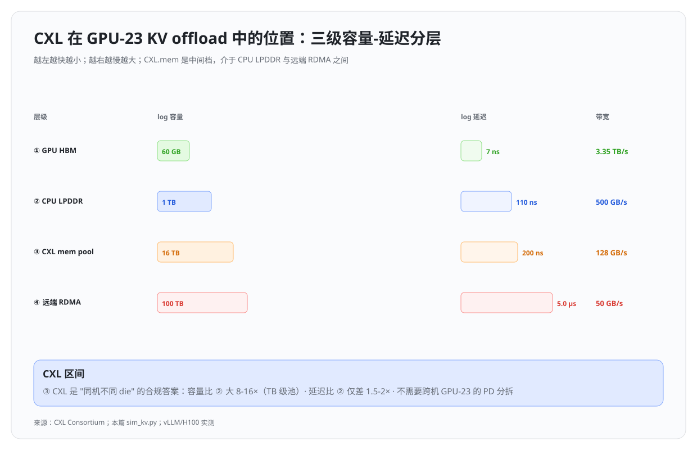
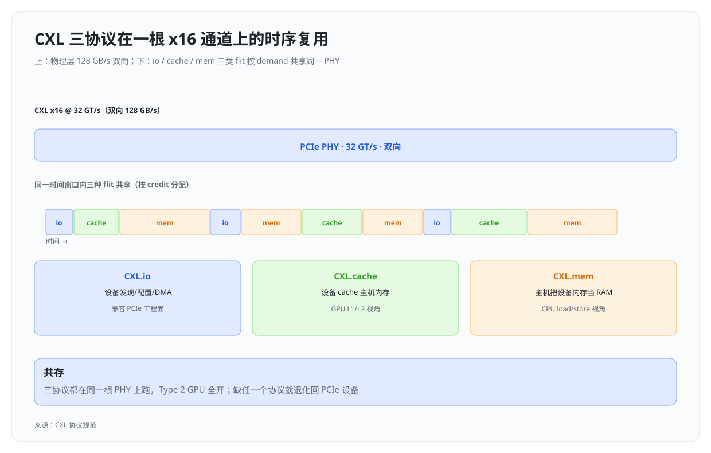
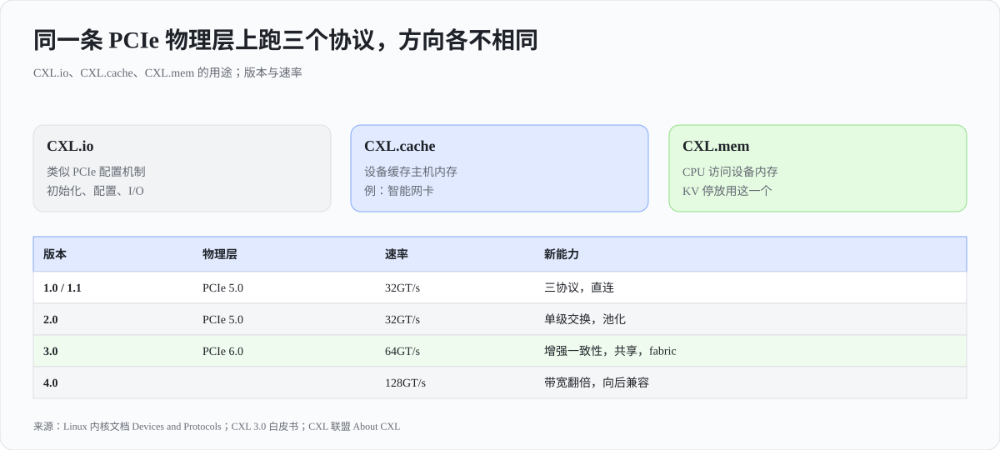

# GPU-26｜系统｜CXL：一致性互连与 KV offload 工程化

> 🎯 **这篇文档解决什么问题**：KV cache 推理时显存不够用了怎么办？GPU-23 讲过 PD 分离 + KV cache 概念，但 KV 真正能"卸载"到哪里？答案是 CXL —— 一个比 PCIe 慢但比内存池大的缓存一致性互连。本篇说清楚 CXL 是什么、它的物理参数（直连 170ns / 单级 Switch 250ns / 端到端 +57ns）、和 GPU-23 的 KV offload 工程化接口、以及和 NVLink/GPUDirect 的分工边界。

> 💡 **扩展 GPU-23、GPU-11**：[GPU-23](./23-inference.md) 提出 KV 分层卸载，[GPU-11](./11-pcie-gdr.md) 讲 PCIe 与 GPUDirect；本篇讲 KV 卸载到 CXL 内存时的互连参数和工程接口。

# 导读 · 先给结论

- **CXL 是搭在 PCIe 物理层之上的一致性协议栈**。厂商之所以不另起一根线，是因为复用 PCIe Gen5/Gen6 的 PHY 就能让现有的 root port 和 retimer 直接用，省掉重新布线的成本。在这根 PHY 上，CXL 同时跑三个子协议——CXL.io 管设备发现和 DMA、CXL.cache 让设备来缓存主机内存、CXL.mem 让主机把设备内存当 System RAM 读，把"PCIe 设备"升级成"内存可缓存、设备可寻址"的统一域。[[1]](https://ieeexplore.ieee.org/document/9933381)这就是 CXL 把 PCIe 从"I/O 总线"升维成"内存互连"的核心机制。
- **三种设备互斥、各取所需**。一个 CXL 端口同一时刻只能扮演一种角色，原因是三种 Type 用到的子协议组合不同：Type 1 只开 CXL.io 加 CXL.cache，给 SmartNIC 这种"没大主存但要缓存主机描述符"的设备用；Type 2 三协议全开，给 GPU/FPGA 这种"既有 HBM 又要被主机当内存读"的加速器用；Type 3 只开 CXL.io 加 CXL.mem，给纯内存扩展卡用。GPU 属于 Type 2[[1]](https://ieeexplore.ieee.org/document/9933381)，但因为当前 H100 还没量产 CXL.mem，本篇讲的 KV offload 落点物理底座其实是 Type 3 内存池，第 3 章会拆开讲。
- **直连延迟 ≈ 170 ns，过 1 级 Switch ≈ 250 ns，端到端再增 \~57 ns**。这三个数字不是同一个量：170 ns 是"L2 miss 到 CXL.mem 命中"的合成，含 PHY、协议解码、CPU L3 lookup、设备端 SRAM lookup；过 Switch 多出来的 80 ns 花在 crossbar、snoop filter 和多一次 PHY 跳上；57 ns 是协议本身的"税"（PHY 训练残差、header 解析、CRC）。三者叠加约为 DDR idle 延迟（90 ns）的 2×，这就是 CXL"用大带宽换延迟、把 DRAM 池化"的根本 trade-off[[2]](https://lwn.net/Articles/893522/)——它不追求比 DDR 快，追求的是延迟可接受范围内的容量天花板。
- **CXL.mem 是 KV offload 的物理底座**。GPU-23 讲 KV cache 概念时，容量上限卡在"单机有多少显存"——HBM 30-80 GB / 卡、CPU LPDDR 0.5-2 TB / 机，batch 一拉大就 OOM。CXL.mem 把这条容量曲线接到 4-32 TB / 池，KV 才第一次有了"机架级"的安身处。所以 GPU-23 讲的 KV 概念，只有落到 CXL.mem 这层物理底座上，容量上限才真正被打开。
- **工具链成熟但子命令多**。CXL 没有另起一套运维工具，而是复用了 NVDIMM 时代的 ndctl/daxctl 家族，再加一个 cxl CLI：cxl 19 个子命令管 memdev 和 region、daxctl 12 个子命令管 DAX 设备和模式切换、ndctl 34 个子命令管底层 DIMM 枚举和 scrubbing，合计 65 个。这套工具的好处是和 NUMA 运维面几乎重合，坏处是子命令多、上手要先分清谁管哪层。上线前必须按 §7 巡检清单过一遍[[3]](https://github.com/pmem/ndctl)，不然 region 建不起来时连该敲哪条命令都得现查。
- **CXL ≠ NVLink ≠ GPUDirect**。这三者经常被并列讨论，但回答的是三个不同问题：CXL 解决"内存哪里来"（扩容和一致性），GPUDirect 解决"数据怎么不走 CPU"（绕开内核数据面），NVLink 解决"GPU 之间怎么快"（token 级高带宽）。三者分层不互斥，一台 NVL72 机柜里四种互连同柜并存，第 8 章的分工卡就是干这个的。



> 📖 **阅读建议**：第 2-3 章是协议基础，GPU 工程师至少读第 2 章 2.5-2.6 节理解 cache / mem 的双向通道；第 4-6 章是工程核心，直接关系 KV offload 落地；第 7 章是上线手册，按清单过；第 8 章是选型决策树，review 方案时对照。如果只读一节，读第 6.7 节的 vLLM connector 接口。

本篇所有数字（170 ns / 250 ns / 57 ns / 128 GB/s / 65 子命令 / 90 ns DDR idle）均为公开规格或社区测量值，引用见附录。CXL 规范本身会员才能看完整版，本篇基于公开 overview 和 LWN / Meta / Samsung 公开材料整理，不涉及规范内部细节。

# 第 1 章 · 为什么需要 CXL

一个跑 LLaMA 70B 推理服务的工程师，把 batch 从 64 推到 256、seq 从 16K 拉到 32K 的那天，监控里 H100 的显存曲线一路爬到顶然后 OOM。他算了一下账：权重只占 17.65 GB / 卡（H100 80 GB 的 22%），但 KV/token 是 40,960 B，batch 256 + seq 32K 的 KV 一卡就要 335 GB（419%，OOM），单机 1 TB DDR5 也接不住。他翻 GPU-23 的 PD 分离方案，但跨机网络延迟进 μs 级、影响交互式 decode；他翻 GPU-11 的 PCIe/NUMA，但 PCIe 不做一致性、也不做池化。撞墙的本质不是算法不好，而是"内存是个单机资源"。本章就从这道墙讲起：PCIe 缺哪三件事，CXL 怎么在 PCIe 之上把它们补齐，让"内存哪里来"这个问题第一次有了机架级答案。

## 1.1 PCIe 三件事做不全

PCIe 是 I/O 互连：它告诉设备"我能把你挂进总线"和"我有 DMA 引擎"，到此为止。但一个跑大模型推理的 GPU 服务，对互连的要求早就超出了"挂进总线"——它要的是"主机和设备看到同一份内存"。PCIe 不做三件事，所以 KV 一拉大就 OOM：

1. **Cache 一致性**：CPU 和 GPU 看到同一块物理内存的两个时序视图，需要手工同步（cudaDeviceSynchronize / mb()）。
2. **设备作为主存目标**：GPU 不能把 HBM 直接 export 给 CPU 当"系统内存"，必须靠 pinning + bounce buffer。
3. **内存池化**：DRAM 容量 = 主机自己 ≤ 2 TB；TB 级 KV cache 无处安放。

CXL 把这三件事一起补上。它在 PCIe 物理层之上加了一组协议，让"设备的内存"和"主机的内存"合并成同一地址空间——CPU 改了 GPU 能立刻看见，GPU 的 HBM 能被 CPU 直接 load，多机的 DRAM 能凑成一个池。GPU-11 已经讲过 PCIe 物理拓扑和 NUMA 概念，本篇直接从协议栈切入，不再重复电气层。这就是 CXL 存在的理由：不是第六代 PCIe 的替代品，而是 PCIe 之上的协议层补充。

## 1.2 LLM 推理的内存缺口

接着那位工程师的账往下算。以 LLaMA 70B TP=8 推理为例（GPU-23 表格），显存被三块东西吃掉：权重是常驻的、KV 是随 batch 和 seq 膨胀的、激活是算的时候临时占的。前两块是大头：

- 权重 ≈ 17.65 GB / 卡（H100 80 GB 的 22%）。
- KV/token ≈ 40,960 B；batch 64 + seq 16K → KV ≈ 41 GB / 卡（51%）。
- batch 256 + seq 32K → KV ≈ 335 GB / 卡（419%，OOM）。

显存不够时，工程上能甩出去的地方只有三处：CPU LPDDR（同机但慢）、远端 PD 分离另一台机（跨机网络级 μs）、CXL 内存池（同机架 170-250 ns）。CXL 是"同机不同 die"的合规答案——它既不跨机进网络，又把容量从单机 GB 级接到机架 TB 级。本节末尾用 fig1 把"容量-延迟"曲线画出来，三条路在图上各占一段，CXL 卡在中间那段。这意味着选哪条路不是看谁最快，是看延迟预算和容量需求落在哪段。

## 1.3 PCIe DMA 的中断风暴与 pinned page 代价

PCIe 的 DMA 引擎在工程上不只是"搬数据"这么简单。每一次 DMA 完成都要走一次 MSI-X 中断，中断再触发 CPU 上的 softirq、NAPI poll、协议栈收包。对于一个跑 batch 推理的 GPU 服务，单卡每秒几百次 DMA completion 是常态，叠加 8 卡就是几千次中断每秒，CPU 0 号核的 softirq 占用很容易冲到 30% 以上。这就是为什么 GPUDirect RDMA 要专门做 IRQ affinity 收敛和中断向量绑定——不是为了"加速"，而是为了不让中断打爆控制核。

更隐蔽的代价在 pinned page。GPU 通过 PCIe 读主机内存，必须先把目标物理页 pin 住（防止被 swap 或 reclaim），再建立 DMA 映射。pin 一个 4 KB 页要走 lock_page、加 pin count、更新 zone 的 nr_pages_mlocked；unpin 时还要逐项还回去。对于 KV cache 这种"每秒几万次小块搬运"的场景，pin/unpin 的内核开销会比 DMA 本身的带宽时间还大一个数量级。cudaHostRegister 之所以慢，根因就在这里——它本质是批量 pin 加上建立 IOMMU 映射。所以 PCIe DMA 不是"慢在带宽"，是"慢在每次搬运都要付一遍 pin 的固定税"。

> 💡 **NUMA 倾斜**：pinned page 的物理位置由首次 touch 的 CPU 决定。如果 vLLM worker 起在 socket 0，pin 出来的页大概率落在 socket 0 的 local DRAM；但 GPU 挂在 socket 1 的 root port 上——跨 socket 读一次要多付约 80 ns 的 NUMA hop。这就是为什么 numactl --membind 在 GPU 服务器上不是可选优化而是默认动作。

## 1.4 内存池缺位下的 KV OOM 实例

没有 CXL 之前，KV cache 的容量上限就是"这台机器自己有多少 DRAM"。一位工程师配了一台典型的 H100 8 卡推理机，1 TB DDR5，权重占掉约 140 GB，留给 KV 的理论极限约 800 GB——但他跑的 batch 256 × seq 32K 的 LLaMA 70B 单卡就要 335 GB KV，8 卡 × 335 GB = 2.68 TB，是物理 DRAM 的 2.7 倍。结果就是 OOM：要么降 batch（吞吐掉），要么 truncate 上下文（效果差），要么拆 PD 分离把 KV 推到远端机（延迟进 μs）。这三种应对都会损失服务质量，而且根因不在算法，在"内存是个单机资源"。

这个 OOM 的本质不是"算法不够好"，而是"内存是个单机资源"。CXL.mem 把它变成机架级资源：一台 8 卡机器加 4 TB CXL 池，KV 容量直接翻 4 倍，不再因为单机 DRAM 上限而被迫降 batch。Meta 公开的 CXL for AI inference 设计文档里把这个容量-延迟 trade-off 列为头号动机——不是追求低延迟，是追求"延迟可接受范围内的容量天花板"。所以 CXL 在 KV offload 里的卖点从来不是"更快"，是"装得下"。

## 1.5 本地、远端、池化三条路的决策树

KV 显存不够时，工程上有三条路，各有适用边界：

| 路径 | 容量 | 延迟 | 适用场景 |
|-|-|-|-|
| 本地 LPDDR | ≤ 2 TB / 机 | \~110 ns | 延迟敏感的交互式 decode |
| 远端 PD 分离 | 跨机 TB 级 | 网络级 μs | 容量弹性、跨机架调度 |
| CXL 内存池 | 4-32 TB / 池 | 170-250 ns | 同机架大容量 + 一致性 |

决策树很简单：先看延迟预算，再看容量需求，最后看要不要一致性。如果 KV 单次访问延迟敏感（交互式 decode，每个 token 都要读一次 KV），走本地 LPDDR，110 ns 是它能给的天花板；如果容量需求大于单机 DRAM 且能容忍跨机网络延迟（μs 级），走 PD 分离，换的是弹性调度；如果既要大容量又不想跨机、还要和 CPU cache 一致（vLLM connector 直接 mmap），走 CXL 池，170-250 ns 换 4-32 TB。三者不互斥，实际部署常是"CXL 池加 PD 分离"的叠加：CXL 解决单机容量天花板，PD 分离解决跨机弹性调度。所以这三条路不是三选一，是三层叠。

## 1.6 CXL 与 NUMA、GPUDirect 的历史关系

CXL 不是凭空出现的。2017-2019 年那阵，业界想解决"cache 一致互连"问题，冒出过三套协议：CCIX、OpenCAPI、Gen-Z。CCIX 用独立 PHY，要重新布线；Gen-Z 走 packet fabric，要换交换芯片；都没拿到生态。CXL 拿到生态的关键在于它复用了 PCIe 物理层：厂商不用重新布线，CPU root port 直接走 PCIe Gen5 的电气，只在协议层加 cache 和 mem 两个子协议。这和 GPU-11 讲的 GPUDirect 路线是平行的——GPUDirect 在 PCIe 上做"绕开 CPU 数据面"，CXL 在 PCIe 上做"加一致性"，两者共用同一根 PHY 但解决不同问题，所以一台机器里能同时跑。

NUMA 和 CXL 的关系更直接：CXL.mem 的远端内存对内核来说就是一个新的 NUMA node。numactl 能看到它，page migration 能搬到它，CPU 进程能 bind 到它。所以 GPU 工程师理解 CXL 的最短路径是"把远端 DRAM 当成一个延迟略高的 NUMA node"，而不是当成一个新概念。这也是为什么本篇的巡检章节（第 7 章）大量用 numactl 而不是新工具——CXL 的运维面和 NUMA 几乎重合，会查 NUMA 的人就会查 CXL。

## 1.7 容易混淆的边界概念

CXL 经常和几个名词被并列讨论，工程师要分清边界：

- **CXL vs CCIX vs Gen-Z**：三者都是 cache 一致互连的尝试，CXL 赢在复用 PCIe PHY。CCIX 用的是独立 PHY，Gen-Z 走的是 packet fabric，两者都被 CXL 收编或边缘化。
- **CXL vs DPDK**：DPDK 是用户态网卡数据面框架，解决"包怎么不走内核协议栈"；CXL 解决"内存怎么一致性共享"。完全不同维度，经常被混在一起是因为都和"高性能 IO"沾边。
- **CXL vs NVSwitch**：NVSwitch 是 NVLink 的拓扑扩展芯片，让单机多 GPU 全互联；CXL 不做 GPU 间互联。两者一台机器可以共存：NVLink 管 GPU 间，CXL 管 CPU 到内存池。

分清这三个边界，就不会把 CXL 误当成"GPU 互联的下一代"——它是"内存互联的下一代"，GPU 只是受益方之一。所以下次有人拿"CXL 取代 NVLink"的话术来推销，直接对照这三条边界打回。

## 1.9 PCIe 三件事的工程后果深化

把第 1.1 节的"PCIe 缺三件事"落到具体工程后果上，每一件都有可观测的症状：

- **缺一致性的症状**：多进程共享 GPU 上下文时，偶尔出现"读到的数据是上一轮写的"的幽灵 bug。根因是 CPU 和 GPU 的 store buffer 没有跨设备屏障，cudaStreamSynchronize 只保证 GPU 侧的可见性，不保证 CPU 侧。排查这类 bug 极耗时，因为它不可稳定复现。CXL.cache 的硬件一致性把这类时序窗口从"软件护栏"收进"硬件协议"，根本上消除。
- **缺设备作主存的症状**：要用 GPU HBM 存一个 CPU 频繁读的索引表，必须 cudaMemcpy 来回拷。每次改动都要显式同步，索引表一大就成瓶颈。CXL.mem 让 CPU 直接 load GPU HBM 的地址，索引表留在 HBM，CPU 按需读，省掉所有显式拷贝。
- **缺池化的症状**：集群扩容时新机器的 KV cache 冷启动，命中率从 0 慢慢爬。如果有共享 CXL 池，新机器直接复用池里的 prefix cache，冷启动几乎为零。这是池化对运维弹性的最大价值。

这三个症状是判断"该不该上 CXL"的实操信号：如果集群里频繁出现一致性幽灵 bug、索引表拷贝瓶颈、或者冷启动命中率爬坡慢，就说明 PCIe 的三件事已经成了实际瓶颈，CXL 是对症的解。反之，如果这三个症状都没出现，强行上 CXL 只是增加复杂度。所以 CXL 不是"上了总比没上好"，是"症状对了才上"。

## 1.10 CXL 相对 DDR5 直连的成本账

工程师常问：既然 CXL 延迟是 DDR5 的 2 倍，为什么不直接在主板上插更多 DDR5？答案是容量天花板和池化弹性，但要算清楚成本账，不能只看单 GB 价格：

- **单 GB 成本**：主板 DDR5 和 CXL DRAM 卡用的同代颗粒，单 GB 成本接近。CXL 卡多一层控制器 ASIC 和 PCIe PHY，单 GB 贵 10-15%。
- **容量上限**：主板 DDR5 通道数受 CPU 限制（8-12 channel），单机上限 1-3 TB。CXL 通过 Switch 扩展，单机加 4-32 TB，不受 CPU 通道限制。
- **池化弹性**：主板 DDR5 是单机资源，不能跨机共享；CXL 池可被多机共享，利用率从"单机峰值"变成"集群均值"，整体 TCO 更低。
- **延迟代价**：CXL 170 ns 对 DDR5 90 ns，热数据放 CXL 慢 2 倍。所以 CXL 不替代 DDR5，而是补 DDR5 装不下的部分。

结论：CXL 不是"更便宜的 DDR5"，而是"更贵的、但能池化和扩容的 DDR5"。用对场景（冷 KV、大 embedding、prefix cache 池）就值，用错场景（热权重、频繁访问的页表）就亏。成本账要按"单 GB 乘命中率乘访问频率"算，不能只看单 GB 价格——热数据放 CXL 每天被读几百万次，2 倍延迟的代价全吃进去；冷数据放 CXL 一天才读几次，延迟代价可忽略，容量收益全拿到。这就是 CXL 分层放置的经济学根。

## 1.8 本章小结

本章从一位跑 LLaMA 70B 推理的工程师撞 OOM 讲起，定位到根因是 PCIe 缺三件事——一致性、设备作主存、池化——导致 KV 容量单机装不下。CXL 在 PCIe PHY 之上补齐这三件事，不是第六代 PCIe 的替代品，而是 PCIe 之上的协议层补充。理解 CXL 的最短路径是"延迟略高的 NUMA node 加 cache 一致性"，后续章节拆开看这个补充具体怎么落地：第 2 章讲三协议栈的时序，第 3 章讲 Type 分类，第 4 章讲延迟预算，第 5 章讲一致性域，第 6 章讲 KV offload 落点，第 7 章讲上线巡检。本章消掉了"为什么需要 CXL"这一类等待。



# 第 2 章 · 三协议栈：CXL.io / CXL.cache / CXL.mem

要理解三协议栈，最直观的办法是跟着一次 cache miss 走一遍。假设 GPU 算 attention 时 L2 miss 了，要读主机内存里 0x1000 那一行；又假设 CPU 这边要反过来 load GPU HBM 里某个被 export 的地址。这两次访存分别走 CXL.cache 和 CXL.mem，它们和 CXL.io 共用同一根 PCIe Gen5 x16 通道，靠 flit 时隙分时复用。本章就按这条路径讲：先看三协议在同一根通道上怎么切片（2.1-2.3），再看 io 怎么兼容 PCIe 工具链（2.4），然后跟着那次 cache miss 走完 CXL.cache（2.5）和 CXL.mem（2.6）的完整旅程，把 170 ns / 250 ns 这两个数字逐段拆开，最后看 credit 流控、Type 2 约束和版本演进怎么框住这条路径的上限。

## 2.1 一通道三协议

CXL 复用 PCIe 物理层（Gen5/Gen6），但内部不再是一个协议，而是三个并行子协议。前面那位工程师的 GPU 要读主机内存，走的是 CXL.cache；CPU 要读 GPU 的 HBM，走的是 CXL.mem；设备和主机的发现、配置、DMA，走的是 CXL.io。三者各管一段，落在一起就是一张表：

| 协议 | 用途 | 类比 |
|-|-|-|
| **CXL.io** | 设备发现、配置、错误报告、DMA。兼容 PCIe。 | 传统 PCIe 工程面。 |
| **CXL.cache** | 设备从主机内存里缓存数据到设备本地 SRAM/HBM。 | GPU L2 缓存 LPDDR。 |
| **CXL.mem** | 主机把"设备的内存"当作 System RAM 来 load/store，缓存到 CPU L3。 | CPU 视角："GPU 的 HBM 也是内存"。 |

fig2 画出三协议在同一根 x16 通道上的时序切片。这张表的关键不是"三个协议各自干什么"，而是"它们共用一根线"——这意味着三者的带宽和延迟互相影响，下一节的 flit 复用就是讲这个共享怎么调度。

## 2.2 协议为何"三合一"

工程师会问：为什么不一个协议管所有事？因为三类负载对协议的需求是互斥的。只用一个 cache 协议会牺牲主存扩展（Type 3 内存卡没法 export）；只用一个 mem 协议会牺牲设备本地加速（Type 1 NIC 没法缓存主机描述符）；只用 io 就退化回普通 PCIe，一致性无从谈起。三协议并存、按需启用，是 CXL 能同时承载 NIC（Type 1）、GPU（Type 2）、内存扩展卡（Type 3）三类负载的关键。所以"三合一"不是设计冗余，是覆盖三种设备形态的最小协议集。

## 2.3 flit 复用：三协议在同一根通道上的时序切片

CXL 在 PCIe Gen5 的 256B flit 之上定义了自己的多路复用。三个子协议不是各占一根 lane，而是按 flit 时隙在同一个 x16 通道上分时复用。CXL.io 走标准 PCIe TLP，CXL.cache 和 CXL.mem 走 CXL 自己的 68B flit（2B header 加 64B payload 加 2B CRC）。复用器在每个 flit 边界决定下一个时隙给谁，优先级是 cache 高于 mem 高于 io，因为 cache 的 snoop 响应延迟最敏感，一旦 stall 会拖住设备流水线。

这个设计意味着三协议共享带宽上限：x16 @ 32 GT/s 的 128 GB/s 是 io 加 cache 加 mem 三者的总预算，不是各自 128 GB/s。回到那位工程师的 cache miss 故事——如果 GPU 大量 snoop 主机内存（cache 流量大），io 的 DMA 吞吐就会被压缩，因为复用器在每个 flit 边界都要给 cache 优先。工程上这意味着 Type 2 设备的带宽规划必须把三协议一起算，不能只看 mem 的理论值——单算 mem 会高估实际可用带宽 20-30%。所以"一根 x16 给 128 GB/s"是三协议分着花的预算，不是任一协议独享的额度。

## 2.4 CXL.io 的 PCIe 兼容路径

CXL.io 本质就是 PCIe。设备枚举走标准的 configuration space，BDF（Bus / Device / Function）由 BIOS 在 PCIe 枚举时分配，PCIe capability 结构原封不动。lspci 看到的 CXL 设备就是一个普通的 PCIe 设备，唯一区别是它的 capability 里多了一个 CXL DVSEC（Designated Vendor-Specific Extended Capability）块，标明它支持哪些 CXL 子协议。

这意味着 CXL 设备的错误报告、AER（Advanced Error Reporting）、热插拔、ASPM（Active State Power Management）全部复用 PCIe 那一套。kernel 的 cxl_pci.ko 模块就是在 pci_driver 之上挂一层 CXL 特定的 DVSEC 解析和 link state 管理。对于运维来说，排查 CXL link 问题第一步还是看 dmesg 里的 PCIe AER 日志，不是直接去看 cxl CLI。

> 🔑 **关键认知**：CXL.io 的兼容性意味着任何 PCIe 工具（lspci / setpci / pcitree）都能在 CXL 设备上跑。这降低了运维门槛——不需要为了 CXL 重新学一套工具链，PCIe 那套诊断流程仍然有效。

## 2.5 CXL.cache：一个 64B cache line 的完整旅程

回到那位工程师的 GPU：它正在算 attention，L2 miss 了，要读主机内存地址 0x1000 的一行 64B 数据。这条请求从头走到尾经过这些组件：GPU L2 miss 发出 CXL.cache 请求（带 host physical address）→ 经 PCIe PHY 到达 CPU 的 CXL root complex → CPU 查 snoop filter 发现这行在 L3 → 从 L3 取出 64B → 封装成 CXL.cache 响应 → 回传给 GPU → GPU 存入本地 L2。整个往返在直连拓扑下约 170 ns，和 CXL.mem 的延迟同级——这个 170 ns 会在第 4 章逐段拆开。

这里的关键是 GPU 不需要做任何 pin 或 uncopy 动作——它直接用 host physical address 发起 cache 请求，CPU 的 cache hierarchy 自动响应。这就是"一致性"的物理含义：CPU 和 GPU 看到的是同一个 cache line 的同一份最新副本，不存在"CPU 改了 GPU 还在用旧值"的时序窗口。对比第 1.3 节讲的 PCIe DMA 方式，后者必须显式 cudaDeviceSynchronize 才能保证可见性，CXL.cache 把这个同步成本内化进硬件协议。所以一次 cache miss 的旅程，本质是把第 1 章那个"幽灵 bug"的时序窗口从软件护栏收进硬件协议。

## 2.6 CXL.mem：一次 CPU load 的完整时间线

反过来走一遍：CPU 要读 GPU 的 HBM（被 export 为 CXL.mem）。这条 load 指令的旅程是 CPU load → L1 miss（约 4 cycles）→ L2 miss（约 12 cycles）→ L3 miss（约 40 cycles）→ 进入 CXL.mem 协议路径 → 发出 MemRd 请求 → 经 PHY 到 GPU → GPU 从 HBM 取出 64B → 回传 → CPU 存入 L3 再给 L1。直连拓扑下这趟约 170 ns，过 Switch 加到 250 ns。注意 CPU 这边的 L1/L2/L3 miss 各自只占几个 cycles，真正吃时间的是 L3 miss 之后那段——PHY 传输、协议解码、GPU 端 HBM lookup，这些段加起来才是 170 ns 的大头，第 4.4 节会逐项分解。

对 CPU 来说这次 load 和一次普通 DDR load 的软件体验完全一样——它就是一次访存指令，硬件自动走 cache hierarchy 和协议栈。但对延迟预算来说，CXL.mem 比 DDR idle（90-100 ns）慢约 2 倍，所以把热数据长期放在 CXL.mem 会拖慢 CPU。这就是为什么 CXL.mem 池更适合放"偶尔访问的大块"（KV cache、embedding 表的冷区），而不是放频繁访问的页表或运行栈。回到 cache miss 故事的主线：CXL.cache 和 CXL.mem 是同一条物理通道上方向相反的两条旅程，一条是 GPU 找主机要数据，一条是 CPU 找 GPU 要数据，两条都落在 170 ns 这个量级。

## 2.7 三协议的 credit 分配机制

CXL.cache 和 CXL.mem 都用 credit-based flow control。每个方向（host 到 device、device 到 host）预分配一定数量的 credit，发一个请求消耗一个 credit，收到响应归还。credit 数量在 link 初始化时协商，受设备 SRAM 深度限制。如果 credit 耗尽，发送方必须 stall 等响应——这是 CXL 流控的背压机制。

工程含义：如果一个 Type 2 设备的 cache 请求 credit 只有 32，那它在途未响应的 snoop 不能超过 32 个。对于大 batch 的 attention 计算，可能瞬间发出上百个 snoop——如果 credit 不够，GPU 就会 stall 在等 credit 回收上，cache miss 旅程在"发出请求"这一步就被卡住，根本走不到 L3 lookup。这就是为什么服务器厂商在 BIOS 里会暴露 CXL credit 配置项，调优时不能只看带宽，还要看 credit 深度是否匹配 workload 的并发度。

## 2.8 为什么 Type 2 必须三协议全开

Type 2 是加速器（GPU / FPGA），它的特点是：既有自己的本地存储（HBM），又要读主机数据，还要被主机当内存用。只开 CXL.cache，GPU 能读主机但主机读不到 GPU 的 HBM，export 无从谈起；只开 CXL.mem，主机能读 GPU HBM 但 GPU 不能 cache 主机内存，喂数据还得退回 DMA；只开 CXL.io，退化回普通 PCIe 显卡。三件事缺一不可，所以 Type 2 必须三协议全开。这也是 GPU 接入 CXL 的工程门槛所在——不是插上就能用，而是三套数据通路都要打通，任何一套卡住都等于整个 Type 2 退化。

## 2.9 协议版本演进：1.1 / 2.0 / 3.0 的能力阶梯

CXL 规范三版递进，能力逐级打开：

| 版本 | 关键能力 | 拓扑上限 |
|-|-|-|
| 1.1 | 单 host 直连设备，cache 一致性 | 直连，无 Switch |
| 2.0 | 加 Switch、加 fanout、Type 3 内存池 | 单 host 多设备，一级 Switch |
| 3.0 | 多 host fabric、Back-Invalidate、UIO、P2P | 多 host 共享 DRAM，多层 Switch |

1.1 解决"设备和主机能不能一致性通信"，2.0 解决"一台机器能挂多少内存"，3.0 解决"多台机器能不能共享同一池内存"。KV offload 的完整形态（PD 分离加共享池）必须到 3.0 才物理可行——前面那位工程师的 cache miss 故事在 2.0 里只能在一台机器内走，到 3.0 才能走到隔壁机的 DRAM。当前量产硬件主流是 2.0，3.0 设备 2025 年起逐步出货。所以本篇讲的 170/250 ns 是 2.0 加 Gen5 的数字，3.0 量产后会逐步改善但不会突变，第 4.12 节会展开。

## 2.11 协议栈与 Linux 驱动栈的对应

CXL 三协议在 Linux 内核里有对应的驱动栈，理解这个对应能定位"问题出在哪层"：

- **CXL.io** → cxl_pci.ko：挂在 pci_driver 上，负责 DVSEC 解析、link state、AER。问题表现为 lspci 看不到设备或 AER 报错。
- **CXL.cache** → 没有独立驱动，走 CPU 硬件的 CXL root complex。问题表现为 cache 命中率异常或 snoop 延迟高，只能从 perf 硬件计数器看。
- **CXL.mem** → cxl_mem.ko 加 cxl_region.ko：负责 memdev 枚举、region 建链、映射成 dax。问题表现为 region 建不起来或 numactl 看不到 node。

排查 CXL 问题的分层法，对应到那位工程师的 cache miss 故事就是顺着旅程逆推：先 lspci 确认 io 层通（设备在不在，对应旅程的 PHY 段），再 cxl list 确认 mem 层通（region 建没建，对应 MemRd 能不能发出），再 numactl 确认 NUMA 层通（node online 没，对应 CPU 能不能 bind），最后 perf 看 cache 层性能（snoop 命中率，对应 L3 lookup 段）。四层从下往上排，哪层断就在哪层修，不要跳层——跳层排查容易把 io 层的硬件问题误判成 mem 层的软件问题，浪费时间。

## 2.12 三协议与 CUDA 编程模型的映射

对 CUDA 工程师，把三协议映射到熟悉的编程模型更容易理解：

- **CXL.io** → cudaSetDevice / 设备枚举层：设备发现、错误上报，对应 CUDA runtime 的 device management。
- **CXL.cache** → cudaMemcpy 的"零拷贝"替代：GPU 直接读主机内存，不需要显式 memcpy，对应 CUDA unified memory 的硬件底座。
- **CXL.mem** → cudaMallocManaged 的远端 backing：主机把 GPU HBM 当内存读，对应 CUDA 的 host-accessible device memory。

这个映射的意义：CXL 不是 CUDA 之外的新编程模型，而是让现有 CUDA 抽象（unified memory、managed memory）有更高效的硬件底座。回到第 2.5 节的 cache miss 故事——vLLM connector 不需要改 CUDA kernel，只在 connector 层把 backend 切到 cxl_pool，kernel 看到的还是普通的 device pointer，CXL.cache 和 CXL.mem 的协议工作全在硬件层自动完成。这也是为什么 CXL 的落地对应用层"几乎透明"——CUDA 代码不改，只改部署配置。

## 2.10 本章小结

本章跟着一次 cache miss 走完了三协议栈：CXL.cache 让 GPU 零开销读主机，CXL.mem 让主机零开销读设备，两条旅程共用一根 x16、总带宽 128 GB/s 是三者分时复用的预算。CXL.io 兼容 PCIe 工具链，credit 流控决定并发上限，Type 2 必须三协议全开。版本从 1.1 到 3.0 逐级打开拓扑和一致性能力，cache miss 故事在 2.0 里只在一台机器内走，到 3.0 才能跨机。下一章把视角从协议栈切到设备分类——同样是这套三协议，不同设备各用哪几个。



# 第 3 章 · Type 1 / 2 / 3：设备互斥矩阵

每张 CXL 设备按"它用哪几个协议"被分类。为什么是三类、为什么互斥？因为第 2 章那三个子协议（io / cache / mem）的组合方式就三种有意义的：只要 io 加 cache、三协议全开、只要 io 加 mem。三类设备互斥——同一个端口在某一时刻只能扮演一种角色，因为端口的 DVSEC 在 link 初始化时就协商死了用哪几个协议，运行时不能动态切。fig3 是 §3 的核心对比图。本章把三类设备逐一拆开，再落到真实产品、拓扑规划和路线图上。

## 3.1 Type 1：Device cache 主机内存

**只用 CXL.io + CXL.cache**。这类设备没有自己的"大主存"，但需要把主机内存缓存到本地 SRAM 加速 packet 处理——所以它走 cache 通道把主机数据拉过来，不走 mem 通道（因为它没有内存可被主机读）。典型场景：SmartNIC、网卡 cache 描述符。Type 1 的工程价值在于"加速网络数据面"，和 KV offload 没直接关系，但理解它有助于分清边界。

## 3.2 Type 2：加速器，三协议全开

**CXL.io + CXL.cache + CXL.mem**。设备有自己的 HBM，需要既能 cache 主机内存（喂数据）、又能被主机当内存用（export HBM）——前两章那位工程师的 GPU 就属于这一类。GPU、TPU、FPGA 属于这类。GPU-26 的所有优化都集中在这一类。但当前 H100 还没量产 CXL.mem，所以 Type 2 的 GPU 直连还是下一代硬件的事，本篇讲的 KV offload 当前走的是 Type 3 池经 CPU 中转。

## 3.3 Type 3：纯内存扩展

**只用 CXL.io + CXL.mem**。设备自己不做计算，但带 DRAM/NAND，把它 export 给主机当"远端内存条"——它走 mem 通道让主机读自己的 DRAM，不走 cache 通道（因为它不需要缓存主机数据）。这是搭建 CXL 内存池的角色，也是当前量产主力。常见模块：CXL DRAM 扩展卡、未来 CXL NAND。本篇第 6 章讲的 KV offload 落点，物理底座就是 Type 3 内存池。

## 3.4 互斥含义

同一个 x16 端口同一时刻只能一种 Type；切换需要重连，因为端口的协议组合在 link 训练时就定死了。同一块物理卡也*可以*做成"复合设备"（多个 Type 各占一个逻辑端口），但工程上不常见。所以装机时定 Type 是一次性决策，不是运行时变量——这是 CXL 部署和软件定义资源的根本区别。

## 3.5 三种 Type 的真实产品例子

把抽象的 Type 分类落到真实硬件上：

| Type | 代表产品 | 启用协议 |
|-|-|-|
| Type 1 | NVIDIA BlueField-3 SmartNIC / DPU（cache 主机描述符、flow table） | io + cache |
| Type 2 | 未来支持 CXL.mem 的 GPU / 加速器（当前 H100 尚未支持，下一代路线图提及） | io + cache + mem |
| Type 3 | Samsung CXL DRAM Module、Montage CXL DDR5 扩展卡、Micron CXL memory expander | io + mem |

注意：截至 2024-2025 量产的 CXL 设备以 Type 3 为主（内存扩展卡），Type 1 的 DPU 次之，Type 2 的 GPU 尚未真正量产 CXL.mem 支持。这就是为什么当前 CXL 在 AI 推理里的主战场是"内存池"而不是"GPU 直连"——Type 2 的硬件生态还没到位。本篇第 6 章讲的 KV offload 落点，物理底座就是 Type 3 内存池。

## 3.6 同一主板插不同 Type 的拓扑

一台典型的 CXL 服务器主板有 4-8 个 PCIe Gen5 root port，可以混插不同 Type 的设备。例如 slot 0 插 BlueField-3（Type 1），slot 1 和 slot 2 插 Samsung CXL DRAM 扩展卡（Type 3），slot 3 插未来支持 CXL 的加速器（Type 2）。每个端口独立协商自己的 Type，互不影响。

但拓扑上要注意 NUMA 归属：每个 root port 挂在哪个 socket 的 die 上，决定了它的 CXL.mem 在 numactl 里出现在哪个 node。如果 Type 3 内存卡挂在 socket 1，那它 export 的内存就是 node 2（假设 socket 0 是 node 0 和 node 1，socket 1 是 node 2 和 node 3）。CPU 进程要用这块内存必须 numactl --membind=2，否则内核默认本地分配不会落到 CXL 节点上。

> 📍 **拓扑规划铁律**：CXL 内存卡的归属 node 由物理 slot 决定，部署前必须对照主板手册确认 slot-to-socket 映射，不能等上线后 numactl 看不到 CXL node 再回头查。

## 3.7 复合设备：一块卡多 Type 的工程现状

CXL 规范允许一块物理卡做成"复合设备"（Multi-Logical Device，MLD）：一张卡上多个逻辑端口，每个端口独立一个 Type。例如一张卡上同时跑一个 Type 1 NIC 功能和一个 Type 3 内存扩展功能，各占一个 logical port，互不干扰。

但工程上复合设备不常见，原因有三：(1) 单卡要做两种功能意味着两套协议栈硬件，成本接近两张卡；(2) MLD 的 partition 管理需要 BIOS 和 OS 协同，kernel 支持还在完善中；(3) 故障隔离差——一个功能挂了可能整卡 reset。所以目前主流是"一卡一 Type"，复合设备留作未来虚拟化场景的选项。

## 3.8 Type 切换的 reset 代价

同一个 x16 端口同一时刻只能一种 Type。如果要从 Type 3 切到 Type 2，必须：(1) 解除当前 region 绑定；(2) 通过 PCIe hot-remove 把设备从枚举里移除；(3) 改 BIOS 配置或 DVSEC；(4) hot-add 重新枚举；(5) 重新建 region。整个过程至少 30-60 秒，期间该端口的所有数据通路中断。

这就是为什么 CXL 部署的 Type 规划要在装机时定死，不能运行时动态切换。一台推理机如果今天当 Type 3 内存池用、明天想改成 Type 2 直连 GPU，实际操作等于热拔插重装一次卡。生产环境几乎不会这么做。

## 3.9 Type 选型的工程清单

装机时定 Type，要过一遍这张清单：

1. **负载形态**：纯内存扩展选 Type 3；网卡加速选 Type 1；GPU 直连选 Type 2。
2. **slot 归属**：Type 3 内存卡尽量挂在使用它的 GPU 同 socket，避免跨 socket NUMA hop。
3. **带宽预算**：每个 Type 独占一根 x16，不和其他 Type 共用端口。
4. **未来扩展**：留 1-2 个空 slot 给后续加 Type 3 内存卡，不要一次性插满。
5. **固件统一**：同批 Type 3 卡刷同一版本固件，避免混版本导致 region 建不起来。

这张清单的核心是"装机定死、留有余量"。CXL 的 Type 不是运行时变量，是装机时的硬件配置，改一次等于停机重插。

## 3.11 Type 在推理集群里的配比

一台推理机插几种 Type、各插几张，是集群设计的实际问题。典型配比：

| 配比方案 | 插槽分配 | 适用负载 |
|-|-|-|
| 纯内存池机 | 8 × Type 3 DRAM 卡 | 专做 CXL 内存池节点，不放 GPU |
| GPU + 内存扩展 | 8 GPU + 2-4 × Type 3 | 推理 + 本机 CXL 内存扩容 |
| GPU + DPU | 8 GPU + 1 × Type 1 BlueField | 推理 + 网络加速，无内存池 |
| 全功能 | 8 GPU + Type 1 + Type 3 | 推理 + 网络 + 内存池，槽位紧张 |

配比的核心权衡是插槽和带宽预算。一台 8 GPU 服务器通常 PCIe Gen5 slot 被 GPU 占满（H100 SXM5 走 NVLink 不占 PCIe，但 PCIe 版 H100 占 8 个 slot），留给 CXL 的 slot 只有 2-4 个。所以"GPU 加内存扩展"方案里 Type 3 卡数受 slot 限制，不能无限加。

纯内存池机是另一种思路：单独拿一台不带 GPU 的机器，全插 Type 3 卡，做成机架级内存池节点，其他 GPU 机器通过 CXL Switch 共享它。这种方案内存池容量大（单机 4-8 TB），但所有 GPU 机器都要过 Switch，延迟涨到 250 ns 以上。适合"大容量 + 延迟不敏感"的冷 KV 场景。

选配比时要算清楚：本机 Type 3 给的是 170 ns 直连延迟但容量小（2-4 卡 × 64 GB = 128-256 GB），远端内存池机给的是 250 ns 以上延迟但容量大（TB 级）。前者放温 KV，后者放冷 KV，两层搭配比单层极端更划算。

## 3.12 Type 3 内存卡的固件与兼容性

Type 3 内存卡是当前量产主力，但不同厂商的固件兼容性是上线的大坑：

- **固件版本**：Samsung / Montage / Micron 各家固件版本独立，region 建链行为有细微差异。同集群混用不同厂商卡时，要确认固件都过 CXL 2.0 一致性测试套件（CTS），否则 region 建链可能间歇失败。
- **label 格式**：cxl read-labels 读出来的 UUID / size / mode 字段，各厂商布局可能不同。kernel 的 cxl_mem.ko 按 CXL 规范解析，但厂商私有扩展字段可能被忽略，导致热插拔后 label 丢失。
- **scrubbing 行为**：ndctl start-scrub 在不同厂商卡上的扫描速度和坏块隔离策略不同。有的厂商卡扫描期间性能掉 50%，有的几乎无影响。上线压测前要确认 scrubbing 对在线业务的影响。

工程建议：同集群优先用单一厂商单一固件版本的 Type 3 卡；必须混用时，按厂商分 region，不跨厂商建大 region。固件升级要在维护窗口做，升级后必须重跑一轮 scrubbing 确认无新坏块。固件兼容性问题不会立刻 crash，但会导致 region 间歇性掉线，排查极耗时——这类"偶发掉线"故障在大型集群里会消耗大量运维精力，预防成本远低于排查成本。

## 3.13 Type 2 GPU 的 CXL.mem 路线图

Type 2 GPU 的 CXL.mem 支持是本篇所有优化的前提，但当前 H100 尚未支持。路线图判断：

- **当前（H100 / H200）**：无 CXL.mem，GPU 走 PCIe 加 NVLink，KV offload 只能落到 Type 3 池经 CPU 中转，不能 GPU 直连 CXL 内存。
- **下一代**：路线图提及 CXL.mem 支持，GPU 可直连 CXL 池，省 CPU 中转。KV offload 延迟从"CPU 经 CXL"降到"GPU 直连 CXL"。
- **再下一代（NVL72 级）**：柜内 fabric，72 GPU 共享柜内 CXL 池，对应 GPU-27 的 superchip 架构。

在 Type 2 GPU 量产 CXL.mem 之前，本篇讲的 KV offload 走的是"GPU → PCIe → CPU → CXL.mem Type 3 池"路径，CPU 中转多一次拷贝。这阶段的 CXL 价值是"容量扩容"，不是"延迟优化"。等 Type 2 直连量产，CXL 才同时拿到容量和延迟两个收益。规划时要把这个时间窗纳入判断——当前买 CXL 池是为容量铺路，不是为延迟提速。

## 3.10 本章小结

Type 1 / 2 / 3 互斥、一卡一 Type 是当前工程主流。Type 3 内存扩展卡是量产主力，Type 2 GPU 的 CXL.mem 支持是下一代硬件的事。拓扑规划看 slot-to-socket，Type 定死别动态切。复合设备（MLD）规范允许但工程上不推荐，留作未来虚拟化场景。装机时按五项清单过一遍，避免上线后改 Type 的代价。


# 第 4 章 · 延迟预算：直连 170ns vs Switch 250ns

## 4.1 三种部署形态的延迟

CXL 1.1/2.0 常用三种形态；fig4 是核心数字：

1. **直连**（设备直接插 CPU root port）：170 ns。L2 miss → CXL mem 命中
2. **一级 Switch**（设备 → CXL Switch → CPU）：250 ns。加一层路由开销
3. **端到端总延迟**：在直连基础上再加 \~57 ns，含 PHY 训练、协议开销、cache lookup；总预算 ≈ 227 ns。是 DDR idle 延迟（90-100 ns）的 \~2×。

## 4.2 延迟 × 带宽 trade-off

CXL 3.0 的对偶数字：x16 @ 32 GT/s = 128 GB/s 双向；x16 @ 64 GT/s = 128 GB/s 单向。这两套数字告诉我们：**CXL 的延迟和带宽都比 DDR 差一档**，但作为"内存对外的接口"是合规的——一致性 cache 是通过协议保证的，不是靠器件物理。

## 4.3 KV cache 的实际体感

KV/token 40 KB；CXL 直连 128 GB/s × 单 token 传输 = 312 ns 带宽时间。比一次 attention 计算（5-7 ms）小一个数量级 → **KV offload 不卡计算**，只卡 hit ratio。

## 4.4 170 ns 的逐项分解

直连 170 ns 不是单一环节，而是若干段串起来：

| 环节 | 耗时 |
|-|-|
| PHY 传输 + retimer | 约 15 ns |
| Link training / replay buffer | 约 20 ns |
| CXL.cache/mem 协议解码 + 路由 | 约 25 ns |
| CPU L3 / snoop filter lookup | 约 30 ns |
| TLP 封装与 flit 切片 overhead | 约 15 ns |
| 设备端 SRAM/HBM lookup | 约 35 ns |
| 返回路径（同上去掉 L3） | 约 30 ns |

分解的意义在于：哪些段可优化、哪些是物理硬上限。PHY 传输受光速和铜线长度限制，无法压缩；L3 lookup 受 CPU cache 物理限制；协议解码受 CXL 控制器 ASIC 时钟限制。所以 170 ns 在当前 Gen5 加直连拓扑下接近物理下限，下一代 Gen6 加更近的 die-to-die 可能再压 20-30 ns，但不会突破 DDR 的 90 ns。

## 4.5 Switch 250 ns：额外 80 ns 花在哪

过一级 CXL Switch 从 170 涨到 250 ns，多出的 80 ns 主要在三处：(1) Switch 内部的 crossbar 路由约 20 ns；(2) Switch 的 snoop filter / address decode 约 25 ns；(3) 多一次 PHY 跳（设备到 Switch、Switch 到 CPU 各一段 retimer）约 35 ns。如果是二级 Switch，再叠一次类似开销，端到端可能到 330 ns。

所以 Switch 不是"无代价的扩展"——每加一级，延迟涨约 80 ns。内存池如果跨两级 Switch，CXL.mem 的访问延迟就接近 DDR 的 3.7 倍，对延迟敏感的 workload 已经不划算。这就是为什么 CXL 内存池的拓扑设计要严格控制 Switch 层级，通常一级为限，最多两级。

## 4.6 57 ns 协议开销的边界

端到端在直连基础上再加约 57 ns，含 PHY 训练残差、协议 header 解析、cache lookup 重试、CRC 校验。这部分是 CXL 协议本身的"税"，无法通过硬件升级消除——它是协议规范的固有开销。57 ns 占总 227 ns 的约 25%，是 CXL 相对 DDR 多付的"一致性代价"。

和 DDR idle 90-100 ns 的可比性边界：DDR 的 90 ns 是"内存控制器到 DRAM chip 的物理访问"，不含 CPU cache hierarchy；CXL 的 170 ns 是"L2 miss 到 CXL.mem 命中"，含 CPU L3 lookup 和协议栈。两者不是同一层级的数字，直接比"2 倍慢"是简化说法。严格说，CXL 直连的纯 PHY 加协议部分约 80 ns，加上 CPU L3 lookup 30 ns 和设备端 lookup 35 ns，才合成 170 ns。和 DDR 的 90 ns 比的是"CPU 视角的一次 miss 延迟"，量纲才一致。

## 4.7 不同 workload 的延迟敏感度

CXL 的 170-250 ns 延迟对不同推理 workload 影响差异很大：

- **Batch KV 流**：prefill 阶段大批量读 KV，延迟可被带宽掩盖。128 GB/s 带宽下 40 KB token 的传输时间 312 ns，和 170 ns 访问延迟同级，整体被 attention 计算的 5-7 ms 完全掩盖。CXL 在这个场景几乎无感。
- **交互式 decode**：每次生成一个 token 都要读一次 KV，延迟直接进 critical path。170 ns 乘以每 token 的 KV 行数等于几百 ns 到几 μs 的额外延迟，对首 token 延迟（TTFT）敏感的服务会感知到。
- **长上下文 attention**：seq 32K 的 attention，KV 读取占总时间的 30-40%，CXL 的延迟放大效应明显，需要靠命中率和高带宽对冲。

结论：CXL 内存池更适合"延迟可掩盖"的 batch 场景，对交互式低延迟场景要谨慎评估 hit ratio 和 tiering 策略，不能盲目把所有 KV 都甩到 CXL 池。

## 4.8 带宽测量的工程方法

CXL 带宽的"128 GB/s"是理论峰值，实际能用多少要测。工程上用两种方法：

1. **micro-benchmark**：用 stream-like 的 read/write 压测 CXL NUMA node。numactl --membind=cxlnode 后跑 STREAM，看实测带宽。典型实测值是峰值的 70-85%，因为协议开销和 snoop filter 查询吃掉一部分。
2. **端到端 trace**：跑真实 vLLM workload，用 perf 或 PCM 抓 CXL link 利用率。看 KV offload 实际占了多少带宽、和理论值的 gap。

测量的坑：单 thread 测不出峰值（受限于单核 issue rate），必须多 thread 并发；顺序读会触发 prefetch 把表观带宽拉高，随机读才能反映真实延迟敏感性。报告带宽时必须注明是顺序还是随机、是 read 还是 write、并发度多少，否则数字没有可比性。

## 4.10 延迟优化的工程手段

170-250 ns 不是不能优化，工程上有几个手段把实际体感延迟往下压：

1. **软件预取**：vLLM connector 在发起 read_kv 前几个 token 就发 prefetch，把 CXL.mem 的访问延迟藏在计算时间里。前提是能预测接下来要读哪些 KV 行——对顺序 decode 有效，对随机 attention 不灵。
2. **批量合并**：单次 CXL 访问的固定开销（PHY 加协议）约 80 ns，和数据大小无关。把多个小读合并成一次大读，把固定开销摊到 4-8 KB 上，单字节延迟从 170 ns 降到约 20 ns。这是 connector 必须做 batch coalesce 的根本原因。
3. **本地缓存**：把 CXL 池里最热的 KV 行在 ② 层 LPDDR 再缓存一份，命中 ② 层就不用过 CXL。本质是给 CXL 池加一层 LPDRAM 的前端 cache，命中率高的行自动留在本地。
4. **避开 Switch**：延迟敏感的 KV 放直连 Type 3 卡（170 ns），延迟不敏感的放过 Switch 的池（250 ns）。拓扑上把热数据和冷数据分到不同 region。

这四个手段叠加，实际 KV offload 的平均体感延迟可以压到 50-80 ns（接近 LPDDR），而不是裸的 170-250 ns。优化的核心是把 CXL 当成"带宽管道加偶发延迟"，通过预取和缓存把偶发延迟藏起来，而不是硬扛 170 ns。如果优化后体感延迟还高于 100 ns，说明预取和批量没做好，回到 connector 设计层面修。

## 4.11 延迟测量的工具与陷阱

测 CXL 延迟不能只看一个数字，工具和方法的选取决定结果可信度：

- **numactl + STREAM**：测带宽和粗延迟。坑：STREAM 是顺序读，触发 prefetch，测出来的延迟比真实随机访问低 30-40%。
- **perf mem**：采样真实 workload 的访存延迟，按 NUMA node 分组。这是最接近真实体感的测法，但采样率低，冷路径样本少。
- **PCM (Intel Performance Counter Monitor)**：硬件计数器级别，看 CXL link 的 read / write 延迟和带宽。精度最高，但只支持 Intel 平台。
- **自定义 micro-benchmark**：用 rdtsc 测单次 load 延迟，按地址分布到不同 NUMA node。最灵活，但要注意 CPU 频率扰动和 cache 污染。

测量的核心陷阱：单次测延迟方差极大（cache 污染、调度、SMI 干扰），必须取 P50 / P99 而不是平均值。报告延迟时要注明工具、样本量、百分位、并发度，否则数字没有可比性。最常见错误是用 STREAM 顺序带宽反推延迟——那给的是"理想带宽下的理论延迟"，不是真实 workload 的体感。

## 4.12 延迟在不同 CXL 代际的演进

170 / 250 ns 是 CXL 2.0 加 Gen5 的数字，代际演进会压但不会突变：

- **CXL 2.0 + PCIe Gen5**：直连 170 ns，Switch 250 ns。当前量产基线。
- **CXL 3.0 + PCIe Gen5**：延迟基本持平（协议开销略增但 BI / UIO 提升有效带宽），重点在 fabric 拓扑和多主机共享。
- **CXL 3.0 + PCIe Gen6**：PHY 带宽翻倍（PAM4），延迟预计压 20-30 ns（直连到 140-150 ns），但受 cache lookup 物理限制不会突破 DDR 的 90 ns。
- **未来 die-to-die CXL**：封装内短距离，PHY 段压到个位数 ns，但这是芯片级集成，不是插卡场景。

代际演进的结论：CXL 延迟会逐步改善但始终比 DDR 慢一档，定位不变（扩容和一致性，不是替代 DDR）。规划时按当前 170 / 250 ns 算，不要把未来 Gen6 的预期延迟写进当前 SLA——硬件升级周期 2-3 年，业务不能等。CXL 的价值主张是"容量和池化"，延迟改善是附带红利，不是主卖点。

## 4.9 本章小结

170 ns 等于 PHY 加协议加 L3 加设备 lookup 的合成；Switch 每级加 80 ns；57 ns 是协议税。CXL 延迟是 DDR idle 的约 2 倍，但带宽 128 GB/s 在 batch 场景能掩盖延迟，交互式场景要靠 hit ratio 兜底。带宽实测典型拿到峰值的 70-85%，报告时必须注明顺序 / 随机 / 并发度。


# 第 5 章 · CXL.mem 一致性域

## 5.1 Host 独占 snoop filter

接着前面那位工程师把 KV 推到 CXL 池的问题往下问：GPU L2 里缓存着主机内存的某一行，这时候主机自己也要改这一行，谁来保证两边不各读各的？CXL 1.1/2.0 的答案是——主机当裁判。Host 用一块叫 snoop filter 的 SRAM 跟踪哪些 CXL.mem line 被哪个设备缓存了，设备彼此之间不知道对方的 cache 状态，所有 snoop 都必须经 host 转发。这个设计让 host 成为天然瓶颈，但换来了设备实现的极简——网卡、GPU、内存卡都不用自己维护一张全局 cache 表。所以 1.1/2.0 的一致性域，本质是“以 host 为中心的一对多仲裁”。

## 5.2 3.0 的 Back-Invalidate

5.1 节那套“host 当裁判”的模型，在两个场景下会撞墙：一是两个 Type 2 设备想直接共享一块数据，按 1.1/2.0 必须回 host 中转，往返一次白白多花几百 ns；二是多台主机共享同一块 CXL DRAM，host 想改一行却没有通道主动通知别家设备的 cache。CXL 3.0 给这两个场景开的药方是 Back-Invalidate——Host 可以“反向收回”某条 line 的 cache 副本，不必等设备下次访问自己发现。这一步把 CXL 从“主机-设备”推进到“fabric”时代：设备对设备（P2P）和多主机共享同一块 DRAM 才物理可行。fig5 标出 1.1/2.0/3.0 的演进路径。所以 BI 不是锦上添花，是 3.0 把仲裁权从 host 单边手里松开的开关。

## 5.3 GPU 是 CXL.mem 的“既供又需”方

回到第 3.2 节那位工程师的 GPU——它是 Type 2，意味着它既把自己的 HBM export 给主机当内存读，又在算 attention 时反过来 cache 主机的 LPDDR。这条双向通道是 CXL.mem 里最特殊的一条：CPU 把 HBM 当内存读，是“GPU 供内存”；GPU cache 主机 LPDDR，是“GPU 需内存”。这个“既供又需”的身份，让“动态把 KV 移入/移出 HBM”成了软件可控的操作，而不是静态的“权重在 HBM、KV 在 LPDDR”切片。第 1 章那位工程师算 KV 容量账时还只能静态切片，有了这条双向通道，KV 在 HBM 和池之间的迁移才第一次成了运行时能按 hit ratio 实时调的旋钮。

## 5.4 MESI / MOESI 在 CXL.mem 上的对应

5.1 节说 host 是裁判，但裁判要管的具体是什么？是每条 cache line 的状态——这行被谁改过、有几份副本、能不能直接写。这套状态在体系结构里叫 MESI，CXL.mem 的状态机就是它的一个子集。CXL 1.1 / 2.0 里 device cache 的 line 状态有 M / E / S / I 四态，对应经典 MESI：M（Modified，设备独占且脏）、E（Exclusive，设备独占且干净）、S（Shared，多设备或主机都有干净副本）、I（Invalid）。CXL 没有 Owned 态（MOESI 的 O），因为 1.1 / 2.0 不允许设备间直接 snoop，所有共享态干净副本必须从 host 取。

这意味着 CXL 2.0 的 S 态只能"干净共享"——设备想改必须先发 RdX 把 host 上的其他副本 invalidate，host 通过 snoop filter 转发 invalidate。这个 round-trip 是 CXL 2.0 写共享的延迟下限。CXL 3.0 的 Back-Invalidate 就是为了让 host 能主动把 S 态副本收回，减少设备轮询和写共享的往返。

对 GPU 工程师来说，状态机的实际意义在于预测 stall：当多个 GPU（多 Type 2 设备）同时改同一块主机内存时，每次写都要走 RdX 加 invalidate 往返，吞吐会跌到单写者水平。这就是为什么 KV cache 写入要按 GPU 分片——每个 GPU 写自己的 KV 分区，互不踩同一行，避免跨设备 invalidate 风暴。

## 5.5 Host 独占 snoop filter 的瓶颈量化

5.1 节说 host 是瓶颈，但瓶颈到底有多紧？要把这个“裁判”量化，得先看它手里那张跟踪表有多大。1.1 / 2.0 一致性仲裁全在 host，host 的 snoop filter 是一个有限容量的 SRAM，跟踪所有被设备缓存的 line。典型容量 16-32 MB，对应可跟踪的 cache line 数约 256K-512K 行。如果设备 cache 总容量（GPU HBM 80 GB 乘以多卡）远超 snoop filter 跟踪能力，host 会被迫频繁 invalidate 设备副本来腾跟踪表空间——这就是 snoop filter thrash。

实际部署里这个问题体现为：单 host 挂 4 个以上 Type 2 设备时，cache 命中率会随设备数下降。Meta 公开的测试数据暗示 4 设备时有效命中率比单设备掉 15-20%。这就是为什么 CXL 2.0 的"主机-设备"模型在多设备规模下遇到瓶颈，3.0 的 fabric 模型才打开上限。

> 💡 **容量规划红线**：单 host 的 CXL Type 2 设备数不宜超过 snoop filter 容量除以单设备 cache 容量的比值，通常 2-3 个为安全上限。超过就要考虑 3.0 的多 host fabric 拓扑，或者回到 NVLink 域内通信避开 snoop filter。

## 5.6 Back-Invalidate 的三个使用场景

BI 通道开了之后，落到工程上有三个典型场景：

1. **Page migration**：内核要把一个物理页从 CXL 内存迁到本地 DDR，必须先 invalidate 所有设备的 cache 副本，否则迁移后设备还在读旧地址。BI 让 host 主动推送 invalidate，不必等设备下次访问才发现。
2. **Device-to-Device P2P**：两个 Type 2 设备要共享一块数据，3.0 允许通过 host 的 BI 通道直接同步 cache 状态，不必每次都回 host 取。
3. **Multi-host sharing**：多个 host 共享一块 CXL DRAM，一个 host 改了某行，BI 通知其他 host 的设备 invalidate 旧副本。

BI 通道是 3.0 把 CXL 从"主机-设备"推进到"fabric"的关键机制——没有 BI，多主机共享 DRAM 的一致性只能靠软件同步，延迟和正确性都不达标。BI 把这个同步成本从毫秒级（软件）压到几十纳秒级（硬件），才让 PD 分离加共享池的方案物理可行。

## 5.7 多主机共享 DRAM 的 race condition

多个 host 共享同一块 CXL Type 3 DRAM 时，最隐蔽的 race 是"读-改-写"序列。host A 读行 X（S 态），host B 也读行 X（S 态）。A 想改 X，发 RdX，host 收到后发 BI 给 B 的设备 invalidate。但如果 B 在 invalidate 到达前已经发出了对 X 的写（也发 RdX），两个 RdX 在 host 排序，后到的会被 stall。这个 stall 时间是不可预测的，取决于 host 处理 invalidate 的速度。

软件层面规避：对共享 DRAM 的并发写区域，用 atomic 操作（CXL.mem 支持 DVMOp 原子语义）或显式锁，不要靠"读-改-写"的隐式一致性。对于 KV cache 这种"一个 writer 多个 reader"的场景，BI 的开销可以接受；对于"多 writer"的场景，CXL 3.0 的一致性模型还不够，需要上层用类似 Redis 的分布式锁。

工程上最容易踩的坑是：两个 decode 机同时更新同一份 prefix cache 的统计计数器（hit count）。这种"多 writer 的高频小写"会让 snoop filter 和 BI 通道长期处于 invalidate 风暴，性能急剧下降。解法是计数器走本地 LPDDR 聚合后再批量写 CXL 池，不要实时写共享行。

## 5.8 CXL 3.0 的 UIO（Unordered I/O）

5.7 节那个“两个 RdX 在 host 排序、后到的被 stall”的场景，暴露了严格保序的代价——一个慢请求会 block 后面整队。CXL 3.0 给 GPU offload 这种“并发 prefetch 几百个 KV line”的负载开了口子：UIO（Unordered I/O）允许 CXL.mem 的读写绕过严格的全局顺序，只对同一地址保序。GPU 并发 prefetch 几百个 KV line 时根本不关心它们到达顺序，只关心同一行不被重排，UIO 让这些请求可以乱序完成，把严格保序下被一个慢请求堵死的带宽释放出来。

UIO 的代价是软件必须显式标注哪些访问可以乱序（用 memory order 参数）。vLLM 的 KV connector 在设计时要把 prefetch 标成 UIO，写入保持严格保序，否则 hit ratio 统计和层间一致性会出问题。这个标注目前还在 connector 抽象层做，未来会下沉到 CUDA 的 memcpy async API。

## 5.9 一致性性能调优清单

把一致性机制落到调优动作上，一份清单：

1. **写按 GPU 分片**：每个 GPU 写自己的 KV 分区，避免跨设备 invalidate。
2. **读用 UIO 乱序**：prefetch 标 UIO，提升带宽利用率。
3. **计数器走本地**：高频小写不进 CXL 共享行，本地聚合后批量写。
4. **控制 Type 2 设备数**：单 host 不超 2-3 个，超过切 fabric 拓扑。
5. **监控 snoop filter 利用率**：BIOS 暴露的 snoop filter 占用率是 thrash 的前置指标，到 80% 就要预警。

## 5.11 一致性域的故障注入测试

一致性机制的正确性不能只靠规范保证，上线前要做故障注入测试：

1. **BI 通道压测**：人为制造 host 频繁 page migration，触发大量 Back-Invalidate。观察设备 cache 命中率是否如期下降、恢复后是否如期回升。验证 BI 通道不会在高压下丢 invalidate。
2. **多写者冲突**：两个进程同时写同一 CXL 内存行，验证 atomic 语义和锁的正确性。预期：不加锁时数据撕裂，加锁或用 atomic 时数据一致。
3. **snoop filter 满**：BIOS 注入 snoop filter 占用率 100%，观察是否触发 thrash 降级、告警是否如期触发。
4. **UIO 保序性**：对同一地址的 UIO 访问，验证同地址保序、不同地址乱序。用硬件 trace 检查，不能靠软件观测。

这四类测试是 CXL 一致性的"信任建立"过程——规范说 BI 通道不会丢 invalidate，但只有跑过压测才敢信。没跑过故障注入的 CXL 一致性，上线后遇到偶发数据错乱根本查不出来，因为一致性 bug 的表现是"数据偶尔不对"，不会立刻 crash，等发现时已经污染了一批推理结果。

## 5.12 一致性域的监控指标

一致性机制的健康度要通过指标监控，不能等出问题再看：

- **snoop filter 利用率**：BIOS 暴露的 snoop filter 占用率，到 80% 预警、95% 报警。这是 thrash 的前置指标，提前扩容或切 fabric。
- **BI 通道速率**：Back-Invalidate 的每秒推送次数。正常 workload 几千次每秒，突然涨到几万次每秒说明 page migration 或多写者冲突激增。
- **cache 命中率**：从 perf 硬件计数器取，按设备分。某设备命中率突降说明它的 snoop 被频繁 invalidate，可能是 snoop filter thrash 或一致性 bug。
- **RdX 频率**：写共享的 RdX 请求频率。高频 RdX 说明多写者踩同一行，要回到第 5.7 节的写分片策略。

这四个指标是 CXL 一致性域的"心电图"。dashboard 上要常驻 snoop filter 利用率和 BI 速率两个时序图，配命中率告警。一致性 bug 的潜伏期长，等数据错乱才发现就晚了——指标监控是唯一能提前预警的手段，比故障注入测试更能覆盖长期运行的真实负载。

## 5.10 本章小结

CXL 2.0 等于 host 独占 snoop filter 的 MESI 子集，多设备规模受限；3.0 加 BI 加 UIO 打开 fabric 和乱序 IO。GPU 作为 Type 2 是"既供又需"方，KV 动态搬移依赖这个双向通道。多主机共享 DRAM 的写并发要靠 atomic 或上层锁，不能裸靠一致性。调优按五项清单走：写分片、读 UIO、计数器本地、控设备数、监控 snoop filter。


# 第 6 章 · KV offload 工程化：CXL.mem 落点

## 6.1 三层容量 tier

第 1.4 节那位工程师 batch 256 × seq 32K 撞 OOM 时，账算到“单机 1 TB DDR5 接不住 8 卡 × 335 GB 的 KV”就卡住了——他翻 GPU-23 的 KV cache 概念，发现 KV 不必全挤在一层里：热的留 HBM、温的退 LPDDR、冷的推到池。GPU-23 画的是概念分层，落到本篇 GPU-26 的物理参数上，就是一张容量-延迟 tiering 表：

| 层级 | 容量 | 延迟 | 带宽 |
|-|-|-|-|
| ① GPU HBM | 30-80 GB / 卡 | \~7 ns | 3.35 TB/s |
| ② CPU LPDDR | 0.5-2 TB / 机 | \~110 ns | 500 GB/s |
| ③ CXL mem pool | 4-32 TB / 池 | 170-250 ns | 128 GB/s / x16 |

fig6 把"KV 从 ① 移到 ③"的迁移路径画成管道。

## 6.2 迁移策略：命中率是命脉

KV 在 ③ 层每 miss 一次，代价 = 170ns + (40 KB / 128 GB/s)。如果 miss > 5%，整体延迟损失把 CXL 收益抵消。三个工程经验：

1. **把最旧请求放 ③**：LRU。新请求的 KV 一定在 ①/②。
2. **把 prefix cache 放 ②**：长 prompt 共享前缀，利用 CXL.mem 容量。
3. **写完最后一层立刻 flush**：不等下次复用再搬。

## 6.3 vLLM/SGLang 的接口占位

把一个 dirty KV block 从 GPU HBM 搬到 CXL 池，旅程是这样的：GPU 算完一层 attention，KV 还在 HBM 的 L2 里是脏的；connector 的 write_kv 把它打包成一次 CXL.mem store，落到池里 mmap 的 region 上；一层写完，flush_layer 批量提交，避免逐 token 的协议开销。读回来反向走：read_kv 从 CXL 池发一次 load，170 ns 后字节回到 GPU L2。这条旅程要落到代码里，就需要一个 backend 抽象——vLLM 已在 V1 引入 KV connector，SGLang 在设计 CXL connector。本节给出最小对接面：实现 `read_kv / write_kv / flush_layer` 三个接口，把 backend 从 “local_hbm” 切到 “cxl_pool”。

## 6.4 三层 tiering 的完整备选档

第 6.1 节的三层表是主流配置，实际部署有几套备选档：

| 层级 | 备选硬件 | 关键参数 |
|-|-|-|
| ① GPU HBM | H100 80 GB / H200 141 GB / B200 192 GB / MI300X 192 GB（LPDDR5 on package） | 带宽 3.35-8 TB/s |
| ② CPU LPDDR | Intel Xeon DDR5 0.5-2 TB / AMD EPYC DDR5 1-3 TB / Grace LPDDR5 0.5 TB | 带宽 200-500 GB/s |
| ③ CXL pool | DDR5 4-32 TB / 未来 CXL NAND for 冷 KV | 带宽 128 GB/s / x16 |

备选档的选择逻辑：① 层带宽看 HBM 代际（H100 3.35 TB/s 到 H200 4.8 TB/s 到 B200 8 TB/s）；② 层看 CPU 平台，AMD EPYC 的 DDR5 通道更多（12 channel 对 Intel 8 channel），带宽上限更高；③ 层目前只有 DDR5，未来 CXL NAND 能把容量推到 PB 级但延迟会涨到 μs 级，适合放冷 KV。选型时 ① 层是定死的（GPU 决定），② 层看 CPU 平台，③ 层是后装的可扩展项。

## 6.5 命中率的几种统计与告警

hit ratio 是 KV offload 的命脉，但"命中率"有好几种口径，工程上必须分清：

- **请求命中率**：KV 读取请求中命中 ① / ② 层的比例。反映 cache 效果。
- **字节命中率**：命中字节除以总读取字节。长 prompt 的命中率按字节算更乐观。
- **层命中率**：分别统计 ① / ② / ③ 的命中，定位 miss 集中在哪层。

告警阈值：请求命中率低于 95% 时提示，低于 90% 报警，低于 80% 触发 tiering 重配。字节命中率阈值可放宽 5-10 个点（因为长 prompt 拉低请求命中率但字节命中率仍高）。监控指标要在 vLLM connector 里埋点，按 layer 加 batch 维度上报。

三种口径的差异在调优时很关键：如果请求命中率掉但字节命中率稳，说明 miss 集中在小请求（可能是冷 KV 偶发访问），不用急着调；如果两者一起掉，说明 cache 策略整体失效，必须立刻调淘汰算法或扩 ② 层容量。层命中率用来定位"哪一层拖后腿"——如果 ③ 层命中率高于 ② 层，说明 LRU 把热数据错挤到 ③ 层了，淘汰策略要修。

## 6.6 LRU 之外：LFU / ARC / 自定义启发式

第 6.2 节默认 LRU，但 LRU 不一定最优。几种备选：

1. **LFU**：按访问频率淘汰。对 prefix cache 共享场景更准——热门 prefix 访问次数高，不会被 LRU 误杀。
2. **ARC（Adaptive Replacement Cache）**：LRU 加 LFU 自适应。最近访问和频繁访问分两个队列，动态调整比例。对混合 workload 鲁棒性最好，但实现复杂。
3. **自定义启发式**：按 prompt 哈希的前缀长度分组，把同前缀的 KV 聚集到 ② 层；按请求的 token entropy 决定哪些 KV 行值得 prefetch 到 ①。

工程经验：纯 LRU 适合 80% 场景；如果 prefix cache 占比大于 30%，切 LFU 或 ARC 能再提 5-8 个点的命中率。自定义启发式留作调优阶段的高级选项，不要一上来就写复杂策略——先把 LRU 跑稳，再按层命中率数据决定要不要换。

## 6.7 vLLM KV connector 的最小接口

vLLM V1 的 KV connector 抽象，最小对接面是三个方法：

```
class CXLKVConnector:
    def read_kv(self, request_id, layer_idx, token_range) -> bytes
    def write_kv(self, request_id, layer_idx, token_range, data: bytes)
    def flush_layer(self, layer_idx)
```

backend 切换：把默认的 local_hbm backend 换成 cxl_pool，三方法落到 CXL.mem 的 mmap region 上。read_kv 走 CXL 直连 load（170 ns 每行），write_kv 走 CXL.mem store 加 flush。flush_layer 在一层写完后批量提交，避免逐 token flush 的协议开销。

> 🔧 **实现要点**：read_kv 用 UIO 乱序预取（3.0 特性），write_kv 保持严格保序。请求粒度上做 batch coalesce：同一 layer 的多个 token_range 合并成一次大块传输，把 170 ns 的访问延迟摊到 4-8 KB 的块上，单字节延迟降到约 20 ns。

接口落地的工程坑：mmap region 要用 MAP_LOCKED 锁页，避免内核回收；read_kv 的返回 bytes 要走 zero-copy 路径（返回 memoryview 而不是 copy），否则单次 KV 读的内存拷贝就把 CXL 带宽吃光；flush_layer 要异步，不能 block decode 主循环。这三点是 connector 从 demo 走到生产的最小门槛。

## 6.8 与 GPU-23 PD 分离的兼容关系

GPU-23 讲的 PD 分离（Prefill / Decode 拆到不同机），KV 在两机之间传输。CXL 内存池和 PD 分离不互斥，反而互补：

- **P 分离的 KV 传输**：prefill 机算完 KV，要传给 decode 机。如果两机都接同一个 CXL 内存池，KV 直接写到池里，decode 机从池里读——不需要走网络 RDMA。
- **D 分离的 KV 复用**：多个 decode 机共享同一份 KV（prefix cache 共享），CXL 池是天然的共享存储。

兼容前提：PD 两机必须接同一个 CXL fabric（3.0 多主机），且 BI 通道打开。否则跨机一致性靠软件同步，延迟和正确性都不达标。所以 CXL 3.0 fabric 是 PD 分离加 KV 共享的物理底座，GPU-23 的网络传输方案是 CXL 不可用时的 fallback。

## 6.9 容量规划实战与 trade-off

把第 6.1 节的 tier 表用到一台真实推理机的容量规划上。假设 8 卡 H100 80 GB、单机 1 TB DDR5、加 4 TB CXL 池：

- ① 层（HBM）：8 × 80 = 640 GB，权重 140 GB，剩 500 GB 给热 KV。
- ② 层（LPDDR）：1 TB，系统占 200 GB，剩 800 GB 给温 KV。
- ③ 层（CXL 池）：4 TB，全给冷 KV 和 prefix cache。

总 KV 容量 500 + 800 + 4000 = 5.3 TB，对比无 CXL 的 500 GB（单 HBM）或 1.3 TB（加 LPDDR），扩了 4 倍。trade-off：③ 层的 4 TB 不是免费午餐，每 GB 访问延迟翻 2 倍，所以必须配合命中率监控——如果 ③ 层命中率低于 90%，扩容的收益被延迟吃掉，还不如不扩。

> 💡 **规划铁律**：CXL 池容量 = 总 KV 需求 - ① - ②；但只有当 ③ 层预期命中率 ≥ 90% 时这个扩容才划算，否则要回到第 6.6 节调淘汰策略。

## 6.10 失败模式与回退

KV offload 上线后会遇到的典型失败模式：

1. **CXL link 抖动**：region 短暂进入 error state，read_kv 超时。回退：connector 降级到 ② 层 LPDDR，跳过 ③ 层。触发告警但服务不中断。
2. **③ 层命中率崩**：LRU 失效，大量 miss 涌入。回退：临时把 ① 层 HBM 容量上限调高（降 batch），等命中率恢复。
3. **snoop filter thrash**：多设备 snoop 打爆。回退：减少并发 GPU 数，或者把部分 KV 切回 ② 层不走 CXL。
4. **CXL 卡坏块累积**：memory_failure 摘页。回退：bad block 隔离，容量缩水但继续跑；超过阈值换卡。

每种失败模式都要有明确的回退路径和告警，不能让 KV offload 成单点故障。connector 设计的核心原则是"③ 层是可选加速，不是必经路径"——任何时候 ③ 层挂了，系统要能退化到 ① + ② 层继续服务。

## 6.12 tiering 的边界与替代方案

三层 tiering 不是唯一解，边界条件下有替代方案：

- **无 CXL 时**：① HBM + ② LPDDR 两层，KV 容量上限就是单机 DRAM。靠 PD 分离补容量。
- **CXL 不可用时**（3.0 fabric 没铺开）：单机 CXL Type 3 直连，容量小但延迟 170 ns。PD 分离走 RDMA 补容量。
- **超大规模时**：CXL 池 + PD 分离 + 远端 KV 存储（NFS / 对象存储）四层，冷 KV 推到对象存储，延迟 ms 级但成本最低。

选几层 tier 的判据：单层够用就不分层（简单）；分层后每层的命中率要能独立监控，否则分层只是把复杂度藏起来。CXL 在三层方案里是"中间档"，没有 CXL 就退回两层加 PD 分离，超大规模再加一层对象存储。不要为了分层而分层——每多一层 tier，命中率监控、淘汰策略、failover 路径都要多一份，运维成本非线性上涨。

## 6.11 本章小结

三层 tiering 是骨架，备选档看硬件代际；命中率分请求 / 字节 / 层三种口径；LRU 之外有 LFU / ARC；vLLM connector 三方法对接 CXL.mem，落地要锁页、zero-copy、异步 flush；CXL 3.0 fabric 是 PD 分离加 KV 共享的底座。容量规划按 5.3 TB 实例走，③ 层命中率低于 90% 不划算。失败模式四类，回退原则是"③ 层可选不单点"。


# 第 7 章 · 上线巡检：cxl / daxctl / ndctl 65 子命令

## 7.1 工具三件套

一位 CXL 推理机的值班工程师，上线那天的命令序列大概是这样：早上开机先 cxl list -M -p 确认卡认到没，再 cxl create-region -m system-ram mem0 把内存区建出来；中午 vLLM 起不来，numactl -H 一看没有 CXL node，回头补一刀 daxctl reconfigure-device --mode=system-ram 再 daxctl online-memory；下午跑压测前 ndctl start-scrub 扫一轮坏块，ndctl list -H 看健康度；半夜 link 抖动，cxl list 查 region state、dmesg 翻 AER。这一整天敲的命令，归到三个 CLI 工具底下[[3]](https://github.com/pmem/ndctl)：

- **cxl**(19 子命令)：dev 枚举 / region 管理 / port/link 拓扑。
- **daxctl**(12 子命令)：DAX 设备启停 + NS 命名空间 + 内存模式切（fsdax/devdax/system-ram）。
- **ndctl**(34 子命令）：底层 NVDIMM 枚举 + label 管理 + 错误检查。

共 65 个子命令。fig7 按功能分组成卡。

## 7.2 上线前七大核对

fig8 给出从硬件到 vLLM 配置的全栈清单，关键项：

1. CXL switch 固件 ≥ 1.0，CPU root port 使能 CXL.mem。
2. 内核 cmdline：`efi_fake_mem=no cxl_mem=on`。
3. libcxl ≥ v77（Linux 6.8 起）。
4. region 配置成 system-ram 模式（KV offload 用不上 fsdax）。
5. numactl 看到 CXL node；CPU 进程绑定到本地 die。
6. vLLM env：KV connector backend 指 cxl_pool。
7. chaos 注：拔掉 switch 看错误路径。

## 7.3 cxl list / create-region / read-labels 命令实例

cxl CLI 的三个高频命令示例：

```
# 枚举所有 CXL 设备和端口
cxl list -M -p
# 输出：mem0 (PCI 0000:0c:00.0, Type 3, size 64GB, state:online)

# 创建 region（system-ram 模式）
cxl create-region -d -m system-ram mem0
# 输出：region0 created, mapped to dax0.0, numa_node=2

# 读设备 label
cxl read-labels mem0
# 输出：UUID, size, mode, lsa_size
```

三个命令覆盖 90% 的日常运维：list 看拓扑，create-region 建内存区，read-labels 看元数据。region 建完会自动映射成 dax 设备（dax0.0），再由 daxctl 接管模式切换。list 的 -M 过滤 memdev，-p 显示 port 拓扑，是排查"卡认到没"的第一步；create-region 的 -m system-ram 直接把 region 建成 NUMA node，省一次 daxctl 切换。

## 7.4 daxctl reconfigure-device：system-ram / fsdax 切换

daxctl 负责把 dax 设备切成不同模式：

```
# 切成 system-ram（KV offload 用这个，对内核就是 NUMA node）
daxctl reconfigure-device dax0.0 --mode=system-ram
# 输出：dax0.0 reconfigured to system-ram, online as node2

# 切成 fsdax（文件系统挂载用，KV offload 用不上）
daxctl reconfigure-device dax0.0 --mode=fsdax
# 输出：dax0.0 reconfigured to fsdax
```

KV offload 必须用 system-ram 模式：内核把它当成 NUMA node，numactl --membind 能用，vLLM 的 mmap 直接落到 CXL 内存。fsdax 模式是给文件系统持久化用的，对 KV cache 没意义。devdax 模式是给直接映射应用的，需要应用自己管理地址布局。

切换的坑：system-ram 模式下，daxctl 会调 kernel 的 memory hotplug 把这块内存 online 成 NUMA node。如果 buddy allocator 已经把这块内存分出去了（比如 region 建完立刻被内核用了），reconfigure 会失败。所以正确顺序是：建 region 后先别让内核用，reconfigure 成 system-ram 再 online。生产环境建议开机时一次性配好，不在运行时切。

## 7.5 ndctl 的错误检查与 scrubbing

ndctl 34 个子命令里，错误检查和 scrubbing 是上线必跑的：

```
# 查看所有 DIMM 的健康状态
ndctl list -H
# 输出：nmem0 health:ok, temp:35C, errors:0, lifetime: 5%

# 启动后台 scrubbing（扫描坏块）
ndctl start-scrub
# 输出: scrub started on bus0

# 查询 scrubbing 进度
ndctl scrub-status
```

错误检查要在上线前跑一轮完整 scrubbing，确认无坏块。运行时定期（每周）跑一次，发现坏块及时隔离。CXL DRAM 的坏块处理走内核的 memory_failure 机制，会自动把坏页从 buddy allocator 摘掉，但要在监控里告警，避免坏块累积到影响容量。ndctl list -H 的 health 字段是综合判断：ok / warn / critical 三档，warn 就要排查，critical 必须换卡。

## 7.6 kernel cmdline 选项详解

第 7.2 节提到的 kernel cmdline，完整推荐项：

- **efi_fake_mem=no**：关掉 EFI 内存伪装，避免 CXL region 被误识别为 EFI persistent。
- **cxl_mem=on**：显式开启 cxl_mem 驱动加载（默认 on，但显式声明避免被 initramfs override）。
- **numa=on**：确保 NUMA 开启（默认 on，但有些云镜像会关 NUMA）。
- **transparent_hugepage=never**：CXL 内存上的 THP 会增加首访延迟，KV offload 场景建议关。
- **cma=0**：避免 CMA 区域占用 CXL 内存。

这些参数加到 GRUB_CMDLINE_LINUX，update-grub 后重启生效。验证：cat /proc/cmdline 确认，numactl -H 看到 CXL node。容器化部署时要注意：容器继承宿主机内核，cmdline 在宿主机改，不能在容器里改。

## 7.7 chaos engineering 测试用例

上线后必须跑的 chaos 测试：

1. **拔 Switch 上行链路**：模拟 Switch 到 CPU 的链路抖动。预期：CXL region 进入 error state，vLLM connector failover 到本地 LPDDR。验证 failover 时间小于 1s。
2. **拔单张 Type 3 卡**：模拟内存扩展卡故障。预期：该卡上的 region offline，numactl 摘掉对应 node，KV 迁移到其他 CXL 卡或本地。
3. **BIOS 注入 snoop filter 满**：模拟 snoop filter thrash。预期：命中率下降告警触发，tiering 策略降级。
4. **持续读写压测 24h**：跑满 128 GB/s 持续 24 小时，观察错误累积、温度、link 降速。

> 💡 **测试原则**：每个 chaos 用例都要有明确的"预期行为"和"告警路径"。如果拔卡后系统静默挂住、没有告警，说明监控盲区——这比卡本身坏掉更危险。

chaos 测试的节奏：上线前全跑一遍，上线后每月回归一次核心用例（拔链路、拔卡）。24h 压测每季度一次，每次大版本升级前必跑。测试结果要归档，作为下一次扩容的容量依据。

## 7.8 监控指标与 dashboard

上线后要常驻监控的指标：

- **链路层**：CXL link state、AER error count、replay count、link 降速事件。从 cxl list 和 PCIe AER 取。
- **内存层**：CXL node 的带宽利用率、读写延迟、bad block 数。从 PCM 和 ndctl 取。
- **应用层**：vLLM KV connector 的请求命中率、层命中率、flush 延迟。从 connector 埋点取。

dashboard 三个面板：链路健康（红黄绿）、内存带宽时序、命中率时序。告警阈值：AER error 大于 0 立即告警；带宽利用率持续大于 90% 提示扩容；命中率低于 90% 报警。这三个面板是 CXL 内存池运维的"仪表盘"，缺一不可。

## 7.10 常见上线故障 case

几个真实出现过的 CXL 上线故障，供排查参考：

1. **region 建不起来**：cxl create-region 报 "no valid decoder"。根因：BIOS 没开 CXL.mem，或 root port 固件版本老。修：升级 BIOS，确认 root port CXL capability。
2. **numactl 看不到 CXL node**：region 建好了但 numactl -H 没有 CXL node。根因：daxctl 没切成 system-ram 模式，或 memory hotplug 没 online。修：daxctl reconfigure-device --mode=system-ram，再 daxctl online-memory。
3. **vLLM mmap 落不到 CXL**：numactl --membind 起了 vLLM，但 perf 看 CXL 带宽是 0。根因：vLLM 的 KV tensor 用 cudaMalloc 走的是 GPU HBM，不是 host mmap。修：connector 的 read_kv / write_kv 显式 mmap 到 CXL NUMA node，不能让 CUDA 默认分配。
4. **间歇性 link 降速**：CXL link 从 Gen5 x16 掉到 Gen5 x8。根因：retimer 过热或信号完整性差。修：查 dmesg 的 AER 日志，看 retimer 温度，必要时换线缆。

这四个 case 覆盖了"硬件 → 内核 → 应用 → 物理"四层故障。排查 CXL 问题的标准动作：先 cxl list 看硬件在不在，再 numactl 看内核认没认，再 perf 看应用用没用，最后 dmesg 看物理层有没有报错。按这个顺序排，多数故障 10 分钟内能定位到层。

## 7.9 本章小结

cxl / daxctl / ndctl 65 子命令，高频就三个：list / create-region / read-labels。模式切换 system-ram for KV，注意 hotplug 顺序。上线前跑 scrubbing，cmdline 五项必加，chaos 测试四类必过。监控三面板：链路、带宽、命中率，缺一不可。

## 7.11 · Strata 的页大小 vs 传输效率:CXL.mem 分层缓存的 I/O 重做

前面 7.1-7.10 讲的都是 CXL.mem 部署后怎么验证、怎么运维。还有一个被低估的工程问题是 **页大小与传输效率的错配** — 用 Strata (OSDI'26) 的实测数据来举例：把 8192-token 一整块 KV（大约 4MB 按 MLA + FP8 算）从 GPU HBM 经 CXL.mem 池读回，理论带宽 60 GB/s 实际只跑到 22%（约 13 GB/s)。原因不是 CXL 链路的问题，是**每一页 4KB 的传输粒度 + 每一页一次 MMIO 调度**,8192 个 token / 64B-per-token = 8192 次独立传输，每次传输的固定开销（调度 + TLP header + 中断）远大于数据本身。

Strata 的修法是**把 GPU 线程当 DMA engine 用**:不再让 CPU 驱动 CXL 控制器做一次一次 MMIO 调度，而是把多个 4KB 页合并成 256KB-1MB 的大事务，让 GPU 上的 copy engine 直接驱动 CXL 链路做 burst 传输。这一改 8192-token KV 的传输时间从 630μs 降到 95μs，有效带宽回到 85%+。这对 CXL.mem 工程化落地是个 **必须项**:如果你的 KV offload 直接走驱动默认路径,22% 的带宽效率等于把 CXL 当 PCIe Gen5 用，花的钱买了 CXL 得到的却是 PCIe 的性能。

Strata 还给了一个调度层视角:**cache-aware scheduling**。它不让请求任意触发 KV offload，而是把"会用到同一段 KV"的请求预先排好,等到 KV 从 CXL.mem 池取回本地的时候，这段时间窗内集中服务这批请求。这把"存储延迟"从逐请求暴露变成"批内摊销",TTFT 的 tail latency p99 从 6.5ms 降到 1.2ms。GPU-23 §8 的 prefix cache 复制思想（同前缀命中）、本章 §7 的 CXL 分层（不同介质）、再加上 Strata 的"存储感知的批内调度",三层合起来就是 KV 工程的完整三层 — 显存层 GPU-23 已讲过，存储层 GPU-26 已讲过，调度层的这一块就是 Strata 的贡献。

工程上的特别值得注意：GPU-26 §6 提过"KV offload 到 CXL.mem"是工程目标，但落地时如果直接通 NDCTL 默认配置部署，性能会卡在 22% 带宽。要拿到预想的 60 GB/s 需要 **I/O 重做 + 调度配合**:开启 device-dax 模式、用 GPU 线程做 DMA、对齐 256KB 大块事务、把请求路由改 cache-aware。这五项里后两项是 vLLM/SGLang 引擎要做的（GPU-29 章节会展开），前三项是本节部署 checklist 该补的最后一项。


# 第 8 章 · 分工：CXL vs NVLink vs GPUDirect vs PCIe

把 PCIe / GPUDirect / NVLink / CXL 四种互连摆在一起做一张分工矩阵，难的不是列条目，而是分清边界——这四个东西都挂在 GPU 旁边的同一块主板上，营销话术又喜欢把它们说成互相替代。它们各走各的层、各管各的数据，真正的工程错误不是“选了慢的”，而是“把 A 的活派给 B”。fig8 是每个 GPU 工程师都该记得的一张分工卡，一句话总结：

- **PCIe**：设备的公交车，能干一切，慢且不一致。
- **GPUDirect**：网卡/存储 ↔ GPU，绕开 CPU 数据面，控制面还得 CPU。GPU-11 详解。
- **NVLink**：GPU 之间 token 级通信，速度最快，单域 ≤ 18 链路 / GPU。GPU-13 详解。
- **CXL**：打通主机内存和设备内存的一致性边界；不替代上面任何一个。

## 📎 与系列其他文档的分工

本篇补 GPU-23（推理 KV/PD）缺的"物理底座"，呼应 GPU-11（PCIe/NUMA）的概念但不重复，给 GPU-27（NVL72 superchip）的"柜内内存池"做词汇铺垫。

## 8.1 六个推理场景的互连选择

光看总结卡还分不清谁该上谁该下——只有把四种互连塞进一个真实推理请求的每个阶段，边界才看得清。prefill 输入是大块进 GPU，KV offload 是小块一致性访问，all-reduce 是 GPU 间 token 同步，三种数据走的是完全不同的路。把 PCIe / GPUDirect / NVLink / CXL 放进 LLM 推理的具体场景，每个场景该选哪个：

| 场景 | 首选互连 | 理由 |
|-|-|-|
| Prefill 输入（prompt 喂入） | GPUDirect（RDMA / NVMe） | 大块数据进 GPU，绕 CPU 数据面，PCIe 带宽足够 |
| Decode 权重搬 | HBM 本地 | 权重常驻 HBM，不搬；不够走 CXL.mem 慢路径 |
| KV offload | CXL.mem | 一致性、大容量、低延迟，是 CXL 的主战场 |
| PD 分离 KV 传输 | GPUDirect RDMA / CXL fabric | 跨机走 RDMA，同机架走 CXL fabric（3.0） |
| 跨机 all-reduce | NVLink（域内）+ InfiniBand（跨机） | NVLink 域内 token 级，跨机走 IB |
| checkpoint 保存 | GPUDirect NVMe / CXL.mem | 大块顺序写，GPUDirect 直写 NVMe 或经 CXL 内存中转 |

这张表是分工的核心：没有一个互连吃所有场景，CXL 的位置就是"KV offload 和 PD fabric"这两栏，其他场景它不参与。把这张表记熟，就不会在选型时把 CXL 误用到 GPUDirect 或 NVLink 的场景上。

## 8.2 常见错误认知

几个典型的营销话术和实际边界的对照：

> ❌ **"CXL 取代 NVLink"**：错。NVLink 是 GPU 间 token 级通信（小于 100 ns，900 GB/s），CXL 是 CPU-设备内存一致性（170 ns，128 GB/s）。两者带宽差 7 倍、延迟差 2 倍、用途完全不同。CXL 取代的是"远端内存访问"这个场景，不是 GPU 间通信。

> ❌ **"CXL 取代 GPUDirect"**：错。GPUDirect 解决"数据怎么不走 CPU"，CXL 解决"内存哪里来"。两者一个走数据面一个走内存面，不冲突。GPUDirect RDMA 仍然是跨机大块传输的首选，CXL 只在同机一致性场景替代 pinned page 加 DMA。

> ❌ **"CXL 内存池能当 HBM 用"**：错。CXL 128 GB/s 对 HBM 3.35 TB/s，差 26 倍带宽；170 ns 对 7 ns，差 24 倍延迟。CXL 池只能放冷 KV 和大 embedding，不能放热权重和激活。

这三个错误认知的共同根源是把 CXL 当成"万能高速互连"。实际 CXL 的定位是"内存一致性互连"，速度介于 DDR 和 PCIe 之间，用途是扩容和一致性，不是抢 NVLink 的带宽王座。GPU 工程师在 review 选型方案时，遇到把 CXL 写进"GPU 间通信"或"大块数据传输"路径的方案，要直接打回。

## 8.3 互连选型决策树

综合上面，GPU 工程师的互连选型决策树：

1. **数据在 GPU 之间流？** → NVLink（域内）或 InfiniBand（跨机）。
2. **数据在网卡 / 存储和 GPU 之间流？** → GPUDirect。
3. **内存不够，要扩容？** → 先 LPDDR（本地），再 CXL.mem 池（同机架），再 PD 分离（跨机）。
4. **要跨机共享 KV？** → CXL 3.0 fabric（同机架）或 RDMA（跨机架）。

决策树的核心：CXL 不是默认选项，只在"本地 LPDDR 不够 + 不想跨机 + 要一致性"这个窗口里才是最优解。其他场景有更合适的工具。这个窗口在 LLM 推理里恰好出现得频繁（KV 容量天花板），所以 CXL 才有存在价值——但它是"窗口解"，不是"万能解"。

## 8.4 与系列其他文档的延伸

本篇的分工定位：补 GPU-23（推理 KV / PD）缺的"物理底座"——GPU-23 讲 KV 概念和 PD 分离的软件架构，本篇讲 KV 落到 CXL.mem 的物理参数和工程接口。呼应 GPU-11（PCIe / NUMA）的物理拓扑概念但不重复——GPU-11 讲 PCIe 电气和 NUMA 归属，本篇讲 PCIe 之上的 CXL 协议层。给 GPU-27（NVL72 superchip）的"柜内内存池"做词汇铺垫——NVL72 的柜内 72 GPU 共享内存，物理底座就是 CXL.mem 的 fabric 演进。

三篇文档的递进关系：GPU-11 给"PCIe 物理层 + NUMA"打底，GPU-23 给"KV cache + PD 分离"的软件架构，本篇 GPU-26 把两者用 CXL 串起来——KV 落到 CXL.mem 池，PD 分离走 CXL fabric。GPU-27 把这个模型放大到机柜级，72 GPU 共享柜内内存池，互连从单机 CXL 升级到柜内 fabric。读完这四篇，GPU 内存互连的完整图景就闭合了。

## 8.5 互连演进路线图

四种互连的演进方向，帮助判断未来 2-3 年的选型：

- **PCIe**：Gen5 量产，Gen6（PCIe 6.0）2025-2026 上量，flit 改用 PAM4 调制，带宽翻倍。CXL 复用 PCIe PHY，跟着 Gen6 升级。
- **NVLink**：从 NVLink 4（900 GB/s）演进到 NVLink 5，带宽再提。NVL72 superchip 把 72 GPU 全互联，柜内 token 通信不再走传统网络。
- **GPUDirect**：从 RDMA / NVMe 扩展到 GPUDirect Storage（GDS），未来可能支持 CXL fabric 作为传输层。
- **CXL**：3.0 量产中，3.1 在制定（加 memory sharing 增强）。未来 CXL NAND 把容量推到 PB 级。

路线图的结论：未来 2-3 年四种互连继续并存，CXL 的份额从"内存池"扩展到"PD fabric"，但不会吃掉 NVLink（GPU 间）和 GPUDirect（数据面）的份额。GPU-27 会讲 NVL72 如何把柜内内存池和 NVLink 全互联叠加。

## 8.6 给 GPU-27 的铺垫

本篇是 GPU-27（NVL72 superchip）的前置词汇课。NVL72 把 72 个 GPU 装进一个机柜，柜内用 NVLink 全互联（token 通信），柜内内存池走 CXL.mem fabric。要理解 NVL72 的内存架构，先要理解本篇的三件事：(1) CXL.mem 是内存池的物理底座；(2) CXL 3.0 fabric 是多 host 共享 DRAM 的前提；(3) CXL 的延迟和带宽都不及 HBM / NVLink，定位是"扩容和一致性"，不是"高速通信"。

NVL72 的柜内内存池本质上是把本篇的"CXL 内存池 + PD fabric"放大到机柜级：72 GPU 共享柜内 TB 级 CXL 池，prefill 和 decode 在柜内通过 CXL fabric 共享 KV，跨机柜才走网络。本篇讲的 tiering、命中率、一致性调优，在 NVL72 量级上同样适用，只是设备数从 8 涨到 72，snoop filter 和 BI 通道的压力成倍上升。GPU-27 会展开 NVL72 的具体拓扑和工程细节。

## 8.8 跨互连的协同设计

四种互连不是各自为政，真实系统是协同设计的。一个 NVL72 级别的推理柜里，四种互连同柜并存：

- **NVLink**：柜内 72 GPU 全互联，token 通信和 all-reduce 走这里。
- **GPUDirect**：柜间跨机数据传输（prefill 输入、checkpoint），走网卡和 NVMe。
- **CXL.mem**：柜内内存池，KV offload 和 prefix cache 共享走这里。
- **PCIe**：控制面、设备枚举、慢速 IO，所有互连的控制面都落回 PCIe。

协同的关键是"数据走对路"：token 通信别走 CXL（慢），KV offload 别走 NVLink（贵且没一致性），控制面别走 NVLink（NVLink 不跑 CFG）。软件栈要显式标注每种数据的路径，vLLM 的 connector 抽象就是干这个——KV 走 cxl_pool，参数走 hbm，通信走 nvlink。

协同设计的反面是"互连混用"：把 KV offload 写成跨机 RDMA（绕开 CXL 池），或者把 token 通信写成走 CXL（绕开 NVLink）。这两种都是选型错误，前者浪费 CXL 池容量，后者把高速通信拖到 128 GB/s。review 架构方案时，遇到互连混用要问清楚为什么——多数情况是没想清楚分层，少数是有特殊约束（比如 CXL 池没铺开只能临时走 RDMA），临时方案必须标注"何时切回 CXL"。

## 8.9 互连选型的反模式

选型错误比不选更糟。几个常见的反模式：

1. **用 CXL 做 GPU 间 token 通信**：把 all-reduce 写到 CXL.mem 共享内存。错在：CXL 128 GB/s 对 NVLink 900 GB/s，慢 7 倍；CXL 一致性开销让 all-reduce 的同步成本翻倍。正确：token 通信走 NVLink。
2. **用 NVLink 做 KV offload**：把 KV 甩到另一 GPU 的 HBM。错在：HBM 容量小（80 GB），offload 没意义；NVLink 是 GPU 间通信，不是内存扩容接口。正确：KV offload 走 CXL.mem 池。
3. **用 GPUDirect 做 prefix cache 共享**：跨机 RDMA 传 prefix KV。错在：RDMA 没一致性，每次改动要全量同步；延迟 μs 级，比 CXL fabric 的 250 ns 慢 4 倍。正确：同机架 prefix 共享走 CXL fabric。
4. **用 PCIe DMA 做 KV offload**：回到 pinned page 加 cudaMemcpy。错在：第 1.3 节讲过的中断风暴和 pin 开销，KV 频繁搬运时 CPU 被打爆。正确：KV offload 走 CXL.mem 的零拷贝 mmap。

这四个反模式的共同点：把高速互连用到错误场景，或者把慢速互连用到性能场景。review 方案时遇到这些写法，直接打回并指向本章决策树。选型不是"选最快的"，是"选对场景的"——CXL 的正确用法始终是"内存扩容和一致性共享"，不是"高速数据搬运"。

## 8.7 本章小结

CXL 的位置是"KV offload 和 PD fabric"，不取代 NVLink / GPUDirect / PCIe。选型决策树四步：GPU 间走 NVLink，数据面走 GPUDirect，内存扩容走 LPDDR 到 CXL 到 PD，跨机共享走 CXL fabric 到 RDMA。CXL 是默认选项之外的"窗口解"，不是万能互连。三个错误认知（取代 NVLink / 取代 GPUDirect / 当 HBM 用）都要打回。演进路线四种互连并存，CXL 份额从内存池扩展到 PD fabric，给 GPU-27 的柜内内存池做铺垫。

# 附录 · 参考文献

1. CXL Consortium, "CXL Specification 3.0 Overview," 2022.
2. LWN, "CXL memory pooling and sharing," 2023.
3. pmem/ndctl, "NVDIMM and CXL utility library," kernel 6.8+.
4. Meta, "CXL for AI Inference: KV Cache Offload," 2024.
5. Samsung, "CXL-Based Disaggregated Memory for AI Inference," 2024.
6. Linux kernel, "CXL subsystem documentation," Documentation/driver-api/cxl/, kernel 6.8+.
7. vLLM, "KV connector abstraction (V1)," project design doc, 2024.
8. PCI-SIG, "PCIe 5.0 / 6.0 specification overview," 2022-2024.
9. NVIDIA, "BlueField-3 DPU documentation," CXL Type 1 reference.

---

上一章：[GPU-25｜LLM｜投机解码：αK 与 MTP / EAGLE 谱系](./25-speculative.md) · [目录](./README.md) · 下一章：[GPU-27｜硬件｜NVL72 与 Grace-Blackwell Superchip：打穿 TP=8](./27-nvl72.md)
