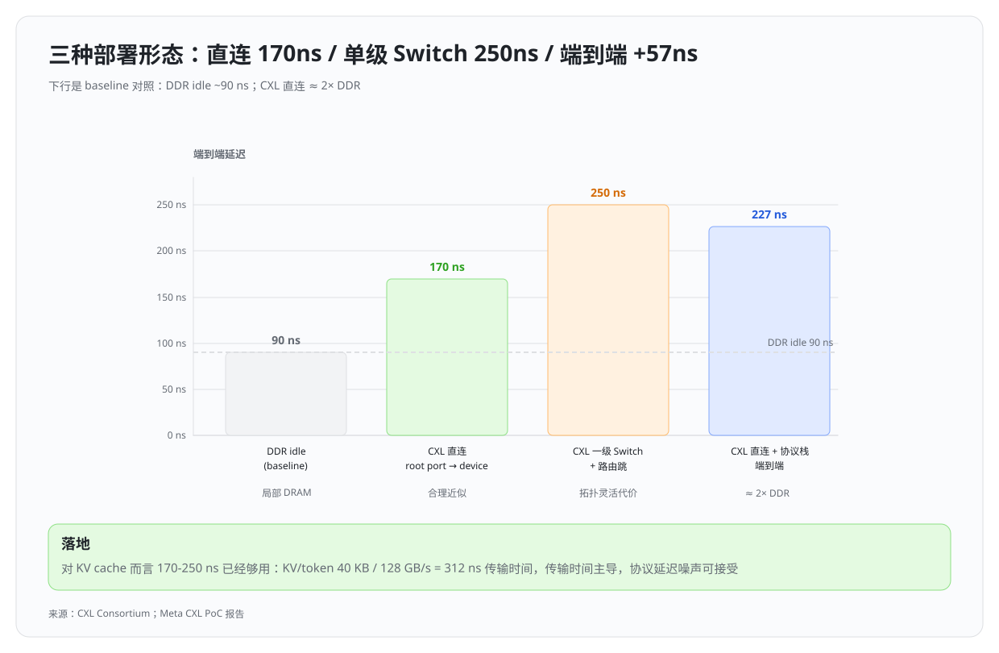
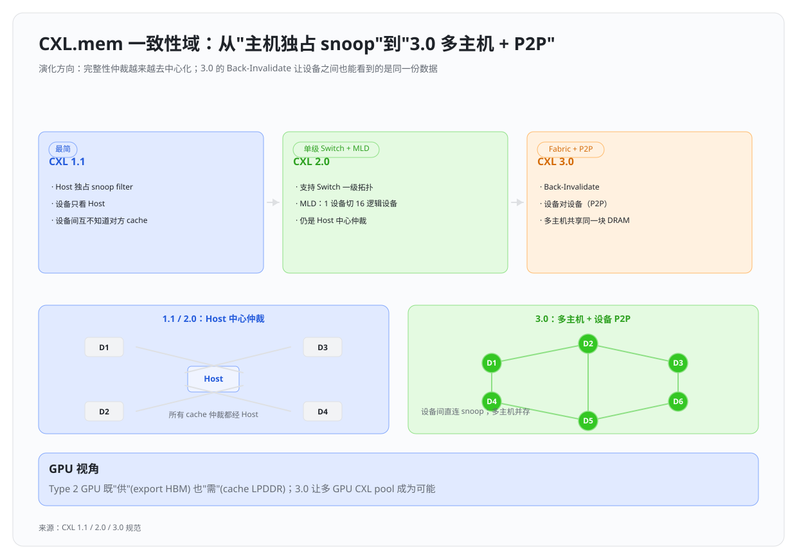
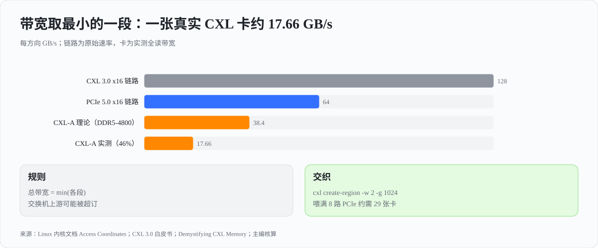
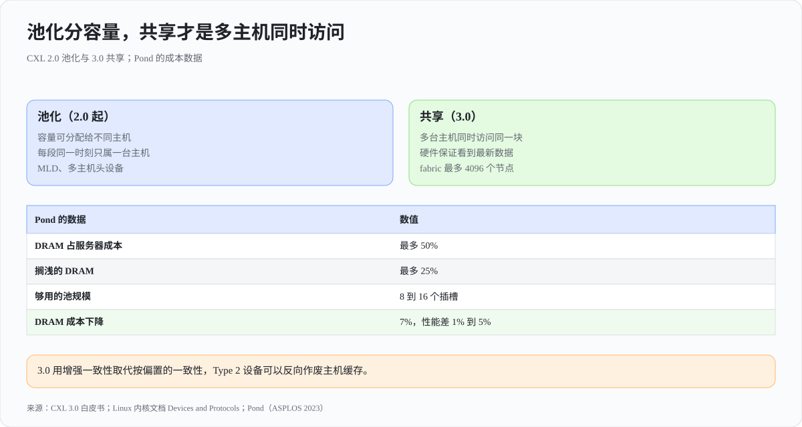
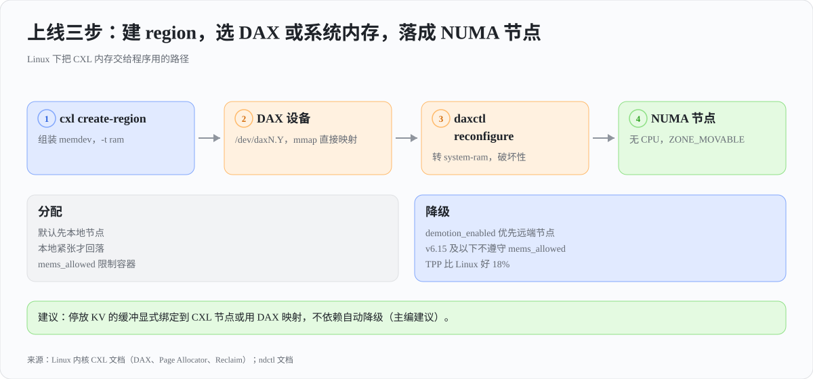
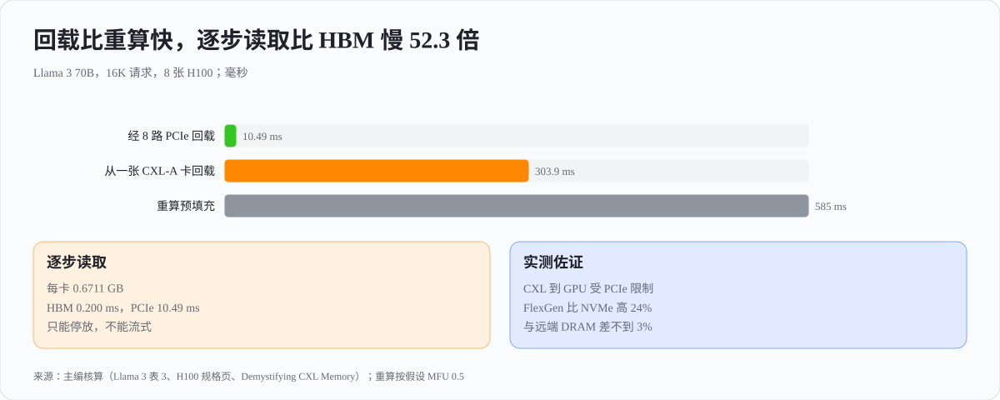
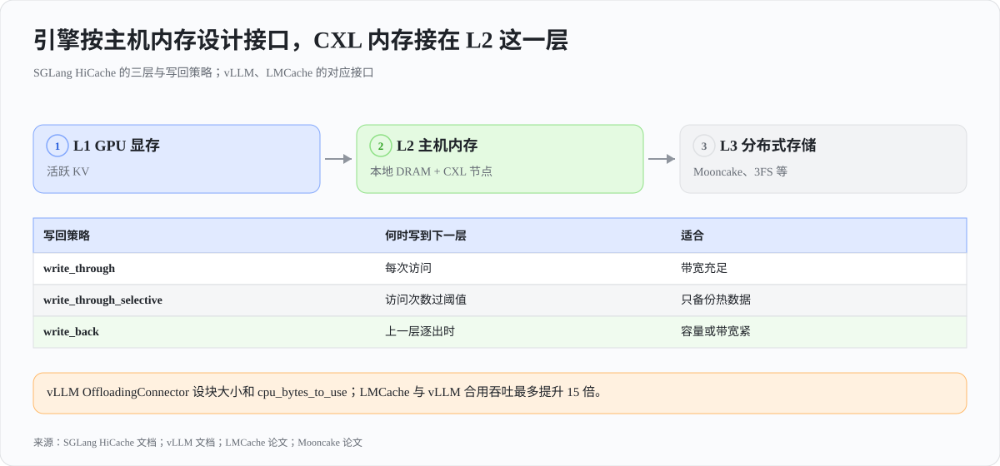

# GPU-26｜系统｜CXL：一致性互连与 KV offload 工程化

> 🎯 **这篇文档解决什么问题**：KV cache 越来越大，HBM 放不下以后，KV 能挪到哪里、挪出去以后代价多大。本篇以 CXL 内存为例，说明它的协议和设备类型，算清延迟和带宽，讲 Linux 里怎样配置，再用 Llama 3 70B 的例子说明 CXL 内存适合停放和回载 KV，不适合在解码时逐步读取，最后说明怎样把它接进推理引擎。

> 💡 **扩展 GPU-23、GPU-11**：GPU-23（[GPU-23｜LLM｜推理系统：KV cache、PagedAttention 与 PD 分离](./23-inference.md)）提出 KV 分层卸载，GPU-11（[GPU-11｜系统｜PCIe、NUMA 与 GPUDirect](./11-pcie-gdr.md)）讲 PCIe 与 GPUDirect；本篇讲 KV 卸载到 CXL 内存时的互连参数和工程接口。

**使用方式**：第 1 章算容量账。第 2、3 章讲 CXL 是什么、KV 实际经过哪条路径。第 4、5 章算延迟和带宽。第 6 章讲一致性和池化，第 7 章讲 Linux 配置。第 8、9 章讲 KV 怎样卸载和接入引擎，第 10 章给清单和自测。

**代码**：本篇没有配套代码，文中算例由主编按公开资料核算，第 10 章给出可以自己写的练习。

<b>🧭 主线位置</b>：GPU-00（[GPU-00｜索引｜从 0 开始 GPU 优化：路线、章节与练习](./README.md)）建立了时间账 T = T_compute + W_mem + W_host + W_comm + W_idle。GPU-23（[GPU-23｜LLM｜推理系统：KV cache、PagedAttention 与 PD 分离](./23-inference.md)）算出 KV 决定了能开多大的批，GPU-25（[GPU-25｜LLM｜投机解码：αK 与 MTP / EAGLE 谱系](./25-speculative.md)）用投机解码压缩解码的 W_mem。本篇处理 KV 放不下的情况：把暂时不用的 KV 停放到主机一侧，用一次回载的 W_host 代替一次重算的 T_compute。GPU-27（[GPU-27｜硬件｜NVL72 与 Grace-Blackwell Superchip：打穿 TP=8](./27-nvl72.md)）接着讲 NVL72 怎样扩大 GPU 之间的高带宽域。

## 导读 · 先给结论

- <b>先算容量账。</b>Llama 3 70B 每 token 的 KV 是 327680 字节，8 张 H100 只够约 88.96 个 16K 请求（第 1 章）。[[1]](https://arxiv.org/pdf/2407.21783)[[2]](https://www.nvidia.com/en-us/data-center/h100/)
- <b>CXL 在 PCIe 物理层上加了一致性和内存语义。</b>CXL.mem 让 CPU 一致地访问设备内存（第 2 章）。[[3]](https://computeexpresslink.org/wp-content/uploads/2023/12/CXL_3.0_white-paper_FINAL.pdf)[[4]](https://docs.kernel.org/driver-api/cxl/devices/device-types.html)
- <b>今天 KV 落在 CPU 一侧的 Type 3 内存。</b>H100 规格页列的是 NVLink 和 PCIe Gen5，GPU 经主机访问 CXL 内存（第 3 章）。[[4]](https://docs.kernel.org/driver-api/cxl/devices/device-types.html)[[2]](https://www.nvidia.com/en-us/data-center/h100/)
- <b>延迟多几十到一百多纳秒。</b>Pond 估算 8 到 16 插槽的池多 70 到 90ns，真实设备之间相差 1 倍到 3 倍（第 4 章）。[[5]](https://arxiv.org/pdf/2203.00241)[[6]](https://arxiv.org/pdf/2303.15375)
- <b>带宽取最小的一段。</b>真实卡只给出理论值的 20% 到 47%，CXL 内存首先是容量（第 5 章）。[[7]](https://docs.kernel.org/driver-api/cxl/linux/access-coordinates.html)[[6]](https://arxiv.org/pdf/2303.15375)
- <b>只停放，不流式读取。</b>每步从主机读 KV 比从 HBM 慢 52.3 倍；回载 16K 请求约 10.49 ms，比重算快（第 8 章）。[[8]](https://arxiv.org/pdf/2405.14209)[[2]](https://www.nvidia.com/en-us/data-center/h100/)
- <b>引擎接口按主机内存设计。</b>vLLM、SGLang HiCache、LMCache 都能卸到主机内存，接 CXL 要放对节点、选对写回策略（第 9 章）。[[9]](https://docs.vllm.ai/en/latest/features/disagg_prefill/)[[10]](https://docs.sglang.io/advanced_features/hicache_design.html)

<b>📎 与系列其他文档的分工</b>：GPU-11（[GPU-11｜系统｜PCIe、NUMA 与 GPUDirect](./11-pcie-gdr.md)）讲 PCIe 拓扑和 NUMA 亲和。GPU-23（[GPU-23｜LLM｜推理系统：KV cache、PagedAttention 与 PD 分离](./23-inference.md)）讲 KV 的容量账、PagedAttention 和 PD 分离。GPU-27（[GPU-27｜硬件｜NVL72 与 Grace-Blackwell Superchip：打穿 TP=8](./27-nvl72.md)）讲 NVL72 和 Grace-Blackwell 的高带宽域。GPU-29（[GPU-29｜LLM｜推理引擎实战：SGLang vs vLLM 选型](./29-engine-choice.md)）比较推理引擎的实现。本篇只讲 CXL 内存作为 KV 停放层的部分，不展开 NVLink 和 RDMA。

## 第 1 章 · 显存装不下以后：先把 KV 的容量账算清

GPU-23（[GPU-23｜LLM｜推理系统：KV cache、PagedAttention 与 PD 分离](./23-inference.md)）算过一笔账：Llama 3 70B 切到 8 张 H100 上，权重占掉一部分显存，剩下的才能放 KV cache，16K 上下文时只够约 88.96 个请求同时在跑。会话一多、上下文一长，KV 就装不下了。这时有三条路：把 KV 丢掉以后重算，把 KV 挪到别的地方存着，或者买更多的卡。本篇讨论第二条路里的一个选项：CXL 内存。先把容量账算清，再看 CXL 能补多少、补上以后要付什么代价。

### 一个请求的 KV 有多大

Llama 3 论文的表 3 给出 70B 的结构：80 层，模型维度 8192，64 个注意力头，8 个 KV 头[[1]](https://arxiv.org/pdf/2407.21783)。每个头的维度是 8192 ÷ 64 = 128。每个 token 在每一层要存 K 和 V 两份，每份 8 × 128 个 BF16 数，所以每个 token 的 KV 是 80 × 8 × 128 × 2 × 2 = 327680 字节。张量并行切到 8 张卡上，每张卡每个 token 存 40960 字节。

一个 4096 token 的请求，KV 约 1.342 GB，每张卡约 0.1678 GB；一个 16384 token 的请求，KV 约 5.369 GB，每张卡约 0.6711 GB。这些数字后面会反复用到：容量按整份请求算，搬运按每张卡自己那份算。

### 三层容量：HBM、主机内存、CXL

H100 SXM 每卡 80 GB HBM，带宽 3.35 TB/s[[2]](https://www.nvidia.com/en-us/data-center/h100/)。GPU-23 算出每卡留给 KV 的约 59.70 GB，8 卡合计 477.6 GB，16K 请求能放 88.96 个。再往外一层是主机内存：DGX H100 的系统内存是 2 TB，由 32 条 DIMM 组成[[11]](https://docs.nvidia.com/dgx/dgxh100-user-guide/introduction-to-dgxh100.html)。假设拿出一半放 KV，能多停放约 186 个 16K 请求。再往外才是 CXL 内存卡、本地 SSD 和远端存储。

LMCache 论文的使用统计说明，用户存下来的 KV 总量增长很快，已经远远超过 GPU 显存的容量[[12]](https://arxiv.org/abs/2510.09665)。KV 迟早要移出 GPU，要回答的是移到哪一层、什么时候移回来。

放进时间账：KV 放不下时，要么批变小，每个 token 分摊的读权重时间变多，W_mem 上升；要么把 KV 丢掉，下次重算，多出一段 T_compute；要么把 KV 存到外面，回载时多出一段主机侧的搬运，记进 W_host。后面几章比较这三种代价。

按五步闭环看容量：

- **定天花板**：按层数、KV 头数、头维度和精度算出每 token 的 KV 字节，再乘上下文长度。
- **测实际**：在线上统计并发请求数和平均上下文长度，看 HBM 里的 KV 占满了没有。
- **定位等待**：区分正在解码的 KV 和空闲会话、共享前缀的 KV。
- **消除或隐藏**：只把暂时不用的 KV 挪出 HBM。
- **复测**：并发数和命中率上升，TTFT 不变差。

一个常见的误区是以为加了外部内存就能多开解码并发。现象是机器上多插了几百 GB 内存，同时解码的请求数却没变。原因是解码每一步都要读完整的 KV，正在生成的请求的 KV 必须在 HBM 里，外部内存只能停放暂时不用的那部分。改法是把 KV 分成活跃和停放两类，外部内存只用来放后者，用回载代替重算。

> 🔑 **本章要点**：Llama 3 70B 每 token 的 KV 是 327680 字节，16K 请求约 5.369 GB。8 张 H100 留给 KV 的 477.6 GB 只够 88.96 个 16K 请求，DGX H100 的 2 TB 主机内存是下一层。外部内存只能放暂时不用的 KV。这一章是五步闭环的“定天花板”：先算出每一层能放多少。

## 第 2 章 · CXL 是什么：PCIe 物理层上跑三个协议

CXL 联盟对 CXL 的定义是一种面向处理器、内存扩展和加速器的缓存一致性互连[[13]](https://computeexpresslink.org/about-cxl/)。它让 CPU 的内存空间和设备上的内存保持一致[[13]](https://computeexpresslink.org/about-cxl/)。CXL 3.0 白皮书说得更具体：它在 PCI Express 的 I/O 语义之上，加了一致性和内存语义[[3]](https://computeexpresslink.org/wp-content/uploads/2023/12/CXL_3.0_white-paper_FINAL.pdf)。换句话说，CXL 用的是 PCIe 的线和物理层，跑的协议多了两种。

### 三个协议各管什么

Linux 内核文档把 CXL 的核心协议分成三个[[4]](https://docs.kernel.org/driver-api/cxl/devices/device-types.html)：

- **CXL.io**：基本的交互协议，类似 PCIe 的配置机制，用于初始化、配置和内存与缓存以外的 I/O 访问[[4]](https://docs.kernel.org/driver-api/cxl/devices/device-types.html)。
- **CXL.cache**：设备一致地访问并缓存主机内存的机制[[4]](https://docs.kernel.org/driver-api/cxl/devices/device-types.html)。
- **CXL.mem**：CPU 一致地访问并缓存设备内存的机制[[4]](https://docs.kernel.org/driver-api/cxl/devices/device-types.html)。

后两个协议配置好以后，对 Linux 来说基本是透明的[[4]](https://docs.kernel.org/driver-api/cxl/devices/device-types.html)。这一点对 KV offload 很关键：CXL.mem 挂上来的内存，在 CPU 看来就是普通内存，load 和 store 走 CPU 的缓存层次，不需要专门的驱动接口。方向也要看清：CXL.cache 是设备缓存主机的内存，CXL.mem 是 CPU 访问设备的内存。

### 版本怎样演进

CXL 1.0 在 2019 年 3 月发布[[3]](https://computeexpresslink.org/wp-content/uploads/2023/12/CXL_3.0_white-paper_FINAL.pdf)。CXL 2.0 在 2020 年十一月发布，加了单级交换、持久内存、内存池化和安全[[3]](https://computeexpresslink.org/wp-content/uploads/2023/12/CXL_3.0_white-paper_FINAL.pdf)。CXL 3.0 基于 PCIe 6.0，传输速率翻倍到 64GT/s，延迟不比前几代高[[3]](https://computeexpresslink.org/wp-content/uploads/2023/12/CXL_3.0_white-paper_FINAL.pdf)，采用 PAM-4 信号上的 256B flit[[3]](https://computeexpresslink.org/wp-content/uploads/2023/12/CXL_3.0_white-paper_FINAL.pdf)。CXL 4.0 把速率从 64GT/s 再翻倍到 128GT/s[[13]](https://computeexpresslink.org/about-cxl/)，并且保持对 3.x、2.0、1.1 和 1.0 的完全向后兼容[[13]](https://computeexpresslink.org/about-cxl/)。

| 版本 | 物理层与速率 | 和 KV offload 相关的新能力 |
|---|---|---|
| 1.0 / 1.1 | PCIe 5.0，32GT/s | 三协议，设备直连主机 |
| 2.0 | PCIe 5.0，32GT/s | 单级交换、内存池化[[3]](https://computeexpresslink.org/wp-content/uploads/2023/12/CXL_3.0_white-paper_FINAL.pdf) |
| 3.0 | PCIe 6.0，64GT/s | 增强一致性、内存共享、fabric（第 6 章）[[3]](https://computeexpresslink.org/wp-content/uploads/2023/12/CXL_3.0_white-paper_FINAL.pdf) |
| 4.0 | 128GT/s | 带宽再翻倍，向后兼容[[13]](https://computeexpresslink.org/about-cxl/) |

表里 1.x 和 2.0 的 32GT/s 是 PCIe 5.0 的速率，Pond 论文也写明 CXL.mem 沿用 PCIe 的电气接口[[5]](https://arxiv.org/pdf/2203.00241)。

按五步闭环看 CXL 的定位：

- **定天花板**：查清平台支持的 CXL 版本和链路速率。
- **测实际**：确认 CXL 内存在系统里以哪种形式出现（第 7 章）。
- **定位等待**：区分访问者是 CPU 还是 GPU，两者走的路径不同。
- **消除或隐藏**：让 CPU 侧的 KV 缓冲落在 CXL 内存上。
- **复测**：在相同负载下比较放在本地 DRAM 和 CXL 内存上的回载时间。

一个常见的误区是把 CXL 当成一种更快的 PCIe，以为 GPU 插在 CXL 平台上就能直接读写远端内存。现象是采购了 CXL 平台，GPU 到主机的拷贝速度却和以前一样。原因是 CXL.mem 让 CPU 能 load 和 store 设备内存，GPU 和主机之间仍然走原来的 PCIe 链路。改法是先画出 KV 从 HBM 到 CXL 内存经过的每一段链路，第 3 章和第 8 章会画这条路径。

> 🔑 **本章要点**：CXL 在 PCIe 物理层上加了一致性和内存语义，分 CXL.io、CXL.cache、CXL.mem 三个协议。CXL.mem 让 CPU 一致地访问设备内存，配好后对 Linux 基本透明。1.x 和 2.0 用 PCIe 5.0，3.0 到 64GT/s，4.0 到 128GT/s。这一章是五步闭环的“定天花板”：弄清 CXL 能做什么、谁是访问者。

## 第 3 章 · 三类设备：谁缓存谁的内存

CXL 设备按用到的协议分成三类。分类决定了设备有没有可以被主机当内存用的存储，也就决定了它能不能放 KV。本章先按内核文档把三类设备讲清楚，再说明今天的 GPU 服务器上，KV 能落到的是哪一类。

### Type 1、Type 2、Type 3

**Type 1** 支持 CXL.io 和 CXL.cache[[4]](https://docs.kernel.org/driver-api/cxl/devices/device-types.html)，实现完全一致的缓存，但没有主机管理的设备内存（HDM）[[4]](https://docs.kernel.org/driver-api/cxl/devices/device-types.html)。典型例子是智能网卡，它要直接在主机内存上存放收到的数据包[[4]](https://docs.kernel.org/driver-api/cxl/devices/device-types.html)。这类设备主要依赖 CPU 的内存，和 KV 存放无关。

**Type 2** 三个协议都支持[[4]](https://docs.kernel.org/driver-api/cxl/devices/device-types.html)，通常是带高带宽内存的加速器[[4]](https://docs.kernel.org/driver-api/cxl/devices/device-types.html)。它和 Type 1 的主要区别是有 HDM：设备在本地内存上工作，CPU 同时能一致地访问这块内存。内核文档举的例子是，这让 GPU 之类的设备可以通过 DAX 设备或文件描述符暴露自己的内存[[4]](https://docs.kernel.org/driver-api/cxl/devices/device-types.html)。

**Type 3** 支持 CXL.io 和 CXL.mem[[4]](https://docs.kernel.org/driver-api/cxl/devices/device-types.html)，最简单的例子是内存扩展器，把本地的内存容量直接暴露给 CPU[[4]](https://docs.kernel.org/driver-api/cxl/devices/device-types.html)。CXL 交换机能在上游、下游和对等设备之间路由任何 CXL 协议[[4]](https://docs.kernel.org/driver-api/cxl/devices/device-types.html)。一块设备还可以对多台主机呈现多个逻辑设备（MLD）[[4]](https://docs.kernel.org/driver-api/cxl/devices/device-types.html)，或者把同一个逻辑设备接到多个主机头上，内核文档举的例子是一个开机前静态配置好的内存池[[4]](https://docs.kernel.org/driver-api/cxl/devices/device-types.html)。

| 类型 | 协议 | HDM | 例子 | 和 KV 的关系 |
|---|---|---|---|---|
| Type 1 | io + cache | 无 | 智能网卡 | 无关 |
| Type 2 | io + cache + mem | 有 | 带 HBM 的加速器 | 设备内存可被 CPU 访问 |
| Type 3 | io + mem | 有 | 内存扩展卡、内存池 | 主机侧的 KV 停放层 |

### GPU 服务器上的 KV 走哪条路

H100 的规格页列出的互连是 NVLink 900GB/s 和 PCIe Gen5 128GB/s[[2]](https://www.nvidia.com/en-us/data-center/h100/)。NVIDIA 让 CPU 和 GPU 一致地共享内存的方案是 GH200 上的 NVLink-C2C，规格页写的是 CPU+GPU 一致内存模型、900GB/s 的一致接口，比 PCIe Gen5 快 7 倍[[14]](https://www.nvidia.com/en-us/data-center/grace-hopper-superchip/)。本文查到的公开资料里，没有 H100 作为 Type 2 设备接入 CXL 的说明。

所以今天在 H100 服务器上做 KV offload，CXL 能起作用的位置是 CPU 一侧：Type 3 内存卡插在 CPU 的 CXL 端口上，成为主机内存的一部分；KV 从 HBM 经 GPU 的 PCIe Gen5 链路到 CPU，再落到 CXL 内存。后面几章的延迟、带宽和接口都按这条路径算。

按五步闭环看设备类型：

- **定天花板**：确认平台上 CXL 设备是哪一类、挂在哪个 CPU 的哪个端口上。
- **测实际**：列出 KV 从 HBM 到 CXL 内存经过的链路。
- **定位等待**：找出这条路径上最窄的一段，通常是 GPU 的 PCIe 链路或 CXL 卡本身。
- **消除或隐藏**：让每张 GPU 的回载走离它最近的 CPU 和 CXL 卡。
- **复测**：分别量 GPU 到本地 DRAM 和 GPU 到 CXL 内存的拷贝带宽。

一个常见的误区是买了 Type 3 内存卡，以为 GPU 能像访问显存一样直接 load 和 store 它。现象是推理引擎里找不到能让 GPU 直接访问 CXL 内存的配置项，最后只能当普通主机内存用。原因是 Type 3 设备面向的是 CPU，GPU 访问它仍要经过主机。改法是在规划阶段就按主机内存的一层来设计，不对 GPU 直连抱期望。

> 🔑 **本章要点**：Type 1 只缓存主机内存，Type 2 是带 HDM 的加速器，Type 3 是内存扩展器。H100 规格页列的是 NVLink 和 PCIe Gen5，NVIDIA 的 CPU 和 GPU 一致方案是 GH200 的 NVLink-C2C。今天 KV 能落到的是 CPU 一侧的 Type 3 内存。这一章是五步闭环的“定位等待”：先画出 KV 实际经过的路径。

## 第 4 章 · 延迟账：CXL 内存比本地 DRAM 慢多少

CXL 内存挂在 CPU 的 PCIe 端口上，访问它要多走一段链路和一个控制器，延迟一定比插在内存槽里的 DRAM 高。高多少取决于拓扑和设备，不同来源给的数差别很大。本章先说明延迟由哪几段组成，再给论文里的实测和估算，最后说明这个数对 GPU 的 KV 搬运有多大影响。

### 延迟按段相加

Linux 内核文档用一个带交换机的拓扑说明 CXL 内存的访问延迟怎么算：设备自己的延迟、设备到交换机的链路、交换机、交换机到根端口的链路、根端口到 CPU，总的读写延迟是这些部分之和[[7]](https://docs.kernel.org/driver-api/cxl/linux/access-coordinates.html)。设备的数据来自它的 CDAT 表，交换机的数据来自 SSLBIS 子表。热插拔的 CXL 设备在开机时还不存在，BIOS 没法在 ACPI 表里标注它的性能[[7]](https://docs.kernel.org/driver-api/cxl/linux/access-coordinates.html)，所以由驱动自己汇总。

Pond 论文给了各段的量级。Intel 测得 CXL 端口一次往返约 25ns，加上控制器一侧的延迟，CXL 读比 NUMA 本地 DRAM 读端到端多约 70ns[[5]](https://arxiv.org/pdf/2203.00241)。信号要走远时需要 retimer，每个方向约加 10ns[[5]](https://arxiv.org/pdf/2203.00241)。论文的图 7 把拓扑和延迟对起来：本地 DRAM 85ns，8 插槽的池 155ns，是本地的 182%；16 插槽的池 180ns，是本地的 212%[[5]](https://arxiv.org/pdf/2203.00241)。论文的结论是，8 到 16 插槽的池比同 NUMA 节点的 DRAM 多 70 到 90ns，机架级的池要多 180ns 以上[[5]](https://arxiv.org/pdf/2203.00241)。

### 真实设备差别很大

Demystifying CXL Memory 一文在第四代 Xeon 上测了三家厂商的真实 CXL 内存卡[[6]](https://arxiv.org/pdf/2303.15375)。它的结论是，真实 CXL 内存的访问延迟高度依赖控制器设计[[6]](https://arxiv.org/pdf/2303.15375)：CXL-A 的 load 延迟只比远端 NUMA 节点上的 DDR5 长 35%，CXL-B 和 CXL-C 分别长到约 2 倍和 3 倍[[6]](https://arxiv.org/pdf/2303.15375)。论文还指出，用远端 NUMA 节点模拟的 CXL 内存和真实设备之间有重要差别[[6]](https://arxiv.org/pdf/2303.15375)，很多早期研究用的正是这种模拟。CXL 3.0 的低延迟 flit 变体能再省 2 到 5ns[[3]](https://computeexpresslink.org/wp-content/uploads/2023/12/CXL_3.0_white-paper_FINAL.pdf)，和设备之间的差距比起来很小。

### 对 GPU 搬 KV 影响多大

延迟高对两类负载影响不同。CPU 上要求微秒级响应的程序很敏感，Demystifying 一文测到，把页放到 CXL 内存上，这类程序的尾延迟增加 10% 到 82%[[6]](https://arxiv.org/pdf/2303.15375)。GPU 回载 KV 是另一回事。按每块 16 个 token 算，每张卡一块 KV 是 655360 字节，经 PCIe Gen5 x16 拷贝约 10.24 微秒，Pond 估的 90ns 只占 0.88%。块越大，延迟越无关紧要，决定时间的是带宽，第 5 章专门算带宽。

按五步闭环看延迟：

- **定天花板**：按拓扑把各段延迟相加，估出访问一次 CXL 内存的下限。
- **测实际**：在自己的卡上实测 load 延迟，不用远端 NUMA 节点代替。
- **定位等待**：区分是 CPU 上的细粒度访问还是 GPU 的大块拷贝。
- **消除或隐藏**：延迟敏感的数据留在本地 DRAM，大块 KV 放 CXL 内存。
- **复测**：比较放在两种内存上的回载时间和 CPU 侧服务的尾延迟。

一个常见的误区是拿一个延迟数字代表所有 CXL 内存。现象是按论文里某张卡的数做了规划，换了供应商以后延迟高出一倍。原因是延迟由控制器决定，不同设备相差 1 倍到 3 倍。改法是每换一种设备都实测一遍，规划里按测到的最差设备留余量。

> 🔑 **本章要点**：CXL 内存的访问延迟是各段之和。Pond 估算 8 到 16 插槽的池比本地 DRAM 多 70 到 90ns，图 7 给出 85、155、180ns；真实设备之间相差 1 倍到 3 倍。对 GPU 的大块 KV 拷贝，90ns 只占一块拷贝时间的 0.88%。这一章是五步闭环的“测实际”：延迟要在自己的设备上量。

## 第 5 章 · 带宽账：链路、控制器、交织，取最小的那个

第 4 章说明，对大块 KV 拷贝来说决定时间的是带宽。CXL 内存的带宽由好几段决定：GPU 到 CPU 的 PCIe 链路、CPU 到 CXL 卡的链路、卡上的控制器和 DRAM。内核文档的规则很简单：总带宽取这些部分的最小值[[7]](https://docs.kernel.org/driver-api/cxl/linux/access-coordinates.html)。本章按这条规则逐段算。

### 链路带宽

内核文档给出链路带宽的算法：每条 lane 的速率等于 GT/s 除以 8，单位 MB/s[[7]](https://docs.kernel.org/driver-api/cxl/linux/access-coordinates.html)，再乘以链路宽度[[7]](https://docs.kernel.org/driver-api/cxl/linux/access-coordinates.html)。PCIe 5.0 是 32GT/s[[8]](https://arxiv.org/pdf/2405.14209)，x16 链路每个方向是 16 × 32 ÷ 8 = 64 GB/s，x8 是 32 GB/s。这是原始速率，没有扣掉编码和协议开销。H100 规格页写的 PCIe Gen5 128GB/s[[2]](https://www.nvidia.com/en-us/data-center/h100/)，是两个方向加在一起。CXL 3.0 的 x16 链路原始带宽合计最高 256GB/s[[3]](https://computeexpresslink.org/wp-content/uploads/2023/12/CXL_3.0_white-paper_FINAL.pdf)，每个方向 128 GB/s；CXL 4.0 再翻倍，每个方向 256 GB/s。

交换机还有一个容易漏掉的限制：交换机后面所有设备的带宽加起来，可能超过交换机的上游链路[[7]](https://docs.kernel.org/driver-api/cxl/linux/access-coordinates.html)。这时上游链路就是那个最小值。

### 控制器和 DRAM

链路只是上限，卡能给出多少还要看控制器。Demystifying CXL Memory 测的三张卡里，CXL-A 用 DDR5-4800，理论每通道 38.4 GB/s[[6]](https://arxiv.org/pdf/2303.15375)；全读负载下，远端 NUMA 的 DDR5 和 CXL-A、CXL-B、CXL-C 分别只达到理论最大带宽的 70%、46%、47% 和 20%[[6]](https://arxiv.org/pdf/2303.15375)。论文的结论是，带宽强烈依赖 CXL 控制器的效率[[6]](https://arxiv.org/pdf/2303.15375)。按 46% 算，CXL-A 实际能读约 17.66 GB/s。Pond 论文的估算是，一个 x8 的 CXL 端口在常见的 2 比 1 读写比下，带宽相当于一个 DDR5-4800 通道[[5]](https://arxiv.org/pdf/2203.00241)。

再和 CPU 自己的内存比。Exploring and Evaluating Real-world CXL 一文的 AMD 平台每插槽 12 个 DDR5-4800 通道，最大带宽 460.8 GB/s[[8]](https://arxiv.org/pdf/2405.14209)，插的 CXL 卡是单通道 DDR5-4800、128 GB[[8]](https://arxiv.org/pdf/2405.14209)。一张这样的卡在峰值上只给插槽多了 8.3% 的带宽。CXL 内存首先是容量，其次才是带宽。

### 交织：把几张卡并成一个 region

要拿到更高的带宽，就得把多张卡交织起来。内核文档说明，HDM 解码器可以定义每个设备在一段交织地址里的份额，交织可以在同一个主桥下的多个设备之间，也可以跨主桥[[15]](https://docs.kernel.org/driver-api/cxl/theory-of-operation.html)。ndctl 文档的例子是用两张卡、1024 字节粒度建一个两路交织的 region：cxl create-region -m -d decoder0.1 -w 2 -g 1024 mem0 mem1[[16]](https://raw.githubusercontent.com/pmem/ndctl/main/Documentation/cxl/cxl-create-region.txt)。按每卡 17.66 GB/s 算，要喂满 8 张 GPU 各自 64 GB/s 的 PCIe 链路，合计 512 GB/s，需要约 29 张这样的卡。这个数说明，CXL 内存很难成为 GPU 回载 KV 的带宽来源，它更适合当容量层。

按五步闭环看带宽：

- **定天花板**：逐段写出 GPU 链路、CXL 链路、交换机上游、控制器的带宽，取最小值。
- **测实际**：在 CXL 内存上跑顺序读写，量出实际带宽占理论值的比例。
- **定位等待**：看最小值落在哪一段，通常是控制器或卡的数量。
- **消除或隐藏**：用交织把多张卡并起来，或者把回载分摊到更长的时间里。
- **复测**：交织后带宽随卡数增长，回载时间按比例下降。

一个常见的误区是把链路速率当成卡的带宽。现象是按 x16 链路 64 GB/s 估回载时间，实测慢了三倍多。原因是控制器只能给出理论值的一部分，Demystifying 一文测到 20% 到 47%。改法是用实测带宽做规划，并且按交织后的 region 测，不按单卡推算。

> 🔑 **本章要点**：CXL 内存的带宽取链路、交换机上游、控制器中的最小值。PCIe 5.0 x16 每方向 64 GB/s，但真实卡只给出理论值的 20% 到 47%，CXL-A 约 17.66 GB/s，一张卡只给插槽多 8.3% 的带宽。喂满 8 张 GPU 的 PCIe 要约 29 张卡。这一章是五步闭环的“定位等待”：找出带宽链条上最窄的那一段。

## 第 6 章 · 一致性与池化：从按偏置到 back-invalidate

前两章把 CXL 内存当成一台主机自己的扩展内存。CXL 2.0 和 3.0 的重点在更大的范围：几台主机共用一个内存池，甚至同时访问同一块内存。这要解决两个问题：多方缓存同一行数据时怎样保持一致，以及池里的容量怎样分给不同主机。本章讲这两件事，再用 Pond 论文的数据看池化省下多少钱。

### 一致性：3.0 的增强一致性

CXL 3.0 白皮书说明，对带内存的加速器，也就是 Type 2 设备，3.0 的一个主要改进是设备能反向作废主机缓存中的数据（back invalidate）[[3]](https://computeexpresslink.org/wp-content/uploads/2023/12/CXL_3.0_white-paper_FINAL.pdf)。这种维护 HDM 一致性的模型叫增强一致性，它取代了前几代引入的按偏置（bias）一致性[[3]](https://computeexpresslink.org/wp-content/uploads/2023/12/CXL_3.0_white-paper_FINAL.pdf)。在这种对称的一致性下，Type 2 设备可以为自己的 HDM 地址范围实现一个 snoop filter，从而更高效地映射和管理更大的内存[[3]](https://computeexpresslink.org/wp-content/uploads/2023/12/CXL_3.0_white-paper_FINAL.pdf)。增强一致性还允许对 HDM 的直接对等访问，不必经过主机[[3]](https://computeexpresslink.org/wp-content/uploads/2023/12/CXL_3.0_white-paper_FINAL.pdf)。

对 KV 来说，这些能力的意义在多主机共享：如果几台主机要读同一份前缀的 KV，一致性决定了一台主机改了数据以后，其他主机能不能马上看到。本文没有查到推理引擎直接使用 CXL 硬件共享内存的公开实现，下面的讨论限于规范层面。

### 池化和共享是两回事

白皮书把两者分开讲。池化是把 CXL 内存当作可以灵活分配和回收给不同主机的资源[[3]](https://computeexpresslink.org/wp-content/uploads/2023/12/CXL_3.0_white-paper_FINAL.pdf)，2.0 就支持，每段容量同一时刻只属于一台主机。共享是 3.0 新增的：同一块内存可以同时被多台主机访问，硬件保证每台主机看到的都是最新数据[[3]](https://computeexpresslink.org/wp-content/uploads/2023/12/CXL_3.0_white-paper_FINAL.pdf)。3.0 还引入了 fabric，最多支持 4096 个节点[[3]](https://computeexpresslink.org/wp-content/uploads/2023/12/CXL_3.0_white-paper_FINAL.pdf)；其中的 GFAM 设备类似 Type 3，但可以被最多 4095 个节点访问[[3]](https://computeexpresslink.org/wp-content/uploads/2023/12/CXL_3.0_white-paper_FINAL.pdf)。内核文档里的多逻辑设备和多主机头设备，正是池化在设备层的形态[[4]](https://docs.kernel.org/driver-api/cxl/devices/device-types.html)。

### 池化省多少钱

Pond 论文用 Azure 的生产数据回答了这个问题。DRAM 可以占到服务器成本的 50%[[5]](https://arxiv.org/pdf/2203.00241)；随着更多核被分配给虚拟机，最多 25% 的 DRAM 会搁浅，也就是有内存但没有核可以一起卖出去[[5]](https://arxiv.org/pdf/2203.00241)。约 50% 的虚拟机用到的内存不到租用量的一半[[5]](https://arxiv.org/pdf/2203.00241)。论文的分析是，8 到 16 个插槽组成的池就能拿到池化的大部分收益[[5]](https://arxiv.org/pdf/2203.00241)，最终把 DRAM 成本降低 7%，性能和同 NUMA 节点分配相差 1% 到 5%[[5]](https://arxiv.org/pdf/2203.00241)。按 DRAM 占服务器成本 50% 粗算，这 7% 相当于最多 3.5% 的服务器成本。

放到推理集群上，道理相同：各台机器上空闲会话的 KV 量此起彼伏，池化能让几台机器共用一份停放容量，不必每台都按峰值配内存。代价是第 4 章的延迟：池越大，跨的插槽越多，延迟越高。

按五步闭环看池化：

- **定天花板**：统计每台机器停放 KV 的峰值和均值，算出池化能省的容量。
- **测实际**：量池化后的访问延迟和带宽。
- **定位等待**：看延迟是否随池规模明显上升。
- **消除或隐藏**：把池控制在少数几个插槽内。
- **复测**：省下的内存和增加的回载时间相比是否划算。

一个常见的误区是把池化当成共享。现象是设计里假设几台主机能直接读同一份前缀 KV，上线时才发现池里每段容量只能分给一台主机。原因是 2.0 的池化只做容量分配，多主机同时访问要 3.0 的共享能力和软件支持。改法是先按池化设计，跨主机复用 KV 仍走推理引擎自己的传输（第 9 章）。

> 🔑 **本章要点**：CXL 3.0 用增强一致性取代按偏置的一致性，Type 2 设备能反向作废主机缓存。池化是分配容量，共享是多主机同时访问，后者是 3.0 新增的。Pond 用 8 到 16 插槽的池把 DRAM 成本降低 7%，性能相差 1% 到 5%。这一章是五步闭环的“消除或隐藏”：用池化消除搁浅的内存。

## 第 7 章 · Linux 里的 CXL 内存：region、DAX 和 NUMA 节点

CXL 内存卡插上以后，要经过几步配置才能被程序用上。内核文档把 CXL 子系统比作 RAID 驱动：RAID 驱动把几块盘组装成一个新的逻辑设备[[15]](https://docs.kernel.org/driver-api/cxl/theory-of-operation.html)，CXL 子系统把 PCIe 和 ACPI 对象组装成一个能解码内存地址的拓扑。本章按顺序走一遍：建 region，选 DAX 设备或系统内存，落成 NUMA 节点，再看内核怎样在本地 DRAM 和 CXL 内存之间分配和迁移页。

### 从 region 到 NUMA 节点

第一步是建 region。cxl create-region 的作用是设置构成 region 的各个 CXL 内存设备的属性，把它们组装成一个 region[[16]](https://raw.githubusercontent.com/pmem/ndctl/main/Documentation/cxl/cxl-create-region.txt)，用 -t 指定类型是 pmem 还是 ram[[16]](https://raw.githubusercontent.com/pmem/ndctl/main/Documentation/cxl/cxl-create-region.txt)，多张卡交织的写法见第 5 章。

第二步决定程序怎样访问这块内存，有两种方式。一种是 DAX 设备，在 /dev/daxN.Y 下出现，程序用 mmap 系统调用直接映射[[17]](https://docs.kernel.org/driver-api/cxl/linux/dax-driver.html)，内核文档建议想自己管理 CXL 内存分配的用户用这种接口[[17]](https://docs.kernel.org/driver-api/cxl/linux/dax-driver.html)。另一种是交给内核：dax_kmem 驱动把 DAX 设备转成一组热插拔内存块[[17]](https://docs.kernel.org/driver-api/cxl/linux/dax-driver.html)，用 daxctl reconfigure-device 把 devdax 模式转成 system-ram 模式[[18]](https://raw.githubusercontent.com/pmem/ndctl/main/Documentation/daxctl/daxctl-reconfigure-device.txt)。这个操作是破坏性的，设备上的数据会丢失[[18]](https://raw.githubusercontent.com/pmem/ndctl/main/Documentation/daxctl/daxctl-reconfigure-device.txt)。它默认以 movable 方式上线新的内存块[[18]](https://raw.githubusercontent.com/pmem/ndctl/main/Documentation/daxctl/daxctl-reconfigure-device.txt)；如果系统设置了自动上线内存块，转成 system-ram 会失败[[18]](https://raw.githubusercontent.com/pmem/ndctl/main/Documentation/daxctl/daxctl-reconfigure-device.txt)。

转成系统内存以后，CXL 内存通常是一个单独的 NUMA 节点，和本地 DRAM 分开[[19]](https://docs.kernel.org/driver-api/cxl/allocation/page-allocator.html)，而且这个节点上没有 CPU[[8]](https://arxiv.org/pdf/2405.14209)。容量可以上线到 ZONE_NORMAL 或 ZONE_MOVABLE[[19]](https://docs.kernel.org/driver-api/cxl/allocation/page-allocator.html)。

### 页分配和降级

没有显式设置内存策略时，内核默认先从本地 NUMA 节点分配，只有本地节点紧张时才回落到其他节点[[19]](https://docs.kernel.org/driver-api/cxl/allocation/page-allocator.html)。容器可以用 cpusets.mems_allowed 限制能用哪些节点[[19]](https://docs.kernel.org/driver-api/cxl/allocation/page-allocator.html)。另一条路是回收：打开 kernel/mm/numa/demotion_enabled 以后，回收时会优先把页迁到更远的 NUMA 节点，而不是换出到 swap[[20]](https://docs.kernel.org/driver-api/cxl/allocation/reclaim.html)，下一个降级节点按 HMAT 或 CDAT 里的性能数据确定[[20]](https://docs.kernel.org/driver-api/cxl/allocation/reclaim.html)。要注意，Linux v6.15 及以下版本的降级不遵守 cpusets.mems_allowed[[20]](https://docs.kernel.org/driver-api/cxl/allocation/reclaim.html)。

自动放置的效果要看负载。Meta 的 TPP 在内核里主动把冷页从本地内存降级到 CXL 内存[[21]](https://arxiv.org/abs/2206.02878)，在带 CXL 1.1 的生产服务器上评估[[21]](https://arxiv.org/abs/2206.02878)，比当时的 Linux 好 18%，比 NUMA Balancing 等方案好 5% 到 17%[[21]](https://arxiv.org/abs/2206.02878)。但 Demystifying CXL Memory 一文测到，TPP 在一个延迟敏感的应用上，p99 延迟比静态放 25% 的页到 CXL 内存高 174%[[6]](https://arxiv.org/pdf/2303.15375)，原因是它一直在两种内存之间迁移页。该文自己提出的按带宽分配的策略，对带宽密集的应用最多提升 24%[[6]](https://arxiv.org/pdf/2303.15375)。

KV 缓冲是推理引擎自己申请、自己管理的大块内存，生命周期和访问模式引擎最清楚。所以更稳妥的做法是让引擎显式把停放 KV 的缓冲放到 CXL 节点上，或者直接用 DAX 设备映射，不依赖内核的自动降级。这是主编根据上面几份文档得出的建议，没有查到推理引擎的官方说明。

按五步闭环看 Linux 配置：

- **定天花板**：确认 region 的大小、交织方式和类型。
- **测实际**：查看 NUMA 节点列表，确认 CXL 内存是一个无 CPU 的节点。
- **定位等待**：看 KV 缓冲实际落在哪个节点上。
- **消除或隐藏**：显式绑定节点或用 DAX 映射，关掉对 KV 不需要的自动迁移。
- **复测**：各节点的使用量和预期一致，CPU 侧服务的尾延迟不变差。

一个常见的误区是把 CXL 内存上线以后就不管了，指望内核自动用好它。现象是 CXL 节点几乎是空的，本地 DRAM 却被 KV 缓冲挤满，其他进程开始被回收。原因是默认策略先用本地节点，本地紧张时才回落。改法是让 KV 缓冲显式绑定到 CXL 节点，并定期核对每个节点的用量。

> 🔑 **本章要点**：CXL 内存先用 cxl create-region 组装成 region，再选 DAX 设备映射或用 daxctl 转成系统内存，后者成为一个无 CPU 的 NUMA 节点。默认分配先用本地节点，降级要打开 demotion_enabled。TPP 比 Linux 好 18%，但也可能让尾延迟变差。这一章是五步闭环的“测实际”：确认 KV 缓冲真的落在 CXL 节点上。

## 第 8 章 · KV offload 落在哪：停放和回载，不能逐步读取

前面几章算出了 CXL 内存的延迟和带宽。现在把它们放回推理：KV 放在 CXL 内存上，到底怎么用才划算。答案取决于 KV 是在每一步解码时都要读，还是只在一个会话恢复时读一次。本章用 GPU-23 的 70B 例子把这两种用法各算一遍，再和重算比较。

### 逐步读取：比 HBM 慢 52.3 倍

假设一个 16K 请求的 KV 放在主机一侧，每步解码都从那里读。每张卡要读自己那份约 0.6711 GB，从 HBM 读只要约 0.200 ms，经 PCIe Gen5 x16 每方向 64 GB/s 读要约 10.49 ms，慢了 52.3 倍。GPU-23 算过，70B 在 8 卡上批大小 1 时一步解码光读权重就约 5.27 ms，再加 10.49 ms 读 KV，TPOT 会翻好几倍。所以活跃请求的 KV 必须在 HBM 里，CXL 内存只适合停放暂时不用的 KV。

实测结论也一样。Exploring and Evaluating Real-world CXL 一文发现，基于 CXL 内存做张量卸载的收益有限，因为 CXL 内存和 GPU 显存之间的拷贝比 CPU 直接访问内存的路径更长[[8]](https://arxiv.org/pdf/2405.14209)；在他们的 CXL 1.1 平台上，这条路径的瓶颈是 CPU 和 GPU 之间的 PCIe[[8]](https://arxiv.org/pdf/2405.14209)。研究 CXL 近存计算的论文也指出，把不在 GPU 上的 KV 调回有限的 GPU 显存，传输代价很高[[22]](https://arxiv.org/abs/2511.00321)。

### 停放和回载：比重算快

另一种用法是：会话暂停时把 KV 写出去，恢复时一次读回来。还是 16K 请求，8 张卡各经自己的 PCIe 并行回载，约 10.49 ms；4096 token 的请求约 2.62 ms。如果数据只来自一张 CXL-A 这样实测约 17.66 GB/s 的卡，16K 请求要约 303.9 ms，4096 token 要约 76.0 ms。

和重算比较。预填充的计算量约为 2 × 参数量 × token 数，70B 算 4096 token 约 578.4 TFLOP，16384 token 约 2313.4 TFLOP。H100 的 BF16 稠密峰值约 989 TFLOPS（规格页的 1,979 是稀疏口径[[2]](https://www.nvidia.com/en-us/data-center/h100/)），假设 MFU 为 0.5，8 卡重算 4096 token 约 146 ms，16384 token 约 585 ms。即使只靠一张 CXL 卡，回载也比重算快。这里的 MFU 是假设值，实际要以自己的预填充实测为准。

FlexGen 的实验从另一个角度印证了 CXL 内存作为主机侧容量层的价值。在那组实验里只有 8% 的 KV 在 GPU 上[[8]](https://arxiv.org/pdf/2405.14209)，本地 DRAM 加 CXL 内存的吞吐和本地加远端 DRAM 相差不到 3%，比本地 DRAM 加 NVMe 在 LLaMA 上高 24%、在 OPT 上高 20%[[8]](https://arxiv.org/pdf/2405.14209)。也就是说，CXL 内存能替代一部分 DRAM，明显好于退到 SSD。

### 和网络比

回载的单位通常是块。每张卡一块 16 个 token 的 KV 是 640 KiB，经 PCIe Gen5 x16 约 10.24 微秒，经一张 400Gb/s 网卡[[23]](https://www.nvidia.com/content/dam/en-zz/Solutions/networking/ethernet-adapters/connectx-7-datasheet-Final.pdf)约 13.11 微秒，两者是同一个量级。所以对 GPU 来说，本机 CXL 内存和远端机器的内存在带宽上差别不大，CXL 的优势在于容量便宜、离 CPU 近，并不在于回载更快。

放进时间账：逐步读取会把 W_mem 放大几十倍，不可取；停放和回载把一次重算的 T_compute 换成一次回载的 W_host。SGLang HiCache 在预填充时一边计算第 N 层一边加载第 N+1 层的 KV[[10]](https://docs.sglang.io/advanced_features/hicache_design.html)，回载的时间大部分可以藏在计算后面。

按五步闭环看 KV offload：

- **定天花板**：算出回载一个请求要搬的字节和最窄链路的带宽。
- **测实际**：量回载时间和重算时间。
- **定位等待**：回载慢时看瓶颈是 PCIe 还是 CXL 卡。
- **消除或隐藏**：按层重叠回载和计算，或者提前预取。
- **复测**：恢复会话的 TTFT 下降，解码的 TPOT 不变。

一个常见的误区是把 CXL 内存当成 HBM 的延伸，让解码直接读放在外面的 KV。现象是并发上去了，每个请求的 TPOT 却翻了几倍。原因是 PCIe 比 HBM 慢 52.3 倍，每步都读会把时间全花在搬运上。改法是只在会话恢复或前缀命中时整块回载，解码期间 KV 全部留在 HBM。

> 🔑 **本章要点**：每步从主机读 16K 请求的 KV 比从 HBM 慢 52.3 倍，只能用于停放。回载 16K 请求经 8 路 PCIe 约 10.49 ms，单张 CXL 卡约 303.9 ms，都比假设 MFU 0.5 时约 585 ms 的重算快。对 GPU 来说 CXL 内存和远端内存带宽相近，优势在容量。这一章是五步闭环的“消除或隐藏”：用回载代替重算。

## 第 9 章 · 引擎接口：把 CXL 内存接成 KV 的第二层

第 8 章说明 CXL 内存适合停放 KV。真正落地还要推理引擎配合：什么时候写出去、写到哪里、什么时候读回来。主流引擎都已经有了把 KV 卸到主机内存的接口，CXL 内存转成系统内存以后，就是主机内存的一部分。本章介绍这些接口，再说明接 CXL 时要多做哪些事。

### 引擎已有的卸载接口

vLLM 的 KV connector 里有一个 OffloadingConnector，用来把 KV 卸到 CPU 内存，可以设置 CPU 侧的块大小（按 token 计）和要分配的 CPU 内存总字节数[[9]](https://docs.vllm.ai/en/latest/features/disagg_prefill/)，文档的例子是块大小 64、cpu_bytes_to_use 为 1000000000[[9]](https://docs.vllm.ai/en/latest/features/disagg_prefill/)。

SGLang 的 HiCache 借鉴 CPU 的三级缓存，把 GPU 显存当 L1、主机内存当 L2、分布式存储当 L3[[10]](https://docs.sglang.io/advanced_features/hicache_design.html)。它的流程有三步：本地匹配、预取和写回[[10]](https://docs.sglang.io/advanced_features/hicache_design.html)。写回有三种策略：write_through 每次访问都立刻写到下一层[[10]](https://docs.sglang.io/advanced_features/hicache_design.html)；write_through_selective 只在访问次数超过阈值后才写[[10]](https://docs.sglang.io/advanced_features/hicache_design.html)；write_back 只在上一层逐出时才写[[10]](https://docs.sglang.io/advanced_features/hicache_design.html)。

LMCache 是独立于引擎的 KV 缓存层，从 vLLM 和 SGLang 里取出 KV 存到 GPU 之外，既支持跨请求复用前缀的卸载，也支持预填充和解码分离[[12]](https://arxiv.org/abs/2510.09665)，可以在 GPU、CPU、存储和网络之间编排缓存[[12]](https://arxiv.org/abs/2510.09665)。论文报告它和 vLLM 一起用时，吞吐最多提升 15 倍[[12]](https://arxiv.org/abs/2510.09665)。Mooncake 则利用 GPU 集群里闲置的 CPU、DRAM 和 SSD 资源，做成分离式的 KV 缓存[[24]](https://arxiv.org/pdf/2407.00079)。

### 接 CXL 内存要多做的事

这些接口说的都是主机内存，没有一个专门的 CXL 选项。把 CXL 内存接进来，要在引擎外面多做三件事。这三条是主编按前几章的数据整理的，不是引擎文档的原话。

- **放对节点**：第 7 章说过，默认分配先用本地 DRAM。要让停放 KV 的缓冲落在 CXL 节点上，得在启动引擎时显式绑定，或者让引擎用 DAX 设备映射。
- **按带宽选写回策略**：一张 CXL-A 这样的卡实测约 17.66 GB/s，比 8 张 GPU 的 PCIe 合计窄得多。写回流量大时，write_through 会占满卡的带宽，用 write_through_selective 或 write_back 更稳。
- **按容量定停放规模**：一张 128 GB 的卡约能停放 23.8 个 16K 请求。按会话的平均空闲时长和到达率，算出需要停放多少个请求，再折算成卡数。

更远一步是把一部分计算挪进 CXL 内存。一项研究在 CXL 内存里放了近存计算加速器，由它挑选要用的 token 页，不再把 KV 调回 GPU[[22]](https://arxiv.org/abs/2511.00321)，报告的吞吐最多提升 21.9 倍[[22]](https://arxiv.org/abs/2511.00321)。这还是研究阶段的方案，需要专门的硬件。

按五步闭环看引擎接入：

- **定天花板**：按会话空闲时长和到达率算出要停放的 KV 总量。
- **测实际**：统计主机层的命中率、回载次数和写回流量。
- **定位等待**：命中率低时看容量，回载慢时看带宽，写回慢时看策略。
- **消除或隐藏**：调写回策略、绑定节点、按层预取。
- **复测**：前缀命中带来的 TTFT 下降稳定，CXL 卡带宽不打满。

一个常见的误区是把引擎的主机内存配额设得比本地 DRAM 大，指望超出的部分自动落到 CXL 内存。现象是回载时间忽快忽慢，同样大小的请求有的几毫秒，有的几十毫秒。原因是内核先从本地节点分配，紧张时才回落到其他节点，KV 块落在哪种内存上是随机的。改法是把本地 DRAM 和 CXL 内存当成两层，分别设配额，用监控核对每层的用量。

> 🔑 **本章要点**：vLLM 的 OffloadingConnector、SGLang 的 HiCache、LMCache 和 Mooncake 都能把 KV 卸到主机内存，没有专门的 CXL 选项。接 CXL 内存要放对节点、按带宽选写回策略、按容量定停放规模，一张 128 GB 的卡约停放 23.8 个 16K 请求。这一章是五步闭环的“消除或隐藏”：把 CXL 内存接成主机侧的停放层。

## 第 10 章 · 上线前核对清单与自测

前九章沿着 KV 能放在哪里展开：第 1 章算容量账，第 2、3 章说明 CXL 的协议、设备类型和 KV 实际经过的路径，第 4、5 章算延迟和带宽，第 6 章讲一致性和池化，第 7 章讲 Linux 里的配置，第 8 章说明 CXL 内存只适合停放和回载，第 9 章把它接进推理引擎。本章把这些压成一张核对清单，再给出练习和自测题。

### 📌 核对清单

| 检查项 | 怎样查 | 通过的标志 |
|---|---|---|
| 容量账 | 按层数、KV 头数、头维度、精度算每 token KV，乘上下文长度（第 1 章） | 知道 HBM、主机内存、CXL 各能放多少个请求 |
| 访问者和路径 | 画出 KV 从 HBM 到 CXL 内存经过的每段链路（第 2、3 章） | 确认 GPU 经 PCIe 到 CPU，再到 CXL 卡 |
| 设备类型 | 核对 CXL 卡是 Type 3，挂在哪个 CPU 端口（第 3 章） | 每张 GPU 回载走最近的 CPU |
| 延迟实测 | 在自己的卡上测 load 延迟，不用远端 NUMA 模拟（第 4 章） | 有本机实测值，按最差设备留余量 |
| 带宽最小值 | 逐段写出 GPU 链路、CXL 链路、交换机上游、控制器带宽（第 5 章） | 找出最窄的一段，用实测值规划 |
| 交织 | 多卡用 cxl create-region 交织成一个 region（第 5、7 章） | 带宽随卡数增长 |
| 池化边界 | 区分池化和共享，控制池的插槽数（第 6 章） | 延迟增加可接受，省下的容量可算 |
| Linux 配置 | region 类型、DAX 或 system-ram、NUMA 节点、自动上线设置（第 7 章） | CXL 内存是一个无 CPU 的节点 |
| 缓冲落点 | 核对停放 KV 的缓冲实际在哪个节点（第 7、9 章） | KV 缓冲在 CXL 节点上，本地 DRAM 不被挤满 |
| 只停放不流式 | 确认解码期间 KV 全在 HBM（第 8 章） | TPOT 和不开卸载时一致 |
| 回载对比重算 | 实测回载时间和预填充重算时间（第 8 章） | 回载明显更快 |
| 写回策略 | 按卡的带宽选 write_through、selective 或 write_back（第 9 章） | 写回流量不打满 CXL 卡 |
| 监控 | 主机层命中率、回载次数、各节点用量 | 命中带来的 TTFT 下降稳定 |

### 练习

本篇没有配套代码。下面几个练习可以用几十行 Python 或几条命令完成：

- **换一个模型算容量**：按第 1 章的公式算 Llama 3 8B 和 405B 每 token 的 KV，再算一张 128 GB 的 CXL 卡能停放多少个 16K 请求。
- **带宽链条**：给定 GPU 链路、CXL 链路、交换机上游和控制器效率，写一个函数按内核文档的规则取最小值（第 5 章）。
- **回载还是重算**：把回载时间和重算时间写成上下文长度的函数，找出两者相等的长度，并说明它对 MFU 假设有多敏感（第 8 章）。
- **看 NUMA 拓扑**：在一台有 CXL 内存的机器上列出 NUMA 节点和距离，确认哪个节点没有 CPU（第 7 章）。
- **写回流量**：按会话到达率和每个会话的 KV 大小，估算 write_through 和 write_back 两种策略下写到 CXL 卡的流量（第 9 章）。

### 自测题

1. Llama 3 70B 每 token 的 KV 为什么是 327680 字节？16K 请求在每张卡上占多少？
2. CXL.cache 和 CXL.mem 的访问方向各是什么？KV 停放用的是哪一个？
3. 为什么今天的 H100 服务器上，KV 能落到的是 CPU 一侧的 Type 3 内存？
4. CXL 内存的延迟和带宽分别按什么规则汇总？为什么对 GPU 的大块拷贝来说带宽更重要？
5. 池化和共享有什么区别？Pond 用多大的池拿到了 7% 的 DRAM 成本下降？
6. 为什么解码不能每步从 CXL 内存读 KV？回载和重算各要多久？

**下一步**：CXL 让主机一侧多了一层便宜的容量，但 GPU 和这层内存之间仍然隔着一条 PCIe。GPU-27（[GPU-27｜硬件｜NVL72 与 Grace-Blackwell Superchip：打穿 TP=8](./27-nvl72.md)）讲 NVL72 和 Grace-Blackwell：用 NVLink 把更多 GPU 和 CPU 内存连进同一个高带宽域。

## 参考文献

按正文首次引用顺序编号，资料截至 2026 年 11 月中。

[1] Llama Team, AI @ Meta. The Llama 3 Herd of Models. arXiv 2407.21783 [arxiv.org/pdf/2407.21783](https://arxiv.org/pdf/2407.21783)

[2] NVIDIA H100 Tensor Core GPU 产品页 [www.nvidia.com/en-us/data-center/h100/](https://www.nvidia.com/en-us/data-center/h100/)

[3] Das Sharma, Agarwal. Compute Express Link 3.0 白皮书. CXL Consortium [computeexpresslink.org/wp-content/uploads/2023/12/CXL_3.0_white-paper_FINAL.pdf](https://computeexpresslink.org/wp-content/uploads/2023/12/CXL_3.0_white-paper_FINAL.pdf)

[4] Linux 内核文档. CXL Devices and Protocols [docs.kernel.org/driver-api/cxl/devices/device-types.html](https://docs.kernel.org/driver-api/cxl/devices/device-types.html)

[5] Li et al. Pond: CXL-Based Memory Pooling Systems for Cloud Platforms. ASPLOS 2023, arXiv 2203.00241 [arxiv.org/pdf/2203.00241](https://arxiv.org/pdf/2203.00241)

[6] Sun et al. Demystifying CXL Memory with Genuine CXL-Ready Systems and Devices. MICRO 2023, arXiv 2303.15375 [arxiv.org/pdf/2303.15375](https://arxiv.org/pdf/2303.15375)

[7] Linux 内核文档. CXL Access Coordinates Computation [docs.kernel.org/driver-api/cxl/linux/access-coordinates.html](https://docs.kernel.org/driver-api/cxl/linux/access-coordinates.html)

[8] Wang et al. Exploring and Evaluating Real-world CXL: Use Cases and System Adoption. IPDPS 2025, arXiv 2405.14209 [arxiv.org/pdf/2405.14209](https://arxiv.org/pdf/2405.14209)

[9] vLLM 文档. Disaggregated Prefilling（KV connector 列表） [docs.vllm.ai/en/latest/features/disagg_prefill/](https://docs.vllm.ai/en/latest/features/disagg_prefill/)

[10] SGLang 文档. HiCache System Design and Optimization [docs.sglang.io/advanced_features/hicache_design.html](https://docs.sglang.io/advanced_features/hicache_design.html)

[11] NVIDIA DGX H100 User Guide: Introduction [docs.nvidia.com/dgx/dgxh100-user-guide/introduction-to-dgxh100.html](https://docs.nvidia.com/dgx/dgxh100-user-guide/introduction-to-dgxh100.html)

[12] Cheng et al. LMCache: An Efficient KV Cache Layer for Enterprise-Scale LLM Inference. arXiv 2510.09665 [arxiv.org/abs/2510.09665](https://arxiv.org/abs/2510.09665)

[13] CXL Consortium. About CXL（含 CXL 4.0 要点） [computeexpresslink.org/about-cxl/](https://computeexpresslink.org/about-cxl/)

[14] NVIDIA GH200 Grace Hopper Superchip 产品页 [www.nvidia.com/en-us/data-center/grace-hopper-superchip/](https://www.nvidia.com/en-us/data-center/grace-hopper-superchip/)

[15] Linux 内核文档. Compute Express Link Driver Theory of Operation [docs.kernel.org/driver-api/cxl/theory-of-operation.html](https://docs.kernel.org/driver-api/cxl/theory-of-operation.html)

[16] ndctl 项目文档. cxl-create-region(1) [raw.githubusercontent.com/pmem/ndctl/main/Documentation/cxl/cxl-create-region.txt](https://raw.githubusercontent.com/pmem/ndctl/main/Documentation/cxl/cxl-create-region.txt)

[17] Linux 内核文档. CXL DAX Driver Operation [docs.kernel.org/driver-api/cxl/linux/dax-driver.html](https://docs.kernel.org/driver-api/cxl/linux/dax-driver.html)

[18] ndctl 项目文档. daxctl-reconfigure-device(1) [raw.githubusercontent.com/pmem/ndctl/main/Documentation/daxctl/daxctl-reconfigure-device.txt](https://raw.githubusercontent.com/pmem/ndctl/main/Documentation/daxctl/daxctl-reconfigure-device.txt)

[19] Linux 内核文档. CXL Memory Allocation: The Page Allocator [docs.kernel.org/driver-api/cxl/allocation/page-allocator.html](https://docs.kernel.org/driver-api/cxl/allocation/page-allocator.html)

[20] Linux 内核文档. CXL Memory Allocation: Reclaim [docs.kernel.org/driver-api/cxl/allocation/reclaim.html](https://docs.kernel.org/driver-api/cxl/allocation/reclaim.html)

[21] Maruf et al. TPP: Transparent Page Placement for CXL-Enabled Tiered-Memory. ASPLOS 2023, arXiv 2206.02878 [arxiv.org/abs/2206.02878](https://arxiv.org/abs/2206.02878)

[22] Scalable Processing-Near-Memory for 1M-Token LLM Inference: CXL-Enabled KV-Cache Management Beyond GPU Limits. arXiv 2511.00321 [arxiv.org/abs/2511.00321](https://arxiv.org/abs/2511.00321)

[23] NVIDIA. ConnectX-7 Datasheet [www.nvidia.com/content/dam/en-zz/Solutions/networking/ethernet-adapters/connectx-7-datasheet-Final.pdf](https://www.nvidia.com/content/dam/en-zz/Solutions/networking/ethernet-adapters/connectx-7-datasheet-Final.pdf)

[24] Qin et al. Mooncake: A KVCache-centric Disaggregated Architecture for LLM Serving. arXiv 2407.00079 [arxiv.org/pdf/2407.00079](https://arxiv.org/pdf/2407.00079)

---

上一章：[GPU-25｜LLM｜投机解码：αK 与 MTP / EAGLE 谱系](./25-speculative.md) · [目录](./README.md) · 下一章：[GPU-27｜硬件｜NVL72 与 Grace-Blackwell Superchip：打穿 TP=8](./27-nvl72.md)
